# Rust Benchmarking: Criterion, Divan, Gungraun, and dhat

> [!summary] Claim:
> Criterion.rs times growing batches of iterations (d, 2d, ..., 100d), fits a least-squares line through the origin, bootstraps 100,000 resamples for confidence intervals, and calls a change real only when a bootstrapped t-test gives p < 0.05 and the whole 95% interval of the mean change clears a 1% noise band; it never fails the process on a regression.
> Divan auto-scales iterations per sample until a sample is 100 times the timer's precision, subtracts measured loop and allocator-tally overhead, and counts allocator calls per iteration through a thread-local `GlobalAlloc` wrapper.
> Gungraun runs each benchmark exactly once under Valgrind's Callgrind, toggling collection on the benchmark function only, so instruction counts repeat exactly from run to run in a fixed build and environment, and soft or hard limits turn a counted regression into exit code 3.
> dhat-rs wraps the system allocator behind a global lock, records a backtrace per allocation, and exposes exact block and byte counts that tests can assert on, which makes heap usage a unit-testable property instead of a profiling chore.

```mermaid
flowchart TD
    subgraph CRIT["Criterion.rs 0.8.2 (wall clock, statistics)"]
        C1["Warm-up<br/>1, 2, 4, ... iterations until > 3 s<br/>mean estimate met"] --> C2["Linear sampling<br/>sample i runs i x d iterations, i = 1..100<br/>d = ceil(5 s / met / 5050)"]
        C2 --> C3["Analysis<br/>Tukey fences label outliers (kept)<br/>bootstrap mean, median, MAD, std dev<br/>slope = sum(x*y) / sum(x*x)"]
        C3 --> C4["Compare with baseline<br/>Welch t vs bootstrapped null, p < 0.05<br/>mean-change 95% CI outside +/-1%"]
        C4 --> C5["target/criterion/.../{new,base,change}<br/>sample.json, estimates.json, tukey.json<br/>exit code 0 even if regressed"]
    end
    subgraph DIV["Divan 0.1.21 (wall clock, allocations)"]
        D1["Tune: sample_size 1, 2, 4, ...<br/>until slowest sample > 100 x timer precision"] --> D2["Collect sample_count = 100 samples<br/>outputs parked in defer slots, dropped after timing"]
        D2 --> D3["Subtract loop and alloc-tally overhead<br/>report fastest, slowest, median, mean<br/>alloc / grow / shrink / dealloc per iteration"]
    end
    subgraph GUN["Gungraun 0.20.0 (simulated CPU, one shot)"]
        G1["cargo bench runs the bench binary<br/>harness = false"] --> G2["gungraun-runner (same version)<br/>re-runs binary with --gungraun-run under valgrind"]
        G2 --> G3["Callgrind --toggle-collect=bench fn<br/>--cache-sim=yes, env cleared, optional sandbox"]
        G3 --> G4["Ir, Dr, Dw, I1mr, D1mr, D1mw, ILmr, DLmr, DLmw<br/>L1, LL, RAM hits; cycles = L1 + 5 LL + 35 RAM"]
        G4 --> G5["Compare with previous run or baseline<br/>soft (%) and hard limits -> exit code 3"]
    end
    subgraph DH["dhat 0.3.3 (heap accounting)"]
        H1["#[global_allocator] dhat::Alloc<br/>wraps System"] --> H2["Every alloc, realloc, dealloc<br/>takes global mintex::Mutex<br/>stack walk keyed by frame IPs"]
        H2 --> H3["Profiler running: update totals,<br/>live-block map, t-gmax peak"]
        H3 --> H4["HeapStats::get + dhat::assert_eq!<br/>or dhat-heap.json for dh_view.html"]
    end
```



## The Mechanism

[[Rust-CPU-Profiling-cargo-flamegraph-samply-and-Frame-Pointers]] owns the question "where does the time go".
This note owns the question that comes before and after it: "is version B faster than version A, by how much, and would we notice if it got slower".
Four Rust tools answer different versions of that question, and each one is built around a different measurement:

| Tool | What it measures | Noise model | Natural home |
| :--- | :--- | :--- | :--- |
| Criterion.rs 0.8.2 | Wall-clock time per iteration | Statistical: many samples, bootstrap intervals | Local A/B work, dedicated benchmark hosts |
| Divan 0.1.21 | Wall-clock time per iteration, plus allocator calls | Many samples, min/median/mean, no saved baselines | Fast local comparisons across many parameters and types |
| Gungraun 0.20.0 | Instructions, simulated cache hits and misses, estimated cycles, heap metrics (DHAT), or Linux perf counters | Deterministic for Valgrind tools: one run, exact counts | CI regression gates on shared or virtualized runners |
| dhat 0.3.3 | Heap blocks and bytes (total, peak, live at exit) | Deterministic | Allocation regression tests, heap profiles |

Every fact below about a crate comes from its released source at the pinned version unless another source is named.
Volatile facts are dated (as of 2026-11) and name the platform.

### 1. The harness layer: `cargo bench`, `harness = false`, and `black_box`

`cargo bench` builds and runs benchmark targets with the `bench` profile, whose documented default is `inherits = "release"` (Cargo Book, Profiles).
Rust's built-in `#[bench]` with `test::Bencher` needs the unstable `test` feature, so it works only on nightly; the Rust Performance Book names Criterion and Divan as the stable alternatives.
Every tool in this note therefore replaces the libtest harness: a bench target entry in `Cargo.toml` with `harness = false` makes Cargo link the file's own `main`, which the tool's macro generates (`criterion_main!`, `divan::main()`, Gungraun's `main!`).

Two consequences of that design recur in every tool's documentation:

- Cargo still builds an implicit libtest bench harness for the library and binary targets, and that harness rejects flags it does not know, such as `--save-baseline`, with "Unrecognized option".
  Both the Criterion FAQ and the Gungraun guide give the same two fixes: run one target with `cargo bench --bench NAME -- FLAGS`, or set `bench = false` on `[lib]` and on each binary target.
- A benchmark in `benches/` is a separate crate, so it can call only `pub` items, and calls cross a crate boundary that blocks inlining unless the callee is `#[inline]`, generic, or LTO is on.
  The Gungraun guide recommends a separate workspace member for benchmarks for exactly this reason: in-crate benchmarks can look faster than what users of the library observe.

`std::hint::black_box` (stable since 1.66.0, const-stable since 1.86.0, per the attributes in `library/core/src/hint.rs` at 1.99.0) is the standard way to stop the optimizer from deleting or precomputing the code under test.
Its documentation is precise about the contract:

- It is an identity function that the compiler must treat as if it could observe and change its argument, so wrapping an input hides its value and wrapping an output forces it to be computed.
- It affects only the value crossing it: `black_box(5 * 10)` still folds to `black_box(50)`, so write `black_box(5) * black_box(10)` when the multiplication is the subject.
- It is "best-effort", may vary by platform and code-generation backend, and "must not be relied upon to control critical program behavior", which includes constant-time cryptography.

Criterion 0.6.0 made `criterion::black_box` a plain call to `std::hint::black_box` and turned the `real_blackbox` feature into a no-op, so there is one implementation left to reason about (Criterion CHANGELOG).

### 2. Criterion.rs: linear sampling, bootstrap, and change detection

Criterion.rs was written by Jorge Aparicio and Brook Heisler (the crate's `authors`), and the repository now lives at `criterion-rs/criterion.rs`.
After 0.5.1 (2023-05-26) there was a two-year gap; then 0.6.0 (2025-05-17, MSRV 1.80), 0.7.0 (2025-07-25), 0.8.0 (2025-11-29 in the CHANGELOG, published 2025-11-30 UTC on crates.io, MSRV 1.86, async-std dropped), and 0.8.2 (2026-02-04), the current release (as of 2026-11, crates.io).

#### Defaults

`Criterion::default()` in `src/lib.rs` sets these values, all overridable in code, on the command line, or (for some) per group:

| Field | Default | CLI flag |
| :--- | :--- | :--- |
| `sample_size` | 100 (setter asserts at least 10) | `--sample-size` |
| `warm_up_time` | 3 s | `--warm-up-time` |
| `measurement_time` | 5 s | `--measurement-time` |
| `nresamples` | 100,000 | `--nresamples` |
| `noise_threshold` | 0.01 (1%) | `--noise-threshold` |
| `confidence_level` | 0.95 | `--confidence-level` |
| `significance_level` | 0.05 | `--significance-level` |
| `sampling_mode` | `SamplingMode::Auto` | (code only) |
| baseline name | `base` | `--save-baseline`, `--baseline`, `--baseline-lenient`, `--load-baseline`, `--discard-baseline` |

#### Warm-up and the iteration plan

`Routine::warm_up()` in `src/routine.rs` calls the benchmark closure with an iteration count of 1, then 2, 4, 8, and so on, adding up the measured time, and stops as soon as the total exceeds `warm_up_time`.
The ratio of total time to total iterations is `met`, the estimated mean execution time, and it is the only input to the iteration plan.

In linear mode (`ActualSamplingMode::iteration_counts()` in `src/lib.rs`), sample `i` runs `i * d` iterations for `i = 1..n`.
The total is `d * n(n+1)/2`, which is 5,050 d for the default 100 samples, so Criterion solves `d = ceil(measurement_time / met / 5050)`, clamped to at least 1.
When `d` comes out as 1, meaning the plan only just fits or does not fit at all, Criterion prints "Warning: Unable to complete 100 samples in 5.0s", suggests a longer target time, flat sampling, or a smaller sample count, and runs anyway (the `d == 1` branch of `iteration_counts()`).

`SamplingMode::Auto` chooses flat mode, where every sample runs the same `ceil(time_per_sample / met)` iterations, when the linear plan's expected time exceeds twice the target.
With `d = 1` the linear plan costs 5,050 x `met`, so with the default 5 s target Auto switches to flat for routines slower than 2 x 5 s / 5050, about 1.98 ms per iteration (derived from the source, Both).
Flat mode has no slope; Criterion then reports the mean.

Version 0.8.0 added a measurement-layout perturbation: on Unix and Windows targets, `Function::bench()` runs sample `i` inside `alloca::with_alloca(i % page_size::get(), ...)`, so successive samples see the stack shifted by `i` bytes.
Because `i` is the sample index, the shift spans 0 to 99 bytes with the defaults, not a full page; the goal, per the source comment, is to "reduce measurement bias from memory alignment and cache effects".
Gungraun's `Sandbox` attacks the same layout bias from the other side, by keeping the environment and path that land on the initial stack constant.

#### The timing loops

`Bencher::iter()` (`src/bencher.rs`) reads the measurement once, runs `for _ in 0..iters { black_box(routine()); }`, and reads it again, so the per-iteration cost of the loop is a counter increment and a compare.
It also brackets the loop with `Instant::now()` and `elapsed()` to track elapsed time for warm-up, so with `WallTime` the clock is read four times per sample, never per iteration.
That is why the Criterion FAQ advises against hand-unrolling small functions inside the closure: the harness already amortizes timer cost across `d * i` iterations.

`iter_batched(setup, routine, size)` keeps setup out of the timed region by building inputs in batches; `BatchSize` decides how many inputs exist at once:

| `BatchSize` | Iterations per batch | Overhead the source documents ("in testing", rough guide) |
| :--- | :--- | :--- |
| `SmallInput` | `ceil(iters / 10)`, so 10 batches per sample | about 500 ps |
| `LargeInput` | `ceil(iters / 1000)`, so 1,000 batches per sample | about 750 ps |
| `PerIteration` | 1 | about 350 ns |
| `NumBatches(k)` | `ceil(iters / k)` | user choice |
| `NumIterations(k)` | `k` | user choice |

`iter_custom` hands the iteration count to the closure and trusts the `Duration` it returns, which is the escape hatch for multi-threaded or externally timed work; if any sample reports zero time, the analysis is skipped with an error that names `iter_custom`.
The `Measurement` trait abstracts the clock (`WallTime` is the default), which is how third-party crates plug in other counters.

#### Analysis

`analysis::common()` in `src/analysis/mod.rs` turns each sample into a per-iteration average `time / iters` and then:

1. Classifies the averages with Tukey's method (`stats/univariate/outliers/tukey.rs`): inner fences at Q1 - 1.5 IQR and Q3 + 1.5 IQR, outer fences at Q1 - 3 IQR and Q3 + 3 IQR, giving "mild" and "severe" outliers.
   Percentiles use linear interpolation at rank `p/100 * (n - 1)` (`Percentiles::at_unchecked()`).
   Outliers are only labeled and reported ("Found 3 outliers among 100 measurements"); they are not dropped, and the Criterion book says so explicitly.
2. Bootstraps the mean, standard deviation, median, and median absolute deviation of the averages with `nresamples` resamples and takes percentile confidence intervals at `confidence_level`.
3. In linear mode only, bootstraps the regression slope over the `(iters, time)` pairs.
   `Slope::fit()` in `stats/bivariate/regression.rs` is `dot(x, y) / dot(x, x)`, a least-squares line through the origin with no intercept term.

The printed `time: [low point high]` line is `Estimates::typical()`: the slope when it exists, otherwise the mean.

Why a slope through the origin beats a plain mean is a short derivation.
Suppose each sample costs a fixed overhead `c` (timer reads, loop entry) plus `s` per iteration, so `t_i = c + s * x_i` with `x_i = i * d`.
The fitted slope is `s + c * sum(x) / sum(x^2) = s + c * 3 / (d * (2n + 1))`, which for n = 100 is `s + 0.0149 * c / d`.
The mean of per-iteration averages is `s + (c / d) * H_n / n`, where `H_n` is the harmonic number, which for n = 100 is `s + 0.0519 * c / d`.
The slope therefore carries about 3.5 times less fixed-overhead bias than the mean for the same data, and both shrink as `d` grows.

#### Comparison and the verdict

When `target/criterion/<id>/<baseline>/` exists, `analysis/compare.rs` loads the baseline's `sample.json` and computes:

- Welch's t statistic between the new and baseline per-iteration averages (`Sample::t()`: difference of means over `sqrt(s1^2/n1 + s2^2/n2)`).
- A null distribution for it by `mixed::bootstrap()`, which pools both samples and resamples them into two groups, so the p-value is two-tailed and makes no normality assumption.
- Bootstrapped relative changes of the mean and the median, `new / base - 1`, with confidence intervals.

`report.rs` then prints one of four verdicts:

| Condition | Message |
| :--- | :--- |
| p >= `significance_level` | "No change in performance detected." |
| p < 0.05 and the mean-change interval lies entirely below -1% | "Performance has improved." |
| p < 0.05 and the mean-change interval lies entirely above +1% | "Performance has regressed." |
| p < 0.05 and the interval touches the +/-1% band | "Change within noise threshold." |

The verdict is computed from the change in the mean, not the slope, even though the headline time is the slope.
And it is only printed: the process exit code does not change; the only `process::exit(1)` calls in 0.8.2 are for invalid command-line combinations.
A CI gate built on Criterion must read `target/criterion/<id>/change/estimates.json` (fields `mean` and `median`, each with `point_estimate` and `confidence_interval`) and decide itself.

#### Baselines and files

Each benchmark writes `new/` (`sample.json` with `sampling_mode`, `iters`, `times`; `estimates.json`; `tukey.json` with the four fences; `benchmark.json`) and, after a comparison, `change/estimates.json`.
With the default `Baseline::Save` and name `base`, the files in `new/` are then copied over `base/`, so every run compares with the previous one.
`--save-baseline NAME` saves to `NAME`; `--baseline NAME` compares with `NAME` and leaves it untouched, panicking if it is missing; `--baseline-lenient NAME` skips benchmarks that lack it; `--load-baseline NEW --baseline OLD` compares two saved baselines without running anything; `--discard-baseline` saves nothing.
`--profile-time N` iterates for N seconds without analysis or saving, which is the mode to use under a profiler.
`--quick` replaces sampling with a doubling search that stops when the two-point fit's residual is under `significance_level` (5%) of the estimate after at least 100 ms, or when `measurement_time` runs out.

#### Features and companions

The default features of 0.8.2 are `rayon` (parallel bootstrap), `plotters`, and `cargo_bench_support`; the HTML report needs the non-default `html_reports` feature (since 0.4.0) and gnuplot is used when present.
`cargo-criterion` 1.1.0 (released 2021-07-28) is an alternative runner, but when a benchmark is connected to it, Criterion 0.8.2 refuses named baselines with "baselines are not supported when running with cargo-criterion".
The Criterion book's own FAQ says not to rely on Criterion results in cloud CI, because virtualization noise produces apparent changes, and recommends an instruction-counting tool instead; at the time that was Iai, which Gungraun replaces.

### 3. Divan: tuned sample sizes, deferred drops, and allocation counts

Divan, by Nikolai Vazquez, is at 0.1.21 (2025-04-10, MSRV 1.80, as of 2026-11).
Benchmarks are registered with the `#[divan::bench]` attribute anywhere in the bench crate and run by `divan::main()`, which builds a tree of modules and functions for its output.
Options on the attribute (or on `#[divan::bench_group]`, or as `DIVAN_*` environment variables and CLI flags) are `name`, `crate`, `args`, `consts`, `types`, `sample_count`, `sample_size`, `threads`, `counters` (`bytes_count`, `chars_count`, `cycles_count`, `items_count`), `min_time`, `max_time`, `skip_ext_time`, and `ignore`.
`args`, `consts`, and `types` generate one benchmark per value, const generic, or type, which is Divan's main ergonomic advantage over Criterion for comparing, for example, `Vec`, `LinkedList`, and `HashSet` with one function.

#### The sampling loop

From `Bench` in `src/benchmark/mod.rs`:

- `DEFAULT_SAMPLE_COUNT` is 100.
- Unless `sample_size` is fixed, the run starts in `Tune` mode with one iteration per sample and doubles the sample size until the slowest sample of a round exceeds 100 times the measured timer precision; those tuning samples are discarded, and `Collect` mode then gathers `sample_count` samples.
- There is no default time limit: `max_time` defaults to unlimited, `min_time` to zero; when set, they include input generation and drop time unless `skip_ext_time` is set.
- Timer precision is measured once per timer kind by `Timer::measure_precision()`: the smallest non-zero difference between back-to-back timestamps, with an artificial delay loop added when consecutive reads return the same value.
- The overhead of an empty sample loop (measured over samples of 10,000 iterations) and of each allocation tally is measured once and subtracted from every sample, clamped so a sample never drops below the precision floor.

The default timer is the OS clock (`Instant`); `--timer tsc` or `DIVAN_TIMER=tsc` reads the CPU timestamp counter directly, with `rdtsc` and `rdtscp` plus serialization on x86 and `cntvct_el0` on AArch64, where `cntfrq_el0` gives the frequency.

The reported statistics are `fastest`, `slowest`, `median`, and `mean` per iteration (sample duration divided by sample size), plus `samples` and `iters`.
Divan does not save results or compare runs: there is no baseline mechanism in 0.1.21, so A/B comparison means two named benchmarks side by side or two runs read by a human.

#### Deferred drop

When the benchmarked function returns a value that needs dropping, Divan stores every iteration's output in a preallocated "defer slot", stops the clock, records allocation data, and only then drops the outputs (the `defer_store` path in `src/benchmark/mod.rs`).
Two consequences follow, and the lab shows the first one:

- Deallocations of returned values are not counted against the benchmark; the lab's `push_grow` reports `dealloc 0` although every `Vec` it returns is eventually freed.
- `sample_size` outputs are alive at once, so a benchmark returning a large buffer holds `sample_size` of them, which changes cache and memory behavior compared with a loop that drops each result immediately.

`Bencher::with_inputs(gen).bench_values(f)` and `.bench_refs(f)` generate inputs outside the timed loop in the same slots.

#### `AllocProfiler`

`#[global_allocator] static ALLOC: AllocProfiler = AllocProfiler::system();` wraps `System`; `AllocProfiler::new(inner)` wraps any other `GlobalAlloc` such as mimalloc.
The documented implementation in `src/alloc.rs`:

- Counts four operations, `alloc`, `dealloc`, `grow`, and `shrink` (a `realloc` is a grow or a shrink), with a count and a byte total each, plus a `max alloc` row.
- Keeps the counters in thread-local storage so that multi-threaded benchmarks do not contend; on macOS it reaches the `pthread_getspecific` slot directly through the `gs` (x86-64) or `tpidrro_el0` (AArch64) register, elsewhere it uses `thread_local!`.
- Does not check for counter overflow.
- Runs while the timer runs, so counting allocations adds time; Divan measures that cost and subtracts it.

Counts are deterministic for deterministic code, so Divan's allocation rows are stable across runs even though its time columns are not.

### 4. Gungraun: instruction counts under Callgrind

#### Lineage

Brook Heisler's `iai` (0.1.1, 2021-01-24) ran benchmarks under Cachegrind and subtracted a calibration run.
`iai-callgrind` forked it, switched to Callgrind, and reached 0.16.1 (2025-07-30).
From 0.17.0 (2025-09-22) the project is Gungraun: the crates `iai-callgrind`, `iai-callgrind-runner`, and `iai-callgrind-macros` became `gungraun`, `gungraun-runner`, and `gungraun-macros`, environment variables moved from `IAI_CALLGRIND_*` to `GUNGRAUN_*`, the output directory from `target/iai` to `target/gungraun`, and the summary line from "Iai-Callgrind result" to "Gungraun result" (Gungraun guide, Migration).
In 0.18.2 the Valgrind client requests moved into a separate `valgrind-requests` package.
The current release is 0.20.0 (2026-09-26, MSRV 1.88, as of 2026-11), and its README describes Callgrind, Cachegrind, DHAT, and Linux perf as fully integrated.

#### How one benchmark runs

1. `cargo bench` runs the bench binary, whose `main!` macro hands control to `gungraun-runner`, found on `PATH` or through `GUNGRAUN_RUNNER`; library and runner versions must match exactly or the runner exits with an error, which is why the runner is a separate install (`cargo install --version 0.20.0 gungraun-runner`, `cargo binstall`, or the `gungraun/setup-gungraun` GitHub Action).
2. The runner starts `valgrind` on the same bench binary with a `--gungraun-run` argument that selects one benchmark, once per benchmark (`src/runner/lib_bench.rs`).
3. Callgrind is configured with `--toggle-collect=<benchmark function>`, which implies `--collect-atstart=no`, so events are counted only between entry to and exit from the benchmark function; setup, teardown, argument construction, and the Rust runtime are excluded.
4. The runner reads the Callgrind output file, derives the summary metrics, compares them with the previous run or a named baseline, applies limits, and prints the result.

Gungraun deviates from Valgrind's defaults on purpose (guide, "Important Default Behaviour", and `src/runner/callgrind/args.rs`): `--trace-children=yes`, `--fair-sched=try`, `--separate-threads=yes`, `--cache-sim=yes`, and uncompressed output (`--compress-strings=no`, `--compress-pos=no`).
It also clears the environment before a library benchmark (`--env-clear`, `--envs` to pass variables through) and offers an opt-in `Sandbox` (`DEFAULT_SANDBOX_ENABLED` is `false` in `src/runner/common.rs`), a temporary directory with a random name of constant length such as `/tmp/.a23sr8fk`, which keeps the path length constant only while `$TMPDIR` is unset or consistently `/tmp` (guide, "Why Using a Sandbox?").
Both exist for layout stability: the kernel copies environment variables and the path onto the initial stack, so a benchmark run from `/home/bob/workspace/project` and one run from `/runner/project` can execute different instruction counts.

The bench profile must keep symbols: Gungraun needs `[profile.bench] debug = true`, and if the release profile sets `strip = true`, the bench profile must set `strip = false`, or the runner fails with an error that a "sentinel" was not found (guide, Migration and Installation).
Because the toggle names a compiled function, a benchmarked function that the optimizer inlined cannot be found; Gungraun prevents inlining of the benchmark function itself and warns against pointing the entry point at private functions that may be inlined.

#### The metrics

Callgrind with cache simulation reports `Ir` (instructions executed), `Dr` and `Dw` (data reads and writes), and misses `I1mr`, `D1mr`, `D1mw` (first level) and `ILmr`, `DLmr`, `DLmw` (last level).
`CyclesEstimator::calculate()` in `gungraun-runner` 0.20.0 (`src/runner/callgrind/mod.rs`, which returns a `CacheSummary`) derives the rest:

```text
RAM hits      = ILmr + DLmr + DLmw
LL hits       = (I1mr + D1mr + D1mw) - RAM hits
L1 hits       = (Ir + Dr + Dw) - LL hits - RAM hits
Total read+write = Ir + Dr + Dw
Estimated Cycles = L1 hits + 5 * LL hits + 35 * RAM hits
```

The source credits the cycle weights to Itamar Turner-Trauring's "consistent benchmarking in CI" article.
The guide's Fibonacci example checks out: 2,359 L1 hits plus 35 times 3 RAM hits is 2,464 estimated cycles, exactly as printed.

The cache numbers come from Valgrind's simple simulated hierarchy, not from the CPU.
Valgrind 3.21.0 (2023-04-28) made `--cache-sim=no` the default for Cachegrind, saying the simulation "is old and unlikely to match any real modern machine" and that `Ir` "is by far the most useful event" (Valgrind NEWS).
The guide gives the same advice for regression checks: if in doubt, gate on `Ir`.

#### Regressions, baselines, and exit codes

Regression checks are off by default.
`Callgrind::soft_limits([(EventKind::Ir, 5.0)])` fails a benchmark whose `Ir` rises more than 5% over the comparison; `hard_limits` caps an absolute count; the same limits can be set without code as `--callgrind-limits='ir=5%'` (or `GUNGRAUN_CALLGRIND_LIMITS`), with `|` combining soft and hard limits and `@all`, `@default`, and other groups addressing several metrics at once.
A regression makes the benchmark binary exit with code 3 (0 is success, 1 other errors, 2 argument errors); Cargo then reports the bench as failed.
`OutputFormat::tolerance(0.9)` or `--tolerance=0.9` marks changes within the margin as "Tolerance" for benchmarks that are not deterministic, such as those using `HashMap` with its random hasher seed.

Without options, each run compares with the previous run's output in `target/gungraun`.
`--save-baseline=NAME` compares with `NAME` if present and overwrites it, `--baseline=NAME` compares without overwriting, and `--load-baseline=NAME` (with `--baseline`) compares two saved baselines; the default name is `default`.
`--output-format=json` streams one JSON summary per benchmark, and `--save-summary=json` writes `summary.json` next to each benchmark's output (schema v7 from 0.20.0).

`cargo test --benches` runs Gungraun benchmarks in test mode: each runs once without measurement, so the code is exercised on platforms without Valgrind, but the runner binary is still required.

#### Tools beyond Callgrind

- Cachegrind needs Valgrind 3.22 or later, because it relies on the `start_instrumentation` and `stop_instrumentation` client requests added there; the `cachegrind` feature inserts them around the benchmark body and passes `--instr-at-start=no`, which adds 10 to 20 instructions that Callgrind runs of the same function do not see.
  The guide recommends Cachegrind where Callgrind's call and return detection is weak: it works best on x86 and amd64 and relies on heuristics on ARM, PowerPC, and MIPS, which have no explicit call and return instructions.
- DHAT and Massif give heap metrics with the same limit syntax (`--dhat-limits`, metrics such as `totalbytes`, `totalblocks`, `attgmaxbytes`).
- Linux perf (perf 5.9 or later, for `--control=fd:...,ack`) measures real hardware events instead of simulated ones; its soft limits are reported only when the change is statistically significant at the configured alpha, because hardware counts are noisy.

#### Platforms (as of 2026-11)

Valgrind 3.28.0 (2026-10-23) supports Linux on x86, amd64, arm, arm64, ppc, s390x, mips, and riscv64, plus FreeBSD, Solaris and illumos, Android, and macOS on Intel only: x86 for 10.8 to 10.14 and amd64 for 10.8 to 13.0 Ventura (Valgrind NEWS and Supported Platforms).
There is no Windows port and no arm64 macOS port, so Gungraun's Valgrind tools cannot run natively on Apple silicon; the guide's `--tool-runner` option can run them through Docker or Podman instead.

### 5. dhat-rs: heap accounting you can assert on

`dhat` 0.3.3 (2024-02-04) is Nicholas Nethercote's Rust re-implementation of Valgrind DHAT's heap mode and ad hoc mode.
Its documentation opens with a warning that the crate "is experimental" and that maintenance "is not a high priority of the author".
[[Cpp-Memory-Profiling-heaptrack-Massif-DHAT-and-Allocators]] owns Valgrind's DHAT; this section owns the Rust crate.

#### Mechanism

`dhat::Alloc` is a unit struct implementing `GlobalAlloc` over `System` (`src/lib.rs`):

- Every `alloc`, `realloc`, and `dealloc` first sets a thread-local `IGNORE_ALLOCS` flag, so allocations made by dhat itself go straight to `System`, then locks a global `mintex::Mutex` around a three-state `Phase` (`Ready`, `Running`, `PostAssert`).
  The source explains the choice of `mintex`: it is guaranteed not to allocate, after earlier versions using `parking_lot::Mutex` hit problems.
- The lock is taken even when no `Profiler` is running, so installing `dhat::Alloc` serializes every allocation in the process; this is why the crate recommends enabling it behind a Cargo feature, in release builds, only while profiling.
- While a heap profiler runs, each allocation walks the stack with `backtrace::trace`, trims frames that belong to dhat and to the runtime below `main` (`trim_backtraces` defaults to 10 frames), and looks up a program point keyed by frame instruction pointers, so identical stacks share one record.
- A live-block map keyed by address records the program point and allocation instant, so `dealloc` can attribute lifetime and update the right counters.

The accounting rules are exact and worth knowing before writing an assertion:

- `total_blocks` and `total_bytes` count every `alloc` and every `realloc`; a `realloc` adds one block and its full new size, while `curr_blocks` stays the same and `curr_bytes` changes by the size difference (`update_counts_for_alloc()`).
- `max_bytes` and `max_blocks` are taken at the global peak `t-gmax`, using `>=` so the latest of equal peaks wins.
- `curr_bytes` and `curr_blocks` are what is live when `HeapStats::get()` is called, or at exit (`t-end`).
- Only what happens inside the `Profiler`'s lifetime counts: memory allocated before it and freed or untouched inside it is ignored, and memory allocated before it and reallocated inside it is treated as a new allocation; dhat deliberately offers no reset.

#### Heap usage testing

`dhat::Profiler::builder().testing().build()` starts a profiler in testing mode; `dhat::HeapStats::get()` returns `total_blocks`, `total_bytes`, `curr_blocks`, `curr_bytes`, `max_blocks`, and `max_bytes`, and panics if no profiler is running.
`dhat::assert!`, `dhat::assert_eq!`, and `dhat::assert_ne!` behave like the standard macros, except that a failure first saves a heap profile and then panics with "dhat: assertion failed".
Because only one `Profiler` may exist at a time and the libtest runner itself allocates on other threads, the documented pattern is one heap test per integration-test file, each of which is its own process; `cargo test -- --test-threads=1` is the blunt alternative.

#### Profiling and ad hoc modes

`dhat::Profiler::new_heap()` at the top of `main` prints a summary to stderr when dropped ("dhat: Total: ... bytes in ... blocks", "At t-gmax", "At t-end") and writes `dhat-heap.json` for DHAT's viewer (`dh_view.html`, from Valgrind 3.17 or later, also hosted online).
A program that leaves through `std::process::exit` skips destructors, so the profile is never written unless the `Profiler` is dropped explicitly first.
`Profiler::new_ad_hoc()` with `dhat::ad_hoc_event(weight)` calls at interesting points aggregates weighted events by call stack into `dhat-ad-hoc.json`, and `AdHocStats` supports the same kind of test.

Compared with Valgrind DHAT, the crate runs on any platform, usually slows the program less, and gives better Rust backtraces, but it needs source changes, sees only what happens inside `main`, and cannot report reads, writes, or `memcpy` traffic, because it does not instrument loads and stores.

### 6. Choosing the counter

| Question | Counter | Tool | Caveat |
| :--- | :--- | :--- | :--- |
| Is B faster than A for users? | Wall-clock time | Criterion on a quiet, dedicated host | Noise; no exit-code gate |
| Which of 12 types or sizes is fastest? | Wall-clock time per parameter | Divan `types`, `args`, `consts` | No saved baselines |
| Did this PR add work? | Instructions (`Ir`) | Gungraun with `ir` soft limit | Ignores memory stalls, branch mispredicts, and SIMD width |
| Did this PR add allocations? | Allocator calls and bytes | Divan `AllocProfiler`, dhat tests, Gungraun DHAT | Says nothing about time |
| Why is it slower? | Stacks, events | [[Rust-CPU-Profiling-cargo-flamegraph-samply-and-Frame-Pointers]], [[Linux-perf-in-Depth-and-perf-c2c]] | Profilers are not regression gates |

Instruction counts and time disagree in predictable ways: a change that trades a cache miss for ten arithmetic instructions raises `Ir` and lowers time, and a change that adds a dependent load lowers `Ir` while adding latency.
The Gungraun guide itself says instruction counts and estimated cycles "correlate with but do not equal wall-clock time" and recommends Criterion-style wall-clock benchmarks to validate end-to-end claims.

## Commands and Numbers to Know

| Item | Value | Platform and date | What it controls |
| :--- | :--- | :--- | :--- |
| Criterion `sample_size` | 100, minimum 10 | Both (as of 2026-11) | Samples per benchmark; linear plan runs 5,050 d iterations |
| Criterion `warm_up_time` / `measurement_time` | 3 s / 5 s | Both (as of 2026-11) | Doubling warm-up; target for the iteration plan |
| Criterion `nresamples` | 100,000 | Both (as of 2026-11) | Bootstrap resamples for every interval and the t null |
| Criterion `noise_threshold` | 0.01 | Both (as of 2026-11) | Band the mean-change interval must clear |
| Criterion `significance_level` / `confidence_level` | 0.05 / 0.95 | Both (as of 2026-11) | p cutoff; interval width; `--quick` reuses 0.05 as its target relative error |
| Criterion Auto -> Flat switch | `met` > 2 x `measurement_time` / 5050 (about 1.98 ms) | Both (as of 2026-11) | Slow routines lose the slope estimate |
| Criterion regression exit code | 0 | Both (as of 2026-11) | Gate on `change/estimates.json` instead |
| `cargo bench --bench crit -- --save-baseline main` | saves `target/criterion/<id>/main/` | Both (as of 2026-11) | Named reference for A/B |
| `cargo bench --bench crit -- --baseline main` | compares, never overwrites; panics if missing | Both (as of 2026-11) | Use `--baseline-lenient` for new benchmarks |
| `--profile-time 10` | iterate 10 s, no analysis | Both (as of 2026-11) | Run under a profiler |
| Divan `sample_count` | 100 | Both (as of 2026-11) | `DIVAN_SAMPLE_COUNT` |
| Divan sample-size tuning | double until slowest sample > 100 x timer precision | Both (as of 2026-11) | `DIVAN_SAMPLE_SIZE` fixes it |
| Divan `min_time` / `max_time` | 0 / unlimited | Both (as of 2026-11) | `DIVAN_MIN_TIME`, `DIVAN_MAX_TIME`, `skip_ext_time` |
| Divan timer | `os` default, `tsc` optional | Both (as of 2026-11) | `DIVAN_TIMER=tsc` |
| Gungraun limit flag | `--callgrind-limits='ir=5%'` | Linux (as of 2026-11) | `GUNGRAUN_CALLGRIND_LIMITS`; `%` soft, bare number hard |
| Gungraun regression exit code | 3 | Linux (as of 2026-11) | 1 other errors, 2 bad arguments |
| Gungraun baseline default name | `default` | Linux (as of 2026-11) | `--save-baseline`, `--baseline`, `--load-baseline` |
| Gungraun estimated cycles | L1 + 5 LL + 35 RAM | Linux (as of 2026-11) | Relative metric only |
| Gungraun bench profile | `debug = true`, `strip = false` | Linux (as of 2026-11) | Otherwise "sentinel not found" |
| Gungraun Cachegrind mode | Valgrind >= 3.22 | Linux (as of 2026-11) | Client requests start and stop instrumentation |
| Gungraun perf mode | perf >= 5.9 | Linux (as of 2026-11) | `--control=fd:...,ack` |
| Valgrind arm64 macOS | not supported | macOS (as of 2026-11) | Valgrind 3.28.0 supports macOS only on Intel (amd64 up to 13.0) |
| dhat `trim_backtraces` | `Some(10)` | Both (as of 2026-11) | Approximate maximum frames per stack |
| dhat realloc accounting | +1 `total_blocks`, + new size `total_bytes` | Both (as of 2026-11) | A growing `Vec` counts every resize |
| Rust `Vec` minimum non-zero capacity | 8 for 1-byte, 4 for <= 1024-byte, else 1 | Both (as of 2026-11, Rust 1.99.0) | Then doubles: `max(2 * cap, needed)` |
| `std::hint::black_box` | stable 1.66.0, const 1.86.0 | Both (as of 2026-11) | Best-effort optimization barrier |

## Multi-Language Comparison: C++ / Python / Rust

| Concern | C++ | Python | Rust |
| :--- | :--- | :--- | :--- |
| Statistical wall-clock harness | Google Benchmark, nanobench ([[Cpp-Google-Benchmark-and-nanobench\|C++ benchmarks]]) | pyperf, asv ([[Python-Benchmarking-pyperf-asv-and-NumPy-Pandas-Profiling\|Python benchmarks]]) | Criterion.rs, Divan |
| Optimization barrier | `benchmark::DoNotOptimize`, `ankerl::nanobench::doNotOptimizeAway` | Not needed; the interpreter does not delete unused work | `std::hint::black_box` |
| Saved baselines and comparison | Google Benchmark's `compare.py` tool | pyperf `compare_to`, asv history | Criterion `--save-baseline` / `--baseline`; Divan none |
| Deterministic instruction counts | Callgrind or Cachegrind directly ([[Cpp-CPU-Profiling-perf-samply-Callgrind-and-llvm-mca\|C++ CPU profiling]]) | Callgrind on the interpreter, rarely used | Gungraun wraps Callgrind and Cachegrind with limits and baselines |
| Allocation counting in a benchmark | Custom `operator new` hooks; heaptrack | memray, tracemalloc ([[Python-Memory-Profiling-Memray-and-Line-Profiler\|Python memory]]) | Divan `AllocProfiler`, dhat `HeapStats` |
| Heap profile viewer | Valgrind DHAT, heaptrack GUI | memray flame graphs | dhat-rs writes DHAT's JSON for `dh_view.html` |
| Hook point | Replaceable global `operator new` | `PyMem` allocator hooks | `#[global_allocator]`, exactly one per binary |

The Rust column has one structural difference: `#[global_allocator]` is a single static per final binary, so Divan's `AllocProfiler` and `dhat::Alloc` cannot both be installed in one bench binary, and each must wrap whatever production allocator (mimalloc, jemalloc) the measurement should reflect.

## Worked Lab Example

The lab is `code/05-Profiling/criterion_gungraun/`.
It needs `cargo` with Rust 1.88 or later and crates.io access, so `run.sh` declares `# requires: network`; the Gungraun stage additionally needs Linux and `valgrind` on `PATH`, and prints a single skip line elsewhere.
`rbench/` is one Cargo package with a locked dependency set (`Cargo.lock`): `criterion = "=0.8.2"` without default features except `cargo_bench_support`, `divan = "=0.1.21"`, `dhat = "=0.3.3"`, and, under `[target.'cfg(target_os = "linux")'.dev-dependencies]`, `gungraun = "=0.20.0"`.

The code under test (`rbench/src/lib.rs`):

- `push_grow(n)` pushes `n` `u64` values into `Vec::new()`, so the vector grows by doubling from capacity 4.
- `push_reserved(n)` does the same into `Vec::with_capacity(n)`.
- `checksum(data)` runs a serial `acc = acc.rotate_left(5) ^ x * K` chain over the data, once by default and four times when built with `--features slow`; the loop-carried dependency blocks vectorization and `black_box(data)` per pass blocks merging passes, so the slow build does about four times the work.

`run.sh` copies the package to a temporary directory and runs four stages; `check.py` then turns the raw output into facts that cannot depend on timing:

1. Criterion: `cargo bench --bench crit -- --warm-up-time 1 --measurement-time 2 --noplot --save-baseline base` with the fast build, then the same with `--features slow` and `--baseline base`.
   `check.py` reloads `new/sample.json` and recomputes Criterion's slope (`sum(x*y) / sum(x*x)`), mean, median (interpolated percentile), and Tukey fences in Python, requiring agreement to a relative 1e-9, then checks the verdict, the p-value, the mean-change interval, and that `base/sample.json` is byte-for-byte unchanged.
2. Divan: `cargo bench --bench div` with `AllocProfiler`, parsed for per-iteration operation counts.
3. dhat: `examples/heap.rs`, one process per measurement, prints `HeapStats` for each function; `check.py` predicts the numbers by simulating `RawVec::grow_amortized()` and `min_non_zero_cap()` from Rust 1.99.0, and a third process runs a deliberately wrong `dhat::assert_eq!(stats.total_blocks, 1)` that must panic with exit code 101 and save `dhat-heap.json`.
4. Gungraun (Linux only): installs `gungraun-runner` 0.20.0 into a temporary root, runs the benches twice, and requires "(No change)" on every `Instructions` line of the second run, more instructions for `push_grow` than for `push_reserved`, a 3.5x to 4.5x instruction ratio for the slow checksum, and exit status 3 when the slow build runs with `--callgrind-limits='ir=5%'`.
   This stage and `benches/gung.rs` have not been executed for this note (no Linux run is recorded, and lab runs are out of scope for this revision).
   Its expectations rest on the 0.20.0 runner source instead: `NO_CHANGE` is the string "No change" (`src/runner/format.rs`), the `Instructions:   N|M   (...)` line layout is the one documented in `src/runner/args.rs`, a regression is printed under `Regressions:` and ends in `std::process::exit(3)` (`src/main.rs`), and the ratio bound follows from the slow build running the checksum pass four times.
   Treat the 3.5x to 4.5x bound as a design expectation, not a measurement, until a Linux run records it.

```bash
cd code/05-Profiling/criterion_gungraun
TOOLCHAIN_LABS_NETWORK=1 bash run.sh
```

### Verified output

Recorded by `python3 -m _harness.verify --record` on darwin-arm64 on 2026-11-12 with rustc 1.99.0; the file is `code/05-Profiling/criterion_gungraun/expected/darwin-arm64.txt`.
An independent re-run of `run.sh` on 2026-11-13 (rustc 1.99.0, darwin-arm64) exited 0 with byte-identical output.
No Linux output is recorded: the harness's Linux container has no Rust toolchain and runs with `--network none`, so the Gungraun stage has not been run for this note.

```text
== Criterion.rs 0.8.2: sampling, estimates, change detection ==
sampling mode: Linear
samples: 100
iteration counts are d, 2d, ..., 100d: yes
slope point estimate equals sum(x*y) / sum(x*x) over sample.json: yes
mean point estimate equals mean(time / iters) over all 100 samples: yes
median point estimate equals the interpolated 50th percentile: yes
tukey.json fences equal Q1 - 3 IQR, Q1 - 1.5 IQR, Q3 + 1.5 IQR, Q3 + 3 IQR: yes
slope 95% confidence interval contains the slope point estimate: yes
slow build against baseline 'base': Performance has regressed.
p-value printed below the 0.05 significance level: yes
lower bound of the mean-change interval is above the +1% noise threshold: yes
mean change point estimate is between +200% and +500%: yes
--baseline base left base/sample.json byte-for-byte unchanged: yes
== Divan 0.1.21: AllocProfiler counts per iteration, n = 1000 ==
push_grow: alloc 1, grow 8, shrink 0, dealloc 0
push_reserved: alloc 1, grow 0, shrink 0, dealloc 0
push_grow: 1 alloc and 8 grows (capacity 4 doubled to 1024): yes
push_reserved: 1 alloc and 0 grows: yes
== dhat 0.3.3: heap usage testing, n = 1000 ==
predicted from RawVec growth: 9 blocks, 16352 bytes, final buffer 8192 bytes
push_grow: total_blocks 9, total_bytes 16352, max_blocks 1, max_bytes 8192, curr_bytes 0
push_reserved: total_blocks 1, total_bytes 8000, max_blocks 1, max_bytes 8000, curr_bytes 0
push_grow matches the prediction (each realloc counts as a block): yes
push_reserved is one 8000-byte block: yes
everything was freed before HeapStats::get (curr_bytes 0): yes
failing dhat::assert_eq! panics (exit 101) and saves dhat-heap.json: yes
== Gungraun 0.20.0: Callgrind instruction counts ==
skipped on darwin: Valgrind has no port for this system (the stage runs on Linux)
```

### Reading the result

- The iteration counts are exact multiples of `d`, which is the linear plan; `checksum` at 4,096 elements is far below the 1.98 ms flat-mode threshold.
- The slope, mean, median, and fences match an independent Python recomputation, so the printed `time:` line is nothing more than `dot(x, y) / dot(x, x)` over `sample.json`, and the mean is taken over all 100 samples, outliers included.
- The slow build is about four times the work, so the mean change lands between +200% and +500% and its whole interval clears the 1% band; Criterion still exited 0, which is why `check.py`, not Criterion, decides pass or fail.
- Divan and dhat agree from two different hooks: one allocation plus 8 reallocations (capacities 4, 8, 16, 32, 64, 128, 256, 512, 1024).
- dhat's `total_bytes` of 16,352 is `8 * (4 + 8 + ... + 1024)`, because each realloc adds its full new size, while `max_bytes` is only the final 8,192-byte buffer, because during a realloc dhat moves `curr_bytes` by the difference and never counts the old and new buffers together.
- `push_reserved` allocates exactly the 8,000 bytes it needs, which is the kind of property a `dhat::assert_eq!` test can pin down in CI on any platform, including macOS.
- Divan's `dealloc 0` is its deferred drop at work: returned vectors are freed after the timed region.

## Pitfalls

> [!warning] Pitfall: treating Criterion's verdict as a CI gate
> "Performance has regressed." is printed text, and the process exits 0.
> A gate must parse `target/criterion/<id>/change/estimates.json` or use a tool that does, and on a shared CI runner the noise the Criterion FAQ warns about will make that gate flaky.

> [!warning] Pitfall: comparing against the previous run instead of a fixed baseline
> With no flags, every Criterion run overwrites `base`, so a slow drift of 0.5% per commit is never compared against anything older than one commit.
> Save `--save-baseline main` from the target branch and compare branches with `--baseline main`; Gungraun has the same flags with the default name `default`.

> [!warning] Pitfall: `black_box` in the wrong place
> `b.iter(|| f(42))` lets the optimizer specialize `f` for 42 and even hoist it out of the loop; `b.iter(|| f(black_box(42)))` does not.
> `black_box(5 * 10)` still constant-folds the multiplication, because only the value crossing the barrier is opaque.

> [!warning] Pitfall: benchmarking inside the crate
> A benchmark target is a separate crate, so non-generic, non-`#[inline]` library functions are not inlined into it without LTO.
> Put benchmarks in a separate workspace member that depends on the library like a real user does, as the Gungraun guide recommends.

> [!warning] Pitfall: stripped or symbol-less bench builds break Gungraun
> `[profile.bench]` inherits `release`, so `strip = true` there leaves Callgrind nothing to toggle on and the runner fails with "sentinel ... not found".
> Set `debug = true` and `strip = false` in `[profile.bench]`.

> [!warning] Pitfall: unpinned `gungraun-runner`
> The runner and the library must be the same version; a CI image with a cached older runner fails as soon as `Cargo.lock` moves.
> Install `gungraun-runner` with the exact version from the lockfile, or use the `gungraun/setup-gungraun@v1` action, whose default `runner-version: auto` detects the library version from `Cargo.toml` (guide, CI setup).

> [!warning] Pitfall: reading Gungraun cache metrics as hardware truth
> L1, LL, and RAM hits come from Valgrind's simulated caches, which Valgrind's own release notes call unlikely to match a modern machine, and "Estimated Cycles" is a weighted sum with fixed weights 1, 5, and 35.
> Gate on `Ir`, and confirm wins that depend on memory behavior with wall-clock or perf measurements.

> [!warning] Pitfall: nondeterministic code under an exact counter
> `HashMap`'s randomly seeded hasher, environment lookups, and path-dependent stack layout change instruction counts between runs.
> Use Gungraun's `Sandbox`, keep the cleared environment, seed hashers in benchmarks, and use `tolerance` only for the metrics that genuinely vary.

> [!warning] Pitfall: dhat assertions in parallel tests
> dhat allows one `Profiler` at a time and counts every allocation in the process, including the libtest runner's own threads.
> Put each heap test in its own integration-test file, or run with `--test-threads=1`.

> [!warning] Pitfall: leaving `dhat::Alloc` installed
> Every allocation takes a global mutex even when no profiler runs, and every profiled allocation walks the stack.
> Gate the `#[global_allocator]` and the `Profiler` behind a `dhat-heap` feature, as the crate's documentation shows.

> [!warning] Pitfall: an allocator profiler measuring the wrong allocator
> `AllocProfiler::system()` and `dhat::Alloc` both wrap `System`; if production uses mimalloc or jemalloc, timing under them measures a different allocator.
> Use `AllocProfiler::new(MiMalloc)` for timing, and treat dhat counts as allocator-independent call counts, not costs.

## At Scale

A single developer needs two habits: a fixed baseline before a change, and allocation counts next to times.
The difficult part appears when hundreds of engineers share benchmark infrastructure and every PR asks "did this get slower".

Decision rules:

- Up to a few engineers on one service: Criterion or Divan locally, `--save-baseline main` before the change, `--baseline main` after, and dhat assertions for the allocation properties that matter (zero allocations on a hot path, exactly one buffer per request).
- Shared CI on virtualized runners: gate on Gungraun `Ir` with a soft limit (5% is the guide's example) against a baseline saved from the target branch, and never gate on wall-clock time there; the Criterion FAQ says not to rely on its results in cloud CI, and the Gungraun guide says Gungraun works reliably on CI providers such as GitHub Actions "where Criterion-rs cannot".
- Wall-clock truth: run Criterion on dedicated, quiet hosts (fixed frequency, isolated cores, no co-tenants) on a schedule, store `estimates.json` per commit, and alert on sustained shifts rather than single runs.
- From about 1,000 to 50,000 engineers, benchmark results are data with an owner: store Gungraun `summary.json` (schema v7) and Criterion `change/estimates.json` centrally, keep benchmark crates as separate workspace members with pinned tool versions, and require that a PR touching a hot path either passes the instruction gate or carries a wall-clock measurement that justifies the change.
- Allocation budgets scale better than time budgets: an assertion that a request handler makes exactly N allocations is deterministic on every platform, needs no special host, and catches the regressions most likely to turn into tail latency.
- Keep exceptions explicit: a benchmark that cannot be deterministic (hashing, threads) gets a documented `tolerance` or is excluded from the gate, never a silently widened limit for the whole suite.

[[Profiling-Decision-Records]] owns how such a policy is written down, and [[Continuous-Profiling-GWP-Parca-Pyroscope-and-OTel-Profiles]] owns the production-side signal that benchmarks cannot provide.

## Practice Drill

> [!tip] Practice Drill:
> In a copy of the lab, change `push_grow` to call `v.reserve(n as usize)` before the loop, and predict the Divan rows and the dhat stats before running; then predict them again for `Vec<u8>` and for a 2,048-byte element type, using `min_non_zero_cap()` (8, 4, and 1 elements).
> Next, run the Criterion stage with `--sample-size 10` and then `--measurement-time 0.01`, and explain the warning Criterion prints and which sampling mode it chose, using the formula for `d`.
> Then make the slow checksum only 3% slower (for example 33 passes against 32) and run the comparison five times: record how often you get "Performance has regressed." versus "Change within noise threshold." and explain the difference with the mean-change interval.
> On a Linux host with Valgrind, run the Gungraun stage, then add `--callgrind-limits='ir=0.5%'` and change one constant in `checksum`; decide whether a 0.5% instruction limit is a reasonable gate for this function.
> Finally, write `tests/heap_push_reserved.rs` as its own integration test with `dhat::Profiler::builder().testing().build()` and `dhat::assert_eq!(stats.total_blocks, 1)`, and confirm that `cargo test` passes it while a version with `Vec::new()` fails and writes `dhat-heap.json`.

## Interview Questions

> [!question] L5: Why must benchmark inputs and outputs go through `std::hint::black_box`, and what does `black_box` not guarantee?
>
> > [!success]- Answer
> > Without it, the optimizer may compute a pure function of constant inputs at compile time, hoist it out of the timing loop, or delete it because its result is unused.
> > Wrapping inputs hides their values, and wrapping the output forces the computation; Criterion's `Bencher::iter` already wraps the closure's return value.
> > `black_box` only affects the value that crosses it, so `black_box(5 * 10)` still folds to 50.
> > The standard library documents it as best-effort and explicitly not suitable for correctness or constant-time cryptography.

> [!question] L5 (predict the output): a Divan benchmark returns `let mut v = Vec::new(); for i in 0..1000u64 { v.push(i) }; v` with `AllocProfiler` installed, and a dhat test runs the same code then drops `v`; what do they report?
>
> > [!success]- Answer
> > Divan reports 1 `alloc` and 8 `grow` operations per iteration and 0 `dealloc`, because outputs are dropped after the timed region.
> > The vector starts at capacity 4 for 8-byte elements and doubles to 8, 16, ..., 1024, which is one allocation and eight reallocations.
> > dhat reports `total_blocks` 9, because each realloc counts as a block, `total_bytes` 16,352 (8 times 2,044 elements), `max_bytes` 8,192, and `curr_bytes` 0 after the drop.
> > This lab records exactly these numbers on darwin-arm64.

> [!question] L5: Criterion printed "Change within noise threshold." for one benchmark and "No change in performance detected." for another; what is the difference?
>
> > [!success]- Answer
> > "No change in performance detected." means the bootstrapped t-test did not reach p < 0.05, so the data does not support any difference.
> > "Change within noise threshold." means the difference is statistically significant, but the 95% interval of the relative change in the mean overlaps the +/-1% `noise_threshold` band.
> > Only when the whole interval lies beyond 1% does Criterion print "improved" or "regressed".
> > All four verdicts leave the exit code at 0.

> [!question] L6: Why does Criterion run 1d, 2d, ..., 100d iterations and fit a slope instead of timing 100 equal batches and averaging?
>
> > [!success]- Answer
> > Each sample has a fixed cost `c` (two clock reads, loop entry) on top of `s` per iteration, so `t_i = c + s * x_i`.
> > Criterion's `Slope::fit` is `sum(x*y) / sum(x*x)`, and for `x_i = i*d` it equals `s + 3c / (d(2n+1))`, about `s + 0.0149 c/d` for 100 samples.
> > The mean of per-iteration averages is `s + (c/d) * H_n / n`, about `s + 0.0519 c/d`, so the slope carries roughly 3.5 times less overhead bias.
> > Varying the batch size also exposes nonlinearity, such as a cache effect that appears only for long batches, as visible curvature; when a routine is too slow for the linear plan (above about 1.98 ms with defaults) Criterion falls back to flat sampling and reports the mean.

> [!question] L6 (debug this): CI started failing every Gungraun benchmark with an error about a sentinel not being found, right after someone set `strip = true` in `[profile.release]` to shrink the shipped binary; what happened and what is the fix?
>
> > [!success]- Answer
> > `[profile.bench]` inherits from `release`, so the bench binary was stripped too.
> > Gungraun locates the benchmark function by symbol to set Callgrind's `--toggle-collect` and needs debug information, so without symbols the runner cannot find its entry point.
> > The fix leaves release alone and overrides the bench profile with `debug = true` and `strip = false`, which is the guide's documented remedy.
> > The same failure appears if benchmark functions are inlined away, which Gungraun prevents for its own benchmark functions but not for private functions used as entry points.

> [!question] L6: Gungraun is deterministic, yet a developer's laptop and the CI runner report different `Ir` for the same commit; list the causes and the controls.
>
> > [!success]- Answer
> > Different toolchains or dependency versions produce different machine code, so pin `rustc` and commit `Cargo.lock`.
> > The environment and working-directory path are copied onto the initial stack and change layout and some code paths, which is why Gungraun clears the environment and offers a `Sandbox` with a constant-length path under `/tmp`.
> > Code that reads the environment, hashes with random seeds, or uses time varies by run, so seed it or use `tolerance` for that benchmark.
> > Runtime CPU-feature dispatch sees the CPU that Valgrind emulates (the platforms page lists AMD64 support up to AVX2), and different architectures (x86-64 versus aarch64) simply execute different instruction streams, so compare only like with like and save baselines per platform.

> [!question] L7: Design a performance regression gate for a Rust monorepo whose CI runs on shared cloud VMs.
>
> > [!success]- Answer
> > Gate on Gungraun `Ir` with a soft limit around 5% for most benchmarks, comparing each PR with a baseline saved from the merge base (`--save-baseline=main` on main, `--baseline=main` on the PR), and fail on exit code 3.
> > Install `gungraun-runner` at the exact library version and keep benchmarks in a separate workspace member with `debug = true` and `strip = false`.
> > Add dhat or Divan allocation assertions for hot paths, which are deterministic on every runner, and parse `summary.json` into a dashboard so trends are visible below the gate.
> > Run Criterion on a dedicated bare-metal host nightly, parse `change/estimates.json` because Criterion never fails the process, and use it to confirm or reject instruction-count changes that touch memory behavior.
> > Document exceptions per benchmark (tolerance for hashing, exclusions for threads) rather than widening the global limit.

> [!question] L7: When would you pick Divan over Criterion, and what do you give up?
>
> > [!success]- Answer
> > Divan is better when comparing many variants: `types`, `consts`, and `args` generate one benchmark per type or value from one function, it adds allocation counts through `AllocProfiler`, and its tuned sample size keeps each benchmark short.
> > It reports fastest, slowest, median, and mean per iteration, but no confidence intervals, no significance test, and no saved baselines in 0.1.21, so regression detection is manual.
> > Its deferred drop keeps `sample_size` outputs alive at once and excludes their deallocation from the measurement, which matters for benchmarks returning large buffers.
> > Criterion is the choice when the question is "is this change real", because it saves baselines and quantifies uncertainty.

> [!question] L8+: An engineer's PR raises `Ir` by 12% and the Gungraun gate fails, but Criterion on bare metal shows the function 20% faster; how do you decide, and what policy do you set?
>
> > [!success]- Answer
> > Both can be right: instruction count ignores memory stalls, branch mispredictions, and instruction-level parallelism, so trading a cache miss or a mispredicted branch for extra arithmetic (or a SIMD path with more instructions per element) raises `Ir` and lowers time.
> > Verify the wall-clock claim on a quiet host with a fixed baseline and a confidence interval that clears the noise band, and look at perf hardware counters or Gungraun's perf mode to confirm the mechanism (fewer cache misses, fewer branch misses).
> > If confirmed, accept the PR with an explicit, reviewed baseline update rather than a raised limit, and record the reason.
> > The policy is that the instruction gate is a tripwire, not the definition of performance: a failure requires either a fix or evidence from a wall-clock or hardware measurement, and owners can approve the latter.

> [!question] L8+: Your team wants to keep `dhat::Alloc` as the global allocator in a staging build "to always have heap data"; what is your review?
>
> > [!success]- Answer
> > `dhat::Alloc` locks one global mutex on every allocation, reallocation, and deallocation even when no profiler runs, so a multi-threaded service's allocations become serialized.
> > With a profiler running it also walks the stack per allocation and keeps a map of live blocks, which adds memory and time proportional to allocation rate.
> > The crate itself is documented as experimental and not actively maintained, and it measures only inside `main`.
> > Recommend a `dhat-heap` feature for targeted profiling runs, deterministic allocation tests in CI, and a continuous profiler for production heap data instead.

## Further Reading

- The Criterion.rs Book, "Analysis Process": the official description of warm-up, linear sampling, Tukey classification, and the bootstrap, and its statement that outliers are kept.
- Criterion.rs 0.8.2 source (`src/routine.rs`, `src/lib.rs`, `src/analysis/`, `src/report.rs`): the iteration plan, the stack-offset perturbation, the regression fit, and the verdict rules.
- Criterion.rs FAQ: why not to rely on wall-clock benchmarks in cloud CI, the "Unrecognized option" fix, and advice on small functions.
- Divan 0.1.21 source (`src/benchmark/mod.rs`, `src/alloc.rs`, `src/time/timer.rs`): sample-size tuning, overhead subtraction, deferred drop, and the thread-local allocation counters.
- Gungraun Guide 0.20.0: installation and CI, library benchmarks, regression limits, baselines, Cachegrind, DHAT, perf, and the migration from Iai-Callgrind.
- `gungraun-runner` 0.20.0 `src/runner/callgrind/mod.rs`: the exact formulas for L1, LL, and RAM hits and estimated cycles.
- dhat 0.3.3 crate documentation: heap and ad hoc profiling, heap usage testing, and the accounting rules for allocations outside the profiler's lifetime.
- Valgrind Callgrind manual and NEWS: `--toggle-collect`, why Cachegrind's cache simulation is off by default since 3.21.0, and the supported platform list.
- Nicholas Nethercote, The Rust Performance Book, "Benchmarking": a short map of the Rust benchmarking tools and why `#[bench]` is nightly-only.
- `library/core/src/hint.rs` at Rust 1.99.0: the full contract of `black_box`, including what it cannot promise.

## See Also

- [[Rust-CPU-Profiling-cargo-flamegraph-samply-and-Frame-Pointers]]: finding where the time goes once a benchmark shows it moved; Criterion's `--profile-time` feeds it.
- [[Rust-Compile-Time-and-Binary-Size-Profiling]]: the build-time side of Rust performance.
- [[Drill-Profiling-Rust-Monomorphization-and-Inlining-Regression]]: a regression that benchmarks catch and profilers explain.
- [[Cpp-Google-Benchmark-and-nanobench]]: the C++ counterparts of Criterion and Divan.
- [[Cpp-CPU-Profiling-perf-samply-Callgrind-and-llvm-mca]]: Callgrind and Cachegrind used directly, without Gungraun.
- [[Cpp-Memory-Profiling-heaptrack-Massif-DHAT-and-Allocators]]: Valgrind DHAT, Massif, and allocator statistics.
- [[Python-Benchmarking-pyperf-asv-and-NumPy-Pandas-Profiling]]: the same statistical questions in Python.
- [[Linux-perf-in-Depth-and-perf-c2c]]: the hardware counters behind Gungraun's perf mode.
- [[Profiling-Decision-Records]]: writing down the gate policy from the At Scale section.

## Related

- Prerequisites: [[Rust-CPU-Profiling-cargo-flamegraph-samply-and-Frame-Pointers]]
- Next: [[Rust-Compile-Time-and-Binary-Size-Profiling]]
- Lab: `code/05-Profiling/criterion_gungraun/` (requires: network)
