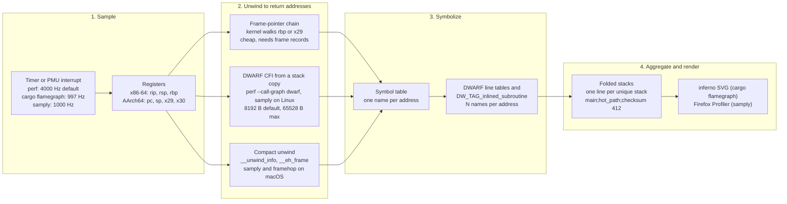

# Rust CPU Profiling: cargo-flamegraph, samply, and Frame Pointers

> [!summary] Claim:
> A CPU profile is three separate jobs: interrupt a thread and capture its registers, unwind the stack into return addresses, and symbolize each address into one or more named frames.
> Rust profiles break at the unwind step because rustc keeps frame pointers only where the target demands them (`may-omit` on x86_64 Linux, `non-leaf` on AArch64 Linux and Apple Silicon at 1.99.0), while the prebuilt std has carried frame pointers since 1.79.0 (all functions) and non-leaf ones since 1.89.0.
> They break at the symbolize step because a generic function inlined into its caller has no frame of its own, and only DWARF inline records bring it back; `debug = "line-tables-only"` supplies them without changing a byte of machine code.
> cargo-flamegraph drives an OS profiler (`perf record --call-graph dwarf,64000`, `xctrace` Time Profiler, or DTrace) and folds the output into an SVG with inferno; samply samples by itself (Mach thread suspension on macOS, `perf_event_open` with a 32,000-byte stack copy on Linux), unwinds with framehop, and serves symbols to the Firefox Profiler.



## The Mechanism

A sampling profiler stops a thread many times a second and asks one question: which chain of calls is running right now.
The registers answer only the innermost part, the program counter.
Everything above it has to be reconstructed from the stack, and that reconstruction (unwinding) and the later mapping of addresses to names (symbolization) are where an optimized Rust binary fights back.
Every version, default, and source line below was read at the cited tag; "1.99.0" means the stable toolchain current in 2026-11.

### 1. Frame records on x86-64 and AArch64

A frame record is a pair of words a function stores on entry so that the stack becomes a linked list.

- On x86-64 the classic prologue is `push %rbp; mov %rsp, %rbp`, so `[rbp]` holds the caller's `rbp` and `[rbp + 8]` holds the return address.
  The psABI makes `rbp` an ordinary callee-saved register, so a compiler that omits the frame pointer may use it for data.
- On AArch64 the AAPCS64 defines a frame record as two 64-bit values, the caller's frame pointer and the link register, stored as a pair with `x29` pointing at it: `stp x29, x30, [sp, #-16]!; mov x29, sp`.
- Apple's ARM64 ABI page, as quoted in rustc's `frame-pointer-cli-control.rs` test, says the frame pointer register "must always address a valid frame record" but that "leaf functions or tail calls - may opt not to create an entry in this list".

The lab disassembles one leaf and one non-leaf function from a release build on aarch64-apple-darwin.
The leaf `lab_leaf_mix` is six instructions with no frame record; the non-leaf `lab_nonleaf_mix` saves `x29, x30` because the `bl` it makes overwrites the link register.
With `-Cforce-frame-pointers=yes` the leaf grows to nine instructions: `stp x29, x30, [sp, #-0x10]!`, `mov x29, sp`, and a matching `ldp` before `ret`.

#### How the kernel walks the chain, and what it misses

`perf_callchain_user()` in `arch/x86/events/core.c` stores `regs->ip`, then sets `fp = regs->bp` and repeatedly reads `next_frame` and `return_address` from user memory until it reaches `max_stack` entries or a read faults.
`arch_stack_walk_user()` in `arch/arm64/kernel/stacktrace.c` does the same with `regs->pc` and `regs->regs[29]`.
Neither reads the link register or the word at the stack pointer, so the walk has three blind spots:

1. A sample inside a leaf that made no frame record loses the leaf's caller: the first record found belongs to the caller's caller.
   The x86 code has a comment for exactly this case at a uprobe on function entry: without reading `*regs->sp` first, "we'll skip immediate caller as %rbp is not yet setup".
2. A sample in a prologue or epilogue, before `rbp` or `x29` is set or after it is restored, loses the caller the same way.
3. A function built without frame pointers that uses `rbp` for data hands the walker an arbitrary number, so the stack is cut short at that function or continues through garbage; perf prints the bad entries as `[unknown]`.

The first two lose one frame; the third destroys everything above the function, and it is the one Rust users hit on x86_64 Linux.

### 2. What rustc emits: the `FramePointer` ratchet and per-target defaults

`compiler/rustc_target/src/spec/mod.rs` at 1.99.0 defines three policies:

```rust
pub enum FramePointer {
    Always = "always",     // every function keeps a frame record
    NonLeaf = "non-leaf",  // every function that calls another one
    MayOmit = "may-omit",  // the code generator decides; no guarantee either way
}
```

`FramePointer::ratchet()` combines two policies by taking the stronger one, and the target's policy is combined with the command line's.
The comment on the method says the transition is meant to be "one way".
`parse_frame_pointer()` in `rustc_session/src/options.rs` maps `y`, `yes`, `on`, `true`, or no value to `Always`, maps `n`, `no`, `off`, `false` to `MayOmit`, and also accepts the literal values `always` and `non-leaf`.
The resulting LLVM function attribute is `"frame-pointer"="all"` or `"frame-pointer"="non-leaf"`, as the `frame-pointer-cli-control.rs` codegen test checks.

Two consequences follow, and the lab shows both on aarch64-apple-darwin:

- `-Cforce-frame-pointers=no` cannot remove frame pointers that the target requires.
  The test file records that this "irreversible ratchet" was discussed in the T-compiler meeting on 2025-05-22 and accepted as intentional, and warns that it is "reverse polarity" relative to C compilers' `-fomit-frame-pointer`.
- The stability gate in `rustc_session/src/config.rs` fires only when the parsed value is `NonLeaf`, although its error text names both values.
  On stable 1.99.0 `-Cforce-frame-pointers=non-leaf` fails with "`-Cforce-frame-pointers=non-leaf` or `always` also requires `-Zunstable-options` and a nightly compiler", while `-Cforce-frame-pointers=always` is accepted, which is equivalent to `yes` (as of 2026-11, Both).

The default when no flag is given, read from the target specs at 1.99.0:

| Target | Policy at 1.99.0 | Source and history |
| :--- | :--- | :--- |
| `x86_64-unknown-linux-gnu` | `may-omit` | No override; the `TargetOptions` default is `FramePointer::MayOmit` |
| `aarch64-unknown-linux-gnu` and other `aarch64-*-linux-*` | `non-leaf` | PR 140832, in 1.89.0 (2025-08-07); the 1.88.0 target file has no override |
| `aarch64-apple-darwin` | `non-leaf` | Set in the target file at 1.88.0 and by architecture in `base/apple` since PR 141797 (1.89.0) |
| `x86_64-apple-darwin` | `always` | `base/apple` maps x86 Apple targets to `Always` |
| `aarch64-pc-windows-msvc` | `non-leaf` | ETW fast stack walking requires `x29` to point at the previous `{x29, x30}` pair |
| illumos targets | `always` | `base/illumos.rs` |

PR 140832 gives the reasoning for AArch64 Linux: the AAPCS64 leaves frame-pointer conformance to each platform, Apple and Windows mandate it, and in the absence of a Linux edict "Rust will assume aarch64-linux targets also use non-leaf frame pointers", matching what clang does.
x86_64 Linux, the most common server target, is the one that gives no guarantee.

### 3. The prebuilt standard library

Your crate is compiled with your flags, but `libstd`, `libcore`, and `liballoc` arrive prebuilt from rustup, so their frame policy is whatever the Rust release engineers chose.

- PR 122646 by Ben Kimock (merged 2024-03-18, shipped in 1.79.0 on 2024-06-13) added `-Cforce-frame-pointers=yes` to bootstrap's `std_cargo()`.
  Its argument: users are "much more likely to be profiling apps written in Rust than they are profiling the Rust compiler".
- PR 141800 (merged 2025-06-07) changed that to `-Zunstable-options -Cforce-frame-pointers=non-leaf`, because "leaf frame-pointers can impact LLVM inlining choices, and that can be a real problem for things like `mul_add`".
  The flag reads `yes` in `compile.rs` at tag 1.88.0 and `non-leaf` at tag 1.89.0, so 1.89.0 (2025-08-07) is the first release with non-leaf std.
- At 1.99.0 the setting lives in `library/Cargo.toml`, in the `[profile.dist]` that bootstrap uses for the prebuilt artifacts: `codegen-units = 1`, `debug = 1 # "limited"`, `-Cembed-bitcode=yes`, and `-Cforce-frame-pointers=non-leaf`.
- The compiler itself is not built this way: `bootstrap.example.toml` documents `rust.frame-pointers = false` as the default.

What this does and does not buy you:

- Non-generic std code (`std::rt::lang_start_internal`, formatting, I/O, the allocator shims) has frame records, so a frame-pointer walk that enters std keeps going.
- Generic std code (`Vec<T>`, iterator adapters, `HashMap<K, V>`, `sort`, closures passed to std) is instantiated in the crate that uses it and compiled with that crate's flags, so on x86_64 Linux it inherits your `may-omit`.
  The lab's walk passes through one such instantiation, `std::sys::backtrace::__rust_begin_short_backtrace::<fn(), ()>`, which is generic over the user's `main` and so can only be compiled in the user's crate.
- On x86_64 Linux a default release build therefore has a frame-pointer chain that is intact inside std and broken at every frame of yours that reused `rbp`; the fix is to build your own crates with `-Cforce-frame-pointers=yes` (section 9).
- Rebuilding std with your own flags needs the nightly-only `-Zbuild-std` (requires the `rust-src` component and a nightly Cargo and rustc); whether `RUSTFLAGS` then reach the rebuilt std was not tested here (UNVERIFIED: not run for this note).

### 4. Unwinding without frame pointers: DWARF CFI from a stack copy

`perf record -g` means `--call-graph fp` for user space: the kernel walks the chain at interrupt time and stores only addresses.
`--call-graph dwarf` changes the contract: the kernel copies raw user stack bytes and user registers into every sample (`PERF_SAMPLE_STACK_USER`, `PERF_SAMPLE_REGS_USER`), and `perf report` or `perf script` unwinds later using `.eh_frame` or `.debug_frame` through libunwind or libdw.
perf-record(1) gives the default copy size as 8192 bytes; `get_stack_size()` in `tools/perf/util/callchain.c` rounds the requested size up to a multiple of 8 and rejects anything above `round_down(USHRT_MAX, sizeof(u64))`, which is 65,528 bytes.

The cost is bytes per second per busy thread, before compression, and is plain arithmetic:

| Recorder | Rate | Stack copy | Raw stack bytes per busy thread |
| :--- | :--- | :--- | :--- |
| `perf record --call-graph dwarf` | 4000 Hz (`.freq = 4000` in `builtin-record.c`) | 8,192 B | 32.8 MB/s |
| `cargo flamegraph` on Linux | 997 Hz | 64,000 B | 63.8 MB/s |
| `samply record` on Linux | 1000 Hz | 32,000 B | 32.0 MB/s |
| `perf record -g` (frame pointers) | 4000 Hz | none; up to `kernel.perf_event_max_stack` addresses | 8 B per frame |

Any frame whose return address lies above the copied window is lost, so deep stacks, large stack arrays, and big `async` state machines held on the stack all truncate DWARF stacks from the root end.
DWARF unwinding also spends CPU offline for every sample, on top of symbolization.
Rust emits `.eh_frame` for its unwinder, so CFI exists for Rust code; whether it is forced is target-dependent per the `-Cforce-unwind-tables` documentation.

### 5. macOS: Mach sampling, compact unwind, and xctrace

macOS gives an unprivileged process no `perf_event_open`, so each tool takes a different road.

#### samply on macOS

`samply/src/mac/process_launcher.rs` at samply-v0.13.1 launches the child with `DYLD_INSERT_LIBRARIES` pointing at an embedded `libsamply_mac_preload.dylib` and a `SAMPLY_BOOTSTRAP_SERVER_NAME`, so the preloaded library can send the child's Mach task port back to samply.
For each sample, `mac/proc_maps.rs` calls `thread_suspend`, reads `pc`, `lr`, `sp`, and `fp` with `thread_get_state` (with a mask to strip pointer-authentication bits), reads stack memory with `mach_vm_read_overwrite`, unwinds, and calls `thread_resume`.
The sampler thread sleeps for the interval and corrects for oversleeping, at a default of 1000 Hz (`--rate`).
Because it suspends threads rather than waiting for a CPU interrupt, samply on macOS records both on-CPU and off-CPU samples; on Linux it records on-CPU samples only (README, as of 2026-11).

Unwinding is done by framehop, which parses Apple's compact unwind format in `__unwind_info`, DWARF CFI in `.eh_frame` and `.debug_frame`, and Windows PE unwind data, falls back to frame pointers when it finds no unwind data for an address, and analyses instructions on macOS to unwind correctly from inside a prologue or epilogue.
It recovers only the registers needed for return addresses (`rip`, `rsp`, `rbp` or `lr`, `sp`, `fp`) and caches unwind rules in a 509-slot cache.
Compact unwind has a frameless encoding for such functions (`UNWIND_ARM64_MODE_FRAMELESS` in `compact_unwind_encoding.h`), and DWARF CFI for a leaf says the return address is still in the link register, so a CFI-aware unwinder takes the leaf's return address from `lr`, which is exactly the frame the kernel walkers in section 1 drop.

The preload trick fails for executables signed to refuse `DYLD_INSERT_LIBRARIES`, so samply cannot profile system binaries such as `/bin/sleep` or the system `python3`; anything you build, `cargo install`, or Homebrew installs works.
Attaching to a running process (`-p`) needs `samply setup`, which self-signs the samply binary, rerun after every samply update.

#### cargo-flamegraph on macOS

Since 0.6.8 (2025-04-28), `src/lib.rs` on macOS runs `xctrace record --template "Time Profiler" --output cargo-flamegraph.trace --target-stdout - --launch -- <command>`, then `xctrace export --input cargo-flamegraph.trace --xpath '/trace-toc/*/data/table[@schema="time-profile"]'`, and folds the XML with inferno's `xctrace` collapser.
On this path it refuses `-F` other than 997 ("xctrace doesn't support custom frequency"), refuses `-c`, and rejects `--no-inline`, which is Linux-only.
Up to 0.6.7, and still on other non-Linux systems, it ran DTrace with `profile-997 /pid == $target/ { @[ustack(100)] = count(); }` and `-x ustackframes=100`, which needs root.
xctrace is the command-line front end to Instruments, resolved here through `xcrun` from `/Applications/Xcode.app` (`xcrun xctrace version` reports 27.2 on the recording Mac); [[macOS-Instruments-xctrace-and-DTrace]] owns the Time Profiler internals and its installation requirements.

### 6. Linux: samply's `perf_event_open` recorder

`samply/src/linux/profiler.rs` at samply-v0.13.1 sets `stack_size = 32000`, opens `PERF_COUNT_HW_CPU_CYCLES` and falls back to the software `PERF_COUNT_SW_CPU_CLOCK` when hardware counters are unavailable, as in most VMs and containers.
`perf_event.rs` requests `PERF_SAMPLE_IP | TID | TIME | CPU | PERIOD | REGS_USER | STACK_USER` and never `PERF_SAMPLE_CALLCHAIN`, so samply always unwinds in user space with framehop from the copied stack, and it works whether or not the binary has frame pointers, up to the 32,000-byte window.
It needs `kernel.perf_event_paranoid` at 1 or lower (the README suggests `echo '1' | sudo tee /proc/sys/kernel/perf_event_paranoid`) or `CAP_PERFMON`, and an `mlock` limit increase (`kernel.perf_event_mlock_kb`) if `mmap` fails with `EPERM`.
`samply import perf.data` loads a recording made by perf itself, which is the path when perf is already installed on a production host and samply is not.

### 7. Symbolization: line tables, inline scopes, and where the DWARF lives

#### Debug-info levels

`-Cdebuginfo` (Cargo `debug`) takes `none` (0), `line-directives-only`, `line-tables-only` (added in 1.70.0), `limited` (1), and `full` (2).
The rustc book describes `line-tables-only` as "the minimal amount of debug info for backtraces with filename/line number info", with no variable or parameter information.
Cargo's `release` profile defaults to `debug = false`, and since 1.77.0 Cargo also passes `-C strip=debuginfo` when no package in the build asks for debug info (cargo PR 13257, which measured a Linux x86-64 hello world shrinking from about 4.5 MiB to about 450 KiB; 1.77.1 reverted it for MSVC).
That implicit strip removes the DWARF that the prebuilt std (built with `debug = 1`) would otherwise contribute, so a default release binary has no line information at all, even for std frames.

The lab measures what each level gives a symbolizer, on the same optimized code:

- `release`: zero debug-map references and zero DWARF entries; `-C strip=debuginfo` is on the rustc command line.
- `profiling` (`inherits = "release"`, `debug = "line-tables-only"`): 17,297 `DW_TAG_inlined_subroutine` entries and 6,594 subprograms, but no `DW_TAG_variable` at all.
- `profiling-full` (`debug = "full"`): the same 17,297 inline entries, plus 608 variables and 85 more subprograms.
- All three have byte-identical `__text` (229,308 bytes on darwin-arm64), so debug info is free at run time; it costs only disk space and link time.

#### How an inline-aware symbolizer turns one address into several frames

For each function, DWARF has a `DW_TAG_subprogram` whose address range covers the machine code, and a tree of `DW_TAG_inlined_subroutine` children, each with its own address range, a `DW_AT_abstract_origin` pointing at the inlined function, and `DW_AT_call_file` and `DW_AT_call_line` naming the call site.
Given an address, the symbolizer collects every scope that contains it, innermost first, and emits one logical frame per scope; the line printed for each outer frame is the call site of the frame inside it.
In the lab, return address `hot_path + 107` becomes two frames: `checksum<rust_flamegraph::Fnv> (main.rs:49)`, the `capture_here()` call inside the inlined generic, and `rust_flamegraph::hot_path (main.rs:57)`, the line `checksum::<Fnv>(data) ^ checksum::<Rotl>(data)`.
Symbolizers look up `return address - 1` rather than the return address itself, because the return address is the instruction after the call and can belong to the next line or even the next inline scope; the lab program subtracts one before printing.

Inline frames are named from the DWARF `DW_AT_name` of the abstract origin, not from the linker symbol, so they read `checksum<rust_flamegraph::Fnv>` without a module path.
In this `line-tables-only` build the subprogram for `hot_path` carries only `DW_AT_name ("hot_path")`, which is why `std::backtrace` in the lab prints `hot_path` and `capture_here` while `atos` prints the demangled linker symbol `rust_flamegraph::hot_path`.

#### Where the DWARF lives

| Platform | Cargo default with debug on | Where the DWARF is | What a profiler on another machine needs |
| :--- | :--- | :--- | :--- |
| Linux | `split-debuginfo = "off"` | `.debug_*` sections inside the ELF | The unstripped ELF, or a `.debug` file found by build ID |
| macOS | `split-debuginfo = "unpacked"` (Cargo's choice; rustc's own default is `packed`) | The `.o` files under `target/` and inside the prebuilt `.rlib` archives, referenced by `N_OSO` debug-map entries in the executable | A `.dSYM` made by `dsymutil` before `target/` is cleaned |
| Windows MSVC | `packed` | `.pdb` | The `.pdb` |

The lab's `profiling` binary has five `N_OSO` references: one for the crate's codegen unit and four for archive members of the prebuilt `libstd`, `libpanic_unwind`, `liballoc`, and `libcore` rlibs.
The lab runs `dsymutil` and points `atos` at the dSYM, which is what makes std's own inline frames (`std::panicking::catch_unwind::<...>` and friends) appear.

### 8. Symbol names: v0 mangling

Since 1.97.0 (2026-07-09) stable rustc mangles symbols with the v0 scheme of RFC 2603 by default (PR 151994); v0 had been opt-in with `-Csymbol-mangling-version=v0` since 1.59.0, and the legacy scheme is now available only on nightly.
The release note warns that this "may cause some tools (such as debuggers or profilers, especially with old versions) to fail to demangle symbols emitted by Rust".

- A v0 symbol starts with `_R`; on Mach-O the platform underscore makes it `__R`, which the lab checks with `nm`.
- v0 encodes generic arguments reversibly, so a demangled name such as `std::sys::backtrace::__rust_begin_short_backtrace::<fn(), ()>` tells you which instantiation was hot.
  RFC 2603's motivation for replacing the legacy `_ZN...17h<hash>E` names is that with them "one cannot extract the type arguments of a monomorphized function from its symbol name".
- perf gained a v0 demangler, `tools/perf/util/demangle-rust-v0.c` ("perf demangle-rust: Add rustc-demangle C demangler", 2025-05-09); the file is absent at the Linux v6.15 tag and present at v6.16, so perf from Linux 6.16 or later is needed for readable names from a 1.97+ binary (as of 2026-11, Linux).
- On macOS the Xcode `c++filt` demangles v0 names, as the lab's last section shows; in the runs made for this note, `atos` from Xcode 27.2 printed v0 linker symbols undemangled, so the lab pipes `atos` through `c++filt` (as of 2026-11, macOS).

### 9. cargo-flamegraph end to end

cargo-flamegraph (v0.6.15, 2026-11-02, as of 2026-11) is two binaries, `cargo-flamegraph` and `flamegraph`, built on inferno's collapsers and SVG renderer.

1. Build: `cargo flamegraph` builds the selected target with the `release` profile by default; `--dev` or `--profile <name>` changes it, and `--bin`, `--example`, `--test`, `--bench`, `--unit-test`, and `--unit-bench` choose what to run.
   Tests and benches run under the `bench` profile, so the README asks for `[profile.bench] debug = true`.
2. Record on Linux: `perf record -F 997 --call-graph dwarf,64000 -g -o perf.data <command>` (the stack size was 16,384 up to 0.6.7); `-c "<perf args>"` replaces the whole argument string, and `PERF` overrides the binary.
3. Record on macOS: the xctrace path in section 5.
   Record on Windows: the built-in blondie backend, or DTrace for Windows when it is installed.
4. Fold: `perf script --force -i perf.data` (with `--no-inline` if requested) piped into inferno's `collapse::perf::Folder`, which writes one line per unique stack, `frame;frame;frame count`.
   `--skip-after <FUNCTION>` cuts frames below a function, and `--post-process <command>` filters the folded text before rendering.
5. Render: `inferno::flamegraph::from_reader` writes `flamegraph.svg`; `--flamechart` keeps time order instead of merging, `--reverse` and `--inverted` flip it, `--deterministic` fixes colours per function.

Two operational facts from the README matter for Rust specifically:

- `perf script` resolves inline frames by calling `addr2line`, which "can take a very long time" on large binaries (issues 74, 199, 294); the fixes are `--no-inline`, which drops inline frames, or `cargo install addr2line --features=bin` to put gimli's faster `addr2line` first on `PATH`.
- Since Rust 1.90.0 (2025-09-18) `x86_64-unknown-linux-gnu` links with lld by default, and the README says lld and mold need `-Clink-arg=-Wl,--no-rosegment` or "perf will not be able to generate accurate stack traces"; the cause is in perf's DWARF unwinder, not in frame pointers.
  Commit dc2cf4ca866f ("perf unwind: Fix segbase for ld.lld linked objects", Fangrui Song, merged 2022-06-03) says libunwind-based `--call-graph dwarf` unwinding computed the `.eh_frame_hdr` base as `map->start + segbase - map->pgoff`, which is wrong when `.eh_frame_hdr` and `.text` sit in different `PT_LOAD` headers whose `p_vaddr` difference differs from their `p_offset` difference.
  lld's default `--rosegment -z noseparate-code` layout (since lld 10) produces exactly that pair of R and RX segments, and `--no-rosegment` removes the R segment.
  The commit fixed `tools/perf/util/unwind-libunwind-local.c`, so a perf that predates it, or an unwinder path that still computes the base the old way, is what the flag works around; whether a given distribution's current perf still needs the flag was not tested here (UNVERIFIED: not run).

The 997 Hz default is one less than a round 1000; Brendan Gregg's perf page explains the same choice of 99 over 100 Hz as avoiding "sampling in lockstep with some periodic activity, which would produce skewed results".

### 10. samply end to end

```bash
# One-time: a profile that keeps release codegen and adds line tables (samply README recommends debug = true).
cat >> ~/.cargo/config.toml <<'EOF'
[profile.profiling]
inherits = "release"
debug = "line-tables-only"
EOF

cargo build --profile profiling
samply record ./target/profiling/myapp --my-arg          # opens profiler.firefox.com via a local server
samply record --save-only -o prof.json.gz -- ./target/profiling/myapp
samply load prof.json.gz                                 # serve symbols later, from the same machine
samply record -p 12345                                   # Linux; on macOS only after `samply setup`
samply import perf.data                                  # a recording made by perf on Linux
```

samply stores addresses, not names, in the profile; the local web server it starts answers the Firefox Profiler's symbol requests from the binaries and debug files on disk, which is how the UI gets inline frames and source lines.
That makes a saved profile only as good as the debug files still present when it is loaded, which is why `--save-only` followed by `cargo clean` loses symbols, and why `--unstable-presymbolicate` exists to write a `.syms.json` sidecar.
In the runs made for this note, samply 0.13.1 recorded the lab binary's `spin` mode on darwin-arm64 without `sudo` or `samply setup` (as of 2026-11, macOS).

### 11. Inlined generic frames and what to do about them

Monomorphization makes one copy of a generic function per set of type arguments, here `checksum::<Fnv>` and `checksum::<Rotl>`, and `#[inline(always)]` or LLVM's own inliner then merges each copy into its caller.
After inlining, the copy has no symbol, no frame record, and no return address; a frame-pointer or CFI unwinder sees only `hot_path`, and every sample inside the loop is self time of `hot_path`.
The lab shows this directly: the frame-pointer walk finds 8 return addresses, a symbol-table lookup names 8 frames, and the DWARF inline expansion of the same 8 addresses names 18.

The options, best first:

1. Keep the code and add `debug = "line-tables-only"`; use an inline-aware symbolizer (samply, `perf script` without `--no-inline`, `atos -i`, `addr2line -i`, `std::backtrace`).
   It changes nothing in the machine code, which the lab's `__text` hash check proves.
2. Put `#[inline(never)]` on a boundary you need to see, such as `hot_path` in the lab.
   This changes code generation (a call, a frame record, and lost cross-function optimization), so it is a measurement tool for a profiling build, never something to leave in a hot loop on faith; check the effect with [[Rust-Benchmarking-Criterion-Divan-Gungraun-and-dhat]].
3. Pass `--no-inline` to `cargo flamegraph` only when `perf script` is too slow, and read the result knowing that generic code is folded into its callers.

When one generic shows up as many rows, one per instantiation, the cost is split across them and none looks hot; [[Drill-Profiling-Rust-Monomorphization-and-Inlining-Regression]] works that failure through, and [[Rust-Compile-Time-and-Binary-Size-Profiling]] measures how many copies exist.

## Commands and Numbers to Know

| Item | Value | Platform and date | What it controls |
| :--- | :--- | :--- | :--- |
| `-Cforce-frame-pointers=yes` | Ratchets to `Always` | Both (as of 2026-11) | Every function keeps a frame record; cannot be weakened by a later flag |
| `-Cforce-frame-pointers=no` | `MayOmit`, ratcheted with the target | Both (as of 2026-11) | Does not remove frame pointers the target requires |
| `-Cforce-frame-pointers=non-leaf` | Nightly only, with `-Zunstable-options` | Both (as of 2026-11) | Rejected by stable 1.99.0 |
| `-Cforce-frame-pointers=always` | Accepted by stable 1.99.0 | Both (as of 2026-11) | Same as `yes`; the gate checks only `non-leaf` |
| Default on `x86_64-unknown-linux-gnu` | `may-omit` | Linux (as of 2026-11) | Your code may use `rbp` for data |
| Default on `aarch64-unknown-linux-gnu` | `non-leaf` since 1.89.0 | Linux (as of 2026-11) | Leaf functions have no frame record |
| Default on `aarch64-apple-darwin` | `non-leaf` | macOS (as of 2026-11) | Apple ABI requires valid `x29` chains |
| Prebuilt std | `yes` in 1.79.0 to 1.88.0, `non-leaf` since 1.89.0 | Both (as of 2026-11) | Frame records in non-generic std code |
| Cargo `release` debug | `debug = false`, implicit `-C strip=debuginfo` since 1.77.0 | Both except Windows MSVC (as of 2026-11) | No line or inline information, even for std |
| `debug = "line-tables-only"` | Since 1.70.0 | Both (as of 2026-11) | Lines and inline scopes, no variables, same machine code |
| Cargo `split-debuginfo` | `unpacked` on macOS, `off` on Linux | Both (as of 2026-11) | Where the DWARF lives |
| Default symbol mangling | v0 since 1.97.0 | Both (as of 2026-11) | `_R` symbols with generic arguments |
| perf v0 demangler | Linux 6.16 and later | Linux (as of 2026-11) | Readable names from 1.97+ binaries |
| `perf record` frequency | 4000 Hz | Linux (as of 2026-11) | Samples per second per CPU when `-F` is absent |
| `--call-graph dwarf` stack copy | 8,192 B default, 65,528 B max | Linux (as of 2026-11) | Bytes of user stack copied per sample |
| `cargo flamegraph` on Linux | `perf record -F 997 --call-graph dwarf,64000 -g` | Linux (as of 2026-11, v0.6.15) | Recording command when `-c` is absent |
| `cargo flamegraph` on macOS | `xctrace record --template "Time Profiler"` since 0.6.8 | macOS (as of 2026-11) | No custom `-F` or `-c` |
| `samply record --rate` | 1000 Hz | Both (as of 2026-11, v0.13.1) | Sampling interval |
| samply Linux stack copy | 32,000 B | Linux (as of 2026-11, v0.13.1) | Window for framehop's user-space unwinding |
| `kernel.perf_event_paranoid` | 1 or lower for samply | Linux (as of 2026-11) | Unprivileged `perf_event_open` |
| Rust linker on `x86_64-unknown-linux-gnu` | lld since 1.90.0 | Linux (as of 2026-11) | cargo-flamegraph README asks for `-Wl,--no-rosegment` |

## Multi-Language Comparison: C++ / Python / Rust

| Concern | C++ (GCC, Clang) | Python (CPython) | Rust (rustc 1.99.0) |
| :--- | :--- | :--- | :--- |
| Keep frame pointers | `-fno-omit-frame-pointer`, plus `-mno-omit-leaf-frame-pointer` for leaves | Interpreter is C; the perf how-to says CPython builds itself with `-fno-omit-frame-pointer` on supported GCC-compatible toolchains (`--without-frame-pointers` opts out) | `-Cforce-frame-pointers=yes`; per-target default otherwise |
| Weakening flag | `-fomit-frame-pointer` really removes them | Not applicable | `=no` cannot remove what the target requires |
| Runtime library | glibc and the rest of the distro: frame pointers by default in Fedora 38 and Ubuntu 24.04 | `libpython` as above | Prebuilt std: non-leaf frame pointers since 1.89.0 |
| Generic or template code | Instantiated in the user's translation unit with the user's flags | Not applicable | Instantiated in the user's crate with the user's flags |
| Inline frames | DWARF from `-g` or `-gline-tables-only` (Clang) | Python frames need the perf trampoline (`-X perf`, since 3.12) or `-X perf_jit` | DWARF from `debug = "line-tables-only"` or higher |
| Symbol names | Itanium `_Z` | Python function names come only from the trampoline; [[Python-CPython-perf-Trampoline-and-Tachyon-Internals]] owns the format | v0 `_R` since 1.97.0 |
| Usual profilers | perf, samply, Instruments ([[Cpp-CPU-Profiling-perf-samply-Callgrind-and-llvm-mca]]) | py-spy, Tachyon, perf with trampolines ([[Python-CPython-perf-Trampoline-and-Tachyon-Internals]]) | cargo flamegraph, samply, perf |

## Worked Lab Example

The lab is `code/05-Profiling/rust_flamegraph/`; it needs macOS on Apple Silicon, `cargo`, and the Xcode command-line tools (`atos`, `dsymutil`, `dwarfdump`, `objdump`, `otool`, `c++filt`), and declares `# requires: macos`.
`run.sh` copies `Cargo.toml` and `src/` into a temporary directory, so no `Cargo.lock` or `target/` is left in the lab, and unsets every `RUSTFLAGS` variable so a reader's environment cannot change the codegen.

`src/main.rs` has a trait `Mix` with two implementations and a generic `checksum<M: Mix>` marked `#[inline(always)]`, called as `checksum::<Fnv>` and `checksum::<Rotl>` from `#[inline(never)] fn hot_path`.
On its first call `checksum::<Fnv>` calls `capture_here()`, which does three things:

1. Reads `x29` with inline assembly and walks the frame records, pushing each saved return address, stopping at a null frame pointer, a zero return address, or a record that does not move up the stack; this is the whole algorithm of a frame-pointer unwinder, minus reading another process's memory.
2. Prints the executable's load address (the address of `_mh_execute_header`) and each return address minus one, for `run.sh` to symbolize; none of these addresses reach the expected output.
3. Prints `std::backtrace::Backtrace::force_capture()`, which unwinds with the system unwinder and names frames with gimli.

`run.sh` then:

1. Prints the codegen flags Cargo passes for the `release`, `profiling`, and `profiling-full` profiles, taken from `cargo build -v`.
2. Builds all three and compares their `__text` sections by hashing `otool -t`.
3. Builds a dSYM for each with `dsymutil` and counts debug-map entries, inline entries, variables, and subprograms with `dwarfdump`.
4. Runs the walk in `release` and in `profiling`, symbolizing the same return addresses with `atos` (one name each) and `atos -i` (inline scopes expanded).
5. Rebuilds `release` with no flag, `-Cforce-frame-pointers=yes`, and `-Cforce-frame-pointers=no`, and disassembles the two `#[no_mangle]` functions with `objdump`.
6. Asks stable rustc to accept `non-leaf` and `always`.
7. Checks that `hot_path` has a v0 symbol and demangles it.

Each check can fail: if debug info changed codegen, the hashes would differ; if `=no` could weaken the target, the non-leaf column would read `no`; if inline records were missing, `atos -i` would print 8 frames, as it does for `release`.

```bash
cd code/05-Profiling/rust_flamegraph
bash run.sh
```

### Verified output

Recorded with `python3 -m _harness.verify --record 05-Profiling/rust_flamegraph/` on darwin-arm64 (macOS 27.3, rustc 1.99.0, Xcode 27.2) on 2026-11-12, and re-checked with `python3 -m _harness.verify` (PASS); the file is `code/05-Profiling/rust_flamegraph/expected/darwin-arm64.txt`.

```text
== 1. What cargo passes to rustc for this crate
host: aarch64-apple-darwin
release:        -C opt-level=3 -C strip=debuginfo
profiling:      -C opt-level=3 -C debuginfo=line-tables-only -C split-debuginfo=unpacked
profiling-full: -C opt-level=3 -C debuginfo=2 -C split-debuginfo=unpacked

== 2. Debug info does not change the machine code
release         __text bytes: 229308
profiling       __text bytes: 229308
profiling-full  __text bytes: 229308
__text identical across release, profiling, profiling-full: yes

== 3. Debug info that reaches a symbolizer
profile           OSO-refs inlined-DIEs  variables   subprogs
release                  0            0          0          0
profiling                5        17297          0       6594
profiling-full           5        17297        608       6679

== 4. release (no debug info): the walk and its names
physical frames walked through x29: 8
-- atos, one name per return address:
   rust_flamegraph::capture_here + 39
   rust_flamegraph::hot_path + 107
   rust_flamegraph::main + 983
   std::sys::backtrace::__rust_begin_short_backtrace::<fn(), ()> + 11
   std::rt::lang_start::<()>::{closure#0} + 15
   std::rt::lang_start_internal + 935
   main + 51
   ?? (outside the executable: dyld start)
-- atos -i, inline frames expanded from DWARF:
   rust_flamegraph::capture_here + 39
   rust_flamegraph::hot_path + 107
   rust_flamegraph::main + 983
   std::sys::backtrace::__rust_begin_short_backtrace::<fn(), ()> + 11
   std::rt::lang_start::<()>::{closure#0} + 15
   std::rt::lang_start_internal + 935
   main + 51
   ?? (outside the executable: dyld start)
-- std::backtrace (libunwind for the walk, gimli for names):
   <std::backtrace::Backtrace>::create
   rust_flamegraph::capture_here
   rust_flamegraph::hot_path
   rust_flamegraph::main
   std::sys::backtrace::__rust_begin_short_backtrace::<fn(), ()>
   std::rt::lang_start::<()>::{closure#0}
   std::rt::lang_start_internal
   _main
   SUM 9991348379508672728
   MIX 260941653835776

== 5. profiling (line-tables-only): the same walk with inline scopes
physical frames walked through x29: 8
-- atos, one name per return address:
   rust_flamegraph::capture_here (main.rs:114)
   rust_flamegraph::hot_path (main.rs:57)
   rust_flamegraph::main (main.rs:148)
   std::sys::backtrace::__rust_begin_short_backtrace::<fn(), ()> (backtrace.rs:166)
   std::rt::lang_start::<()>::{closure#0} (rt.rs:206)
   std::rt::lang_start_internal (rt.rs:171)
   main + 51
   ?? (outside the executable: dyld start)
-- atos -i, inline frames expanded from DWARF:
   rust_flamegraph::capture_here (main.rs:114)
   checksum<rust_flamegraph::Fnv> (main.rs:49)
   rust_flamegraph::hot_path (main.rs:57)
   rust_flamegraph::main (main.rs:148)
   call_once<fn(), ()> (function.rs:250)
   std::sys::backtrace::__rust_begin_short_backtrace::<fn(), ()> (backtrace.rs:166)
   std::rt::lang_start::<()>::{closure#0} (rt.rs:206)
   <&dyn core::ops::function::Fn<(), Output = i32> + core::panic::unwind_safe::RefUnwindSafe + core::marker::Sync as core::ops::function::FnOnce<()>>::call_once (function.rs:287)
   std::panicking::catch_unwind::do_call::<&dyn core::ops::function::Fn<(), Output = i32> + core::panic::unwind_safe::RefUnwindSafe + core::marker::Sync, i32> (panicking.rs:576)
   std::panicking::catch_unwind::<i32, &dyn core::ops::function::Fn<(), Output = i32> + core::panic::unwind_safe::RefUnwindSafe + core::marker::Sync> (panicking.rs:544)
   std::panic::catch_unwind::<&dyn core::ops::function::Fn<(), Output = i32> + core::panic::unwind_safe::RefUnwindSafe + core::marker::Sync, i32> (panic.rs:359)
   std::rt::lang_start_internal::{closure#0} (rt.rs:175)
   std::panicking::catch_unwind::do_call::<std::rt::lang_start_internal::{closure#0}, isize> (panicking.rs:576)
   std::panicking::catch_unwind::<isize, std::rt::lang_start_internal::{closure#0}> (panicking.rs:544)
   std::panic::catch_unwind::<std::rt::lang_start_internal::{closure#0}, isize> (panic.rs:359)
   std::rt::lang_start_internal (rt.rs:171)
   main + 51
   ?? (outside the executable: dyld start)
-- std::backtrace (libunwind for the walk, gimli for names):
   std::backtrace_rs::backtrace::libunwind::trace
   std::backtrace_rs::backtrace::trace_unsynchronized::<<std::backtrace::Backtrace>::create::{closure#0}>
   <std::backtrace::Backtrace>::create
   capture_here
   checksum<rust_flamegraph::Fnv>
   hot_path
   main
   call_once<fn(), ()>
   __rust_begin_short_backtrace<fn(), ()>
   {closure#0}<()>
   <&dyn core::ops::function::Fn<(), Output = i32> + core::panic::unwind_safe::RefUnwindSafe + core::marker::Sync as core::ops::function::FnOnce<()>>::call_once
   std::panicking::catch_unwind::do_call::<&dyn core::ops::function::Fn<(), Output = i32> + core::panic::unwind_safe::RefUnwindSafe + core::marker::Sync, i32>
   std::panicking::catch_unwind::<i32, &dyn core::ops::function::Fn<(), Output = i32> + core::panic::unwind_safe::RefUnwindSafe + core::marker::Sync>
   std::panic::catch_unwind::<&dyn core::ops::function::Fn<(), Output = i32> + core::panic::unwind_safe::RefUnwindSafe + core::marker::Sync, i32>
   std::rt::lang_start_internal::{closure#0}
   std::panicking::catch_unwind::do_call::<std::rt::lang_start_internal::{closure#0}, isize>
   std::panicking::catch_unwind::<isize, std::rt::lang_start_internal::{closure#0}>
   std::panic::catch_unwind::<std::rt::lang_start_internal::{closure#0}, isize>
   std::rt::lang_start_internal
   _main
   SUM 9991348379508672728
   MIX 260941653835776

== 6. Frame-pointer flags on aarch64-apple-darwin (release profile)
rustflags                      leaf saves   non-leaf saves  leaf instructions
(none: target says non-leaf)   no           yes             6
-Cforce-frame-pointers=yes     yes          yes             9
-Cforce-frame-pointers=no      no           yes             6
stable rustc accepts -Cforce-frame-pointers=non-leaf: no (error: `-Cforce-frame-pointers=non-leaf` or `always` also requires `-Zunstable-options` and a nightly compiler)
stable rustc accepts -Cforce-frame-pointers=always: yes

== 7. Symbol mangling
hot_path is mangled with v0 (Mach-O symbol starts with __R): yes
c++filt on the symbol: rust_flamegraph::hot_path
rustc is 1.97 or later, where v0 is the stable default: yes
```

### Reading the result

- Section 1 is the profile story in three lines: `release` is optimized and stripped, `profiling` is the same optimization plus line tables, and on macOS Cargo also asks for `split-debuginfo=unpacked`.
- Section 2 proves the central promise of the profiling profile: 229,308 bytes of `__text` with the same hash in all three builds, so profiling the `profiling` binary is profiling the `release` code.
- Section 3 shows that `line-tables-only` already carries every inline scope (17,297 entries, the same as `full`) and no variables; `full` adds 608 variables that a profiler never reads.
- Sections 4 and 5 walk the same 8 frame records; in `release` both `atos` modes print the same 8 names with byte offsets, while in `profiling` the inline expansion turns them into 18 frames with source lines, including `checksum<rust_flamegraph::Fnv>` at `main.rs:49` and eight inlined frames of std's `lang_start_internal` (`catch_unwind` helpers and closures).
- `std::backtrace` agrees: 8 names in `release` (its own `Backtrace::create` plus the program's frames) and 20 in `profiling`, with short `DW_AT_name` names such as `capture_here` where the line tables carry no linkage name.
- Section 6 shows the ratchet: the target's `non-leaf` policy gives the leaf 6 instructions and no frame record, `yes` adds 3 instructions to every leaf, and `no` changes nothing.
- The last line of section 6 records the stable gate quirk: `always` is accepted although the error for `non-leaf` says it needs nightly too.

## Pitfalls

> [!warning] Pitfall: `perf record -g` on an x86_64 Linux release build
> `-g` means frame-pointer unwinding, and `x86_64-unknown-linux-gnu` is `may-omit`, so the chain breaks at the first frame of yours that used `rbp` for data, while std frames look fine because std has frame records.
> The flame graph shows plausible std towers under `[unknown]` or under the wrong parent; use `--call-graph dwarf`, samply, or rebuild your crates with `-Cforce-frame-pointers=yes`.

> [!warning] Pitfall: expecting std's frame pointers to cover generic std code
> `Vec::push`, iterator adapters, `HashMap` lookups, and closures given to std are compiled into your crate with your flags.
> On a `may-omit` target they lose frame records exactly like your own code.

> [!warning] Pitfall: profiling a release binary with no debug info
> Since 1.77.0 a default release build is built with `-C strip=debuginfo`, which removes std's line tables too.
> Every inlined generic, iterator closure, and std helper disappears into its caller; add a `profiling` profile with `debug = "line-tables-only"` instead of switching to a debug build, which profiles different code.

> [!warning] Pitfall: `cargo clean` or a moved `target/` on macOS
> With Cargo's `split-debuginfo = "unpacked"`, the DWARF stays in `.o` files under `target/` and in the toolchain's rlibs, referenced by absolute `N_OSO` paths.
> Clean, move, or ship the binary and the symbolizer finds nothing; run `dsymutil` and keep the `.dSYM` with any profile you save.

> [!warning] Pitfall: trusting `-Cforce-frame-pointers=no` to remove frame pointers
> The policy only ratchets upward; on aarch64-apple-darwin, `-Cforce-frame-pointers=no` leaves the non-leaf frame records in place, as the lab shows.
> It is not a C-style `-fomit-frame-pointer`, and benchmarks that assume it is measure nothing.

> [!warning] Pitfall: reading a leaf function's parent from a frame-pointer profile
> Both the x86 and arm64 kernel walkers start from the frame pointer and ignore the return address in `lr` or at `[sp]`, so a sample in a leaf with no frame record is attributed to the caller's caller.
> A hot leaf appears to be called from a function that never calls it; check with samply or a DWARF recording before acting on it.

> [!warning] Pitfall: truncated DWARF stacks
> `--call-graph dwarf` copies 8,192 bytes per sample by default, and nothing above that window can be unwound.
> Deep recursion, large stack arrays, and futures held on the stack cut stacks off at the root end; raise the size (65,528 bytes at most) or use frame pointers.

> [!warning] Pitfall: an old perf after a toolchain upgrade
> From 1.97.0 symbols are v0, and perf older than Linux 6.16 has no v0 demangler, so names arrive as `_RNv...` strings and inferno folds them as such.
> Upgrade perf, or demangle the folded file with `rustfilt` through `--post-process`.

> [!warning] Pitfall: `#[inline(never)]` added to see a frame and then left in
> Forcing a frame changes register allocation, blocks constant propagation into the callee, and adds a call per iteration.
> Keep such attributes behind a feature or `cfg_attr` used only for profiling builds, and benchmark the difference.

## At Scale

A single developer needs one habit: a `profiling` profile with line tables, and samply on macOS or Linux.
The problems at scale are consistency, symbols, and cost.

- With a few dozen engineers, the profile definition belongs in the workspace `Cargo.toml` or a checked-in `.cargo/config.toml`, so every profile anyone shares was built the same way.
- Frame pointers cannot be set per profile on stable: `rustflags` inside a profile is the unstable `profile-rustflags` feature, so a fleet setting goes in `.cargo/config.toml` as `[target.x86_64-unknown-linux-gnu] rustflags = ["-Cforce-frame-pointers=yes"]` or in the build system's equivalent.
- At 1,000 to 50,000 engineers the deciding constraint is the always-on fleet profiler ([[Continuous-Profiling-GWP-Parca-Pyroscope-and-OTel-Profiles]]): kernel frame-pointer walks are nearly free per sample, while DWARF unwinding needs either a large per-sample stack copy or an unwinder in eBPF with per-binary tables.
- The published cost of frame pointers is small but not zero: Fedora's measurements for its Fedora 38 change ranged from no significant effect (openssl, botan, zstd, Redis) through 2 to 2.4 percent (Blender, a GCC kernel build) to 1 to 10 percent on CPython benchmarks, and Brendan Gregg reports Netflix production overhead "usually less than 1%, with one exception of 10%".
- Rust's own release engineers chose non-leaf frame pointers for std after finding leaf frame records harmed inlining decisions, which is a reasonable default for application code too where nightly is acceptable; on stable the choice is `yes` or the target default.
- Symbols are a pipeline, not a flag: build with `line-tables-only`, keep the unstripped artifact or the split debug file keyed by build ID, ship the stripped binary, and make sure every symbolizer in the pipeline understands v0 names.

Decision rules:

- On a laptop, investigating one program: samply with the `profiling` profile; cargo flamegraph when you want an SVG to attach to a review.
- On a Linux server without samply: `perf record --call-graph dwarf` (or `-g` on a frame-pointer build), then `samply import perf.data` or `flamegraph --perfdata perf.data`.
- For an always-on fleet profiler on x86_64 Linux: build Rust services with `-Cforce-frame-pointers=yes` unless a benchmark of that service shows a cost the team will not pay, and record the decision in [[Profiling-Decision-Records]].
- For a latency-critical inner loop where a frame record measurably costs: keep that crate on the target default, document the exception, and profile it with DWARF or samply.
- Never ship profiles built from `debug` builds or without line tables to anyone making optimization decisions.

## Practice Drill

> [!tip] Practice Drill:
> Run the lab, then predict before each change and rerun to check.
> First, add `#[inline(never)]` to `checksum` and predict the physical frame count of the walk and whether `__text` stays identical across profiles (it should, since all three profiles get the same change).
> Second, remove `#[inline(always)]` from both `step` methods and predict whether `atos -i` still shows them; LLVM decides now, so read the disassembly of `hot_path` to explain the answer.
> Third, on a Linux x86_64 host, build the lab with and without `RUSTFLAGS=-Cforce-frame-pointers=yes`, record `perf record -g ./rust_flamegraph spin 200000` for each, and compare how many samples in `perf script` reach `main`.
> Fourth, record the same binary with `perf record --call-graph dwarf,1024` and explain why stacks now stop short of `main`.
> As a stretch, extend `walk_frame_pointers` to run inside a `SIGPROF` handler, taking `pc`, `fp`, and `lr` from the signal context, and reproduce the lost-caller effect for a sample landing in `lab_leaf_mix`; [[Rebuild-Lab-Sampling-Profiler-to-Folded-Stacks]] builds the full profiler.

## Interview Questions

> [!question] L5: A release flame graph shows almost all time as self time in one large function that you know calls several generic helpers; what happened, and how do you see the helpers without slowing the program down?
>
> > [!success]- Answer
> > The helpers were monomorphized and inlined into their caller, so in the machine code they have no symbol, no frame record, and no return address; every unwinder sees only the caller.
> > The default release profile also has no debug info, and since 1.77.0 Cargo strips std's debug info as well, so the symbolizer has nothing to expand.
> > Build with a profile that inherits `release` and sets `debug = "line-tables-only"`, and use an inline-aware symbolizer such as samply or `perf script` without `--no-inline`.
> > The machine code is unchanged, which can be checked by comparing the `__text` section, so the profile describes the release code.

> [!question] L5: What do `debug = "line-tables-only"` and `debug = "full"` give a CPU profiler, and what do they cost at run time?
>
> > [!success]- Answer
> > `line-tables-only` gives file and line information and the inline scope tree (`DW_TAG_inlined_subroutine` with call sites), which is everything a CPU profiler uses.
> > `full` adds variables, parameters, and types, which debuggers need and profilers ignore; in the lab both levels carry the same 17,297 inline entries, and only `full` has variables (608).
> > Neither changes the generated machine code, so the run-time cost is zero; the costs are disk space, link time, and on macOS the need to keep `.o` files or a `.dSYM`.

> [!question] L5: Predict the output: on aarch64-apple-darwin with rustc 1.99.0 you build a leaf and a non-leaf function with `-Cforce-frame-pointers=no`; which of them saves `x29, x30`?
>
> > [!success]- Answer
> > Only the non-leaf function, exactly as with no flag at all.
> > The target policy is `non-leaf`, and rustc combines the command line with the target by taking the stronger policy, so `=no` (which parses to `MayOmit`) cannot weaken it.
> > The leaf has no frame record in both builds; the lab's table shows 6 leaf instructions for both, against 9 with `=yes`.

> [!question] L6: Explain why a hot leaf function in a frame-pointer profile can appear to be called by its caller's caller, and why samply on macOS does not show this artifact.
>
> > [!success]- Answer
> > The kernel walkers record the interrupted program counter and then follow the frame-pointer register: `regs->bp` on x86 in `perf_callchain_user()` and `x29` on arm64 in `arch_stack_walk_user()`.
> > A leaf compiled without a frame record never updated the frame pointer, so it still points at the caller's record, whose saved return address is in the caller's caller; the caller itself is skipped, and the x86 source has a comment describing the same skip at function entry.
> > samply suspends the thread, reads `pc`, `lr`, `sp`, and `fp`, and unwinds with framehop, which reads Apple's compact unwind info, knows the leaf is frameless, and takes the return address from `lr`.
> > The same is true of any CFI-based unwinder, such as `perf --call-graph dwarf`.

> [!question] L6: Compare `perf record -g` and `perf record --call-graph dwarf` for a Rust service on x86_64 Linux, with numbers.
>
> > [!success]- Answer
> > `-g` uses frame pointers: the kernel stores up to `kernel.perf_event_max_stack` addresses, about 8 bytes per frame, and perf needs no work afterwards, but it is only correct if every frame on the stack has a frame record, and `x86_64-unknown-linux-gnu` is `may-omit` for your crates.
> > `dwarf` copies user registers and 8,192 bytes of stack per sample by default (65,528 bytes at most), and unwinds offline from `.eh_frame`; it works without frame pointers but truncates anything above the window.
> > At perf's default 4000 Hz that is 32.8 MB/s of raw stack per busy thread, and cargo flamegraph's 997 Hz with 64,000 bytes is 63.8 MB/s, before perf's optional compression.
> > For a quick local profile dwarf is fine; for anything long-running or fleet-wide, build with `-Cforce-frame-pointers=yes` and use `-g`.

> [!question] L6: Debug this: after upgrading a service from Rust 1.96 to 1.98, and changing nothing else, the team's perf-based flame graphs show names such as `_RNvCs...8hot_path` instead of `service::hot_path`; what happened?
>
> > [!success]- Answer
> > Rust 1.97.0 made v0 the default symbol mangling, so symbols changed from legacy `_ZN...17h<hash>E` names to `_R` names, and the release notes warn that older profilers may fail to demangle them.
> > perf demangles v0 only from Linux 6.16, where `tools/perf/util/demangle-rust-v0.c` was added; the build hosts run an older perf.
> > Upgrade perf, or demangle the folded stacks with `rustfilt` in cargo flamegraph's `--post-process`; going back to legacy mangling needs nightly, so it is not an option on stable.
> > The upgrade is also a gain: v0 names carry generic arguments, so instantiations of one generic become distinguishable.

> [!question] L7: If the standard library has been built with frame pointers since 1.79.0, why can a default release Rust binary still produce broken frame-pointer stacks on x86_64 Linux, and why did std move from all functions to non-leaf in 1.89.0?
>
> > [!success]- Answer
> > The prebuilt std carries frame records in the code compiled into it, but the user's crates are compiled with the target default, which on `x86_64-unknown-linux-gnu` is `may-omit`, so any user function may use `rbp` for data and break the chain.
> > Generic std code, which is most of what a Rust program calls in hot loops, is instantiated in the user's crate and follows the user's flags, not std's.
> > PR 141800 moved std to `non-leaf` because leaf frame records affected LLVM inlining decisions, with `mul_add` as the example; leaves lose at most one frame in a frame-pointer walk, while making their prologues larger cost real code quality.
> > The fix for application code is `-Cforce-frame-pointers=yes` for the workspace, or `-Zbuild-std` plus nightly when std itself must follow a different policy.

> [!question] L7: How does an inline-aware symbolizer turn the single return address `hot_path + 107` into two frames, and why does it look up the address minus one?
>
> > [!success]- Answer
> > DWARF describes `hot_path` with a `DW_TAG_subprogram` covering its address range, and inside it a `DW_TAG_inlined_subroutine` for `checksum<Fnv>` with its own range, an abstract origin, and the call site's file and line.
> > The symbolizer finds every scope containing the address, innermost first, and emits one frame per scope; the outer frame's line is the call site recorded on the inner scope, which is why `hot_path` is reported at the line that calls `checksum::<Fnv>`.
> > A return address is the instruction after the call, which can belong to the next line or a different inline scope, so symbolizers subtract one to land inside the call instruction.

> [!question] L8+: You must set the frame-pointer policy for every Rust service in a 20,000-engineer company that is rolling out continuous profiling; what do you decide, and what evidence do you ask for?
>
> > [!success]- Answer
> > Default to `-Cforce-frame-pointers=yes` for all Rust services on x86_64 Linux, set in a checked-in `.cargo/config.toml` or the build system rather than per developer, because the fleet profiler can then use cheap kernel frame-pointer walks and every stack is complete.
> > The evidence for the cost is public: Fedora measured roughly 0 to 2.4 percent on most workloads and up to 10 percent on some CPython benchmarks, and Gregg reports under 1 percent at Netflix with one 10 percent outlier; ask each latency-critical team to run its own benchmark, and grant documented exceptions where the cost is real.
> > AArch64 Linux and Apple targets already keep non-leaf frame pointers, and the prebuilt std keeps non-leaf ones, so the change mainly touches x86_64 Linux user crates.
> > Pair the policy with a symbol pipeline (line tables in every release build, debug files keyed by build ID, v0-aware demanglers) and a CI check that disassembles a known function to prove the flag is applied, as the lab does; record the decision in a profiling decision record.

> [!question] L8+: Choose between cargo flamegraph and samply as the paved road for Rust profiling across macOS laptops and Linux servers.
>
> > [!success]- Answer
> > samply is the better default: one tool on both platforms, unprivileged on macOS for programs it launches, an unwinder that does not need frame pointers (framehop over compact unwind or DWARF CFI from a 32,000-byte stack copy), inline frames from debug info, and an interactive UI with source and timelines.
> > cargo flamegraph is the better artifact generator: it wraps the platform profiler, produces a self-contained SVG for reviews, integrates with Cargo targets including tests and benches, and can process an existing `perf.data`.
> > Its weaknesses are platform-specific: on Linux it depends on perf's DWARF unwinding (64,000-byte copies, slow `addr2line`), and on macOS it depends on xctrace from a full Xcode with no custom frequency.
> > Standardize the `profiling` Cargo profile and frame-pointer policy first, because both tools are only as good as the binary they sample.

## Further Reading

- rustc book, Codegen Options (1.99): the authoritative list of `force-frame-pointers`, `debuginfo`, `strip`, and `split-debuginfo` values and defaults.
- `frame-pointer-cli-control.rs` in rust-lang/rust: the test that pins the ratchet behaviour and links every platform that relies on frame pointers.
- Rust PRs 122646 and 141800: why std got frame pointers in 1.79.0 and why it switched to non-leaf in 1.89.0.
- Cargo book, Profiles: `inherits`, `debug`, `strip`, and `split-debuginfo`, the knobs every profiling profile is made of.
- flamegraph-rs/flamegraph `src/lib.rs`: the exact perf, xctrace, and DTrace commands behind `cargo flamegraph`.
- samply README and framehop README: how samply records on each OS and which unwind formats framehop reads.
- perf-record(1) and `tools/perf/util/callchain.c`: the `--call-graph` modes and the stack-copy limits.
- `arch/x86/events/core.c` and `arch/arm64/kernel/stacktrace.c`: the kernel's frame-pointer walkers and the frames they cannot see.
- RFC 2603: the v0 mangling grammar and why legacy names lost generic arguments.
- Brendan Gregg, "The Return of the Frame Pointers" (2024): the history of frame-pointer omission and the overhead evidence behind distributions re-enabling them.

## Related

- Prerequisites: none
- Next: [[Rust-Benchmarking-Criterion-Divan-Gungraun-and-dhat]]
- See also: [[Linux-perf-in-Depth-and-perf-c2c]], [[macOS-Instruments-xctrace-and-DTrace]], [[Drill-Profiling-Rust-Monomorphization-and-Inlining-Regression]], [[Rust-Compile-Time-and-Binary-Size-Profiling]], [[Continuous-Profiling-GWP-Parca-Pyroscope-and-OTel-Profiles]], [[Profiling-Decision-Records]], [[Rebuild-Lab-Sampling-Profiler-to-Folded-Stacks]], [[Cpp-CPU-Profiling-perf-samply-Callgrind-and-llvm-mca]]
- Lab: `code/05-Profiling/rust_flamegraph/` (requires: macos)
