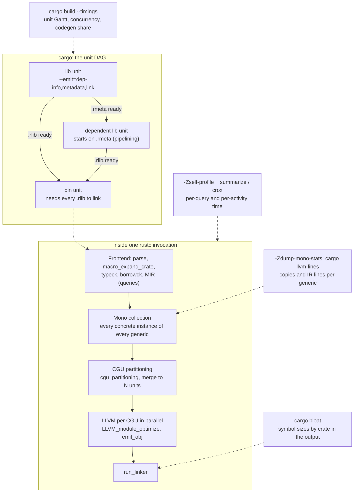

# Rust Compile-Time and Binary Size Profiling

> [!summary] Claim:
> A Rust build is a DAG of rustc invocations ("units"), and each invocation is a query-driven frontend followed by monomorphization, partitioning into codegen units, LLVM optimization per unit, and a link.
> `cargo build --timings` measures the DAG (which unit is on the critical path and whether Cargo had parallelism to spend), `-Zself-profile` measures inside one rustc (which query or LLVM activity ate the time), and `-Zdump-mono-stats` or `cargo llvm-lines` measures the input that drives backend time: how many monomorphized copies of each generic function reached codegen.
> `cargo bloat` reads the final symbol table and charges each function's bytes to a crate by a heuristic, so it answers "what is in the binary" but not "who caused it".
> Generic code is compiled where it is used, not where it is defined, so the crate that pays in build time and the crate that is blamed in a size report are often different crates, and since Rust 1.97 made v0 symbol mangling the default, name-based tools see every instantiation as a separate function.



## The Mechanism

Two questions get confused in Rust build work: "why is the build slow" and "why is the binary big".
They share a root cause, monomorphization, but they are measured at different layers, and a tool that answers one is often wrong about the other.
This note works from the outermost layer (the Cargo DAG) inward (one rustc, then its codegen input), and ends at the output file.
Every fact below was checked against the source or documentation listed in `sources`, or observed locally with stable rustc 1.99.0 and nightly rustc 1.101.0 (2026-10-24) on darwin-arm64, as of 2026-11.

### 1. The unit DAG and pipelining

Cargo turns the dependency graph into units, where a unit is one compiler invocation: a crate built for one target, profile, and feature set, or one build script compile or run.
Cargo runs units in parallel up to `-j`, and a unit can start only when its inputs exist.

The key optimization is pipelining.
`cargo build -v` on Rust 1.99 shows that a library unit is compiled with `--emit=dep-info,metadata,link`, so rustc writes the crate metadata (`.rmeta`) as soon as the frontend has finished, before codegen runs.
A dependent library is compiled with `--extern dep=.../libdep-<hash>.rmeta`, so it can start type checking against that metadata while the upstream crate is still in LLVM.
A binary unit is compiled with `--extern dep=.../libdep-<hash>.rlib`, because linking needs the object code, so every binary waits for the full codegen of everything below it.
Both `--extern` forms were observed locally with a two-crate workspace on stable 1.99.0 (as of 2026-11, macOS).

Consequences that the timings report makes visible:

- A crate whose frontend is slow blocks every dependent for the whole frontend time, while a crate whose codegen is slow blocks only units that must link its object code: binaries, tests, and proc macros, which rustc loads as dynamic libraries.
- A proc macro and a build script are compiled for the host and must also run before dependents can expand or build, so they sit on the critical path out of proportion to their size.
- The final binary's codegen and link are always serial at the end of the build, which is why one large leaf crate often dominates incremental rebuilds.

### 2. `cargo build --timings`

`-Ztimings` was stabilized as `--timings` in Rust 1.60 (cargo pull request 10245).
It writes `target/cargo-timings/cargo-timing.html` and a timestamped copy next to it so older runs can be compared (Cargo Book, "Reporting build timings").
The report has two tables and two graphs:

- A summary table: units built, maximum concurrency, total build time, and the compiler version.
- The unit graph: one bar per unit over time; the codegen part of each bar is lavender, build scripts are orange, and hovering a unit draws lines to the units it unblocked, which is how you trace the critical path.
  The Cargo Book notes that the codegen start is not always shown, for example for binary units.
- The concurrency graph: CPU usage in the background and three lines, "Waiting" (red, units ready but waiting for a CPU slot), "Inactive" (blue, units waiting on dependencies), and "Active" (green).
- A per-unit table with total time, codegen time, and the features each unit was built with.

How to read it:

- A long tail where "Active" is 1 and "Inactive" is 0 means the build is serial at the end: the leaf crate or the link is the problem, not your core count.
- Many units "Waiting" means you are CPU-bound and more cores or less work will help.
- The same crate appearing twice with different versions is duplicated work; `cargo tree -d` (`--duplicates`, "Show only dependencies which come in multiple versions") finds the cause.
- A unit whose bar is mostly lavender is backend-bound, and section 4 explains why that usually means generics; a unit whose bar is mostly not lavender is frontend-bound or macro-bound.
- The concurrency graph is Cargo's concurrency; rustc's internal backend threads coordinate with Cargo through the jobserver and do not appear as extra units.

Unstable extensions on nightly (as of 2026-11, Both):

- `cargo +nightly -Zsection-timings build --timings` (cargo pull request 15780, tracking issue 15817) asks rustc for section timestamps; in rustc master the sections are `Codegen` and `Linking` (`TimingSection` in `rustc_errors/src/timings.rs`), so the time before `Codegen` starts is the frontend.
- `-Zmem-stats` adds peak memory per unit to the `--timings` output, which matters when parallel units run the machine out of memory.
- `-Zbuild-analysis` with `[build.analysis] enabled = true` writes one JSONL log per Cargo invocation to `$CARGO_HOME/log/`, and `cargo report sessions`, `cargo report timings`, and `cargo report rebuilds` read them; `cargo report timings` regenerates the HTML report from a past session without rebuilding, and `cargo report rebuilds` says why a unit was rebuilt.
- The old `--timings=json` machine-readable output was removed in 1.94.0-nightly (Cargo Book, unstable features, "timings"), so scripts that parsed it must move to build-analysis logs.

### 3. Inside one rustc: `-Zself-profile` and `measureme`

rustc is built on demand-driven queries (`typeck`, `mir_borrowck`, `optimized_mir`, and so on), with results cached in memory and, for incremental builds, on disk.
The self-profiler records an interval event for every query provider execution and every "generic activity", a named span opened with `prof.generic_activity("...")` in the compiler source.
It is a nightly-only `-Z` flag, as of 2026-11 (Both).

#### Recording

```bash
# Leaf crate only: cargo passes the flags to the last rustc invocation.
cargo +nightly rustc --release -- -Zself-profile=profiles

# Every crate in the build, one file per rustc process.
RUSTFLAGS="-Zself-profile=profiles" cargo +nightly build --release
```

`SelfProfiler::new` creates the output directory and builds the file name from the crate name and the process ID padded to seven digits.
On nightly 2026-10-24 the file is `<crate>-<pid>.mm_profdata`; a direct `rustc m.rs` without `--crate-name` produced `unknown-crate-0085358.mm_profdata` locally, which is the `unknown-crate` fallback in `SelfProfiler::new`; Cargo always passes `--crate-name`, so Cargo builds get real names.
On rustc master (fetched 2026-11) the same function formats the name as `{crate_name}-{pid:07}.rustc_profile`, so the extension depends on which nightly you use.
The Unstable Book page still describes the older three-file format (`.events`, `.string_data`, `.string_index`); the measureme `summarize` README says to use summarize 0.7.1 if you see three files.
The seven-digit padding is deliberate: the source comment explains that the PID's printed length "can behave as a source of entropy for heap addresses, when ASLR is disabled", so padding keeps otherwise identical runs identical.

#### What gets recorded: event filters

`-Zself-profile-events=<list>` selects event groups, from `EVENT_FILTERS_BY_NAME` in `rustc_data_structures/src/profiling.rs`, which also accepts each individual filter name (`generic-activity`, `query-keys`, and so on):

| Group | Contents | Cost |
| :--- | :--- | :--- |
| `default` | `generic-activity`, `query-provider`, `query-cache-hit-count`, `query-blocked`, `incr-cache-load`, `incr-result-hashing`, `artifact-sizes` | Low; this is what you get without the flag |
| `args` | `query-keys`, `function-args` | Records each query's key, such as the item it ran on; much larger files, needed to see which function was slow |
| `query-cache-hit` | One event per cache hit | The source says recording hits individually "made compilation 3-5x slower", which is why `default` records only counts |
| `llvm` | LLVM pass events | Backend detail |
| `none`, `all` | Nothing, everything | `all` is for compiler developers |

Use `-Zself-profile-events=default,args` when you need to know which function, not just which query, was expensive.

#### Counters

`-Zself-profile-counter` defaults to `wall-time` (a monotonic clock, `std::time::Instant`) and also accepts `instructions:u` (retired user-space instructions) and `instructions-minus-irqs:u` (instructions minus hardware interrupt counts).
Instruction counts are far less sensitive to machine load and frequency scaling than wall time, so they can expose a regression of a fraction of a percent that wall time hides.
On darwin-arm64, `-Zself-profile-counter=instructions:u` printed "failed to create profiler: only supported architecture is x86_64; only supported OS is Linux" and continued without profiling (observed with nightly 2026-10-24).

#### Reading: `summarize`, `crox`, `flamegraph`

The tools live in the `measureme` repository and are installed from its `stable` branch:

```bash
cargo install --git https://github.com/rust-lang/measureme --branch stable summarize crox flamegraph
summarize summarize profiles/mycrate-0012345.mm_profdata
summarize diff before.mm_profdata after.mm_profdata
crox profiles/mycrate-0012345.mm_profdata      # writes ./chrome_profiler.json
crox --dir profiles                            # merges every file in the directory
```

`summarize summarize` prints a table sorted by self time with the columns `Item`, `Self time`, `% of total time`, `Time`, `Item count`, and, when non-zero, `Cache hits`, `Blocked time`, `Incremental load time`, and `Incremental result hashing time`, followed by an `Artifact Size` table.
Its options are `--json` (write the analysis next to the input) and `-p`/`--percent-above` (default 0.0, rejected outside 0 to 100).
`summarize diff` prints signed per-item differences sorted by absolute self-time change and accepts `-e`/`--exclude` and `--json`; `summarize aggregate` analyses variance across several runs of the same build.

`crox` converts only interval events into Chrome trace "complete" events (`"ph": "X"`), with `ts` and `dur` in microseconds, the rustc PID as `pid`, and the thread as `tid`; it adds `process_name` metadata from the `--crate-name` in the recorded command line.
It always writes `chrome_profiler.json` in the current directory; `--collapse-threads` merges threads with no overlapping events, and `--minimum-duration <microseconds>` drops short events, which keeps a whole-build trace small enough to open in Chrome DevTools or Perfetto.
The `crox` source notes that cache-hit events are not exported because Chrome does not handle that many.

Self time versus total time matters more in rustc than in most programs, because queries call queries.
`typeck` of one function can force `type_of` and trait selection for many others, so a query with large total time but small self time is a symptom; sort by self time to find the work, then use `args` events to find the function.

#### Activity names worth knowing

These labels come from `prof.generic_activity*` and `sess.time` calls in rustc master, as of 2026-11, except `typeck` and `mir_borrowck`, which are query names that appear as query-provider events:

| Label | Phase | What a large value usually means |
| :--- | :--- | :--- |
| `macro_expand_crate` | Frontend | Proc macros or deeply recursive `macro_rules!`; confirm with `-Zmacro-stats` |
| `MIR_checking`, `typeck`, `mir_borrowck` | Frontend | Heavy trait solving or very large functions |
| `cgu_partitioning` | Mono and partitioning | Huge numbers of mono items |
| `codegen_module` | MIR to LLVM IR, serial per CGU | Too much IR; see section 4 |
| `LLVM_passes`, `codegen_module_optimize`, `LLVM_module_optimize` | LLVM, parallel per CGU | Too much IR, or `opt-level` 3 on huge functions |
| `LLVM_module_codegen_emit_obj` | LLVM machine code | Same, plus debuginfo volume |
| `LLVM_thin_lto_*`, `LLVM_fatlto`, `LLVM_lto_optimize` | LTO | The cost you chose with `lto` |
| `run_linker` | Link | Linker choice, debuginfo size, symbol count |

The `artifact-sizes` events record bytes per output: `llvm_bitcode`, `llvm_ir`, `dwo_file`, object files, and `cgu_instructions`, which `record_llvm_cgu_instructions_stats` fills with an LLVM instruction count per codegen unit.

#### Lighter-weight probes

- `-Ztime-passes` prints one stderr line per "verbose" activity in the form `time: <seconds, 3 decimals>; rss: <start>MB -> <end>MB (<delta>MB)\t<pass>`, and `print_time_passes_entry` skips entries that took 5 ms or less and did not change RSS; `-Ztime-passes-format=json` emits JSON instead.
- `-Zllvm-time-trace` writes a JSON trace of LLVM's work (help text: "generate JSON tracing data file from LLVM data"), comparable to the Clang `-ftime-trace` output that [[Cpp-Compile-Time-Profiling-ftime-trace-and-ClangBuildAnalyzer]] analyses; `-Ztime-llvm-passes` prints per-pass LLVM timings.
- `-Zmacro-stats` reports how much code each procedural and declarative macro generated; the Rust Performance Book suggests `cargo +nightly rustc -- -Zmacro-stats` for a leaf crate.
- For a statistical view of rustc itself (for example, to see a pathological trait-solver loop), profile the compiler process with `perf` or samply as [[Rust-CPU-Profiling-cargo-flamegraph-samply-and-Frame-Pointers]] describes; the self-profiler only knows the spans the compiler authors declared.

### 4. Monomorphization: where the backend time comes from

Rust compiles a generic function once per distinct set of concrete type arguments, and each copy is a full function for LLVM to optimize and emit.
The copy is generated in the crate that uses it, not the crate that defines it: `Vec<MyType>::push` is compiled in your crate, even though its source is in `alloc`.
The cargo-llvm-lines README states this directly: "a generic function will be accounted for in the crates that use it, rather than in the defining crate."

#### Codegen units and partitioning

After the mono collector finds every item, `rustc_monomorphize/src/partitioning.rs` places them into codegen units (CGUs), which LLVM optimizes as independent modules on parallel threads.
Its module documentation gives the heuristic: two CGUs per source module, one for "stable" non-generic code and one for "volatile" monomorphized instances, so that adding a new use of a generic does not invalidate the non-generic code of that module in an incremental build; the split is made only when incremental compilation is on (`is_volatile = is_incremental_build && mono_item.is_generic_fn()` in `place_mono_items`).
In optimized builds, functions that may be inlined (`#[inline]` items, items from other crates that are available for inlining, and drop glue) get `InstantiationMode::LocalCopy` and are copied into every CGU that reaches them as CGU-private copies with internal linkage, so the same function can be optimized several times in one crate.
At `opt-level` 0, `MonoItem::instantiation_mode` in `rustc_middle/src/mono.rs` gives them `GloballyShared` instead (one copy per crate), except `#[inline(always)]`, which is always `LocalCopy`; optimized incremental builds use a separate drop-glue heuristic.
Since Rust 1.75, rustc also makes small leaf functions cross-crate inlinable automatically (pull request 116505), controlled by `-Zcross-crate-inline-threshold`, whose master default is 100.
The CGUs are then merged down to the target count, which `Session::codegen_units` chooses as: the `-Ccodegen-units` value if given, else a target default, else 256 when incremental compilation is on, else 16.
The source comment explains that a high count does not mean that many threads: the jobserver limits parallelism, and the main cost of more units is lost cross-unit inlining.

#### Sharing generics across crates

When crate B and crate C both instantiate `Vec<u32>::push`, each normally gets its own copy.
`share_generics()` in `rustc_session/src/config.rs` makes a crate export its instantiations so downstream crates reuse them instead of generating new ones.
In master its default is on unless the optimization objective is speed: on for `opt-level` 0, 1, `s`, and `z`, off for 2 and 3, with the source comment "Sharing instantiations means fewer copies, at the cost of leaving them opaque to speed optimizations."
`-Zshare-generics=yes|no` overrides it on nightly.
This is one reason a dev build and a release build of the same code have different monomorphization profiles.

There is no compiler fallback that compiles one copy for all type arguments: the unstable `-Zpolymorphize` was removed in Rust 1.85 (pull request 133883), and `rustc +nightly -Z help` on 2026-10-24 lists no polymorphization option.

#### Measuring copies: `-Zdump-mono-stats`

`-Zdump-mono-stats[=<dir>]` writes `<crate>.mono_items.md` (or `.json` with `-Zdump-mono-stats-format=json`) from `dump_mono_items_stats()`:

- It walks every CGU and groups user-defined mono items by their `DefId`, skipping compiler-generated shims.
- For each `DefId` it reports `Instantiation count`, `Estimated Cost Per Instantiation` (the compiler's `size_estimate` of the first instance), and `Total Estimated Cost` (count times estimate), sorted by total.
- Because it iterates CGUs, an inline function copied into five CGUs counts five times, which is exactly the duplicated LLVM work you want to see.
- Because it groups by `DefId`, not by symbol name, it is unaffected by the mangling scheme.

#### Measuring IR: `cargo llvm-lines`

`cargo llvm-lines` 0.4.48 runs `cargo rustc` on the root crate with `CARGO_INCREMENTAL` emptied and `-- --emit=llvm-ir -Cno-prepopulate-passes -Cpasses=name-anon-globals -o <tmpdir>/crate`.
`-Cno-prepopulate-passes` skips LLVM optimization, both because the tool wants to count the IR rustc hands to LLVM and because it is faster; `-Cpasses=name-anon-globals` avoids an LLVM error on some programs.
`count_lines()` then reads the `.ll` file: a line starting with `define ` opens a function, a line equal to `}` closes it, and every line that starts with exactly two spaces is counted as one instruction line.
The function name is the text between `@` and `(`, demangled with `rustc-demangle`, with a trailing legacy hash `::h` plus 16 hex digits removed.
Each output row is one demangled name, with total lines, number of copies, and running percentages; `--sort lines|copies|name` and `--filter <regex>` reorder and filter, and `--files` analyses existing `.ll` files, which is how the rustc-dev-guide measures the compiler's own crates.

Two scope rules from the README:

- Only the root crate is counted; use `-p <dep>` to measure a dependency.
- Because generics are counted where they are used, `CARGO_PROFILE_RELEASE_LTO=fat cargo llvm-lines --release` moves all codegen into the root crate and gives a whole-program view.

#### The v0 mangling change and what it does to name-based tools

Rust 1.97.0 (2026-07-09) made the v0 symbol mangling scheme the default (pull request 151994); nightly switched with nightly-2025-11-21.
Legacy mangling encoded only the generic definition's path plus an opaque hash, so every instantiation of `RawVec<T, A>::grow_amortized` demangled to the same string, and cargo-llvm-lines could add them up.
v0 encodes generic arguments reversibly and puts crate disambiguators in the name, so `rustc-demangle`'s default output for each instantiation is distinct, for example `gen[f3d13dbde95ae376]::fill::<u8>` and `gen[f3d13dbde95ae376]::fill::<u16>`.
On stable 1.97 and later, `-Csymbol-mangling-version=legacy` is rejected with "requires `-Z unstable-options`", and the v0 announcement says legacy "is not intended to be stabilised so that support can eventually be removed."

The cargo-llvm-lines 0.4.48 source has no special handling for v0 names, so on stable the `Copies` column becomes 1 for every generic instantiation and the per-function totals are split across many rows.
The worked example shows the effect on a four-instantiation program.
Use nightly with legacy mangling when you need cargo-llvm-lines grouping, or use `-Zdump-mono-stats`, which groups by `DefId`.

### 5. The output: what `cargo bloat` actually measures

`cargo bloat` 0.12.1 builds the target through Cargo with `--message-format=json`, finds the final artifact, and parses its symbol table with the `binfarce` crate.
It supports `bin`, `dylib`, and `cdylib` artifacts in ELF, Mach-O, and PE; for WebAssembly the README points to Twiggy.

#### How it builds

`get_cargo_envs()` always sets `CARGO_PROFILE_<PROFILE>_STRIP=false`, because without symbols there is nothing to measure, and for MSVC targets it also sets `CARGO_PROFILE_<PROFILE>_DEBUG=true`, because MSVC keeps symbols in the PDB.
The binary it measures is therefore not byte-identical to your shipped one if you ship with `strip = "symbols"`: section sizes match, file size does not.
The `--time` flag was removed in 0.12.0 with the changelog note "Use `cargo --timings` instead."

#### How it sizes a function

- ELF: it keeps symbols of type `STT_FUNC` in the chosen section (`.text` by default; `--symbols-section <NAME>` is ELF-only) and uses each symbol's `st_size`.
- Mach-O: the format stores no symbol size, so `binfarce` sorts symbols in section 1 (normally `__TEXT,__text`) by address and gives each one the distance to the next symbol with a different address, which includes alignment padding.
- All formats: symbols at the same address are deduplicated, so when the linker folds identical functions, one name gets the bytes and the others disappear.
- The `File` column divides by the whole file size and the `.text` column by the section size; data in `.rodata`, `__const`, and similar sections, such as panic location strings, format strings, and lookup tables, is not in either function list.

#### How it picks a crate

`crate_name::from_sym()` tries three things in order:

1. Exact lookup: before analysing the binary, `collect_deps_symbols()` reads the archive symbol index of every dependency `.rlib` (and the standard library's, from the sysroot), so a symbol that some rlib defines is charged to that crate.
2. For a legacy-mangled name, a string parser: the first path segment, with special cases for `<A as B>::f` where it prefers whichever of `A`'s or `B`'s crate the rlib index lists and marks the guess as inexact otherwise.
3. For a v0-mangled name, the first crate root the demangler prints, which for an inherent method on `Vec<T>` is `alloc`.

Unless `--split-std` is given, `core`, `alloc`, `std`, and the other sysroot crates are folded into `std`, and symbols that do not demangle as Rust are `[Unknown]`.
A generic instantiated by your crate does not exist in any upstream rlib, so it reaches rule 2 or 3 and is charged to the crate that defined the generic.
`cargo bloat --crates` therefore reports `Vec<YourType>` code as `std`, which is why the README warns that its numbers "are a result of guesswork".
Use `cargo bloat -n 50` (function view) to find large instantiations, and `cargo llvm-lines` or `-Zdump-mono-stats` to find who instantiated them.

### 6. The levers, ranked by mechanism

| Lever | Mechanism | Compile time | Binary size | Runtime cost |
| :--- | :--- | :--- | :--- | :--- |
| Outline the non-generic body | One copy of the bulk, thin generic shim per type | Less IR | Smaller | One extra call, usually inlined |
| `&dyn Trait` instead of `T: Trait` on cold paths | One copy, vtable dispatch | Less IR | Smaller | Indirect call |
| Fewer dependency features, fewer duplicate versions | Less code to compile at all | Fewer units | Smaller | None |
| `debug = "line-tables-only"` or `false` in dev | Less DWARF to generate and link | The Rust Performance Book reports "as much as 20-40%" for `debug = false` in dev builds, and "most of" that for `line-tables-only` | Smaller artifacts | Worse debugging |
| Faster linker (`lld`, `mold`, `wild`) | Parallel linking | Less `run_linker` | None | None |
| Parallel frontend (nightly) | Rayon threads inside the frontend | Up to 50% in the 2023 announcement | None | None |
| Cranelift backend (nightly, dev only) | Faster, less optimizing codegen | Less backend time | Not a release lever | Slower code |
| `hint-mostly-unused` on a huge, mostly unused dependency (nightly) | Defer codegen of that crate's items until a user needs them | Large wins on API-surface crates | Not reported | Not reported |
| `codegen-units = 1`, `lto = "fat"` | Whole-crate or whole-program optimization | Slower | Usually smaller | Usually faster |
| `opt-level = "s"` or `"z"` | Size-oriented LLVM pipeline; also turns `share_generics` on | Varies | Smaller, but `s` can beat `z` | Usually slower |
| `panic = "abort"` | No unwind tables or landing pads | Slightly faster | Smaller | No `catch_unwind` |
| `strip = "symbols"` | Removes the symbol table | None | Smaller | Unsymbolized profiles and backtraces |

The outlining pattern is the one the Rust Performance Book cites from `std::fs::read`: the generic function converts its argument and calls a private non-generic inner function that does the work.

```rust
pub fn read<P: AsRef<Path>>(path: P) -> io::Result<Vec<u8>> {
    fn inner(path: &Path) -> io::Result<Vec<u8>> {
        // All the real work: compiled once.
        let mut file = File::open(path)?;
        let mut bytes = Vec::new();
        file.read_to_end(&mut bytes)?;
        Ok(bytes)
    }
    inner(path.as_ref()) // The only per-type code.
}
```

The `inner` body above is simplified; the shape, a thin generic wrapper calling one non-generic `inner`, is the point.

## Commands and Numbers to Know

| Item | Value | Platform and date | What it controls |
| :--- | :--- | :--- | :--- |
| `cargo build --timings` | Stable since Rust 1.60 | Both (as of 2026-11) | HTML report at `target/cargo-timings/cargo-timing.html` plus a timestamped copy |
| `--timings=json` | Removed in 1.94.0-nightly | Both (as of 2026-11) | Use `-Zbuild-analysis` and `cargo report timings` |
| `-Zsection-timings` | Nightly Cargo | Both (as of 2026-11) | rustc reports `Codegen` and `Linking` section times into the report |
| `-Zbuild-analysis` | Nightly Cargo; JSONL in `$CARGO_HOME/log/` | Both (as of 2026-11) | `cargo report sessions`, `timings`, `rebuilds` |
| `-Zself-profile[=dir]` | Nightly rustc | Both (as of 2026-11) | `<crate>-<pid:07>.mm_profdata` on nightly 2026-10-24; `.rustc_profile` in master |
| `-Zself-profile-events` | Default group has 7 filters | Both (as of 2026-11) | `default,args` adds query keys |
| `-Zself-profile-counter` | `wall-time` default; `instructions:u` | `instructions:u` is Linux x86_64 only (as of 2026-11) | Deterministic counts for regression tracking |
| `crox --minimum-duration` | Microseconds | Both (as of 2026-11) | Drops short events from `chrome_profiler.json` |
| `-Ztime-passes` | Prints entries over 5 ms or with an RSS change | Both (as of 2026-11) | Quick phase breakdown on stderr |
| `-Zdump-mono-stats[=dir]` | `<crate>.mono_items.md`, or JSON | Both (as of 2026-11) | Instantiations per `DefId` with estimated cost |
| rustc default codegen units | 256 incremental, 16 otherwise | Both (as of 2026-11) | Parallelism versus cross-unit inlining |
| Cargo incremental in CI | Off by default when `CI` is set, since Rust 1.99 | Both (as of 2026-11) | CI dev builds therefore default to 16 codegen units |
| `share_generics` default | On for opt-level 0, 1, s, z; off for 2, 3 | Both (as of 2026-11) | Reuse of upstream instantiations |
| Symbol mangling default | `v0` since Rust 1.97; `legacy` needs `-Zunstable-options` | Both (as of 2026-11) | Name-based tool grouping |
| `cargo llvm-lines` flags | `--sort lines\|copies\|name`, `--filter`, `--files`, `-p` | Both (as of 2026-11) | Version 0.4.48 |
| `cargo bloat` flags | `-n` default 20, `--crates`, `--split-std`, `--full-fn`, `--message-format json` | Both (as of 2026-11) | Version 0.12.1 |
| Release profile `strip` | Docs say `"none"`; Cargo passes `-C strip=debuginfo` when debuginfo is off | Linux and macOS, observed on macOS (as of 2026-11) | Cargo 1.77 change; reverted for Windows in 1.77.1 |
| `debug = "line-tables-only"` | Cargo 1.71 named values | Both (as of 2026-11) | File and line backtraces without type info |
| Default linker on `x86_64-unknown-linux-gnu` | `rust-lld` since Rust 1.90 | Linux (as of 2026-11) | Opt out with `-Clinker-features=-lld` |
| Parallel frontend | `-Zthreads=N` still accepted; help points to `-Zunstable-options --jobs-frontend N` | Both (as of 2026-11) | Default is sequential |
| Cranelift | `rustup component add rustc-codegen-cranelift --toolchain nightly`, then `-Zcodegen-backend=cranelift` | Component listed for aarch64-apple-darwin on nightly (as of 2026-11) | The perf book names the older `rustc-codegen-cranelift-preview` component |
| `-Cpanic=immediate-abort` | Nightly, `-Zunstable-options`, needs `-Zbuild-std` | Both (as of 2026-11) | Without build-std: "the crate `core` was compiled with a panic strategy which is incompatible" |

## Multi-Language Comparison: C++ / Python / Rust

| Concern | C++ (Clang) | Python | Rust |
| :--- | :--- | :--- | :--- |
| Unit of build parallelism | Translation unit, scheduled by Make or Ninja | Not applicable; extension modules are built by the C or Rust toolchain | Crate unit scheduled by Cargo, plus CGUs inside rustc |
| Build DAG report | `ninja -d stats`, `.ninja_log` | Not applicable | `cargo build --timings` |
| Per-invocation trace | `-ftime-trace` JSON, analysed with ClangBuildAnalyzer: [[Cpp-Compile-Time-Profiling-ftime-trace-and-ClangBuildAnalyzer\|C++ compile-time profiling]] | `python -X importtime` measures import, the closest analogue to start-up "build" cost | `-Zself-profile` with `summarize` and `crox`, or `-Zllvm-time-trace` |
| Where generic code is compiled | Every TU that instantiates a template; the linker discards duplicate COMDATs | Not applicable | The crate that instantiates it; `share_generics` reuses upstream copies at low opt-levels |
| Instantiation counter | ClangBuildAnalyzer "Templates that took longest to instantiate" report section (README sample output) | Not applicable | `-Zdump-mono-stats`, `cargo llvm-lines` |
| Binary size attribution | Bloaty (`-d sections`, `symbols`, `compileunits`, `inlines`, `armembers`; its `shortsymbols` source groups template instantiations together) | Wheel contents and bundled shared libraries | `cargo bloat` (symbol table), Twiggy for wasm |
| Name-based grouping hazard | Itanium mangling has always included template arguments, so C++ size tools show one row per instantiation | Not applicable | v0, the default since Rust 1.97, includes generic arguments, so Rust tools now behave the same way |

## Worked Example

This note has no recorded lab, so the outputs below are not checked by `make verify`.
They were produced once by hand on darwin-arm64 on 2026-11-12, with stable rustc 1.99.0 and nightly rustc 1.101.0 (2026-10-24), to verify the v0 claim in section 4.
The counting program was a copy of `count_lines()`, `parse_function_name()`, and `has_hash()` from cargo-llvm-lines 0.4.48 `src/count.rs`, built against `rustc-demangle` 0.1.28, the version in that release's `Cargo.lock`; the published `cargo llvm-lines` binary itself was not run.
An independent re-run during fact-checking (same toolchains and host, a fresh copy of the counting logic) reproduced both outputs and the `_RINvCskVPHZiEErhG_3gen4fillhEB2_` symbol exactly.

### Step 1: a program with four instantiations

```rust
fn fill<T: Copy + Default + std::fmt::Debug>(n: usize) -> Vec<T> {
    let mut v = Vec::with_capacity(n);
    for _ in 0..n { v.push(T::default()); }
    v
}
fn main() {
    println!("{:?}", fill::<u8>(2));
    println!("{:?}", fill::<u16>(2));
    println!("{:?}", fill::<u32>(2));
    println!("{:?}", fill::<u64>(2));
}
```

### Step 2: emit unoptimized IR exactly as cargo-llvm-lines does

```bash
# Stable 1.99: v0 mangling is the default.
cargo rustc -- --emit=llvm-ir -Cno-prepopulate-passes -Cpasses=name-anon-globals -o out1

# Nightly: legacy mangling, which now needs -Zunstable-options.
cargo +nightly rustc -- --emit=llvm-ir -Cno-prepopulate-passes -Cpasses=name-anon-globals \
    -Zunstable-options -Csymbol-mangling-version=legacy -o out2
```

The first `define` lines of the stable IR carry v0 symbols such as `@_RINvCskVPHZiEErhG_3gen4fillhEB2_`, where the trailing `h` before `E` is the v0 code for `u8`.

### Step 3: count, filtered to `fill` and `with_capacity`

Stable 1.99.0, v0 mangling (darwin-arm64, hand run):

```text
copies=1 lines=59 <alloc[4ca4a55bf09a7fe7]::raw_vec::RawVecInner>::with_capacity_in
copies=1 lines=13 <alloc[4ca4a55bf09a7fe7]::vec::Vec<u16>>::with_capacity
copies=1 lines=13 <alloc[4ca4a55bf09a7fe7]::vec::Vec<u32>>::with_capacity
copies=1 lines=13 <alloc[4ca4a55bf09a7fe7]::vec::Vec<u64>>::with_capacity
copies=1 lines=13 <alloc[4ca4a55bf09a7fe7]::vec::Vec<u8>>::with_capacity
copies=1 lines=41 gen[f3d13dbde95ae376]::fill::<u16>
copies=1 lines=41 gen[f3d13dbde95ae376]::fill::<u32>
copies=1 lines=41 gen[f3d13dbde95ae376]::fill::<u64>
copies=1 lines=41 gen[f3d13dbde95ae376]::fill::<u8>
```

Nightly 1.101.0, legacy mangling (darwin-arm64, hand run):

```text
copies=1 lines=59 alloc::raw_vec::RawVecInner<A>::with_capacity_in
copies=4 lines=52 alloc::vec::Vec<T>::with_capacity
copies=4 lines=164 gen::fill
```

### Reading the result

- The IR is the same under both schemes: four 41-line copies of `fill` sum to 164, and four 13-line copies of `with_capacity` sum to 52.
- Only the grouping changed: under v0 every row has `copies=1`, so a sort by lines puts a heavy generic with many small copies below a single large non-generic function, which is backwards for finding monomorphization bloat.
- `RawVecInner::with_capacity_in` has one copy in both runs because the standard library already moved the bulk of `RawVec` into a non-generic-over-`T` inner type, the outlining pattern from section 6 at work in `alloc`.
- The crate disambiguators (`gen[f3d13dbde95ae376]`) are part of the default `rustc-demangle` output for v0; any tool that groups by that string will also split rows when the same crate is built with different metadata.

### The full workflow on a real project

```bash
# 1. Where does the wall time go across crates?
cargo build --release --timings
open target/cargo-timings/cargo-timing.html     # xdg-open on Linux

# 2. Which phase inside the slow crate? (nightly)
cargo +nightly rustc -p slow_crate --release -- -Zself-profile=prof -Zself-profile-events=default,args
summarize summarize prof/slow_crate-*.mm_profdata | head -30

# 3. Which generics feed the backend? (nightly, mangling-independent)
cargo +nightly rustc -p slow_crate --release -- -Zdump-mono-stats=mono
head -20 mono/slow_crate.mono_items.md

# 4. What ended up in the binary?
cargo install cargo-bloat
cargo bloat --release -n 30
cargo bloat --release --crates --split-std
```

## Pitfalls

> [!warning] Pitfall: reading `cargo bloat --crates` as "who caused the bytes"
> Generic code is compiled in the instantiating crate but charged to the defining crate, because the instance is not in any upstream rlib's symbol index and the fallback parser takes the first crate in the demangled path.
> A dependency-heavy `std` row usually means your own `Vec<T>`, `HashMap<K, V>`, iterator, and formatting instantiations.

> [!warning] Pitfall: trusting cargo-llvm-lines `Copies` on stable Rust 1.97 or later
> With v0 mangling the demangled name includes the generic arguments, so cargo-llvm-lines 0.4.48 reports each instantiation as its own row with one copy.
> Use nightly with `-Zunstable-options -Csymbol-mangling-version=legacy`, or `-Zdump-mono-stats`, which groups by `DefId`.

> [!warning] Pitfall: profiling a different build from the one you ship
> `cargo bloat` forces `strip = false`, cargo-llvm-lines disables LLVM optimization and incremental, and `-Zself-profile` needs nightly with its own LLVM.
> The ranking of functions is usually stable across these changes, but absolute byte counts and seconds are not; confirm the final win on the real release profile.

> [!warning] Pitfall: concluding that `opt-level = "z"` is always smallest
> min-sized-rust warns that `"s"` can produce a smaller binary than `"z"`, and the Cargo Book (Profiles, `opt-level`) warns that the `"s"` and `"z"` levels are "not being necessarily smaller".
> Changing `opt-level` also flips `share_generics`, so the number of instantiations changes along with the optimizer, and the comparison needs a measured build of each.

> [!warning] Pitfall: blaming the slowest bar instead of the critical path
> The longest unit in `--timings` may overlap with other work; the unit that matters is the one with "Inactive" units waiting on it and "Active" near 1.
> Splitting a crate that is not on the critical path costs a new unit and saves nothing.

> [!warning] Pitfall: sorting the self-profile by total time
> Queries call queries, so total time is inherited; a large `typeck` total may be caused by one trait bound that forces evaluation of hundreds of impls.
> Sort by self time, then record `-Zself-profile-events=default,args` to see the query keys.

> [!warning] Pitfall: comparing wall-time profiles across machines or runs
> The default counter is wall time, which includes scheduler noise and thermal throttling; `instructions:u` is available only on Linux x86_64.
> On other hosts, compare medians of several runs with `summarize aggregate`, or move regression tracking to a Linux x86_64 runner.

> [!warning] Pitfall: misreading Mach-O sizes from cargo bloat
> Mach-O has no symbol sizes, so each function's size is the gap to the next symbol in `__TEXT,__text` (or to the end of the section for the last one), including alignment padding.
> Folded identical functions keep only one name, so a function can look free while it shares bytes with another.

> [!warning] Pitfall: applying `hint-mostly-unused` everywhere
> The Inside Rust call for testing warns that the hint can make builds much slower when most of the API is used, or used from several crates, because deferred code is generated again in each user.
> Nightly Cargo has a `blanket_hint_mostly_unused` lint against applying it to all dependencies; set it per package, and check the result with `--timings`.

## At Scale

For one developer, the build is a feedback loop: incremental dev builds, a fast linker, and less debuginfo matter more than anything a profiler finds.
At 1,000 to 50,000 engineers the build is a fleet cost and a release gate, and the questions become regression detection and ownership.

- Track compile time with instruction counts, not wall time, where possible: `-Zself-profile-counter=instructions:u` works on Linux x86_64, so a fleet can run a dedicated benchmark job on such runners while ordinary CI keeps wall time.
- Archive `--timings` and, on nightly, build-analysis logs per CI run, so that "the build got slower" can be bisected to a dependency bump or a new generic API.
- Know what CI is actually building: since Rust 1.99, Cargo disables incremental compilation when the `CI` environment variable is set, so CI dev builds default to 16 codegen units while developer laptops default to 256, and their time and size profiles differ.
- Budget binary size per artifact in CI with `cargo bloat --message-format json` or plain `ls -l` on the shipped artifact, and fail on growth beyond a threshold; record the function view, not just the crate view, so the diff names a function.
- Own the dependency graph: duplicate major versions (`cargo tree -d`), heavy default features, and proc-macro crates on the critical path are organizational problems, because no single team feels their cost.
- Treat API design as a build-cost decision: a public generic function in a widely used internal crate is instantiated in every downstream crate, so library owners should outline non-generic bodies and prefer `&dyn Trait` on cold paths.

Decision rules:

- If `--timings` shows idle cores at the end, attack the critical path: split the leaf crate, move proc macros off it, or remove a serial build script.
- If one crate's bar is mostly codegen, run `-Zdump-mono-stats` on it and outline the top generics by total estimated cost before touching profiles.
- If `run_linker` dominates incremental rebuilds, change the linker or reduce debuginfo first; it is cheaper than any code change.
- If release size matters more than release build time, try `lto = "fat"`, `codegen-units = 1`, `panic = "abort"`, and `strip = "symbols"`, measuring each step, and keep symbol files out of band so profiling with [[Continuous-Profiling-GWP-Parca-Pyroscope-and-OTel-Profiles]] still works.
- Adopt nightly-only levers (parallel frontend, Cranelift, `hint-mostly-unused`, build-std) only in dev or in a pinned-nightly build lane, and record that decision in [[Profiling-Decision-Records]].

## Practice Drill

> [!tip] Practice Drill:
> Take a binary crate that depends on `serde_json` and builds in more than 20 seconds, then answer three questions with three tools, writing down your prediction before each run.
> First, run `cargo build --release --timings` and name the unit on the critical path and the share of its time spent in codegen.
> Second, on nightly, run `-Zdump-mono-stats` and `-Zself-profile` on your own crate, and check that the top `LLVM_module_optimize` time is explained by the top entries of `<crate>.mono_items.md`.
> Third, run `cargo bloat --release -n 30` and `cargo bloat --release --crates --split-std`, and explain why the `alloc` and `core` rows contain code that only your crate instantiated.
> Then outline the biggest generic in your crate into a thin generic shim plus a non-generic inner function, and measure all three again.
> The drill [[Drill-Profiling-Rust-Monomorphization-and-Inlining-Regression]] continues from here with the runtime side: what the same bloat does to instruction-cache behavior.

## Interview Questions

> [!question] L5: What is the difference between what `cargo build --timings` and `-Zself-profile` measure?
>
> > [!success]- Answer
> > `--timings` measures Cargo's DAG of units: when each rustc invocation started and finished, how much of it was codegen, and how many units were active, waiting for a CPU, or waiting on dependencies.
> > It answers "which crate is on the critical path" and "did Cargo have parallelism to spend".
> > `-Zself-profile` measures inside one rustc process: time per query provider and per named activity such as `macro_expand_crate`, `LLVM_module_optimize`, or `run_linker`.
> > It answers "why is this crate slow", and it needs nightly.

> [!question] L5: Why does a library's dependent start compiling before the library has finished, but the binary does not?
>
> > [!success]- Answer
> > Cargo pipelines library builds: rustc is run with `--emit=dep-info,metadata,link` and writes `.rmeta` right after the frontend.
> > A dependent library only needs that metadata to type check, so Cargo passes `--extern dep=...rmeta` and starts it while the upstream crate is still in codegen.
> > A binary must link object code, so it gets `--extern dep=...rlib` and waits for every upstream codegen to finish.

> [!question] L6: Predict the output: a crate calls `fill::<T>` for four integer types, and on stable Rust 1.99 you run cargo-llvm-lines filtered to `fill`; how many rows appear, and what is in the Copies column?
>
> > [!success]- Answer
> > Four rows, one per instantiation (`gen[...]::fill::<u8>`, `::<u16>`, `::<u32>`, `::<u64>`), each with `copies=1`.
> > Rust 1.97 made v0 mangling the default, v0 encodes generic arguments in the symbol, and cargo-llvm-lines 0.4.48 groups by the demangled name.
> > On nightly with `-Zunstable-options -Csymbol-mangling-version=legacy` the same IR gives one row, `gen::fill`, with four copies; on darwin-arm64 the lines summed to 164 in both cases.

> [!question] L6: Debug this: `cargo bloat --release --crates` says `std` is 61% of `.text` in your service and a teammate proposes `-Zbuild-std` with `optimize_for_size`; what do you check first?
>
> > [!success]- Answer
> > Check whether that code is really the standard library's own code or your instantiations of its generics.
> > cargo-bloat charges a symbol to a crate by exact lookup in each dependency rlib's symbol index, and otherwise by the first crate in the demangled path, so `Vec<MyType>::push` or `HashMap<K, V>` code created in your crate is charged to `alloc` or `std`, folded into `std` without `--split-std`.
> > Run the function view (`cargo bloat --release -n 50`) and look for generic arguments that name your types, then run `-Zdump-mono-stats` or cargo-llvm-lines on your crate to count the instantiations.
> > If the bulk is your instantiations, outlining and `dyn` on cold paths will help; build-std only helps the non-generic part of std, and it ties you to nightly.

> [!question] L6: Why does `codegen-units = 1` usually make a release binary smaller and faster but the build slower, and what is the default and why?
>
> > [!success]- Answer
> > LLVM optimizes each codegen unit as an independent module, so with many units it cannot inline across unit boundaries, and functions that may be inlined are copied into several units as private copies.
> > One unit gives LLVM the whole crate, so it inlines and removes more code, but it serializes the backend onto one thread.
> > rustc defaults to 16 units without incremental and 256 with it; the source comment says the number is for keeping idle CPUs busy under jobserver limits, and that its main cost is lost cross-unit inlining.

> [!question] L7: A self-profile shows `typeck` with a large total time but a small self time; how do you find the cause?
>
> > [!success]- Answer
> > Queries call queries, so total time includes everything that `typeck` forced, such as trait selection, `type_of`, and normalization for other items.
> > Sort `summarize summarize` by self time to find the queries doing the work, then re-record with `-Zself-profile-events=default,args` so each event carries its query key, and convert with `crox` to see nesting on a timeline.
> > If the hot path is not a declared activity, sample the rustc process itself with perf or samply.
> > Typical causes are deeply nested generic types, blanket impls that force wide trait searches, and large `async` state machines.

> [!question] L7: How does `-Zshare-generics` interact with opt-level, and why might a dev build's mono profile not predict a release build's?
>
> > [!success]- Answer
> > With share-generics on, a crate exports its generic instantiations and downstream crates link to them instead of generating their own copies.
> > `share_generics()` defaults to on unless the optimization objective is speed, so it is on for opt-level 0, 1, `s`, and `z`, and off for 2 and 3, because shared copies are opaque to inlining.
> > A release build at opt-level 3 therefore generates more duplicate instantiations across crates than a dev build, and `#[inline]` copies multiply further across codegen units, so release mono stats must be measured on the release profile.

> [!question] L8+: Your organization's Rust monorepo CI time doubled in a year; design the measurement and the fix program.
>
> > [!success]- Answer
> > Measure first at three layers: archive `--timings` reports (and build-analysis logs on a nightly lane) per run to find which units and which share of codegen grew; on a dedicated Linux x86_64 runner, record `-Zself-profile-counter=instructions:u` profiles of the top crates so regressions are not hidden by noise; and record `-Zdump-mono-stats` for the crates whose codegen grew.
> > Check configuration drift: since Rust 1.99 Cargo disables incremental in CI, which changes codegen unit counts, and Rust 1.90 changed the default linker on x86_64 Linux.
> > Fix in order of leverage: remove duplicate dependency versions and unused features, move proc macros and build scripts off the critical path, use a fast linker and minimal debuginfo for test builds, and give owners of widely used generic APIs a budget for instantiations.
> > Put a regression gate on instruction counts or on per-crate codegen time with a tolerance, and make every exception a recorded decision.

> [!question] L8+: Someone proposes standardizing on `opt-level = "z"`, `lto = "fat"`, `codegen-units = 1`, `panic = "abort"`, and `strip = "symbols"` for every service to cut container sizes; what is your position?
>
> > [!success]- Answer
> > Separate size from speed and debuggability before agreeing.
> > `lto = "fat"` and `codegen-units = 1` usually shrink and speed up the binary but slow every release build; `opt-level = "z"` trades speed for size and can lose to `"s"`; `panic = "abort"` changes behavior, because `catch_unwind` and unwinding through threads stop working; and `strip = "symbols"` breaks symbolization unless symbols are archived out of band for profilers and crash analysis.
> > The likely position is a size profile for artifacts where size is the product requirement (edge, embedded, wasm), and the default release profile plus out-of-band debug symbols for latency-sensitive services, each measured with `cargo bloat` and a benchmark before adoption.

## Further Reading

- The Cargo Book, "Reporting build timings": the authoritative description of the `--timings` report's graphs, colors, and tables.
- The Cargo Book, "Unstable Features": `section-timings`, `build-analysis`, `mem-stats`, `profile-hint-mostly-unused`, `codegen-backend`, and `build-std`, and the record of what was stabilized or removed.
- `rustc_data_structures/src/profiling.rs` in rust-lang/rust: the self-profiler's event filters, file naming, and `-Ztime-passes` formatting.
- `rustc_monomorphize/src/partitioning.rs`: the codegen unit heuristic and `-Zdump-mono-stats`, explained by the people who wrote it.
- The measureme repository: `summarize`, `crox`, and `flamegraph`, with their READMEs.
- The rustc-dev-guide, "Profiling the compiler": how the compiler team uses these tools and cargo-llvm-lines on rustc itself.
- cargo-llvm-lines and cargo-bloat sources: short enough to read in an hour, and the only way to know what their numbers mean.
- The Rust Performance Book, "Compile Times" and "Build Configuration": the shortest list of levers with honest caveats.
- min-sized-rust: the step-by-step size ladder from release mode to `no_std`, with each step's Rust version requirement.
- The Rust Blog posts on the parallel frontend (2023), `rust-lld` on 1.90 (2025), and v0 mangling (2025), and the Inside Rust call for testing `hint-mostly-unused` (2025): the dated numbers behind the levers.

## Related

- Prerequisites: none
- See also: [[Rust-CPU-Profiling-cargo-flamegraph-samply-and-Frame-Pointers]], [[Rust-Benchmarking-Criterion-Divan-Gungraun-and-dhat]], [[Drill-Profiling-Rust-Monomorphization-and-Inlining-Regression]], [[Cpp-Compile-Time-Profiling-ftime-trace-and-ClangBuildAnalyzer]], [[Cpp-PGO-AutoFDO-and-BOLT-Workflow]], [[Profiling-Decision-Records]], [[Continuous-Profiling-GWP-Parca-Pyroscope-and-OTel-Profiles]]
