# Tracy and Perfetto Hybrid Profilers

> [!summary] Claim:
> A hybrid profiler puts three kinds of evidence on one clock: zones the program marked itself, periodic stack samples, and the kernel's scheduler events, so a slow frame can be split into time running, time runnable but not running, and time blocked.
> Tracy does this inside one process: a zone costs a hardware timer read and a 32-byte item pushed on a lock-free queue, a worker thread LZ4-compresses the queue to a server that connects to the client on TCP port 8086, and on Linux the same client opens `sched_switch` and `sched_waking` tracepoints through `perf_event_open`.
> Perfetto does it for a whole machine: producers serialize protobuf `TracePacket`s directly into a shared memory buffer with ProtoZero, the `traced` service copies committed chunks into central ring buffers, `traced_probes` drains the kernel's per-CPU ftrace buffers into the same stream, and the trace is analyzed offline.
> Trace Processor loads that file into columnar SQL tables, and PerfettoSQL joins `slice` intervals against `thread_state` intervals, which is the query that turns "this zone took 10 ms" into "4 ms on CPU, 6 ms preempted".
> Both tools lose data without stopping: a Tracy client that exits early leaves zones missing and names unresolved with no record of the loss, while Perfetto counts what it drops when a ring buffer wraps or a shared memory buffer overruns, in a `stats` table that has to be read.

```mermaid
flowchart TB
    subgraph TRACY["Tracy v0.15.0: one process, live view"]
        direction LR
        TZ["Application threads<br/>ZoneScoped, FrameMark, TracyPlot<br/>timer read + 32-byte queue item"]
        TQ["Lock-free MPSC queue<br/>plus a locked serial queue"]
        TW["Client worker thread<br/>256 KiB staging buffer<br/>streaming LZ4"]
        TK["Linux kernel<br/>perf_event_open tracepoints<br/>sched_switch, sched_waking<br/>one mmap ring per CPU"]
        TS["Tracy server<br/>tracy-profiler or tracy-capture<br/>connects to the client, TCP 8086"]
        TF[".tracy file<br/>tracy-csvexport"]
        TZ --> TQ --> TW --> TS --> TF
        TK -->|"SysTraceWorker thread"| TQ
        TS -.->|"query: pointer to string"| TW
    end

    subgraph PERFETTO["Perfetto v59.1: whole system, offline analysis"]
        direction LR
        PP["Producer process<br/>TRACE_EVENT, custom data sources<br/>ProtoZero writes TracePacket"]
        PS["Shared memory buffer<br/>256 KiB default<br/>pages, chunks, 4 chunk states"]
        PK["Linux kernel<br/>ftrace per-CPU ring buffers"]
        PR["traced_probes<br/>drains ftrace, emits FtraceEventBundle"]
        PT["traced service<br/>central buffers<br/>RING_BUFFER or DISCARD"]
        PC["Consumer<br/>perfetto or tracebox<br/>writes the trace file"]
        PQ["Trace Processor<br/>sort, columnar tables<br/>PerfettoSQL"]
        PP --> PS -->|"CommitData IPC, then copy"| PT
        PK --> PR -->|"its own shared memory buffer"| PT
        PT --> PC --> PQ
    end
```



## The Mechanism

[[Sampling-vs-Instrumentation-Skid-and-Safepoint-Bias]] owns the theory of the two measurement styles, and [[Off-CPU-Analysis-Thread-States-and-Causal-Profiling]] owns thread-state analysis in general.
This note owns two tools that combine the styles: Tracy at v0.15.0 (released 2026-11-05) and Perfetto at v59.1 (released 2026-10-27).
Every Tracy fact is from the v0.15.0 manual, technical document, or source, and every Perfetto fact is from the v59.1 documentation, headers, or protos, unless another source is named.

### 1. Why one clock matters

A sampling profiler such as the one in [[Linux-perf-in-Depth-and-perf-c2c]] answers "where does CPU time go on average".
It cannot say which of 10,000 frames was the slow one, because a 10 kHz sampler puts about 160 samples in a 16 ms frame and none of them is labeled with a frame number.
Instrumentation answers "how long did this exact frame, request, or order take", but a wall-clock duration says nothing about why.
A 10 ms zone may have computed for 10 ms, or computed for 4 ms and waited 6 ms for a CPU.
The scheduler knows the difference, and it reports it through two tracepoints: `sched_switch` (a CPU stops running one thread and starts another) and `sched_waking` (a blocked thread becomes runnable).

A hybrid profiler records all three streams with timestamps that can be compared.
The two tools in this note make opposite design choices about everything else.

| Design axis | Tracy | Perfetto |
| :--- | :--- | :--- |
| Scope | One instrumented process, plus scheduler data for the machine | Every process that connects, plus kernel data sources |
| Transport | TCP stream from client to server while the program runs | Shared memory to a local service, then a file |
| Analysis | Interactive GUI on live or saved data | SQL over a file, in the browser UI or a shell |
| Event encoding | Packed C structs, pointers resolved lazily by the server | Protobuf, self-describing, stable ABI |
| Buffering policy | Queue everything in memory until a server takes it | Fixed-size buffers that wrap or stop |

### 2. Tracy: what a zone costs

`ZoneScoped` expands to two statements (`public/tracy/Tracy.hpp`).
The first is a `static constexpr tracy::SourceLocationData` holding five fields known at compile time: zone name (`nullptr` for plain `ZoneScoped`, set by `ZoneScopedN`), function name, file name, line, and color.
The second constructs a `tracy::ScopedZone` on the stack and passes it the address of that static.

The constructor in `public/client/TracyScoped.hpp` does four things when the zone is active:

1. `TracyQueuePrepare( QueueType::ZoneBegin )` reserves the next slot in the calling thread's queue and writes a one-byte event type.
2. `MemWrite( &item->zoneBegin.time, Profiler::GetTime() )` stores the raw timer reading.
3. `MemWrite( &item->zoneBegin.srcloc, (uint64_t)srcloc )` stores the address of the static, not its contents.
4. `TracyQueueCommit` publishes the slot with one release-ordered store of the tail index.

The destructor does the same with a `ZoneEnd` event and a second timer reading.
No string is copied, no lock is taken, and no system call is made.

#### The timer

`Profiler::GetTime()` reads a hardware counter directly when one is usable.

- On x86 and x86-64 it executes `rdtsc` and requires an invariant TSC; the technical document says Tracy refuses to run without one unless `TRACY_NO_INVARIANT_CHECK=1` is set.
- On Apple ARM64 and Windows ARM64 it reads the virtual counter register `CNTVCT_EL0`; `TracyProfiler.hpp` defines `TRACY_HAS_CNTVCT` only for those two, with the comment "For now only supported on Apple devices".
- On Linux targets without `rdtsc`, including Linux ARM64, it calls `clock_gettime( CLOCK_MONOTONIC_RAW )`.
- On iOS it reads `mach_absolute_time()`, which `TracyProfiler.hpp` treats as a hardware timer.
- On anything else it falls back to `std::chrono::high_resolution_clock`.

The manual and the technical document still describe a `CNTVCT_EL0` read on ARM Linux guarded by a `SIGILL` trap; the v0.15.0 source has no such path, and this note follows the source.

A hardware counter reading is in ticks, not nanoseconds.
The client calibrates a multiplier once against `std::chrono::high_resolution_clock` (`Profiler::CalibrateTimer()`), sends it in the connection's welcome message, and ships raw ticks; the server does the multiplication.
The counter's tick length is a hard floor on resolution.
On the machine used for the worked example, an Apple M3 Pro, `sysctl hw.tbfrequency` reports 24,000,000 Hz, so one tick is 41.67 ns and no zone can be reported as shorter than that (as of 2026-11, macOS).

#### The queue item

Every event is a `QueueItem`, a packed union whose size is pinned by `static_assert( QueueItemSize == 32, ... )` in `TracyQueue.hpp`.
The first byte is the `QueueType`, the remaining 31 bytes hold the event's struct, and most events use fewer than 32 bytes; only the used bytes go on the network.
A `ZoneBegin` therefore carries a one-byte type, an 8-byte timer reading, and an 8-byte pointer.

Tracy has two queues (technical document, "Queues"):

- The asynchronous queue is a modified `moodycamel::ConcurrentQueue`, used as multiple producers and one consumer, lock-free; order is preserved only within one thread, which is enough to rebuild each thread's zone stack.
- The synchronous queue is a pair of vectors behind a lock, used for events whose global order cannot be reconstructed, such as memory allocations and frees.

Queue memory is never returned to the system; it is reused after dequeue, and it comes from Tracy's own `rpmalloc` instance so profiling does not disturb the application's heap.
Defining `TRACY_FIBERS` routes zone events through the locked serial queue instead (`TracyProfiler.hpp`), which is the "additional cost" the manual attaches to fiber support.

#### The worker thread and the wire

A dedicated client thread dequeues events, appends them to a staging buffer of `TargetFrameSize` (256 KiB), and sends each buffer through streaming LZ4.
The roles are inverted compared with most telemetry: the profiled program listens, on TCP port 8086, and the profiler connects to it.
The handshake is 12 bytes from the server: the 8-byte string `TracyPrf` and a little-endian 32-bit `ProtocolVersion`, which is 83 at v0.15.0.
The client answers with one status byte, and on `HandshakeWelcome` a packed `WelcomeMessage` (1,170 bytes at v0.15.0) carrying the timer multiplier, the program name, and host information.
The versions must match exactly; the release notes state that there is no guarantee a mismatched client and server can talk, and protocol breakages are not listed.

Because a zone sends only a pointer, the conversation is two-way.
The first time the server sees a source-location address it sends a `ServerQuerySourceLocation` query, the client replies with the struct, and the server then queries each string pointer inside it.
This design has three consequences that show up as rules in the manual:

- Zone names, frame names, and plot names must be string literals or other storage that lives until the process ends, including after `main` returns.
- A module that contains such literals must not be unloaded, and on Linux Tracy overrides `dlclose` to prevent it.
- The server can read any address it asks for; the technical document calls this "by-design" and says profiling is expected to happen in a controlled environment.

#### What is recorded before anyone connects

By default profiling starts before `main`, and events accumulate in memory until a server connects; the manual warns this can grow to "a couple of gigabytes".
After that first connection ends, the client accepts no second one.
`TRACY_ON_DEMAND` changes both behaviors: nothing is recorded without a connection, and each connection is a separate capture, at the price of extra bookkeeping on every event.

#### The cost claim, and its limits

The manual's own benchmark instruments a 4x4 block compression function in etcpak, captures 16,777,216 zones per image, and divides the extra run time by the zone count to get 2.25 ns per zone, begin and end together.
That figure is the manual's, not a measurement made for this note, and the manual does not name the benchmark machine; the assembly listing printed next to it is x64.
Read it with care: the image was compressed on 12 parallel threads and the difference is wall time for one image, so the processor time per zone summed over threads can be several times 2.25 ns, and the manual does not report it.
It also covers only the producer side: compressing and sending the events is paid for by the client's worker thread.
The manual also states that on Apple platforms "the performance hit due to profiling is higher than on other platforms".
The same manual gives the other side of the budget: in an extreme test on an i7-8700K the server processed 27 million zones per second and consumed 1 GB of RAM per second.

#### Frames and other markup

`FrameMark` at the end of the main loop emits a frame boundary, and the time between two marks is one frame in the default frame set.
`FrameMarkNamed(name)` creates an additional continuous set, and `FrameMarkStart(name)` with `FrameMarkEnd(name)` marks discontinuous frames such as an audio callback.
The other event families use the same queue: `TracyPlot` (numeric series), `TracyMessageL` (log lines), `TracyLockable` (a mutex wrapper that records waits and holds), `TracyAlloc` and `TracyFree` (memory), and GPU zones for the major graphics APIs.
`ZoneScopedS(depth)` additionally captures a call stack of the given depth at zone entry.

### 3. Tracy: the system half

The manual calls this automated data collection, and all of it is implemented in `public/client/TracySysTrace.cpp`.

#### Context switches on Linux

`SysTraceStart()` reads `/proc/sys/kernel/perf_event_paranoid`, locates tracefs, and reads the numeric tracepoint IDs from `events/sched/sched_switch/id` and `events/sched/sched_waking/id`.
It also parses each tracepoint's `format` file so that it can find fields by offset; the v0.15.0 release notes mention that this parsing now handles "rare non-default kernel data structure formats".

For context switches it fills a `perf_event_attr` with:

- `type = PERF_TYPE_TRACEPOINT` and `config` set to the `sched_switch` ID.
- `sample_period = 1`, so every event is recorded and none are sampled away.
- `sample_type` of `PERF_SAMPLE_TIME` and `PERF_SAMPLE_RAW`, plus `PERF_SAMPLE_CALLCHAIN` unless wait stacks are disabled, with `sample_max_stack = 127` on kernels 4.8 and newer.

It then calls `perf_event_open( &pe, -1, i, -1, PERF_FLAG_FD_CLOEXEC )` once per CPU: pid -1 and a specific CPU means "every task on this CPU".
Each file descriptor gets its own memory-mapped ring buffer of 256 KiB; the `sched_waking` events get a second set of 64 KiB rings.
A dedicated thread (`SysTraceWorker`) reads the rings and turns each record into an ordinary queue item.

Observing every task on the machine is why this needs privilege.
The manual's rule is that the profiled application, not the viewer, must be run as root, because the viewer may be on another machine.
The manual also notes that the `perf_event` interface consumes one file descriptor per logical CPU per category, which can exhaust the open-file limit on many-core hosts; `ulimit -n 65536` is its suggested workaround.

#### One clock for both halves

Zones are stamped by the client's timer and perf events are stamped by the kernel, so the two must be reconciled.

- When the program uses `rdtsc`, `RingBuffer::ConvertTimeToTsc()` converts each kernel timestamp back into TSC ticks using `time_zero`, `time_mult`, and `time_shift` from the perf mmap metadata page, which requires the `cap_user_time_zero` capability.
- Otherwise the client sets `use_clockid = 1` and `clockid = CLOCK_MONOTONIC_RAW` on every event, a `perf_event_attr` field that the source documents as available from Linux 4.1; this is the same clock `GetTime()` reads on Linux targets without `rdtsc`.

#### Sampling

Call stack sampling uses the same interface with `sample_freq` instead of a period and `PERF_SAMPLE_IP`, `PERF_SAMPLE_TID`, `PERF_SAMPLE_TIME`, and `PERF_SAMPLE_CALLCHAIN`.
The default rate is 10 kHz on Linux and Android and 8 kHz on Windows, where the implementation uses ETW sessions instead; `TRACY_SAMPLING_HZ` overrides it.
Sampling on Linux works without root, and running as root adds kernel frames.
Only on Linux kernels (Linux, Android, and WSL2 in the manual's matrix), Tracy can also sample hardware counters to estimate instructions per cycle, branch miss rate, and cache miss rate.

Samples taken at context switches are the "wait stacks": they show where a thread was when it was descheduled.
The manual is explicit that they are biased and are therefore excluded from sampling statistics and the flame graph.

#### What the platform takes away

The manual's feature support matrix removes most of this on macOS: context switches, wait stacks, call stack sampling, hardware sampling, CPU topology, and crash handling are all unavailable there, while zones, locks, plots, messages, and memory events work (as of 2026-11, macOS).
The source goes further than the matrix: the v0.14.0 release notes list a "prototype implementation of system tracing on Apple devices", and `public/client/apple/TracyMach.cpp` starts a call stack sampler, at a default of 1,000 Hz, only when the process runs as root.
That path was not exercised for this note.
Without root, Tracy on macOS is an instrumentation profiler only; [[macOS-Instruments-xctrace-and-DTrace]] owns the system side on that platform.

v0.15.0 also added `tracy-monitor`, a Linux-only (x86-64 and ARM64) tool that launches or attaches to a program with no Tracy instrumentation and records sampled call stacks, and, depending on privilege, context switches and wait stacks.

### 4. Perfetto: producers, a service, and consumers

Perfetto separates three roles (`docs/concepts/service-model.md`).

- A producer is an untrusted process that offers data sources; it knows nothing about consumers, sessions, or other producers.
- The service (`traced`) owns the central trace buffers, routes configuration, and moves data out of each producer's shared memory.
- A consumer is trusted: it sends a `TraceConfig`, starts and stops the session, and reads the buffers back destructively.

Control messages travel over a UNIX stream socket as length-prefixed `IPCFrame` protobufs: 4 bytes of little-endian length, then the frame.
Trace data does not travel over the socket at all.

#### The shared memory buffer

Each producer has exactly one shared memory buffer (SMB) with the service, obtained by passing a tmpfs file descriptor over the producer socket during `InitializeConnection`.
`tracing_service.h` sets `kDefaultShmSize` to 256 KiB, `kDefaultShmPageSize` to 4,096 bytes, and `kMaxShmSize` to 32 MiB.
`shared_memory_abi.h` defines the layout, and it is a long-term stable ABI: the documentation says no breaking change has been made since Android 9 in 2018.

- The SMB is divided into fixed-size pages; `kMinPageSize` is 4 KiB and `kMaxPageSize` is 64 KiB "due to Chunk::size being 16 bits", while the ABI document lists 4, 8, 16, and 32 KB as the valid sizes.
- Each page starts with an 8-byte `PageHeader` whose first word is a 32-bit atomic bitmap: bits 30 to 28 select one of five partitionings (1, 2, 4, 7, or 14 chunks per page) and the low 28 bits hold a 2-bit state for each of up to 14 chunks.
- Each chunk starts with an 8-byte `ChunkHeader`: a 32-bit `chunk_id` that counts up per writer, a 16-bit `writer_id`, and 16 bits holding a 10-bit packet count and flags.

A chunk moves through four states stored in that bitmap.

| State | Value | Who may touch it |
| :--- | :--- | :--- |
| `kChunkFree` | 0 | The producer may acquire it; the service never touches it |
| `kChunkBeingWritten` | 1 | Owned by one `TraceWriter`; the service reads it only when flushing |
| `kChunkBeingRead` | 2 | Reserved for the service; the ABI document notes it "ended up being never used" |
| `kChunkComplete` | 3 | The producer is done; the service copies it and marks it free |

Because the state lives in one atomic word, acquiring and releasing a chunk is a compare-and-swap (`header_bitmap.compare_exchange_strong` in `shared_memory_abi.cc`), and neither side can block the other.
A chunk is owned by one `TraceWriter`, usually one thread, so writes inside a chunk need no synchronization; the producer takes a process-local mutex only to find the next free chunk.
The ABI document names the worst case plainly: either side can starve the SMB by leaving every chunk busy, and "that has the only side effect of losing the trace data".

#### Life of a trace packet

1. A data source asks its `TraceWriter` for a new `TracePacket` and serializes fields straight into its current chunk.
2. When the chunk is full the writer marks it complete, sends an asynchronous `CommitData` IPC, and acquires the next free chunk.
3. The service copies the chunk into the central buffer named by the data source's `target_buffer` and marks the SMB chunk free.
4. At the end of the session, or on a periodic `flush_period_ms`, the service asks every data source to flush, and partially filled chunks are committed too.

When no chunk is free, the outcome depends on the data source's `BufferExhaustedPolicy`.
The default in `data_source.h` is `kDrop`: the writer serializes into a garbage chunk and the data is lost until a chunk frees up.
`kStall` blocks the writing thread instead, and the comment in `buffer_exhausted_policy.h` says the process is aborted if no chunk frees up "after a few seconds".
A third value, `kStallThenDrop`, stalls for the same few seconds and then drops instead of aborting.

A `TracePacket` may span several chunks; flags in the chunk header (`kFirstPacketContinuesFromPrevChunk`, `kLastPacketContinuesOnNextChunk`) let the service reassemble it, and a consumer only ever sees whole packets.

#### The central buffer

Each `buffers` entry in the `TraceConfig` creates one central buffer inside `traced`, sized by `size_kb`, with one of two fill policies.

- `RING_BUFFER`, the default, overwrites the oldest chunks, which keeps the end of the story.
- `DISCARD` stops accepting data when the buffer is full, which keeps the beginning.

The service keys everything by sequence, the pair of producer ID and writer ID.
`docs/concepts/buffers.md` states the guarantees: packets of one sequence come out in the order they were written, there is no ordering between sequences, and a packet is emitted only if every fragment arrived.
If a ring buffer overwrite leaves a hole in a sequence, the service emits nothing more from that sequence until the hole itself is overwritten, and it marks the next packet with `previous_packet_dropped`.

By default the trace file is written when the session ends, so the buffer must hold the whole trace: the documentation's rule is buffer size divided by aggregate write rate, with 1 to 2 MB/s given as typical for Android scheduler tracing.
Setting `write_into_file: true` streams the buffer to the file every `file_write_period_ms` (default 5 seconds), and the buffer then only needs to hold one period.

The v59.1 tree contains two implementations of this buffer.
`trace_config.proto` describes `experimental_mode: TRACE_BUFFER_V2` as selecting "the experimental TraceBufferV2 implementation" per buffer, and the design document describes V2 as a 2025 rewrite that also tries to preserve first-in, first-out order across sequences (as of 2026-11, Both).

#### The kernel path

Scheduler events take a longer route.
The kernel writes ftrace events into its own per-CPU ring buffers, because it cannot write into a userspace buffer.
`traced_probes` reads those buffers periodically, converts each raw record into a protobuf, groups them into one `FtraceEventBundle` per CPU, and then behaves like any other producer.
`compact_sched`, enabled by default from Perfetto v42, encodes `sched_switch` and `sched_waking` in a denser format, as parallel packed arrays inside the bundle.

That gives three buffering stages for one `sched_switch`, and three places to lose it, each with its own counter.

| Stage | Loss is recorded in | Trace Processor `stats` name and severity at v59.1 |
| :--- | :--- | :--- |
| Kernel per-CPU ftrace buffer | `FtraceCpuStats.overrun`, `FtraceEventBundle.lost_events` | `ftrace_cpu_overrun_end` (info), `ftrace_cpu_has_data_loss` (data_loss) |
| Producer shared memory buffer | `TraceStats.BufferStats.trace_writer_packet_loss` | `traced_buf_trace_writer_packet_loss` (data_loss) |
| Central buffer | `chunks_overwritten` or `chunks_discarded` | `traced_buf_chunks_overwritten`, `traced_buf_chunks_discarded` (both info) |

The documentation's summary is one query: `select * from stats where severity = 'data_loss' and value != 0`.
That query is necessary and not sufficient.
In `src/trace_processor/storage/stats.h` at v59.1 the overrun and chunk counters have severity `info`, so the query reports a full shared memory buffer and an unreliable ftrace CPU but not a wrapped or filled central buffer.
A wrap is the normal state of a ring buffer; the question for the analyst is whether it removed packets the analysis needs, so read those counters by name.

`heapprofd`, Perfetto's sampling allocation profiler, is another producer on the same service; its documentation states that it requires Android 10 or higher, offers `heap_profile host` for local Linux processes, and samples with a default interval of 4,096 bytes.
[[Cpp-Memory-Profiling-heaptrack-Massif-DHAT-and-Allocators]] owns allocation profiling.

### 5. ProtoZero: protobuf without a second pass

Every Perfetto event is a protobuf, and the usual protobuf workflow (fill an object, then serialize it) costs a copy and often an allocation.
ProtoZero is a code generator and a small runtime that removes both (`docs/design-docs/protozero.md`).

A generated ProtoZero class has no fields.
Each `set_*` method appends the field's tag and value directly to the output, so the object is a cursor, not a container.
Three restrictions follow: nothing can be read back, nothing stops a field from being written twice, and a nested message must be finished before its parent is written to again.

Nested messages are the hard part, because protobuf prefixes a nested message with its byte length, and the length is unknown until the message is complete.
ProtoZero reserves a fixed 4 bytes for every nested length (`kMessageLengthFieldSize = 4` in `proto_utils.h`) and backfills them when the message is finalized.
The backfill uses a redundant varint: continuation bits are set on the first three bytes whether they are needed or not.
`WriteRedundantVarInt()` at v59.1:

```cpp
inline void WriteRedundantVarInt(uint32_t value,
                                 uint8_t* buf,
                                 size_t size = kMessageLengthFieldSize) {
  for (size_t i = 0; i < size; ++i) {
    const uint8_t msb = (i < size - 1) ? 0x80 : 0;
    buf[i] = static_cast<uint8_t>(value) | msb;
    value >>= 7;
  }
}
```

A length of 7 is canonically the single byte `07`; ProtoZero writes `87 80 80 00`.
Any conforming protobuf parser accepts both, which the worked example checks with `protoc --decode_raw`.
Four 7-bit groups cap a nested message at `kMaxMessageLength`, 2^28 - 1 bytes, and cost 3 bytes of overhead for every message shorter than 128 bytes.

The second problem is that a message can outgrow its chunk.
The output goes through a `ScatteredStreamWriter`, which asks a delegate for a new buffer at each boundary; in tracing the delegate acquires the next SMB chunk.
If the chunk holding a reserved length has already been committed and copied by the time the message ends, the writer cannot backfill it.
The size field is then redirected to a patch list, and the patch travels in the next `CommitData` IPC as a `ChunkToPatch`; the service applies it only if the chunk is still in the central buffer and was written by the same producer.

The design document's own benchmark, on a Pixel 3, reports 242 ns for a simple event with ProtoZero against 402 ns with libprotobuf and 118 ns for a serializer with no encoding at all; those are the document's numbers, not measurements made for this note.

### 6. Time in a Perfetto trace

A `TracePacket` has a `timestamp` and an optional `timestamp_clock_id`.
When the clock ID is absent the timestamp is on the trace's default clock, `CLOCK_BOOTTIME` on Linux and Android, which is also the clock of ftrace events.
Data sources may use other clocks (`CLOCK_MONOTONIC`, `CLOCK_REALTIME`, or a producer-defined clock such as a GPU timer) and the service emits `ClockSnapshot` packets that read several clocks at one instant.
Trace Processor builds a graph from those snapshots and converts every event to one trace time at import.

The practical rule is that events from the SDK and events from ftrace line up without any effort when both use the default clock, and a custom data source that invents its own clock must emit snapshots or its events cannot be placed.

### 7. Trace Processor and PerfettoSQL

Trace Processor is the analysis half, a C++ library with a shell (`trace_processor_shell`), a Python API, and a WebAssembly build inside the Perfetto UI.
Its pipeline (`docs/design-docs/trace-processor-architecture.md`) detects the file format from the first bytes, tokenizes it, sorts events by timestamp, and stores the result in a columnar database that it queries with SQL.

Sorting uses a sliding window to bound memory, so packets that sit in a shared memory buffer for a long time before being committed can arrive too far out of order and be dropped with an "out-of-order" import error.
`buffers.md` recommends `flush_period_ms` in the config against it, and `--full-sort` at import works around it at the cost of buffering the whole trace.

PerfettoSQL is SQLite's dialect plus extensions (`docs/analysis/perfetto-sql-syntax.md`).

| Statement | Purpose |
| :--- | :--- |
| `INCLUDE PERFETTO MODULE slices.time_in_state;` | Load a standard library module |
| `CREATE PERFETTO TABLE name AS ...` | Materialize a result in the columnar engine instead of a SQLite table |
| `CREATE PERFETTO VIEW name(col TYPE, ...) AS ...` | A view with a declared schema |
| `CREATE PERFETTO FUNCTION f(x LONG) RETURNS LONG AS SELECT ...` | Scalar or table-valued SQL function |
| `CREATE PERFETTO MACRO m(x Expr) RETURNS Expr AS ...` | Syntactic macro, invoked as `m!(...)` |
| `CREATE PERFETTO INDEX i ON t(col)` | Index on a Perfetto table |

The tables that matter for a hybrid analysis:

- `slice` holds every begin and end pair as one row with `ts`, `dur`, `name`, `depth`, and `track_id`; the `thread_slice` view in the `slices.with_context` module adds thread and process names.
- `sched_slice` (also reachable as `sched`) holds one row per stretch of a thread running on a CPU, with `end_state` saying why it stopped.
- `thread_state` holds one row per interval of each thread's life, with `state` equal to `Running`, `R` (runnable), `S` (sleeping), `D` (uninterruptible sleep), and others; Trace Processor derives it from `sched_switch` and `sched_waking`.
- `thread` and `process` map the trace-wide unique IDs `utid` and `upid` to names and kernel IDs.
- `stats` holds import errors and the data-loss counters.

Joining two interval tables is the core operation, and plain SQL is bad at it.
PerfettoSQL offers the `SPAN_JOIN` virtual table operator and the standard library's `_interval_intersect!` macro; the library module `slices.time_in_state` uses the macro to build `thread_slice_time_in_state`, one row per slice and scheduler state with the summed overlap.
That table is the bridge named in this note's scope, and the worked example runs it.

### 8. Recording a hybrid trace

On Linux the documented path is `tracebox`, one static binary that bundles `traced`, `traced_probes`, and the `perfetto` command-line consumer (since Perfetto v16).

```bash
curl -LO https://get.perfetto.dev/tracebox && chmod +x tracebox
sudo ./tracebox -o trace.perfetto-trace --txt -c hybrid.cfg --system-sockets
```

Run this way, with no applet name, `tracebox` starts `traced` and `traced_probes` itself.
Its reference page says it then uses "a private socket namespace" by default, which an application's SDK cannot find; `--system-sockets` makes it use the standard sockets so that producers outside `tracebox` can connect.

A config that records scheduler events and one application's track events:

```text
buffers { size_kb: 65536 fill_policy: RING_BUFFER }
buffers { size_kb: 4096 fill_policy: RING_BUFFER }

data_sources {
  config {
    name: "linux.ftrace"
    target_buffer: 0
    ftrace_config {
      ftrace_events: "sched/sched_switch"
      ftrace_events: "sched/sched_waking"
      ftrace_events: "task/task_newtask"
      ftrace_events: "task/task_rename"
    }
  }
}
data_sources {
  config { name: "linux.process_stats" target_buffer: 1 }
}
data_sources {
  config {
    name: "track_event"
    target_buffer: 0
    track_event_config { enabled_categories: "*" }
  }
}

duration_ms: 10000
flush_period_ms: 10000
incremental_state_config { clear_period_ms: 5000 }
```

The second buffer holds process metadata apart from the scheduler firehose so that a wrap of buffer 0 does not erase the mapping from thread ID to process.
The application must initialize the SDK with `perfetto::kSystemBackend` to connect to `traced`; with `perfetto::kInProcessBackend` it hosts its own private service and its trace contains no scheduler data.
The config was assembled from the v59.1 documentation and `test/configs/scheduling.cfg`.
It parses against the v59.1 schema (`protoc --encode=perfetto.protos.TraceConfig` with `protos/perfetto/config/perfetto_config.proto`), but it was not used to record for this note because the recording platform has no ftrace.

## Commands and Numbers to Know

| Item | Value | Platform and date | What it controls |
| :--- | :--- | :--- | :--- |
| Tracy data and broadcast port | TCP 8086 and UDP 8086 | Both (as of 2026-11) | `TRACY_PORT` macro changes both ports, `TRACY_DATA_PORT` and `TRACY_BROADCAST_PORT` one each; the `TRACY_PORT` environment variable changes only the data port |
| Tracy `ProtocolVersion` | `83` at v0.15.0 | Both (as of 2026-11) | Client and server must match exactly |
| Tracy handshake | `TracyPrf` + 4-byte version, then 1 status byte | Both (as of 2026-11) | Status 1 welcome, 2 protocol mismatch, 3 not available, 4 dropped |
| Tracy `QueueItem` | 32 bytes | Both (as of 2026-11) | Upper bound on one event; only used bytes are sent |
| Tracy `TargetFrameSize` | 256 KiB | Both (as of 2026-11) | Staging buffer before LZ4; also caps one text or frame image transfer |
| Tracy zone cost | 2.25 ns per zone, begin plus end | Manual's etcpak benchmark, machine not named (as of 2026-11) | Wall time over a 12-thread run, producer side only; higher on Apple platforms per the manual |
| Tracy sampling rate | 10 kHz Linux and Android, 8 kHz Windows | Linux, Windows (as of 2026-11) | `TRACY_SAMPLING_HZ`; capped by `kernel.perf_event_max_sample_rate` |
| Tracy context switch ring | 256 KiB per CPU, `sample_period = 1` | Linux (as of 2026-11) | One `perf_event_open` fd per CPU; needs root |
| Tracy system CPU usage plot | one reading every 100 ms | Both (as of 2026-11) | System-wide load, not the profiled process alone |
| Tracy source locations | at most 65,534 | Both (as of 2026-11) | Unique instrumented places in the code |
| Tracy session length | at most 2^47 ns, about 1.6 days | Both (as of 2026-11) | Includes on-demand sessions |
| Tracy text string | at most 64 KB each | Both (as of 2026-11) | `ZoneText`, `TracyMessage`, and similar |
| `TRACY_ENABLE` | undefined by default | Both (as of 2026-11) | Without it every macro expands to nothing; the value is ignored, only definedness counts |
| `TRACY_ON_DEMAND` | off | Both (as of 2026-11) | Record only while a server is connected; allows reconnects |
| `TRACY_NO_EXIT=1` | off | Linux, Windows (as of 2026-11) | Client waits for a connection before exiting; not supported on macOS |
| `TRACY_NO_SYSTEM_TRACING` | off | Both (as of 2026-11) | Macro or environment variable; disables all kernel data collection |
| `TRACY_NO_CODE_TRANSFER` | off | Both (as of 2026-11) | Stops the client from sending machine code (functions up to 128 KB) and source files |
| `tracy-capture -o f.tracy -a addr -p port -s seconds -f` | `-o` required | Both (as of 2026-11) | Headless capture; `-m` sets a memory limit in percent of RAM |
| `tracy-csvexport f.tracy` | zone statistics | Both (as of 2026-11) | `-u` one row per zone, `-e` self time, `-F` frame statistics, `-f` name filter |
| Perfetto SMB size | 256 KiB default, 32 MiB maximum | Both (as of 2026-11) | `TracingInitArgs.shmem_size_hint_kb` in the SDK |
| Perfetto SMB page | 4 KiB default; 4, 8, 16, 32 KB documented | Both (as of 2026-11) | Smaller pages mean more commit IPCs; larger pages mean fewer chunk swaps |
| Perfetto chunks per page | 1, 2, 4, 7, or 14 | Both (as of 2026-11) | 2 state bits per chunk in one 32-bit atomic word |
| ProtoZero nested length | 4 bytes, redundant varint | Both (as of 2026-11) | Caps a nested message at 2^28 - 1 bytes |
| `BufferExhaustedPolicy` | `kDrop` | Both (as of 2026-11) | `kStall` blocks the writer instead of dropping |
| `fill_policy` | `RING_BUFFER` | Both (as of 2026-11) | `DISCARD` keeps the start of the trace instead of the end |
| `file_write_period_ms` | 5,000 ms | Both (as of 2026-11) | Only with `write_into_file: true` |
| `flush_period_ms` | unset | Both (as of 2026-11) | Sources disagree: `buffers.md` says a flush happens only at the end by default and suggests 10 to 30 seconds for long traces; the `trace_config.proto` comment says periodic flushing is automatic and the field is rarely needed |
| `compact_sched` | enabled from Perfetto v42 | Linux (as of 2026-11) | Denser encoding of `sched_switch` and `sched_waking` |
| Default trace clock | `CLOCK_BOOTTIME` | Linux (as of 2026-11) | `timestamp_clock_id` overrides it per packet |
| heapprofd sampling interval | 4,096 bytes | Linux, Android 10+ (as of 2026-11) | `sampling_interval_bytes`; 0 crashes the target per the documentation |
| `trace_processor query --format csv -f q.sql trace` | CSV by default | Both (as of 2026-11) | Agent environment variables switch the default to markdown unless `--format` is given |
| `trace_processor server http` | port 9001 | Both (as of 2026-11) | Lets the Perfetto UI use a native Trace Processor for large traces |
| `trace_processor convert json trace out.json` | formats `json`, `systrace`, `ctrace`, `text`, `profile`, `firefox` | Both (as of 2026-11) | Export to other viewers |

## Multi-Language Comparison: C++ / Python / Rust

Both tools are C++ at the core; the other languages reach them through bindings of differing maturity.

| Concern | C++ | Python | Rust |
| :--- | :--- | :--- | :--- |
| Tracy zone markup | `ZoneScoped;`, `ZoneScopedN("name");`, `FrameMark;` after adding `public/TracyClient.cpp` and defining `TRACY_ENABLE` | First-party pybind11 package built from the Tracy tree: `import tracy_client as tracy`, `with tracy.ScopedZone(name="test"):`, `tracy.frame_mark()` | Third-party `tracy-client` crate: `Client::start()`, `span!("name")`, `frame_mark()`, `plot!` |
| Tracy version coupling | Client source and server binary must come from the same release | The package links one Tracy client shared library; C and C++ code in the same process must link that same library | Each `tracy-client-sys` release embeds one Tracy release, and `tracy-client` accepts a range of them; the newest README row lists Tracy v0.14.1 with `tracy-client-sys` 0.30.0 and `tracy-client` 0.19.0, and there is no row for v0.15.0 (main branch, as of 2026-11) |
| Tracy name lifetime | String literals; `ZoneTransientN` copies names for unloadable code | The binding's `PyScopedZone` holds its own `std::string` copies of name, function, and source | `span!` builds one lazily initialized static location per call site |
| Perfetto slice markup | `TRACE_EVENT("category", "Name");` after `PERFETTO_DEFINE_CATEGORIES`, `perfetto::Tracing::Initialize(args)`, and `perfetto::TrackEvent::Register()`; SDK is two files, `perfetto.h` and `perfetto.cc`, C++17 | No live recording SDK was found in the v59.1 documentation; the synthetic track event reference builds `TracePacket`s offline from a Python template (`builder.add_packet()`), and the worked example writes the bytes directly | `perfetto-sdk` crate with a `#[tracefn]` attribute and a `tracing-perfetto-sdk` layer; documented as community-maintained |
| Perfetto analysis | Trace Processor C++ library, or the shell | `pip install perfetto`; `TraceProcessor(trace='t.pftrace').query('select ...').as_pandas_dataframe()` | `perfetto-sdk-protos-trace-processor` crate provides the RPC protos |
| Scheduler data | Tracy: automatic on Linux as root; Perfetto: `linux.ftrace` data source | Same recording path; only the markup differs | Same recording path; only the markup differs |

[[Python-cProfile-Tachyon-and-Sampling-Profilers]] and [[Rust-CPU-Profiling-cargo-flamegraph-samply-and-Frame-Pointers]] own the language-native profilers; the bindings in this table matter when one timeline must hold native and interpreted frames together.

## Worked Example

This note has no harness lab.
The script `scratch/worked_example.sh` in this note's job directory was run by hand on darwin-arm64 (macOS 27.2, Apple M3 Pro, Apple clang 21.0.0, Python 3.15.2) three times with byte-identical output, recorded in `scratch/worked_example.darwin-arm64.txt`.
It prints derived facts only; no duration in the output is a performance measurement.
Its inputs are the Tracy v0.15.0 source tree, `tracy-capture` and `tracy-csvexport` built from that tree, and the Perfetto v59.1 `trace_processor_shell` prebuilt for mac-arm64.

The example has two halves because the recording platform forces it.
macOS has no ftrace, and Tracy collects no context switches there, so the Tracy half exercises the instrumentation path and the Perfetto half exercises the scheduler join on a trace encoded by hand.

### Half 1: Tracy zones, the handshake, and a headless capture

The instrumented program, `tracy_example/zones.cpp`, with its includes omitted:

```cpp
// Volatile accumulator: the loop cannot be folded to a closed form, so a zone has real duration.
static volatile uint64_t sink;
static uint64_t work_scale = 1;  // WORK_SCALE=0 makes every zone body empty

static void spin(uint64_t iterations) {
    for (uint64_t i = 0; i < iterations * work_scale; ++i) sink = sink + i;
}

static void decode() {
    ZoneScopedN("decode");
    spin(20000);
}

static void render(int pass) {
    ZoneScopedN("render");
    ZoneValue(static_cast<uint64_t>(pass));
    spin(40000);
}

int main() {
    if (const char* scale = std::getenv("WORK_SCALE")) work_scale = std::strtoull(scale, nullptr, 10);
    // Tracy's server connects to the client; wait for it so no frame predates the capture.
    while (!TracyIsConnected) std::this_thread::sleep_for(std::chrono::milliseconds(10));
    for (int frame = 0; frame < 50; ++frame) {
        {
            ZoneScopedN("frame");
            decode();
            render(0);
            render(1);
        }
        TracyPlot("frame_index", static_cast<int64_t>(frame));
        FrameMark;
    }
    std::puts("client: 50 frames done");
    // LINGER_MS keeps the process alive so the client thread can drain its queues.
    if (const char* linger = std::getenv("LINGER_MS")) {
        std::this_thread::sleep_for(std::chrono::milliseconds(std::atoi(linger)));
    }
    return 0;
}
```

Fifty frames with one `frame`, one `decode`, and two `render` zones each make 200 zones.
The script builds it twice, with and without `TRACY_ENABLE`; the commands here are the script's, with its temporary directory removed:

```bash
c++ -std=c++17 -O2 -DTRACY_ENABLE -DTRACY_NO_BROADCAST -DTRACY_ONLY_LOCALHOST \
    -I tracy-src/public tracy_example/zones.cpp tracy-src/public/TracyClient.cpp -o zones_on
c++ -std=c++17 -O2 -I tracy-src/public tracy_example/zones.cpp -o zones_off
```

`tracy_example/handshake.py` is a short stand-in for a Tracy server.
It connects to the waiting client, sends the shibboleth and a protocol version, and decodes the reply.
Two excerpts, the packed `WelcomeMessage` layout and the start of the probe:

```python
WELCOME = struct.Struct("<dqqQQQQqBB12sI64s1024s")


def probe(host: str, port: int, version: int) -> None:
    with socket.create_connection((host, port), timeout=5) as sock:
        sock.sendall(b"TracyPrf" + struct.pack("<I", version))
        status = read_exact(sock, 1)[0]
        print(f"protocol {version}: status {status} ({STATUS.get(status, '?')})")
        if status != 1:
            return
        fields = WELCOME.unpack(read_exact(sock, WELCOME.size))
```

The capture step starts the client, waits until it is listening, and runs the real tools; in simplified form:

```bash
TRACY_PORT=28111 LINGER_MS=1500 ./zones_on &
tracy-capture -a 127.0.0.1 -p 28111 -f -o full.tracy
tracy-csvexport full.tracy | cut -d, -f1,2,6
```

### Output, half 1 (darwin-arm64, hand run)

Copied from `scratch/worked_example.darwin-arm64.txt`:

```text
== 1. Tracy: the macros compile out without TRACY_ENABLE
tracy symbols without TRACY_ENABLE: 0
tracy symbols with TRACY_ENABLE: more than 0

== 2. Tracy: the server connects to the client, and the version must match
protocol 82: status 2 (HandshakeProtocolMismatch)
protocol 83: status 1 (HandshakeWelcome)
  WelcomeMessage bytes: 1170
  programName: zones_on
  cpuArch: arm64
  flags & OnDemand: 0
  timerMul > 0: True

== 3. Tracy: headless capture, then CSV statistics
zones captured: 200
name,src_file,counts
frame,tracy_example/zones.cpp,50
render,tracy_example/zones.cpp,100
decode,tracy_example/zones.cpp,50
frame sets:
frame_set,continuous
Frame,1

== 4. Tracy on macOS: exiting right after the last zone loses data
zones captured with no linger: fewer than 200

== 5. Tracy: zones shorter than one timer tick
zones captured: 200
zones in the statistics: fewer than 200
shortest zone in the statistics, in ticks: 1
zones reported as 41 or 42 ns: most

== 6. Tracy: capture started before any client is listening
tracy-capture exit status: 3
```

### Reading half 1

- Step 1 counts symbols containing "tracy" with `nm`: none without `TRACY_ENABLE`, so the instrumentation leaves nothing in a production build.
- Step 2 shows the inverted roles and the version gate: one wrong digit in the protocol version and the client answers status 2 and sends nothing else.
- Step 3 is the expected arithmetic, 50 + 100 + 50 = 200, and the default frame set is continuous.
- Step 4 reproduces the manual's macOS caveat that "profiling is interrupted when the application exits".
  While developing the script, three runs without the linger captured 0, 72, and 68 of the 200 zones, and the two partial captures listed their zones under the name `???` because the process died before answering the server's source-location queries.
- Step 5 runs the same program with empty zone bodies.
  The capture tool counts all 200 zones, but `tracy-csvexport` lists fewer: the server adds a zone to its per-source-location statistics only when its span is greater than zero (`if( timeSpan > 0 )` in `server/TracyWorker.cpp`), and a zone that begins and ends inside one 41.67 ns counter tick has a span of zero.
  The zones that do appear are mostly reported as 41 or 42 ns, which is one tick and says nothing about the code inside them.
- Step 6 records an observed difference from the manual, which says the capture utility "will wait until it can make a connection".
  On this machine `tracy-capture` v0.15.0 printed the handshake-dropped message and exited with status 3 when nothing was listening; the script therefore starts the client first (as of 2026-11, macOS).
  In the source, status 3 is what `WaitForConnection()` in `util/CaptureOutput.cpp` returns for `HandshakeDropped`, and `Worker::Exec()` sets that state when no status byte comes back after the handshake; it retries `Connect()` until it succeeds, so the manual's "wait" holds until a connect call succeeds.
  Why a connect succeeded here with no listener was not investigated.

### Half 2: a Perfetto trace by hand, then the bridge query

`perfetto_example/make_trace.py` writes a complete trace with no Perfetto library.
It encodes 21 packets: two `TrackDescriptor`s naming process `engine` (pid 1000) and thread `worker` (tid 1001), eighteen `TrackEvent` slice begins and ends, and one `FtraceEventBundle` for CPU 0 holding six `sched_switch` events and one `sched_waking`.
The writer imitates ProtoZero by giving every nested message a 4-byte redundant length:

```python
def redundant_varint(value: int, size: int = LENGTH_FIELD_SIZE) -> bytes:
    """Mirror of protozero::proto_utils::WriteRedundantVarInt."""
    if value >= 1 << (7 * size):
        raise ValueError(f"length {value} does not fit in {size} bytes")
    out = bytearray()
    for i in range(size):
        msb = 0x80 if i < size - 1 else 0
        out.append((value & 0x7F) | msb)
        value >>= 7
    return bytes(out)
```

The timeline it encodes, in milliseconds from the first event:

```text
slices on worker:   frame 0-10    frame 10-26               frame 26-40
                    decode 1-4    decode 11-14              decode 27-37
                    render 5-9    render 15-25              render 38-39
CPU 0 runs:         worker 0-17 | noisy 17-23 | worker 23-29 | idle 29-35 | worker 35-40
worker leaves CPU:  at 17 still runnable (preempted), at 29 sleeping, woken at 34
```

The module include and the third query in `perfetto_example/queries.sql` are the bridge:

```sql
INCLUDE PERFETTO MODULE slices.time_in_state;

SELECT
  id,
  name,
  sum(iif(state = 'Running', dur, 0)) / 1000000 AS running_ms,
  sum(iif(state = 'R', dur, 0)) / 1000000 AS runnable_ms,
  sum(iif(state = 'S', dur, 0)) / 1000000 AS sleeping_ms
FROM thread_slice_time_in_state
GROUP BY id, name
ORDER BY id;
```

The script runs all five queries with CSV forced, because the shell would otherwise switch to markdown when it detects a coding agent's environment; in simplified form:

```bash
python3 perfetto_example/make_trace.py toy.pftrace
protoc --decode_raw < toy.pftrace | grep -c '^1 {'
trace_processor_shell query --no-agent --format csv -f perfetto_example/queries.sql toy.pftrace
```

### Output, half 2 (darwin-arm64, hand run)

Copied from `scratch/worked_example.darwin-arm64.txt`:

```text
== 7. Perfetto: hand-encoded trace, ProtoZero-style lengths
packets: 21
nested messages (length-prefixed): 58
canonical encoding (minimal varint lengths): 697 bytes
ProtoZero-style encoding (4-byte lengths):   869 bytes
overhead: 172 bytes
first packet, canonical:   0a 14 50 01 e2 03 0f 08 0a 1a 0b 08 e8 07 32 06 65 6e 67 69 6e 65
first packet, ProtoZero:   0a 9a 80 80 00 50 01 e2 03 92 80 80 00 08 0a 1a 8b 80 80 00 08 e8 07 32 06 65 6e 67 69 6e 65
protoc --decode_raw top-level packets: 21

== 8. Perfetto: PerfettoSQL over slices and scheduler states
"id","name","depth","start_ms","wall_ms"
0,"frame",0,0,10
1,"decode",1,1,3
2,"render",1,5,4
3,"frame",0,10,16
4,"decode",1,11,3
5,"render",1,15,10
6,"frame",0,26,14
7,"decode",1,27,10
8,"render",1,38,1

"start_ms","dur_ms","state","cpu"
0,17,"Running",0
17,6,"R","[NULL]"
23,6,"Running",0
29,5,"S","[NULL]"
34,1,"R","[NULL]"
35,5,"Running",0
40,"[NULL]","S","[NULL]"

"id","name","running_ms","runnable_ms","sleeping_ms"
0,"frame",10,0,0
1,"decode",3,0,0
2,"render",4,0,0
3,"frame",10,6,0
4,"decode",3,0,0
5,"render",4,6,0
6,"frame",8,1,5
7,"decode",4,1,5
8,"render",1,0,0

"on_cpu","start_ms","dur_ms","end_state"
"noisy",17,6,"S"

"data_loss_rows"
0
```

### Reading half 2

- The first packet shows the encoding choice byte for byte.
  Canonically the packet is `0a 14`: field 1, 20 bytes.
  ProtoZero-style it is `0a 9a 80 80 00`: field 1, then 26 encoded as four bytes, and each inner message (`e2 03` is field 60, `track_descriptor`; `1a` is field 3, `process`) grows the same way.
- The overhead is 172 bytes for 58 nested messages: 56 messages are shorter than 128 bytes and pay 3 extra bytes each, and the ftrace packet and its bundle are longer and pay 2 each.
  On this toy trace that is 25 percent, and it buys the ability to write every message in one forward pass.
- `protoc --decode_raw` found the same 21 packets, and Trace Processor loaded the file, so both independent parsers accept redundant varints.
- The first result set is what an instrumentation-only profiler shows: `render` took 4 ms in the first frame and 10 ms in the second, and `decode` took 3 ms twice and then 10 ms.
- The second result set is what the scheduler recorded for the same thread: runnable but off-CPU from 17 to 23 ms, asleep from 29 to 34 ms, runnable again for 1 ms after `sched_waking`, and the final sleep has no end, so its duration is NULL.
- The third result set is the bridge.
  Slice 5, the slow `render`, ran for 4 ms, exactly as long as the fast one, and spent 6 ms runnable: it was preempted, and the code is not slower.
  Slice 7, the slow `decode`, ran for 4 ms, slept for 5 ms, and waited 1 ms for a CPU after it was woken: it blocked on something, and the 1 ms is scheduling latency.
- The fourth result set names the thread that held the CPU during the preemption, `noisy`.
- The last result set is the check that should come first on a real trace: zero rows of data loss.

One conversion was also tried: `trace_processor_shell convert json` on this toy trace produced a file with four metadata events (`ph` `M`) and no slices (observed on macOS arm64, as of 2026-11).
The cause is in the exporter: `ExportSlices` in `src/trace_processor/export_json.cc` at v59.1 skips every slice whose `category` is NULL, with a comment saying such slices are ftrace or system slices exported from another table.
The toy trace's nine track events carry no categories, and `select count(*), sum(category is null) from slice` returns 9 and 9, so all were skipped.
Setting `categories` on each `TrackEvent` (as `TRACE_EVENT("category", ...)` always does in a real SDK trace) is the expected fix, but the fixed trace was not re-converted for this note.
Treat conversion between the two tools' formats as lossy until a specific trace has been checked in the destination viewer.

## Pitfalls

> [!warning] Pitfall: reading a zone's wall time as CPU time
> A zone duration is the difference of two timer readings and includes every microsecond the thread spent preempted or blocked.
> Without scheduler data, a preempted zone, a blocked zone, and a slow algorithm look identical: slices 5 and 7 of the worked example both report 10 ms, one preempted and one asleep.
> Collect context switches (Tracy as root on Linux, `linux.ftrace` in Perfetto) before concluding that code got slower.

> [!warning] Pitfall: Tracy client and server from different releases
> The handshake compares `ProtocolVersion` for equality and rejects anything else with status 2.
> Language bindings embed a specific Tracy release, so upgrading the viewer alone breaks every capture.
> Pin the client version in the build and ship the matching `tracy-capture` and `tracy-profiler` with it.

> [!warning] Pitfall: a short-lived or crashing client
> Events sit in the client's queue until the worker thread sends them, and the server must still query source-location strings afterwards.
> If the process exits first, zones are lost and names show as `???`; on macOS there is no `TRACY_NO_EXIT` to prevent it.
> Keep the process alive until the capture has drained, and on Linux and Windows set `TRACY_NO_EXIT=1` for batch programs.

> [!warning] Pitfall: instrumenting functions that are shorter than the timer tick
> A zone shorter than one counter tick has a span of zero, is left out of the server's statistics, and still costs a queue item and network bandwidth.
> The tick is 41.67 ns on the Apple M3 Pro used here; on x86-64 it is one TSC cycle.
> Instrument the loop, not its body, and use sampling for anything measured in tens of nanoseconds.

> [!warning] Pitfall: `TRACY_ENABLE=0` and partial definition
> Tracy tests whether the macro is defined, not its value, so `-DTRACY_ENABLE=0` enables profiling.
> The manual requires it to be defined for the whole project, not as a `#define` in some source files.
> Put the definition in the flags that every file receives.

> [!warning] Pitfall: dynamic strings and unloaded modules
> A zone, frame, or plot name is a pointer that the server dereferences later, possibly after `main` has returned.
> A stack buffer, a `std::string` that is destroyed, or a literal inside a plugin that gets unloaded gives garbage names or a crash.
> Use literals, or `ZoneTransientN` and the size-taking macros that copy the text.

> [!warning] Pitfall: leaving a default Tracy client in a deployed binary
> A client without `TRACY_ON_DEMAND` buffers events without bound until someone connects, listens on all interfaces, announces itself by UDP broadcast, lets the server read arbitrary memory, and by default transfers machine code.
> For anything outside a lab, compile it out, or combine `TRACY_ON_DEMAND`, `TRACY_ONLY_LOCALHOST`, `TRACY_NO_BROADCAST`, and `TRACY_NO_CODE_TRANSFER` and review the result as a debug port.

> [!warning] Pitfall: a Perfetto ring buffer that eats its own dictionary
> Track events intern strings and scheduler events name threads only by ID; the packets that define those names are emitted once.
> When the ring buffer wraps past them, later events are undecodable and Trace Processor skips them.
> Set `incremental_state_config { clear_period_ms: ... }` to about a tenth of the buffer's time span and put `linux.process_stats` in its own buffer.

> [!warning] Pitfall: analyzing a trace without reading `stats`
> Perfetto drops data by design at three stages, and none of them stops the recording or prints an error.
> A gap in scheduler slices can be an idle CPU or an overrun kernel buffer, and only the counters tell them apart.
> Run `select * from stats where severity = 'data_loss' and value != 0` before any other query, and read `ftrace_cpu_overrun_end`, `traced_buf_chunks_overwritten`, and `traced_buf_chunks_discarded` by name, because their severity is `info`.

> [!warning] Pitfall: bursts into a small shared memory buffer
> The default policy when no chunk is free is to drop, and a data source that writes megabytes without yielding outruns the service no matter what its average rate is.
> Raise `shmem_size_hint_kb`, split the write, or declare `kBufferExhaustedPolicy = BufferExhaustedPolicy::kStall` for that data source and accept that the writer can block.

> [!warning] Pitfall: sporadic events in long traces
> A data source that emits rarely leaves its chunk uncommitted for a long time, so its packets reach the file far from their timestamp order.
> The symptoms are "out-of-order" import errors or a timeline with one stale event and a huge gap.
> Set `flush_period_ms`, or import with `--full-sort`.

> [!warning] Pitfall: scripts that parse `trace_processor query` output
> The default output is CSV, but v59 switches the default to capped markdown when it detects a coding-agent environment variable and stdout is not a terminal.
> A script that worked in a terminal then fails in an automated session.
> Pass `--format csv` explicitly.

## At Scale

For one engineer the choice is about feedback speed: Tracy shows zones while the program runs, and that is hard to beat for a game loop, a matching engine, or any latency-critical loop that one person is tuning.
The trade-offs change when captures have to be compared, stored, shared, and collected from machines nobody is sitting at.

| Concern | One developer | A team with CI | 1,000 to 50,000 engineers |
| :--- | :--- | :--- | :--- |
| Capture | `tracy-profiler` attached live | `tracy-capture -s N` or `tracebox -c cfg` in a job | A reviewed set of `TraceConfig` files and a paved-road wrapper |
| Analysis | The GUI | `tracy-csvexport` and PerfettoSQL files checked into the repository | Shared PerfettoSQL modules, batch Trace Processor over many traces |
| Version drift | None | Client and tools pinned together in one lockfile | Trace file format must outlive tool upgrades; Perfetto's protobuf ABI is built for this, Tracy's file format changes per release and needs `tracy-update` |
| Data volume | Whatever fits in RAM | Seconds of trace per job, stored as artifacts | Ring buffers with a trigger, sampled hosts, retention policy |
| Privilege | Run the program as root | A runner image with ftrace or `perf_event` access | A system daemon (`traced`) owned by the platform team, consumers restricted |
| Privacy | Not a concern | Traces contain process names and command lines | Traces are sensitive: scheduler data discloses machine activity, and Tracy can embed machine code |

Decision rules:

- Use Tracy when one process is under study, a person is iterating interactively, and frame-level or request-level latency matters more than fleet coverage.
- Use Perfetto when the question crosses process boundaries, when traces must be queried by programs, or when a trace has to be recorded on a machine and analyzed elsewhere, later, by someone else.
- Instrument with zones and slices at the granularity of a unit of work (a frame, a request, an order, a batch) and its three to ten largest phases; leave function-level attribution to sampling, as [[Cpp-CPU-Profiling-perf-samply-Callgrind-and-llvm-mca]] describes.
- Budget instrumentation by event rate, not by per-event cost: at the manual's 27 million zones per second the server consumes 1 GB of RAM per second, so a capture is limited by memory long before per-zone nanoseconds matter.
- In CI, compare distributions of zone durations between runs, not single captures, and control the environment as [[Benchmark-Methodology-Noise-and-Environment-Control]] describes; [[Performance-Regression-Detection-in-CI]] owns the comparison method.
- Never leave either tool's firehose on in production; fleet-wide, always-on profiling is sampling at low frequency, which [[Continuous-Profiling-GWP-Parca-Pyroscope-and-OTel-Profiles]] owns, and the choice between tools belongs in [[Profiling-Decision-Records]].
- For a production incident where restarting with instrumentation is not possible, use dynamic tracing as in [[Playbook-Diagnose-a-Production-Tail-Latency-Spike-with-eBPF-and-perf]]; on Linux `tracy-monitor` can also attach to an uninstrumented process for sampled stacks.
- Request-scoped tracing across services is a different mechanism with a different cost model; [[Debugging-Distributed-Systems-with-Traces-and-Correlation]] owns it.

## Practice Drill

> [!tip] Practice Drill:
> Rebuild the bridge by hand, then break it.
> Start from the timeline in the worked example and edit a copy of `make_trace.py`.
> First, add a second preemption: make `noisy` run from 6 to 8 ms, inside the first `render` slice, and predict the new `running_ms` and `runnable_ms` for slices 0 and 2 before running the query.
> Second, write the same result without the standard library: create two views with `ts`, `dur`, and `utid` over `thread_slice` and `thread_state`, combine them with `CREATE VIRTUAL TABLE ... USING SPAN_JOIN(a PARTITIONED utid, b PARTITIONED utid)`, and check that the sums match `thread_slice_time_in_state` row for row.
> Third, delete the thread's `TrackDescriptor` packet and predict which of the five result sets change and how; then delete the `sched_waking` event and predict what happens to the 1 ms runnable interval of slice 7.
> Fourth, change `LENGTH_FIELD_SIZE` to 1 and find the first packet that can no longer be encoded, and explain from its size why ProtoZero does not use a shorter fixed length.
> On Linux with root, finish by recording a real trace with the config in "Recording a hybrid trace" and running the unchanged `queries.sql` against it, with the `tid` filter adjusted.

## Interview Questions

> [!question] L5: What does a Tracy `ZoneScoped` do at run time, and why must the zone name be a string literal?
>
> > [!success]- Answer
> > It declares a static `SourceLocationData` with an optional name (set by `ZoneScopedN`), function, file, line, and color, and constructs a `ScopedZone` that pushes a `ZoneBegin` item: a one-byte type, the raw hardware timer reading, and the address of the static.
> > The destructor pushes a `ZoneEnd` with a second timer reading.
> > The strings are not copied; the server later asks the client for the contents of that address and of each string pointer in it.
> > The name must therefore stay valid for the life of the process, which a literal guarantees and a temporary buffer does not.
> > `ZoneTransientN` and the macros that take a size copy the text and exist for the cases where a literal is impossible.

> [!question] L5: In Perfetto, what is the difference between `RING_BUFFER` and `DISCARD`, and when is each the right choice?
>
> > [!success]- Answer
> > Both are fill policies of a central buffer inside `traced`.
> > `RING_BUFFER`, the default, overwrites the oldest data, so the trace ends at the moment tracing stopped and covers as far back as the buffer reaches.
> > `DISCARD` stops accepting data when the buffer is full, so the trace starts at the beginning and may end early.
> > Use a ring buffer when waiting for a rare event and stopping after it, and discard for a bounded one-shot such as a startup trace.
> > A ring buffer needs `clear_period_ms` or a separate metadata buffer, because overwriting can erase interned strings and process names that later events depend on.

> [!question] L5 (predict the output): A thread has a `frame` slice from 26 to 40 ms. The scheduler shows it Running from 23 to 29, sleeping from 29 to 34, runnable from 34 to 35, and Running from 35 to 40. What does `thread_slice_time_in_state` report for that slice?
>
> > [!success]- Answer
> > The table intersects the slice interval with each state interval and sums by state.
> > Running overlaps 26 to 29 and 35 to 40, which is 3 + 5 = 8 ms.
> > Runnable (`R`) overlaps 34 to 35, which is 1 ms.
> > Sleeping (`S`) overlaps 29 to 34, which is 5 ms.
> > The three sum to the slice's 14 ms of wall time, and the worked example's output row is `6,"frame",8,1,5`.
> > The 1 ms of `R` after a sleep is scheduling latency: the thread was ready and no CPU ran it.

> [!question] L6: Why does ProtoZero write `87 80 80 00` where a normal protobuf encoder writes `07`, and what does that cost?
>
> > [!success]- Answer
> > ProtoZero serializes each field straight into the output as the setter is called, so when a nested message starts its length is not yet known.
> > It reserves a fixed 4 bytes and backfills them at the end with a redundant varint, one that sets the continuation bit on the first three bytes whatever the value.
> > Protobuf parsers accept non-minimal varints, so the result is still valid.
> > The cost is 3 extra bytes for every nested message under 128 bytes and a cap of 2^28 - 1 bytes per nested message.
> > The benefit is no intermediate object, no second pass, and no allocation, which is what lets a trace event be written directly into shared memory.

> [!question] L6: How does Tracy get context switch data on Linux, and how does it line those events up with zones?
>
> > [!success]- Answer
> > The client reads the `sched_switch` and `sched_waking` tracepoint IDs from tracefs and calls `perf_event_open` once per CPU with `PERF_TYPE_TRACEPOINT`, pid -1, and a sample period of 1, so every switch on the machine is recorded into a per-CPU mmap ring.
> > A client thread drains the rings into the normal event queue.
> > Zones are stamped with the TSC on x86 and with `CLOCK_MONOTONIC_RAW` on Linux targets without `rdtsc`, while perf stamps events itself.
> > With `rdtsc`, Tracy converts each perf timestamp back to TSC ticks using `time_zero`, `time_mult`, and `time_shift` from the perf metadata page.
> > Otherwise it asks perf to use `CLOCK_MONOTONIC_RAW` through `use_clockid`, which needs Linux 4.1 or newer.
> > Watching every task requires root, and the profiled program is the one that needs it.

> [!question] L6 (debug this): A Tracy capture of a command-line tool on macOS shows 70 zones where 200 were executed, and every zone is named `???`. What happened, and how do you fix it?
>
> > [!success]- Answer
> > The process exited while the client still held undelivered events and before it answered the server's source-location queries.
> > Zones are queued in memory and sent by a background thread, and names are fetched lazily by pointer, so an early exit loses both.
> > The manual lists this as a macOS limitation: profiling is interrupted when the application exits, and `TRACY_NO_EXIT` is not supported there.
> > Keep the process alive until the server has drained it, for example by waiting on `TracyIsConnected` at start and sleeping or waiting for input at the end.
> > On Linux and Windows the fix is `TRACY_NO_EXIT=1`.
> > Confirm by checking that the capture tool's zone count equals the expected count.

> [!question] L6: Name every place a `sched_switch` event can be lost between the Linux kernel and a Perfetto query result, and how each loss is detected.
>
> > [!success]- Answer
> > First, the kernel's per-CPU ftrace ring buffer overruns if `traced_probes` does not drain it in time; `FtraceCpuStats.overrun` and `FtraceEventBundle.lost_events` record it, surfaced as `ftrace_cpu_overrun_end`.
> > Second, the shared memory buffer of `traced_probes` has no free chunk and the writer drops; `trace_writer_packet_loss` records it.
> > Third, the central buffer wraps or fills; `chunks_overwritten` or `chunks_discarded` record it, and the next packet on the sequence carries `previous_packet_dropped`.
> > Fourth, at import the windowed sorter drops packets that are too far out of order, which appears as an import error in `stats`.
> > The query `select * from stats where severity = 'data_loss' and value != 0` catches the shared memory loss and, through `ftrace_cpu_has_data_loss`, the kernel loss.
> > The overrun and chunk counters have severity `info` at v59.1, so a wrapped central buffer must be read by name.

> [!question] L7 (debug this): A 20-minute ring-buffer Perfetto trace shows scheduler slices labeled only with thread IDs, and most application slices are missing although the app was emitting them. The `stats` table shows millions of overwritten chunks. Diagnose and fix the config.
>
> > [!success]- Answer
> > The buffer holds far less than 20 minutes, so it wrapped many times, which is expected for a ring buffer.
> > The defect is that the packets carrying incremental state were overwritten: `linux.process_stats` emits each process and thread once, and track events emit interned names and track descriptors once per sequence.
> > Without them the scheduler events have no names, and Trace Processor skips track events that refer to missing interned data.
> > Fix it in three parts.
> > Put `linux.process_stats` in a second, small buffer that the scheduler stream cannot wrap.
> > Set `incremental_state_config { clear_period_ms }` to roughly a tenth of the time the main buffer holds, so descriptors are re-emitted often enough.
> > Set `flush_period_ms` so sporadic sources commit regularly.
> > Then size the main buffer from the write rate: buffer size divided by megabytes per second gives the seconds retained.

> [!question] L7: A colleague quotes "Tracy costs 2 ns per zone" to justify instrumenting every function. What do you check before agreeing?
>
> > [!success]- Answer
> > The figure is the manual's benchmark of one hot function, begin and end together: a wall-time difference from a run on 12 parallel threads divided by the zone count, so processor time per zone is higher, and it covers only the producer side.
> > The first check is the timer: on a counter with a 41.67 ns tick, a zone that begins and ends inside one tick has a span of zero and is left out of the statistics, and a slightly longer one is reported as exactly one tick, so both produce cost and no information.
> > The second is the consumer side: every zone is two queue items that a worker thread must compress and send, and the server stores them in RAM, about 1 GB per second at 27 million zones per second in the manual's test.
> > The third is perturbation: instrumentation inside small functions changes inlining and code layout, so the measured program is not the shipped one.
> > The fourth is the configuration: on-demand mode, fibers, and call stack capture each add work per event.
> > The answer is to instrument units of work and their main phases, and let the sampler cover function-level detail.

> [!question] L7: Design the trace format and tooling for a low-latency service where each request must be attributable to on-CPU, runnable, and blocked time, on Linux.
>
> > [!success]- Answer
> > Record with Perfetto in system mode: the service links the SDK with the system backend and emits one slice per request and one per major phase, with the request ID as an argument.
> > Enable `linux.ftrace` with `sched_switch` and `sched_waking`, and `linux.process_stats` in its own buffer.
> > Use a ring buffer sized from the measured write rate, stopped by a `STOP_TRACING` trigger (`TriggerConfig` in the trace config) when a request exceeds its latency budget, so the trace contains the slow request and what preceded it.
> > Analyze with a checked-in PerfettoSQL module built on `thread_slice_time_in_state`, emitting per-request running, runnable, and sleeping time, and gate every run on the data-loss query.
> > Keep the SDK's shared memory buffer large enough for the request rate and verify `trace_writer_packet_loss` stays zero under load.
> > For interactive tuning of one process, Tracy with root gives the same split live, but its captures are not queryable by programs.

> [!question] L8+: You own profiling for 5,000 engineers shipping C++, Python, and Rust services. Which of Tracy and Perfetto do you standardize, and what is the policy?
>
> > [!success]- Answer
> > Standardize one trace format for anything that is stored or shared, and Perfetto is the candidate: its protobuf ABI is documented as stable since 2018, the file is self-describing, and analysis is SQL that can run in batch.
> > Provide a paved road: a small set of reviewed `TraceConfig` files, a wrapper that records with the right privileges, and a shared PerfettoSQL library with the standard queries, including the mandatory data-loss check.
> > Allow Tracy as a developer tool for single-process tuning, with the client version pinned per repository and the rule that it is compiled out of release builds.
> > Treat traces as sensitive data with access control and retention, since they reveal what every process on a host was doing.
> > Keep always-on fleet profiling separate: that is low-frequency sampling with its own pipeline, and hybrid tracing is the escalation path when a profile shows where but not why.
> > Record the decision and its revisit conditions in a decision record, including what would change it, such as a first-party Python recording SDK or a stable Tracy file format.

> [!question] L8+: A team wants to ship a build with the Tracy client enabled to production hosts so they can attach when something goes wrong. Review the request.
>
> > [!success]- Answer
> > The default client is unsafe for that purpose in five ways: it records from process start and buffers without bound until a server connects, it accepts only one connection ever, it listens on all interfaces and broadcasts its presence, the protocol lets the server read arbitrary process memory, and it transfers machine code.
> > A hardened configuration exists: `TRACY_ON_DEMAND` so nothing is recorded without a connection and reconnects work, `TRACY_ONLY_LOCALHOST` and `TRACY_NO_BROADCAST` so access requires a shell on the host, and `TRACY_NO_CODE_TRANSFER`.
> > Even then the port is an unauthenticated debug interface with memory read access, so it needs the same controls as a debugger port, and on-demand mode adds bookkeeping cost to every event.
> > The server must match the client's protocol version exactly, which means operations must keep the matching tools for every deployed build.
> > The alternatives are lower risk: a system-wide Perfetto daemon with restricted consumers, or dynamic tracing and `tracy-monitor`-style external sampling that need no change to the binary.
> > Approve only for a bounded canary with the hardened flags, a network policy, and a measured overhead number from that service.

## Further Reading

- Tracy user manual at v0.15.0 (`manual/tracy.tex`): the feature support matrix, the build options table, and the limits list are the three sections to read before relying on any feature.
- Tracy technical documentation at v0.15.0 (`manual/techdoc.tex`): the only prose description of the queues, the worker loop, and the wire protocol.
- `public/client/TracySysTrace.cpp` at v0.15.0: a compact, readable example of consuming tracepoints and samples through `perf_event_open` rings.
- Perfetto, "Buffers and dataflow": the three buffering stages, how to size each, and the ordering and atomicity guarantees.
- Perfetto, "Tracing API and ABI": the socket protocol and the shared memory layout, with the reasons behind each choice.
- `shared_memory_abi.h` at v59.1: the page and chunk headers and the chunk state machine, with long explanatory comments.
- Perfetto, "ProtoZero design document": direct serialization, scattered buffers, deferred patching, and a benchmark against libprotobuf.
- Perfetto, "TraceBuffer V2 Design document": what a ring buffer must do when packets fragment, arrive out of order, and need patching.
- Perfetto, "CPU Scheduling events" and "Synchronization of multiple clock domains": how scheduler tables are produced and how timestamps from different clocks are reconciled.
- Perfetto, "PerfettoSQL Syntax" and the standard library source under `src/trace_processor/perfetto_sql/stdlib/`: the extensions and worked examples of interval joins.

## Related

- Prerequisites: none
- Next: [[Continuous-Profiling-GWP-Parca-Pyroscope-and-OTel-Profiles]]
- See also: [[Sampling-vs-Instrumentation-Skid-and-Safepoint-Bias]], [[Off-CPU-Analysis-Thread-States-and-Causal-Profiling]], [[Linux-perf-in-Depth-and-perf-c2c]], [[eBPF-bpftrace-ftrace-uprobes-and-USDT]], [[macOS-Instruments-xctrace-and-DTrace]], [[Flame-Graphs-Differential-Flame-Graphs-and-Visualizations]], [[Profiling-Decision-Records]], [[Debugging-Distributed-Systems-with-Traces-and-Correlation]]
