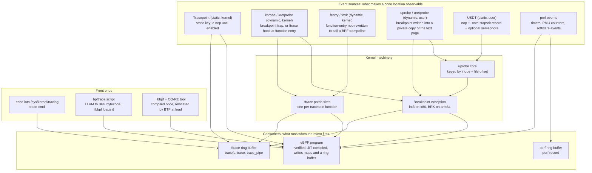

# eBPF, bpftrace, ftrace, uprobes, and USDT

> [!summary] Claim:
> Every Linux tracer is two independent choices: an event source that makes a point in running code observable, and a consumer that runs when the event fires.
> The sources are static or dynamic, kernel or user: tracepoints and USDT markers are compiled in and cost one patched-out instruction when idle; kprobes, fentry, and uprobes rewrite live instruction text, with a trap, a direct call, or a trampoline.
> The consumers are the ftrace ring buffer behind tracefs, perf, and eBPF programs, which the kernel verifier proves safe (bounded, memory-safe, 512 bytes of stack, at most 1,000,000 simulated instructions) before a JIT compiles them to native code.
> bpftrace is a compiler from a small awk-like language to those eBPF programs, so its overhead is the overhead of the event source it attaches to: tens of nanoseconds for fentry and tracepoints, about 300 ns for a trapping uprobe (figures from kernel commit messages, as of 2026-11, Linux; the uprobe figures are x86-64, the kernel-probe figures name no machine).
> A USDT probe is a `nop` plus a non-loaded ELF note; a tracer arms it by registering a uprobe at the note's file offset and incrementing a 2-byte semaphore so the application starts preparing the arguments.



## The Mechanism

[[Linux-perf-in-Depth-and-perf-c2c]] owns sampling: interrupt at a rate and record where the CPU was.
This note owns tracing: run code at chosen events and record what happened there.
Sampling cost is fixed by the rate; tracing cost is the event rate multiplied by the per-event cost, so the first question for any probe is how often it fires.

Version facts are pinned to Linux v7.3, bpftrace v0.27.1, and libbpf v1.8.0, the current releases as of 2026-11.

### 1. Static and dynamic, kernel and user

| | Kernel | User space |
| :--- | :--- | :--- |
| Static (compiled in, named, documented) | Tracepoints | USDT markers |
| Dynamic (any function or instruction, no source change) | kprobes, kretprobes, fprobe, fentry/fexit | uprobes, uretprobes |

Static probes are placed by the code's authors, so they carry a name, typed arguments, and an intent to keep meaning the same thing.
Dynamic probes attach to whatever symbol or address exists in this build, so they break when a function is renamed, inlined, or split.
The kernel's own position is that neither is a stable ABI: `bpf_design_QA.rst` answers "NO" both to "Are tracepoints part of the stable ABI?" and to "Are places where kprobes can attach part of the stable ABI?".
In practice tracepoints change far less often than function names, which is why bpftrace's documentation calls them "a more stable interface than `kprobe`s".

### 2. ftrace: patch sites, a ring buffer, and tracefs

ftrace is the oldest of the three consumers and the foundation the other kernel probes stand on.
It lives in tracefs, mounted at `/sys/kernel/tracing`, and it is driven by reading and writing files (`ftrace.rst`).

**Patch sites.**
A kernel built with `CONFIG_DYNAMIC_FTRACE` is compiled so that every traceable function begins with a call the kernel can rewrite: historically `mcount` from `-pg`, then `__fentry__` from `-mfentry` on x86, which runs before the stack frame is built.
On arm64 the GCC configuration depends on `-fpatchable-function-entry=2`, which reserves nops at function entry instead (`arch/arm64/Kconfig` at v7.3).
At boot, before SMP starts, ftrace rewrites every recorded call site to a nop and adds the function to `available_filter_functions`.
An untraced kernel therefore pays one nop per function, and enabling a tracer means patching nops back into calls for exactly the functions selected.

**Tracers.**
`current_tracer` selects what the patch sites call.
`function` records every entry to the functions in `set_ftrace_filter`.
`function_graph` records entry and exit with durations for the functions in `set_graph_function` and everything they call, down to `max_graph_depth`.
`nop` is the idle tracer.

**The ring buffer.**
Events go to a per-CPU ring buffer sized by `buffer_size_kb`, which is a per-CPU size, not a total.
With the default `overwrite` option the oldest events are discarded when a CPU's buffer fills, so a flight-recorder trace keeps the most recent history.
`trace` shows the buffer without consuming it; `trace_pipe` blocks and consumes, so two readers of `trace_pipe` split the events between them.
Changing `current_tracer` clears the buffer.

**Events.**
Each tracepoint appears under `events/<subsystem>/<event>/` with an `enable` file and a `format` file describing its fields.
Dynamic events are created by writing a definition to `kprobe_events`, `uprobe_events`, or the unified `dynamic_events`, after which they look like any other event.

```sh
cd /sys/kernel/tracing
# Call graph of one function, with per-call durations.
echo do_nanosleep > set_graph_function
echo function_graph > current_tracer
cat trace_pipe            # Ctrl-C to stop reading
echo nop > current_tracer # stops the tracer and clears the buffer
echo > set_graph_function

# One static event, no BPF involved.
echo 1 > events/syscalls/sys_enter_openat/enable
cat trace_pipe
echo 0 > events/syscalls/sys_enter_openat/enable
```

ftrace needs no compiler and no BPF, which makes it the tool that still works on a minimal or very old system, and the fastest way to answer "is this function called at all, and by whom".
Its limit is that filtering and aggregation are fixed-function (event filters, hist triggers), where an eBPF program can compute anything the verifier accepts.

### 3. kprobes, kretprobes, and fprobe

A kprobe makes almost any kernel instruction an event (`kprobes.rst`).

1. On registration, Kprobes copies the probed instruction and replaces its first bytes with a breakpoint instruction (`int3` on x86).
2. When a CPU executes the breakpoint, it traps, the registers are saved, and the kprobe's handler runs with the saved registers.
3. Kprobes then single-steps its copy of the original instruction out of line, so the breakpoint never has to be removed and no other CPU can slip past it.
4. Execution resumes after the probed instruction.

Two optimizations avoid the trap.
With `CONFIG_OPTPROBES` (x86) and `debug.kprobes_optimization=1`, Kprobes replaces the breakpoint with a jump to a detour buffer when a safety analysis of the surrounding function allows it.
A kprobe placed exactly on a function's ftrace patch site can use the ftrace call instead of a breakpoint; `/sys/kernel/debug/kprobes/list` marks such probes `[FTRACE]` and jump-optimized ones `[OPTIMIZED]`.

A kretprobe is a kprobe on function entry whose handler replaces the saved return address with the address of a trampoline; when the function returns into the trampoline, the return handler runs and the real return address is restored.
The per-call bookkeeping is preallocated (`maxactive`), so a deeply concurrent function can miss return events rather than block.

Some functions cannot be probed at all: Kprobes keeps a blacklist (`NOKPROBE_SYMBOL()`) of code whose trapping would recurse into the probe machinery, and registration there is rejected.

fprobe is the multi-function form: "a function entry/exit probe based on the function-graph tracing feature in ftrace" (`fprobe.rst`), one handler for many functions without one breakpoint each.
BPF's kprobe-multi link (`BPF_TRACE_KPROBE_MULTI`, Linux 5.18) attaches through it with `register_fprobe_ips()`, which is why `bpftrace -e 'kprobe:vfs_* { ... }'` can attach to hundreds of functions in one system call.

The kernel documentation's own overhead table is from 2005 hardware (0.49 microseconds per kprobe hit on an Opteron 246), so treat it as history and use the current selftest figures in Commands and Numbers to Know.

### 4. Tracepoints

A tracepoint is a call site the kernel developer wrote: `trace_sched_switch(...)` in the scheduler, with a `TRACE_EVENT` definition naming the fields.
When disabled, the site is guarded by a static key, implemented with jump labels so that the disabled case is straight-line code rather than a load and a conditional branch (`tracepoints.rst`).
Enabling it patches the jump and the registered callbacks run with the typed arguments.

Two BPF attachment styles exist.
A `tracepoint` program receives the event's formatted record, the same fields the `format` file lists.
A `rawtracepoint` program receives the raw arguments before they are formatted, which skips the record construction; in the kernel's batched benchmark it is the cheapest attachment of all (see Commands and Numbers to Know).

### 5. eBPF: a verified program at the event

eBPF turns "record this event" into "run this program at this event".
The program is bytecode for a 64-bit register machine, loaded with `bpf(BPF_PROG_LOAD)`, and it can only do three things: compute on its registers and stack, call kernel helpers and kfuncs, and read or write maps.

**The verifier.**
Before a program can attach, the verifier proves it safe in two steps (`verifier.rst`).
The first step is a control-flow check that rejects unreachable instructions and malformed graphs.
The second step "starts from the first insn and descends all possible paths", simulating every instruction and tracking the type and value range of every register and stack slot.
`R1` starts as `PTR_TO_CTX`; adding two pointers yields a scalar that can no longer be dereferenced; a register that was never written is not readable; R1 to R5 are clobbered by every call and R6 to R9 survive it.
Loads and stores are allowed only through pointers of known type, with bounds proven, which is why a map lookup result must be compared against NULL before use.

The limits that shape real programs (constants at v7.3):

- At most 1,000,000 instructions simulated across all paths (`BPF_COMPLEXITY_LIMIT_INSNS`); exceeding it prints `BPF program is too large. Processed %d insn`.
- 512 bytes of stack per function (`MAX_BPF_STACK`), with the combined depth of a call chain also checked (`combined stack size of %d calls is %d. Too large`).
- At most 16 nested call frames (`MAX_CALL_FRAMES`), 256 subprograms (`BPF_MAX_SUBPROGS`), and 64 maps per program (`MAX_USED_MAPS`).
- At most 33 chained tail calls (`MAX_TAIL_CALL_CNT`).
- Loops must be provably bounded: the verifier accepted them from Linux 5.3, and `bpf_loop()` (Linux 5.17) moves the loop into a helper call, so the verifier does not have to walk every iteration.

The simulated-instruction limit counts paths, not program size: a 200-instruction program with a loop the verifier must unroll 10,000 times can hit it, and a 50,000-instruction straight-line program does not.
State pruning is what makes this tractable: when the verifier reaches an instruction in a state that is a subset of one already proven safe, it stops exploring that path.

**After verification.**
A JIT compiles the bytecode to native instructions; with `CONFIG_BPF_JIT_ALWAYS_ON` the interpreter is removed entirely.
The program then runs in the context of whatever fired the event, on the traced thread's time, so every instruction it executes is latency added to that thread.

**Maps and output.**
Maps are the only state that outlives one invocation and the only channel to user space.
Aggregating in a map (a count per key, a histogram) keeps the per-event cost in the kernel and sends only the summary out, which is the property that lets BPF tools trace events too frequent to log.
For streamed events, the BPF ring buffer (`BPF_MAP_TYPE_RINGBUF`, Linux 5.8) is one buffer shared by all CPUs, which preserves ordering across CPUs and uses memory better than the older per-CPU perf buffer (`ringbuf.rst`).
A full ring buffer drops events; it never blocks the traced code.

**Reading memory.**
A tracing program cannot dereference an arbitrary kernel or user pointer directly.
It calls `bpf_probe_read_kernel()` or `bpf_probe_read_user()` (split into separate helpers in Linux 5.5), which copy with the kernel's `_nofault` routines and return an error instead of oopsing.
A no-fault copy does not page memory in, so a user string that is not resident reads as an error, which bpftrace hides unless it is run with `-k`.

**Who may load.**
`kernel.unprivileged_bpf_disabled` gates unprivileged `bpf()`: 0 allows it, 1 disables it until reboot, 2 disables it but lets an administrator change it back, and kernels built with `BPF_UNPRIV_DEFAULT_OFF` start at 2.
Since Linux 5.8 the privilege is split: `CAP_BPF` allows loading programs and creating maps, and tracing program types (kprobe, tracepoint, perf event, raw tracepoint, tracing, and also LSM, struct_ops, and extension programs) additionally require `CAP_PERFMON` (`is_perfmon_prog_type()` in `kernel/bpf/syscall.c`).
bpftrace 0.25 replaced its "are you root" check with a check for `CAP_BPF`, `CAP_PERFMON`, `CAP_DAC_READ_SEARCH`, and `CAP_DAC_OVERRIDE`.
Under kernel lockdown in confidentiality mode, the kernel-memory read helpers are withheld (`LOCKDOWN_BPF_READ_KERNEL` in `kernel/trace/bpf_trace.c`), and kprobes and tracefs have their own lockdown reasons in the same tier (`include/linux/security.h`), so a tool that reads kernel memory fails to load whatever capabilities it holds.

### 6. BTF, CO-RE, and fentry

A kprobe program receives saved registers and must know, out of band, that the second argument is a `struct sock *` and that `sk_rcvbuf` is at some offset.
Offsets change between kernel versions and configurations, so a program compiled against one kernel's headers reads garbage on another.

BTF (BPF Type Format) is the fix: a compact description of every kernel type, generated from DWARF by `pahole` when the kernel is built with `CONFIG_DEBUG_INFO_BTF` and exposed at `/sys/kernel/btf/vmlinux`.
Nakryiko's CO-RE write-up puts it at "up to 100x reduction in size" against DWARF, small enough to ship in every kernel image.

CO-RE (Compile Once - Run Everywhere) uses it in three parts:

1. Clang records, for each field access marked relocatable, a BTF relocation naming the type and field instead of baking in the offset.
2. At load time, libbpf matches the program's types against the running kernel's BTF and patches every offset, size, and existence check into the bytecode.
3. The program is written against a generated `vmlinux.h` (`bpftool btf dump file /sys/kernel/btf/vmlinux format c`) and uses `BPF_CORE_READ()` for pointer chains and `bpf_core_field_exists()` to branch on kernels where a field was renamed or removed.

bpftrace uses the same BTF at run time to resolve struct fields without kernel headers, and its documentation says to "prefer to exclusively use BTF as it can never get out of sync on a running system".

BTF also enables a faster attachment than a kprobe.
A BPF trampoline (Linux 5.5 on x86-64, 6.0 on arm64) is a small generated stub that converts the kernel calling convention to the BPF one and calls the attached programs directly; the function's ftrace patch site is rewritten to call it.
`fentry` programs see the function's arguments with their real types, checked by the verifier against BTF, and `fexit` programs see the arguments and the return value together, which a kretprobe cannot.
There is no saved-register frame and no generic kprobe dispatch, and in the kernel's batched benchmark fentry runs about 31 million events per second against about 13 million for a kprobe on the same function entry (commit `7df4e597ea2c`).
The commit does not say whether that kprobe used a breakpoint or the ftrace hook, so do not read the gap as the cost of a trap alone.

### 7. uprobes: breakpoints keyed by file offset

A uprobe makes an instruction in a user-space executable or library an event.
Its identity is not an address in a process but a pair: the inode of the file and a byte offset into it (`uprobe_register(inode, offset, ref_ctr_offset, consumer)` in `kernel/events/uprobes.c`).
That choice is what lets one registration cover every process that maps the file, now or later, under any ASLR slide.

**Arming.**
For each address space that maps the file's text at that offset, the kernel writes a breakpoint instruction over the original: the one-byte `int3` (`0xcc`) on x86, a 4-byte `BRK` with immediate 5 on arm64.
It cannot write to the page cache page that every process shares, so `uprobe_write()` first breaks copy-on-write and patches an "exclusive anonymous page" belonging to that process.
A probed process therefore stops sharing each patched text page, and a new process gets its breakpoint at `mmap` time.

**Firing.**

1. The thread executes the breakpoint and traps into the kernel.
2. `handle_swbp()` finds the uprobe for this inode and offset and runs its consumers: the ftrace uprobe event, perf, or the attached BPF program, with the user registers as context.
3. The original instruction must still execute, so if the architecture code can emulate it (on x86: nops, pushes, and relative branches), the kernel adjusts the registers and returns.
4. Otherwise the instruction is copied into a slot in a per-process "execute out of line" page, mapped into the process as `[uprobes]`, and single-stepped there.
5. The thread returns to user space after the probed instruction.

A breakpoint with no matching uprobe delivers `SIGTRAP`, which is what a process sees if its text contained a stray `int3`.
On x86 an out-of-line slot is 128 bytes, so one 4 KiB page holds 32 of them, and a thread that finds all slots busy waits for one.

**Return probes.**
A uretprobe is an entry uprobe whose handler overwrites the return address on the user stack with the address of a trampoline in the `[uprobes]` page.
The return then lands in the kernel, the return consumers run, and the real address is restored.
This is safe only for code that returns through the address it was called with: bpftrace's documentation shows a Go program dying with `fatal error: unknown caller pc` because the Go runtime inspects and moves stacks.
Nested return probes are capped at 64 per thread (`MAX_URETPROBE_DEPTH`).

**Why it is slow, and what changed.**
Every hit of a classic uprobe is a trap, an exception entry and exit, and possibly a single-step, so it costs several times a system call.
Three x86-64 changes attack that cost (as of 2026-11, Linux):

- Linux 6.11 added the `uretprobe` system call (number 335): the return trampoline makes a system call instead of executing a breakpoint, which the commit measured as 31 percent faster on an Intel i7-1165G7 and 10 percent on an AMD Ryzen 7 5700U.
- Linux 6.18 added the `uprobe` system call (number 336) and "optimized uprobes": when the probed instruction is a 5-byte nop, the kernel replaces it after the first hit with a `call` to a trampoline page mapped into the process, which makes the system call, so later hits never trap.
- Linux 7.3 moved the optimization from the 5-byte nop to a 10-byte nop, because the `call` pushes a return address into the stack red zone, where a leaf function may be keeping live data without having moved `rsp`; the 10 bytes hold `lea -0x80(%rsp), %rsp` followed by the `call`, which steps over the red zone first.

Linux v7.3 also exempts both system calls from seccomp: `seccomp_uprobe_exception()` in `kernel/seccomp.c` makes every filter treat them as always allowed for native 64-bit callers, and both are in the strict-mode (`mode1_syscalls`) allowlist, so a traced process with a strict filter is not killed by its own trampoline.
The optimization is written only in `arch/x86`, and the first hit of every optimized uprobe is still a breakpoint, because the trampoline is installed from the hit handler once the loader has finished mapping the binary.

### 8. USDT: a nop, an ELF note, and a semaphore

USDT (User Statically-Defined Tracing) is the user-space counterpart of a tracepoint, and it is built entirely from pieces described elsewhere: one instruction, one ELF note, and a uprobe.
[[ELF-Mach-O-and-PE-Object-Formats]] owns sections and notes in general.

**What the macro emits.**
`STAP_PROBE2(provider, name, a, b)` from SystemTap's `<sys/sdt.h>` expands to exactly one `nop` in the instruction stream and one record in the section `.note.stapsdt`.
The section is not allocated, so it is never mapped into the running process and costs no memory at run time, and it survives in stripped binaries.
Each note has owner `stapsdt`, type 3, and a descriptor laid out as (SystemTap wiki, "UserSpaceProbeImplementation"):

| Field | Size | Meaning |
| :--- | :--- | :--- |
| Probe PC | address size | Link-time address of the `nop` |
| Base | address size | Link-time address of the 1-byte section `.stapsdt.base` |
| Semaphore | address size | Link-time address of the semaphore, or 0 for none |
| Provider | NUL-terminated string | For example `orders` |
| Name | NUL-terminated string | For example `order_done` |
| Arguments | NUL-terminated string | One `N@OP` per argument, separated by single spaces |

The base field exists because a non-allocated note is never relocated: a reader compares it with the actual `sh_addr` of `.stapsdt.base` and applies the difference to the PC and the semaphore.

**Arguments.**
Each argument is `N@OP`.
`N` is the size in bytes, negative when the value is signed (`-4` is a signed 32-bit integer, `8` an unsigned 64-bit one), with an `f` suffix for floating point.
`OP` is an assembler operand chosen by the compiler at that site: a register (`%edi`, `x6`), a constant (`$5`), or a memory reference (`-8(%rbp)`, `[x4, 16]`).
The macro passes the values to an inline `asm` with the constraint `nor` (immediate, offsettable memory, or register; `<sys/sdt.h>` uses `nZr` on PowerPC and `g` on 32-bit Arm), so the compiler does not move a value just to satisfy the probe; it reports where the value already is.
The tracer is the one that parses operands "like an assembler", and it must do so per site, because the same probe inlined in three places can have three different argument strings.
libbpf parses up to 12 arguments per probe (`USDT_MAX_ARG_CNT`) into a small table its BPF-side code reads at run time.

**Semaphores.**
The `nop` is free, but computing an argument that is not already live is not.
A probe may name a semaphore: a 2-byte counter in the writable section `.probes`, tested by the application before it prepares arguments.
The tracer increments it while attached and decrements it on detach.
Linux 4.20 moved this into the kernel: a uprobe can be registered with a reference-counter offset (`ref_ctr_offset`, also a file offset), and the kernel increments the counter in every process where it arms the probe, including ones that start later.
bpftrace 0.24 requires this kernel support for probes with semaphores.

**Arming a USDT probe.**
A tracer such as bpftrace or libbpf does the following, all in user space except the last step:

1. Find `.note.stapsdt` and decode the notes matching the provider and name.
2. Apply the base adjustment, then convert the probe PC and the semaphore address from virtual addresses to file offsets using the `PT_LOAD` segment that contains each.
3. Parse the argument string into register and memory reads.
4. Register one uprobe per site at that file offset, passing the semaphore's file offset as the reference counter.

From then on a USDT probe is a uprobe on a `nop`, which is the cheapest instruction for the kernel to emulate.
On x86-64, libbpf's `usdt.h` (version 0.2.0) now emits a 1-byte `nop` followed by the 10-byte nop, and libbpf 1.8.0 attaches to the second one when the kernel's `uprobe` system call returns `EPROTO` to a caller outside a trampoline, which is the behavior the 7.3 nop10 change introduced (`probe_uprobe_syscall()` in `src/features.c`), so the probe is optimized into a call (as of 2026-11, Linux x86-64).
SystemTap's `<sys/sdt.h>` still emits the single `nop`, which stays on the trap path.

### 9. bpftrace: the language on top

bpftrace compiles a script to BPF bytecode with LLVM and loads it through libbpf (`bpftrace(8)`).
A program is a list of `probe /filter/ { action }` clauses.

```text
tracepoint:syscalls:sys_enter_openat   <- probe: provider and attach point
/comm == "nginx"/                      <- filter, compiled into the program
{
  @opens[str(args.filename)] = count();   <- action: update a map in kernel context
}
```

- `@name` is a BPF map, global to the script and printed at exit; `$name` is a scratch variable on the BPF stack.
- `count()`, `sum()`, `avg()`, `min()`, `max()`, `stats()`, `hist()`, and `lhist()` are map value functions, computed in the kernel.
- `printf()` is asynchronous: the values are copied into the ring buffer and formatted in user space, so a `printf` per event costs a ring buffer write and can drop under load.
- `args` gives typed, named arguments where BTF or DWARF provides them (tracepoints, raw tracepoints, fentry/fexit, and uprobes on binaries with DWARF); `arg0` to `argN` are raw register arguments (kprobes, uprobes, USDT).
- `retval` is available in return probes; `fexit` also keeps `args`.
- `kstack` and `ustack` capture stacks; walking a user stack needs frame pointers, which [[Stack-Unwinding-CFI-and-Exception-ABI]] explains.

Each probe type is a thin name for one of the kernel mechanisms in this note, and it costs what that mechanism costs.

| bpftrace probe | Short | Attaches through | Arguments |
| :--- | :--- | :--- | :--- |
| `tracepoint:subsys:event` | `t` | Static tracepoint | `args.field` (needs BTF since 0.25) |
| `rawtracepoint:event` | `rt` | Raw tracepoint | `argN` and `args` (needs BTF since 0.24) |
| `fentry:fn`, `fexit:fn` | `f`, `fr` | BPF trampoline at the ftrace site | `args.name`, `retval` in `fexit` |
| `kprobe:fn`, `kretprobe:fn` | `k`, `kr` | kprobe, or kprobe-multi through fprobe | `argN`; `retval` in the return probe |
| `uprobe:bin:fn`, `uretprobe:bin:fn` | `u`, `ur` | uprobe at a symbol's file offset | `argN`; `args` with DWARF |
| `usdt:bin:provider:name` | `U` | uprobe at each note's file offset, plus the semaphore | `argN` from the note |
| `profile:hz:99` | `p` | perf timer on every CPU | none |
| `interval:s:1` | `i` | Timer that fires on one CPU at a time | none |
| `software:...`, `hardware:...` | `s`, `h` | perf software and PMU events | none |
| `begin`, `end` | - | bpftrace runtime | none |

bpftrace 0.20 introduced the names `fentry` and `fexit` for what it had called `kfunc` and `kretfunc`; the old names still work.

Production one-liners, each a direct use of one mechanism (as of 2026-11, bpftrace v0.27.1, Linux):

```sh
# What is traceable, and with which arguments? Always look before attaching.
bpftrace -l 'tracepoint:syscalls:sys_enter_open*'
bpftrace -lv 'tracepoint:sched:sched_switch'
bpftrace -lv 'fentry:tcp_reset'
bpftrace -l 'usdt:/lib/x86_64-linux-gnu/libc.so.6:*'   # glibc's own probes; the path is distribution-specific

# Syscall rate by process: one tracepoint and an in-kernel count.
bpftrace -e 'tracepoint:raw_syscalls:sys_enter { @[comm] = count(); }'

# New processes: who executed what.
bpftrace -e 'tracepoint:syscalls:sys_enter_execve { printf("%s -> %s\n", comm, str(args.filename)); }'

# Files opened, by process: a typed tracepoint argument and a user string read.
bpftrace -e 'tracepoint:syscalls:sys_enter_openat { printf("%s %s\n", comm, str(args.filename)); }'

# Latency histogram between two events on the same thread.
bpftrace -e 'tracepoint:syscalls:sys_enter_read { @start[tid] = nsecs; }
             tracepoint:syscalls:sys_exit_read /@start[tid]/ {
               @us[comm] = hist((nsecs - @start[tid]) / 1000); delete(@start, tid); }'

# Same shape on a kernel function, through a BPF trampoline.
bpftrace -e 'fentry:do_nanosleep { @start[tid] = nsecs; }
             fexit:do_nanosleep /@start[tid]/ {
               @us = hist((nsecs - @start[tid]) / 1000); delete(@start, tid); }'

# Who calls a kernel function: stack as the map key.
bpftrace -e 'kprobe:do_nanosleep { @[comm, kstack(5)] = count(); }'

# Allocation sizes in one process only (-p keeps the uprobe out of every other process).
bpftrace -p "$PID" -e 'uprobe:libc:malloc { @bytes = hist(arg0); }'

# A USDT probe in your own service, summed in the kernel.
bpftrace -e 'usdt:./order_server:orders:order_done { @notional[str(arg2)] = sum(arg1); }' -c ./order_server

# Check that a script parses, loads, and attaches, without running it.
bpftrace --dry-run -e 'kprobe:vfs_* { @[probe] = count(); }'
```

The two-event latency pattern is the core idiom: store a timestamp keyed by thread at the start event, compute the delta and delete the key at the end event, and guard the end clause with a filter so events whose start was missed are skipped.
[[Playbook-Diagnose-a-Production-Tail-Latency-Spike-with-eBPF-and-perf]] owns the ordered procedure that applies these during an incident.

## Commands and Numbers to Know

| Item | Value | Platform and date | Why it matters |
| :--- | :--- | :--- | :--- |
| tracefs mount point | `/sys/kernel/tracing` | Linux (as of 2026-11) | bpftrace reads `available_filter_functions` and `available_events` from it; often not mounted inside containers |
| `buffer_size_kb` | Per-CPU size of the ftrace ring buffer | Linux (as of 2026-11) | Total memory is this times the CPU count |
| ftrace `overwrite` option | `1`: oldest events discarded when full | Linux (as of 2026-11) | Flight-recorder behavior; set `0` to keep the beginning instead |
| `trace` vs `trace_pipe` | Non-consuming vs blocking and consuming | Linux (as of 2026-11) | Two `trace_pipe` readers split the stream |
| Verifier instruction budget | 1,000,000 simulated instructions | Linux v7.3 (as of 2026-11) | Counts explored paths, not program length |
| BPF stack | 512 bytes per function | Linux v7.3 (as of 2026-11) | bpftrace moves objects over `on_stack_limit` (32 bytes) to preallocated memory |
| Call depth, subprograms, maps | 16 frames, 256 subprograms, 64 maps | Linux v7.3 (as of 2026-11) | Limits on program structure |
| Tail calls | 33 chained | Linux v7.3 (as of 2026-11) | Bounds program chaining |
| `kernel.unprivileged_bpf_disabled` | `0`, `1` (until reboot), `2` (changeable) | Linux v7.3 (as of 2026-11) | `2` is the default when built with `BPF_UNPRIV_DEFAULT_OFF` |
| Capabilities for tracing BPF | `CAP_BPF` and `CAP_PERFMON` | Linux 5.8 and later (as of 2026-11) | bpftrace 0.25 also checks `CAP_DAC_READ_SEARCH` and `CAP_DAC_OVERRIDE` |
| Kernel BTF | `/sys/kernel/btf/vmlinux`, needs `CONFIG_DEBUG_INFO_BTF` | Linux v7.3 (as of 2026-11) | Required for fentry, typed `args`, and CO-RE |
| uprobe breakpoint | `0xcc` (1 byte) on x86; `BRK` immediate 5 (4 bytes) on arm64 | Linux v7.3 (as of 2026-11) | What appears in the patched text page |
| uprobe out-of-line slots | 128 bytes each, 32 per 4 KiB page | Linux v7.3 x86 (as of 2026-11) | Threads wait when all are busy |
| uretprobe nesting | 64 per thread | Linux v7.3 (as of 2026-11) | Deeper recursion loses return events |
| x86-64 system calls | `uretprobe` 335, `uprobe` 336 | Linux v7.3 (as of 2026-11) | Added in 6.11 and 6.18; v7.3 exempts both from seccomp filters |
| USDT note | Section `.note.stapsdt`, owner `stapsdt`, type 3 | Linux (as of 2026-11) | `readelf -n` prints provider, name, location, base, semaphore, arguments |
| USDT semaphore | 2-byte counter in `.probes` | Linux (as of 2026-11) | Kernel-managed through `ref_ctr_offset` since Linux 4.20 |
| USDT arguments per probe | 12 in libbpf 1.8.0 and in `usdt.h` | Linux (as of 2026-11) | bpftrace 0.24 raised its own limit to 255 |
| bpftrace `max_map_keys` | `4096` | bpftrace v0.27.1, Linux (as of 2026-11) | Raise it when keying by stack or address |
| bpftrace `max_strlen` | `1024` (was 64 before 0.23) | bpftrace v0.27.1, Linux (as of 2026-11) | Longest value `str()` returns |
| bpftrace `max_probes`, `max_bpf_progs` | `1024` each | bpftrace v0.27.1, Linux (as of 2026-11) | A wide wildcard fails rather than freezing the host |
| bpftrace `missing_probes` | `error` | bpftrace v0.27.1, Linux (as of 2026-11) | Since 0.24 a probe that cannot attach aborts the script |
| bpftrace output streams | Script output on stdout, everything else on stderr | bpftrace v0.24 and later, Linux (as of 2026-11) | `Attached N probes` no longer pollutes piped output |

Per-event cost, from kernel commit messages rather than from this vault's lab.
Each row is the throughput of one thread triggering the probe in a loop with a BPF program that increments a counter; nanoseconds are 1000 divided by the million-per-second figure and include the loop itself.
The first eight rows are the batched harness, where a BPF driver program calls the probed helper `bpf_get_numa_node_id()` 100 times per `bpf()` system call; the rest are a user thread executing the probed instruction, and commit `7df4e597ea2c` warns that results compare only within one harness.

| Attachment | Throughput | Derived cost | Source, platform, date |
| :--- | :--- | :--- | :--- |
| Empty in-kernel loop (baseline) | 49.9 M/s | 20 ns | Commit `7df4e597ea2c`, Linux, machine not stated (2024-03) |
| Raw tracepoint | 36.8 M/s | 27 ns | Same commit |
| fentry | 31.0 M/s | 32 ns | Same commit |
| fexit | 20.4 M/s | 49 ns | Same commit |
| Tracepoint | 19.4 M/s | 52 ns | Same commit |
| kprobe-multi | 15.4 M/s | 65 ns | Same commit |
| kprobe | 12.9 M/s | 77 ns | Same commit |
| kretprobe | 5.6 M/s | 180 ns | Same commit |
| System call (no probe) | 14.3 M/s | 70 ns | Commit `0c4fc6bd6105`, Linux x86-64, CPU not stated (2026-03) |
| uprobe on a `nop` | 3.13 M/s | 320 ns | Commit `554ba38456da`, Linux x86-64, CPU not stated (2026-07) |
| uprobe on a `ret` | 1.10 M/s | 913 ns | Same commit |
| uretprobe on a `nop` | 2.14 M/s | 467 ns | Same commit |
| USDT on a 1-byte `nop` | 3.25 M/s | 308 ns | Same commit |
| USDT on the 10-byte nop, optimized | 7.26 M/s | 138 ns | Same commit |

Two facts to keep from that table.
A kernel-side probe is roughly four to ten times cheaper than a trapping user-side probe; that compares two harnesses on unstated machines, so read it as an order of magnitude.
The instruction under a uprobe matters: a `nop` is emulated, while the `ret` in that benchmark costs about three times as much; `ret` is not among the instructions `arch/x86/kernel/uprobes.c` has emulation routines for (nops, pushes, relative jumps and calls), so it takes the out-of-line path.

## Multi-Language Comparison: C++ / Python / Rust

Kernel-side probes do not care what language the process was written in.
User-side probes do, because a uprobe needs a symbol and a calling convention, and a USDT probe needs the runtime or the application to have been built with markers.

| Concern | C++ | Python (CPython) | Rust |
| :--- | :--- | :--- | :--- |
| Defining USDT probes | `<sys/sdt.h>` (`STAP_PROBEn`) or libbpf's single-header `usdt.h` (`USDT`, `USDT_WITH_SEMA`, `USDT_IS_ACTIVE`) | The interpreter itself carries markers when built with `--with-dtrace`; the documented markers are the interpreter's, not the application's | The `usdt` crate generates probes from a D provider file or a `#[usdt::provider]` module and states they are visible to `dtrace` and to `bpftrace` on Linux |
| Probes shipped with the runtime | glibc's `libc` provider (memory allocation and non-local goto probes), which glibc documents as outside its stable ABI | `python:function__entry`, `function__return`, `line`, `gc__start`, `gc__done`, `import__find__load__start`, `import__find__load__done`, `audit`; documented as implementation details with no compatibility guarantee | None in the standard library |
| Naming a function for a uprobe | Mangled names; bpftrace's `cpp` qualifier matches demangled names: `uprobe:/path/app:cpp:"MyApp::Server::handle_request"` | A uprobe on `python3` sees interpreter C functions, not Python functions; use the markers, or the perf trampoline described in [[Python-CPython-perf-Trampoline-and-Tachyon-Internals\|CPython perf trampoline]] | Mangled names: legacy hash-suffixed names or v0 names beginning `_R` (RFC 2603); list them with `bpftrace -l 'uprobe:./app:*'` and attach with a wildcard |
| What `arg0` is | The first integer register argument, which for a member function is `this`, and for a large return value may be the hidden return slot | For `function__entry`: `arg0` filename, `arg1` function name, `arg2` line number, the first two as C string pointers | The first integer register argument; Rust's calling convention is unspecified, so confirm against the disassembly |
| Return probes | For functions that return normally through their original return address | On interpreter C functions only | For functions that return normally through their original return address |
| User stacks | Need frame pointers or DWARF; see [[Cpp-CPU-Profiling-perf-samply-Callgrind-and-llvm-mca\|C++ CPU profiling]] | Native frames only unless the perf trampoline is on | Need frame pointers; see [[Rust-CPU-Profiling-cargo-flamegraph-samply-and-Frame-Pointers\|Rust CPU profiling]] |
| Typed arguments | `bpftrace -lv 'uprobe:./app:fn'` lists parameters when the binary has DWARF; since 0.24 that is the only DWARF feature bpftrace keeps | Not applicable | Same DWARF mechanism |

The Python row's argument order and the list of markers are from the CPython 3.14 "Instrumenting CPython with DTrace and SystemTap" document.
The C++ `this` shift is from bpftrace's uprobe documentation, which adds that "the only way to know is to experiment".

## Worked Lab Example

The lab is `code/05-Profiling/bpftrace_usdt/`.
It needs a C compiler, `readelf`, `python3`, and `gdb` with Python support, and it runs without root.

Attaching a real uprobe needs `CAP_BPF` and `CAP_PERFMON`, which the lab harness container deliberately does not have.
So the lab builds every user-space step itself and substitutes gdb for the kernel in the last one: gdb reads the same notes, patches the same `nop` with a breakpoint through `ptrace`, raises the same semaphore, and fetches the arguments the same way.
[[How-Debuggers-Work-ptrace-Mach-and-Breakpoints]] owns that mechanism.
When the script runs as root on a host with bpftrace installed, it also traces the binary with `trace.bt` and compares the events with `trace.expected`, reporting on stderr so that stdout is identical either way.

What is in the directory:

- `sdt_min.h`: a 76-line reduction of `<sys/sdt.h>` that emits the v3 note by hand, so the whole format is readable in one screen.
- `order_server.c`: two probes, `orders:order_start(id, qty)` with no semaphore and `orders:order_done(id, notional, symbol)` guarded by one; the guarded block calls a function that counts how often the "expensive" argument was prepared.
- `stapsdt.py`: parses the ELF section headers, program headers, and `.note.stapsdt` with the standard library, applies the base adjustment, converts addresses to file offsets, decodes each argument, reports whether the probe site holds a `nop`, and fails unless `readelf -n` decodes the same notes.
- `probe_tracer.py`: a gdb Python script that sets `-probe-stap` breakpoints, prints `$_probe_argc` and `$_probe_argN` on each hit, and reads the probed instruction twice: through `/proc/PID/mem`, which shows what the CPU fetches, and through gdb, which shows the saved original.
- `trace.bt`: the same two probes for bpftrace.

```bash
cd code/05-Profiling/bpftrace_usdt
bash run.sh
```

### Verified output

Recorded by `python3 -m _harness.verify --record` in the pinned lab container on linux-aarch64 (GCC 13.2.0, gdb 15.1, kernel 7.2.12) in 2026-11 and re-checked with `python3 -m _harness.verify`; the file is `code/05-Profiling/bpftrace_usdt/expected/linux-aarch64.txt`.

```text
== 1. Probes decoded from .note.stapsdt ==
.note.stapsdt: SHT_NOTE, not allocated, so never mapped at run time; 2 probes
probe orders:order_start
  site: section .text, executable segment, file offset = address - 0x0
  site instruction on disk: nop
  semaphore: none
  arg0: -4@x6 -> signed 4-byte value in register x6
  arg1: -4@x0 -> signed 4-byte value in register x0
probe orders:order_done
  site: section .text, executable segment, file offset = address - 0x0
  site instruction on disk: nop
  semaphore: section .probes, writable segment, file offset = address - 0x10000, value on disk 0
  arg0: -4@x6 -> signed 4-byte value in register x6
  arg1: -8@x0 -> signed 8-byte value in register x0
  arg2: 8@[x4, 16] -> unsigned 8-byte value in memory at register x4 + 16
readelf -n decodes the same provider, name, location, semaphore, and arguments: 2/2 probes

== 2. No tracer attached ==
orders handled: 5, fill checksum: 277980
expensive argument preparations: 0

== 3. Tracer attached to orders:order_start (no semaphore) ==
  hit orders:order_start argc=2 arg0=101 arg1=10
    stop address matches the note location modulo the load base: yes
    instruction at the site in the live process: brk (breakpoint instruction)
    instruction gdb reports for the same address: nop (the saved original)
  hit orders:order_start argc=2 arg0=102 arg1=250
  hit orders:order_start argc=2 arg0=103 arg1=5
  hit orders:order_start argc=2 arg0=104 arg1=75
  hit orders:order_start argc=2 arg0=105 arg1=1200
  orders:order_start: 5 hits
  traced program output:
    orders handled: 5, fill checksum: 277980
    expensive argument preparations: 0

== 4. Tracer attached to orders:order_done (semaphore-gated) ==
  hit orders:order_done argc=3 arg0=101 arg1=189500 arg2="AAPL"
    stop address matches the note location modulo the load base: yes
    instruction at the site in the live process: brk (breakpoint instruction)
    instruction gdb reports for the same address: nop (the saved original)
    semaphore in the live process: 1
  hit orders:order_done argc=3 arg0=102 arg1=10318750 arg2="MSFT"
  hit orders:order_done argc=3 arg0=103 arg1=66550 arg2="NVDA"
  hit orders:order_done argc=3 arg0=104 arg1=1333500 arg2="AMZN"
  hit orders:order_done argc=3 arg0=105 arg1=3018000 arg2="F"
  orders:order_done: 5 hits
  traced program output:
    orders handled: 5, fill checksum: 277980
    expensive argument preparations: 5
```

### Reading the result

- Section 1 is everything a tracer knows before it attaches, and all of it came from a section that is never loaded.
- The site is a plain `nop`, so an untraced process executes one extra instruction per probe and nothing else.
- The argument strings are the compiler's choices, not the programmer's: `id` stayed in `x6` and `qty` in `x0`, while `symbol` was never loaded into a register at all, and the note says to read 8 bytes at `x4 + 16`, the field's home inside the `struct order`.
- A tracer that assumed "arguments are in the argument registers" would read the wrong values.
- The two address-to-offset lines differ: text is mapped where file offset equals address, but the semaphore lives in the data segment, where the address is the file offset plus `0x10000` on this aarch64 build.
- A tracer that passed the semaphore's virtual address as the uprobe reference counter would increment the wrong bytes.
- Section 2 is the idle cost of a semaphore-gated probe: the expensive preparation ran 0 times.
- Section 3 shows the patch: the bytes the CPU fetches at the site are now a breakpoint, while gdb reports the original `nop` for the same address, exactly as a kernel uprobe keeps the original instruction aside to emulate or single-step.
- Tracing `order_start` does not touch the other probe's semaphore, so the expensive path still ran 0 times.
- Section 4 shows the gate opening: the semaphore reads 1 in the live process, the guarded block ran for all 5 orders, and each hit decoded three arguments of three different shapes, including a pointer followed to the string `"AAPL"`.
- The stop address equals the note's location modulo the page-aligned load base under ASLR, which is the reason uprobes are keyed by file offset and not by address.

The same binary works with the kernel's own interfaces.
`stapsdt.py --sites ./order_server` prints each probe's address and semaphore address, and the ftrace form of a USDT attachment is one line with the file offset of the site and, in parentheses, the file offset of the semaphore:

```sh
# These offsets are from one aarch64 build; compute your own with stapsdt.py --sites.
cd /sys/kernel/tracing
echo 'p:orders/done /path/to/order_server:0x8dc(0x10010) id=%x6:s32 notional=%x0:s64' > uprobe_events
echo 1 > events/orders/done/enable
/path/to/order_server
cat trace
echo 0 > events/orders/done/enable
echo > uprobe_events
```

## Pitfalls

> [!warning] Pitfall: a kprobe that attaches and never fires
> A function can exist as a symbol and still not be on the path you are tracing, because the compiler inlined it into its hot callers and kept an out-of-line copy for the others.
> The probe attaches without error and the map stays empty.
> Confirm with a tracepoint on the same path, or with `function_graph` on the caller, before concluding that "it is not called".

> [!warning] Pitfall: tracing a semaphore-gated USDT probe by address
> A uprobe or breakpoint placed on the probe's address without the reference counter never sees an event, because the application's guard is still false.
> The gdb manual states the same rule for debuggers: the semaphore is set for a `-probe-stap` breakpoint but not for a breakpoint placed on the location by another method.
> Attach through the `usdt:` probe type, or pass the semaphore's file offset as `(REF)` in `uprobe_events`.

> [!warning] Pitfall: a system-wide uprobe on a hot library function
> A uprobe is registered on a file, so `uprobe:libc:malloc` without `-p` patches every process that maps libc.
> At roughly 320 ns per hit (see Commands and Numbers to Know), a process calling `malloc` one million times per second spends about a third of a core in the probe.
> Scope user-space probes with `-p PID`, sample instead of tracing, or aggregate at a coarser function.

> [!warning] Pitfall: `uretprobe` on code that manages its own stack
> The return probe rewrites the return address on the stack.
> Runtimes that inspect or copy stacks, with Go as bpftrace's documented example, crash with errors such as `fatal error: unknown caller pc`.
> Measure such functions with two entry probes or USDT markers at the start and end instead.

> [!warning] Pitfall: assuming USDT arguments are in argument registers
> The note records where each value happened to live: a register, a stack slot, a constant, or a field in memory, and it differs per site and per compiler.
> A wildcard that matches several sites with different argument types fails in bpftrace when the action uses `argN`.
> Read the `Arguments:` line of `readelf -n` for every site before trusting a script.

> [!warning] Pitfall: `printf` per event at high rates
> `printf` copies its arguments to the ring buffer and formats them in user space, and a full buffer drops events instead of slowing the kernel.
> Above a few thousand events per second, aggregate in a map and print the map on an `interval` probe.

> [!warning] Pitfall: maps that grow without bound
> A `@start[tid]` entry whose end event never arrives stays in the map, and at `max_map_keys` (4096 by default) new keys stop being stored.
> Delete in the end clause, filter the end clause on the key's presence, and raise `max_map_keys` deliberately when keying by stack or address.

> [!warning] Pitfall: reading ftrace output destructively or losing it
> `trace_pipe` consumes what it prints, and writing a new tracer name to `current_tracer` clears the whole buffer.
> Stop the trace with `echo 0 > tracing_on`, then read `trace`, then change tracers.

> [!warning] Pitfall: a script that worked on last quarter's bpftrace
> Between 0.21 and 0.27 bpftrace changed its default for missing probes to a hard error, moved non-script output to stderr, required BTF for tracepoint `args`, removed the `sarg` builtin, deprecated `while`, and changed `delete` to take the map and key separately.
> Pin the bpftrace version next to the scripts and run them with `--dry-run` in CI.

> [!warning] Pitfall: linker garbage collection and USDT notes
> A note does not keep its probe site alive, and a discarded site can leave a dangling note with bogus addresses.
> libbpf's `usdt.h` ties each note to its code section with `SHF_LINK_ORDER` for that reason; with other headers, check `readelf -n` on the final binary when linking with `--gc-sections`.

> [!warning] Pitfall: tracing inside a container
> bpftrace needs tracefs for the list of traceable functions and events, BTF from `/sys/kernel/btf`, and `CAP_BPF` with `CAP_PERFMON`; a default container lacks at least tracefs and the capabilities.
> Process IDs and file paths are also resolved in the tracer's namespaces, so a path-based uprobe from the host may not match a binary inside a container's mount namespace.

## At Scale

A single developer runs bpftrace as root on one machine and pays for mistakes with one slow shell.
A fleet has four different problems: who is allowed to load programs, what a probe costs multiplied by every host, whether the probe still attaches after the next kernel or service release, and who owns the instrumentation.

**Cost is a multiplication.**
Budget tracing the way capacity is budgeted: events per second times nanoseconds per event, per core.
A tracepoint firing 100,000 times per second at about 50 ns is 0.5 percent of a core.
A trapping uprobe firing at the same rate at about 320 ns is 3.2 percent, and a uretprobe, whose 467 ns already includes its entry trap, is about 4.7 percent.
Rates above a million per second belong to sampling, which [[Linux-perf-in-Depth-and-perf-c2c]] covers, or to counters the application maintains itself.

**Portability is a build property.**
A bpftrace script is compiled on the host at run time, which needs LLVM inside the tool (the v0.27.1 static release binary for aarch64 is 196 MB) and BTF on the host.
A libbpf CO-RE tool is compiled once, carries no compiler, and adapts to each kernel at load.
Ad hoc investigation is bpftrace's job; anything that runs continuously or on every host should be a CO-RE program with tests against the kernel versions in the fleet.

**Decision rules.**

- One engineer to a team: use bpftrace interactively; prefer tracepoints, then fentry, then kprobes; list before attaching; always pass `-p` for user-space probes.
- From about 100 engineers: check the scripts that matter into the repository, pin the bpftrace version, and run them with `--dry-run` against the production kernel image in CI, because a renamed function now fails loudly.
- From about 1,000 engineers: treat USDT probes in shared services as an interface, because static markers are the only user-space instrumentation that survives inlining, LTO, and symbol stripping; name them like API (`provider:noun_verb`), document the arguments, review changes, and gate any argument that is not already live behind a semaphore.
- At 10,000 to 50,000 engineers: nobody gets root to trace; grant `CAP_BPF` and `CAP_PERFMON` to a reviewed agent, expose a catalog of approved programs, set `kernel.unprivileged_bpf_disabled` to 1 or 2 fleet-wide, and decide in advance how tracing coexists with kernel lockdown, which removes the kernel-memory read helpers.
- For latency-critical user-space paths on x86-64: emit probes with a header that produces the `nop` plus 10-byte nop pair and run a kernel with the 10-byte optimization (Linux 7.3 as released), which turns the per-hit trap into a call and a system call.
- On arm64 there is no equivalent as of 2026-11, so keep user-space probes off per-message paths.
- On kernels 6.18 to 7.2 as released, do not place uprobes on 5-byte nops in code whose leaf functions use the red zone; that is the bug the 7.3 change fixes, and a stable kernel may or may not carry the fix.
- Always-on profiling is a different product with its own agent and storage: [[Continuous-Profiling-GWP-Parca-Pyroscope-and-OTel-Profiles]] owns it, and [[Profiling-Decision-Records]] owns the choice between tools.

## Practice Drill

> [!tip] Practice Drill:
> Extend the lab so that one logical probe has two sites, then predict what a tracer must do differently.
> Move `SDT_PROBE2(orders, order_start, ...)` into a `static inline` helper and call it from `handle_order()` and from a second function that passes a constant quantity.
> Before running anything, predict how many `orders:order_start` notes `readelf -n` will print, and what the `Arguments:` string of the constant-quantity site looks like.
> Then predict what the lab's section 3 prints for the number of hits, and check it.
> As a second step, on a Linux host where you have root, register the `order_done` site through `uprobe_events` twice: once with the `(REF)` semaphore offset and once without, and explain the difference in `uprobe_profile` hit counts.
> As a stretch, replace `sdt_min.h` with the real `<sys/sdt.h>` or libbpf's `usdt.h` and diff the `readelf -n` output: the notes must be equivalent, and on x86-64 `usdt.h` changes the instruction at the site.

```bash
cd code/05-Profiling/bpftrace_usdt
cc -O2 -g -o order_server order_server.c
readelf -n order_server | sed -n '/stapsdt/,$p'
python3 stapsdt.py order_server
python3 stapsdt.py --sites order_server
gdb -q -batch -ex 'info probes' ./order_server
```

## Interview Questions

> [!question] L5: What is the difference between a tracepoint and a kprobe, and when do you choose each?
>
> > [!success]- Answer
> > A tracepoint is a call site written into the kernel source with a name and typed fields; when disabled it is a patched-out jump, and when enabled it calls the registered handlers.
> > A kprobe is attached at run time to almost any instruction by replacing it with a breakpoint, or by using the function-entry ftrace site, and it hands the handler raw registers.
> > Choose a tracepoint when one exists for the event, because it survives refactoring and gives named arguments; choose a kprobe or fentry when you need a function nobody instrumented.
> > Neither is a stable ABI according to the kernel's own BPF Q&A, but tracepoints change far less often than function names and inlining decisions.

> [!question] L5: Predict the output: in the lab, with the tracer attached only to `orders:order_start`, what does the program print for "expensive argument preparations", and why?
>
> > [!success]- Answer
> > It prints `expensive argument preparations: 0`, with 5 hits recorded on `order_start`.
> > The expensive computation is guarded by the semaphore of the other probe, `order_done`, and attaching to `order_start` neither patches that site nor increments that counter.
> > Attaching to `order_done` raises the semaphore to 1 in the live process, and the count becomes 5.
> > The point is that a semaphore is per probe (or per group that shares one), so enabling one probe does not make the application pay for another.

> [!question] L5: Why does bpftrace aggregate in maps instead of printing every event?
>
> > [!success]- Answer
> > `count()`, `sum()`, and `hist()` update a BPF map inside the kernel, in the context of the event, and only the final summary is copied to user space.
> > `printf()` is asynchronous: each call copies its arguments into a ring buffer, and bpftrace's user-space half formats and writes them.
> > At high event rates the ring buffer fills and events are dropped, and the per-event cost includes a wakeup of the bpftrace process.
> > Aggregating keeps the cost proportional to the event rate times a few tens of nanoseconds, with no loss.

> [!question] L6: Walk through what happens between a thread executing a uprobed instruction and the BPF program seeing its arguments.
>
> > [!success]- Answer
> > The instruction was replaced, in a private copy of the text page, by a breakpoint: `int3` on x86 or a `BRK` on arm64.
> > Executing it raises an exception; the kernel's `handle_swbp()` maps the faulting address back to an inode and file offset and finds the registered uprobe.
> > The consumers run with the saved user registers as context, so a BPF program reads arguments from those registers or, for stack and memory operands, with `bpf_probe_read_user()`.
> > The kernel then either emulates the original instruction by editing the saved registers or copies it to a slot in the `[uprobes]` page and single-steps it there.
> > The cost is an exception entry and exit plus that work, about 320 ns on the hardware in the kernel's 2026 benchmark, against about 70 ns for a system call.

> [!question] L6: Debug this: a tracer attached to a USDT probe in a C++ service prints nothing although the code path certainly runs, and `readelf -n` shows the probe with a nonzero Semaphore field; what do you check?
>
> > [!success]- Answer
> > A nonzero semaphore means the application tests a counter before it reaches the probe, so the first suspect is that the counter was never raised.
> > Check how the script attached: a `uprobe:` on the address, or a tracefs uprobe event without the `(REF)` offset, arms the breakpoint but leaves the guard false, so the `nop` is never reached.
> > Check the kernel: reference-counted uprobes need Linux 4.20, and bpftrace 0.24 and later refuse semaphore probes without it; `/sys/bus/event_source/devices/uprobe/format/ref_ctr_offset` exists when it is supported.
> > Check the target: with `-c`, bpftrace attaches USDT probes only to the child it starts, and it stops the child after `execve` with `ptrace(2)` until the probes are attached, but it does no other implicit filtering, so filter on `/pid == cpid/` when the binary also runs elsewhere (bpftrace v0.27.1 manual, `-c`); a path-based attach from the host may not match a binary inside a container's mount namespace.
> > Then check the site itself: if the probe is in an inline function there are several notes, and a wildcard or a stale binary path may have matched a site this path does not execute.

> [!question] L6: Why are uprobes registered by inode and file offset rather than by process and virtual address?
>
> > [!success]- Answer
> > A virtual address is meaningful in one address space at one moment: ASLR, PIE, and `dlopen` give the same instruction a different address in every process.
> > The file offset is the same everywhere, so one registration covers every current mapping of the file and every future one; the kernel installs the breakpoint when a matching `mmap` happens.
> > The price is that the tracer must translate: a symbol or a USDT note gives a link-time virtual address, and the tracer converts it with the `PT_LOAD` segment's `p_vaddr` and `p_offset`.
> > The lab shows the translation is not the identity: text had offset equal to address, while the semaphore in the data segment differed by `0x10000`.

> [!question] L7: The verifier rejects a 300-instruction program with `BPF program is too large. Processed 1000001 insn`; explain why, and give two fixes.
>
> > [!success]- Answer
> > The limit is on instructions the verifier simulates across all explored paths, not on the program's length.
> > A bounded loop is verified by walking its iterations, and branches inside it multiply the states, so a short loop body with data-dependent branches can cost millions of simulated instructions.
> > State pruning normally collapses equivalent states, and it fails when each iteration leaves a register with a slightly different known range, so no state is a subset of an earlier one.
> > Fix one: move the body into a callback for `bpf_loop()`, so the iteration count no longer multiplies the verification work.
> > Fix two: make the states converge, for example by clamping an index with a mask so the verifier sees the same range each iteration, or split the work across tail calls.

> [!question] L7: Why is fentry cheaper than a kprobe, and what does it require that a kprobe does not?
>
> > [!success]- Answer
> > A kprobe runs its handler from a breakpoint exception or from a generic ftrace callback, with a full saved-register frame, and the BPF program then picks arguments out of registers.
> > fentry rewrites the function's entry patch site to call a generated trampoline that stores exactly the function's arguments and calls the BPF program directly.
> > In the kernel's batched benchmark that is about 31 million events per second against about 13 million for a kprobe, and fexit is about 3.7 times faster than a kretprobe.
> > It requires kernel BTF so the trampoline and the verifier know the function's prototype, a kernel and architecture with BPF trampolines (x86-64 since 5.5, arm64 since 6.0), and a function that has an ftrace patch site.
> > A kprobe is still needed for an instruction in the middle of a function.

> [!question] L8+: A team proposes USDT probes on the per-order path of a latency-critical x86-64 trading gateway; what do you require before approving?
>
> > [!success]- Answer
> > Idle cost first: the probe must be a bare `nop` with arguments that are already live, and anything computed for the probe must sit behind a semaphore; I would ask for the `readelf -n` output and the disassembly of the hot function.
> > Enabled cost second: a trapping uprobe is about 300 ns per hit, which is a visible fraction of an order's budget, so tracing every order is acceptable only briefly or with the optimized path.
> > The optimized path needs three things together: a header that emits the 10-byte nop, a libbpf-based tracer new enough to attach to it, and a kernel with the 10-byte optimization; kernels 6.18 to 7.2 as released optimize a 5-byte nop with a red-zone bug.
> > The first hit after attach still traps, and attaching breaks copy-on-write on the patched text page, so attach before the open, not during it.
> > Operationally I would require that probes are scoped by PID, that the kernel is one that exempts the `uprobe` and `uretprobe` system calls from the process's seccomp filter (v7.3 does), that return probes are banned on this path, and that the probe names and arguments are reviewed as an interface.

> [!question] L8+: Design the policy for who can run eBPF tracing across 20,000 hosts.
>
> > [!success]- Answer
> > Separate ad hoc investigation from continuous collection.
> > Continuous collection is a small set of CO-RE programs, code-reviewed, tested against every kernel in the fleet, and loaded by one agent that holds `CAP_BPF` and `CAP_PERFMON` and nothing else.
> > Ad hoc tracing goes through that agent or through a break-glass role with an audit log, because a tracing program can read any kernel or process memory, including keys and customer data.
> > Set `kernel.unprivileged_bpf_disabled` so unprivileged loading is off, and decide per environment whether kernel lockdown is on, since confidentiality mode disables the read helpers tracing depends on.
> > Give every program an overhead budget in events per second, enforce `max_probes`-style limits and PID scoping for user-space probes, and require that scripts pass `--dry-run` against the target kernel in CI.
> > Finally own the instrumentation: USDT probes and tracepoints used by the catalog are an interface with an owner, because dynamic probes on function names will break with the next compiler upgrade.

## Further Reading

- `Documentation/trace/ftrace.rst` (Linux v7.3): the tracefs files, the tracers, and the "dynamic ftrace" section that explains the boot-time nop patching.
- `Documentation/trace/kprobes.rst` (Linux v7.3): how breakpoints, single-stepping, return trampolines, and jump optimization work, and what cannot be probed.
- `Documentation/trace/uprobetracer.rst` and `kernel/events/uprobes.c` (Linux v7.3): the tracefs syntax for user probes, and the copy-on-write patching and out-of-line execution behind it.
- `Documentation/bpf/verifier.rst` (Linux v7.3): the two verification steps and the register state model, in the kernel's own words.
- `arch/x86/kernel/uprobes.c` and commit `554ba38456da` (Linux v7.3): the uprobe system call, the trampoline, and the byte-by-byte nop10 rewrite with its red-zone rationale.
- SystemTap wiki, "UserSpaceProbeImplementation": the normative description of the `.note.stapsdt` format, the argument grammar, and semaphores.
- `src/usdt.c` in libbpf v1.8.0: a long design comment that is the best single explanation of USDT from the tracer's side.
- `docs/language.md` and `docs/stdlib.md` in bpftrace v0.27.1: every probe type, builtin, map function, and configuration variable.
- Andrii Nakryiko, "BPF CO-RE (Compile Once - Run Everywhere)" and the CO-RE reference guide: why BTF exists and how relocations make one binary run on many kernels.
- Brendan Gregg, *BPF Performance Tools* (Addison-Wesley, 2019): the tool catalog and methodology that made bpftrace the standard front end.

## Related

- Prerequisites: none
- Next: [[macOS-Instruments-xctrace-and-DTrace]]
- See also: [[15-Technical-Whitepapers/01-Systems-Performance-and-Tracing/Linux-Tracing-and-Instrumentation|Linux Tracing and Instrumentation]], [[19-Shell-and-Unix-Engineering/20-Observability-and-Incident-Response/bpftrace-One-Liners|bpftrace One Liners]]
- Lab: `code/05-Profiling/bpftrace_usdt/` (requires: linux)
