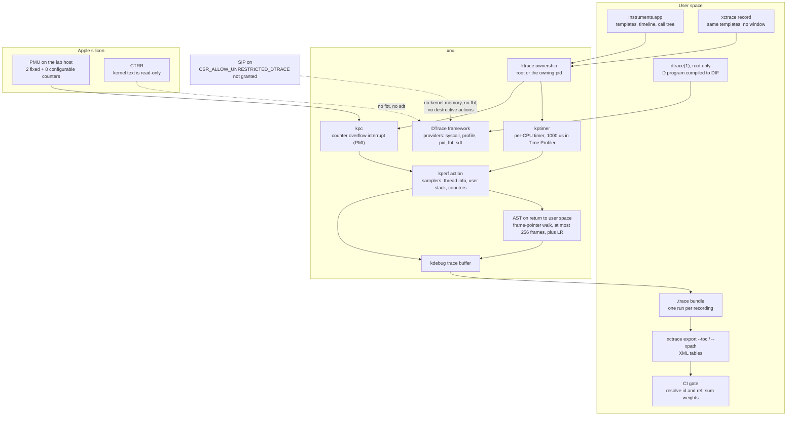

# macOS Instruments, xctrace, and DTrace

> [!summary] Claim:
> Instruments is a front end: the samples come from three xnu facilities, kperf (sampling actions fired by a timer or by a PMU interrupt), kpc (the PMU counters, grouped into classes), and kdebug (the trace buffer both write into), and `xctrace` drives the same recorder without a window.
> Time Profiler fires a per-CPU timer every 1000 us and walks the user stack by frame pointers on the way back to user space; CPU Profiler replaces the timer with an interrupt every 1,000,000 `CORE_ACTIVE_CYCLE` counts.
> `xctrace export` turns a `.trace` bundle into XML tables in which every repeated value is an `id` once and a `ref` afterwards, so a reader that does not resolve references keeps a few percent of the data.
> DTrace still ships, but three independent gates decide what it can do: root, the System Integrity Protection bit `CSR_ALLOW_UNRESTRICTED_DTRACE`, and on Apple silicon the read-only kernel text region (CTRR), which removes the `fbt` and `sdt` kernel providers whatever SIP says.



## The Mechanism

Every statement about kernel behavior in this note is from the xnu source at tag `xnu-12377.121.6`, the newest public tag when this note was written.
The lab host ran a newer kernel (`xnu-13432.41.4`, macOS 27.2), whose source is not public yet, so where the running system and the public source disagree the text says so.
Every statement about tool output is from the lab in `code/05-Profiling/xctrace_automation/`, recorded on macOS 27.2 with Xcode 27.2 on an Apple M3 Pro.

### 1. Three layers: template, kernel sampler, trace bundle

An Instruments template is a named set of instruments, and each instrument is a consumer of one or more kernel data sources.
`xctrace list templates` and `xctrace list instruments` print what the installed Xcode offers.
`xctrace record` starts the recording, and `xctrace export` reads the result back as XML.

The command-line history explains what a CI script can rely on:

| Xcode | Change | Source |
| :--- | :--- | :--- |
| 12 | The `instruments` command is deprecated in favor of `xctrace`; `xctrace export` can export Analysis Core tables | Xcode 12 release notes |
| 13 | The `instruments` command is removed; a CPU Profiler template samples on cycle-based PMIs; `xctrace export --har` | Xcode 13 release notes |
| 14.3 | `xctrace export` includes a parsable backtrace per row, with an address and a symbol name per frame | Xcode 14.3 release notes |
| 16.3 | Processor Trace instrument, on M4 Macs and iPads and iPhone 16 | Xcode 16.3 release notes |
| 26 | CPU Counters reworked around guided "Bottleneck Analysis" modes; `xctrace record --run-name` | Xcode 26 release notes |
| 27 | `xctrace record --show-recording-options` and `--recording-options`; `xctrace export` accepts `.atrc` and `.logarchive` input and time ranges | Xcode 27 release notes |

`xctrace` 27.2 also has `show`, `toc`, and `triage` subcommands, which print a call tree, a track listing, or a hang report as text.
They are documented only in `xctrace help` on this host and appear in none of the release notes listed in this note's sources, so treat their output format as less stable than the XML export (as of 2026-11, macOS).

### 2. kperf: triggers, actions, samplers

kperf separates when to sample from what to record.
A trigger is a timer, a PMU counter overflow, or a kdebug event; an action is a numbered bundle of samplers that a trigger runs.
`osfmk/kperf/action.h` lists the samplers as bits, among them `SAMPLER_TH_INFO`, `SAMPLER_KSTACK`, `SAMPLER_USTACK`, `SAMPLER_PMC_THREAD`, `SAMPLER_PMC_CPU`, and `SAMPLER_TH_SCHEDULING`.
`ACTION_MAX` in `action.c` allows 32 actions and `KPTIMER_MAX` in `kptimer.c` allows 8 timers.

The timer trigger is per CPU.
The header comment of `kptimer.c` describes it: each configured timer schedules CPU-local timers, "As each timer fires, that CPU samples itself and schedules another timer to fire at the next deadline", and "The first timer to fire across all CPUs determines that deadline", which keeps all CPUs on one cadence.
An action can carry a pid filter (`pid_filter` in `action.c`), and a sample whose current process does not match is dropped, which is why a Time Profiler recording of one process holds only samples in which that process was on a CPU.

Time Profiler's settings are visible in the trace's table of contents.
The lab reads `sample-rate-micro-seconds=1000`, `callstack=user`, and `all-thread-states=NO` from the `time-sample` table of a default recording, so the default is a 1 ms period, user stacks only, running threads only.
With `highFrequencySampling` set, the same attribute reads 100, a 10 kHz sample rate.
The kernel's floor is lower still: `kperf.limits.timer_min_period_ns` is 50000 on the lab host.

#### Why the user stack is not walked in the interrupt

A timer or PMU interrupt can arrive while the thread's user stack pages are not resident, and an interrupt handler cannot take a page fault.
So `kperf_sample()` is called with `SAMPLE_FLAG_PEND_USER`, and for the user stack it calls `kperf_ucallstack_pend()`, which sets `T_KPERF_AST_CALLSTACK` on the thread through `kperf_ast_pend()`.
The stack is collected by the AST handler when the thread is about to return to user space, where faults are legal.

The walker is `backtrace_user()` in `osfmk/kern/backtrace.c`.
It follows the frame-pointer chain, copying one frame record at a time from user memory: the caller's frame pointer, and one word above it the return address.
On arm64e both are signed, and the walker strips the pointer authentication bits; its comment reads "Return addresses are signed by arm64e ABI, so strip off the auth".
The same function follows Swift async frames, which it recognizes by bit 60 of the saved frame pointer.
`MAX_UCALLSTACK_FRAMES` in `callstack.h` caps a user stack at 256 frames, and `MAX_KCALLSTACK_FRAMES` caps a kernel stack at 128.

No DWARF is involved, which is why the walk is cheap enough to run a thousand times a second, and it works because the platform ABI makes the chain reliable.
Apple's arm64 ABI document says "The frame pointer register (`x29`) must always address a valid frame record" and adds that "Some functions - such as leaf functions or tail calls - may opt not to create an entry in this list".
That second sentence has two visible consequences, and the lab shows both.

A leaf function without a frame record leaves `x29` pointing at its caller's record, and that record holds the return address into the caller's caller.
A pure frame-pointer walk from the leaf would therefore skip the caller.
kperf compensates in `callstack_fixup_user()`, which appends the thread's saved link register to the frame list on arm64 (and the word at the stack pointer on x86_64), because at that moment the link register is the only place that still names the caller.
In the lab, `hot_leaf` has no `stp x29, x30` in its prologue, and the profile still shows `start;main;middle;hot_leaf`.

A tail call does the opposite: the caller pops its own frame record and branches, so it is not on the stack at all while the callee runs.
In the lab, `middle` reaches `warm_leaf` with `b _warm_leaf` instead of `bl`, and the profile shows `start;main;warm_leaf`, with no `middle`.
No profiler that reads the stack can recover that frame, because the information is gone before the sample is taken.

#### Waiting threads: PET

Sampling "all thread states" cannot be done by a per-CPU timer, because a blocked thread is on no CPU.
`osfmk/kperf/pet.c` implements Profile Every Thread, and its header comment ties it to the tool: PET "supports the 'record waiting threads' mode in Instruments".
Traditional PET wakes a kernel thread that walks every task and thread, and the comment warns that this "can take on the order of milliseconds" and "perturbs the timer cadence by the duration of PET sampling".
Lightweight PET avoids the walk: each thread checks a generation count when it is switched on-core and samples itself if a sampling period has passed.
The cost shows up in the default rate: with `recordWaitingThreads` set, the lab reads `sample-rate-micro-seconds=5000` and `all-thread-states=YES`, five times slower than the default.

#### Where the samples go

kperf does not have its own output channel.
`BUF_DATA` in `osfmk/kperf/buffer.h` expands to `KDBG_RELEASE`, so each sample is a group of kdebug events in class `DBG_PERF`, written to the same trace buffer as scheduler and system call events.
That is why the table of contents of a Time Profiler trace lists `kdebug` tables next to `time-sample`.

kdebug and kperf share one owner at a time.
`bsd/kern/kern_ktrace.c` says that when ktrace is unconfigured "any root process can take ownership", and that in foreground mode "if the owning process is still running, only it may configure ktrace".
A different process that tries gets `EBUSY` from `ktrace_configure()`, so two independent ktrace clients cannot both configure it.

### 3. kpc: the PMU as counter classes

kpc exposes the CPU's performance monitoring unit as arrays of counters grouped by class (`osfmk/kern/kpc.h`):

| Class | Value | Meaning in `kpc.h` |
| :--- | :--- | :--- |
| `KPC_CLASS_FIXED` | 0 | "The fixed instructions and cycles (and on Intel, reference cycles) counters" |
| `KPC_CLASS_CONFIGURABLE` | 1 | "The configurable counters that can be programmed with microarchitecture-specific events" |
| `KPC_CLASS_POWER` | 2 | "The set of configurable counters reserved by power management services" |
| `KPC_CLASS_RAWPMU` | 3 | "Only for configuration, allows setting extra CPMU registers as if they were counter configurations" |

On arm64, `osfmk/arm64/kpc.c` fixes `KPC_ARM64_FIXED_COUNT` at 2 and derives the configurable count as `CPMU_PMC_COUNT - KPC_ARM64_FIXED_COUNT`.
Counters are 47 bits wide, or 63 where the chip has `CPMU_64BIT_PMCS`.
`kpc_get_classes()` in that file returns the fixed, configurable, and raw-PMU masks, which is the value 11.
The power class is not a fixed set: `kpc_get_configurable_pmc_mask()` in `kpc_common.c` gives it counters only when power management has registered for them and no task has forced all counters.

The event names live in user space, in `/usr/share/kpep/`, one property list per CPU family.
The lab finds the file for the running CPU by formatting `hw.cputype`, `hw.cpusubtype`, and `hw.cpufamily` in hexadecimal, and reads these facts from it on an M3 Pro:

- `fixed_counters` is `0x3`: counter 0 is `FIXED_CYCLES` and counter 1 is `FIXED_INSTRUCTIONS`, with the aliases `Cycles` and `Instructions`.
- `config_counters` is `0x3fc`: counters 2 to 9, eight configurable counters.
- `power_counters` is `0xe0`: counters 5, 6, and 7.
- Many events carry a `counters_mask` that limits them to a subset of the configurable counters, while `CORE_ACTIVE_CYCLE` has no mask and can be placed on any of them.

The relation between the `power_counters` field and `KPC_CLASS_POWER` is not documented anywhere this note could fetch.
UNVERIFIED: the property list format has no public specification, so reading `0xe0` as "the counters power management may claim" is an inference from the field name and the class comment.

The counter restrictions are why a list of eight events is not always schedulable: two events that both need counter 7 cannot be counted in one run.

The running kernel on the lab host reports `kpc.classes` as 27, binary `11011`.
Bits 0, 1, and 3 are the fixed, configurable, and raw-PMU classes, and bit 2, power, is clear.
UNVERIFIED: bit 4 is set on macOS 27.2 and has no definition in `kpc.h` at `xnu-12377.121.6`, so its meaning cannot be stated from public source.

Access is asymmetric.
`kpc_sysctl()` in `bsd/kern/kern_kpc.c` leaves the class and count queries open and requires `ktrace_read_check()` for everything else, with the comment "This is either root or the blessed pid".
A normal user can ask what the PMU looks like, but cannot read or program a counter directly.

#### From counter to sample: PMI

A counter can be given a period and a kperf action (`kpc_set_period()` and `kpc_set_actionid()` in `kpc_common.c`).
When the counter overflows, the PMU raises a performance monitoring interrupt, and `kpc_sample_kperf()` calls `kperf_sample()` with the same `SAMPLE_FLAG_PEND_USER` path the timer uses.

This is the CPU Profiler template.
The Xcode 13 release notes introduce it as "analyzing CPU workloads using Cycle-based Performance Monitoring Interrupts (PMIs)" and say it "provides a more stable measurement for code running on Performance or Efficiency CPUs".
The lab's table of contents shows the configuration: `pmi-event=CORE_ACTIVE_CYCLE`, `pmi-threshold=1000000`.
The exported rows carry a `Cycles` weight instead of a time weight, the weights differ from row to row, and the largest one is the threshold plus a small overshoot, the interrupt's skid.

The difference from Time Profiler matters on asymmetric cores.
A time sample has the same 1 ms weight on a performance core and on an efficiency core, although the two execute different amounts of work in that millisecond.
A cycle sample is taken after the same number of active cycles on either core type.
[[Linux-perf-in-Depth-and-perf-c2c]] covers the same choice between `cpu-clock` and `cycles` events on Linux.

#### CPU Counters and Processor Trace

The CPU Counters template counts events instead of sampling stacks on them.
Since Xcode 26 its default is a guided mode: the release notes say the CPU Bottlenecks configuration breaks "sustainable CPU bandwidth into four broad categories", Useful, Instruction Delivery, Instruction Processing, and Discarded.
The same notes list a known issue, "No data is present when recording the CPU Counters on macOS devices in the 'Streaming SME Bottlenecks' or 'Instruction Processing Bottlenecks' modes", so check that a mode returns data on your hardware before building a gate on it (as of 2026-11, macOS).

Processor Trace, added in Xcode 16.3, records control flow in hardware instead of sampling, and the release notes limit it to M4 Macs and iPads and iPhone 16.
[[Intel-VTune-AMD-uProf-and-Hardware-Tracing-PT-SPE]] owns hardware tracing; this note stops at the sampling instruments.

### 4. xctrace: record, table of contents, export

`xctrace record` needs a template and a target.
The target is `--launch -- command`, `--attach <pid|name>`, or `--all-processes`, and `--time-limit` or the target's exit ends the recording.
The output is a `.trace` bundle, a directory, and `--append-run` adds another run to an existing bundle.

```bash
xcrun xctrace record --template 'Time Profiler' --output run.trace --no-prompt \
    --target-stdout /dev/null --launch -- ./workload 120
xcrun xctrace export --input run.trace --toc --output toc.xml
xcrun xctrace export --input run.trace \
    --xpath '/trace-toc/run[@number="1"]/data/table[@schema="time-profile"]' --output samples.xml
```

`export --toc` prints a `<trace-toc>` document: one `<run>` per recording, with the target process, the template name, and a `<data>` element holding one `<table>` per stored table.
Each table has a `schema` attribute and, for many schemas, attributes that record how it was configured, such as `sample-rate-micro-seconds` on `time-sample`.
`export --xpath` takes an XPath over that same document and writes every table it selects.

The export format has four rules that a reader must implement, and the lab's `trace_xml.py` is a reader of about 130 lines that does.

1. A `<node>` holds a `<schema>` with one `<col>` per column, then `<row>` elements whose children are the cells in column order.
2. An empty cell is `<sentinel/>`, and the stack column can hold one: while the lab was written, the last sample of an exiting process had no backtrace.
3. A cell's text is the raw value and its `fmt` attribute is the display string: a weight is `1000000` with `fmt="1.00 ms"`.
4. A value is written in full once, with `id="N"`, and every later use is an empty element with `ref="N"`.

The fourth rule is where scripts go wrong.
Ids are unique across the whole document, not per row and not per node, and a reference can stand for a whole backtrace, for one frame inside a new backtrace, or for the binary inside a frame.
In the lab's Time Profiler export more than 90% of rows carry their backtrace as a `ref`, because a CPU-bound loop produces the same stack over and over.
A reader that looks only for inline frames keeps under 10% of the sample weight and reports no error.

Two more details matter for automation.
An XPath selects every table that matches, and a second table of an already printed schema repeats only its rows: the lab's predicate on `os-signpost` and the Points of Interest category matches 2 tables holding the same two events.
`time-profile` is the modeled table that the call tree is built from, and `time-sample` is the raw kperf sample table; a gate should read the first.

The weight column needs care.
The schema's own documentation, exported with the table, says "The weight is a unit of time, but it does not represent a duration on the CPU".
Each Time Profiler row has the fixed weight of one sampling period, so summing weights estimates on-CPU time and says nothing about time spent waiting.

### 5. Recording options

`--template` accepts a path to a template saved from Instruments as well as a built-in name.
Xcode 27 added two flags to `xctrace record` that set an instrument's options, such as high-frequency sampling, without a saved template.
`--show-recording-options` prints the selected template's options as JSON without recording, and `--recording-options <file>` applies a JSON file.

The file must be the whole document with values changed.
The lab passes a file that holds only `{"Time Profiler": {"highFrequencySampling": true}}`, and `xctrace` refuses to start; the full document with that one value flipped is accepted.
For Time Profiler the keys are `contextSwitchSampling`, `highFrequencySampling`, `recordKernelStacks`, and `recordWaitingThreads`, all false by default (as of 2026-11, macOS).

### 6. Signposts: your own table in the same trace

A sampling profile says where time went, not which request or phase it belonged to.
Signposts supply that: `os_signpost_interval_begin` and `os_signpost_interval_end` in C, or `OSSignposter` in Swift, write begin and end events through the unified logging system.
A log handle created with the category `OS_LOG_CATEGORY_POINTS_OF_INTEREST` lands in the Points of Interest instrument, which the Time Profiler template includes.

The lab wraps its computation in one interval named `compute`.
The export shows a Begin row and an End row with timestamps on the same trace-relative clock as the samples, and the formatted message `rounds=120` decoded from the format string and its argument.
Joining the two tables by time is then arithmetic: at least 98% of the samples fall inside the interval, and the on-CPU weight inside it does not exceed its wall-clock length.

### 7. DTrace: the design, and what macOS lets it do

DTrace is the oldest of these mechanisms and the only one that is programmable.
The design is in Cantrill, Shapiro, and Leventhal's 2004 paper.
Providers are kernel modules that publish probes, and "Each probe is thus uniquely identified by a 4-tuple: < provider, module, function, name >".
A D program attaches a predicate and actions to probes, and the compiler lowers it to DIF, a small virtual instruction set run in probe context.
Safety is structural: "To prevent DIF from inducing an infinite loop in probe context, only forward branches are permitted".
The cost when unused is the selling point: "When not explicitly enabled, DTrace has zero probe effect".
[[eBPF-bpftrace-ftrace-uprobes-and-USDT]] covers the Linux successor to this design, including USDT probes, which DTrace introduced.

xnu registers these providers in `bsd/dev/dtrace/`:

| Provider | File | How it instruments | Privilege it is registered with |
| :--- | :--- | :--- | :--- |
| `syscall`, `mach_trap` | `systrace.c` | Swaps the handler pointer in the system call table for `dtrace_systrace_syscall` | `DTRACE_PRIV_USER` |
| `profile`, `tick` | `profile_prvd.c` | Cyclic timers: one for `tick-N`, one per CPU for `profile-N` | `DTRACE_PRIV_KERNEL \| DTRACE_PRIV_USER` |
| `pid`, USDT helpers | `fasttrap.c` | Rewrites instructions in the traced process | `DTRACE_PRIV_PROC \| DTRACE_PRIV_OWNER \| DTRACE_PRIV_ZONEOWNER` |
| `fbt` | `fbt.c` | Rewrites kernel function entry and return instructions | `DTRACE_PRIV_KERNEL` |
| `sdt` family: `proc`, `io`, `sched`, `vminfo`, `tcp`, `ip`, and others | `sdt.c`, `sdt_subr.c` | Rewrites static probe sites in kernel text | `DTRACE_PRIV_KERNEL` |
| `lockstat` | `lockstat.c` | Kernel lock probes | `DTRACE_PRIV_KERNEL` |

Three gates sit in front of them.

#### Gate 1: root

`dtrace` opens the DTrace device, and an unprivileged user is refused.
The lab runs `dtrace -l` as a normal user and gets exit status 1, no probes, and "failed to initialize dtrace: DTrace requires additional privileges".

#### Gate 2: System Integrity Protection

`bsd/sys/csr.h` defines `CSR_ALLOW_UNRESTRICTED_DTRACE` as bit 5 of the SIP configuration.
`dtrace_is_restricted()` in `dtrace_subr.c` is true when `csr_check(CSR_ALLOW_UNRESTRICTED_DTRACE)` fails, which is the default.
The `dtrace` command makes the same check and prints the line the lab records: "system integrity protection is on, some features will not be available".

With SIP on, and outside Apple-internal configurations, the kernel does the following to root's DTrace session:

- `dtrace_cred2priv()` grants `DTRACE_PRIV_USER | DTRACE_PRIV_PROC | DTRACE_PRIV_OWNER` instead of `DTRACE_PRIV_ALL`, so root holds none of the privilege that `fbt`, `lockstat`, and the `sdt` family are registered with, and `fbt_provide_module()` also returns without creating probes.
- `dtrace_priv_kernel()` fails, which is the man page's "D programs are not permitted to access kernel address values or kernel memory contents".
- `dtrace_init()` sets `dtrace_destructive_disallow`, and the man page confirms that "Even with -w, destructive actions are not allowed if System Integrity Protection is enabled".
- `dtrace_priv_proc()` fails for a traced process that `dtrace_can_attach_to_proc()` rejects, and that function rejects any process with the `CS_RESTRICT` code-signing flag.
- The same check stops a restricted process from registering USDT helper probes, with `EACCES`.
- `dtrace -A`, anonymous boot-time tracing, exits with "system integrity protection restricts the use of anonymous tracing".

Apple's SIP guide states the user-visible result: "DTrace cannot be used to inspect system processes, whether from the Instruments application or the dtrace(1) command-line tool", and it adds that SIP "does not prevent you from inspecting your own apps when you're developing them".

#### Gate 3: read-only kernel text on Apple silicon

`fbt` and `sdt` work by rewriting kernel instructions, and on Apple silicon the kernel text is locked by a hardware register after boot.
`dtrace_fbt_probes_restricted()` and `dtrace_sdt_probes_restricted()` both begin with `if (!ml_unsafe_kernel_text()) return TRUE;`.
`ml_unsafe_kernel_text()` in `osfmk/arm64/machine_routines.c` is true only when the boot loader's `kernel-ctrr-to-be-enabled` property is 0.
When it is false, `fbt_provide_module()` returns without creating probes and `sdt_init()` returns before attaching, so there are no `fbt` probes and no kernel `sdt` providers, with SIP on or off.

The only documented way to change that property is `bputil --disable-kernel-ctrr`, whose manual page says the option "automatically downgrades to Permissive Security mode" and is "sometimes required for performing actions such as using dynamic DTrace code hooks to profile kernel behavior".

#### What is left on a stock Apple silicon Mac

Reading the gates together, root on a default configuration keeps the providers whose registration includes a non-kernel privilege: `syscall`, `mach_trap`, and `profile`, plus the `pid` provider and USDT probes on processes that are not `CS_RESTRICT`.
For a signed process with `CS_HARD` or `CS_KILL` set, `fasttrap.c` must also get `cs_allow_invalid()` to succeed before it rewrites the process's text, and returns `EACCES` when it does not.
UNVERIFIED: this note's author had no root on the lab host, so none of the DTrace statements past Gate 1 were executed; they are read from the source at the pinned tag.

The intended invocations are standard D, shown here unexecuted:

```bash
# Count system calls made by one command (syscall provider, -c sets $target).
sudo dtrace -n 'syscall:::entry /pid == $target/ { @[probefunc] = count(); }' -c ./workload

# Sample user stacks of one process at 997 Hz (profile provider).
sudo dtrace -n 'profile-997 /pid == $target/ { @[ustack()] = count(); }' -p 12345
```

Lifting Gate 2 means booting into Recovery and running `csrutil disable`, which Apple documents with the warning to "Disable SIP only temporarily".
UNVERIFIED: the `csrutil` binary on macOS 27.2 contains the strings `--without` and `dtrace`, which matches the widely used `csrutil enable --without dtrace`, but neither the usage text nor the manual page documents it and it cannot be run outside Recovery.

### 8. Tools next to Instruments

`sample` is the zero-setup alternative for one process: its manual page says it "suspends the process at specified intervals (by default, every 1 millisecond), records the call stacks of all threads in the process at that time, then resumes the process", for 10 seconds by default.
It runs in user space and stops the target for each sample, where kperf samples in the kernel without suspending anything.

`samply` is a command-line sampling profiler for macOS and Linux that does not go through Instruments; [[Cpp-CPU-Profiling-perf-samply-Callgrind-and-llvm-mca]] and [[Rust-CPU-Profiling-cargo-flamegraph-samply-and-Frame-Pointers]] own it.
Brendan Gregg's `stackcollapse-instruments.pl` converts a call tree copied out of the Instruments window with Edit > Deep Copy into folded stacks; the lab produces folded stacks from the XML export instead, which needs no window.
[[Rebuild-Lab-Sampling-Profiler-to-Folded-Stacks]] builds the folded format from first principles.

## Commands and Numbers to Know

| Item | Value | Platform and date | Where it comes from |
| :--- | :--- | :--- | :--- |
| Time Profiler sampling period | 1000 us | macOS (as of 2026-11) | Lab: `sample-rate-micro-seconds` on `time-sample` |
| Time Profiler weight per sample | 1,000,000 ns | macOS (as of 2026-11) | Lab: only distinct value in the weight column |
| High-frequency sampling period | 100 us, weight 100,000 ns | macOS (as of 2026-11) | Lab: `highFrequencySampling=true` |
| Waiting-threads sampling period | 5000 us, `all-thread-states=YES` | macOS (as of 2026-11) | Lab: `recordWaitingThreads=true` |
| `kperf.limits.timer_min_period_ns` | 50000 | macOS (as of 2026-11) | Lab: sysctl on the M3 Pro host |
| `kperf.limits.timer_min_pet_period_ns` | 1000000 | macOS (as of 2026-11) | Lab: sysctl on the M3 Pro host |
| CPU Profiler trigger | `CORE_ACTIVE_CYCLE`, every 1,000,000 counts | macOS (as of 2026-11) | Lab: `pmi-event`, `pmi-threshold` |
| User stack depth cap | 256 frames | macOS (as of 2026-11) | `MAX_UCALLSTACK_FRAMES`, `callstack.h` |
| Kernel stack depth cap | 128 frames | macOS (as of 2026-11) | `MAX_KCALLSTACK_FRAMES`, `callstack.h` |
| kperf timers and actions | 8 timers, 32 actions | macOS (as of 2026-11) | `KPTIMER_MAX`, `ACTION_MAX` |
| kpc classes | fixed 0, configurable 1, power 2, raw PMU 3 | macOS (as of 2026-11) | `kpc.h` |
| Fixed counters on arm64 | 2: cycles, instructions | macOS (as of 2026-11) | `KPC_ARM64_FIXED_COUNT`; lab: mask `0x3` |
| Configurable counters, M3 Pro | 8, mask `0x3fc` | macOS (as of 2026-11) | Lab: kpep database |
| Counter width on arm64 | 47 bits, or 63 with `CPMU_64BIT_PMCS` | macOS (as of 2026-11) | `osfmk/arm64/kpc.c` |
| `kpc.classes` | 27 on macOS 27.2; 11 in public source | macOS (as of 2026-11) | Lab; `kpc_get_classes()` |
| SIP bit for DTrace | `CSR_ALLOW_UNRESTRICTED_DTRACE`, `1 << 5` | macOS (as of 2026-11) | `bsd/sys/csr.h` |
| `sample` defaults | 1 ms interval, 10 s duration | macOS (as of 2026-11) | `sample(1)` |
| `xctrace record` targets | `--launch -- cmd`, `--attach <pid\|name>`, `--all-processes` | macOS (as of 2026-11) | `xctrace help record` |
| `xctrace record` limits | `--time-limit <time[ms\|s\|m\|h]>`, `--window <duration[ms\|s\|m]>` | macOS (as of 2026-11) | `xctrace help record` |
| `xctrace record` options | `--show-recording-options`, `--recording-options <file>` | macOS (as of 2026-11) | Xcode 27 release notes |
| `xctrace export` modes | `--toc`, `--xpath <expression>`, `--har` | macOS (as of 2026-11) | `xctrace help export` |
| `xctrace symbolicate` | `--input <trace> --dsym <path>` | macOS (as of 2026-11) | `xctrace help symbolicate` |

## Multi-Language Comparison

The kernel samples machine frames, so what a language shows in Instruments depends on whether its frames are machine frames and whether they keep a frame record.

| Concern | C and C++ (Apple clang) | Rust | Python (CPython 3.15) |
| :--- | :--- | :--- | :--- |
| Frame records on arm64 macOS | Required by the platform ABI; leaves and tail calls may omit them, as the lab's `hot_leaf` and `middle` do | The Apple target base sets `FramePointer::NonLeaf` for arm64 targets, the same rule | A Python call does not create a machine frame of its own; only the interpreter's C functions have frame records |
| What a kperf stack shows | Your functions | Your functions | The interpreter's C functions, unless a trampoline gives each Python function a machine frame |
| Getting language-level frames | Nothing to do | Nothing to do | `python -m profiling.sampling`, which on macOS uses `task_for_pid()` and needs root, the `com.apple.security.cs.debugger` entitlement, or SIP off; or the perf trampoline with samply, supported on macOS from Python 3.15 |
| Known macOS limit | Tail calls remove the caller from every sample | Same as C | The perf-map HOWTO says samply "can't profile signed Python executables due to restrictions by macOS" |
| Phase markers | `os_signpost_interval_begin` and `os_signpost_interval_end`, used in the lab | Nothing in the standard library; needs a binding to the C API | Nothing in the standard library; needs a binding to the C API |

The Rust row reflects `rust-lang/rust` master and the Python rows reflect the Python 3.15 documentation, both read in 2026-11.
[[Python-cProfile-Tachyon-and-Sampling-Profilers]] owns the Python profilers.

## Worked Lab Example

The lab is `code/05-Profiling/xctrace_automation/`; `run.sh` is tagged `# requires: macos` and needs Xcode for `xctrace` and `otool`, no root, and no network.

The design problem is that a profile is statistical and a lab's output must be identical on every run.
The lab solves it with a workload whose answer is known in advance and by printing only two kinds of line: values read from the tools, and yes or no answers to questions with a band around the expected value.
Any "no" also makes `report.py` exit non-zero.

`workload.c` runs `middle()` 120 times.
`middle()` spends three units of work in `hot_leaf()` and one in `warm_leaf()`, two loops of the same shape, so a correct profiler must report about 75% and 25%.
The whole loop sits inside one signpost interval named `compute`.

`run.sh` does the following:

1. It runs `selftest.py`, which prints nothing and fails the lab if `trace_xml.py` accepts a hand-built export that breaks a format rule: a duplicate id, a `ref` to a missing id, a `ref` that resolves to a different element, a row with too few cells, a first node without a schema, or the wrong root element.
2. It compiles the workload with `"${CC:-cc}" -O1 -g -fno-omit-frame-pointer`.
3. It records the workload with the Time Profiler template and exports the table of contents, the `time-profile` table, and the Points of Interest signpost table, then asks `xctrace show --calltree` for the same call tree as text.
4. It records the workload again with the CPU Profiler template and exports its table of contents and `cpu-profile` table.
5. It prints the Time Profiler recording options, writes three variants with `options.py`, and makes three more attempts: a partial options file, which must be refused, and short recordings with `highFrequencySampling` and with `recordWaitingThreads`.
6. It runs `report.py`, which resolves every `id` and `ref`, builds leaf shares and folded stacks, joins samples to the signpost interval, reads the PMU database in `/usr/share/kpep`, and probes `dtrace` as a normal user.

```bash
cd code/05-Profiling/xctrace_automation
bash run.sh
```

### Verified output

Recorded by `python3 -m _harness.verify --record` on darwin-arm64 (macOS 27.2, Xcode 27.2, Apple M3 Pro) on 2026-11-10 and re-checked by `python3 -m _harness.verify`; the file is `code/05-Profiling/xctrace_automation/expected/darwin-arm64.txt`.

```text
== 1. The binary under test (otool -tV)
hot_leaf saves a frame record (stp x29, x30): no
middle calls hot_leaf with: bl _hot_leaf
middle reaches warm_leaf with: b _warm_leaf

== 2. Time Profiler: xctrace record, then export --toc
template-name: Time Profiler
target: type=launched name=workload return-exit-status=0
toc lists exactly one time-profile table: yes
toc lists exactly one time-sample table: yes
time-sample: sample-rate-micro-seconds=1000 callstack=user all-thread-states=NO
time-profile: high-frequency-sampling=0 record-waiting-threads=0 needs-kernel-callstack=0

== 3. Time Profiler: export --xpath, id/ref resolved
columns: time thread process core thread-state weight stack
weight column: name=Weight engineering-type=weight
at least 500 samples: yes
distinct sample weights (ns): 1000000
thread states sampled: Running
more than 90% of rows carry their backtrace as a ref: yes
a reader that skips ref rows keeps under 10% of the weight: yes
under 1% of rows have an empty backtrace cell: yes

== 4. Time Profiler: where the time went (designed 3:1)
hot_leaf self weight in [70, 80] %: yes
warm_leaf self weight in [20, 30] %: yes
the two leaves hold more than 98% of the weight: yes
heaviest two folded stacks:
  start;main;middle;hot_leaf
  start;main;warm_leaf
xctrace show --calltree agrees on hot_leaf within 0.5 points: yes

== 5. Signpost interval from the same trace
tables matched by the XPath: 2
distinct compute events: Begin End
exactly one Begin and one End: yes
Begin message: rounds=120
at least 98% of samples fall inside the interval: yes
on-CPU weight inside the interval does not exceed its wall time (2% slack): yes

== 6. CPU Profiler: the same workload sampled by a PMU counter
template-name: CPU Profiler
toc lists exactly one kdebug-counters-with-pmi-sample table: yes
pmi-event=CORE_ACTIVE_CYCLE pmi-threshold=1000000 callstack=user
weight column: name=Cycles engineering-type=cycle-weight
at least 500 samples: yes
sample weights are not all equal: yes
the largest weight is the PMI threshold plus under 5% skid: yes
hot_leaf share of cycles in [70, 80] %: yes

== 7. Recording options (--show-recording-options, --recording-options)
instruments with options: Hangs, Points of Interest, Time Profiler
Time Profiler defaults: contextSwitchSampling=false highFrequencySampling=false recordKernelStacks=false recordWaitingThreads=false
a file holding only the changed key is rejected: yes
highFrequencySampling=true -> sample-rate-micro-seconds=100 all-thread-states=NO
  distinct sample weights (ns): 100000
  hot_leaf self weight still in [70, 80] %: yes
recordWaitingThreads=true -> sample-rate-micro-seconds=5000 all-thread-states=YES

== 8. The PMU as the kernel describes it
/usr/share/kpep has a database named after hw.cputype, hw.cpusubtype, hw.cpufamily: yes
fixed_counters mask: 0x3 (2 counters)
config_counters mask: 0x3fc (8 counters)
power_counters mask: 0xe0 (3 counters)
the fixed and configurable masks do not overlap: yes
the power mask is a subset of the configurable mask: yes
fixed events: FIXED_CYCLES=counter0 FIXED_INSTRUCTIONS=counter1
aliases: Cycles->FIXED_CYCLES Instructions->FIXED_INSTRUCTIONS
the CPU Profiler's PMI event CORE_ACTIVE_CYCLE is in the database: yes
CORE_ACTIVE_CYCLE may be programmed on any configurable counter: yes
more than 10 events are restricted to a subset of the counters: yes
every restricted event's mask is a subset of the configurable mask: yes
kpc.classes: 27 (0b11011) -> FIXED=yes CONFIGURABLE=yes POWER=no RAWPMU=yes
kperf.limits.timer_min_period_ns: 50000
kperf.limits.timer_min_pet_period_ns: 1000000

== 9. DTrace as an unprivileged user
running as a non-root user: yes
System Integrity Protection status: enabled.
dtrace -l: exit 1, 0 probes listed
  dtrace: system integrity protection is on, some features will not be available
  dtrace: failed to initialize dtrace: DTrace requires additional privileges
```

### Reading the result

- Section 1 is the ground truth from the disassembly: `hot_leaf` has no frame record, `middle` calls it with `bl`, and `middle` reaches `warm_leaf` with a plain branch, a tail call.
- Section 4 is the profiler's view of the same code: `middle` appears above `hot_leaf` although the frame-pointer chain alone would skip it, and `middle` is absent above `warm_leaf` because it was already gone from the stack.
- Section 3 shows why the reference rule matters: more than 90% of rows are references to an earlier backtrace, and a reader that skipped them would keep under 10% of the weight.
- Sections 4 and 6 agree on the answer by two different triggers: the timer puts `hot_leaf` between 70% and 80% of the time weight, and the PMU interrupt puts it between 70% and 80% of the cycles.
- Section 4's last line is an independent check: the share computed from the XML is within 0.5 points of what `xctrace show --calltree` prints for the same trace.
- Section 5 joins two tables from one trace by timestamp, and the weight check is the on-CPU rule in action: weight counts only the samples in which the thread was running, so it can fall short of the interval's wall-clock length and cannot exceed it.
- Section 6 shows that CPU Profiler weights are cycles, are not uniform, and top out at the PMI threshold plus under 5% skid.
- Section 7 gives the three sampling periods: 1000 us by default, 100 us with high-frequency sampling, and 5000 us when waiting threads are recorded.
- Section 8 is the PMU as described by the kpep database and the kernel: 2 fixed and 8 configurable counters on this CPU, and a `kpc.classes` value with one bit the public header does not define.
- Section 9 is DTrace's first two gates from user space: no root, so no probes, and the SIP notice printed before the failure.

## Pitfalls

> [!warning] Pitfall: parsing rows without resolving `ref`
> The export writes each distinct value once and references it afterwards, with ids that are unique across the whole document.
> A script that reads only inline `<frame>` elements sees each distinct stack once, which for a hot loop is a few percent of the samples, and it fails silently.
> Build one id table for the document and resolve references at every depth: backtrace, frame, and binary.

> [!warning] Pitfall: reading `fmt` instead of the element text
> `fmt` is the display string, such as `1.00 ms`, with units that change with magnitude.
> The element text is the raw integer, in nanoseconds for time weights and in cycles for cycle weights.

> [!warning] Pitfall: an XPath that matches more than one table
> `xctrace export --xpath` writes every matching table, and a trace can hold several tables of one schema with different attributes.
> The lab's signpost predicate matches 2 tables with the same events, so a reader that concatenates rows would double every interval.
> Select by all the attributes that identify the table, or deduplicate by timestamp and event type.

> [!warning] Pitfall: treating weight as elapsed time
> A Time Profiler sample is a point in time with the fixed weight of one period, and by default only running threads are sampled.
> A function that waits on a lock or on I/O for 2 seconds contributes no samples.
> Compare weight with a signpost interval to see how much of the wall-clock time was on a CPU, and use the System Trace template or `recordWaitingThreads` when the time is off-CPU.

> [!warning] Pitfall: counting rows in a CPU Profiler export
> Cycle weights differ from row to row.
> Sum the weight column; do not count rows.

> [!warning] Pitfall: expecting every caller to be in the tree
> A tail call removes the caller from the stack before the callee runs, and an inlined function has no frame at all.
> When a function you know is on the path is missing from the call tree, check the disassembly for `b` instead of `bl` before you suspect the profiler.

> [!warning] Pitfall: a partial `--recording-options` file
> The file must contain every instrument and key that `--show-recording-options` printed.
> A file with only the changed key is rejected before recording starts.

> [!warning] Pitfall: assuming the DTrace one-liner from a Solaris or Intel Mac guide will work
> On Apple silicon with the default boot policy there are no `fbt` probes and no kernel `sdt` providers, so scripts built on `io:::start`, `proc:::exec-success`, `sched:::on-cpu`, or `fbt::` find no probes.
> With SIP on, kernel memory is unreadable and system processes cannot be traced.
> Decide what you need to observe first, then check which gate it is behind.

> [!warning] Pitfall: turning SIP off on a daily machine to get a trace
> `csrutil disable` removes protections for the whole system, and `bputil --disable-kernel-ctrr` moves the machine to Permissive Security.
> Use a dedicated test machine, and prefer Instruments' System Trace or a Linux host with eBPF when the question allows it.

> [!warning] Pitfall: gating CI on absolute times from a shared runner
> Load on the runner stretches wall-clock time and leaves the shape of the profile alone, which is why every check in the lab is a share, a ratio, or a count.
> Gate on those, not on seconds.

## At Scale

For one developer, Instruments.app is the right tool: record, look at the call tree, fix, record again.
The command line adds nothing until the measurement has to be repeated without a person.

For a team, the unit of work becomes a scripted recording in CI: `xctrace record` on a Mac runner, `xctrace export`, a parser, and a threshold.
What breaks at that size is trust in the number.
A gate needs a known-answer workload beside the real one, as the lab has, so that a parser bug, a schema change, or a noisy runner shows up as a failed self-check instead of a false regression.

For 1,000 to 50,000 engineers, the macOS fleet is developer laptops and CI hosts, not production servers, and that changes which tools carry weight:

- Continuous production profiling is a Linux problem; [[Continuous-Profiling-GWP-Parca-Pyroscope-and-OTel-Profiles]] owns it, and nothing in this note is a substitute.
- macOS profiling at that scale is about build tools, tests, and client applications, and the paved road is a shared wrapper around `xctrace` with pinned templates and a common parser.
- The Xcode version is part of the measurement: the release notes show the CLI gaining and changing features in almost every major version, and the lab's `expected` file exists so that an upgrade that changes a schema fails a check.
- Trace bundles are sensitive artifacts: the table of contents records the machine's name and hardware UUID and the full paths of every binary, so scrub or restrict them before attaching one to a ticket.
- SIP stays on for the fleet, which means DTrace is a lab-machine tool; a workflow that needs kernel probes is routed to a Linux host or to a small pool of dedicated test Macs with an owner.

Decision rules:

1. Use Time Profiler for a first look, and CPU Profiler when the runners or the workload mix performance and efficiency cores and the number must be comparable across runs.
2. Gate on shares and ratios from a known-answer workload plus the real workload; never gate on wall-clock seconds from a shared machine.
3. Read `time-profile` or `cpu-profile` through a reader that resolves references and is tested with broken inputs; do not parse the `fmt` strings or the text of `xctrace show`.
4. Mark phases with signposts in the product code and join by time, so that the gate measures "the import phase" and not "whatever ran during the recording".
5. Pin the Xcode version on the runner and re-record expected outputs as a reviewed change when it moves.
6. Record waiting threads, kernel stacks, or system-wide scope only when the question needs them; each one lowers the sample rate or widens what the trace contains.
7. Write the tool choice down per platform; [[Profiling-Decision-Records]] holds the format.

## Practice Drill

> [!tip] Practice Drill:
> Start from the lab and change one thing at a time, predicting the two folded stacks before each run.
> First, add `__attribute__((disable_tail_calls))` to `middle()` in a copy of `workload.c`, confirm with `otool -tV` that the branch to `warm_leaf` became `bl`, and predict which line of section 4 changes.
> Second, compile the original with `-O0` and predict whether `hot_leaf` gets a frame record and whether the shares stay inside their bands.
> Third, break the reader on purpose: make `Export.deref()` in a copy of `trace_xml.py` return the element unchanged, run `report.py`, and list which checks turn to "no" and which still pass.
> Fourth, write the gate you would ship: a script that exits non-zero when `hot_leaf` exceeds 60% of cycles, and run it against the lab's CPU Profiler export.
> If you have root on a test machine, finish with the two `dtrace` commands from the DTrace section and record which providers `sudo dtrace -l | awk '{print $2}' | sort -u` lists with SIP on.

## Interview Questions

> [!question] L5: What does Time Profiler measure, and what does it miss by default?
>
> > [!success]- Answer
> > It samples: a per-CPU kernel timer fires every 1000 us, and each firing records the stack of the thread running on that CPU if it belongs to the target.
> > Each sample gets the weight of one period, so the sum of weights estimates on-CPU time per function.
> > By default it records running threads only and user stacks only, so time spent blocked on a lock, sleeping, or waiting for I/O does not appear, and kernel frames are absent.
> > `recordWaitingThreads` and `recordKernelStacks` change that, and the first one lowers the default rate to one sample per 5000 us.

> [!question] L5: How do you take a CPU profile on macOS from a script, with no window?
>
> > [!success]- Answer
> > `xcrun xctrace record --template 'Time Profiler' --output run.trace --launch -- ./tool args` records until the tool exits, or `--attach <pid>` with `--time-limit 10s` for a running process.
> > `xcrun xctrace export --input run.trace --toc` lists the tables, and `--xpath` with a predicate on `@schema="time-profile"` writes the samples as XML.
> > The `instruments` command that older guides use was deprecated in Xcode 12 and removed in Xcode 13.

> [!question] L5 (debug this): A CI script counts `<frame>` elements in an `xctrace export` and reports that a 3-second CPU-bound run produced 6 stacks.
> What is wrong?
>
> > [!success]- Answer
> > The export deduplicates values: a backtrace is written in full once with an `id`, and every later row that has the same stack holds an empty `<tagged-backtrace ref="N"/>`.
> > A CPU-bound loop repeats a handful of stacks thousands of times, so almost every row is a reference and the script counts only the first occurrence of each.
> > The fix is to index every element that has an `id` across the whole document, resolve each `ref` at every depth, and sum the weight column of all rows.
> > The lab measures the damage: more than 90% of rows are references, and a reader that skips them keeps under 10% of the weight.

> [!question] L6 (predict the output): `main` calls `middle`, which calls `hot_leaf` and then returns `warm_leaf(x)`; it is compiled at `-O1` for arm64 macOS.
> Which stacks does Time Profiler report for the two leaves?
>
> > [!success]- Answer
> > `start;main;middle;hot_leaf` and `start;main;warm_leaf`.
> > The call to `hot_leaf` is a `bl`, so `middle`'s frame record is on the stack and its return address is in the link register while the leaf runs.
> > The call to `warm_leaf` is in tail position, so the compiler pops `middle`'s frame and emits `b _warm_leaf`; while `warm_leaf` runs, the link register points into `main` and nothing on the stack mentions `middle`.
> > The lab prints both the disassembly and the folded stacks, and they match this prediction.

> [!question] L6: `hot_leaf` has no frame record, so a frame-pointer walk starting at its PC should skip its caller.
> Why does the profile still show the caller?
>
> > [!success]- Answer
> > In a leaf without a frame record, `x29` still points at the caller's record, and that record's return address belongs to the caller's caller, so the walk alone yields leaf, grandparent, and so on.
> > The caller is named only by the link register, which holds the return address into it.
> > kperf's `callstack_fixup_user()` appends the saved link register to the frame list for exactly this case, and the consumer can then place the caller between the leaf and the rest of the chain.
> > On x86_64 the same function reads the word at the stack pointer, because there the return address is on the stack.

> [!question] L6: What is the difference between Time Profiler and CPU Profiler, and when does it change the answer?
>
> > [!success]- Answer
> > Time Profiler is triggered by a timer, so each sample stands for a fixed amount of time; CPU Profiler is triggered by a PMU counter overflowing, every 1,000,000 `CORE_ACTIVE_CYCLE` counts in the default template, so each sample stands for an amount of CPU work.
> > On a machine with performance and efficiency cores, a millisecond is not a fixed amount of work, so the same code can get different time shares depending on where the scheduler placed it.
> > Apple introduced CPU Profiler in Xcode 13 as "a more stable measurement for code running on Performance or Efficiency CPUs".
> > For a single-threaded loop that stays on one core type the two agree, as they do in the lab.

> [!question] L6: Why does kperf collect the user stack on the way back to user space instead of inside the timer interrupt?
>
> > [!success]- Answer
> > Walking a user stack means reading user memory, which can fault if a page is not resident, and an interrupt handler cannot sleep to service a fault.
> > `kperf_sample()` therefore runs with `SAMPLE_FLAG_PEND_USER`: it records what is safe in interrupt context and calls `kperf_ucallstack_pend()`, which sets an AST flag on the thread.
> > The AST runs in the thread's own context just before it returns to user space, where `backtrace_user()` can copy from user memory safely.
> > The registers have not changed in between, because the thread has not run user code since the interrupt.

> [!question] L7: A colleague's DTrace script that uses `fbt` and `io:::start` works on an Intel Mac with SIP disabled and finds no probes on an Apple silicon Mac with SIP disabled.
> Explain.
>
> > [!success]- Answer
> > Disabling SIP lifts only one gate, the `CSR_ALLOW_UNRESTRICTED_DTRACE` check behind `dtrace_is_restricted()`.
> > `fbt` and the kernel `sdt` providers, which include `io`, work by rewriting kernel instructions, and on Apple silicon the kernel text is made read-only by CTRR after boot.
> > `dtrace_fbt_probes_restricted()` and `dtrace_sdt_probes_restricted()` both return true when `ml_unsafe_kernel_text()` is false, so `fbt` creates no probes and `sdt_init()` returns before attaching.
> > The documented switch is `bputil --disable-kernel-ctrr`, which also drops the machine to Permissive Security, so the right answer for most questions is a different tool: System Trace in Instruments, the `syscall` and `profile` providers that need no text patching, or a Linux host.

> [!question] L7: Design a performance regression gate for a macOS command-line tool that runs on shared CI Macs.
>
> > [!success]- Answer
> > Record with `xctrace record --launch` using CPU Profiler, so samples are weighted in cycles and do not depend on which core type the scheduler chose.
> > Mark the phases that matter with signposts in the tool and select samples by joining on the interval timestamps, so the gate measures a named phase.
> > Export `cpu-profile` with a specific XPath, parse it with a reader that resolves references and is tested against malformed input, and compute shares and cycle totals per phase.
> > Gate on ratios against a baseline from the same runner image, and run a known-answer workload in the same job so that a broken parser or a changed schema fails a self-check before it produces a false regression.
> > Pin the Xcode version, store the trace bundle as a restricted artifact, and treat wall-clock seconds from a shared runner as untrusted.

> [!question] L7: The PMU on an M3 Pro has ten counters.
> Why can a request to count eight events at once still fail?
>
> > [!success]- Answer
> > Two of the ten are fixed to cycles and instructions, which leaves eight configurable counters.
> > The event database marks many events with a `counters_mask` that limits them to a subset, so several requested events may compete for the same few counters.
> > Some configurable counters can also be claimed by power management, which is what the kpc power class models, and they join the configurable set only when a task forces all counters.
> > A tool has to solve an assignment problem, and when it cannot, the alternatives are fewer events per run or multiplexing across runs.

> [!question] L8+: Your organization wants one profiling story for Linux servers and macOS developer machines.
> What do you standardize and what do you keep separate?
>
> > [!success]- Answer
> > Standardize the output and the method, not the collector: folded stacks or pprof as the interchange format, phase markers in product code, known-answer workloads in every gate, and shares instead of seconds.
> > Keep the collectors separate, because the kernels are: `perf` and eBPF on Linux, kperf through `xctrace` on macOS, with one parser per collector feeding the common format.
> > Keep fleet-wide continuous profiling on Linux, where it can run unattended, and treat macOS profiling as a CI and developer workflow.
> > Do not standardize on DTrace for macOS: with SIP on and CTRR enforced it cannot see the kernel, and asking engineers to lower machine security for a trace is a policy cost that outlasts the investigation.
> > Write the per-platform choice and its reasons in a decision record, and revisit it when an Xcode release changes the command line.

> [!question] L8+: An engineer proposes disabling SIP on all CI Macs so DTrace can be used for flaky-test triage.
> How do you respond?
>
> > [!success]- Answer
> > Start from what the triage needs to observe, because SIP is only one of three gates and lifting it does not deliver kernel function or I/O probes on Apple silicon.
> > With SIP off and CTRR on, DTrace gains kernel memory access, destructive actions, and tracing of restricted processes, and still has no `fbt` or kernel `sdt` probes.
> > The cost is fleet-wide: CI hosts hold signing identities and source, and SIP is one of the controls protecting them.
> > Offer the alternatives in order: Time Profiler or System Trace through `xctrace` with signposts around the flaky region, `sample` on a hung process, and a small pool of dedicated, isolated triage machines with relaxed policy if a kernel-level question remains.
> > If the pool is approved, give it an owner, keep credentials off it, and record the decision.

## Further Reading

- Xcode release notes for 12, 13, 14.3, 16.3, 26, and 27: the only dated record of when each `xctrace` capability and instrument arrived.
- `xctrace help record`, `export`, `show`, and `toc` on your own Xcode: the authoritative flag list for the version you run.
- xnu `osfmk/kperf/kptimer.c` and `pet.c`: the header comments explain per-CPU timers, PET, and lightweight PET in a page each.
- xnu `osfmk/kperf/action.c` and `callstack.c`: how a sample is assembled, why the user stack is pended, and the link-register fixup.
- xnu `osfmk/kern/kpc.h`, `osfmk/arm64/kpc.c`, and `bsd/kern/kern_kpc.c`: counter classes, Apple silicon counter counts, and who may read them.
- xnu `bsd/dev/dtrace/dtrace_subr.c` and `osfmk/arm64/machine_routines.c`: the complete logic of the SIP and CTRR gates in under a hundred lines.
- Cantrill, Shapiro, and Leventhal, "Dynamic Instrumentation of Production Systems" (USENIX 2004): the DTrace design, including the safety argument for DIF.
- illumos Dynamic Tracing Guide: the D language reference that the macOS manual page assumes.
- Apple, "Writing ARM64 code for Apple platforms": the frame record rule that makes frame-pointer sampling reliable.
- Apple, System Integrity Protection Guide, Runtime Protections: the user-visible contract for what SIP blocks.
- Apple, "Recording Performance Data": the signpost API that turns a profile into per-phase numbers.

## Related

- Prerequisites: none
- Next: [[Intel-VTune-AMD-uProf-and-Hardware-Tracing-PT-SPE]]
- See also: [[Linux-perf-in-Depth-and-perf-c2c]], [[eBPF-bpftrace-ftrace-uprobes-and-USDT]], [[Cpp-CPU-Profiling-perf-samply-Callgrind-and-llvm-mca]], [[Rust-CPU-Profiling-cargo-flamegraph-samply-and-Frame-Pointers]], [[Python-cProfile-Tachyon-and-Sampling-Profilers]], [[Rebuild-Lab-Sampling-Profiler-to-Folded-Stacks]], [[Continuous-Profiling-GWP-Parca-Pyroscope-and-OTel-Profiles]], [[Profiling-Decision-Records]]
- Lab: `code/05-Profiling/xctrace_automation/` (requires: macos)
