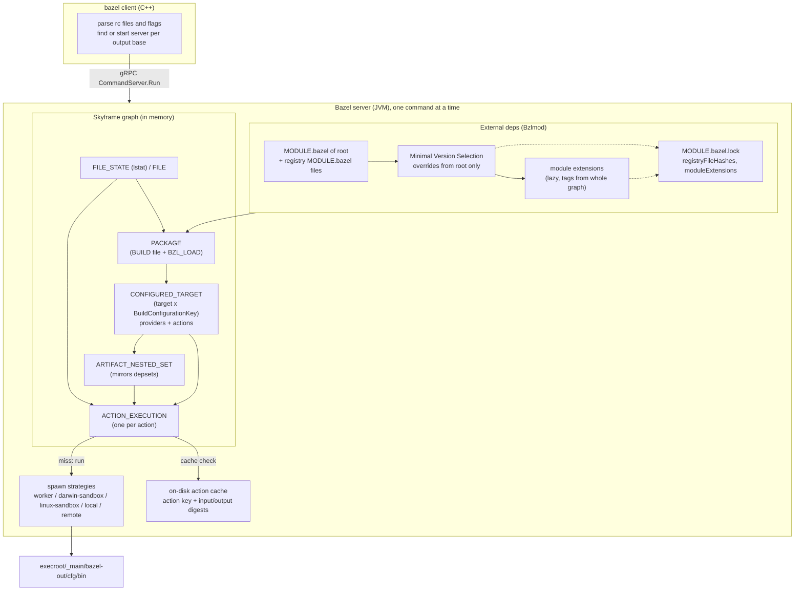

# Bazel: Skyframe, Bzlmod, and the Execution Model

> [!summary] Claim:
> Bazel is a long-lived server that keeps one incremental dependency graph, Skyframe, in which every input, package, configured target, and action is a node (`SkyKey` to immutable `SkyValue`) computed by a `SkyFunction` that may read other nodes only through `Environment.getValue`, so Bazel knows every edge and can invalidate exactly the reverse closure of a changed file.
> A build is loading (evaluate `BUILD` and `.bzl` files into packages of targets), analysis (run rule implementations per configuration, producing providers and an action graph), and execution (run only the actions whose outputs are needed), and since Bazel 7 the last two are interleaved by default (Skymeld).
> A node that recomputes to an equal value stops invalidation from spreading (change pruning); for actions, the digest-level cutoff that makes a comment-only edit cheap is done by the on-disk action cache, because a rewritten output file does not compare equal in Skyframe.
> External code arrives through Bzlmod: `MODULE.bazel` files fetched from index registries, one version per module chosen by Minimal Version Selection, repos named by canonical names (`module+`) behind per-repo apparent names, and module extensions for everything else, with results pinned in `MODULE.bazel.lock`; since Bazel 9.0 `WORKSPACE` no longer exists.



## The Mechanism

Everything below is Bazel 9.3.2 (released 2026-11-05; 10.0.0rc3 is the current prerelease, as of 2026-11, Both) unless a version is named.
Source-file citations are to the `9.3.2` tag of `bazelbuild/bazel`.
[[Build-System-Theory-Schedulers-and-Rebuilders]] owns the abstract vocabulary (schedulers, verifying and constructive traces, early cutoff); this note shows how Bazel instantiates it.

### 1. Client, server, and output base

`bazel` is a native client (`src/main/cpp/blaze.cc`) that talks to a Java server over gRPC (`service CommandServer`, with `Run` returning a stream of responses, in `src/main/protobuf/command_server.proto`).
It derives an output base from a hash of the workspace root under the user's output root (`~/.cache/bazel/_bazel_$USER/<hash>/` on Linux), and finds or starts one server per output base.
A server handles at most one invocation at a time; others block or fail fast according to `--block_for_lock` (`run/client-server.md`).
The client unpacks Bazel's embedded files into the install base and sets their mtimes nine years into the future, then checks those mtimes on later starts to detect tampering.
The server exits after `--max_idle_secs` of inactivity, default `10800` (3 hours).
Changing a startup option (anything before the command, such as `--host_jvm_args`) restarts the server and throws away the in-memory graph, which is the most expensive thing Bazel owns.

The output base holds the persistent state that survives a server restart:

| Path under the output base | Contents |
| :--- | :--- |
| `action_cache/` | The persistent action cache that decides whether an action must run |
| `execroot/_main/` | The action working directory: a symlink forest of the main repo plus `bazel-out/` |
| `execroot/_main/bazel-out/<cfg>/bin` | Outputs, one directory per configuration mnemonic such as `darwin_arm64-fastbuild` |
| `external/<canonical name>/` | Fetched external repositories |
| `bazel-workers/` | Persistent worker working directories and logs `worker-<id>-<mnemonic>.log` |
| `server/`, `command.log` | Server socket and logs, and the last command's console output |
| `MODULE.bazel.lock` | The hidden lockfile, an unspecified-format performance cache |

`bazel clean` removes the output path and the action cache; `--expunge` removes the whole output base.

### 2. Skyframe: nodes, functions, and the evaluation protocol

Skyframe is the incremental evaluation framework the whole server is built on (`reference/skyframe.md`).

- A `SkyKey` is a small immutable name with a function name, for example `FILE_STATE:[root]/[app/a.txt]` or `PACKAGE:app`.
- A `SkyValue` is the immutable value stored at that key.
- A `SkyFunction` computes a value from its key and the values it requests.

`SkyFunction.compute(SkyKey, Environment)` reads dependencies through `env.getValue(key)` or the batched `env.getValuesAndExceptions(keys)`.
If a requested node is not done, `getValue` returns `null`, `env.valuesMissing()` becomes true, and the function must return `null`.
The evaluator schedules the missing nodes and calls `compute` again from the top once they are done; the source calls this a *Skyframe restart* (`SkyFunction.java`).
A restart repeats all work done before the first missing dependency, so expensive functions keep partial results in a `SkyKeyComputeState` obtained from `env.getState(State::new)`; the Javadoc warns that the same instance is not guaranteed across restarts, so the state is a cache, never a correctness requirement.
A function can also return `Reset`, which discards temporary deps and rewinds other nodes; it exists for external data loss, such as a remote cache evicting an output that a done node promised was available.

Dependencies are recorded in groups, one group per batch of requests, in the order they were made.
The lab's dump of the configured-target node for `//app:bundle` shows eight groups: its `PACKAGE`, the host `PLATFORM`, `PLATFORM_MAPPING`, the `BUILD_CONFIGURATION`, `TOOLCHAIN_RESOLUTION`, a builtins `.bzl`, then all five direct dependencies' `CONFIGURED_TARGET` nodes requested together in one batch, then `STARLARK_BUILTINS`.
Groups matter for dirty checking: a dirty node checks its old dependencies group by group (`DirtyBuildingState` tracks `dirtyDirectDepIndex`), and the first changed child moves it to `NEEDS_REBUILDING` without looking at later groups, because the rebuild may request different keys.

Functions must be hermetic with respect to Skyframe: they may write outside the graph (create output files), but they must not read anything that is not a declared node.
The few that must see the outside world are marked `FunctionHermeticity.NONHERMETIC` and are invalidated explicitly.

### 3. The node types that make a build

| Node (dump name) | Value | Depends on |
| :--- | :--- | :--- |
| `FILE_STATE` | Result of `lstat()` plus change-detection data | Nothing; a leaf the invalidator dirties |
| `FILE` | Resolved file, following symlinks | Parent directory `FILE` and its own `FILE_STATE` (lab: two groups) |
| `DIRECTORY_LISTING_STATE` / `DIRECTORY_LISTING` | `readdir()` result | Leaf / state plus directory `FILE` |
| `BZL_LOAD` | A frozen `.bzl` module's globals | The `.bzl` file and its own `load()`s |
| `PACKAGE` | Parsed and evaluated `BUILD` file: targets, attributes, macros expanded | `PACKAGE_LOOKUP`, repo mapping, the `BUILD` file `FILE`, globs, the prelude, each `BZL_LOAD` (lab: 12 groups) |
| `CONFIGURED_TARGET` | A target analyzed in one configuration: providers and registered actions | `PACKAGE`, platform, `BUILD_CONFIGURATION`, toolchain resolution, deps' `CONFIGURED_TARGET`s |
| `ASPECT` | An aspect applied to a configured target | The base configured target and the aspect on its propagated deps |
| `ARTIFACT_NESTED_SET` | All artifacts of one depset node with more than one element | Its children, so the graph "mirrors the NestedSet structure" (`ArtifactNestedSetKey.java`) |
| `ACTION_EXECUTION` | Output metadata (digests) of one executed or cache-hit action | Owning `CONFIGURED_TARGET` (or `ASPECT`) and input artifacts |
| `MODULE_FILE`, `SINGLE_EXTENSION_EVAL`, `REPOSITORY_DIRECTORY` | Bzlmod resolution, extension evaluation, fetched repos | Registries, tags, repo rules |

The skyframe page says the action itself is stored in the `ACTION_EXECUTION` key, which conflicts with keys being small; in 9.3.2 the key is an `ActionLookupData` (the owning configured-target or aspect key plus an action index, as the lab's dump shows), and the action is looked up from the owner's value.
The action graph is therefore never a separate structure: it is the set of actions hanging off configured-target values.

### 4. Invalidation, versions, and change pruning

Bazel uses bottom-up invalidation only.
Before each command it finds changed leaves, by `stat()`-ing every known file or, with `--watchfs` (default `false`), by asking the OS file-watch service, and marks them `CHANGE`; every transitive reverse dependency is marked `DIRTY` (`NodeEntry.DirtyType`).
A third kind, `REWIND`, re-evaluates a node inside the current build and always re-evaluates its parents too.

Every node carries two versions: when it was last evaluated and when its value last changed (`Version.lastEvaluated()`, `lastChanged()`).
A requested dirty node walks the `LifecycleState` machine `CHECK_DEPENDENCIES` to either `VERIFIED_CLEAN` or `NEEDS_REBUILDING`, then `REBUILDING`, then `DONE`.
In `DirtyBuildingState.signalDep`, a child counts as changed when `!childVersion.atMost(version.lastEvaluated())`.
When a rebuilt node's new value is equal to the old one, `IncrementalInMemoryNodeEntry.setValue` keeps the old object and the old `lastChanged` version, so its parents see an unchanged child and become `VERIFIED_CLEAN` without running their functions.
That is change pruning, Bazel's name for early cutoff, and it depends entirely on `SkyValue.equals`.

Equality is where the intuition "same bytes, so nothing downstream reruns" needs care.
`RegularFileArtifactValue.equals` compares the digest, the size, and a `FileContentsProxy` built from file metadata, so an output file that an action rewrote with identical bytes is not an equal Skyframe value.
The lab shows the consequence: after a comment-only edit, the `Normalize` action reruns and writes an identical `a.norm`, the `Bundle` action's node is re-evaluated anyway, and the build summary reports `1 action cache hit`, meaning the action cache, not change pruning, stopped the rerun.
`ActionCacheChecker.isUpToDate` compares the cached entry against the current action key, the input metadata, the output metadata, the effective environment, and the execution salt and output permissions; any mismatch is counted as `DIGEST_MISMATCH` and explained as `action changed since cached execution`, which is why the lab's explain log says that for a pure input-content change.
The aquery FAQ states the other half: the `ActionKey` encodes command line, environment, and tool identity but not input contents, which the lab confirms (`action keys unchanged by the content edit: True`).

A comment-only edit to a `BUILD` file shows pruning failing one level higher.
The package is re-evaluated (`1 packages loaded`) and all seven configured targets in it are re-analyzed (`7 targets configured`), because a `PACKAGE` value holds `Target` objects and the new ones are not equal to the old ones.
The new configured targets carry new depsets, and `ArtifactNestedSetKey` instances compare by identity of the depset's backing array, so every action's dependency keys are new; all four actions were re-checked and hit the action cache (`4 action cache hit`), and none ran.
The cost of a `BUILD` edit is therefore analysis of the package plus one action-cache lookup per action below it, which matters at scale (section 12).

All invalidation is all-or-nothing per node: Bazel does not patch a previous output incrementally, and the skyframe page explains why: the gains were small, and verifying that an incrementally patched result equals a clean build is hard.

### 5. Loading: `BUILD`, `.bzl`, and Starlark's guarantees

Loading evaluates the requested packages and their transitive `load()`s.
Each `.bzl` file is a `BZL_LOAD` node evaluated once per server (until it changes), in parallel with others, after its own `load()`s finish (`extending/concepts.md`).
When a `.bzl` file finishes evaluating, its globals are frozen: mutating a list defined at top level of another file is a runtime error.
Starlark removes the features that would break parallel, cacheable, deterministic evaluation: no recursion, no `while`, no `yield`, no `try`, no `class`, no `import`, no top-level `for` or `if`, immutable globals, and a deterministic dict iteration order (`rules/language.md`).
A legacy macro is a Starlark function that runs during loading and leaves only the targets it created; Bazel 8.0 added symbolic macros, with typed attributes like rules and a design meant for lazy evaluation that the 8.0 release notes call "not implemented yet"; in 9.3.2 the lab's package node depends on `PRECOMPUTED:lazy_macro_expansion_packages`, and `extending/macros.md` documents the API.
Loading never runs rule implementations, so `bazel query` works on the loading-phase graph alone and cannot know which `select()` branch a configuration will choose; the lab's `query deps(//app:c)` lists both `c.txt` and `c_loud.txt`.

### 6. Analysis: configurations, rules, providers, depsets, and actions

Analysis evaluates `CONFIGURED_TARGET` nodes: a target label paired with a `BuildConfigurationKey`, the SHA-256 of the build options (`cquery` prints a 7-hex prefix; `bazel config <prefix>` prints the options).
`select()` is resolved here, against that configuration: the lab's `cquery` picks `c.txt` in the default configuration and `c_loud.txt` under `--//:flavor=loud`, and the two runs report different configuration IDs for every configured target.
Source files are configured in the `null` configuration.

A rule is `rule(implementation, attrs, ...)`; the implementation receives `ctx` and must:

1. Declare outputs with `ctx.actions.declare_file` (only declared files may be written).
2. Register actions with `ctx.actions.run`, `run_shell`, `write`, `expand_template`, or `symlink`; nothing runs yet, registration only adds the action to the configured target's value.
3. Return providers: `DefaultInfo` (files, runfiles, executable), `OutputGroupInfo`, and custom providers declared with `provider(fields = ...)`.

Providers are the only channel between a target and its dependents, and they are frozen values.
The lab's `//app:b` returns `["//rules:defs.bzl%SourcesInfo", "DefaultInfo", "FileProvider", "FilesToRunProvider", "OutputGroupInfo"]`; the last three are native providers Bazel derives for every rule.

Transitive data travels in depsets, persistent DAGs with structural sharing.
Accumulating a transitive list in each target costs O(n^2) along a chain of n libraries, and calling `to_list()` in every non-terminal target brings that back; flatten once, at the top (`extending/depsets.md`, `rules/performance.md`).
Depset orders are `default`, `postorder`, `preorder`, and `topological`; the lab's `bundle.txt` lists `a.norm`, `b.norm`, `c.norm` in postorder, with the diamond dependency on `a` appearing once.
`ctx.actions.args()` keeps depsets unexpanded: "Args objects do not process the depsets they encapsulate until the execution phase" (Args reference), so command-line memory is not copied per target, and `use_param_file` spills long command lines to a params file (format `shell` unless `set_param_file_format` says otherwise).

Configurations change through transitions: incoming (`rule(cfg = ...)`) or outgoing (`attr.label(cfg = ...)`), with `exec` for tools, 1:2+ splits for multi-platform outputs, and `config.none()` since Bazel 8 for pure data.
Every distinct configuration duplicates the configured-target nodes below it; `extending/config.md` shows a transition that appends one character per level and produces 2^n configured targets of one leaf.
Changing a build option between commands discards the analysis cache, and the lab prints the warning (`Build option --//:flavor has changed, discarding analysis cache`); `--noallow_analysis_cache_discard` (since 6.4.0) makes it an error.

### 7. Aspects

An aspect is a rule-like function applied to existing targets along chosen attributes (`attr_aspects`).
Applying aspect A to X creates a shadow graph A(X) over the edges in A's propagation list; edges not in the list, such as `runtime_deps` for an aspect on `deps`, are not shadowed (`extending/aspects.md`).
Aspect nodes are memoized like configured targets: in the lab, applying `inventory_aspect` to `//app:b` and `//app:c`, which both depend on `//app:a`, reports `3 aspect applications`, not 4.
Aspects are how IDE integrations, linters, and language-agnostic code generators read the graph without editing any `BUILD` file; since Bazel 8 an aspect may return `DefaultInfo` (files only), merged into the target's.

### 8. Execution and Skymeld

An action runs only when one of its outputs is requested (`extending/concepts.md`).
`ACTION_EXECUTION` evaluation computes input metadata, checks the action cache, and on a miss hands a spawn to the first applicable strategy from `--spawn_strategy` or per-mnemonic `--strategy`, then records output digests.
The user manual lists `local`, `sandboxed`, `worker`, `docker`, `remote`, and the deprecated `standalone`; `bazel help build` gives the default order as `remote,worker,sandboxed,local`, and the summary line names the concrete sandbox used, `darwin-sandbox` on macOS; [[Sandboxing-and-Hermetic-Execution-Internals]] owns the sandboxes and [[Remote-Execution-API-and-Remote-Caching]] owns remote execution and Build without the Bytes (default since Bazel 7.0, `--remote_download_outputs=toplevel`).
The build summary counts spawns per strategy: the lab's cold build prints `5 processes: 1 internal, 1 darwin-sandbox, 3 worker`.

Bazel 7.0 made execution start while other top-level targets are still being analyzed ("Project Skymeld").
The flag is `--experimental_merged_skyframe_analysis_execution`, default `true` and undocumented in `bazel help` (`BuildRequestOptions.java`).
`SkymeldModule` silently turns it off for `--nobuild` (so always for `cquery` and `aquery`), for `--explain`, for multiple `--package_path` entries, for an aquery dump after the build, for `--check_licenses`, and for a non-positive CPU-heavy SkyKey thread pool.
The lab's profile proves it: with `--explain` the build has separate `Load and analyze dependencies`, `Prepare for build`, and `Build artifacts` phases; without it there is one `Load, analyze dependencies and build artifacts` phase.
Turning on `--explain` to debug a slow build therefore changes how that build is scheduled.

Since Bazel 9.0, `--incompatible_strict_action_env` defaults to `true`, so actions see a fixed `PATH` and no inherited `LD_LIBRARY_PATH` unless `--action_env` passes them.

### 9. Persistent and multiplex workers

A persistent worker is a long-lived tool process the server reuses across actions, so JIT warm-up, parsed state, and in-memory caches survive between compilations (`remote/persistent.md`).
The protocol (`remote/creating.md`):

- An action opts in with `execution_requirements = {"supports-workers": "1"}` and, for JSON, `"requires-worker-protocol": "json"`; the default protocol is protobuf, each message prefixed with its varint length, while JSON messages are newline-delimited with camelCase field names.
- All arguments but the last are startup arguments; the last must be an `@flagfile` (or `--flagfile=`), whose contents become the per-request `arguments`.
- Bazel starts the tool with the startup arguments plus `--persistent_worker`; without that flag the tool must do one-shot work and exit, which is the fallback when workers are disabled.
- A `WorkRequest` carries `arguments`, `inputs` as path and digest pairs (advisory, for the worker's own caching), `request_id` (0 for singleplex), and optional `verbosity` and `sandbox_dir`; a `WorkResponse` carries `exit_code`, `output`, and the same `request_id`, and the worker must write nothing else to stdout.
- Workers are pooled per `WorkerKey`, built from the mnemonic (or `worker-key-mnemonic`), startup flags, and environment; the default pool limit is 4 singleplex instances per key (`DEFAULT_MAX_SINGLEPLEX_WORKERS`) and 8 for multiplex (`DEFAULT_MAX_MULTIPLEX_WORKERS`, `WorkerPoolImpl.java`), even though `bazel help` describes the flag default as `auto`.
- Workers are not sandboxed by default (`--worker_sandboxing=false`), so a worker can read undeclared files and leak state between requests; the `dynamic` strategy requires sandboxed workers.

Multiplex workers (`supports-multiplex-workers`, which wins over `supports-workers`; `--worker_multiplex` defaults to `true`) receive many requests with nonzero `request_id` over one process and answer them from threads, writing each response atomically.
They are still documented as experimental, and only those that implement `sandbox_dir` (`supports-multiplex-sandboxing`, enabled by `--experimental_worker_multiplex_sandboxing` or dynamic execution) can be sandboxed.
Cancellation needs `supports-worker-cancellation` and `--experimental_worker_cancellation`; every non-cancel request must still be answered exactly once.
The lab's Python worker served 6 requests from one process (`--worker_max_instances=Normalize=1`), while the summary lines counted those requests as `worker` processes, so the summary counts spawns, not OS processes.

### 10. Introspection: query, cquery, aquery, dump, mod

| Command | Graph | Knows configurations | Typical use |
| :--- | :--- | :--- | :--- |
| `bazel query` | Target graph after loading | No; reports all `select()` branches | Reverse deps (`rdeps`), `somepath`, ownership, cheap CI target selection |
| `bazel cquery` | Configured-target graph after analysis | Yes, `label (cfgid)` | What really builds under these flags; `--output=starlark` with `providers(target)` |
| `bazel aquery` | Action graph | Yes | Command lines, inputs, outputs, `ActionKey`, `--output=jsonproto` for diffing two builds |
| `bazel dump --skyframe=summary\|count\|deps\|rdeps` | Raw Skyframe nodes | Keys carry config hashes | Debugging invalidation; output "may change at any time" |
| `bazel mod graph\|explain\|show_repo\|dump_repo_mapping\|deps\|tidy` | Module graph | No | Why a version was chosen, what a repo is, mapping for IDEs |

`aquery --skyframe_state` reads actions already in the server's graph without re-analysis.
`cquery` and `aquery` imply `--nobuild`; mixing them with builds under different flags discards the analysis cache each time (`advanced/performance/iteration-speed.md`).

### 11. Bzlmod: modules, resolution, repos, extensions, lockfile

A module is a project with a `MODULE.bazel` at its repo root declaring `module(name, version)`, `bazel_dep`s, overrides, toolchain and platform registrations, and extension usages (`external/module.md`).
`MODULE.bazel` cannot `load()`, because resolution reads only the `MODULE.bazel` files served by registries, before any source archive is fetched (`external/faq.md`).

Registries are index registries, a local directory or static HTTP server with `/modules/<name>/<version>/MODULE.bazel`, `source.json` (types `archive`, `git_repository`, `local_path`), optional `patches/` and `overlay/`, per-module `metadata.json` (`versions`, `yanked_versions`), and optional `bazel_registry.json` (`mirrors`, `module_base_path`) (`external/registry.md`).
`--registry` is repeatable and earlier registries take precedence; the default is the Bazel Central Registry at `https://bcr.bazel.build/`.
The lab uses a `file://` registry with `local_path` sources, so its own modules need no network.

Resolution reads the root module, then repeatedly fetches dependencies' `MODULE.bazel` files until the graph is closed, then applies Minimal Version Selection: each module gets the highest version any dependent asks for, and never a newer one that nobody asked for, which makes the result reproducible without a SAT solver.
Bazel's version format relaxes SemVer: any number of release segments, letters allowed, and no enforced compatibility semantics.
The lab's diamond, `lib_a` asking for `base@1.1` and `lib_b` asking for `base@1.3`, resolves to `base@1.3`, and `mod graph --verbose` says `base@1.3 (was 1.1, cause lib_b@1.0)`.
Selecting a yanked version is an error unless `--allow_yanked_versions` allows it.
`compatibility_level` and `max_compatibility_level` used to fail resolution when two compatibility levels of one module met; since Bazel 8.6.0 and 9.1.0 both are no-ops (9.1.0 release notes, `external/faq.md`).

Only the root module's overrides apply, but they may target any module in the graph:

- `single_version_override` pins a version, a registry, or patches.
- `multiple_version_override` keeps several versions, upgrading each dependent to the nearest allowed higher version.
- `archive_override`, `git_override`, and `local_path_override` remove a module from version resolution and take its `MODULE.bazel` from the repo itself.

Every repo has one canonical name and a per-repo set of apparent names (the repository mapping).
A module repo's canonical name is `name+` or, with several versions, `name+version`; Bazel 8.0 changed the separator from `~` to `+` and the format "is subject to change at any time" (`external/module.md`).
A module sees only its direct dependencies under their apparent names, which is Bzlmod's strict deps: the lab's root maps `lib_a` and `lib_b` but has no `base`, while `lib_a+` maps `base` to `base+`.
Labels written with `@@` are canonical; use `Label("@foo").repo_name`, `$(rlocationpath ...)`, or `bazel mod dump_repo_mapping` instead of hard-coding canonical names.

A module extension (`module_extension(implementation, tag_classes)`) is identified by its `.bzl` file and name, runs after resolution, sees the tags every module in the graph wrote for it (`module_ctx.modules`), and defines repos by calling repo rules (`external/extension.md`).
Extension repos are named `<module canonical>+<extension>+<repo>`: the lab's root extension produced `+facts+lab_facts`, because the root module's canonical name is empty.
Extensions are evaluated lazily, only when a repo they define is needed; `bazel mod deps` evaluates all of them.
Repos they create are visible only through `use_repo`; the root may replace them with `override_repo` or add visible repos with `inject_repo`; `use_repo_rule` defines a single non-module repo through the same machinery.
An extension can return `extension_metadata(reproducible = True)` to stay out of the lockfile, or record `facts` there to avoid repeating network lookups.

`MODULE.bazel.lock` records hashes of every remote registry file read (`registryFileHashes`, including `not found` answers from higher-precedence registries), selected yanked versions, and per extension its `bzlTransitiveDigest`, `usagesDigest`, other inputs, and `generatedRepoSpecs`, split by OS or architecture when the extension declares `os_dependent` or `arch_dependent` (`external/lockfile.md`).
`--lockfile_mode` is `update` (default since 7.0), `refresh` (also re-fetches mutable data such as yanked versions, hourly), `error` (no network during resolution, fail on any drift; the CI setting), or `off`.
The lab's lockfile has `lockFileVersion` 28, records hashes from `bcr.bazel.build` but none from the `file://` registry, and contains the root extension; the lockfile is Bazel-version specific, so pin `.bazelversion` next to it.

The timeline: Bzlmod on by default in 7.0 with the lockfile on; `WORKSPACE` off by default in 8.0 (`--enable_workspace`); in 9.0 Bzlmod is always on, all `WORKSPACE` logic is removed, `--enable_bzlmod` and `--enable_workspace` are no-ops, C++ rules live only in `rules_cc`, and `--incompatible_autoload_externally` defaults to empty, so every language rule must be `load()`ed from its module.
Bazel 9.0 also added `--repo_contents_cache` for fetched repos that declare themselves reproducible.

### 12. Memory: the price of keeping the graph

The graph is the speed: losing it (server restart, OOM, flag churn) turns the next build into full loading and analysis.
`--host_jvm_args=-Xmx...` (a startup option) caps the heap.
To trade incrementality for memory (`advanced/performance/memory.md`):

- `--discard_analysis_cache` drops analysis results before execution, about 10% of memory per the user manual, and forces re-analysis next time.
- `--notrack_incremental_state` stores no edges, so the graph cannot be used incrementally.
- `--nokeep_state_after_build` drops everything after the build; only the on-disk action cache remains.
- Skyfocus (`--experimental_enable_skyfocus`, Bazel 8.0, experimental) keeps only the state needed to rebuild a working set of files; the docs' example went from 1,237 MB to 676 MB of heap.

## Commands and Numbers to Know

| Item | Value | Platform and date | What it controls |
| :--- | :--- | :--- | :--- |
| Current release | 9.3.2 (LTS line 9.x); 10.0.0rc3 prerelease | Both (as of 2026-11) | Version every fact here is checked against |
| `--max_idle_secs` | `10800` | Both (as of 2026-11) | Idle seconds before the server exits; `0` keeps it forever |
| `--experimental_merged_skyframe_analysis_execution` | `true`, undocumented | Both (as of 2026-11) | Skymeld; ignored with `--explain`, `--nobuild`, multiple package paths |
| `--watchfs` | `false` | Linux, macOS (as of 2026-11) | OS file watching instead of stat-scanning for changed leaves |
| `--keep_going` / `-k` | `false` | Both (as of 2026-11) | Continue past failed targets |
| `--jobs` | `auto` | Both (as of 2026-11) | Concurrent execution-phase jobs, bounded by `--local_resources` |
| `--discard_analysis_cache` | `false` | Both (as of 2026-11) | About 10% less memory, slower next build |
| `--keep_state_after_build`, `--track_incremental_state` | `true`, `true` | Both (as of 2026-11) | Set to false for one-shot CI builds |
| `--worker_max_instances` | 4 per WorkerKey (singleplex) | Both (as of 2026-11) | Help text says `auto`; source constant is 4 |
| `--worker_max_multiplex_instances` | 8 per WorkerKey | Both (as of 2026-11) | Parallel requests per multiplex process |
| `--worker_multiplex`, `--worker_sandboxing` | `true`, `false` | Both (as of 2026-11) | Multiplexing when supported; sandboxing is opt-in |
| `--incompatible_strict_action_env` | `true` since 9.0 | Both (as of 2026-11) | Fixed action `PATH`, no inherited `LD_LIBRARY_PATH` |
| `--remote_download_outputs` | `toplevel` since 7.0 | Both (as of 2026-11) | Build without the Bytes |
| `--lockfile_mode` | `update` | Both (as of 2026-11) | `error` in CI; `refresh` to update mutable registry data |
| `--registry` | BCR when unset; repeatable, first wins | Both (as of 2026-11) | Registry precedence |
| `lockFileVersion` | `28` in 9.3.2 | darwin-arm64, Bazel 9.3.2 (as of 2026-11) | Lockfile schema; tied to the Bazel version |
| Canonical repo names | `module+`, `module+version`, `module+ext+repo` | Both (as of 2026-11) | `+` since 8.0, `~` before; not an API |
| Configuration ID | SHA-256 of options, prefix in `cquery` | Both (as of 2026-11) | `bazel config <id>` shows the options |
| `--noallow_analysis_cache_discard` | since 6.4.0 | Both (as of 2026-11) | Fail instead of silently re-analyzing |
| `bazel dump --skyframe=` | `summary`, `count`, `value`, `deps`, `rdeps`, `function_graph`, ... | Both (as of 2026-11) | Raw graph; unstable output |

## Multi-Language Comparison: C++ / Python / Rust

Bazel's own rules are Starlark modules in Bazel 9; what each language's rules do with the execution model differs.

| Concern | C++ (`rules_cc`) | Python (`rules_python`) | Rust (`rules_rust`) |
| :--- | :--- | :--- | :--- |
| Where the rules live in 9.x | `rules_cc`; native C++ rules removed from Bazel in 9.0 | `rules_python`, a dependency of Bazel's built-in modules (its flag aliases appear in every build's options) | `rules_rust` module from the BCR |
| Unit of action | One `CppCompile` per source file, one link per binary | Mostly no compile; actions assemble runfiles trees and launchers | One `Rustc` action per crate, not per file |
| Header or interface discovery | Headers must be declared; compiler-reported includes are checked after the action | Imports are not tracked; undeclared imports work locally and break hermeticity | Crate deps declared; build scripts run as separate actions |
| Early cutoff point | Object digest feeds the link through the action cache | Runfiles symlink trees, cheap to rebuild | Metadata-only outputs can let dependents start early, which [[Cargo-Build-Graph-and-Rustc-Pipelining]] explains for Cargo |
| Persistent workers | Not used for the default C++ toolchain | Not typical | Not used: `rules_rust` 0.75.0 ships no worker implementation and its `rustc` actions set no worker execution requirement (checked against the repository tree, as of 2026-11) |

The C++ column's per-file compile and declared-header model is documented in `docs/bazel-and-cpp.md`; the Python and Rust columns describe the rule sets' design at the level their documentation states, and are not re-measured here.

## Worked Lab Example

The lab is `code/06-Build-Systems/bazel_skyframe_inspect/` (requires: network).
It needs `bazelisk` or Bazel 9.3.2 and `python3`; the network is used only to resolve Bazel's own built-in module dependencies from the BCR on a cold repository cache.

`run.sh` copies `ws/` to a scratch directory and gives it a private output base, so each run starts a cold server with an empty action cache; `drive_bazel.py` runs every command with `--ignore_all_rc_files` and prints derived facts only (temp paths, configuration hashes, and depset identities become placeholders, and timings are never printed).
The workspace is small on purpose:

- `MODULE.bazel` depends on `lib_a@1.0` and `lib_b@1.0` from the lab's `registry/`, which ask for `base@1.1` and `base@1.3`, and uses a root module extension that turns a tag into the repo `lab_facts`.
- `rules/defs.bzl` defines a `SourcesInfo` provider carrying a postorder depset, a `normalized` rule whose `Normalize` action runs `rules/normalize.py` as a JSON persistent worker, a `bundle` rule that concatenates everything with `run_shell` and lazy `args.add_all`, a `flavor_flag` build setting, and `inventory_aspect` along `deps`.
- `app/BUILD.bazel` has a diamond (`b` and `c` both depend on `a`) and a `select()` on `//:loud`.

The script then runs, in one server: `mod graph`, `mod dump_repo_mapping`, `mod show_repo`, `query`, two `cquery`s, two provider `cquery`s, `aquery`, six builds with different edits, three `dump --skyframe=deps`, an aspect build, and a lockfile read.

```bash
cd code/06-Build-Systems/bazel_skyframe_inspect
TOOLCHAIN_LABS_NETWORK=1 bash run.sh
# or, through the harness:
cd ../.. && TOOLCHAIN_LABS_NETWORK=1 python3 -m _harness.verify 06-Build-Systems/bazel_skyframe_inspect/
```

### Verified output

Recorded by `python3 -m _harness.verify --record` on darwin-arm64 with Bazel 9.3.2 on 2026-11-14; the file is `code/06-Build-Systems/bazel_skyframe_inspect/expected/darwin-arm64.txt`.
The lab was not run on Linux, so there is no Linux expected file.

```text
== Bazel
release 9.3.2

== Bzlmod: module graph after Minimal Version Selection
<root> (skyframe_lab@0.0.0)
|---lib_a@1.0
|   `---base@1.3
`---lib_b@1.0
    `---base@1.3 (*)
verbose: base@1.3 (was 1.1, cause lib_b@1.0)

== Bzlmod: apparent -> canonical repo names
seen from <root>: {"lab_facts": "+facts+lab_facts", "lib_a": "lib_a+", "lib_b": "lib_b+"}
seen from lib_a+: {"base": "base+", "lib_a": "lib_a+"}
module extension repo: +facts+lab_facts
module extension rule: _facts_repo

== Loading: query sees every select() branch
//:flavor
//:loud
//app:a
//app:a.txt
//app:c
//app:c.txt
//app:c_loud.txt

== Analysis: cquery resolves select() per configuration
flags (none):
  //:flavor (<cfg1>)
  //:loud (<cfg1>)
  //app:a (<cfg1>)
  //app:a.txt (null)
  //app:c (<cfg1>)
  //app:c.txt (null)
flags --//:flavor=loud:
  //:flavor (<cfg2>)
  //:loud (<cfg2>)
  //app:a (<cfg2>)
  //app:a.txt (null)
  //app:c (<cfg2>)
  //app:c_loud.txt (null)
  WARNING: Build option --//:flavor has changed, discarding analysis cache

== Analysis: providers returned by //app:b
SourcesInfo.transitive: ["app/a.norm", "app/b.norm"]
provider keys: ["//rules:defs.bzl%SourcesInfo", "DefaultInfo", "FileProvider", "FilesToRunProvider", "OutputGroupInfo"]

== Analysis: the action graph (aquery)
Bundle    args=12 exec_info=[]
Normalize args=5 exec_info=[requires-worker-protocol=json, supports-workers=1]
Normalize args=5 exec_info=[requires-worker-protocol=json, supports-workers=1]
Normalize args=5 exec_info=[requires-worker-protocol=json, supports-workers=1]

== Execution 1: first build (aquery already ran the analysis)
INFO: Analyzed target //app:bundle (0 packages loaded, 0 targets configured).
INFO: 5 processes: 1 internal, 1 darwin-sandbox, 3 worker.
  Executing action 'BazelWorkspaceStatusAction stable-status.txt': unconditional execution is requested.
  Executing action 'Bundling //app:bundle': no entry in the cache (action is new).
  Executing action 'Normalizing app/a.txt': no entry in the cache (action is new).
  Executing action 'Normalizing app/b.txt': no entry in the cache (action is new).
  Executing action 'Normalizing app/c.txt': no entry in the cache (action is new).
bundle.txt:
  == a.norm
  alpha one
  alpha two
  == b.norm
  bravo
  == c.norm
  charlie plain
  == facts.txt
  skyframe_lab: the root module tagged this
  == lib_a.txt
  payload from lib_a
  == VERSION.txt
  base version 1.3
  == lib_b.txt
  payload from lib_b

== Execution 2: null build
INFO: Analyzed target //app:bundle (0 packages loaded, 0 targets configured).
INFO: 1 process: 1 internal.
  Executing action 'BazelWorkspaceStatusAction stable-status.txt': unconditional execution is requested.

== Execution 3: edit only a comment in app/a.txt
INFO: Analyzed target //app:bundle (0 packages loaded, 0 targets configured).
INFO: 2 processes: 1 action cache hit, 1 internal, 1 worker.
  Executing action 'BazelWorkspaceStatusAction stable-status.txt': unconditional execution is requested.
  Executing action 'Normalizing app/a.txt': action changed since cached execution.

== Execution 4: edit real content in app/a.txt
INFO: Analyzed target //app:bundle (0 packages loaded, 0 targets configured).
INFO: 3 processes: 1 internal, 1 darwin-sandbox, 1 worker.
  Executing action 'BazelWorkspaceStatusAction stable-status.txt': unconditional execution is requested.
  Executing action 'Bundling //app:bundle': action changed since cached execution.
  Executing action 'Normalizing app/a.txt': action changed since cached execution.
profile phase markers with --explain: ['Launch Blaze', 'Initialize command', 'Evaluate target patterns', 'Load and analyze dependencies', 'Prepare for build', 'Build artifacts', 'Complete build']
action keys unchanged by the content edit: True

== Execution 5: edit only a comment in app/BUILD.bazel
INFO: Analyzed target //app:bundle (1 packages loaded, 7 targets configured).
INFO: 1 process: 4 action cache hit, 1 internal.
  Executing action 'BazelWorkspaceStatusAction stable-status.txt': unconditional execution is requested.

== Execution 6: real edit again, without --explain (Skymeld on)
INFO: Analyzed target //app:bundle (0 packages loaded, 0 targets configured).
INFO: 3 processes: 1 internal, 1 darwin-sandbox, 1 worker.
profile phase markers without --explain: ['Launch Blaze', 'Initialize command', 'Evaluate target patterns', 'Load, analyze dependencies and build artifacts', 'Complete build']

== Persistent worker
Normalize worker processes started: 1; requests served: 6

== Skyframe: the node behind the Bundle action
ACTION_EXECUTION:ActionLookupData0{actionLookupKey=ConfiguredTargetKey{label=//app:bundle, config=BuildConfigurationKey[<cfg1>]}, actionIndex=0}
  Group 1:
    CONFIGURED_TARGET:ConfiguredTargetKey{label=//app:bundle, config=BuildConfigurationKey[<cfg1>]}
  Group 2:
    ARTIFACT_NESTED_SET:ArtifactNestedSetKey[2]@<id>
    ARTIFACT_NESTED_SET:ArtifactNestedSetKey[4]@<id>

== Skyframe: the configured target node, dependency groups in request order
CONFIGURED_TARGET:ConfiguredTargetKey{label=//app:bundle, config=BuildConfigurationKey[<cfg1>]}
  (2 node(s) matched, configurations: <cfg1>, <cfg3>)
  group 1: PACKAGE(app)
  group 2: PLATFORM(@@bazel_tools//tools:host_platform)
  group 3: PLATFORM_MAPPING(PlatformMappingKey{path=platform_mappings, wasExplicitlySetB)
  group 4: BUILD_CONFIGURATION(BuildConfigurationKey[<cfg1>])
  group 5: TOOLCHAIN_RESOLUTION(ToolchainContextKey{configurationKey=BuildConfigurationKey[<)
  group 6: BZL_LOAD(@@_builtins//:common/builtin_exec_platforms.bzl)
  group 7: CONFIGURED_TARGET(//app:b), CONFIGURED_TARGET(//app:c), CONFIGURED_TARGET(@@+facts+lab_facts//:facts.txt), CONFIGURED_TARGET(@@lib_a+//:data), CONFIGURED_TARGET(@@lib_b+//:data)
  group 8: STARLARK_BUILTINS(Starlark @_builtins)

== Skyframe: the package node
PACKAGE:app
  (1 node(s) matched, configurations: none)
  group 1: PRECOMPUTED(lazy_macro_expansion_packages)
  group 2: PACKAGE_LOOKUP(app)
  group 3: PRECOMPUTED(autoload_symbols)
  group 4: STARLARK_BUILTINS(Starlark @_builtins)
  group 5: REPOSITORY_MAPPING(Key{repoName=@@})
  group 6: FILE([<SCRATCH>/ws]/[app/BUILD.bazel])
  group 7: PRECOMPUTED(default_visibility)
  group 8: PRECOMPUTED(config_setting_visibility_policy)
  group 9: IGNORED_SUBDIRECTORIES(@@)
  group 10: REPO_PACKAGE_ARGS(@@)
  group 11: BZL_LOAD(//tools/build_rules:prelude_bazel)
  group 12: BZL_LOAD(//rules:defs.bzl)

== Skyframe: a source file is two nodes
FILE:[<SCRATCH>/ws]/[app/a.txt]
  Group 1:
    FILE:[<SCRATCH>/ws]/[app]
  Group 2:
    FILE_STATE:[<SCRATCH>/ws]/[app/a.txt]

== Skyframe: node counts for this workspace
{'PACKAGE': 1, 'CONFIGURED_TARGET': 8, 'ACTION_EXECUTION': 4}

== Aspects: a shadow graph along deps
INFO: Analyzed 2 targets (0 packages loaded, 0 targets configured, 3 aspect applications).
b kind=normalized shadow_nodes=2
c kind=normalized shadow_nodes=2

== Lockfile
lockFileVersion: 28
registry file hashes from the local file:// registry: 0
registry file hashes from bcr.bazel.build: nonzero = True
root extension recorded: True
```

### Reading the result

- MVS: `base@1.3` is chosen because `lib_b` asked for it, and `bundle.txt` contains `base version 1.3` once; both libraries' `data` filegroups reach the same `@@base+//:VERSION.txt`, so the depset deduplicates it.
- Strict deps: the root's mapping has no `base` at all; only `lib_a+` and `lib_b+` can name it.
- The `query` lists both `select()` branches, while each `cquery` lists one, in a configuration whose ID changes with `--//:flavor`.
- The first build analyzed nothing (`0 targets configured`) because the `aquery` just before it had analyzed the same targets in the same configuration; analysis results are shared across commands in one server.
- `Normalize args=5` is the expanded command line (executable, `--src`, path, `--out`, path); at execution it is a worker request whose flagfile carries the last four.
- Execution 2: a null build runs only the unconditional workspace-status action.
- Execution 3: a comment-only edit reruns `Normalize` for `a.txt`, whose output bytes do not change, and `Bundle` is an action cache hit; the explanation `action changed since cached execution` is the generic message for any action-cache digest mismatch, here the input digest of `a.txt`.
- Execution 4: a real edit reruns both actions, and `aquery` afterwards reports identical action keys, so input contents are not part of the key.
- Execution 5: a `BUILD` comment re-evaluates the package and re-configures 7 targets (the lab does not print which), and all 4 actions are re-checked against the action cache with no execution.
- Execution 6 against Execution 4: the same kind of edit, but without `--explain` the profile has a single merged phase marker, which is Skymeld.
- The worker log shows one process answering all 6 `Normalize` requests (3 + 1 + 1 + 1).
- The Bundle action's node depends on its owning configured target and on two `ARTIFACT_NESTED_SET` nodes, not on eight individual files; the `[2]` and `[4]` are the child counts of the depset nodes Bazel mirrored.
- The configured-target dump matched two nodes for `//app:bundle`, in `<cfg1>` and in a third configuration that none of the lab's commands names; the lab does not establish where `<cfg3>` comes from, so treat it as an open observation (UNVERIFIED: likely a configuration produced by a command-specific option set, not checked).
- Three aspect applications for two requested targets: `inventory_aspect` on `//app:a` is computed once and shared by both shadow paths.

## Pitfalls

> [!warning] Pitfall: reading undeclared inputs
> Rules and repository rules that read files they did not declare work until the file changes, because no Skyframe edge exists to invalidate them.
> Sandboxed strategies catch undeclared action inputs; nothing catches a non-hermetic worker or a repository rule that reads the environment without declaring it.

> [!warning] Pitfall: `to_list()` in every target
> Flattening a depset in each non-terminal target is quadratic in graph depth and copies memory that depsets were designed to share.
> Pass depsets to `ctx.actions.args().add_all`, which expands them at execution time, and flatten only in terminal rules.

> [!warning] Pitfall: flag churn that discards the analysis cache
> Alternating `bazel build -c opt` with `bazel cquery`, an IDE plugin with different flags, or a `--//my:flag` change discards analysis each time.
> Use a fixed flag set per workflow, a separate `--output_base` for each flag set, and `--noallow_analysis_cache_discard` in CI to catch it.

> [!warning] Pitfall: debugging with `--explain` changes the build
> `--explain` disables Skymeld, so a profile taken with it shows separate analysis and execution phases that a normal build does not have.
> Profile with `--profile` alone, and use `--explain` only to learn why actions ran.

> [!warning] Pitfall: transitions that multiply configurations
> Each distinct configuration duplicates every configured target below the transition, and an option that varies per path grows the graph exponentially.
> Audit `cquery` output for repeated labels with different configuration IDs before shipping a transition.

> [!warning] Pitfall: hard-coding canonical repo names
> `@@rules_foo~1.2.3` broke in Bazel 8 when `~` became `+`, and the format may change again.
> Use apparent names, `Label(...).repo_name`, runfiles libraries, or `bazel mod dump_repo_mapping`.

> [!warning] Pitfall: expecting overrides in a dependency to apply
> Overrides in a non-root module's `MODULE.bazel` are ignored, and so is its lockfile.
> A library that needs a patch must ask its users to add the override, or publish the patched version to a registry.

> [!warning] Pitfall: unsandboxed workers leaking state
> With the default `--worker_sandboxing=false`, a worker sees the whole execroot and keeps memory between requests, so one action's stale cache can change another's output.
> Sandbox workers in CI, and make the worker key its caches by the input digests Bazel sends.

> [!warning] Pitfall: Ctrl-C twice
> A second Ctrl-C kills the server and the whole in-memory graph; press it once and wait (`advanced/performance/iteration-speed.md`).

## At Scale

For one developer, the defaults are right: keep the server warm, use a disk cache, and avoid flag churn.
From hundreds to 1,000-50,000 engineers in one monorepo, the costs move from execution, which remote caching and remote execution absorb, to analysis memory, analysis latency, and dependency governance.

- Analysis is the new critical path: a `BUILD` edit near the root of the graph re-analyzes every dependent configured target in every configuration and re-checks every action below it, as the lab's Execution 5 shows in miniature.
  Keep packages fine-grained, keep widely used packages stable, and measure analysis time per target with `--profile` and `bazel analyze-profile`.
- Memory is a fleet cost: CI machines that build once should use `--nokeep_state_after_build` or `--notrack_incremental_state`, while developer machines keep state and size `-Xmx` from measured heap, not from defaults.
- Configurations are budgeted: require review for new transitions, and track configured targets per top-level target over time.
- Dependency governance: run a company registry ahead of the BCR (`--registry` order), mirror archives through `bazel_registry.json` `mirrors`, check in `MODULE.bazel.lock`, set `--lockfile_mode=error` in CI, pin `.bazelversion`, and let one team own `MODULE.bazel` overrides because only the root's count.
- Workers: enable multiplex workers for JVM toolchains to cut memory, sandbox them in CI, and expect `dynamic` execution to require sandboxed workers.
- Upgrades: Bazel 9 removed `WORKSPACE` and native language rules, so an organization on 7.x must finish its Bzlmod migration and add explicit `load()`s before moving; `bazelisk --migrate` with `BAZELISK_INCOMPATIBLE_FLAGS` tests flag flips one by one.

Decision rules:

- If analysis exceeds execution time on incremental builds, look at configured-target counts and transitions before buying more remote executors.
- If the server OOMs, first remove configuration multiplication and `to_list()` hot spots, then tune `-Xmx`, then consider Skyfocus for narrow working sets.
- If two teams need different versions of one module, prefer `single_version_override` to converge; use `multiple_version_override` only when the module's targets never meet in one binary.
- Choose Bazel over CMake or Meson when the codebase is polyglot, shared by many teams, and needs remote caching across them; [[Build-Performance-Economics-and-Decision-Record]] owns the full decision, and [[Buck2-DICE-Starlark-and-BXL]] compares the single-graph alternative.

## Practice Drill

> [!tip] Practice Drill:
> Run the lab, then predict before each experiment what the summary line will say.
> First, add a fourth `normalized` target that depends on `:c`, and predict how many packages load and targets configure on the next build.
> Second, change `normalize.py` itself: predict whether action keys change (the tool is an input, so its digest changes, but is it part of the key?), then check with `aquery --output=jsonproto` and the action-cache hit counts.
> Third, rerun Execution 3 with `--worker_sandboxing` and compare spawn counts.
> Fourth, add `single_version_override(module_name = "base", version = "1.1")` to the root `MODULE.bazel`, predict `mod graph --verbose`, and confirm `bundle.txt` changes.
> Last, write an outgoing transition on `deps` that sets `//:flavor` to `loud` and count configured targets for `//app:a` with `cquery` before and after.
> [[Diagnose-Bazel-and-Buck2-Cache-Misses]] continues with remote cache misses, and [[Drill-Build-Systems-Hunt-Non-Determinism-with-Diffoscope]] with outputs that differ when they should not.

## Interview Questions

> [!question] L5: What happens in each of Bazel's three phases, and which query command sees which phase?
>
> > [!success]- Answer
> > Loading evaluates `BUILD` files and their `.bzl` imports into packages of targets, running macros; `bazel query` works on this graph and therefore lists every `select()` branch.
> > Analysis runs each rule's implementation once per configured target, resolving `select()`, producing providers, and registering actions without running them; `bazel cquery` sees configured targets and `bazel aquery` sees the registered actions.
> > Execution runs only actions whose outputs are requested, after checking the action cache.
> > Since Bazel 7, analysis and execution overlap by default (Skymeld), unless something like `--explain` or `--nobuild` turns it off.

> [!question] L5: Why does `MODULE.bazel` not allow `load()`, and what does Bazel use instead to share logic?
>
> > [!success]- Answer
> > Resolution reads dependencies' `MODULE.bazel` files directly from registries before any source archive is downloaded, so a `load()` would require fetching a whole archive just to resolve versions.
> > Logic that needs code lives in module extensions defined in `.bzl` files, which run after resolution and read tags that every module writes in its `MODULE.bazel`.

> [!question] L6: Predict the output: in the lab, after a comment-only edit to `app/a.txt`, what does the build summary report, and why is `Bundle` not executed?
>
> > [!success]- Answer
> > `INFO: 2 processes: 1 action cache hit, 1 internal, 1 worker.`: the workspace-status action is the internal one, `Normalize` reruns as a worker spawn because its input digest changed, and `Bundle` is an action cache hit.
> > `Normalize` writes byte-identical output, but the rewritten file is not an equal Skyframe value, because `RegularFileArtifactValue.equals` also compares a metadata proxy, so the `Bundle` node is re-evaluated.
> > Its action cache entry matches on action key and input digests, so it is not executed.
> > The early cutoff here comes from the digest-based action cache, not from Skyframe change pruning.

> [!question] L6: Why does a `SkyFunction` sometimes do its expensive parsing twice, and how is it fixed?
>
> > [!success]- Answer
> > When `env.getValue` returns `null` for a dependency that is not done, the function must return `null` and is restarted from the top after the dependency completes, so work done before the request runs again.
> > Batch independent requests into one `getValuesAndExceptions` call so there is one restart instead of several, and keep intermediate results in a `SkyKeyComputeState` from `env.getState`.
> > The state may be dropped under memory pressure, so it can only be a cache.

> [!question] L6: Debug this: a developer reports that `bazel build //...` re-analyzes everything after every `bazel cquery` their IDE runs; what is happening and how do you fix it?
>
> > [!success]- Answer
> > The IDE runs `cquery` with different build options than the developer's builds, so each command changes the configuration and Bazel discards the analysis cache, printing `Build option ... has changed, discarding analysis cache`.
> > Make the IDE use the same flags through a shared `.bazelrc` config, or give it its own `--output_base` so it has its own server.
> > Add `--noallow_analysis_cache_discard` to catch the regression as an error instead of a silent slowdown.

> [!question] L6: How do apparent and canonical repo names differ under Bzlmod, and why does the separation exist?
>
> > [!success]- Answer
> > The canonical name is the single name a repo has in the workspace, such as `base+` or `+facts+lab_facts`, written with `@@`.
> > The apparent name is what a given repo calls it, from that repo's repository mapping; a module only sees its direct `bazel_dep`s and the extension repos it imports with `use_repo`.
> > This gives strict deps (a transitive dependency's change cannot silently break a module that never declared it) and lets two modules use the same apparent name for different repos.
> > The canonical format is not an API: it changed from `~` to `+` in Bazel 8.

> [!question] L7: Explain Minimal Version Selection and when you would use each override type in a large monorepo.
>
> > [!success]- Answer
> > MVS picks, for each module, the highest version that any module in the graph requests, assuming newer versions are backward compatible, and never picks a newer version that nobody asked for; the result is deterministic and needs no solver.
> > `single_version_override` pins a version, registry, or patches for one module everywhere, which is the normal way to converge a monorepo.
> > `multiple_version_override` keeps an allowed set of versions, for a migration window when two parts of the tree cannot share one version and never meet in one binary.
> > `local_path_override`, `git_override`, and `archive_override` take a module out of resolution entirely, for local development or unreleased fixes.
> > Only the root module's overrides apply, so these are central governance tools, not something libraries can ship.

> [!question] L7: Design a persistent worker for an expensive compiler: what must the protocol implementation and the rule do?
>
> > [!success]- Answer
> > The rule declares the tool with `cfg = "exec"`, puts startup flags first and per-request flags in an `@flagfile` as the last argument, and sets `supports-workers` (or `supports-multiplex-workers`) and the protocol in `execution_requirements`.
> > The tool recognizes `--persistent_worker`, reads `WorkRequest`s from stdin (varint-delimited protobuf by default, newline-delimited JSON if requested), writes only `WorkResponse`s with the matching `request_id` to stdout, and captures tool output into the response.
> > Caches inside the worker must be keyed by the input digests in the request, because Bazel does not sandbox workers by default and the same process sees many actions.
> > For multiplexing, handle requests on threads and write responses atomically; for sandboxing and dynamic execution, honor `sandbox_dir`; support cancellation if it races with remote execution.
> > Size pools knowing that each distinct startup-flag set is a separate `WorkerKey` with its own 4 singleplex instances.

> [!question] L8+: Analysis on your 200,000-target monorepo takes longer than execution for most incremental builds and the server needs 30 GB of heap; where do you look and what do you change?
>
> > [!success]- Answer
> > Profile with `--profile` and `bazel analyze-profile`, and count configured targets per configuration with `cquery`: transitions that duplicate large subgraphs are the most common multiplier of both time and memory.
> > Look for rules that call `to_list()` or build strings from depsets in non-terminal targets, and for macros that create many targets; use `--starlark_cpu_profile` and the memory tracker to find them.
> > Check for analysis-cache discards from flag churn in IDEs and scripts, and for invalidation storms: a widely loaded `.bzl` file or a root `BUILD` file that changes often re-analyzes everything below it.
> > For CI, drop incremental state (`--notrack_incremental_state`, `--nokeep_state_after_build`); for developers, consider Skyfocus working sets, still experimental.
> > Execution scale-out (remote execution) does not fix any of this, because analysis runs in the one server.

> [!question] L8+: Your organization is on Bazel 7 with a large `WORKSPACE`. Lay out the migration to Bazel 9.
>
> > [!success]- Answer
> > Bazel 9 has no `WORKSPACE` support and no native language rules, so the migration has two tracks: external dependencies to Bzlmod, and explicit `load()`s from `rules_cc`, `rules_java`, `rules_python`, and other rule modules.
> > Use the Bzlmod migration tool to propose `MODULE.bazel` entries, move dependencies module by module (Bazel 7 and 8 allow both systems at once), and replace `deps.bzl` macros with `bazel_dep` or module extensions.
> > Stand up an internal registry for internal and patched modules, check in the lockfile, and switch CI to `--lockfile_mode=error`.
> > Test the 9.0 flag flips on 8.x with `bazelisk --migrate`, especially `--incompatible_autoload_externally`, `--incompatible_strict_action_env`, and `--incompatible_disable_native_repo_rules`.
> > Stop hard-coding canonical names, which changed from `~` to `+` in 8.0, and retire `compatibility_level`, a no-op since 8.6.0 and 9.1.0.

## Further Reading

- `reference/skyframe.md` (Bazel 9.3.2): the official model of keys, values, functions, invalidation, and change pruning, with the node table.
- `SkyFunction.java`, `NodeEntry.java`, `IncrementalInMemoryNodeEntry.java`, `DirtyBuildingState.java` at 9.3.2: restarts, `SkyKeyComputeState`, the lifecycle states, and the exact change-pruning rule.
- `FileArtifactValue.java` and `ArtifactNestedSetKey.java` at 9.3.2: why output files and depsets compare the way they do, which decides where cutoff happens.
- `SkymeldModule.java` at 9.3.2: every condition that disables merged analysis and execution.
- `extending/rules.md`, `depsets.md`, `aspects.md`, `config.md`, and the Args reference: the rule API, its complexity rules, and the cost of transitions.
- `remote/persistent.md`, `creating.md`, `multiplex.md`: the worker protocol and its sandboxing limits.
- `query/cquery.md` and `query/aquery.md`: configured and action graph queries, including the `ActionKey` FAQ.
- `external/module.md`, `extension.md`, `registry.md`, `lockfile.md`, `faq.md`: the Bzlmod specification as implemented.
- Russ Cox, "Minimal Version Selection" (2018): the algorithm Bzlmod adopted and its reproducibility argument.
- Bazel 7.0, 8.0, 9.0, and 9.1 release notes: Skymeld, Bzlmod defaults, the `+` separator, `WORKSPACE` removal, and `compatibility_level`.

## See Also

- [[Build-System-Theory-Schedulers-and-Rebuilders]]: early cutoff, verifying and constructive traces in the abstract.
- [[Hermetic-and-Reproducible-Builds]]: why declared inputs and stable outputs make caching safe.
- [[Sandboxing-and-Hermetic-Execution-Internals]]: `darwin-sandbox` and `linux-sandbox` internals.
- [[Remote-Execution-API-and-Remote-Caching]]: the remote action cache, CAS, and Build without the Bytes.
- [[Diagnose-Bazel-and-Buck2-Cache-Misses]]: execution-log diffing when the cache misses.
- [[Buck2-DICE-Starlark-and-BXL]]: a single-phase incremental engine with the same rule language.
- [[Migrate-a-Polyglot-Codebase-to-Hermetic-Builds]]: the organizational migration playbook.

## Related

- Prerequisites: [[Build-System-Theory-Schedulers-and-Rebuilders]], [[Hermetic-and-Reproducible-Builds]]
- Next: [[Buck2-DICE-Starlark-and-BXL]]
- Lab: `code/06-Build-Systems/bazel_skyframe_inspect/` (requires: network)
