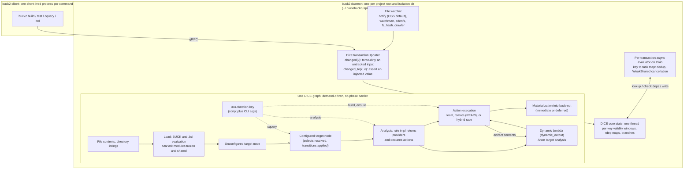

# Buck2: DICE Engine, Starlark, and BXL

> [!summary] Claim:
> Buck2 is a Rust daemon whose whole build, from directory listing and `BUCK` file evaluation through configuration, rule analysis, action execution, and materialization, is one demand-driven graph on DICE, an incremental engine of async Rust computations with no phase barrier between loading, analysis, and execution.
> DICE records each computation's dependencies in series-parallel form, invalidates through exact reverse-dependency maps when a file or config changes, re-verifies dependencies in recorded order without speculation, and cuts off recomputation when a recomputed value interns to the same revision as the cached one.
> Rules are pure Starlark on the `starlark-rust` interpreter, whose frozen, immutable modules are shared across threads; `dynamic_output`, `dynamic_actions`, and anonymous targets give rules a bounded form of monadic (dynamic) dependencies while keeping the target graph static and queryable.
> BXL is Starlark run as one DICE key that drives queries, analysis, and builds from inside the daemon and powers IDE integrations, and `buck2 log critical-path` reads the same graph to attribute wall time to the longest dependency chain across every stage.



Arrows point from a value to the computations that consume it; each box is a family of DICE keys, not a phase.

## The Mechanism

Buck2 is Meta's rewrite of Buck (open sourced in March 2013), written in Rust instead of Java, used internally at Meta and "available as open-source from 2023" (`docs/about/why.md`).
Source claims in this note are pinned to `facebook/buck2` main at commit `5b3b13d3eacefe325bf971369197e33c5f4b3968` (2026-11-15), and commands were run with the `2026-11-15` release binary, which reports itself as `buck2 2026-11-14-5b3b13d3eacefe325bf971369197e33c5f4b3968`, the same commit (as of 2026-11, macOS).
Buck2 publishes date-tagged releases, mostly on the 1st and 15th of each month with occasional off-schedule tags (`2026-08-22`, `2026-05-18`, `2026-03-11`, `2026-01-19`), and every one of them, through `2026-11-15`, is marked "prerelease" on GitHub, as is the rolling `latest` tag (GitHub releases API, as of 2026-11, Both).
[[Build-System-Theory-Schedulers-and-Rebuilders]] owns the vocabulary used here (keys, tasks, schedulers, verifying and constructive traces, early cutoff); this note shows how Buck2 instantiates it.

### 1. The process model: client, daemon, and tenants

The `buck2` command is a thin client.
On first use in a project it starts a daemon for that project root, then sends every command to it over gRPC (`docs/concepts/architecture.md`, `docs/concepts/daemon.md`).
The daemon holds the DICE graph in memory between commands, which is the entire reason a no-op rebuild is fast: Buck2's own comparison reports a no-op build that took 23 seconds "in some benchmarks" in Buck1 taking 0.1 seconds in Buck2 (`docs/about/benefits/compared_to_buck1.md`, Meta internal benchmark, not reproduced here).

- **One daemon per project root and isolation directory.** The default isolation directory is `v2`, which is why outputs live under `buck-out/v2/`; `--isolation-dir <name>` runs a second, independent daemon over the same checkout, and `buck2 kill` or `buck2 clean` do not touch daemons in custom isolation dirs unless given the same flag (`docs/concepts/daemon.md`).
  `buck2 debug daemon-dir` printed `$HOME/.buck/buckd/<absolute project path>/v2` on the 2026-11-15 release (as of 2026-11, macOS).
- **The daemon watches the file system.** `app/buck2_file_watcher/src/file_watcher.rs` selects the watcher from `[buck2] file_watcher`: open-source builds default to `notify` (the cross-platform `notify` crate, pinned at `9.0.0-rc.6` in the workspace `Cargo.toml`), Meta's internal (`fbcode_build`) binary defaults to `edenfs` on an Eden checkout and `watchman` otherwise, and `fs_hash_crawler` is a fourth option.
  Watcher events become `changed()` calls on DICE file keys at the start of the next command; the console line `File changed: a.txt` in the worked example is that event.
  Paths under `[project].ignore` are excluded from watching (`docs/concepts/daemon.md`).
- **Concurrent commands.** "If the state of all the commands are the same, then they will run at the same time", where state means configs and source files; commands with different state are blocked so that "the states do not interfere with each other" (`docs/users/faq/common_issues.md`).
  `--preemptible=ondifferentstate` lets a newer, incompatible command interrupt this one, and `--exit-when=differentstate` makes a command fail with exit code 4 (`DaemonIsBusy`) instead of waiting; `--exit-when=notidle` fails whenever any command is running, and a preempted command exits with code 5 (`DaemonPreempted`) (`docs/users/commands_extra/exit_codes.md`, `buck2 build --help` on the 2026-11-15 release).
- **Recursive invocations.** A genrule or test that calls `buck2` inside a build "should specify an `--isolation-dir`, or else buck2 will return an error" (`docs/users/faq/common_issues.md`), because the inner command would contend for the outer command's daemon.
- **Daemon sharing (opt-in).** `[buck2] share_daemon = true` lets several tenants, each a (project root, isolation directory) pair, share one daemon while keeping separate output and cache state; clients pick the daemon by a compatibility key, a BLAKE3 hash of binary version, user version, startup configuration, and trace-I/O mode (`docs/concepts/daemon.md`).
  The key also accepts a host fraction such as `hostname:0.1` for A/B rollout, and "Hosts that cannot run a shared daemon (today: anything but Linux) keep one daemon per isolation directory whatever the share says" (as of 2026-11, Linux).
  `[buck2] share_dice = true` additionally shares one DICE engine between tenants, so "matching tracked inputs allow results to be reused across tenant roots"; both keys default to false (`docs/concepts/daemon.md`; defaults in `app/buck2_common/src/daemon_routing.rs` and `init.rs`).
  `buck2 kill` then evicts one tenant rather than the process, and a failed eviction deliberately kills the whole daemon "rather than risk two daemons writing one buck-out" (`docs/concepts/daemon.md`).

#### 1.1 Buck settings: typed core configuration

On main, the configuration Buck2 core reads about itself is moving out of `.buckconfig` into typed "Buck settings": values come from `.bucksettings.toml` files, a rollout cache, and `--setting SECTION.KEY=VALUE`, every key is declared with a type, default, scope, and override policy, and "nothing here is readable from Starlark" (`app/buck2_settings/src/lib.rs`).
Sections are scoped `daemon` (read once at daemon start, untracked), `invocation` (per command), or `dice` (injected as a DICE key per command, read through a projection so a computation depends on that section only; "Equal values re-injected do not invalidate anything", `app/buck2_settings/src/dice.rs`).
Many settings declare a `buckconfig_fallback`, so the old key keeps working when no settings layer sets the value: `digest.algorithms` falls back to `buck2.digest_algorithms` (`app/buck2_settings/src/digest.rs`).
`buck2 status` on the 2026-11-15 release prints the daemon's `buck_settings` sections (`analysis`, `daemon`, `digest`, `http`, `hydration`, `log_download`, `materializer`, `package_visibility`, `resource_control`) inside `daemon_startup_config` (as of 2026-11, macOS).
Most keys this note names (`file_watcher`, `share_daemon`, `share_dice`, `check_starlark_peak_memory`, `critical_path_backend2`, `sqlite_materializer_state`, `defer_write_actions`, `clean_stale_enabled`) are still read directly from `[buck2]` in the root `.buckconfig`.

### 2. DICE: the Dynamic Incremental Computation Engine

The DICE README expands the name as "Dynamic Incremental Computation Engine"; the Modern DICE talk calls it "Distributed Incremental Computation Engine" and concedes "It's not distributed at this point" (`dice/README.md`, `docs/insights_and_knowledge/modern_dice.md`).
`dice/dice/docs/index.md` describes it as inspired by Adapton and Salsa, running computations in parallel on tokio and deduplicating identical requests, and still says "DICE is currently still experimental and largely being rewritten".

#### 2.1 Keys, values, and the computation context

A computation is a Rust type implementing the `Key` trait in `dice/dice/src/api/key.rs`:

```rust
#[async_trait]
pub trait Key:
    Allocative + Debug + Display + Clone + Eq + Hash + Send + Sync + Pagable + PagableTagged + 'static
{
    type Value: Allocative + Send + Sync + 'static;

    async fn compute(
        &self,
        ctx: &mut DiceComputations,
        cancellations: &CancellationContext,
    ) -> Self::Value;

    fn equality_behavior() -> EqualityBehavior<Self::Value>;   // Compare(fn) or AlwaysUnequal
    fn validity(_x: &Self::Value) -> bool { true }            // false = transient, never cached
    fn storage_type() -> StorageType { StorageType::Normal }  // Normal or Injected
    fn value_serialize() -> impl ValueSerialize<Value = Self::Value>; // for paging to disk
    // plus key_type_name(), provide(), invalidation_source_priority()
}
```

The excerpt keeps the signatures and abbreviates the doc comments and default bodies; the older `dice/dice/docs/writing_computations.md` still shows a pre-rewrite signature with `&DiceComputations` and a free-standing `equality` (as does `projections.md` for `equality`), so trust `key.rs` over the prose docs.

- **The key is the input.** A key's fields are the arguments of the function; a `ConfiguredTargetLabel` inside an analysis key is what makes "analysis of `//foo:bar` in configuration X" one node.
- **`compute` requests other keys through `ctx`.** Every `ctx.compute(&k)` both returns `k`'s value and records `k` as a dependency of the running key; that recording is the trace.
- **`EqualityBehavior::Compare(f)` enables early cutoff.** `key.rs` warns that "Returning equality for different values would produce inconsistent graph state"; `AlwaysUnequal` declares that reuse is impossible, "which lets DICE avoid materializing a paged-out cached value after recomputation".
- **Injected keys** (`StorageType::Injected`) have no meaningful compute; their values are asserted with `changed_to` and form the leaves of the graph, used for global inputs such as the main buckconfig inputs and the buck-out path (Modern DICE talk).
  The talk calls out the cost: "If you change buck config, it invalidates basically everything."
- **Projection keys** (`ProjectionKey`) are synchronous functions of another key's value, requested through `ctx.projection(...)` on an opaque value from `compute_opaque`; a computation that reads one field of a large value depends on the projection, so a change to other fields does not invalidate it (`dice/dice/docs/projections.md`, `computations.rs`).
- **User data** is per-transaction data that DICE does not track, such as the event dispatcher every command creates; "don't put things in user data that are essential to the computation" (Modern DICE talk).

`DiceComputations` is taken by `&mut`, which is deliberate: Rust then forbids two outstanding `compute` calls on one context, so the only way to request keys concurrently is through the structured combinators `compute2`, `compute_join`, and `compute_many`, each of which gives every branch its own child context (`dice/dice/src/api/computations.rs`).
That restriction is what lets DICE record dependencies as a series-parallel graph: sequential `compute` calls become series edges (the second read may depend on the first value), and a combinator becomes a parallel group.
`with_linear_recompute` is the escape hatch that records everything inside it as sequential, at the cost of serial dependency checking on recompute.

#### 2.2 Transactions, versions, and branches

`Dice::updater(branch)` returns a `DiceTransactionUpdater`; the caller reports `changed(keys)` (force-dirty: "what k reads out there has changed; to what, nobody can say") or `changed_to(key, value)` (a new injected value), then commits, which mints a new version (`dice/dice/src/dice.rs`, `dice/docs/incrementality.md` section 2.1).
In Buck2, each command builds one transaction from the file watcher's events and the current configs.

- **No-op commits mint no version.** A `changed_to` whose value equals the key's current resolution is a no-op, and "If every change was a no-op, the commit mints no version"; Buck2 relies on this because "equal inputs must yield an equal version, because the execution environment shares in-flight work between transactions by version equality" (`dice/docs/incrementality.md` section 5.3).
  This is how two concurrent `buck2 build` commands on the same state share one computation of each key.
- **Snapshots.** DICE supports "a multi-commit transaction model, where computations/requests that is currently running do not see newly committed changes" (`dice/dice/docs/incrementality.md`): a running build keeps a consistent snapshot even if a file is saved mid-build.
- **Branches.** Versions are written `(branch, seq)` and form a forest: `fork` starts a branch from an existing version and `new_root` starts one with no parent (`dice/dice/src/dice.rs` `fork`, `new_root`, `delete_branch`); seqs order commits within one branch and "carry no cross-branch meaning" (`dice/docs/incrementality.md` section 2.1).
  Branches are what let several checkouts share one engine under `share_dice` (as of 2026-11).

#### 2.3 The execution path of one `ctx.compute(&k)`

The Modern DICE talk and `dice/docs/incrementality.md` describe two layers:

1. **The async evaluator**, one per transaction (roughly one per Buck2 command), holds a map from key to task.
   The first request for a key spawns a tokio task and inserts it; every later request in the same transaction gets a shared future for the same task, which is the deduplication guarantee.
2. **The core state**, a single-threaded structure that owns the durable graph.
   The talk calls this move, from fine-grained locks in the async evaluator to "a single-threaded core state", "one of the major changes with Modern Dice"; the formal document adds that the core state "is not a concurrent data structure", that its operations are performed "in some global total order", and that nothing requires that order to follow version order, so the environment around it can be "highly concurrent, including across versions and branches" (section 2.2).

The spawned task sends a lookup to the core state, which the talk describes as answering one of three ways:

- **Match:** the key has a value valid at this version; the task completes with it.
- **Compute:** no usable value; the task runs `k.compute(ctx, ...)`, then writes the value and the recorded dependencies back to the core state.
  The core state may hand back a different but equal instance than the one the task produced, and the talk stresses returning "the result instance from the core state".
- **CheckDeps:** a previous certificate exists but was invalidated; the task re-verifies each recorded dependency against the current version.
  If every dependency, and the key's untracked input, comes back at its recorded revision, the old value is revalidated without running `compute`; otherwise the task computes.

The formal interface is smaller: `lookup` returns either `Valid(revision)` or `Unknown { candidate, epsilon, untracked }`, where `candidate` is an old certificate the caller "may try to re-establish"; Match and CheckDeps are the environment's reading of those two answers (section 2.2).
Cancellation falls out of the task map: the map holds only weak handles, every requester holds a strong one, and when the last requester drops its future the task is cancelled; a task still wanted by another request keeps running (`dice/dice/docs/cancellations.md`).
This is why pressing Ctrl-C in one terminal does not cancel work that a concurrent command on the same state still needs.

#### 2.4 Incrementality: certificates, windows, and reverse dependencies

`dice/docs/incrementality.md` specifies the core state formally.
A completed computation is recorded as a certificate:

```text
Cert {
    key:      Key,
    revision: Revision,               // of key's value
    deps:     Set<(Key, Revision)>,   // what the compute read, and what it saw
    epsilon:  Revision,               // of key's untracked input, ditto
}
```

The `epsilon` field (the "epsilon token") models what a key reads outside the graph, such as a file on disk; a force-dirty asserts a freshly minted revision on that untracked input, so a dirtied file key must re-read the disk even though no tracked dependency changed.
Revisions are per-key counters, not hashes ("separate monotonically incrementing revision counters per key are an option that an implementation may want to take (and ours does)", section 2.1).
Dependents' certificates name `(key, revision)` pairs, so when a recomputed value re-finds an old revision, its dependents revalidate untouched; that is early cutoff, and it composes with force-dirty because dependents reference a key's revision, "not K's epsilon" (section 5.3).

Each key's slot on a branch holds at most one claim: "revision valid on this branch for seqs in `[valid_from, valid_until)`", where `valid_until = Open` means the claim is "attached" (still valid at the head) (section 4.1).
`commit` walks the branch's reverse-dependency map breadth first from the changed keys and closes the window of every attached dependent, which is the invalidation step; "The parts of the rdep map that are visited are discarded" (section 5.3).
The document proves that the walk reaches every transitive dependent, because every key valid at the head has all its dependency edges in the rdep map (Invariant 3, "complete maps").
`dice/dice/docs/incrementality.md` states the cost bound: "O(invalidated subset) traversals and O(changed subset) recomputations for a given request".
A key whose window was closed but whose inputs did not really change is revalidated by CheckDeps, which costs a dependency walk but no recomputation.

#### 2.5 Interning: how a value becomes a revision

Appendix A of `dice/docs/incrementality.md` specifies the value layer.
Each node keeps a revision table mapping revisions to values, reference counted from the certificates pinned on slots, so values with no live certificate are dropped.
A write that carries a value is interned in three steps:

1. Compare the write's `(epsilon, dep revisions)` with stored certificates; on an identical trace, discard the new value and reuse that certificate.
   This is a policy, not a check: "a nondeterministic compute that produces a different value for an identical trace has that value dropped in favor of the stored one."
2. Otherwise compare the value with stored values using the key's equality function, and reuse the revision of an equal one (returning the stored instance, which "prevents retaining two copies").
3. Otherwise mint a new revision.

Two consequences matter for rule and key authors.
A nondeterministic key can silently keep its first value forever under an unchanged trace, so nondeterminism shows up as a value that depends on history, not as a crash.
The series-parallel shape is part of the identity check in step 1, so "two traces equal as sets but recorded with different shapes count as distinct", which only forfeits reuse and never makes an answer wrong (Appendix B).

#### 2.6 Soundness, and what DICE cannot protect against

The soundness theorem is deliberately one-directional: if `lookup` says `Valid(r)`, then `r` is justified by the recorded assertions and certificates; `Unknown` "is always permitted", so forgetting state (eviction, paging, branch deletion) can never make an answer wrong, only slower (section 3.3).
The theorem "needs neither determinism of computes nor completeness of change reporting"; those obligations move to the layers above (section 1).
Section 3.4 spells out the gap: with nondeterministic computes several revisions can be justified for one key, and if the environment fails to report a change, answers "stay sound relative to what was recorded - they are the results of computes against a world that no longer exists".
That is exactly the class of bug the Modern DICE talk lists as the most common: key and value equality, especially treating a configured target label as an identity across commands, and data flowing through a mutex or a lazily initialized `OnceLock` inside a key or value where DICE cannot see it.

#### 2.7 Non-speculative dependency checking

The old DICE checked an invalidated node's dependencies in parallel and stopped at the first change, but that spawned speculative work, and a dependency that was only valid under an earlier dependency's old value could be requested in a state where it no longer made sense; the talk's example is a deleted file whose stale key request "could trigger a panic".
Checking strictly in order fixed that but serialized recomputation.
Modern DICE replays the recorded series-parallel structure: a CheckDeps walk "re-verifies deps in series order, because an early premise's failure makes later premises moot", and "re-verifies parallel groups concurrently"; the order "is a scheduling matter only", since success is judged on the unordered set (Appendix B).
Because the check never requests a key that the real compute would not also request with the same earlier values, the work done while checking is never wasted, and if a dependency did change, the recompute re-requests the same prefix and finds it already cached.

#### 2.8 Transients, cycles, and paging

- **Transient values.** When `Key::validity` returns false, DICE treats the value as transient: it is reused "for all on-going computations at the current version" but not on later ones (`key.rs`, `dice/dice/docs/transients.md`).
- **Cycles.** `dice/dice/src/epoch/cycles.rs` finds strongly connected components (Tarjan's algorithm) in the graph of which pending task waits on which, and reports only "the strongly connected components that no edge leaves", because a component with a way out "may yet resolve itself"; each task in a reported cycle gets a cycle error instead of a value.
  The same source warns that a computation racing a dependency "against something DICE knows nothing about, a timer say" can look like a cycle, and `docs/concepts/daemon.md` states that "Cycle detection is always enabled in both modes" (shared and unshared).
  The formal model takes the least (inductive) reading of justification, so two certificates that support only each other justify nothing.
  Appendix C shows how honest, deterministic writes plus early cutoff can still weave such a mutually supporting "island", and why DICE refuses the coinductive reading: "for an execution environment that defines cycles as errors, the coinductive reading masks exactly those errors", whereas Salsa's fixpoint cycle recovery could soundly want it.
- **Paging.** On main, DICE values can be paged out to an on-disk store and read back on demand, configured in the `hydration` Buck settings section (scope `daemon`, overridable with `--setting` or local settings): `enable_paging = false`, `defer_field_reads = true`, `page_out_on_idle = false`, `page_out_min_free_disk_gb = 100`, `page_out_policy = once_per_value`, `eviction_policy = on_memory_pressure`, and `pagable_storage_backend = sqlite` are the defaults (`app/buck2_settings/src/hydration.rs`, as of 2026-11).
  Every `Key` must be `Pagable` and supply `value_serialize()` for this, `buck2 debug hydration` exists on the 2026-11-15 release, and a `PageIn` entry kind exists in the critical-path schema, so a page-in on the critical path is attributed like any other work.

### 3. One graph instead of phases

`docs/about/why.md` puts it plainly: "Buck2 is not phased - there are no target graph/action graph phases, just a series of dependencies in a single graph on DICE that result in whatever the user requested."
`docs/concepts/architecture.md` still names the stages a build goes through, but adds that "they are not always sequential."
Concretely, each stage is a family of DICE keys:

| Stage | What a key computes | Invalidated by |
| :--- | :--- | :--- |
| Listing and file ops | Directory listings that define packages; file contents and digests | File watcher events |
| Load | Evaluation of one `BUCK` file or `.bzl` module into a frozen module | The file, any `load()`ed module, relevant buckconfig |
| Unconfigured target node | Rule reference plus coerced attributes, `select()` unresolved | The `BUCK` file evaluation |
| Configured target node | Attributes with `select()` resolved under a target platform, transitions applied | Target node, platform and constraint targets |
| Analysis | The rule's Starlark `impl(ctx)`: providers returned, actions declared | Configured node, dependencies' providers, the rule's `.bzl` |
| Action execution | Run one action locally, remotely, or both (hybrid race) and record output digests | Input digests, command line, environment, executor config |
| Materialization | Place outputs in `buck-out` now or defer until a local consumer needs them | Requests from the client or local actions |

Because the analysis of `//:a` depends only on `//:a`'s configured node and its dependencies' providers, the analysis of one target and the execution of another proceed concurrently whenever their dependencies allow; the critical path in the worked example interleaves `listing`, `load`, `analysis`, `action`, and `materialization` entries in one chain.
Analysis does not read source contents, only paths and attributes, so a content-only edit to a source file invalidates actions and leaves analysis alone; the worked example shows a comment edit running exactly one command and no analysis.
Demand is the other half of "not phased": a key that no request reaches is never computed, which the worked example shows when a dynamic action that selects only two of three inputs never builds the third.

Remote execution is the default design point: "local execution is considered a special case of remote execution" (`docs/about/why.md`).
Buck2 speaks the Bazel Remote Execution API, configured under `[buck2_re_client]` (`engine_address`, `action_cache_address`, `cas_address`, `instance_name`, `tls_ca_certs`, `tls_client_cert`, `http_headers`), uses "SHA256 for all its hashing by default", and documents `[buck2] digest_algorithms = BLAKE3 | SHA1 | SHA256` (`docs/users/remote_execution.md`); the settings layer on main also lists `BLAKE3-KEYED` (`app/buck2_settings/src/digest.rs`).
[[Remote-Execution-API-and-Remote-Caching]] owns the protocol.

### 4. Starlark: the language, the interpreter, and the heap

Every Buck2 rule, macro, and toolchain is Starlark; the core has no built-in language rules, so rules such as the C++ ones "don't have access to magic internal features" (`docs/about/why.md`).
The interpreter is `starlark-rust` (`facebook/starlark-rust`, crate version 0.14.2 on main, with 0.14 released May 20, 2026 per `CHANGELOG.md`), an implementation of the Starlark spec that also exists in Java and Go; its ownership moved from Google to Meta at version 0.4.0 (its `README.md`).

- **Deterministic and hermetic by construction.** Starlark has no I/O, no clock, and deterministic iteration order, so evaluating a `BUCK` file is a pure function of its inputs, which is what makes it safe to cache as a DICE value.
- **Freezing.** After a module evaluates, it is frozen into an immutable heap and becomes a `FrozenModule`, which is `Clone` and `Send + Sync`, "so one frozen module is shared by every module that loads it" (`starlark/src/environment/modules.rs`); a `.bzl` file evaluated once serves every `BUCK` file that loads it, on any thread.
  The README states the type-level rule: "frozen values are `Send`/`Sync`, while non-frozen values aren't."
- **Garbage collection.** The unfrozen heap uses "a two-space garbage collector that can deal with cycles", whose cost is proportional to live data, and freezing reuses the same copying walk (`docs/gc.md`).
  `Evaluator::garbage_collect` is `unsafe` and documented "Do not call during Starlark evaluation" (`evaluator.rs`), and Buck2 states that "Starlark is only garbage collected in between top-level statements in the BUCK file, but not garbage collected inside function calls/macros" (`docs/users/faq/starlark_peak_mem.md`), so a macro that allocates in a loop keeps everything until it returns.
- **Peak memory guard.** Buck2 records `starlark_peak_allocated_bytes` for every build file in the `LoadBuildFileEnd` event (`data.proto`), and `interpreter_for_dir.rs` fails a build file whose peak exceeds `DEFAULT_STARLARK_MEMORY_USAGE_LIMIT = 2 * (1 << 30)` (2 GiB), overridable per file with `set_starlark_peak_allocated_byte_limit()`.
  The check runs only when `[buck2] check_starlark_peak_memory` is true (default false in source) and profiling is off, so the "hard `2GB`" limit described in the FAQ applies only where that key is set (as of 2026-11, Both).
- **Types.** Function parameters and returns accept annotations such as `list[str]`, `dict[str, Artifact]`, and `int | None`, with `record` and `enum` as typed data; `docs/types.md` calls the extension "highly experimental".
  The worked example shows both checking times: a wrong attribute on a known return type failed while the `.bxl` module was being evaluated, before any entry point ran, and a wrong argument type failed at runtime with a traceback.
  Buck2 also ships `buck2 starlark typecheck`, `buck2 starlark lint`, and `buck2 starlark debug-attach` (DAP), and `--disable-starlark-types` turns off runtime type checking (2026-11-15 release help).
- **Deviations.** The README lists extensions beyond the spec ("type annotations, recursion, top-level `for`"), no `bytes` type yet, and that "creating circular data structures may lead to stack overflows".
- **Churn.** The unreleased section of `CHANGELOG.md` makes `Value<'v>` lifetimes "brands" and removes `FrozenValue`; the README lists API stability as a non-goal ("We do _not_ aim for API stability between releases"), so embedders pinning `starlark` should expect breaking changes.

### 5. Rules, providers, and bounded dynamism

A rule is `rule(impl = f, attrs = {...})`; at analysis time `f(ctx)` receives attributes, dependency provider collections, and `ctx.actions`, declares outputs with `declare_output`, registers actions with `run`, `write`, `copy_file`, and similar, and returns a list of providers that includes `DefaultInfo` (`docs/concepts/architecture.md`).
Providers are the only channel between targets, so analysis is a pure function of a node and its dependencies' providers, which is what makes each analysis a cacheable DICE key.

#### 5.1 Dynamic dependencies: `dynamic_output` and `dynamic_actions`

Static analysis cannot express "compile these OCaml modules in the order `ocamldeps` prints".
`ctx.actions.dynamic_output` defers part of analysis until listed artifacts have been built: its lambda reads the built values with `read_string`, `read_lines`, or `read_json` and must bind every declared output with new actions (`docs/rule_authors/dynamic_dependencies.md`).
The documented uses are distributed ThinLTO ("the index file says what the dependencies are"), OCaml (`ocamldeps`), Erlang header subsets, and Erlang BEAM ordering; on main, `prelude/cxx/dist_lto/dist_lto.bzl`, `ocaml/ocaml.bzl`, `erlang/erlang_build.bzl`, `go/package_builder.bzl`, and `python/prebuilt_python_library.bzl` all call `dynamic_output` or `dynamic_actions`.

- Its `inputs` parameter "is ignored" (`dynamic_output.rs`); only `dynamic` (artifacts to read) and `outputs` (artifacts to bind) matter.
- The source documents a second use: a `dynamic_output` with an empty `dynamic` list defers expensive analysis, because "The `dynamic_output`'s function will not be run unless one of the actions it outputs is actually requested as part of the build" (`dynamic_output.rs`).
- The newer, typed form, described in source as "the new version of `dynamic_output` and will eventually replace it", is a factory `dynamic_actions(impl = f, attrs = {...})` with attribute kinds `dynattrs.output()`, `artifact_value()`, `dynamic_value()`, `value(T)`, `list`, `dict`, `tuple`, and `option`, invoked through `ctx.actions.dynamic_output_new(...)`, which returns a `DynamicValue` that other dynamic actions can consume (`dynamic_output.rs`, `attrs_starlark.rs`).
- In the critical-path schema the lambda is a `DynamicAnalysis` entry: a DICE key that depends on artifact contents and produces actions, which is a monadic bind placed between two layers of actions.

Buck2 deliberately stops short of full generality.
`docs/rule_authors/anon_targets.md`: "Dynamic dependencies, in their full generality, enable users to do a thing, look at the result, then ask for fresh things."
"However, this full generality is not provided as it breaks processes, like query, that power the Target Determinator."
The target graph stays static and queryable; only the action graph below a target can depend on built contents.

#### 5.2 Anonymous targets

"An anonymous target is defined by the hash of its attributes, rather than its name", so two unrelated rules that ask for the same anon target with the same attributes share one analysis and its actions (`docs/rule_authors/anon_targets.md`).
It solves the sharing problem (two binaries compile shared code once even though the user graph has no common node) and the overlay problem that Bazel solves with aspects.
The doc calls an anon target "the version of `dynamic_output` at analysis time, rather than action time": a rule can create a new analysis after inspecting providers.
An anon target "inherits the execution platform of the calling target, which is part of the hash" unless `exec_group` selects another, and it supports only a subset of attribute types: `bool`, `int`, `str`, `enum`, already-configured `dep`, `source`, `arg` (only when declared `anon_target_compatible = True`), `label`, `list`, and `tuple`.

#### 5.3 Transitive sets, dep files, incremental actions, content-based paths

- **Transitive sets** (`transitive_set()`, `ctx.actions.tset`) are DAGs of values with projections into command lines (`project_as_args`) or JSON (`project_as_json`) and traversal orders `preorder` (default), `postorder`, `topological`, `bfs`, and `dfs` (`docs/rule_authors/transitive_sets.md`).
  A projection is itself a node in the dependency graph, so an action that consumes a link line depends on one projection node rather than on every transitive artifact; the critical-path schema has an `EnsureTransitiveSetProjection` entry for it.
- **Dep files** let an action report which declared inputs it actually read, so a change to an unused header does not rerun it; they "only work if a previous invocation of the command is known to your Buck2 daemon" and "are dropped when the daemon restarts or when you run `buck2 debug flush-dep-files`" (`docs/rule_authors/dep_files.md`); the C++ prelude uses them for headers (`prelude/cxx/compile.bzl`).
- **Incremental actions** opt out of output cleanup (`no_outputs_cleanup`) and receive a metadata file of input paths and digests (`metadata_env_var`, `metadata_path`), so a packager or incremental linker can update its previous output (`docs/rule_authors/incremental_actions.md`).
- **Content-based paths** replace the configuration hash in an output path with "the first 8 bytes of the digest" (16 hex digits); an action sees inputs at real content paths and outputs at an `output_artifacts` placeholder, and "there is no reference to the configuration hash in the action digest", so the action is deduplicated across configurations of one target, but not across targets, because the cell and target names stay in the path (`docs/rule_authors/content_based_paths.md`).
  "Outputs use content-based paths by default", and a call opts out with `has_content_based_path = False`.
  Deduplication needs every output content-based and every input eligible (content-based, a source file, or owned by an exec dep); `ctx.actions.run(..., expect_eligible_for_dedupe = True)` turns ineligibility into an analysis error, and `buck2 aquery <target> --output-attribute 'buck\..*'` prints `buck.all_outputs_are_content_based` and related attributes.
  On the 2026-11-15 release the content directory sits below the target directory (`buck-out/v2/art/root/__a__/b6a98d9ce9a2d914/a.norm`), while the doc's example renders it above (`buck-out/v2/art/cell/97752af0dd8a8d17/__target__/libfoo.o`), and `--show-output` prints a configuration-hash path that is a symlink into the content directory (as of 2026-11, macOS); read paths from Buck2, never construct them.

### 6. BXL: Starlark that drives the daemon

BXL (`.bxl` files) "is a Starlark-based script that enables integrators to inspect and interact with the Buck2 graph" (`docs/bxl/index.md`), at the unconfigured, configured, provider, and action levels.
A script declares entry points with `bxl_main(impl = f, cli_args = {...})`, where `cli_args.bool()`, `int()`, `float()`, `string()`, `list()`, `option()`, `enumeration()`, `json()`, `json_file()`, `target_label()`, `target_expr()`, `configured_target_label()`, `configured_target_expr()`, `sub_target()`, and `sub_target_expr()` define a typed command line (`app/buck2_bxl/src/bxl/starlark_defs/cli_args.rs`), and runs as `buck2 bxl //path/file.bxl:name -- --arg value`; `-- --help` prints the generated usage (confirmed on the 2026-11-15 release).

The context `ctx: bxl.Context` exposes:

- **Queries:** `ctx.uquery()`, `ctx.cquery()`, `ctx.aquery()`, each with typed methods (`deps`, `rdeps`, `owner`, and others) and `eval("<query string>")`, returning target sets that support `+` and `-`.
- **Nodes and attributes:** `ctx.configured_targets(...)`, `ctx.unconfigured_targets(...)`, `node.get_attr`, `get_attrs`, `has_attr`, and `rule_type`; the older `attrs_eager` and `attrs_lazy` still exist.
- **Analysis:** `ctx.analysis(configured)` returns the providers a rule returned, without building; passing `target_platform` into analysis is "actively being deprecated as targets passed into analysis are already configured" (`context.rs`).
- **Build and ensure:** `ctx.build(...)` returns `dict[Label, bxl.BuildResult]` and blocks; `ctx.output.ensure(artifact)` marks an artifact for materialization after the script finishes.
- **Lazy, parallel, recoverable operations:** `ctx.lazy.analysis(...)`, `configured_target_node(...)`, `cquery`, `uquery`, `build_artifact(...)`, and others return `bxl.Lazy` values; `ctx.lazy.join_all([...])` runs them in parallel, and `.catch().resolve()` returns a `Result` instead of failing the script (`docs/bxl/how_tos/how_to_handle_errors.md`, `lazy_ctx.rs`).
- **Actions:** `ctx.bxl_actions(exec_deps = ..., toolchains = ..., target_platform = ..., exec_compatible_with = ...)` gives an `actions` factory equivalent to a rule's, which requires execution platforms to be configured; `bxl.dynamic_actions` and `bxl.anon_rule` mirror the rule APIs.
- **Output:** `ctx.output.print` and `print_json` write to stdout "even when the script is cached"; plain `print()` goes to stderr and does not show up when the script is served from cache (`docs/bxl/faq.md`).

#### 6.1 How BXL is cached

"The entire BXL script is represented as a single node on the DICE graph", keyed by the script and its arguments; if any recorded call (a uquery, cquery, analysis, or build) changes, "the entire BXL script will be reran", while each underlying computation remains incrementally cached (`docs/bxl/faq.md`).
The RFC states the consequence: "the entire bxl will be reran, with no early cutoff" (`docs/rfcs/implemented/bxl.md`); the FAQ's "During 2023, there is a plan to add finer grain incrementality" is still the current text on main, so treat finer-grained BXL incrementality as not delivered (as of 2026-11).
The documented remedy is to move heavy work into actions or into BXL anon targets (`bxl.anon_rule` resolved with `ctx.resolve`), whose output "will be cached using a cache key composed of its attributes, target platform, and any bxl script modifiers" and so can be shared across different BXL commands (`docs/bxl/how_tos/how_to_cache_and_share_operations.md`).
Ensured artifacts are deliberately "separately cacheable from the BXL execution", and an ensured artifact formatted as a string prints a placeholder rather than a path, because it "has not been materialized yet" and an absolute path passed into remote execution would "render the action not shareable across users" (`docs/bxl/faq.md`).

#### 6.2 BXL cquery is not CLI cquery

`buck2 cquery 'rdeps(root//path/..., X, 1)'` builds one target universe from both patterns, so `X` resolves to every configuration in which it appears; `ctx.cquery().rdeps("root//path/...", "X", 1)` configures each argument independently with the default platform, so `X` resolves only to its default configuration and the result can be empty (`docs/bxl/explanation/bxl_cquery_vs_cli_cquery.md`).
To match the CLI, build `ctx.target_universe([...])` and look the arguments up in it, or call `ctx.cquery().eval("rdeps(...)")`, which "will do same logic when we do in CLI".

#### 6.3 What BXL is used for

The prelude ships BXL as the IDE integration layer (main, as of 2026-11):

- `prelude//cxx/tools/compilation_database.bxl:generate` writes a `compile_commands.json` for clangd and clang-tidy (`docs/users/how_tos/compilation_database.md`).
- `prelude/rust/rust-analyzer/resolve_deps.bxl` and `check.bxl` back the `rust-project` tool, which each release ships beside `buck2`.
- `prelude//python/typecheck/batch.bxl:run` batch-typechecks Python targets (`docs/users/languages/python/typechecking.md`).
- `prelude/go/tools/gopackagesdriver/driver.bxl` implements `gopackagesdriver` for gopls.
- `prelude/ide_integrations/visual_studio/` generates Visual Studio solutions, and `prelude/ide_integrations/apple/build_index/` builds Swift index stores.

### 7. Critical-path profiling

Every command writes a compressed protobuf event log of span start, span end, and instant events (schema `app/buck2_data/data.proto`), readable as JSONL with `buck2 log show` (`docs/users/build_observability/logging.md`); the client keeps 12 logs by default (`event_log.retained_logs`, `app/buck2_settings/src/event_log.rs`).
At the end of a build the daemon runs a critical-path backend over the graph of what it computed; `[buck2] critical_path_backend2` defaults to `longest-path-graph`, with `logging` as the other value (`app/buck2_server/src/ctx.rs`, `app/buck2_build_signals/src/env.rs`).

`compute_critical_path_potentials` in `app/buck2_critical_path/src/potential.rs` does, with each pair of steps on two scoped threads:

1. Reverse the dependency graph, and topologically sort it.
2. Compute the longest weighted path to every node from a source and from every node to a sink.
3. Take the node with the largest total and walk predecessors back to recover the critical path.
4. For each node on it, compute the critical-path cost "if that were vertex's runtime was 0", which is the `potential` column: how much the build would shrink before another path becomes critical.

The predecessor walk is iterative with an explicit stack because "a chain of vertices can be far deeper than the thread's stack allows" (`potential.rs`); longest paths on a DAG in topological order cost O(V + E).

The entry kinds in `CriticalPathEntry2` (`data.proto`) are `Analysis`, `AnonAnalysis`, `DynamicAnalysis`, `ActionExecution`, `TestExecution`, `TestListing`, `Install`, `FinalMaterialization`, `ComputeCriticalPath`, `Load`, `Listing`, `EnsureTransitiveSetProjection`, `PageIn`, `Waiting`, and `GenericEntry`; that loading and listing appear in the same path as actions is the single graph made visible.
Each entry carries `duration`, `user_duration` (what the user can improve), `total_duration`, `potential_improvement_duration`, `queue_duration`, `non_critical_path_duration`, `start_offset_ns`, and `was_reused`, and an action entry carries its `execution_kind`, `action_digest`, and `invalidation_info`.

`buck2 log critical-path` prints the path from the last command (or `--recent N`, `--trace-id ID`) as `readable` (default), `tabulated` ("Deprecated in favor of `readable`"), `json` (one object per line), or `csv`; "All durations are in microseconds", and entries reused from a previous command get `(reused)` appended to their kind in the text formats and a boolean `reused` field in `json` and `csv` (`app/buck2_cmd_log_client/src/critical_path.rs`, 2026-11-15 release help).
`buck2 log slowest-path` prints the actual longest path including overhead, because "the slowest path gives a better idea of what the build actually spends its time on"; its potential column is printed but "not computed" (`critical_path.rs`).
Related tools on the 2026-11-15 release: `buck2 log what-ran`, `what-failed`, `what-materialized`, `what-uploaded`, `summary`, `diff`, `chrome-trace`; `buck2 profile loading | analysis | bxl` for Starlark profiles; and `buck2 debug dice-dump`, `allocative`, `heap-dump`, and `allocator-stats` for the daemon's memory.
[[Build-Performance-Economics-and-Decision-Record]] owns how to turn a critical path into a refactoring plan.

### 8. Against Bazel: evaluation model, memory, and daemon

[[Bazel-Skyframe-Bzlmod-and-Execution-Model]] owns Skyframe; this section compares mechanisms only.
No primary source fetched for this note publishes a controlled Buck2-versus-Bazel benchmark of memory or latency on the same graph, so this comparison is architectural, and every number is attributed to its source.

| Concern | Buck2 (DICE) | Bazel (Skyframe) |
| :--- | :--- | :--- |
| Missing dependency during a compute | The Rust future suspends at `.await` and resumes when the dependency is ready | `env.getValue` returns `null`, the function "is expected to return `null`", the dependency is evaluated, "and then the original node builder is invoked again" (bazel.build/reference/skyframe) |
| Cost model of discovery | No re-execution of the prefix; series-parallel structure recorded for recheck | Each re-invocation re-runs the function body up to the missing dependency; `env.getValues()` requests several and evaluates them "in parallel" |
| Phases | Single graph; stages overlap per target | Loading and analysis, then execution; Bazel 7.0 enabled Project Skymeld by default, "removing the boundary between the analysis and execution phases" (Bazel 7 blog) |
| Early cutoff | Revision interning with key equality at every node, including actions | Change pruning: invalidated nodes are "resurrected" when a rebuilt value is unchanged (bazel.build/reference/skyframe) |
| Dynamic dependencies for rules | `dynamic_output`, `dynamic_actions`, anon targets | None documented in the Bazel pages fetched for this note; aspects cover overlays; Skyframe itself discovers dependencies dynamically |
| Rule language | All rules in Starlark, including C++ | Bazel 9.0 completed moving built-in rulesets into Starlark modules (C++ into `rules_cc`), though "A small number of language-specific flags, actions, and toolchain types remain in Bazel for now" (Bazel 9 blog, 2026-01-20) |
| Runtime and memory | Rust with jemalloc; `why.md` cites "the absence of GC pauses" as Rust's advantage and Java's "better memory profiling tools" as its cost | JVM; heap capped with a startup flag such as `--host_jvm_args=-Xmx2g` (bazel.build/advanced/performance/memory) |
| Shedding memory | `hydration.enable_paging` (main, off by default) | `--discard_analysis_cache`, `--notrack_incremental_state`, `--nokeep_state_after_build` |
| Daemon scope | One per project root and isolation dir; optional shared daemon on Linux | "a long-lived server process" per output base, stopping after "3 hours, by default" (`--max_idle_secs`) (bazel.build/run/client-server) |
| Concurrency of commands | Parallel when state is equal, else blocked or preempted | "Each server can handle at most one invocation at a time" (bazel.build/run/client-server) |
| Cache that survives a daemon restart | Remote action cache only; DICE state and dep files are lost; the SQLite materializer state (on by default) remembers what is on disk but does not skip execution | Local on-disk action cache, which "can prevent most re-execution" after `--discard_analysis_cache` (bazel.build/advanced/performance/memory) |
| Remote execution and output downloads | REAPI; deferred materialization by default | REAPI; Build without the Bytes on by default since Bazel 7.0 ("`--remote_download_outputs` defaults to toplevel") |

Buck2's own published numbers are against Buck1, not Bazel: builds "2x as fast as Buck1" in internal tests (`docs/about/why.md`), CI builds "2-4x faster", and a CI target-determination workload "25% faster at P50 (moving to 40% faster at P95) with 25% less memory" (`docs/about/benefits/compared_to_buck1.md`).
Treat these as vendor-reported Meta internal results, not as measurements reproduced here.

## Commands and Numbers to Know

| Item | Value | Platform and date | What it controls |
| :--- | :--- | :--- | :--- |
| Release cadence | Date tags mostly on the 1st and 15th (some off-schedule), all marked prerelease | Both (as of 2026-11) | Pin `buck2` with a date tag and the prelude by commit; there is no semver |
| `buck2 --version` (2026-11-15 asset) | `buck2 2026-11-14-5b3b13d3eace...` | macOS arm64 (as of 2026-11) | The build the worked example ran |
| Daemon directory | `$HOME/.buck/buckd/<project path>/<isolation dir>` | macOS (as of 2026-11) | Printed by `buck2 debug daemon-dir` |
| Default isolation dir | `v2` | Both (as of 2026-11) | Name of `buck-out/v2`; `--isolation-dir` runs another daemon |
| Buck settings | `.bucksettings.toml`, `--setting SECTION.KEY=VALUE`, buckconfig fallbacks | Both (as of 2026-11, main and 2026-11-15 release) | Typed core configuration, invisible to Starlark |
| `[buck2] file_watcher` | `notify` (OSS default), `watchman`, `edenfs`, `fs_hash_crawler` | Both (as of 2026-11) | How changed files reach DICE |
| `[buck2] share_daemon`, `share_dice` | `false`, `false`; `share_daemon` also takes `hostname:<fraction>` | Sharing works on Linux only (as of 2026-11) | Multi-tenant daemon and shared DICE engine |
| `--preemptible` | `never` (default), `always`, `ondifferentstate` | Both (as of 2026-11) | Whether a newer command can interrupt this one |
| `--exit-when` | `never` (default), `differentstate`, `notidle` | Both (as of 2026-11) | Fail fast instead of waiting for the daemon |
| Exit codes 4 and 5 | `DaemonIsBusy`, `DaemonPreempted` | Both (as of 2026-11) | Scriptable signals for the two flags |
| `[buck2] digest_algorithms` (setting `digest.algorithms`) | `SHA256` default; `BLAKE3`, `SHA1` documented; `BLAKE3-KEYED` in settings source | Both (as of 2026-11) | Must match the REAPI backend |
| `[buck2_re_client]` keys | `engine_address`, `action_cache_address`, `cas_address`, `instance_name`, `tls_ca_certs`, `tls_client_cert`, `http_headers` | Both (as of 2026-11) | Remote execution endpoints |
| `[buck2] sqlite_materializer_state` | On unless set (source default `RolloutPercentage::always`) | Both (as of 2026-11; observed `buck-out/v2/cache/materializer_state/db.sqlite` on macOS) | Remember on-disk outputs across restarts |
| `[buck2] defer_write_actions`, `clean_stale_enabled` | Off unless set | Both (as of 2026-11) | Deferred write actions; periodic stale-artifact cleaning |
| `[buck2] check_starlark_peak_memory` | `false` in source | Both (as of 2026-11) | Enables the per-build-file Starlark peak check |
| `DEFAULT_STARLARK_MEMORY_USAGE_LIMIT` | 2 GiB per build file | Both (as of 2026-11) | Override with `set_starlark_peak_allocated_byte_limit()` |
| `[buck2] critical_path_backend2` | `longest-path-graph` (default), `logging` | Both (as of 2026-11) | Backend that computes the critical path |
| `buck2 log critical-path --format` | `readable` (default), `tabulated` (deprecated), `json`, `csv`; durations in microseconds | Both (as of 2026-11) | Critical path of the last or a chosen command |
| `event_log.retained_logs` | `12` | Both (as of 2026-11) | How many command logs the client keeps |
| `hydration` settings section | `enable_paging = false`; backend `sqlite`; 100 GiB minimum free disk for idle page-out | Both (as of 2026-11, main) | DICE value paging to disk |
| Content-based path hash | First 8 bytes of the output digest (16 hex digits), on by default | Both (as of 2026-11) | Output dedup across configurations of one target |
| `dynamic_output(inputs = ...)` | Ignored | Both (as of 2026-11) | Pass `[]` or omit |
| Bazel server idle exit | 3 hours (`--max_idle_secs`) | Both (as of 2026-11) | Bazel comparison only |

## Multi-Language Comparison: C++ / Python / Rust

Buck2's core is language agnostic, so the language-specific mechanisms live in the prelude; this table maps each mechanism in this note to the prelude code that uses it on main (as of 2026-11).

| Concern | C++ (`prelude/cxx`) | Python (`prelude/python`) | Rust (`prelude/rust`) |
| :--- | :--- | :--- | :--- |
| Dynamic dependencies | Distributed ThinLTO plans and backends through `dynamic_output` (`cxx/dist_lto/dist_lto.bzl`) | `prebuilt_python_library.bzl` uses `dynamic_output` | `rust_link_binary` in `rust/build.bzl` uses `dynamic_output` to write the argsfile of objects rustc produced, known only after rustc runs (non-distributed-ThinLTO link extraction) |
| Avoiding unused-input reruns | Dep files for headers (`cxx/compile.bzl`) | Not applicable to interpreted sources | The prelude defines `metadata-fast` and `metadata-full` emit kinds (`rust/build_params.bzl`); what a dependent's metadata input contains is owned by [[Cargo-Build-Graph-and-Rustc-Pipelining]] |
| Pipelining | Not applicable | Not applicable | `compared_to_buck1.md`: "Rust has experimental pipelining support"; metadata outputs are what pipelining feeds to dependents |
| IDE integration through BXL | `compilation_database.bxl` for clangd and clang-tidy | `typecheck/batch.bxl` for batch type checking | `rust-analyzer/resolve_deps.bxl` behind the `rust-project` binary |
| Transitive data | `LinkInfosTSet` (`linking/link_info.bzl`), `CPreprocessorTSet` (`cxx/preprocessor.bzl`), `CxxFlagsTSet` (`cxx/cxx_flags.bzl`) | `PythonLibraryManifestsTSet` and `NativeDepsInfoTSet` (`python/python.bzl`) | Transitive crate deps projected into command lines (`project_as_args` in `rust/build.bzl`) |

[[Cargo-Build-Graph-and-Rustc-Pipelining]] owns `.rmeta` pipelining, and [[Cpp-Modules-in-Build-Systems]] owns the dynamic-dependency problem of C++20 modules.

## Worked Lab Example

This note has no harness lab.
The example in this section is a complete, self-contained Buck2 project; no file outside this note is needed to reproduce it.
Every output shown was captured in one run on darwin-arm64 on 2026-11-15 with the `2026-11-15` release binary of Buck2, with `HOME` pointed at a scratch directory so the daemon state stayed isolated (as of 2026-11, macOS).
Timestamps and absolute paths in the captured output are elided as marked; timings will differ on every run, while command counts, content hashes, and paths are deterministic.
It uses no prelude: `.buckconfig` maps `prelude` to an empty `prelude/prelude.bzl`, and the three rules are plain Starlark over `ctx.actions` running `/bin/sh`.

Create an empty directory, enter it, and create these files.
`.buckroot` and `prelude/prelude.bzl` are empty.
`a.txt` holds `# header comment v1` then `alpha`, `b.txt` holds `bravo`, `c.txt` holds `charlie`, and `manifest.in` holds `a` then `c`, one per line.

```ini
# .buckconfig
[cells]
root = .
prelude = prelude

[buildfile]
name = BUCK
```

```python
# BUCK
load(":defs.bzl", "concat", "normalized", "selected")

normalized(name = "a", src = "a.txt")
normalized(name = "b", src = "b.txt")
normalized(name = "c", src = "c.txt")

concat(name = "report", deps = [":a", ":b", ":c"])

selected(name = "picked", deps = [":a", ":b", ":c"], manifest_src = "manifest.in")
```

```python
# defs.bzl
# Minimal rules with no prelude: every rule is plain Starlark over ctx.actions.

def _normalized_impl(ctx: AnalysisContext) -> list[Provider]:
    # Strip comment lines, so a comment-only edit yields byte-identical output.
    out = ctx.actions.declare_output(ctx.label.name + ".norm")
    ctx.actions.run(
        cmd_args(["/bin/sh", "-c", 'grep -v "^#" "$1" > "$2"', "--", ctx.attrs.src, out.as_output()]),
        category = "normalize",
    )
    return [DefaultInfo(default_output = out)]

normalized = rule(impl = _normalized_impl, attrs = {"src": attrs.source()})

def _concat_impl(ctx: AnalysisContext) -> list[Provider]:
    out = ctx.actions.declare_output(ctx.label.name + ".txt")
    ins = [d[DefaultInfo].default_outputs[0] for d in ctx.attrs.deps]
    ctx.actions.run(
        cmd_args(["/bin/sh", "-c", 'out="$1"; shift; cat "$@" > "$out"', "--", out.as_output(), ins]),
        category = "concat",
    )
    return [DefaultInfo(default_output = out)]

concat = rule(impl = _concat_impl, attrs = {"deps": attrs.list(attrs.dep())})

# Dynamic dependencies: which inputs the final action reads is decided by the
# *contents* of a manifest artifact, known only after it is built.
def _select_impl(actions: AnalysisActions, manifest: ArtifactValue, inputs: dict[str, Artifact], out: OutputArtifact) -> list[Provider]:
    wanted = [line.strip() for line in manifest.read_string().splitlines() if line.strip()]
    chosen = [inputs[name] for name in wanted]
    actions.run(
        cmd_args(["/bin/sh", "-c", 'out="$1"; shift; cat "$@" > "$out"', "--", out, chosen]),
        category = "select",
    )
    return []

_select = dynamic_actions(
    impl = _select_impl,
    attrs = {
        "manifest": dynattrs.artifact_value(),
        "inputs": dynattrs.value(dict[str, Artifact]),
        "out": dynattrs.output(),
    },
)

def _selected_impl(ctx: AnalysisContext) -> list[Provider]:
    manifest = ctx.actions.declare_output("manifest.txt")
    ctx.actions.run(
        cmd_args(["/bin/sh", "-c", 'cp "$1" "$2"', "--", ctx.attrs.manifest_src, manifest.as_output()]),
        category = "manifest",
    )
    inputs = {d.label.name: d[DefaultInfo].default_outputs[0] for d in ctx.attrs.deps}
    out = ctx.actions.declare_output(ctx.label.name + ".txt")
    ctx.actions.dynamic_output_new(_select(manifest = manifest, inputs = inputs, out = out.as_output()))
    return [DefaultInfo(default_output = out)]

selected = rule(impl = _selected_impl, attrs = {"deps": attrs.list(attrs.dep()), "manifest_src": attrs.source()})
```

```python
# tools.bxl
def _deps_impl(ctx: bxl.Context):
    # cli_args.target_label() yields an unconfigured TargetLabel; analysis needs a configured node.
    target = ctx.configured_targets(ctx.cli_args.target)
    # Configured graph: transitive deps of the target, in one DICE-cached query.
    deps = ctx.cquery().deps(target)
    for node in deps:
        ctx.output.print("dep {} rule={}".format(node.label.raw_target(), node.rule_type))
    # Analysis: read the providers the rule returned, without building.
    providers = ctx.analysis(target).providers()
    ctx.output.print("default_outputs={}".format(len(providers[DefaultInfo].default_outputs)))
    # Build and materialize the default output, then print its path.
    # ctx.build returns dict[Label, bxl.BuildResult]; ensure() schedules materialization.
    for label, result in ctx.build(target).items():
        for artifact in result.artifacts():
            ctx.output.print("built {} -> {}".format(label, ctx.output.ensure(artifact).rel_path()))

deps = bxl_main(
    impl = _deps_impl,
    cli_args = {"target": cli_args.target_label()},
)
```

Run the steps from that directory with the 2026-11-15 release `buck2` binary on the path, and finish with `buck2 kill` to stop the daemon.
`BUCK` declares `normalized` targets `:a`, `:b`, `:c` over the three text files; `concat(name = "report")` cats all three; and `selected(name = "picked")` copies `manifest.in` into an artifact and passes it to `_select` through `ctx.actions.dynamic_output_new`.

### Step 1: cold build and critical path

```text
$ buck2 build //:report //:picked --show-output --console=simple
[2026-11-15T02:07:17.481-05:00] Starting new buck2 daemon...
[2026-11-15T02:07:17.659-05:00] Connected to new buck2 daemon.
[2026-11-15T02:07:17.664-05:00] Build ID: <uuid>
[2026-11-15T02:07:17.702-05:00] Cache hits: 0%
[2026-11-15T02:07:17.702-05:00] Commands: 6 (cached: 0, remote: 0, local: 6)
BUILD SUCCEEDED
root//:picked buck-out/v2/art/root/1ef78538d8598cb2/__picked__/picked.txt
root//:report buck-out/v2/art/root/1ef78538d8598cb2/__report__/report.txt
```

`buck2 log what-ran` listed the six commands: `manifest` for `:picked`, `normalize` for `:c`, `:a`, and `:b`, then `concat` for `:report` and `select` for `:picked`.
The `select` command line read `buck-out/v2/art/root/__a__/b6a98d9ce9a2d914/a.norm` and `__c__/999d1d048ee91232/c.norm` and wrote `__picked__/output_artifacts/picked.txt`, which is the content-based layout of section 5.3.

```text
$ buck2 log critical-path
 start_offset      total    waiting       user  potential kind name category identifier execution_kind
            0       4861          0          0          0 buckd_command_init
         4861         48          0          0          0 file-watcher-wait
         4910       1317          0          0          0 other-command-start-overhead
         6228          0       5866          0          0 waiting unknown
        12095        154                   154        154 listing root//
        12249          0       2858          0          0 waiting unknown
        15108        197                   197        197 load root//
        15306          0        774          0          0 waiting for_deps
        16081          0        252          0          0 waiting unknown
        16333          0                     0          0 configure_target
        16333          0        116          0          0 waiting unknown
        16450       1860                  1860          7 analysis root//:b (<unspecified>)
        18311          0         48          0          0 waiting unknown
        18359        137                   137         61 analysis root//:report (<unspecified>)
        18497          0        900          0          0 waiting unknown
        19397      12291                  9671         25 action root//:b (<unspecified>) normalize  ACTION_EXECUTION_KIND_LOCAL
        31688          0         47          0          0 waiting unknown
        31736       9233                  7733         61 action root//:report (<unspecified>) concat  ACTION_EXECUTION_KIND_LOCAL
        40970          0         93          0          0 waiting unknown
        41063          0         65          0          0 waiting materializer_prepare
        41129        211                   211         61 materialization root//:report (<unspecified>)  report.txt
        41575        400          0          0          0 compute-critical-path
```

(Trailing spaces trimmed; the "Showing critical path from" header line is omitted; durations are microseconds.)

### Step 2: comment-only edit, then a manifest edit

```text
$ edit a.txt: change only the comment line to "# header comment v2"
$ buck2 build //:report //:picked --console=simple
[2026-11-15T02:07:17.743-05:00] File changed: a.txt
[2026-11-15T02:07:17.754-05:00] Cache hits: 0%
[2026-11-15T02:07:17.754-05:00] Commands: 1 (cached: 0, remote: 0, local: 1)
BUILD SUCCEEDED
$ buck2 log what-ran
build	root//:a (<unspecified>) (normalize)	local	env -C ... /bin/sh -c 'grep -v "''^#" "$1" > "$2"' -- ./a.txt buck-out/v2/art/root/__a__/output_artifacts/a.norm
$ buck2 log critical-path
 start_offset      total    waiting       user  potential kind name category identifier execution_kind
...
         4662       9234                  7869       9234 action root//:a (<unspecified>) normalize  ACTION_EXECUTION_KIND_LOCAL
        13897          0         73          0          0 waiting unknown
        13970          0                     0          0 build_key(reused)
...
        14019         45                    45          9 materialization root//:report (<unspecified>)  report.txt

$ edit manifest.in: select b instead of c
$ buck2 build //:picked --show-output --console=simple
[2026-11-15T02:07:17.795-05:00] File changed: manifest.in
[2026-11-15T02:07:17.819-05:00] Cache hits: 0%
[2026-11-15T02:07:17.819-05:00] Commands: 2 (cached: 0, remote: 0, local: 2)
BUILD SUCCEEDED
root//:picked buck-out/v2/art/root/1ef78538d8598cb2/__picked__/picked.txt
$ buck2 log what-ran
build	root//:picked (<unspecified>) (manifest)	local	env -C ... /bin/sh -c 'cp "$1" "$2"' -- ./manifest.in buck-out/v2/art/root/__picked__/output_artifacts/manifest.txt
build	root//:picked (<unspecified>) (select)	local	env -C ... -- buck-out/v2/art/root/__picked__/output_artifacts/picked.txt buck-out/v2/art/root/__a__/b6a98d9ce9a2d914/a.norm buck-out/v2/art/root/__b__/5da8f23decf397b1/b.norm
```

(Abridged: Build ID lines dropped, the `env -C` environment prefix elided as `...`, and overhead rows of the second critical path elided as `...`.)

### Step 3: what is on disk

```text
$ find buck-out/v2/art/root -path '*__picked__*' -name picked.txt
buck-out/v2/art/root/__picked__/1ec8367d6c8b59e9/picked.txt: alpha bravo
buck-out/v2/art/root/__picked__/55dafccf1f3fd154/picked.txt: alpha charlie
buck-out/v2/art/root/__picked__/output_artifacts/picked.txt: alpha bravo
buck-out/v2/art/root/1ef78538d8598cb2/__picked__/picked.txt: symlink -> ../../__picked__/1ec8367d6c8b59e9/picked.txt
$ find buck-out -maxdepth 4 -name 'db.sqlite'
buck-out/v2/cache/incremental_state/db.sqlite
buck-out/v2/cache/materializer_state/db.sqlite
```

(Each line shows the file's contents or symlink target, printed by a small loop over the `find` output.)

### Step 4: daemon restart, then BXL twice

After `buck2 kill`, rebuilding `//:picked` reported `Commands: 4 (cached: 0, remote: 0, local: 4)`, and `what-ran` listed `manifest`, `normalize` for `:a` and `:b`, and `select`, but not `normalize` for `:c`.
After a second `buck2 kill`, the BXL script ran on a fresh daemon:

```text
$ buck2 bxl //tools.bxl:deps --console=simple -- --target //:report
dep root//:c rule=root//defs.bzl:normalized
dep root//:b rule=root//defs.bzl:normalized
dep root//:a rule=root//defs.bzl:normalized
dep root//:report rule=root//defs.bzl:concat
default_outputs=1
built root//:report (<unspecified>) -> <ensured <build artifact report.txt bound to root//:report (<unspecified>)>>
[2026-11-15T02:07:18.569-05:00] Cache hits: 0%
[2026-11-15T02:07:18.569-05:00] Commands: 4 (cached: 0, remote: 0, local: 4)
BXL SUCCEEDED

$ buck2 bxl //tools.bxl:deps --console=simple -- --target //:report
dep root//:c rule=root//defs.bzl:normalized
dep root//:b rule=root//defs.bzl:normalized
dep root//:a rule=root//defs.bzl:normalized
dep root//:report rule=root//defs.bzl:concat
default_outputs=1
built root//:report (<unspecified>) -> <ensured <build artifact report.txt bound to root//:report (<unspecified>)>>
BXL SUCCEEDED
$ buck2 log what-ran
```

(Build ID and daemon-connect lines dropped; the second `what-ran` printed only its "Showing commands from" header, meaning zero commands.)

### Reading the result

- **The critical path is one chain across all stages.** `listing`, `load`, `configure_target`, `analysis`, `action`, and `materialization` appear in a single path, which is the "not phased" claim made observable.
  Of the roughly 42 ms cold build, the first 6.2 ms was `buckd_command_init`, `file-watcher-wait`, and command start overhead on a freshly started daemon, and a further 5.9 ms was an unattributed `waiting` entry before the first listing.
- **`potential` is what zeroing a node would save.** The `normalize` action for `:b` has `total` 12,291 us but `potential` 25 us, which by the `potential.rs` definition means another path was within 25 us of the critical one; the only parallel work in this graph is the `normalize` actions for `:a` and `:c`, so speeding up `:b` alone barely moves the build, which is the trap the column exists to expose.
  After the comment edit, the single `normalize` action for `:a` has `potential` equal to its `total` (9,234 us): with no competing path, all of it is critical.
- **Early cutoff at the action level.** After the comment edit only `normalize` for `:a` ran; `a.norm` kept the same content hash (`b6a98d9ce9a2d914` before and after), so `concat` and `select`, whose input digests did not change, were revalidated rather than rerun, and the reused top-level key shows as `build_key(reused)`.
  No analysis ran, because analysis does not read source contents.
- **A dynamic dependency reruns only its own lambda.** Changing the manifest reran the `manifest` copy and the `select` action, and the new `select` command read `b.norm` instead of `c.norm`: the action's inputs were chosen by artifact contents, which a static action graph cannot express.
- **Demand-driven, even below a dynamic edge.** After the restart, building only `//:picked` never ran `normalize` for `:c`: the lambda requested only `a.norm` and `b.norm`, and nothing else demanded `c.norm`, even though `:c` is a declared dependency of `:picked`.
- **Daemon state is the cache.** After `buck2 kill` the same outputs were rebuilt by re-executing actions, and the first BXL run on a fresh daemon ran four commands, because without remote execution there is no persistent action cache and the in-memory DICE state was discarded (default config, no RE, as of 2026-11, macOS).
  This happened even though `buck-out/v2/cache/materializer_state/db.sqlite` existed, which confirms that the SQLite materializer state, on by default, records what is on disk but does not let a new daemon skip execution.
  A second database, `incremental_state/db.sqlite`, holds "content-based incremental path state" (`app/buck2_common/src/invocation_paths.rs`).
- **A cached BXL run executes nothing and still prints.** The second BXL run printed the same lines and ran zero commands: the whole script was one DICE node whose recorded dependencies were unchanged, and `ctx.output.print` output is replayed from the cached result.
- **The `<ensured ...>` text is not a path.** Formatting an ensured artifact into a string yields a placeholder, because the artifact is materialized only after the script returns; pass the ensured artifact itself to `ctx.output.print` to get its path (`docs/bxl/faq.md`).
- **Stale outputs stay on disk.** `__picked__/55dafccf1f3fd154/picked.txt` still held the pre-edit `alpha charlie`, and the `output_artifacts` placeholder directory also held a real file; only the configuration-hash symlink that `--show-output` printed pointed at the current output.

## Pitfalls

> [!warning] Pitfall: untracked data flow inside a DICE key or value
> A mutex, `OnceLock`, or lazily computed field inside a key or value lets data reach a computation without DICE recording a dependency, so an incremental build can return a stale value that a clean build would not.
> The Modern DICE talk names this and wrong key equality as the bugs the Buck2 team hit most; anything that affects results must enter the graph as a key, an injected leaf, or a recorded dependency, never as user data.

> [!warning] Pitfall: equality that compares identity across commands
> A configured target label identifies one node within a command, but DICE compares keys and values across commands, where the same label can name a new node.
> An equality function that says "same label, so equal" makes DICE resurrect a stale value; equality must compare the content that dependents read, because `key.rs` warns that equality for different values "would produce inconsistent graph state".

> [!warning] Pitfall: nondeterministic computes keep their first value
> When a recompute produces a different value under an identical trace, DICE's interning discards the new value in favor of the stored one (`dice/docs/incrementality.md` Appendix A).
> A nondeterministic key therefore returns a value that depends on history, which a clean build cannot reproduce; make computes deterministic, or mark genuinely volatile values transient with `Key::validity`.

> [!warning] Pitfall: buckconfig churn invalidates nearly everything
> The main buckconfig inputs are injected leaves read by almost every key; in the Modern DICE talk's words, "If you change buck config, it invalidates basically everything."
> Keep per-command variation in target platforms and modifiers, or use a separate `--isolation-dir` for a second configuration that you switch to often.

> [!warning] Pitfall: Starlark garbage is not collected inside a macro
> Collection runs only between top-level statements of a `BUCK` file, so a macro that builds large temporary lists in a loop holds all of them until it returns; the FAQ ties this to OOMs "on large servers with 64 hardware threads (or more)".
> Hoist allocations out of loops, stop calling `dict.items()` on large dicts per iteration, and set `[buck2] check_starlark_peak_memory = true` so the 2 GiB per-file guard actually fires.

> [!warning] Pitfall: expecting BXL to be incremental inside the script
> A BXL script is one DICE node with no early cutoff; any change to anything it queried or built reruns the entire script.
> Move expensive pure Starlark into `bxl.anon_rule` anon targets or into actions, and keep the BXL body a thin orchestrator.

> [!warning] Pitfall: BXL cquery without a target universe
> `ctx.cquery().rdeps(universe, x)` configures `x` on its own, so rdeps across configurations can come back empty where `buck2 cquery` finds results.
> Build `ctx.target_universe([...])` and look arguments up in it, or use `ctx.cquery().eval(...)` for CLI semantics.

> [!warning] Pitfall: globbing `buck-out` instead of asking Buck2
> With content-based paths on by default, `buck-out/v2/art/root/__picked__/` held two content directories for `picked.txt` in the worked example, one with stale content (`alpha`, `charlie`), plus a real file under the `output_artifacts` placeholder and a configuration-hash symlink to the current output.
> The documented and observed layouts also differ in where the hash directory sits; read output locations from `--show-output`, `buck2 targets --show-output`, or BXL `ensure`, never from `find buck-out`.

> [!warning] Pitfall: assuming a restart keeps your incremental state
> DICE state and dep files live in the daemon, so `buck2 kill`, a version bump, a change to the `daemon.buster` setting ("changing it starts a new daemon", `app/buck2_settings/src/daemon.rs`), or a crash makes the next build re-execute everything that is not in a remote action cache.
> The SQLite materializer state is on by default and avoids re-downloading outputs already on disk, but it does not skip execution; for local-only setups, budget for cold rebuilds after restarts or run a remote cache.

> [!warning] Pitfall: reaching for full dynamism
> `dynamic_output` cannot add target-graph edges; a rule that needs to "discover" new targets from file contents cannot be expressed, by design, because query and target determination must see a static target graph.
> Model the discovered structure as actions under a fixed target, or generate `BUCK` files ahead of the build.

## At Scale

A single developer mostly sees Buck2 through the daemon: fast no-op builds, a cold rebuild after `buck2 kill`, and a critical path dominated by startup overhead on small graphs.
The trade-offs change as the graph, the team, and the CI fleet grow.

- **Graph memory lives in one process.** DICE keeps every computed node for the current state in the daemon, so peak RSS grows with the transitive closure a developer builds, not with the repository.
  Measure with `buck2 status` snapshots, `buck2 debug allocator-stats` (track `allocated`, not RSS, because after a build "jemalloc's bg threads spend ~10-30 s decommitting unused pages" and "`allocated` does not change" during decommit, per `docs/developers/perf/memory.md`), and `buck2 debug allocative` to find which DICE keys retain memory.
  On main, `hydration.enable_paging` trades that memory for disk and page-in latency, and `PageIn` entries on the critical path show what the trade costs.
- **Starlark is part of the memory budget.** Many concurrent build-file evaluations without intra-macro GC are what the Buck2 FAQ calls out as a source of OOMs on many-core hosts; turn on the per-file peak check and treat `starlark_peak_allocated_bytes` regressions in `LoadBuildFileEnd` events as build-health alerts.
- **Remote execution turns a daemon restart from expensive to cheap.** Meta builds are "always hooked up to remote execution" (`docs/about/why.md`); outside Meta, a REAPI action cache (EngFlow, BuildBarn, and BuildBuddy are the backends `docs/users/remote_execution.md` names, with sample configurations) is what makes CI runners and fresh laptops fast, and `compared_to_buck1.md` describes every user writing to the cache "through sandboxed remote execution".
- **Deferred materialization changes failure modes.** With RE, outputs are not downloaded until something needs them, which Meta reports made "real-world builds finish approximately 2.5 times faster"; if the RE backend expires a blob before Buck2 needs it, the build fails, Meta refreshes TTLs internally, but "open source RE backends do not expose the TTL of artifacts, so this feature does not work outside of Meta" (`docs/users/advanced/deferred_materialization.md`); use the Restarter to restart the daemon on an expired artifact.
- **Configs are an invalidation hazard at scale.** Every mode switch that changes buckconfig invalidates almost everything; give frequently alternated configurations their own isolation directories, at the cost of one more daemon's memory each, or evaluate `share_daemon` and `share_dice` on Linux fleets, where tenants share one engine and reuse results across checkouts.
- **Content-based paths cut duplicate work across configurations.** Because they are on by default, actions that do not vary by configuration run once per target rather than once per configuration, provided their inputs are eligible; use `expect_eligible_for_dedupe = True` on hot actions and the `buck.all_ineligible_for_dedup_inputs` aquery attribute to find what breaks dedup.
- **IDE integrations should be BXL, not shell glue.** A single `buck2 bxl` call replaces a chain of `cquery` and `build` subprocesses with output parsing, runs on the warm daemon, and caches as one node; `ctx.lazy.join_all` with `catch()` keeps one broken target from failing an editor-wide query, and the prelude's compilation-database, rust-analyzer, gopackagesdriver, and Python typecheck scripts are the patterns to copy.
- **Critical path as a fleet metric.** Export `buck2 log critical-path --format json` from CI and track the share of `user_duration` against total; when overhead entries (`buckd_command_init`, `waiting`, `file-watcher-wait`) dominate, the fix is daemon and infrastructure work, not target refactoring.

Decision rules:

- Under about 100 engineers on a mostly single-language repository, Buck2's main benefits (multi-language composability, remote-first execution, dynamic dependencies) rarely pay for the cost of owning a prelude and toolchains, which Meta does not open source ("toolchains are not open-sourced", `docs/about/why.md`); prefer the language's native tool unless polyglot builds or monorepo-wide caching are already the pain.
- From hundreds to 50,000 engineers in a polyglot monorepo, Buck2 and Bazel both fit; choose Buck2 when you need rule-level dynamic dependencies (OCaml, Erlang, distributed ThinLTO), when you want every rule in Starlark with no native special cases, or when you already run Eden or Watchman, and choose Bazel when you need its larger external ecosystem, the Bzlmod registry, and the local on-disk action cache for teams without remote execution.
- Do not adopt Buck2 for more than a handful of engineers without a remote cache: the absence of a persistent local action cache means every daemon restart and every fresh CI runner pays full execution cost.
- Pin the Buck2 binary by date tag and the prelude by commit together, and upgrade both on a schedule, because releases are prereleases, core configuration is migrating to Buck settings, and the Starlark API is explicitly unstable.

[[Migrate-a-Polyglot-Codebase-to-Hermetic-Builds]] owns the migration plan, and [[Diagnose-Bazel-and-Buck2-Cache-Misses]] owns cache-miss forensics with action digests.

## Practice Drill

> [!tip] Practice Drill:
> Recreate the worked example's project (no prelude, three rules over `/bin/sh`) and predict, before each command, how many commands `Commands:` will report and which targets `buck2 log what-ran` will list.
> Then break early cutoff on purpose: change the `normalize` command so that it appends `date +%s` to its output, make a comment-only edit, and predict which actions now rerun; restore determinism and confirm that `concat` goes quiet again.
> Next, add a `select()` to one attribute and build under two target platforms in the same daemon, set `expect_eligible_for_dedupe = True` on `normalize`, and compare the paths `--show-output` prints with the content-hash directories under `buck-out/v2/art/root/`, explaining which actions were deduplicated across configurations.
> Finally, write a BXL script that prints `cquery().rdeps()` of `:a` within `//...`, run it once with plain arguments and once through `ctx.target_universe`, and explain any difference; then run `buck2 log critical-path --format json` and sort entries by `potential_improvement_duration`.
> Stretch: write a 200-line Rust or Python toy that records series-parallel dependencies, interns values to per-key revisions, invalidates through reverse edges, and revalidates with CheckDeps, and compare its recompute counts with [[Rebuild-Content-Hashed-Build-System-Lab]].

## Interview Questions

> [!question] L5: What does "Buck2 is not phased" mean, and what observable behavior does it produce?
>
> > [!success]- Answer
> > Loading, configuration, analysis, execution, and materialization are not global barriers; each is a family of DICE keys in one graph, and a key runs as soon as the keys it requests are ready.
> > The analysis of one target can run while another target's actions execute, and a request computes only the slice of the graph it needs.
> > Observable effects: `buck2 log critical-path` shows `listing`, `load`, `analysis`, `action`, and `materialization` entries in a single chain, an edit to a source file's contents reruns actions without rerunning analysis, and an artifact nothing demands is never built.
> > The architecture docs still name the stages, but say they "are not always sequential".

> [!question] L5 (predict the output): In the worked example, if `a.txt` changes only in a comment line that `normalize` strips, what does the next `buck2 build //:report //:picked` report, and why?
>
> > [!success]- Answer
> > It reports `Commands: 1 (cached: 0, remote: 0, local: 1)`, and `what-ran` lists only `normalize` for `root//:a`.
> > The file watcher force-dirties the file key for `a.txt`, which invalidates the `normalize` action that reads it; that action reruns and produces byte-identical output, so its output digest (content path `b6a98d9ce9a2d914`) is unchanged and the action key re-finds its old revision.
> > `concat` and `select` are then revalidated through their recorded dependencies instead of rerun: early cutoff, visible as `build_key(reused)` in the critical path.
> > No analysis or load reruns, because neither reads source contents and neither `BUCK` nor `defs.bzl` changed.

> [!question] L5: Why is `ctx.cquery().rdeps("root//path/...", "X", 1)` in BXL empty when `buck2 cquery 'rdeps(root//path/..., X, 1)'` returns targets?
>
> > [!success]- Answer
> > The CLI builds one target universe from both patterns, so `X` resolves to every configuration in which it appears in that universe, including the one its dependents use.
> > BXL configures each argument independently with the default target platform, so `X` resolves only to its own default configuration, which no dependent in the universe may use.
> > Fix it with `ctx.target_universe([...])` and a lookup in that universe, or call `ctx.cquery().eval("rdeps(...)")`, which applies CLI semantics.
> > The design reason is that BXL gives explicit control over configurations, while the CLI hides them.

> [!question] L6 (debug this): A new BXL file fails with "Error evaluating module" and "The attribute `artifacts` is not available on the type `dict[Label, bxl.BuildResult]`"; after that fix, the script fails with a traceback ending in "Type of parameter `labels` doesn't match, expected `ConfiguredTargetLabel | Label | bxl.ConfiguredTargetNode | ...`, actual `TargetLabel (repr: root//:report)`" at `ctx.analysis(...)`; diagnose both, and explain why one is reported before the script runs.
>
> > [!success]- Answer
> > `ctx.build(...)` returns a dict from label to `bxl.BuildResult`, even for one target, so iterate `for label, result in ctx.build(t).items()` and call `result.artifacts()` on each value.
> > `cli_args.target_label()` yields an unconfigured `TargetLabel`, while `ctx.analysis` needs a configured label, a `bxl.ConfiguredTargetNode`, or a configured target set, because analysis is defined per configuration; configure first with `ctx.configured_targets(ctx.cli_args.target)`.
> > The first error was reported as "Error evaluating module", before any entry point ran, so the diagnostic is attributed to the `.bxl` file as a whole rather than to one invocation; this note's worked example did not test whether it also blocks other `bxl_main` entries in the same file.
> > The second depends on the runtime value of a CLI argument, so it surfaces only when the entry point runs, as a Starlark traceback naming the call site.
> > Both reproduce on the 2026-11-15 release with the error text quoted.

> [!question] L6: When should a rule use `dynamic_output` (or `dynamic_actions`) rather than an anonymous target, and why does Buck2 refuse fully general dynamic dependencies?
>
> > [!success]- Answer
> > Use dynamic outputs when the actions to run depend on the contents of a built artifact: OCaml module order from `ocamldeps`, distributed ThinLTO backends from the thin-link index, Erlang header subsets.
> > The lambda runs after the listed artifacts are built and must bind every declared output; with an empty `dynamic` list it also defers expensive analysis until an output is actually requested.
> > Use anonymous targets when the problem is sharing or overlaying analysis: two rules that request the same anon rule with the same attributes share one analysis and its actions, keyed by attribute hash, which is Buck2's answer to aspects and to cross-binary sharing.
> > Fully general dynamic dependencies would let file contents add target-graph edges, which would break `uquery`, `cquery`, and the target determinator that decides what CI must build, so Buck2 keeps the target graph static and allows dynamism only below a target.

> [!question] L6: After `buck2 kill`, a developer's next build reruns actions even though all outputs are in `buck-out` and `materializer_state/db.sqlite` exists; explain why, and give two fixes with their costs.
>
> > [!success]- Answer
> > Buck2's incrementality lives in the daemon: DICE's validity windows, recorded dependencies, and dep files are in memory, and without remote execution there is no persistent action cache to consult, so a new daemon cannot prove that an output on disk is the result of the current action digest.
> > The SQLite materializer state, on by default, only records what is materialized on disk so it need not be downloaded again; it is not an action cache.
> > The worked example shows this: after `buck2 kill`, rebuilding `//:picked` re-executed four actions.
> > Fix one: configure a REAPI action cache under `[buck2_re_client]`, so a new daemon gets cache hits by digest; the cost is running or paying for a cache and making actions hermetic enough to share.
> > Fix two: avoid restarts by keeping the binary pinned and avoiding changes that force one (a version bump or a `daemon.buster` change); this costs discipline, not infrastructure, and does not help fresh CI runners.
> > Bazel differs here: its on-disk action cache survives a server restart.

> [!question] L7: Compare how DICE and Skyframe handle a computation that discovers a dependency mid-execution, and what that does to CPU cost and to recomputation after a change.
>
> > [!success]- Answer
> > In Skyframe, `env.getValue` returns `null` for a missing dependency; the `SkyFunction` returns `null`, the dependency is evaluated, and the function body is invoked again from the start, so a function that discovers k dependencies one at a time can run up to k + 1 times, which is why `env.getValues()` batches requests.
> > In DICE the computation is a Rust future: `ctx.compute(&k).await` suspends without losing work and resumes when `k` is ready, so discovery costs no re-execution.
> > DICE's `&mut DiceComputations` forces concurrency through `compute2`, `compute_join`, and `compute_many`, which lets it record dependencies as a series-parallel graph.
> > After a change, DICE replays that structure: series dependencies are checked in order and stop at the first change, parallel groups are checked concurrently, so checking never requests a key the real compute would not, and no speculative work is spawned.
> > Both then apply early cutoff (Skyframe's change pruning, DICE's revision interning), and both pay a reverse-dependency walk proportional to the invalidated subset.

> [!question] L7: A custom DICE key occasionally returns a value that a clean build never produces, and the bug disappears after `buck2 kill`; what mechanisms can cause this, and how do you find which one?
>
> > [!success]- Answer
> > DICE's soundness theorem is relative to what was recorded: if the key's compute reads something DICE does not track (a mutex, a `OnceLock`, user data, or a file without a force-dirty), its answers stay "sound relative to what was recorded" but describe a world that no longer exists.
> > A wrong equality function is the second cause: treating two different values as equal, for example by comparing configured target labels across commands, makes dependents revalidate against a stale revision.
> > Nondeterminism is the third: under an identical trace, interning discards a new value in favor of the stored one, so the key's value depends on history.
> > A restart clears all three, which is why the symptom vanishes after `buck2 kill`.
> > To find it, audit the key and value types for interior mutability, compare the equality function with what dependents read, and run the compute twice with the same inputs to test determinism; `buck2 debug dice-dump`, which dumps the DICE graph to a file, captures the state while the stale value is live for comparison with a clean run.

> [!question] L7: How do you diagnose and fix a build host with 96 hardware threads that intermittently OOMs while evaluating `BUCK` files, with no single large target?
>
> > [!success]- Answer
> > Starlark collects garbage only between top-level statements of a build file, not inside macro calls, so many concurrent evaluations of allocation-heavy macros can each hold large transient heaps at once.
> > Read `starlark_peak_allocated_bytes` from `LoadBuildFileEnd` events in `buck2 log show` to find the worst files, then profile them with `buck2 profile loading`.
> > Fix the macros: hoist allocations out of loops, stop calling `dict.items()` on large dicts per iteration, and generate and process targets one at a time.
> > Set `[buck2] check_starlark_peak_memory = true` so files above the 2 GiB default (`DEFAULT_STARLARK_MEMORY_USAGE_LIMIT`) fail loudly; it is false in source and skipped while profiling, so the guard is off unless you turn it on.
> > If the remaining peak is from the DICE graph rather than Starlark, use `buck2 debug allocative` to find retaining keys, track `allocator-stats` `allocated` rather than RSS, and consider DICE paging on main.

> [!question] L7: How would you design, on Buck2, a compilation database for your IDE team that stays current as engineers edit?
>
> > [!success]- Answer
> > Write it as BXL: take a file or target, use `ctx.cquery().owner(...)` within an explicit `ctx.target_universe` to find owning configured targets, `ctx.analysis(...)` to read compile flags from providers, and write the database with BXL actions, returning the ensured path.
> > Start from `prelude//cxx/tools/compilation_database.bxl:generate`, which does this for clangd and clang-tidy.
> > Because the script is one DICE node with no early cutoff, keep it thin: move per-target flag extraction into `bxl.anon_rule` anon targets so unchanged targets reuse cached results across invocations, keep heavy JSON writing in actions, and use `ctx.lazy.join_all(...).catch()` so one broken target does not fail the whole database.
> > Run it on the developer's warm daemon, give it its own `--isolation-dir` if editor integrations must not block or be blocked by interactive builds (at the cost of a second daemon's memory), and export its critical path to watch latency regressions.

> [!question] L8+: Your company runs Bazel on a 30,000-engineer polyglot monorepo and a group proposes moving to Buck2; what evidence do you require, and what would make you say no?
>
> > [!success]- Answer
> > Require a measured pilot on the same graph: peak and steady-state daemon memory, no-op and incremental latency for top workflows, critical-path breakdowns, and remote-cache hit rates, because no fetched primary source publishes a controlled Buck2-versus-Bazel benchmark; Meta's published gains are against Buck1.
> > Weigh the mechanisms: Buck2 gives rule-level dynamic dependencies, all-Starlark rules, transitive sets wired into the graph, a suspending engine, concurrent commands on equal state, and content-based dedup across configurations; Bazel gives a larger rules ecosystem, Bzlmod, Skymeld, and an on-disk action cache that survives restarts, and since Bazel 9 its rules are also largely Starlark.
> > Count the migration cost: rewriting every rule and macro against the Buck2 prelude, owning toolchains (Meta does not open source its toolchains), retraining, and running both systems during migration.
> > Say no if the pain is not one Buck2 uniquely solves, if there is no remote execution plan (Buck2 without a remote cache restarts cold), or if the organization cannot absorb twice-monthly prerelease upgrades, a configuration system in migration, and an unstable Starlark API.
> > Record the decision with [[Build-Performance-Economics-and-Decision-Record]], including the reversal criteria.

## Further Reading

- `docs/about/why.md` (facebook/buck2): the authoritative list of what differs from Buck1 and Bazel, including "not phased" and dynamic dependencies.
- `dice/docs/incrementality.md` (facebook/buck2 main): the formal model of DICE's core state, certificates, validity windows, reverse-dependency invalidation, interning, and the soundness theorem, with the cycle discussion in Appendix C.
- `docs/insights_and_knowledge/modern_dice.md` (facebook/buck2): the Modern DICE talk transcript, with the single-threaded core state, non-speculative dependency checks, and the pitfalls the team hit.
- `dice/dice/src/api/key.rs` and `api/computations.rs`: the actual `Key` trait and the series-parallel combinators, which are more current than the prose API docs.
- `docs/rule_authors/dynamic_dependencies.md`, `anon_targets.md`, and `content_based_paths.md`: the two bounded forms of dynamism, why full generality is refused, and how outputs dedupe across configurations.
- `docs/bxl/` (index, FAQ, cquery divergence, caching and error-handling how-tos): the BXL API, its caching model, and its configuration semantics.
- `app/buck2_critical_path/src/potential.rs`: the critical-path and potential-improvement algorithm.
- `app/buck2_settings/src/lib.rs`: the typed Buck settings layer that is replacing core buckconfig keys.
- `facebook/starlark-rust` README, `docs/gc.md`, and `docs/types.md`: the interpreter's guarantees, moving collector, and type system.
- Bazel's Skyframe, client/server, and memory pages, and the Bazel 7 and Bazel 9 release blogs: the primary sources for the comparison table.
- Andrey Mokhov, Neil Mitchell, and Simon Peyton Jones, "Build Systems a la Carte" (JFP 2020): the theory Buck2's design draws on, owned by [[Build-System-Theory-Schedulers-and-Rebuilders]].

## Related

- Prerequisites: [[Build-System-Theory-Schedulers-and-Rebuilders]], [[Bazel-Skyframe-Bzlmod-and-Execution-Model]]
- Next: [[Remote-Execution-API-and-Remote-Caching]]
- See also: [[Diagnose-Bazel-and-Buck2-Cache-Misses]], [[Build-Performance-Economics-and-Decision-Record]], [[Migrate-a-Polyglot-Codebase-to-Hermetic-Builds]], [[Cargo-Build-Graph-and-Rustc-Pipelining]], [[Cpp-Modules-in-Build-Systems]], [[Rebuild-Content-Hashed-Build-System-Lab]], [[Hermetic-and-Reproducible-Builds]]
