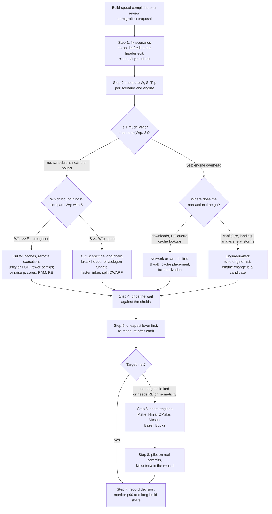

# Decision Record: Build Performance Economics and Engine Selection

> [!summary] Claim:
> A build has two numbers that bound every optimization: total work W (the sum of every action's duration) and span S (the longest dependency chain, the critical path).
> On p workers no schedule beats max(W/p, S), and any greedy scheduler finishes within W/p + S, so cores buy speed only while W/p dominates, and incremental builds are almost always span-bound.
> The money is in engineer wait, which is nonlinear: a build that crosses an attention threshold (about 10 seconds for focus, about a minute in Google's own build telemetry) costs a context switch, not just its seconds.
> Change the build engine only after measuring that the engine itself, not the graph, the cache, or the hardware, is the binding constraint, and write that measurement into a decision record with kill criteria.

The scheduler theory behind work and span is owned by [[Build-System-Theory-Schedulers-and-Rebuilders]].
Engine internals are owned by [[Make-and-Ninja-Mechanics]], [[Modern-CMake-Architecture-and-Targets]], [[Meson-Build-System-and-WrapDB]], [[Bazel-Skyframe-Bzlmod-and-Execution-Model]], and [[Buck2-DICE-Starlark-and-BXL]].
Cache-miss forensics are owned by [[Diagnose-Bazel-and-Buck2-Cache-Misses]], and the migration procedure by [[Migrate-a-Polyglot-Codebase-to-Hermetic-Builds]].
This playbook owns the measurement, the cost model, the lever ladder, the engine decision matrix, and the decision record that ties them together.

## Trigger and Symptoms

Activate this playbook when someone proposes spending money or engineering quarters on build speed, or when the numbers below drift.

- The p90 of interactive incremental builds rises across two consecutive measurement windows, or the share of builds over one minute rises.
  Google's ESEC/FSE 2022 panel study collected exactly these signals: p50 and p90 build time per engineer, satisfaction with build latency, and the share of "long builds", defined as over 1 minute because the median of all developers' 70th-percentile build time was 70 seconds.
  It dropped p50 build time from its model because it was highly correlated with the other latency metrics (VIF above 3).
  In the final model (Table 3) p90 build time was significant (effect -0.024, p = 0.019) and the long-build share was not (p = 0.599), so p90 is the stronger signal and the long-build share is a threshold indicator, not proven evidence.
- A no-op build (nothing changed) takes more than about a second; the Ninja manual cites Chromium's earlier build systems taking ten seconds to start building after a one-file change, against under a second for Ninja.
- A hardware refresh is being priced, and the proposal says "more cores" without a work and span measurement.
- A remote cache or remote execution contract is up for renewal, or its bill grew faster than headcount.
- A team proposes migrating to Bazel or Buck2, or away from them, citing speed.
- A forced migration arrives: Bazel 9 removed `WORKSPACE` support entirely (Bazel 8 had disabled it by default), so a `WORKSPACE`-based repository must either move to Bzlmod or stay on Bazel 8, whose support ends in December 2027 (as of 2026-11, Both).
- Developers report "build and test cycles that inhibit rapid iterative development" in a survey; that phrase is the survey option the Google study coded as build-and-test-cycle hindrance.

## Decision Tree



## Prerequisites

### Data

- Per-invocation build telemetry for interactive builds, not just CI: invocation type, wall time, and engineer identity hashed for per-person percentiles.
  Without per-engineer percentiles you cannot reproduce the p50/p90 per engineer that the Google study used, and an org-wide mean hides the engineers who suffer most.
- A fixed set of reference commits for benchmarking, so before and after runs build identical graphs.
- Hardware inventory: cores, RAM, and disk for developer machines and CI runners.

### Tools

| Tool | Version used for the claims here | Why |
| :--- | :--- | :--- |
| Ninja | 1.13.2 (critical path scheduler since 1.12.0, jobserver client since 1.13.0) | `.ninja_log` timing, `-d stats`, `-d explain` |
| CMake | 4.5.0 | `--profiling-format=google-trace` for configure time |
| Meson | 1.12.1 (needs Python 3.10 or newer) | Ninja backend by default |
| Bazel | 9.3.2 LTS; 8.8.2 for `analyze-profile` | JSON trace profile, summary lines, execution log |
| Buck2 | date-tagged releases such as `2026-11-01`, all marked prerelease | `buck2 log critical-path`, `what-ran`, `summary` |
| GNU Make | 4.4.1 for `.WAIT` and the fifo jobserver; macOS `/usr/bin/make` is 3.81 | Legacy builds |
| Clang | 9 or newer for `-ftime-trace` | Per-translation-unit cost |
| `jq`, `python3` | any current | Profile post-processing |

The Ninja, CMake, Meson, Bazel, and Buck2 versions above are the current releases on GitHub and the vendors' release pages as of 2026-11-14 (Both); the GNU Make features come from its NEWS file, and `make --version` printed `GNU Make 3.81` on the macOS 27.3 host used while writing this note.

**Verification:**

```bash
ninja --version
cmake --version | head -n 1
bazel --version
command -v buck2 && buck2 --version
jq --version
```

Each prints a version; record them in the decision record, because the numbers you collect are only comparable across identical tool versions.

### Permissions and cost controls

- Read access to the remote cache and remote execution dashboards (queue length, worker utilization, bytes transferred), and to the invoice.
- Agreement from engineering management that the record will name kill criteria; a migration without them cannot be stopped on evidence.

## The Economics Model

### Work, span, and the two bounds

Model one build invocation as a DAG of actions, each with a duration.
W is the sum of all executed action durations, S is the duration of the longest path, p is the number of concurrent action slots, and T is the observed wall time.

- **Work bound:** T >= W/p, because p slots cannot do more than p seconds of work per second.
- **Span bound:** T >= S, because the actions on the longest chain run one after another whatever p is.
- **Greedy upper bound:** any list scheduler that never leaves a slot idle while an action is ready finishes within T <= W/p + (1 - 1/p) S.
  This follows from Graham's 1966 analysis of list scheduling on identical processors, which bounds the ratio of two list schedules' finishing times by 1 + (n - 1)/n' for n and n' processors (2 - 1/n when n = n'); Brent's 1974 lemma gives the unit-time form, t + (q - t)/p for q operations and t steps.
- **Parallelism:** W/S is the largest speedup any number of cores can give; past p = W/S extra slots sit idle.
  Amdahl's 1967 argument is the special case of a fixed serial fraction; Gustafson's 1988 reply is that larger machines are usually given larger problems, which in builds is the clean build or the CI matrix rather than the incremental edit.

The ratio T / max(W/p, S) is the scheduling-plus-overhead efficiency.
Near 1 means the engine is doing its job and only the graph or the hardware can help; well above 1 means time is going somewhere that is not action execution: configure, loading and analysis, `stat` storms, queueing, or downloads.

Graham's same paper proves that list scheduling has timing anomalies: adding processors, shortening tasks, relaxing precedence constraints, or changing the priority list can each increase the finishing time.
Builds are list schedules, so a faster compiler or a bigger machine can make a particular build slower; the bound says by at most a factor of 1 + (n - 1)/n', and the cure is a priority list that favors the critical path.
Ninja 1.12.0 added exactly that: `Plan::ComputeCriticalPath()` in `src/build.cc` topologically sorts the wanted edges, weights each edge by its previous elapsed time from `.ninja_log` (1 when there is no history, 0 for phony edges), propagates the heaviest downstream chain back to each producer, and the ready queue (`EdgePriorityLess` in `src/graph.h`) hands out the highest weight first, breaking ties by the lower edge id.
The v1.12.0 release note warns that this "may break your build if you haven't specified your dependencies correctly", because a missing dependency that was hidden by the old order is now exposed.

### The cost of waiting is a step function

Pure wait cost per build is its latency L times the loaded hourly cost of the engineer.
That linear model underestimates long builds and overestimates short ones, because people react to thresholds.
Nielsen's response-time limits, from Usability Engineering (1993), put 1 second as the limit for uninterrupted flow of thought and 10 seconds as the limit for keeping attention on the task, after which users switch to other tasks.
Google's build study used 1 minute as its long-build threshold, derived from its own data (the median of per-developer 70th percentiles was 70 seconds).
Jaspan and Green's IEEE Software article (2023) frames build latency as two separate problems, absolute speed and predictability; the abstract is all of it this note relies on.

A threshold model that you can calibrate:

```text
cost(L) = L                    if L <= L_switch
cost(L) = L_switch + K         if L >  L_switch
expected cost per build = sum over latency buckets of share(bucket) * cost(L_bucket)
annual cost = engineers * builds_per_day * working_days * expected cost * loaded_rate
```

- `L_switch` is the latency after which the engineer stops waiting and starts something else; start with 60 seconds and calibrate it from telemetry (the gap between build completion and the next edit or build event).
- `K` is the refocus penalty for that switch; it is an assumption, not a published constant, so carry two cases: K = 0 (a lower bound, pure wait capped at the threshold) and a calibrated K.
- If a decision flips between the K = 0 and calibrated-K cases, you must measure K before deciding, or make the decision on the lower bound.
- The study found that engineers with longer build times, or who reported being hindered by their build and test cycle, reported lower productivity, and that the relationship was causal under its panel model (Table 3 effect size for p90 build time is -0.024 with p = 0.019, on a model whose adjusted R-squared is 0.1019; build-and-test-cycle hindrance has p = 0.064 and the long-build share p = 0.599 in the same table); treat that as evidence that latency matters, not as a dollar conversion.

Two consequences drive almost every decision:

1. Improvements that do not move builds across a threshold are worth little: taking a build from 6 minutes to 2.5 minutes leaves it above `L_switch`, so in the threshold model it saves nothing.
2. Improvements that move a common build from just above the threshold to below it are worth far more than their seconds suggest; the worked example below shows a 10x difference in value from the same intervention depending on K.

For the loaded rate, the U.S. median annual wage for software developers was $135,980 in May 2025 per the BLS Occupational Outlook Handbook (as of 2026-11, US); the overhead multiplier for benefits, space, and equipment is an organizational number you must obtain from finance, so the worked example labels its 1.4 as an assumption.

### Hardware return on investment

A developer machine upgrade buys a larger p, more RAM, and faster single-thread speed.
Its benefit per build is bounded by the work and span bounds:

- If the scenario is span-bound (S >= W/p already), more cores change the lower bound not at all and the greedy upper bound by at most W/p_old - W/p_new.
- If it is work-bound, the gain is at most W/p_old - W/p_new, and it ends when p reaches W/S.
- Single-thread speed shortens S and every action in W; it is the only hardware lever for span-bound builds.

Memory decides the usable p, not the core count.
Ninja's default `-j` is `GuessParallelism()` in `src/ninja.cc`: 2 on a one-processor machine, 3 on a two-processor machine, and processor count + 2 otherwise.
Bazel's `--jobs` defaults to `auto`, which "calculates a reasonable default based on host resources", and accepts `HOST_CPUS*0.5`-style expressions; `--local_resources=memory=HOST_RAM*.5` caps the RAM Bazel assumes for local actions.
The LLVM build guide recommends one link job per 15 GB of RAM (so `-DLLVM_PARALLEL_LINK_JOBS=2` on a 32 GB machine) and says `-DLLVM_RAM_PER_LINK_JOB=10000` (MB) is a good approximation, because linking with debug information is the largest memory user; `LLVM_USE_SPLIT_DWARF` passes `-gsplit-dwarf` to reduce link-time memory.
A machine with more cores than RAM can feed swaps, and swapping turns a work-bound build into a disk-bound one, so the safe slot count is:

```text
p_safe = min(cores + 2, floor((RAM - reserve) / peak_RSS_per_compile))
link pool depth = floor((RAM - reserve) / peak_RSS_per_link)
```

Measure `peak_RSS_per_compile` and `peak_RSS_per_link` on your worst translation units and links (`/usr/bin/time -v` on Linux reports maximum resident set size; `/usr/bin/time -l` on macOS), then encode the link limit as a Ninja pool, `JOB_POOLS` in CMake, or Bazel resource settings.

Annualize the machine delta over its refresh period and compare with the annual wait savings from the threshold model, not from raw seconds.

### Remote cache and remote execution economics

A remote cache trades action execution for a lookup plus a download.
Per action, with hit rate h:

```text
t_action = h * (t_lookup + t_fetch) + (1 - h) * (t_lookup + t_exec + t_upload)
```

- Only actions on the critical path change latency; hits off the critical path reduce W (and the CPU bill) but not T.
- `t_fetch` is why Build without the Bytes exists: since Bazel 7.0 `--remote_download_outputs` defaults to `toplevel`, which downloads only outputs of top-level targets and those needed by local actions, and `minimal` downloads only the latter (as of 2026-11, Both).
- Bazel's `--disk_cache` adds a local layer; its garbage collection is off unless you set `--experimental_disk_cache_gc_max_size` or `--experimental_disk_cache_gc_max_age`, and runs after the server has been idle for `--experimental_disk_cache_gc_idle_delay` (default `5m`); in Bazel 9.3.2 `bazel help build --long` lists only these `experimental_` names (as of 2026-11, Both).

Remote execution adds a farm, so it adds queueing.
For a single queue with random arrivals and service, the mean time waiting in queue is rho / (1 - rho) mean service times at utilization rho: 1x at 0.5, 2.3x at 0.7, 4x at 0.8, 9x at 0.9, 19x at 0.95.
Pools with many workers wait less than that single-server approximation at the same utilization, but the 1 / (1 - rho) blow-up near saturation remains, so size the farm for peak arrival (Monday mornings and release branches), not mean, and treat sustained utilization above about 0.7 to 0.8 as a latency problem even when the dashboard looks efficient.
Bazel's dynamic execution (`--strategy=Mnemonic=dynamic`; the docs still say to pass `--internal_spawn_scheduler`, which in Bazel 9.3.2 is a placeholder that defaults to `true`) races a local and a remote branch of the same action and keeps the first to finish; it requires remote execution, not a cache-only remote, and the docs name persistent-worker actions and very short actions as the best local candidates.

Software Engineering at Google reports that Google's build output cache (ObjFS) let builds run twice as fast as storing all output on local disk, and that Google runs millions of builds per day producing petabytes of outputs; those are Google-scale numbers, useful as an existence proof, not as your forecast.

## Commands and Numbers to Know

| Item | Platform | Value (as of 2026-11) | Why it matters |
| :--- | :--- | :--- | :--- |
| Ninja default `-j` | Both | 2 for 1 CPU, 3 for 2 CPUs, CPUs + 2 otherwise | Defaults ignore RAM; set pools for links. |
| Ninja scheduling | Both | Critical-path priority since 1.12.0, weights from `.ninja_log` history | A clean first build has no history; weights default to 1 per edge. |
| `.ninja_log` format | Both | `# ninja log v7`; tab-separated start ms, end ms, mtime, output, rapidhash of the command | Times restart at 0 per invocation; one line per output. |
| Ninja jobserver | Both | Client since 1.13.0; POSIX needs the fifo jobserver (GNU Make 4.4+); off when `-j` is passed; `-l` still enforced | Nested `make` and `ninja` share one slot budget; macOS `make` 3.81 cannot provide it. |
| Ninja `console` pool | Both | Depth 1, predefined | Long interactive steps serialize there. |
| GNU Make `-j` | Both | 1 job unless `-j`; `-j` with no number means unlimited | Unbounded `-j` can OOM a large tree. |
| GNU Make 4.4 | Both | `.WAIT`, `--shuffle`, fifo jobserver where `mkfifo` exists | `--shuffle` exposes missing prerequisites. |
| macOS `/usr/bin/make` | macOS | GNU Make 3.81 (dated 2006 in GNU NEWS) | No `--output-sync` (added in 4.0), no `.WAIT`. |
| CMake configure profile | Both | `--profiling-format=google-trace --profiling-output=FILE` (3.18) | Measures configure, which incremental timings omit. |
| CMake `JOB_POOLS` | Both | Ninja generators only; `JOB_POOL_COMPILE`, `JOB_POOL_LINK` | Encodes the RAM rule for link jobs. |
| CMake `UNITY_BUILD` | Both | Since 3.16, `BATCH` mode default | Cuts W from repeated header parsing; can cause ODR errors. |
| `target_precompile_headers` | Both | Since 3.16; `REUSE_FROM` needs identical flags | Another W lever for header-heavy C++. |
| `<LANG>_COMPILER_LAUNCHER` | Both | Since 3.4; Makefile and Ninja generators | How ccache and sccache are wired in. |
| Meson unity | Both | `unity=off` default, `unity_size=4` | Same lever as CMake's, off by default. |
| Bazel `--jobs` | Both | `auto`; 1 to 5000; above 2500 "may cause memory issues" | Raise it for remote execution, not for local. |
| Bazel profile | Both | Written by default to the output base as `command-$INVOCATION_ID.profile.gz`; last 5 retained | No flag needed to get a profile. |
| Bazel `--slim_profile` | Both | `true` | Merges events in large profiles; `--noslim_profile` for full detail. |
| Bazel `analyze-profile` | Both | Present in 8.x, deleted on master in January 2025, absent from 9.x | Use `chrome://tracing`, `jq`, or the Bazel Invocation Analyzer on 9.x. |
| Bazel `--remote_download_outputs` | Both | `toplevel` since 7.0 | Intermediate outputs stay remote. |
| Bazel release model | Both | LTS roughly every 12 months; 9 active to Dec 2028, 8 to Dec 2027, 7 to Dec 2026 | Version pinning is part of the cost. |
| Buck2 releases | Both | Date tags about twice a month (the README calls them bi-monthly), all prerelease; README says no stable release tag | Upgrade cadence is your problem. |
| Buck2 local hermeticity | Both | Local-only build steps are not sandboxed; remote execution is | Local cache poisoning risk without RE. |
| Clang `-ftime-trace` | Both | Since Clang 9; `-ftime-trace-granularity` in microseconds | Finds the translation units and headers behind W. |
| LLVM link RAM guidance | Both | One link job per 15 GB; `LLVM_RAM_PER_LINK_JOB=10000` | A measured starting point for pool depth. |
| Google long-build threshold | Both | Over 1 minute (median of per-developer p70 was 70 s) | A data-derived `L_switch`, not a universal one. |

## Step-by-Step Execution

Each step ends with a check.
Do not continue past a failed check; go to Failure Modes.

### Step 1: Fix the scenarios and the metric

Define five scenarios and freeze the commits they run on:

1. **No-op:** build twice, measure the second.
2. **Leaf edit:** touch one `.cc` file deep in a leaf library.
3. **Core edit:** change one widely included header or one core proto.
4. **Clean with warm remote cache:** fresh output tree, populated shared cache.
5. **Clean cold:** fresh output tree, no shared cache (this is the CI worst case and the cache-outage case).

For each scenario record p50 and p90 across at least ten repetitions, and for interactive telemetry record p50, p90, and the share above `L_switch` per engineer.
The scenarios matter more than the tool: a clean build is usually work-bound and an incremental build usually span-bound, so a single "build time" number mixes two different problems.

**Verification:** you have a table with five rows, each with p50, p90, and the exact commit and tool versions.
If the p90 of a scenario is more than about twice its p50 on an idle machine, find the noise source (thermal throttling, background indexers, cache eviction) before going further, because Step 2 compares runs.

### Step 2: Measure W, S, T, and p for each scenario

#### Ninja (Ninja itself, or CMake and Meson with the Ninja backend)

`.ninja_log` records every edge's start and end time in milliseconds since the invocation began.
This script summarizes the most recent invocation in the log:

```python
#!/usr/bin/env python3
"""Summarize the most recent build in a .ninja_log: work, wall, parallelism, tail."""
import sys
from collections import namedtuple

Edge = namedtuple("Edge", "start end outputs")


def last_build(path):
    builds, current, last_end = [], {}, -1
    with open(path) as f:
        header = f.readline().strip()
        if not header.startswith("# ninja log v"):
            sys.exit(f"not a ninja log: {header!r}")
        for line in f:
            start, end, _mtime, out, cmd_hash = line.rstrip("\n").split("\t")
            start, end = int(start), int(end)
            if end < last_end:  # times restart at 0 for each invocation
                builds.append(current)
                current = {}
            last_end = end
            key = (start, end, cmd_hash)  # one edge, possibly several outputs
            e = current.get(key)
            current[key] = Edge(start, end, (e.outputs if e else ()) + (out,))
    builds.append(current)
    return header, list(builds[-1].values())


def main(path, jobs):
    header, edges = last_build(path)
    work = sum(e.end - e.start for e in edges)
    t0, t1 = min(e.start for e in edges), max(e.end for e in edges)
    wall = t1 - t0
    # Concurrency sweep: when did the build last drop below jobs/2 running edges?
    events = sorted([(e.start, 1) for e in edges] + [(e.end, -1) for e in edges])
    running, low_since, prev_t = 0, None, t0
    for t, d in events:
        if t > prev_t:
            if running < max(1, jobs // 2):
                low_since = prev_t if low_since is None else low_since
            else:
                low_since = None
        running += d
        prev_t = t
    tail = (t1 - low_since) if low_since is not None else 0
    print(f"log format: {header}")
    print(f"edges: {len(edges)}")
    print(f"work W (ms): {work}")
    print(f"wall T (ms): {wall}")
    print(f"achieved parallelism W/T: {work / wall:.2f}")
    print(f"utilization W/(jobs*T): {work / (jobs * wall):.2f}")
    print(f"low-concurrency tail (ms): {tail} ({100 * tail / wall:.0f}% of wall)")
    for e in sorted(edges, key=lambda e: e.start - e.end)[:5]:
        print(f"  {e.end - e.start:>8} ms  {e.outputs[0]}")


if __name__ == "__main__":
    main(sys.argv[1], int(sys.argv[2]))
```

```bash
ninja -C build -j "$JOBS" app
python3 ninja_log_stats.py build/.ninja_log "$JOBS"
```

Pass the slot count you actually used; with no `-j` on a machine with more than two processors, that is processor count + 2.
The script was run once while writing this note, on a six-edge toy graph with `sleep` commands under Ninja 1.13.2 on macOS, to check that it parses the v7 format and separates invocations; its timings are not quoted because they are not a recorded lab.
Read the output this way:
- `achieved parallelism W/T` far below `jobs` with a large `low-concurrency tail` means the end of the build is a chain: span-bound.
- `utilization` near 1 with no tail means work-bound: more slots or less work will help.
- The five longest edges are the first candidates for the critical path; confirm with `ninja -t query OUTPUT` to see each edge's inputs and walk the chain backward.

For a visual timeline, `ninjatracing build/.ninja_log > trace.json` converts the log to the Chrome trace format, viewable in `chrome://tracing`, Speedscope, or Perfetto.
Ninja rewrites (recompacts) `.ninja_log` at load time when it holds more than 100 entries and more than three times as many entries as unique outputs (`BuildLog::Load` in `src/build_log.cc`), keeping one line per output, which drops the invocation boundaries the script relies on, so measure on a log where the last invocation is the measured one.
The script also detects a new invocation only when an end time drops below the previous line's, so a short build followed by one whose first edge ends later is merged; deleting `.ninja_log` before the measured run removes both problems.
The ninjatracing README similarly recommends deleting the log and doing a clean build, or at least running `ninja -t recompact`, before using its `--showall` mode.

To attribute W inside the compiler, add `-ftime-trace` to Clang (Clang 9 or newer), which writes a JSON trace next to each object file; GCC's closest equivalent is `-ftime-report`, which prints per-pass times to stderr.
To include configure time, which incremental timings never show:

```bash
cmake -S . -B build -G Ninja --profiling-format=google-trace --profiling-output=configure-trace.json
```

#### Bazel

Bazel writes a JSON trace profile for every build-like command by default, so the profile of the last command is already at `$(bazel info output_base)/command.profile.gz`.
Pin an explicit path for benchmark runs, which also exempts it from the keep-last-5 garbage collection:

```bash
bazel build //app:server --profile=/tmp/leaf-edit.profile.gz --noslim_profile
```

The last two lines of the console are the cheapest W, S, and T measurement.
In Bazel 9.3.2, `BuildSummaryStatsModule.buildComplete` prints `Elapsed time: %.3fs` joined with `AggregatedCriticalPath.toStringSummaryNoRemote()`, which renders as `Critical Path: %.2fs`, and then the spawn summary from `SpawnStats.convertSummaryToString`, which starts `N processes:` followed by counts per runner such as `remote cache hit`, `internal`, or `remote`.
The source comment in `SpawnStats` warns that this line is misleading: "processes" counts actions, cache-hit runners did not run a process, and the total excludes action cache hits.
The undocumented `--experimental_stats_summary` flag (default `false`) switches to lines that state W and S directly: `Total action wall time %.2fs`, `Execution critical path %.2fs (setup %.2fs, action wall time %.2fs)`, and `Elapsed time %.2fs (preparation %.2fs, execution %.2fs)`; treat its format as unstable.

Extract the critical path and the per-mnemonic work from the profile with `jq`:

```bash
P=/tmp/leaf-edit.profile.gz
gzip -dc "$P" | jq -r '
  (.traceEvents | map(select(.ph == "M" and .args.name == "Critical Path")) | first | .tid) as $cp
  | [.traceEvents[] | select(.ph == "X" and .tid == $cp)]
  | (sort_by(-.dur)[] | "\(.dur / 1000 | floor) ms\t\(.name)"),
    "total critical path: \(map(.dur) | add / 1e6) s"'
gzip -dc "$P" | jq -r '
  [.traceEvents[] | select(.ph == "X" and .args.mnemonic != null)]
  | group_by(.args.mnemonic)
  | map({m: .[0].args.mnemonic, n: length, s: (map(.dur) | add / 1e6)})
  | sort_by(-.s)[] | "\(.m)\t\(.n)\t\(.s) s"'
```

The profile documents a `Critical Path` row with one block per critical-path action, an `action count` row that "should go up to the value of `--jobs`" in clean builds, and `CPU usage (Bazel)`; timestamps and durations are microseconds.
Bazel's profiler emits the critical-path blocks on a fake thread named `Critical Path` (`ThreadMetadata.CRITICAL_PATH_THREAD_ID` is 0 in 9.3.2), which is why the query selects the thread by name.
Both queries were checked only against a hand-written file in the documented format, not against a real Bazel profile, so verify them on yours.
On Bazel 8.x, `bazel analyze-profile FILE` prints cumulative statistics and the critical path; the command was deleted from Bazel's main branch in January 2025 and is absent from 9.x.
The Bazel Invocation Analyzer from EngFlow reads the same profile and prints suggestions.

For per-action cache behavior, write the execution log with `--execution_log_compact_file=exec.log` (zstd-compressed `ExecLogEntry` protos; Bazel's reference recommends it over `--execution_log_json_file` as "significantly smaller and cheaper to produce"); the diffing procedure belongs to [[Diagnose-Bazel-and-Buck2-Cache-Misses]].

#### Buck2

```bash
buck2 build //app:server
buck2 log critical-path --format csv > critical-path.csv
buck2 log summary
buck2 log what-ran --format csv > what-ran.csv
buck2 log chrome-trace --help
```

`buck2 log critical-path` lists every node on the critical path of the selected build, `summary` prints high-level statistics, `what-ran` lists everything that ran, and `chrome-trace` generates a Chrome trace from the event log; event logs are zstd-compressed protobuf whose schema lives in `app/buck2_data/data.proto` and may change.
`buck2 build --build-report FILE` writes a JSON report of per-target results and build metrics.

**Verification:** for every scenario and engine you have W, S, T, and p.
Check that W/T <= p and that S <= T; a violation means the data mixes invocations or mislabels the slot count.

### Step 3: Classify the bound

| Observation | Classification | First levers |
| :--- | :--- | :--- |
| T close to S, S >> W/p | Span-bound | Split the longest action, break header or code-generation funnels, faster linker, split DWARF |
| T close to W/p, W/p >> S | Work-bound | Compiler cache, remote cache, unity builds, PCH, fewer configurations, more slots |
| T >> max(W/p, S), gap before first action | Engine overhead (configure, loading, analysis) | Engine tuning; then engine change is a candidate |
| T >> max(W/p, S), gap during execution | Queueing, downloads, sandbox setup, RAM pressure | Farm sizing, Build without the Bytes, pools, RAM |
| Variance large at fixed commit | Predictability problem | Remove nondeterministic cache misses before speeding anything up |

**Verification:** each scenario has exactly one primary classification, and the record states the numbers that put it there.

### Step 4: Price the wait

Apply the threshold model to the interactive latency distribution from telemetry, once with K = 0 and once with your calibrated K, and price each candidate intervention by the change in expected cost per build.
Price CI separately: CI latency costs engineer wait only on the path to merge (presubmit), and costs machine time everywhere.

**Verification:** every candidate lever has a lower-bound annual value and a calibrated annual value, and the record says which one the decision rests on.

### Step 5: Walk the lever ladder, cheapest first

Apply one lever at a time and repeat Step 2 after each, because levers interact (a remote cache hides a slow compiler until the cache misses).

1. **Configuration:** set the slot count from RAM (`p_safe`), put links in a pool (`JOB_POOL_LINK`, `LLVM_PARALLEL_LINK_JOBS`), use split DWARF for debug builds, and stop building configurations nobody runs.
2. **Local caching:** wire ccache or sccache through `<LANG>_COMPILER_LAUNCHER` for CMake, or `--disk_cache` for Bazel; see [[Compiler-Caches-ccache-and-sccache]].
3. **Graph surgery for S:** find the chain from Step 2 and break it: move a generated header out of a widely included path, split a giant translation unit, replace a code generator that runs on every build; [[Drill-Build-Systems-Break-a-Dependency-Bottleneck]] is the drill.
4. **Work reduction for W:** unity builds (`UNITY_BUILD`, Meson `unity=on`), precompiled headers, include hygiene guided by `-ftime-trace`, and C++20 modules where the toolchain supports them ([[Cpp-Modules-in-Build-Systems]]).
5. **Hardware:** only for work-bound scenarios, sized by the RAM rule, priced by the threshold model.
6. **Shared remote cache:** needs deterministic actions; see [[Hermetic-and-Reproducible-Builds]] and [[Remote-Execution-API-and-Remote-Caching]].
7. **Remote execution:** raises p beyond one machine; needs hermetic actions and a sized farm.
8. **Engine change:** only when Step 3 says engine overhead, or when 6 and 7 require hermeticity your current engine cannot enforce.

**Verification:** after each lever the scenario table is re-measured, and the lever is kept only if the improvement exceeds the run-to-run noise from Step 1.

### Step 6: Score the engines

The six engines sit at two layers.
Make and Ninja are executors: they run a graph they are given and track freshness.
CMake and Meson are meta-build systems: they generate a graph for an executor (Ninja by default for Meson, Ninja or Make or an IDE for CMake).
Bazel and Buck2 are integrated engines: they evaluate rules, own the action graph, key actions by content, and speak the Remote Execution API.

| Criterion | Make | Ninja | CMake | Meson | Bazel | Buck2 |
| :--- | :--- | :--- | :--- | :--- | :--- | :--- |
| Layer | Executor and language | Executor ("aims to be an assembler") | Meta-build | Meta-build | Integrated engine | Integrated engine |
| Freshness | mtime only; command changes not tracked | mtime plus command hash in `.ninja_log`; depfile and deps log | Executor's | Ninja's | Content digests of inputs, command, and environment | Content digests, single incremental graph (DICE) |
| Scheduling | Make order; `-j`, `-l`, jobserver | Critical-path priority since 1.12 | Executor's | Ninja's | Critical path tracked; Skymeld (default since 7.0) removes the analysis and execution boundary | No phases; single dependency graph |
| Hermeticity | None | None | None | None | Local actions sandboxed where available (default strategy order `remote,worker,sandboxed,local`) | Remote execution only; local-only steps unsandboxed |
| Remote cache or execution | Launcher wrappers only | Launcher wrappers only | Launcher wrappers only | Launcher wrappers only | Native REAPI cache and execution, dynamic execution | Native, "same API as Bazel" |
| Languages | Anything, by hand | Anything, generated | C, C++, CUDA, Fortran, others | C, C++, Rust, others | Many via rules (C++ in `rules_cc` since 9.0) | Many via the Starlark prelude |
| Stability | Mature; macOS ships 3.81 | Mature, small | Mature, policy-versioned | Mature | LTS, 2 years maintenance after active | No stable tag; bi-monthly prereleases |
| Fixed cost | Lowest | Lowest | Low | Low (Python 3.10+) | High: JVM server, rules, Bzlmod, remote infra | High: daemon, prelude, toolchains, RE strongly advised |
| Default when | Small POSIX projects, generated Makefiles | Always the executor under CMake or Meson | C or C++ libraries consumed by others | New C or C++ projects wanting a strict DSL | Polyglot monorepo, many teams, shared cache and RE | Large monorepo already on RE, wanting Buck1 continuity or DICE |
| Migrate away when | No-op build slow, deps hand-maintained | Never as a target; replace the generator | Configure dominates, hermeticity needed | Same as CMake | Fixed cost exceeds wait savings, few teams | Ecosystem or stability gaps bite |

Key evidence for the matrix:
- Ninja's manual states its design goal as "very fast (i.e., instant) incremental builds" with "very little policy", and that Ninja files are meant to be generated.
- Meson's FAQ refuses a Make backend because "Make simply cannot be made fast", and its configuration language is deliberately not Turing-complete.
- Bazel 9.0 removed `WORKSPACE` and moved the built-in C++ rules into `rules_cc`; LTS releases are cut about every 12 months.
- Buck2's announcement reports builds 2x as fast as Buck1 in Meta's internal tests; that compares Buck2 with Buck1, not with Bazel.
- Buck2's own "Why Buck2" page says the open-source build without remote execution "may be less polished" and that Meta's internal toolchains are not open-sourced.

**Verification:** every cell your record relies on cites a source or a measurement from Step 2; cells you could not verify are marked as such in the record rather than filled with reputation.

### Step 7: Write the decision record

```markdown
# ADR-NNN: Build engine and build performance investment for <scope>

Status: proposed | accepted | superseded by ADR-MMM
Date: YYYY-MM-DD
Owners: <build platform team>
Review date: <at most 6 months out>

## Context
- Scenarios and their p50 / p90 / share above L_switch (Step 1 table).
- W, S, T, p per scenario and engine, tool versions, commit IDs (Step 2).
- Classification per scenario (Step 3).

## Decision drivers
- Annual wait cost, K = 0 and calibrated K (Step 4).
- Hermeticity, remote execution, language coverage requirements.
- Team capacity to operate the engine and its infrastructure.

## Options considered
- Status quo plus lever ladder steps 1 to 5.
- <Engine A> with <cache / RE plan>.
- <Engine B> with <cache / RE plan>.

## Decision
<one option>, because <the measured driver that decides it>.

## Consequences
- Fixed costs: people, infrastructure, migration duration, dual-build period.
- What gets slower or harder (for example IDE integration, onboarding).

## Kill criteria
- Abort or roll back if <scenario> p90 is not below <target> by <date>.
- Abort if dual maintenance exceeds <N> engineer-weeks per quarter.
- Abort if the remote cache hit rate for <scenario> stays below <h> after <date>.

## Measurement plan
- Dashboards, owners, and the reference commits used for re-measurement.
```

**Verification:** a reviewer who was not in the analysis can recompute each number in the Decision drivers section from the Context section.

### Step 8: Pilot, measure, and decide

Pilot on one representative slice of the codebase with real developers, run the old and new builds side by side on the same reference commits, and measure the same five scenarios.
For Bazel, the build performance documentation recommends `bazel-bench` for benchmarking and suggests the deterministic counters in the Build Event Protocol (`PackageMetrics.packages_loaded`, `TargetMetrics.targets_configured`, `ActionSummary.actions_created`, `ActionSummary.actions_executed`) as proxies that are less noisy than wall time.

**Verification:** the pilot's numbers are entered into the record, and each kill criterion is evaluated as pass or fail with its number.

## Worked Example: A 300-Engineer C++ Organization

All inputs below are stated assumptions chosen to show the arithmetic, except the BLS wage; no number here was measured.

Inputs:
- 300 engineers, 230 working days per year, 30 interactive builds per engineer-day, so 2,070,000 builds per year.
- Loaded rate: $135,980 (BLS median, May 2025) times an assumed overhead multiplier of 1.4, over an assumed 2,000 working hours: $95.19 per hour.
- Latency distribution of interactive builds: 60% at 20 s, 30% at 90 s, 10% at 360 s (mean 75 s, so the mean hides that 40% of builds cross a 60 s threshold).
- Threshold model: `L_switch` = 60 s, K = 180 s (calibrated case) or 0 s (lower bound).

Baseline expected cost per build:
- K = 180 s: 0.6 x 20 + 0.3 x (60 + 180) + 0.1 x (60 + 180) = 12 + 72 + 24 = 108 s.
- K = 0 s: 0.6 x 20 + 0.3 x 60 + 0.1 x 60 = 12 + 18 + 6 = 36 s.
- Annual cost: 2,070,000 x 108 s = 62,100 hours, about $5.91 million; with K = 0, 20,700 hours, about $1.97 million.

Intervention: a shared remote cache plus one graph fix moves the 90 s bucket to 40 s and the 360 s bucket to 150 s.
- K = 180 s: 0.6 x 20 + 0.3 x 40 + 0.1 x (60 + 180) = 12 + 12 + 24 = 48 s, a saving of 60 s per build: 34,500 hours, about $3.28 million per year.
- K = 0 s: 0.6 x 20 + 0.3 x 40 + 0.1 x 60 = 30 s, a saving of 6 s per build: 3,450 hours, about $0.33 million per year.

Readings:
- The 360 s to 150 s improvement contributes nothing in either case, because both latencies stay above the threshold.
- All the value comes from the 90 s builds crossing below 60 s, and the value differs by 10x between the two K cases.
- If the intervention costs less than about $0.33 million per year all-in, approve it on the lower bound; if it costs between that and $3.28 million, measure K first.

Hardware variant: an assumed $1,500 extra per machine for 16 instead of 10 cores, amortized over 3 years, costs $500 per engineer-year.
- Clean local build with W = 2,400 core-seconds and S = 150 s: the lower bound falls from max(240, 150) = 240 s to max(150, 150) = 150 s, and the simple greedy bound W/p + S (looser than the (1 - 1/p) S form, used here for round numbers) from 390 s to 300 s; 16 cores is exactly W/S, so further cores do nothing.
- Incremental build with W = 60 core-seconds and S = 40 s: the lower bound stays 40 s, and the simple upper bound W/p + S falls from 46 s to 43.75 s (the tighter form gives 42 s to 41.25 s, so 2.25 s below is a generous ceiling).
- At 2 clean builds per day, the pure-wait saving is 460 x 90 s = 11.5 hours, about $1,095 per engineer-year, which beats $500; in the threshold model clean builds are above 60 s before and after, so the clean-build saving is 0, and the incremental saving is at most 2.25 s x 6,900 builds = 4.3 hours, about $410, which does not.
- The upgrade decision therefore depends on whether engineers really wait through local clean builds; with a working remote cache they rarely run them, which is the usual answer.

## Rollback Procedure

1. **Configuration levers** (slot counts, pools, unity builds, PCH): each is a build-file or flag change; revert the commit and re-run the Step 1 scenarios.
   **Check:** scenario p50 and p90 return to the recorded baseline within noise.
2. **Compiler or disk cache:** remove the launcher (`CMAKE_CXX_COMPILER_LAUNCHER`) or the `--disk_cache` flag; caches are optimizations, so builds stay correct without them.
   **Check:** a clean build succeeds with the cache disabled, which also proves the build does not depend on cached state.
3. **Remote cache or execution:** remove `--remote_cache` and `--remote_executor` from the shared `.bazelrc` behind a config name (for example `build:remote`), so one line restores local execution; keep `--remote_local_fallback` (default `false`) off unless you have decided that silent local fallback is acceptable, because it hides farm outages in latency numbers.
   **Check:** the same `bazel build` command without `--config=remote` succeeds on a machine with no network route to the farm; do not invent a `--config=local` unless a `build:local` section exists, because Bazel fails when a named config section is missing.
4. **Hardware:** cannot be rolled back; this is why Step 4 must price it on the threshold model before purchase.
5. **Engine migration:** keep the old build green and authoritative until the kill criteria pass; roll back by switching CI's required check back to the old build and freezing new-engine files.
   **Check:** the old build passes on HEAD, and the ADR status is set to superseded with the reason.

## Failure Modes of the Procedure

| Failure | How it shows up | Recovery |
| :--- | :--- | :--- |
| Mixed invocations in the data | W/T > p, or S > T | Measure one invocation per log or profile; Ninja recompaction merges history. |
| Measuring only clean builds | Hardware and RE look decisive; developers see no change | Weight scenarios by how often engineers run them (Step 1). |
| Mean instead of distribution | Threshold crossings invisible | Report p50, p90, and share above `L_switch` per engineer. |
| Cache hits off the critical path | Hit rate rises, T does not move | Check whether critical-path actions hit; see [[Diagnose-Bazel-and-Buck2-Cache-Misses\|Diagnose cache misses]]. |
| Farm saturation | T grows with team size, queue time in the profile | Size for peak; keep utilization below about 0.7 to 0.8. |
| More cores, slower or OOM builds | Swap, link failures, the Graham anomaly | Set `p_safe` from RAM, pools for links; critical-path priority. |
| Exposed missing dependencies after an upgrade | Ninja 1.12+ or Make `--shuffle` breaks a build that used to pass | Fix the dependency; the old order was hiding a real bug ([[Drill-Build-Systems-Fix-Broken-Incremental-Depfile\|Fix a broken depfile]]). |
| Nondeterministic actions | Low remote cache hit rate across machines | [[Hermetic-and-Reproducible-Builds\|Hermetic and reproducible builds]] before buying a bigger cache. |
| Buck2 without RE | Correct-looking builds that depend on undeclared local files | Run on RE in CI so undeclared inputs fail there. |
| Migration stalls | Two build systems maintained for years | Kill criteria with dates; one owner for the dual-build period. |
| Forced upgrade surprise | `WORKSPACE` repo cannot move past Bazel 8 | Track the LTS end-of-support dates in the record's review date. |

## Pitfalls

> [!warning] Optimizing seconds that do not cross a threshold
> Halving a 6-minute build feels like progress and changes almost nothing about how engineers work, because both numbers are past the point where they switch tasks.
> Spend first on the builds that sit just above `L_switch`, and report the share of builds above it.

> [!warning] Reading the Bazel process line as a cache report
> `N processes: ...` counts actions, counts cache hits as if they were processes, and excludes action cache hits from the total, per the comment in `SpawnStats.java`.
> Use the execution log or the profile for cache accounting.

> [!warning] Trusting the default job count
> Ninja's default is processor count + 2 and Bazel's `auto` is derived from host resources; neither knows your worst link's RAM.
> A 16-core, 32 GB laptop running 18 heavyweight C++ compiles plus parallel debug links can swap, and swap makes every bound meaningless.

> [!warning] Comparing engines on different graphs
> A Bazel pilot that also splits the giant library, fixes the generated header, and turns on a remote cache will beat the old build even if the engine contributed nothing.
> Attribute each improvement to its lever by applying the levers to the old build too, or say plainly that the comparison is of whole programs.

> [!warning] Vendor numbers as forecasts
> "2x faster than Buck1" (Meta) and "twice as fast with ObjFS" (Google) are measurements of those companies' graphs, caches, and networks.
> They prove the mechanism can matter; only Step 2 on your graph predicts your result.

> [!warning] A cache that hides a correctness bug
> A remote action cache serves whatever result a writer uploaded for an action key; a nonhermetic action poisons everyone who hits that key.
> Buck2's README states that local-only build steps are not sandboxed, so in a cache-without-RE setup an undeclared input can be uploaded and served.

## At Scale

The levers change with headcount, because fixed costs amortize and coordination costs grow.

- **1 to 20 engineers:** CMake or Meson with Ninja, ccache or sccache, and sane pools; the fixed cost of Bazel or Buck2 (rules, remote infrastructure, a person who understands them) usually exceeds the wait it removes.
  Measure anyway, because a single generated header can make every build span-bound.
- **20 to 300 engineers:** a shared cache becomes worth its operations cost once many engineers build the same commits; CMake has no content-addressed action cache of its own, so this is where teams either adopt compiler-level remote caches (sccache with cloud storage) or start a Bazel pilot for hermeticity.
- **300 to 5,000 engineers:** remote execution and a build platform team are normal; the dominant risks become nondeterminism, farm queueing, and analysis-phase cost on large graphs, which [[Bazel-Skyframe-Bzlmod-and-Execution-Model]] and [[Buck2-DICE-Starlark-and-BXL]] treat.
- **5,000 to 50,000 engineers:** the build is infrastructure with its own SLOs (p90 by scenario, cache availability, farm queue time), its own capacity planning, and its own release process, as in Google's description of Blaze, Forge, and ObjFS in Software Engineering at Google.

Decision rules:
- Do not change engines to fix a span-bound graph; every engine runs the same chain in the same order.
- Change engines when Step 2 shows engine overhead dominates, or when remote execution and hermeticity are required and the current engine cannot enforce them.
- Prefer the engine whose ecosystem covers your languages without custom rules; Buck2's own docs list open-source toolchain gaps, and Bazel's C++ support now comes from `rules_cc`.
- Make the build team's goals threshold metrics (share of builds over `L_switch` per engineer) rather than means, which also resists Goodhart effects from optimizing a single benchmark.
- Re-run this playbook at every LTS boundary and hardware refresh, and whenever the long-build share rises.

## Practice Drill

> [!tip] Practice Drill: Measure, classify, and price one real build
> On any CMake or Meson project you can build locally, configure it with Ninja and run the five Step 1 scenarios.
> 1. Run the `ninja_log_stats.py` script after each scenario and write down W, T, achieved parallelism, and the tail.
> 2. Predict, before running it, how the leaf-edit and clean scenarios change when you halve `-j`; then run them and explain the result with the two bounds.
> 3. Find the longest edge on the clean build's tail and walk its inputs with `ninja -t query`; that chain is your span.
> 4. Price the leaf-edit and core-edit scenarios with the threshold model for K = 0 and K = 180 s, using your own build counts.
> 5. Then do [[Drill-Build-Systems-Break-a-Dependency-Bottleneck]] and re-measure: the drill should move S, and your W should barely change.
> Target time: under 45 minutes for steps 1 to 4.

## Interview Questions

> [!question] L5
> Define work and span for a build, and explain why buying more cores did nothing for incremental builds.
>
> > [!success]- Answer
> > Work W is the sum of every executed action's duration; span S is the duration of the longest dependency chain.
> > On p slots the wall time is at least max(W/p, S), and a greedy scheduler finishes within W/p + (1 - 1/p) S.
> > An incremental build after a one-file edit runs a short chain (compile, archive or link, maybe a test), so W is small and S dominates: W/p was already below S, and more cores lower only a bound that was not binding.
> > Only shortening the chain (faster link, split the edited library, faster single-thread hardware) helps.

> [!question] L5 (predict the output)
> A `build.ninja` has three independent compiles `a.o`, `b.o`, `c.o` (0.2 s each), a generator `gen.h` (0.6 s), `d.o` (0.3 s) that depends on `gen.h`, and `app` (0.2 s) that depends on all four objects.
> Ninja 1.13 runs it with `-j2` on a fresh tree with no `.ninja_log`.
> Which edge starts at time zero, and what are the lower and greedy upper bounds on wall time?
>
> > [!success]- Answer
> > With no history, `EdgeWeightHeuristic` gives every non-phony edge weight 1, and `ComputeCriticalPath` propagates the heaviest downstream chain back: `app` is 1, `d.o` and each of `a.o`, `b.o`, `c.o` is 2, and `gen.h` is 3.
> > The ready queue hands out the highest weight first, so `gen.h` starts at time zero together with one of the compiles; a run of this exact graph under Ninja 1.13.2 while writing this note started `gen.h` first.
> > W = 0.6 + 0.3 + 3 x 0.2 + 0.2 = 1.7 s, so W/p = 0.85 s, and S = 0.6 + 0.3 + 0.2 = 1.1 s.
> > The lower bound is max(0.85, 1.1) = 1.1 s, and the greedy upper bound is 0.85 + 0.5 x 1.1 = 1.4 s; the build is span-bound, so the result lands near 1.1 s plus process overhead.
> > A list order that starts two compiles first delays `gen.h` to 0.2 s, so the chain ends at 0.2 + 1.1 = 1.3 s; that is the kind of order a critical-path scheduler avoids.

> [!question] L5
> A Bazel build ends with `INFO: Elapsed time: 300.512s, Critical Path: 41.20s`.
> What do the two numbers tell you, and what do you look at next?
>
> > [!success]- Answer
> > Elapsed time is T for the whole command; the critical path is S over executed actions, so T is about 7x S.
> > Either the build is work-bound (W/p near 300 s), or most of the time is not action execution at all: loading, analysis, queueing, or downloads.
> > Open the JSON profile: the `action count` row shows whether concurrency reached `--jobs`, `CPU usage (Bazel)` and the `Main Thread` row (`runAnalysisPhase`) show analysis cost, and the critical-path row lists the chain.
> > With `--experimental_stats_summary` Bazel prints `Total action wall time`, which is W directly, so W/T versus `--jobs` separates the two cases.

> [!question] L6 (debug this)
> After a laptop refresh from 10 cores and 32 GB to 16 cores and 32 GB, engineers report that clean debug builds of a large C++ service are slower and sometimes fail with the linker killed, while incremental builds are unchanged.
> What happened, and what do you change?
>
> > [!success]- Answer
> > Ninja's default `-j` rose from 12 to 18 (processor count + 2) and CMake passed it through, so peak memory from concurrent compiles plus several debug links exceeded RAM; the machine swapped and the OOM killer took a linker.
> > Swapping turns a work-bound build into a disk-bound one, which is why clean builds got slower despite more cores; incremental builds are span-bound, so they did not change.
> > Fix: measure peak RSS per compile and per link, set the slot count from RAM, and put links in a pool with `JOB_POOLS` and `JOB_POOL_LINK` (or `LLVM_PARALLEL_LINK_JOBS`, which LLVM sizes at one link per 15 GB); add `-gsplit-dwarf` to shrink link-time memory.
> > Then re-measure: the clean build should become work-bound again, and the refresh's value is limited to that scenario.

> [!question] L6
> The remote cache dashboard shows a 92% hit rate, yet developers see no improvement in incremental builds.
> Give three explanations and how to tell them apart.
>
> > [!success]- Answer
> > First, the hits are off the critical path: they lower W and the CPU bill, but the edited chain always misses because it contains the change; the critical-path row of the profile will show executed, not cached, actions.
> > Second, fetch cost: a hit that downloads large intermediate outputs can be slower than recompiling; check `--remote_download_outputs` (default `toplevel` since Bazel 7.0) and per-action fetch times in the profile.
> > Third, the time is not in execution at all: loading and analysis or a cold Bazel server dominate, visible as a long gap before the first action.
> > The hit rate is also inflated if CI dominates the traffic; segment it by interactive versus CI invocations.

> [!question] L6
> Why does Ninja 1.12's release note warn that the new scheduler "may break your build"?
>
> > [!success]- Answer
> > Before 1.12, edges ran in an order that happened to satisfy some undeclared dependencies, for example a generated header that a compile includes but does not list.
> > The critical-path scheduler reorders ready edges by weight, so a compile can now run before the generator it silently needs and fail, or worse, read a stale header.
> > The build was always wrong; the order hid it, which is the same class of bug that GNU Make 4.4's `--shuffle` is designed to expose.
> > Fix the depfile or the explicit dependency rather than pinning an old Ninja.

> [!question] L7
> Write the outline of a decision record for a 400-engineer organization with a C++ and Python monorepo on CMake that is considering Bazel.
>
> > [!success]- Answer
> > Context: five scenarios with p50, p90, and share above the switch threshold per engineer; W, S, T, p per scenario; tool versions and reference commits.
> > Classification: if incremental builds are span-bound, the engine is not the fix, and the record says so; if configure and stat overhead or the lack of a hermetic shared cache dominates, Bazel is a candidate.
> > Options: CMake plus lever ladder (pools, sccache with shared storage, unity builds, graph surgery) versus Bazel with remote cache, versus Bazel with remote execution.
> > Drivers: annual wait cost at K = 0 and calibrated K, Bazel fixed costs (rules for both languages, Bzlmod-only since 9.0, `rules_cc` for C++, a build team, remote infrastructure), and dual-maintenance cost during migration.
> > Kill criteria with dates: pilot slice p90 for leaf edit below target, hit rate above target, dual-maintenance effort below a cap.
> > Review date tied to the Bazel LTS calendar.

> [!question] L7
> Size a remote execution farm for a team whose peak demand is 600 core-seconds of actions per second.
> What utilization do you plan for, and why not 95%?
>
> > [!success]- Answer
> > Queueing delay grows like rho / (1 - rho): about 1 mean service time of waiting at rho 0.5, 2.3 at 0.7, 9 at 0.9, and 19 at 0.95 for a single-queue approximation; large pools do better, but the blow-up near saturation remains.
> > Plan peak utilization around 0.7, so about 860 cores for 600 core-seconds per second of peak demand, and measure queue time in the profile to calibrate.
> > At 95% the farm looks efficient on the invoice while every developer's critical path waits in the queue, and the wait cost is paid by the most expensive resource.
> > Add autoscaling for predictable peaks and keep CI and interactive work in separate priority classes.

> [!question] L7
> A team adds faster CPUs to its CI fleet and a particular pipeline gets slower.
> How is that possible, and what do you do?
>
> > [!success]- Answer
> > Graham proved that list schedules have timing anomalies: shortening task times, adding processors, relaxing precedence, or changing the priority list can each increase the finishing time, by at most a factor of 1 + (n - 1)/n'.
> > Faster tasks change which tasks become ready together, so a long chain can start later than before.
> > Measure the critical path before and after; give the scheduler a critical-path priority (Ninja 1.12+ does this from history, Bazel tracks the critical path) and keep timing history warm on CI runners, because a fresh `.ninja_log` has no weights.

> [!question] L8+
> Formulate a company-wide strategy that balances developer hardware against a remote execution farm.
>
> > [!success]- Answer
> > Split builds by bound: incremental builds are span-bound and need fast single-thread hardware and short chains; clean and CI builds are work-bound and are cheapest on shared capacity that many engineers reuse through the cache.
> > Buy developer machines for single-thread speed and RAM (to run the edited chain and the IDE without swap), not for core counts beyond what the incremental scenario uses.
> > Put work-bound load on a shared cache and farm sized at about 0.7 peak utilization, with Build without the Bytes so laptops do not download intermediates.
> > Price both on the threshold model, decide on the lower bound where possible, and set SLOs on the share of builds over the switch threshold per engineer.
> > Revisit at each hardware refresh and engine LTS boundary, and keep a local-only fallback that is tested, because a farm outage otherwise stops the company.

> [!question] L8+
> When would you choose Buck2 over Bazel for a new monorepo, and what risks would you write into the record?
>
> > [!success]- Answer
> > Choose Buck2 when the organization already runs remote execution, wants rules entirely in Starlark with a Rust core and a single incremental graph, and has the people to own toolchains; Meta reports 2x over Buck1, which shows what the architecture can do but says nothing about Bazel.
> > Risks to record: no stable release tag (bi-monthly prereleases), local-only build steps not sandboxed so hermeticity depends on remote execution, open-source toolchains that Buck2's own docs call less polished, and fewer third-party rules than Bazel's ecosystem (no published count exists, so audit the rules your languages need).
> > Bazel's risks are different: higher fixed cost, a JVM server, and forced migrations at LTS boundaries such as the `WORKSPACE` removal in 9.0, against a larger rules ecosystem and a published support calendar.
> > Mitigate with a pilot, RE from day one in CI, version pinning through dotslash files or Bazelisk, and kill criteria.

## Further Reading

- R. L. Graham, Bounds for Certain Multiprocessing Anomalies, Bell System Technical Journal, 1966, https://archive.org/details/bstj45-9-1563.
  The list-scheduling model builds use, the 1 + (n - 1)/n' bound, and why more processors can be slower.
- R. P. Brent, The Parallel Evaluation of General Arithmetic Expressions, JACM, 1974, https://maths-people.anu.edu.au/~brent/pub/pub022.html.
  The lemma that turns unlimited-processor schedules into p-processor bounds.
- Cheng et al., What Improves Developer Productivity at Google? Code Quality, ESEC/FSE 2022, https://doi.org/10.1145/3540250.3558940.
  Panel-data evidence that build latency is causally linked to self-rated productivity, and the long-build metric definition.
- Jaspan and Green, Build Latency, Predictability, and Developer Productivity, IEEE Software, 2023, https://research.google/pubs/developer-productivity-for-humans-part-4-build-latency-predictability-and-developer-productivity/.
  Why predictability is a separate goal from speed.
- Nielsen, Response Times: The 3 Important Limits, https://www.nngroup.com/articles/response-times-3-important-limits/.
  The 1 s and 10 s attention limits behind the threshold model.
- Software Engineering at Google, Chapter 18, https://abseil.io/resources/swe-book/html/ch18.html.
  Why artifact-based builds scale, and Google's distributed caching and execution.
- The Ninja Build System Manual, https://ninja-build.org/manual.html, and `src/build.cc`, https://github.com/ninja-build/ninja/blob/master/src/build.cc.
  Design goals, pools, the log, and the critical-path scheduler's code.
- Bazel JSON Trace Profile and Breaking Down Build Performance, https://bazel.build/advanced/performance/json-trace-profile.
  What each profile row means and which BEP counters to benchmark with.
- Bazel Dynamic Execution, https://bazel.build/remote/dynamic.
  The local and remote race, its failure semantics, and tuning flags.
- buck2 log command reference, https://buck2.build/docs/users/commands/log.
  `critical-path`, `what-ran`, `summary`, and `chrome-trace` for Buck2 measurements.
- Building LLVM with CMake, https://llvm.org/docs/CMake.html.
  A real project's memory-driven job pool guidance.

## Related

- Prerequisites: [[Bazel-Skyframe-Bzlmod-and-Execution-Model]], [[Modern-CMake-Architecture-and-Targets]]
- Next: [[Diagnose-Bazel-and-Buck2-Cache-Misses]]
- See also: [[Build-System-Theory-Schedulers-and-Rebuilders]], [[Make-and-Ninja-Mechanics]], [[Meson-Build-System-and-WrapDB]], [[Buck2-DICE-Starlark-and-BXL]], [[Remote-Execution-API-and-Remote-Caching]], [[Compiler-Caches-ccache-and-sccache]], [[Migrate-a-Polyglot-Codebase-to-Hermetic-Builds]], [[Drill-Build-Systems-Break-a-Dependency-Bottleneck]]
