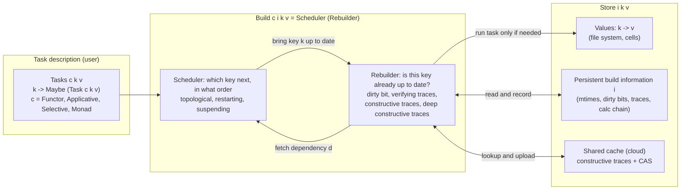
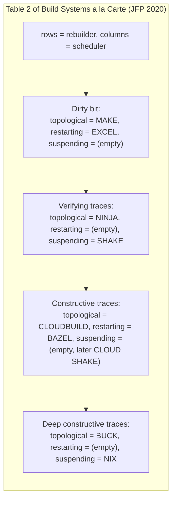

# Build System Theory: Schedulers, Rebuilders, and Dependency Graphs

> [!summary] Claim:
> A build system brings a key-value store up to date for a target key, and Mokhov, Mitchell, and Peyton Jones show that every real one is the composition of two independent parts: a scheduler that decides the order in which keys are brought up to date, and a rebuilder that decides whether a key needs any work at all.
> There are three schedulers (topological, restarting, suspending) and four rebuilders (dirty bit, verifying traces, constructive traces, deep constructive traces), giving a 3 x 4 grid in which Make, Excel, Ninja, Shake, Bazel, CloudBuild, Buck, and Nix each occupy one cell.
> The type of the task decides what the scheduler may assume: an applicative task has static dependencies that a topological sort can use before any work starts, and a monadic task discovers dependencies from values, which only a restarting or suspending scheduler can handle.
> Minimality, early cutoff, dynamic dependencies, cloud sharing, and shallow builds are each a consequence of the cell a system picks, not of its implementation language, and the cells explain why no tool gets all five for free.





## The Mechanism

Every fact in this note attributed to "the paper" is from the open-access journal version, Mokhov, Mitchell, and Peyton Jones, "Build systems a la carte: Theory and practice", JFP 30, e11 (2020), which extends the ICFP 2018 conference paper; section numbers are the journal's.
The paper's models are executable Haskell published on Hackage as the `build` package, which is at version 1.1 (as of 2026-11, Both).
Statements about specific tools are checked against their own sources at the versions named in each subsection, because the paper describes them as of 2018 to 2020.

### 1. The vocabulary: store, keys, tasks, and the build function

The paper reduces every build system to five nouns (Section 3.1):

- **Store**: a mapping from keys to values.
  For a software build the store is the file system, keys are file paths, and values are file contents; for Excel the store is the workbook, keys are cell names, and values are cell contents.
- **Input, output, and intermediate keys**: inputs are supplied by the user (`main.c`), outputs are what the user asked for (`main.exe`), and everything else (`main.o`) is intermediate.
- **Persistent build information** `i`: whatever the build system remembers between runs, such as modification times, dirty bits, a calc chain, or traces.
  This is the build system's memory, and the choice of what to remember is most of the design.
- **Task description**: how to compute the value of one non-input key from the values of its dependencies.
  Makefile rules, Excel formulae, Shake rules, and Starlark rule implementations are all task descriptions.
- **Build system**: a function from a task description, a target key, and a store to a new store in which the target and all its dependencies are up to date.

The paper writes these as Haskell types, quoted here because the rest of the theory hangs off them (Section 3.2 and 3.3, Figure 5):

```haskell
newtype Task c k v = Task (forall f. c f => (k -> f v) -> f v)
type Tasks c k v   = k -> Maybe (Task c k v)          -- Nothing means "k is an input"
type Build c i k v = Tasks c k v -> k -> Store i k v -> Store i k v

type Rebuilder c ir k v = k -> v -> Task c k v -> Task (MonadState ir) k v
type Scheduler c i ir k v = Rebuilder c ir k v -> Build c i k v
```

A task is a function that receives a callback, `fetch :: k -> f v`, and uses it to obtain the values of its dependencies.
The task never sees the file system, the scheduler, or the cache; it only sees `fetch`.
That is what makes the decomposition possible: the scheduler decides what `fetch` does when it is called, and the rebuilder decides whether the task is called at all.

The simplest build system, `busy`, makes `fetch` recursively rebuild every dependency every time, with no memory (`i = ()`).
It is correct for any acyclic task description but recomputes a shared dependency once per use: with `B2 = B1 + B1`, it computes `B1` twice in one build.
Every real build system is `busy` plus memory plus a smarter order.

### 2. Correctness and minimality, stated precisely

The paper's definition of correctness (Section 3.6) is two conditions on the result store, over the keys reachable from the target:

1. The result agrees with the initial store on every input key: the build corrupted no input.
2. For every non-input key `k`, recomputing its task against the result store gives exactly the stored value: `getValue k result == compute task result`, where `compute` runs the task with a `fetch` that simply reads the store.

In words: after the build, nothing would change if you recomputed any reachable key from the values sitting next to it.
The definition says nothing about how much work was done, and `busy` satisfies it.

Minimality is the efficiency property (Section 2.1): a build system is minimal if it executes each task at most once per build, and only if the task transitively depends on inputs that changed since the previous build.

Three refinements matter in practice:

- **Acyclicity.** Every build system in the paper is correct only for acyclic task descriptions; `busy` loops forever on a cycle.
  Excel and Pluto support bounded iteration instead (Section 8.5, and Section 6 of this note).
- **Non-deterministic tasks** weaken condition 2: the stored value must belong to the set of values the task could produce, not equal one specific recomputation (Section 8.3).
- **Shallow builds** weaken the scope: only the target and the reachable inputs must match, because intermediates were never materialised (Section 8.4).

Make is minimal only under an assumption: its footnote 5 notes that you can fool Make with `touch`, which changes a modification time without changing content, so Make is minimal only if you do not do that.

### 3. Task classes: what the scheduler may know before running a task

Because `Task` is polymorphic in the context `f`, the constraint `c` classifies task descriptions by how much they reveal before they run (Section 3.4):

| Constraint `c` | What a task can do | Dependency shape | Example from the paper | Real system at this level |
| :--- | :--- | :--- | :--- | :--- |
| `Functor` | Transform one fetched value | Exactly one dependency, a linear chain | Collatz sequence | Docker image layers (single-stage builds) |
| `Applicative` | Combine several fetched values | Static: knowable without computing anything | `B1 = A1 + A2`, Fibonacci | Make, Ninja build edges, Buck1 |
| `Selective` | Choose between branches on a fetched value | Statically over-approximable | `IF(C1=1, B2, A2)` | Dune (redesigned around selective functors) |
| `Monad` | Fetch keys chosen from earlier fetched values | Dynamic: known only by running | `INDIRECT("A" & C1)`, Ackermann | Excel, Shake, redo, Nix, Bazel's Skyframe internally, Buck2 dynamic outputs |

The applicative case has a striking consequence: you can extract a task's dependencies without doing any of its work by running it in the `Const` functor, where `fetch k` records `[k]` and the applicative instance concatenates the lists (Section 3.7):

```haskell
dependencies :: Task Applicative k v -> [k]
dependencies task = getConst $ run task (\k -> Const [k])
```

No such trick exists for a monadic task, because `Const` has no `Monad` instance: you cannot know what `B1 = INDIRECT("A" & C1)` reads until you know `C1`.
For monadic tasks the paper defines `track`, which runs the task for real and records the `(key, value)` pairs it fetched, in order.

The order matters.
A monadic task is deterministic, so two runs that fetch the same values for their first dependency will fetch the same second key; a rebuilder that checks a monadic task's recorded dependencies must therefore check them in the recorded order and stop at the first mismatch, because a later recorded dependency may not even be needed any more.
rustc's `try_mark_green()` and Skyframe's dirty-node checking both walk recorded dependencies in order for exactly this reason.

#### The dependency spectrum in real tools

Real build systems are rarely purely applicative or purely monadic, and the in-between mechanisms are worth knowing precisely:

- **Make** is applicative inside one parse of the makefiles, but GNU make can remake its own makefiles: after reading all makefiles it treats each as a goal, and if any was actually changed, it "starts with a clean slate and reads all the makefiles over again", incrementing `MAKE_RESTARTS` each time (GNU make 4.4.1 manual, section 3.5).
  The manual's classic auto-dependency recipe (section 4.14) gives each `.d` file a `%.d: %.c` rule and `include`s the results, so a changed `.d` triggers this restart: a whole-program restarting scheduler wrapped around an applicative core.
  The newer idiom of writing `.d` files as a side effect of compiling (`-MMD`) and reading them with `-include` needs no restart, because it is the post-hoc mechanism described next for Ninja.
- **Ninja depfiles** (`depfile`, and `deps = gcc` or `deps = msvc`, the latter two available since Ninja 1.3) record header dependencies discovered as a side effect of compiling.
  The manual's argument is the key theoretical point: "if the file has never been compiled, it must be built anyway, generating the header dependencies as a side effect", and any later modification also causes a rebuild that refreshes the list (Ninja v1.13.2 manual).
  Post-hoc dependencies are therefore sound for deciding whether to rebuild, but they cannot order a build: a generated header must exist before the first compile reads it, which is why the manual pairs depfiles with order-only dependencies (`||`) "to generate a header file before starting a subsequent compilation step".
- **Ninja dyndep** (available since Ninja 1.10) lets a build statement load extra implicit inputs and outputs from a file that an earlier edge produced, which is how C++20 module dependencies discovered by a scanner reach the graph; [[Cpp-Modules-in-Build-Systems]] and [[Make-and-Ninja-Mechanics]] own the details.
  This is a staged dynamic dependency: the graph changes at a known point during the build, not arbitrarily inside a task.
- **Shake, redo, and Nix** are fully monadic: a rule may read a file and then `need` the files it lists.
  redo's `redo-ifchange` can even be called after the target is generated, so a `.do` script can compile first and declare the headers gcc reported afterwards; `redo-ifcreate` declares a dependency on a file that does not exist yet, so creating it later triggers a rebuild.
- **Bazel** runs on Skyframe, which is monadic internally: a `SkyFunction` calls `env.getValue()` and gets `null` for a dependency that is not ready.
  The paper states (2020) that user-defined Starlark rules cannot express dynamic dependencies and that some predefined rules use the internal capability instead; this note did not re-verify that statement against Bazel 9.3.2 (UNVERIFIED for current Bazel: the paper's claim predates Bazel 7 to 9).
- **Buck2** exposes dynamic power to rule authors through dynamic dependencies (`dynamic_output`) and anonymous targets, used for Haskell and OCaml module graphs and distributed ThinLTO (Buck2 `docs/about/why.md`); [[Buck2-DICE-Starlark-and-BXL]] owns the API.

### 4. Schedulers

A minimal build system must build each key at most once, and the only way to do that while producing a correct result is to build every key after its dependencies (Section 4).
The scheduler is the part that guarantees this order.

#### 4.1 Topological scheduler

The topological scheduler computes the graph of keys reachable from the target, sorts it topologically, and then runs the rebuilder on each key in that order.
A depth-first post-order or Kahn's algorithm does this in O(V + E) time for V keys and E dependency edges.

Its advantages are simplicity and early errors: a missing rule or a dependency cycle is reported before any command runs.
Its limitation is fundamental, not an engineering gap: it needs every task's dependencies before execution, so it requires `c = Applicative`, and any system built on it inherits that restriction (Section 4.1, Section 6.2).

Parallelism is natural (Section 8.2): start every task whose dependencies are complete, which is the ready-set loop at the heart of `make -j` and Ninja.
The next problem is limiting parallelism, which pools and the GNU jobserver solve; [[Make-and-Ninja-Mechanics]] owns them.

#### 4.2 Restarting scheduler

To handle dynamic dependencies without knowing them up front, a restarting scheduler runs tasks in some order and, when a task fetches a dependency that is not yet up to date, aborts the task, builds the dependency, and runs the task again from the beginning (Section 4.2).

Its costs:

- A mechanism to abort a task, which is easy for a pure function and an engineering problem for a running process.
- Duplicate work: anything a task computed before the missing fetch is thrown away and recomputed.
  A task that discovers k out-of-date dependencies one at a time, with no remembered order, starts k + 1 times and performs 1 + 2 + ... + (k + 1) fetches, which is O(k^2); a suspending scheduler performs k + 1 (this bound is this note's derivation from the paper's algorithm, not a figure the paper gives).

Remembering the order removes most aborts.
Excel keeps the calc chain from the previous build, so in the common case where an edit changes values but not dependencies there are no aborts at all (Section 2.2).
Microsoft's documentation describes the same mechanism: during recalculation Excel "revises this chain if it comes across a formula that depends on a cell that has not yet been calculated", moving the cell and its dependents down the chain, which is why "calculation times can often improve in a worksheet that has just been opened in the first few calculation cycles" (Excel Recalculation, Microsoft Learn).

Bazel's Skyframe is the large-scale restarting scheduler.
`SkyFunction.compute()` returns `null` when `env.valuesMissing()` is true; Skyframe computes the missing dependencies and calls `compute()` again, which the source calls a "Skyframe restart" (`SkyFunction.java`, Bazel 9.3.2).
The duplicate-work problem is acknowledged in the API: `Environment.getState()` returns a `SkyKeyComputeState` object that may survive across restarts of the same key, so a function can cache work done before its first missing dependency, and the Javadoc stresses that there is no guarantee the same instance comes back, so it is only a performance optimisation.
The paper also notes that Bazel does not persist a calc chain; it stores the most recent dependency information, from which it can recompute an order, and may still abort when a newly discovered dependency is out of date (Section 4.2).

GNU make's makefile remaking (`MAKE_RESTARTS`) is a third restarting scheduler, at the granularity of the whole makefile.

In parallel, a restarting scheduler can run n workers over the queue; a key may be pushed back not because it is out of date but because it raced an unfinished task, and if the order is persisted, as Excel does, racing dependencies drift apart over successive runs (Section 8.2).

#### 4.3 Suspending scheduler

A suspending scheduler builds a dependency at the moment it is fetched and suspends the requesting task until it is ready (Section 4.3).
In the paper's model this is just a recursive function call; `busy` is a suspending scheduler with no memory.
Combined with a suitable rebuilder it is minimal and supports dynamic dependencies, so it is theoretically optimal.

In practice, suspension needs either blocking threads or processes, which is simple but expensive when many tasks are suspended, or continuation-passing style, which is efficient but requires the build script to be written so the remainder of a task can be captured (Section 4.3).
Shake started with blocking threads, which Haskell's green threads make cheap, and later moved to continuations; the paper calls this the biggest implementation change in roughly 5,000 commits since the 2012 paper (Section 7.2).

Other suspending schedulers, and how they suspend:

- **redo** suspends with processes: `redo-ifchange` blocks the calling `.do` script until the named targets are up to date, waiting on a lock if another redo instance is already building them (`redo-ifchange` manual page).
- **Buck2's DICE** suspends with Rust futures on tokio executors and deduplicates concurrent requests for the same computation (`dice/dice/docs/index.md`).
- **rustc's query system and Salsa** suspend with ordinary recursion: a query that needs another query calls it, and the call returns a cached or freshly computed result.

The paper's practical caveat is important for anyone choosing between the two dynamic schedulers: a suspending scheduler beats a restarting one only if the avoided duplicate work outweighs the cost of suspension, and duplicate work is often a small fraction of total build cost (Sections 2.4 and 4.3).

### 5. Rebuilders

Once the scheduler decides a key's turn has come, the rebuilder decides whether any work is needed (Section 5).
The four rebuilders differ in what they remember, which determines what they can prove.

#### 5.1 Dirty bit

One bit per key: clean after a build, dirty if something it depends on changed.
If a key and all its transitive dependencies are clean, it needs no rebuild.

**Excel** has a literal dirty bit per cell.
The external system that drives the build must supply a transitively closed set of dirty bits; marking too many is safe, marking too few is not (Section 6.3).
Microsoft's documentation confirms the closure: "All direct and indirect dependents are marked as dirty".
Because Excel does not record each cell's dynamic dependencies, it over-approximates: a formula is dirty if it statically mentions a dirty cell, or calls a volatile function, or the formula itself changed (Section 2.2 and 5.1).
Microsoft lists `NOW`, `TODAY`, `RANDBETWEEN`, `OFFSET`, `INDIRECT`, and, depending on arguments, `INFO`, `CELL`, and `SUMIF` as volatile, and volatile cells are re-evaluated with all their dependents on every recalculation (as of 2026-11, Microsoft Learn page dated 2024).
`IF` is over-approximated too: both branches are treated as dependencies even though only one is used.

**Make** uses modification times as a dirty bit that lives in the file system.
GNU make's rule is exact: "A target is out of date if it does not exist or if it is older than any of the prerequisites (by comparison of last-modification times)" (GNU make 4.4.1 manual, section 4.2).
Writing a file implicitly clears its own bit and sets the bit of its direct dependents, but not recursively; the recursion happens because rebuilding a dependent writes it and makes it newer.

Make's mtime bit has failure modes that follow directly from not owning it:

- It requires time to move forward; the paper notes backup software can violate this (Section 5.1), and restoring files from an archive or a version control checkout can produce the same effect.
- A changed mtime with unchanged content (`touch`, a regenerated identical file) forces a rebuild.
- Commands that copy timestamps may drop sub-second precision; GNU make's `.LOW_RESOLUTION_TIME` special target exists because `cp -p` "discards the sub-second part of src's time stamp, dst is typically slightly older than src even when it is up to date", and archive members are always treated as low resolution.
- An interrupted command can leave a truncated output that is newer than its inputs; if GNU make gets a fatal signal while a recipe runs, it may delete the target, which it does when the target's mtime changed since make first checked it (section 5.6), and `.DELETE_ON_ERROR` extends deletion to a recipe that fails, because otherwise the next run would consider the half-written file up to date.

**Early cutoff is impossible with a plain dirty bit** (Section 5.1).
Early cutoff means: if a rebuilt key's value is unchanged, do not rebuild its dependents.
For Excel the dependents were already marked dirty before the build started.
For Make, a target cannot be marked clean without making it newer than its prerequisites, which marks its dependents dirty; leaving the file untouched approximates early cutoff, but then the target looks out of date and is rebuilt on every subsequent run.

Ninja's `restat` is the engineering answer.
With `restat = 1`, Ninja "re-stat[s] the command's outputs after execution of the command", and "each output whose modification time the command did not change will be treated as though it had never needed to be built", which may remove its reverse dependencies from the plan (Ninja v1.13.2 manual).
In the source, `Builder::FinishCommand()` calls `Plan::CleanNode()` when a restat output's mtime is unchanged, and `RecomputeOutputDirty()` compares a restat output's recorded mtime in `.ninja_log`, not its on-disk mtime, against the newest input, so the untouched output is not considered stale on the next run (`src/build.cc`, `src/graph.cc` at v1.13.2).
`restat` is early cutoff at the price of a contract: the command must leave an unchanged output's mtime alone, which in practice means write-to-temporary-then-rename-only-if-different.

The paper notes a dirty-bit rebuilder can be both minimal and support early cutoff if it starts with changed inputs dirty, rebuilds a key when a direct dependency is dirty, and marks the key dirty only if its value changed; but clearing all bits at the end is only correct if every target is rebuilt every time, and fixing that with successive execution numbers turns the dirty bit into verifying step traces (Section 5.1).

#### 5.2 Verifying traces

A verifying trace records, for each key, the hash of the value it produced and the hashes of the dependency values it read (Section 5.2):

```haskell
recordVT :: k -> Hash v -> [(k, Hash v)] -> VT k v -> VT k v
verifyVT :: (Monad m, Eq k, Eq v) => k -> Hash v -> (k -> m (Hash v)) -> VT k v -> m Bool
```

To verify a key, the rebuilder checks that its current value still has the recorded hash (nothing edited the output externally) and then asks the scheduler, through `fetchHash`, for the post-build hash of each recorded dependency.
With a suspending scheduler, that request builds the dependency, so "the actual build steps are performed as a consequence of checking if a key needs rebuilding" (Section 5.2).
If every hash matches, the key is up to date; otherwise it is rebuilt and a new trace recorded.

Verifying traces support dynamic dependencies (the trace records what was actually fetched), minimality, and early cutoff: if a rebuilt dependency has the same hash, the dependent's trace still matches.
They are immune to `touch` because they compare content hashes, not times.

Representation choices from the paper (Section 5.2.1):

- An applicative system can omit dependency keys from traces, because `dependencies` recovers them.
- Storing one trace per key, as a `Map k (Trace ...)`, is what real systems do; it bounds the trace store by the number of keys but loses one optimisation: if dependencies change and then change back, the old trace is gone and the key rebuilds, where keeping all traces would have skipped it.

Real verifying-trace rebuilders and what they hash:

- **Ninja** stores, per output, the command hash, start and end times, and the output mtime in `.ninja_log`, and the discovered header dependencies in the binary `.ninja_deps`.
  `RecomputeOutputDirty()` declares an output dirty if it is missing, if it is older than its newest input (or, for restat, if its recorded mtime is), if the hash of the current command differs from the logged hash, or if there is no log entry at all; generator rules ignore command changes (`src/graph.cc`, v1.13.2).
  So Ninja's trace covers the command line exactly (by hash) and the inputs only by mtime, a hybrid of a verifying trace and a dirty bit.
  The command hash is `rapidhash` with build log format version 7 in v1.13.2, replacing the 64-bit `MurmurHash64A` of log version 6 in v1.12.1, and v1.13.2 refuses logs older than version 7 (`kOldestSupportedVersion = 7`), so the first build after upgrading treats every command as unlogged and reruns it (`src/build_log.cc` at both tags).
- **SCons** uses the `content` decider by default: a target is out of date if a dependency's checksum differs from the one recorded when the target was last built; `content-timestamp` skips checksumming files whose timestamp matches the last build, which misses a content change made within the same timestamp (SCons 4.11.1 man page).
  SCons also caches a hash of each executed action, its build signature, so changed flags rebuild the target: a self-tracking verifying trace.
- **Shake** uses the step-trace variant (see "5.2.2 Verifying step traces").

#### 5.2.2 Verifying step traces

Shake stores less: instead of a hash for every dependency, each key records its result hash, two times, and the list of dependency keys (Section 5.2.2):

```haskell
data StepTrace k v = StepTrace { key :: k, result :: Hash v, built :: Time, changed :: Time, depends :: [k] }
```

`built` is the build step in which the key was last run; `changed` is the step in which its value last changed, equal to `built` if the last run changed the value and older otherwise.
Verification walks the recorded dependencies in order, brings each up to date (suspending if needed), and fails as soon as a dependency's `changed` is greater than the key's `built`.
The time need only be a per-run counter, so every key built in one run shares a value.
A variant with a single time field loses early cutoff "and indeed corresponds quite closely to MAKE".

Shake's source shows the mechanism directly.
`Result` holds `result`, `built :: Step`, `changed :: Step`, `depends`, `execution` (seconds the rule last took), and `traces`, where `Step` is a newtype over `Word32` (`Types.hs`).
A rule reports one of four `RunChanged` values: `ChangedNothing`, `ChangedStore`, `ChangedRecomputeSame`, and `ChangedRecomputeDiff`; in `runKey`, `ChangedRecomputeSame` keeps the previous `changed` step while `built` becomes the current step, which is early cutoff (`Build.hs`, Shake master, Hackage 0.19.9).

The saving is space: the paper notes a typical cryptographic hash is 32 bytes while a Shake key is a 4-byte `Int`, and for applicative tasks the dependency list can be dropped too, so a step trace is O(1) per key instead of O(n) in its dependencies.
Step traces also let Shake use custom value equality where `Hash v` would not be valid.

There is one observable difference (Section 5.2.2, Figure 7): build everything at step 1; change `util.c` and build only `util.o` at step 2, so `util.o` gets `changed = 2`; change `util.c` back and build `main.exe` at step 3.
With verifying traces, `main.exe`'s recorded hash for `util.o` matches again and `main.exe` is not rebuilt.
With step traces, `util.o.changed = 2 > main.exe.built = 1`, so `main.exe` is rebuilt, and since its value is unchanged its `changed` stays 1.
The paper knows of no other situation where step traces are weaker, and this one arises only when building subsets of targets; the worked example reproduces it.

The same structure appears in compiler-internal incremental engines:

- **rustc** records every query-to-query access through the query context as a dependency graph, computes a 128-bit `Fingerprint` of each query result with stable hashing, and on the next session runs `try_mark_green()`: walk a node's dependencies, mark the node green if all are green, re-execute an unknown dependency to find out whether it is red or green, and stop at the first red (rustc-dev-guide, "Incremental compilation in detail").
  That is a suspending scheduler with fingerprinted verifying traces and early cutoff.
  rustc also documents the escape hatches every such engine needs: `eval_always` queries re-execute every session because they read untracked inputs, and `no_hash` queries skip fingerprinting, so everything depending on them is always re-executed; "projection queries" form change-propagation "firewalls" around such nodes.
  The guide is candid about the trade-off: 128-bit hashing makes a collision-induced missed update negligible but not impossible, and computing fingerprints is costly.
- **Salsa**, used by rust-analyzer, tracks a single global revision incremented on every input write and records, for each memoised result, the revision in which it last changed; recomputing a function and finding the same value lets Salsa *backdate* it, marking it as last changed in an earlier revision, which is `changed` versus `built` under another name.
  Salsa adds *durability*: it tracks, per durability level, the last revision in which some input of that level changed, so a result that depends only on high-durability inputs (the standard library, crates.io dependencies) can be validated without walking its edges (Salsa book).
- **Buck2's DICE** records values "with version numbers" and the last version at which each was valid; when all of an invalidated node's dependencies recompute to the same values, the node skips recomputation (Modern DICE talk transcript), and DICE tracks reverse dependencies to achieve "O(invalidated subset) traversals and O(changed subset) recomputations" for a request (`dice/dice/docs/incrementality.md`).
- **Skyframe** distinguishes `DirtyType.DIRTY` (a dependency was dirtied: re-evaluate only if some direct dependency's value actually changed, otherwise mark clean) from `DirtyType.CHANGE` (the node's own value is known stale, for example a file node after a file-system change), and a dirty node passes through `CHECK_DEPENDENCIES` to either `VERIFIED_CLEAN` or `NEEDS_REBUILDING` (`NodeEntry.java`, Bazel 9.3.2).
  The Bazel documentation calls the early-cutoff effect *change pruning*: if a rebuilt node's value equals its old value, nodes invalidated because of it are "resurrected" (Skyframe reference page).

#### 5.3 Constructive traces

A constructive trace also stores the value itself, not just its hash (Section 5.3):

```haskell
recordCT    :: k -> v -> [(k, Hash v)] -> CT k v -> CT k v
constructCT :: (Monad m, Eq k, Eq v) => k -> (k -> m (Hash v)) -> CT k v -> m [v]
```

Once values are stored, it makes sense to keep many traces per key and share them with other users, which is a cloud build.
`constructCT` returns the list of values whose recorded dependency hashes match the current ones; a list, because a non-deterministic task may have produced different values from the same inputs.
There are three outcomes:

1. The list is empty: rebuild the key and record a new trace.
2. The current value is in the list: the key is up to date, and the trace acted as a verifying trace.
3. The current value is not in the list: copy any listed value into the store without running anything, which is a cache hit.

An applicative system can index the cache directly by the key and its dependency hashes, as a `Map (k, [Hash v]) v`, so a client computes the lookup key locally and makes one round trip.
In practice, most cloud build systems store hashes in the trace store and keep the bytes in a separate content-addressable store, which is exactly the Remote Execution API's split between the action cache and the CAS; [[Remote-Execution-API-and-Remote-Caching]] owns that protocol, and [[Compiler-Caches-ccache-and-sccache]] owns the single-tool version of the same idea.

The paper's examples: Bazel (restarting plus constructive traces), Microsoft's CloudBuild (topological plus constructive traces, an applicative build system that schedules a static DAG), and Cloud Shake.

#### 5.4 Deep constructive traces

A deep constructive trace keys a value on the hashes of the terminal input keys only, ignoring intermediates (Section 5.4).
To decide whether `main.exe` is up to date, a constructive trace consults `util.o` and `main.o`, which must first be brought up to date; a deep constructive trace consults `util.c`, `util.h`, and `main.c` directly.

The advantage is the shallow build: the target can be fetched from the cache without building or downloading any intermediate.
With deterministic tasks, all intermediate values are determined by the terminal inputs, so a client can even request every value it needs in one batch query (Section 8.3), which is the paper's explanation for Buck's choice.

The two costs are fundamental:

- **No early cutoff.** Intermediate values are never consulted, so a comment-only change to `util.c` that leaves `util.o` identical still misses the cache for `main.exe`.
- **Tasks must be deterministic**, or correctness fails, not just cache efficiency (Section 8.4, Figure 12).
  The paper's *Frankenbuild*: a profiler produces a different `main.prof` on every run, and `report.txt` summarises it.
  Both are cached under deep traces keyed on `main.exe`'s hash; the cache evicts `main.prof`; a user rebuilds `main.prof` (a new, different profile), then fetches `report.txt` from the deep trace, which describes the old profile.
  The result violates all three versions of the correctness definition, and the worked example reproduces it.

The paper generalises: a trace can skip any number n of dependency levels, where n = 1 is an ordinary constructive trace and n = infinity is the deep one; intermediate n buys back some early cutoff at the cost of simple shallow builds, while still requiring determinism.

Nix is the paper's monadic example (suspending plus deep constructive traces): an input-addressed store path is derived from the derivation, which transitively includes its inputs, so a change that leaves an output identical still changes every downstream path.
Nix's `ca-derivations` experimental feature exists to "prevent rebuilds when changes to the derivation do not result in changes to the derivation's output", which is early cutoff obtained by moving from deep toward ordinary constructive traces; it is still listed as experimental (as of 2026-11, Nix 2.35.6 reference manual, Both).

### 6. The grid, and where later systems land

The paper tabulates 12 combinations, 8 inhabited by existing systems (Table 2):

| Rebuilder | Topological | Restarting | Suspending |
| :--- | :--- | :--- | :--- |
| Dirty bit | Make | Excel | (empty) |
| Verifying traces | Ninja | (empty) | Shake |
| Constructive traces | CloudBuild | Bazel | (empty in Table 2; Cloud Shake fills it) |
| Deep constructive traces | Buck | (empty) | Nix |

The paper states all four empty cells give workable build systems; the most interesting was suspending plus constructive traces, which it named Cloud Shake and then shipped as Shake's shared cache: minimal, cloud-capable, with early cutoff and monadic dependencies (Sections 6.5 and 7).

The properties of each system follow from its cell (Table 1 of the paper):

| System | Persistent information | Scheduler | Dependencies | Minimal | Early cutoff | Cloud |
| :--- | :--- | :--- | :--- | :--- | :--- | :--- |
| Make | File modification times | Topological | Static | Yes | No | No |
| Excel | Dirty cells, calc chain | Restarting | Dynamic | No | No | No |
| Shake | Previous dependency graph | Suspending | Dynamic | Yes | Yes | No |
| Bazel | Cloud cache, command history | Restarting | Dynamic (internal) | No | Yes | Yes |

Systems that postdate the paper or that it mentions only in passing, placed by this note's reading of their own sources (an interpretation, not a classification the authors made):

| System | Scheduler | Rebuilder | Evidence |
| :--- | :--- | :--- | :--- |
| Buck2 (DICE) | Suspending (async futures) | Version-stamped verifying traces locally, constructive traces through remote execution | DICE docs; "Buck2 uses a dynamic (aka monadic) graph" and "is remote execution first" (`why.md`) |
| rustc incremental | Suspending (query recursion) | Verifying traces with 128-bit fingerprints | rustc-dev-guide |
| Salsa | Suspending | Verifying step traces (revisions, backdating) | Salsa book |
| SCons | Topological | Verifying traces (content checksums) | SCons man page |
| redo | Suspending (blocking processes) | Verifying, with opt-in content stamps (`redo-stamp`) for early cutoff | redo manual pages; the paper says redo "almost exactly matches SHAKE" at this level of detail |
| Tup | Topological over a partial graph | Dirty bit driven by a file-change list | Shal 2009; the paper calls it Make "with a refined dirty-bit implementation" |
| Pluto | Suspending, with cyclic builders | Verifying traces | The paper, Section 9.1 |

The one system the paper says it cannot model is Fabricate, which runs an ordinary script top to bottom, traces each command's file accesses at the OS level, and skips commands whose traced inputs are unchanged; modelling it needs separate `read` and `write` callbacks because a command writes files that were never declared (Section 9.1).
Rattle (Spall, Mitchell, Tobin-Hochstadt, OOPSLA 2020) develops this *forward* style: dependencies are traced, so they are correct by construction, and parallelism lost by running commands in order is recovered by speculation.
"Forward Build Systems, Formally" (CPP 2022) defines a forward build system as correct if every build either produces the result of running the commands in order or reports an error, proves Rattle's memoisation, speculation, and parallelism preserve that in Agda, and reports that the proof found a small bug in Rattle's hazard computation.

### 7. Engineering axes outside the grid

The grid captures order and rebuild decisions; the paper's Section 8 lists what it leaves out, and each item is a source of real incidents.

- **Self-tracking.** Excel recomputes a cell when its formula changes, and Ninja reruns an edge when its command line changes; that is modelled by making the task description itself a dependency (`B1-formula`) (Section 8.8).
  Only systems whose tasks are data, a non-embedded language, can compare tasks precisely; Shake's tasks are Haskell functions, so the safe default is to assume a changed build script may change every task.
  SCons hashes each action's command into its build signature for the same reason.
  Make offers neither, which is why changing `CFLAGS` and rerunning `make` silently keeps stale objects unless the makefile adds the flags to a stamp file.
  Cloud Shake addresses the cloud half by passing two versions to its cache functions, the build script version and the rule version; if either changes, nothing matches (Section 7.3).
- **Volatility and non-determinism.** Volatile tasks (Excel's `RANDBETWEEN`, phony rules) are modelled as depending on a `RealWorld` key that changes every build, and cannot be cached; non-deterministic tasks can be cached but defeat early cutoff and, under deep traces, correctness (Section 8.3).
  Untracked dependencies, such as the compiler binary, are the third impurity; sandboxing narrows them, but the paper notes none is likely to capture "the CPU model and microcode version".
  [[Hermetic-and-Reproducible-Builds]] and [[Sandboxing-and-Hermetic-Execution-Internals]] own the defences.
- **Cloud engineering.** Communication volume, offloading execution to remote workers, eviction (a trace may outlive its value, which lets shallow builds "pass through" hashes whose bytes are gone), and shallow builds that integrate with a virtual file system to materialise a file only on access (Section 8.4).
  Cloud builds are less forgiving: GHC's move to Cloud Shake failed mostly on undeclared produced files (a rule declared `Foo.hi` but a later rule used `Foo.o`, which a cache hit never materialised), and missing dependencies that would be rebuilt once per developer locally might be built once ever with a cache (Section 7.4).
  Standard Chartered reported that a from-scratch build with a warm shared cache took "around 5 s, saving us up to 2 h" (quoted in Section 7.4).
- **Multiple outputs.** `ghc A.hs` writes `A.hi` and `A.o`; encode a combined key and partition the key space so both outputs request exactly the same combined key, otherwise the compiler runs twice (Section 8.7).
- **Iterative computations.** LaTeX needs repeated runs to a fixed point; Excel's iterative calculation runs a self-referential formula up to N times, N defaulting to 100 per the paper (Section 8.5).
  The paper recommends encoding iteration as a bounded series of steps rather than cycles, because LaTeX can be bistable or divergent; Pluto supports cyclic builders with a user-supplied resolution strategy.
- **File watching versus polling.** Checking every input's mtime or hash is O(n) in the project, which is prohibitive at the largest scales, so Bazel and Buck use file-watching APIs (Section 8.9); Buck2 uses Watchman internally and `inotify` or similar in the open-source default (`why.md`).
  Mike Shal's 2009 paper names the two classes: an "Alpha" build system, Make and its derivatives, uses a global view of dependencies and runs in O(n) in the number of files; a "Beta" build system starts from a list of changed files and loads only the partial DAG reachable from them, which he argues is O(log^2 n) assuming the partial DAG is O(log n) of the project and nodes are stored in a tree with O(log n) lookups.
  File watching creates new failure modes: a running task can become obsolete because a dependency changed under it, a topological order may need recomputing mid-build, and a burst of edits can create spurious transient cycles that an IDE-integrated build must tolerate (Section 8.9).

Build systems, memoisation, and self-adjusting computation are close relatives: a minimal build system memoises, but memoisation cannot do incremental recomputation after an input changes, and self-adjusting computation additionally propagates deltas and allocates new keys dynamically (Sections 9.2 and 9.3).
DICE describes itself as "inspired by Adapton and Salsa", two incremental-computation libraries rather than build tools.

## Commands and Numbers to Know

| Item | Value | Platform and date | What it means |
| :--- | :--- | :--- | :--- |
| Grid size | 3 schedulers x 4 rebuilders = 12 cells, 8 inhabited | Both (as of 2026-11) | Table 2 of the JFP 2020 paper |
| `build` package | version 1.1 on Hackage | Both (as of 2026-11) | The paper's executable models |
| GNU make out-of-date rule | missing, or older than any prerequisite | Both (as of 2026-11, GNU make 4.4.1) | Dirty bit stored in the file system |
| `MAKE_RESTARTS` | set only after a restart; counts restarts | Both (as of 2026-11, GNU make 4.4.1) | Makefile remaking is a restarting scheduler |
| `.LOW_RESOLUTION_TIME` | treats listed targets as second-granular | Both (as of 2026-11, GNU make 4.4.1) | For outputs of `cp -p`-style commands |
| `.DELETE_ON_ERROR` | delete a target whose recipe fails | Both (as of 2026-11, GNU make 4.4.1) | Prevents a truncated, newer output from looking up to date |
| `make -W file` (`--what-if`) | pretend `file` was just modified | Both (as of 2026-11, GNU make 4.4.1) | Dry-run a dirty-bit propagation |
| Ninja `restat = 1` | unchanged-mtime outputs are cleaned | Both (as of 2026-11, Ninja 1.13.2) | Early cutoff for an mtime system |
| Ninja `generator = 1` | command changes do not dirty the output | Both (as of 2026-11, Ninja 1.13.2) | Used for the rule that regenerates `build.ninja` |
| Ninja `\|\|` order-only inputs | must be built first, changes do not dirty | Both (as of 2026-11, Ninja 1.13.2) | Orders generated headers before first compile |
| `.ninja_log` format | version 7, command hash `rapidhash` | Both (as of 2026-11, Ninja 1.13.2) | v1.12.1 used version 6 with `MurmurHash64A`; v1.13.2 rejects logs older than 7 |
| `.ninja_deps` format | `# ninjadeps\n`, version 4 | Both (as of 2026-11, Ninja 1.13.2) | Binary store of discovered header deps |
| `ninja -d explain` | prints why each edge is dirty | Both (as of 2026-11, Ninja 1.13.2) | Reads the `RecomputeOutputDirty()` explanations |
| `ninja -t restat` | rewrites recorded mtimes in `.ninja_log` | Both (as of 2026-11, available since Ninja 1.10) | Repairs a log after outputs were touched externally |
| `deps = gcc` / `msvc`, `dyndep` | since Ninja 1.3 and 1.10 | Both (as of 2026-11) | Post-hoc and staged dynamic dependencies |
| Shake `Step` | `newtype Step = Step Word32` | Both (as of 2026-11, Shake 0.19.9) | Per-run counter for `built` and `changed` |
| Shake `RunChanged` | `ChangedNothing`, `ChangedStore`, `ChangedRecomputeSame`, `ChangedRecomputeDiff` | Both (as of 2026-11, Shake 0.19.9) | `RecomputeSame` keeps the old `changed` step |
| rustc `Fingerprint` | 128-bit stable hash of each query result | Both (as of 2026-11, rustc-dev-guide) | Red-green early cutoff |
| Salsa durability | default low; `Durability::HIGH` for rarely edited inputs | Both (as of 2026-11, Salsa master) | Skips edge walks for stable subgraphs |
| Skyframe node lifecycle | `NOT_YET_EVALUATING`, `CHECK_DEPENDENCIES`, `VERIFIED_CLEAN`, `NEEDS_REBUILDING`, `REBUILDING`, `DONE` | Both (as of 2026-11, Bazel 9.3.2) | Verify-then-rebuild with change pruning |
| `SkyKeyComputeState` | optional per-key state kept across restarts | Both (as of 2026-11, Bazel 9.3.2) | Mitigates restarting-scheduler duplicate work |
| Excel volatile functions | `NOW`, `TODAY`, `RANDBETWEEN`, `OFFSET`, `INDIRECT`; `INFO`, `CELL`, `SUMIF` by argument | Excel (as of 2026-11, Microsoft Learn page that applies to Excel 2013) | Recomputed with dependents on every recalculation |
| Excel iterative calculation | default maximum 100 iterations | Excel (per the paper, Section 8.5) | Bounded fixed point instead of a cycle |
| SCons default decider | `content`; `content-timestamp` skips unchanged-mtime files | Both (as of 2026-11, SCons 4.11.1) | Verifying traces over checksums |
| CPython `.pyc` invalidation | `timestamp` (default), `checked-hash`, `unchecked-hash` | Both (as of 2026-11, PEP 552, Python 3.7+) | `compileall --invalidation-mode` |
| Nix `ca-derivations` | experimental feature | Both (as of 2026-11, Nix 2.35.6) | Output-addressed early cutoff for Nix |

## Multi-Language Comparison: C++ / Python / Rust

The theory is language-neutral, but each ecosystem settled in a different cell, and the compilers themselves differ in whether they contain a second, finer-grained build system.

| Concern | C++ | Python | Rust |
| :--- | :--- | :--- | :--- |
| Typical outer builder | CMake or Meson generating Ninja or Make | SCons, or Meson and CMake through build backends | Cargo, or Bazel and Buck2 in monorepos |
| Scheduler | Topological over a static graph, plus Make restarts or Ninja dyndep for discovered edges | SCons: topological, with scanners that read `#include` lines from sources | Cargo: topological over the unit graph ([[Cargo-Build-Graph-and-Rustc-Pipelining]]) |
| Header or import dependencies | Post-hoc depfiles (`-MD`, `/showIncludes`) consumed by Ninja `deps` | SCons scanners discover implicit dependencies automatically, and the results can be cached between builds | rustc emits dep-info for the files a crate read |
| Rebuilder at file level | mtimes (Make) or mtimes plus command hash (Ninja) | SCons `content` checksums; `.pyc` timestamp or hash (PEP 552) | Fingerprints owned by the Cargo note |
| Early cutoff at file level | Only with `restat` and write-if-changed outputs | Native with content checksums | Owned by the Cargo note; Buck2 and Bazel give it through traces |
| Incremental engine inside the compiler | GCC and Clang compile each translation unit from scratch; incrementality lives in the outer builder and in caches such as ccache | None for bytecode compilation; the unit is the module file | rustc query system with red-green marking and 128-bit fingerprints; rust-analyzer on Salsa |
| Shared cache | ccache and sccache, or REAPI caches under Bazel and Buck2 | Wheel and build caches outside this note's scope | sccache, or REAPI caches under Bazel and Buck2 |

The C++ row's claim about GCC and Clang is a statement about the absence of a query-level incremental mode in their normal compile path; [[Compiler-Caches-ccache-and-sccache]] covers the caching that is done instead.

## Worked Lab Example

This note has no harness lab, so nothing here is checked by `make verify`.
The program in this section is a drafting script, run once to produce the output shown; it is the paper's framework transcribed to Python with only the standard library, and the hands-on rebuild of a production-shaped engine belongs to [[Rebuild-Content-Hashed-Build-System-Lab]].

How it maps onto the paper:

- A task is a Python generator: it `yield`s a key to fetch, receives the value, and `return`s its own value, which is the paper's `Action`/`Depends` continuation form, isomorphic to `Task Monad` (Section 7.2).
  `Applicative` additionally exposes a static `deps` list, the analogue of extracting dependencies with `Const`.
- `drive()` is the scheduler's `fetch` loop; a restarting scheduler raises `Missing`, which closes the task's generator and discards its work.
- `track()` executes a task for real and records `(key, hash)` pairs in order, the paper's `track`.
- Four rebuilders plus the step-trace and mtime variants, three schedulers, and ten named compositions; names with `*` are the paper's cells, not the real tools (real Ninja verifies inputs by mtime, and real Bazel remembers dependency information that this model's restarting scheduler discards).
- `inconsistent()` implements the correctness definition of Section 3.6, skipping the comparison for tasks marked non-deterministic.

The scenarios use the paper's running example: `util.o` and `main.o` compiled from `util.h`, `util.c`, and `main.c`, linked into `main.exe`, where the toy compiler ignores `/* comments */`, so a comment-only edit is the canonical early-cutoff test.

```python
#!/usr/bin/env python3
"""Build systems a la carte in Python: schedulers x rebuilders, standard library only.

A task is a generator: it yields a key to fetch, receives that key's value, and
returns its own value.  Applicative tasks also expose a static dependency list.
"""
import hashlib
import itertools
import re


def h(v):
    """Short content hash: the first 8 hex digits of SHA-256 of repr(value)."""
    return hashlib.sha256(repr(v).encode()).hexdigest()[:8]


class Applicative:
    """Static dependencies: the dependency list is data, known before running."""

    def __init__(self, deps, fn, nondeterministic=False):
        self.deps, self.fn, self.nondeterministic = deps, fn, nondeterministic

    def run(self):
        vals = []
        for d in self.deps:
            vals.append((yield d))
        return self.fn(*vals)


class Monadic:
    """Dynamic dependencies: later keys may depend on earlier values."""

    nondeterministic = False

    def __init__(self, gen):
        self.gen = gen

    def run(self):
        return (yield from self.gen())


class Missing(Exception):
    def __init__(self, key):
        super().__init__(key)
        self.key = key


def drive(gen, fetch):
    """Run a task generator to completion, answering each yielded key with fetch."""
    try:
        k = next(gen)
        while True:
            try:
                v = fetch(k)
            except Missing:
                gen.close()  # abort: a restarting scheduler throws the work away
                raise
            k = gen.send(v)
    except StopIteration as stop:
        return stop.value


class Store:
    def __init__(self, inputs, cloud=None):
        self.values = dict(inputs)
        self.info = {}  # persistent build information: the build system's memory
        self.cloud = cloud if cloud is not None else {"ct": {}, "dct": {}}


def tick(store):
    store.info["clock"] = store.info.get("clock", 0) + 1
    return store.info["clock"]


def track(store, key, task, deps):
    """Execute the task for real, recording (dependency, hash) pairs in order."""
    gen = task.run()
    try:
        k = next(gen)
        while True:
            try:
                v = yield k
            except GeneratorExit:
                store.wasted += 1  # aborted mid-execution: duplicate work later
                raise
            deps.append((k, h(v)))
            k = gen.send(v)
    except StopIteration as stop:
        store.log.append(key)
        return stop.value


# ---------------------------------------------------------------- rebuilders


def modtime_rebuilder(key, value, task, store):  # MAKE: a file-system dirty bit
    mt = store.info.setdefault("mtime", {})
    if key in mt and all(mt.get(d, 0) <= mt[key] for d in task.deps):
        return value
    v = yield from track(store, key, task, [])
    mt[key] = tick(store)
    return v


def dirty_bit_rebuilder(key, value, task, store):  # EXCEL: dirty set given from outside
    if value is None or key in store.info.get("dirty", set()):
        return (yield from track(store, key, task, []))
    return value


def vt_rebuilder(key, value, task, store):  # verifying traces
    vt = store.info.setdefault("vt", {})
    tr = vt.get(key)
    if tr and value is not None and h(value) == tr[0]:
        for d, dh in tr[1]:  # in recorded order: a monadic task is deterministic
            if h((yield d)) != dh:
                break
        else:
            return value
    deps = []
    v = yield from track(store, key, task, deps)
    vt[key] = (h(v), deps)
    return v


def changed_step(store, d):
    """Step at which key d last changed; inputs are compared by hash."""
    if store.tasks.get(d) is not None:
        return store.info["st"][d][2]
    seen = store.info.setdefault("inputs", {})
    cur = h(store.values[d])
    if d not in seen or seen[d][0] != cur:
        seen[d] = (cur, store.info["step"])
    return seen[d][1]


def step_rebuilder(key, value, task, store):  # verifying step traces (SHAKE)
    st = store.info.setdefault("st", {})
    tr = st.get(key)  # (result hash, built, changed, dependency keys)
    if tr and value is not None and h(value) == tr[0]:
        for d in tr[3]:
            yield d
            if changed_step(store, d) > tr[1]:
                break
        else:
            return value
    deps = []
    v = yield from track(store, key, task, deps)
    for d, _ in deps:
        changed_step(store, d)
    step = store.info["step"]
    same = tr is not None and tr[0] == h(v)
    st[key] = (h(v), step, tr[2] if same else step, [d for d, _ in deps])
    return v


def ct_rebuilder(key, value, task, store):  # constructive traces (shared)
    for deps, cached in store.cloud["ct"].get(key, []):
        for d, dh in deps:
            if h((yield d)) != dh:
                break
        else:
            if value is None or h(value) != h(cached):
                store.downloads.append(key)
            return cached
    deps = []
    v = yield from track(store, key, task, deps)
    store.cloud["ct"].setdefault(key, []).append((deps, v))
    return v


def dct_rebuilder(key, value, task, store):  # deep constructive traces (shared)
    term = store.info.setdefault("terminal", {})
    for inputs, cached in store.cloud["dct"].get(key, []):
        if all(h(store.values.get(i)) == ih for i, ih in inputs):
            term[key] = inputs
            if value is None or h(value) != h(cached):
                store.downloads.append(key)
            return cached
    deps = []
    v = yield from track(store, key, task, deps)
    inputs = set()
    for d, dh in deps:
        inputs |= set(term[d]) if store.tasks.get(d) is not None else {(d, dh)}
    term[key] = sorted(inputs)
    store.cloud["dct"].setdefault(key, []).append((term[key], v))
    return v


# ---------------------------------------------------------------- schedulers


def topological(rebuilder):
    def build(tasks, target, store):
        order, done, active = [], set(), set()

        def visit(k):
            if k in done or tasks.get(k) is None:
                return
            if k in active:
                raise ValueError(f"dependency cycle through {k}")
            t = tasks[k]
            if not isinstance(t, Applicative):
                raise TypeError(f"{k} has dynamic dependencies")
            active.add(k)
            for d in t.deps:
                visit(d)
            active.discard(k)
            done.add(k)
            order.append(k)

        visit(target)  # the whole order exists before any task runs
        for k in order:
            gen = rebuilder(k, store.values.get(k), tasks[k], store)
            store.values[k] = drive(gen, store.values.__getitem__)

    return build


def restarting(rebuilder, keep_chain=True):
    def build(tasks, target, store):
        chain = list(store.info.get("chain", [])) if keep_chain else []
        if target not in chain:
            chain.append(target)
        done, new_chain = set(), []

        def fetch(d):
            if d in done or tasks.get(d) is None:
                return store.values[d]
            raise Missing(d)

        while chain:
            k = chain.pop(0)
            if k in done:
                continue
            try:
                gen = rebuilder(k, store.values.get(k), tasks[k], store)
                store.values[k] = drive(gen, fetch)
            except Missing as m:
                store.aborts += 1
                chain[:0] = [m.key, k]  # move the dependency in front, retry later
                continue
            done.add(k)
            new_chain.append(k)
        store.info["chain"] = new_chain  # EXCEL's calc chain for next time

    return build


def suspending(rebuilder):
    def build(tasks, target, store):
        done = set()

        def fetch(k):  # recursion suspends the caller until k is up to date
            if k not in done and tasks.get(k) is not None:
                gen = rebuilder(k, store.values.get(k), tasks[k], store)
                store.values[k] = drive(gen, fetch)
                done.add(k)
            return store.values[k]

        fetch(target)

    return build


# ---------------------------------------------------------------- harness


def run_build(system, tasks, target, store):
    store.info["step"] = store.info.get("step", 0) + 1
    store.log, store.downloads, store.aborts, store.wasted = [], [], 0, 0
    store.tasks = tasks
    mark_dirty(store, tasks, set())  # volatile cells recalculate on every recalculation
    system(tasks, target, store)
    store.info["dirty"] = set()
    return list(store.log)


def edit(store, tasks, key, value):
    """The outside world changes an input; also what EXCEL's dirty marking sees."""
    store.values[key] = value
    store.info.setdefault("mtime", {})[key] = tick(store)
    mark_dirty(store, tasks, {key})


def mark_dirty(store, tasks, changed):
    """Transitively closed over-approximation: dynamic tasks count as volatile."""
    dirty = store.info.setdefault("dirty", set())
    todo = set(changed) | {k for k, t in tasks.items() if isinstance(t, Monadic)}
    while todo:
        k = todo.pop()
        dirty.add(k)
        todo |= {
            p
            for p, t in tasks.items()
            if isinstance(t, Applicative) and k in t.deps and p not in dirty
        }


def inconsistent(tasks, target, store):
    """Keys that violate the paper's correctness definition (Section 3.6)."""
    bad, seen, todo = [], set(), [target]
    while todo:
        k = todo.pop()
        if k in seen or tasks.get(k) is None:
            continue
        seen.add(k)
        if tasks[k].nondeterministic:  # any value from its result set is correct
            todo.extend(tasks[k].deps)
            continue

        def fetch(d):
            todo.append(d)
            return store.values[d]

        if drive(tasks[k].run(), fetch) != store.values[k]:
            bad.append(k)
    return sorted(bad)


def strip(src):
    return re.sub(r"/\*.*?\*/", "", src).strip()  # this "compiler" ignores comments


def cc(*srcs):
    return "obj(" + "|".join(strip(s) for s in srcs) + ")"


def link(*objs):
    return "exe(" + "+".join(objs) + ")"


C_TASKS = {
    "util.o": Applicative(["util.h", "util.c"], cc),
    "main.o": Applicative(["util.h", "main.c"], cc),
    "main.exe": Applicative(["util.o", "main.o"], link),
}
C_INPUTS = {
    "util.h": "int f(void);",
    "util.c": "int f(void){return 1;}",
    "main.c": "int main(void){return f();}",
}


def release_tar():
    files = (yield "release.txt").split()
    contents = []
    for f in files:
        contents.append((yield f))
    return "tar[" + ",".join(f"{f}:{h(c)}" for f, c in zip(files, contents)) + "]"


REL_TASKS = dict(C_TASKS)
REL_TASKS["release.txt"] = Applicative(["bins.txt", "docs.txt"], lambda b, d: b + d)
REL_TASKS["release.tar"] = Monadic(release_tar)
REL_INPUTS = dict(C_INPUTS, **{"bins.txt": "main.exe\n", "docs.txt": "LICENSE\n", "LICENSE": "MIT"})

SYSTEMS = [
    ("MAKE", "topological", "dirty bit (mtime)", topological(modtime_rebuilder)),
    ("EXCEL", "restarting", "dirty bit", restarting(dirty_bit_rebuilder)),
    ("NINJA*", "topological", "verifying traces", topological(vt_rebuilder)),
    ("SHAKE", "suspending", "verifying traces", suspending(vt_rebuilder)),
    ("SHAKE-steps", "suspending", "verifying step traces", suspending(step_rebuilder)),
    ("CLOUDBUILD", "topological", "constructive traces", topological(ct_rebuilder)),
    ("BAZEL*", "restarting", "constructive traces", restarting(ct_rebuilder, keep_chain=False)),
    ("CLOUD SHAKE", "suspending", "constructive traces", suspending(ct_rebuilder)),
    ("BUCK1", "topological", "deep constructive", topological(dct_rebuilder)),
    ("NIX", "suspending", "deep constructive", suspending(dct_rebuilder)),
]
BY_NAME = {s[0]: s[3] for s in SYSTEMS}


def scenario_matrix():
    print("== 1. Executions per build of main.exe (aborted restarts in brackets)")
    print(f"{'system':<12} {'scheduler':<12} {'rebuilder':<22} clean edit comment touch noop  ok")
    for name, sched, rebuild, system in SYSTEMS:
        s = Store(C_INPUTS)
        cols = []

        def step(change=None):
            if change:
                change()
            n = len(run_build(system, C_TASKS, "main.exe", s))
            cols.append(f"{n}" + (f"[{s.aborts}]" if s.aborts else ""))

        step()
        step(lambda: edit(s, C_TASKS, "main.c", "int main(void){return f()+0;}"))
        step(lambda: edit(s, C_TASKS, "util.c", "/* doc */ int f(void){return 1;}"))
        step(lambda: edit(s, C_TASKS, "util.h", s.values["util.h"]))  # touch only
        step()
        ok = "yes" if not inconsistent(C_TASKS, "main.exe", s) else "NO"
        print(f"{name:<12} {sched:<12} {rebuild:<22} " + " ".join(f"{c:<5}" for c in cols) + f" {ok}")


def scenario_dynamic():
    print("== 2. Dynamic dependencies: release.tar reads release.txt to find its inputs")
    try:
        run_build(BY_NAME["NINJA*"], REL_TASKS, "release.tar", Store(REL_INPUTS))
    except TypeError as e:
        print(f"NINJA*      refuses: {e}")
    for name in ["EXCEL", "SHAKE", "BAZEL*"]:
        s = Store(REL_INPUTS)
        clean = run_build(BY_NAME[name], REL_TASKS, "release.tar", s)
        aborts = s.aborts
        edit(s, REL_TASKS, "README", "read me")
        edit(s, REL_TASKS, "docs.txt", "LICENSE\nREADME\n")
        readme = run_build(BY_NAME[name], REL_TASKS, "release.tar", s)
        noop = run_build(BY_NAME[name], REL_TASKS, "release.tar", s)
        print(
            f"{name:<11} clean={len(clean)}[aborts {aborts}] add-README={readme} "
            f"no-op={noop} tar={s.values['release.tar']}"
        )


def scenario_step_traces():
    print("== 3. Verifying traces vs verifying step traces (paper Figure 7)")
    for name in ["SHAKE", "SHAKE-steps"]:
        s = Store(C_INPUTS)
        run_build(BY_NAME[name], C_TASKS, "main.exe", s)
        edit(s, C_TASKS, "util.c", "int f(void){return 2;}")
        run_build(BY_NAME[name], C_TASKS, "util.o", s)
        edit(s, C_TASKS, "util.c", C_INPUTS["util.c"])  # change it back
        print(f"{name:<11} after revert, build main.exe runs {run_build(BY_NAME[name], C_TASKS, 'main.exe', s)}")


def scenario_cloud():
    print("== 4. A second user with an empty tree shares the first user's cache")
    for name in ["CLOUD SHAKE", "NIX"]:
        a = Store(C_INPUTS)
        run_build(BY_NAME[name], C_TASKS, "main.exe", a)
        b = Store(C_INPUTS, cloud=a.cloud)
        ran = run_build(BY_NAME[name], C_TASKS, "main.exe", b)
        built = sorted(k for k in C_TASKS if b.values.get(k) is not None)
        print(f"{name:<11} ran={ran} downloaded={b.downloads} materialised={built}")


SAMPLES = itertools.count(1)


def profile(exe):
    return f"prof#{next(SAMPLES)}"  # a sampling profiler: different output every run


def reset_samples():
    global SAMPLES
    SAMPLES = itertools.count(1)


def scenario_frankenbuild():
    print("== 5. Non-deterministic task plus eviction (paper Figure 12)")
    tasks = {
        "main.prof": Applicative(["main.exe"], profile, nondeterministic=True),
        "report.txt": Applicative(["main.prof"], lambda p: f"report({p})"),
    }
    for name in ["BUCK1", "CLOUDBUILD"]:
        reset_samples()
        a = Store({"main.exe": "exe(...)"})
        run_build(BY_NAME[name], tasks, "report.txt", a)
        for space in a.cloud.values():
            space.pop("main.prof", None)  # the cache evicts the profile
        b = Store({"main.exe": "exe(...)"}, cloud=a.cloud)
        run_build(BY_NAME[name], tasks, "main.prof", b)
        run_build(BY_NAME[name], tasks, "report.txt", b)
        bad = inconsistent(tasks, "report.txt", b)
        print(
            f"{name:<11} main.prof={b.values['main.prof']} report.txt={b.values['report.txt']} "
            f"inconsistent={bad}"
        )


if __name__ == "__main__":
    scenario_matrix()
    scenario_dynamic()
    scenario_step_traces()
    scenario_cloud()
    scenario_frankenbuild()
```

```bash
python3 -I bsalc.py
```

### Recorded output

Run once on darwin-arm64 (macOS, Apple Silicon) with Python 3.15.2 on 2026-11-12; the script is deterministic, so the output does not depend on the platform.

```text
== 1. Executions per build of main.exe (aborted restarts in brackets)
system       scheduler    rebuilder              clean edit comment touch noop  ok
MAKE         topological  dirty bit (mtime)      3     2     2     3     0     yes
EXCEL        restarting   dirty bit              3[2]  2     2     3     0     yes
NINJA*       topological  verifying traces       3     2     1     0     0     yes
SHAKE        suspending   verifying traces       3     2     1     0     0     yes
SHAKE-steps  suspending   verifying step traces  3     2     1     0     0     yes
CLOUDBUILD   topological  constructive traces    3     2     1     0     0     yes
BAZEL*       restarting   constructive traces    3[2]  2[2]  1[2]  0[2]  0[2]  yes
CLOUD SHAKE  suspending   constructive traces    3     2     1     0     0     yes
BUCK1        topological  deep constructive      3     2     2     0     0     yes
NIX          suspending   deep constructive      3     2     2     0     0     yes
== 2. Dynamic dependencies: release.tar reads release.txt to find its inputs
NINJA*      refuses: release.tar has dynamic dependencies
EXCEL       clean=5[aborts 4] add-README=['release.txt', 'release.tar'] no-op=['release.tar'] tar=tar[main.exe:0ca3096c,LICENSE:01922f1a,README:51db995d]
SHAKE       clean=5[aborts 0] add-README=['release.txt', 'release.tar'] no-op=[] tar=tar[main.exe:0ca3096c,LICENSE:01922f1a,README:51db995d]
BAZEL*      clean=5[aborts 4] add-README=['release.txt', 'release.tar'] no-op=[] tar=tar[main.exe:0ca3096c,LICENSE:01922f1a,README:51db995d]
== 3. Verifying traces vs verifying step traces (paper Figure 7)
SHAKE       after revert, build main.exe runs ['util.o']
SHAKE-steps after revert, build main.exe runs ['util.o', 'main.exe']
== 4. A second user with an empty tree shares the first user's cache
CLOUD SHAKE ran=[] downloaded=['util.o', 'main.o', 'main.exe'] materialised=['main.exe', 'main.o', 'util.o']
NIX         ran=[] downloaded=['main.exe'] materialised=['main.exe']
== 5. Non-deterministic task plus eviction (paper Figure 12)
BUCK1       main.prof=prof#2 report.txt=report(prof#1) inconsistent=['report.txt']
CLOUDBUILD  main.prof=prof#2 report.txt=report(prof#2) inconsistent=[]
```

### Reading the result

- **Scenario 1, columns.** `clean` builds from nothing, `edit` changes `main.c` for real, `comment` adds a comment to `util.c`, `touch` re-enters `util.h` with identical contents and a newer mtime, and `noop` rebuilds with no change; brackets count aborted restarts.
- **Early cutoff is a property of the rebuilder row.** On `comment`, every verifying and constructive rebuilder runs one task (`util.o`, whose value turns out identical), while the dirty bits (Make, Excel) and both deep constructive systems (Buck1, Nix) also relink `main.exe`: 2 executions.
- **Content hashes beat timestamps.** On `touch`, Make and Excel rebuild all 3 tasks; every trace-based rebuilder runs 0, because the hashes did not move.
- **Restarts are a property of the scheduler column, and of memory.** Excel aborts twice on the clean build while it discovers the order, then never again because it keeps the calc chain; `BAZEL*` here keeps no order and pays 2 aborts on every build, even a no-op, because verification itself fetches a not-yet-processed key.
  Real Bazel keeps the previous dependency edges and avoids most of this, which is the paper's point about persisting order or dependency information.
- **Every row is correct.** The final `ok` column applies the Section 3.6 definition: all ten compositions are correct; they differ only in how much work they do.
- **Scenario 2.** The topological scheduler refuses the monadic `release.tar` outright; the suspending scheduler builds it with zero aborts, the restarting ones with 4, and all three find the new `README` dependency.
  Excel recomputes `release.tar` on a no-op recalculation because a dynamic formula is treated as volatile, the `INDIRECT` over-approximation; Shake runs nothing.
- **Scenario 3** reproduces Figure 7 exactly: after the revert, verifying traces rebuild only `util.o`, step traces also rerun `main.exe`.
- **Scenario 4** shows the shallow build: a second user with an empty tree runs nothing either way, but constructive traces download and materialise all three outputs because verification walks through the intermediates, while deep constructive traces download only `main.exe`.
- **Scenario 5** reproduces Figure 12: under deep traces the second user ends with `main.prof=prof#2` beside `report.txt=report(prof#1)`, which the correctness check flags; under ordinary constructive traces the report's trace is keyed on the new profile's hash, misses, and is rebuilt consistently.

## Pitfalls

> [!warning] Pitfall: trusting modification times to move forward
> Make's rule is "older than any prerequisite", so anything that sets an mtime backwards (restoring from a backup or archive, a checkout tool preserving times, clock skew on a network file system, `cp -p` dropping sub-second precision) can leave a stale target that Make calls up to date.
> Prefer content-hashing rebuilders, and in Make use `.LOW_RESOLUTION_TIME` for timestamp-copying recipes and `.DELETE_ON_ERROR` everywhere.

> [!warning] Pitfall: expecting early cutoff from a tool that rewrites its outputs
> A code generator that always rewrites `version.h` with identical bytes gives a new mtime, and an mtime rebuilder rebuilds every dependent.
> Early cutoff needs both a rebuilder that compares values (or Ninja `restat`) and a tool that leaves unchanged outputs untouched; either half alone does nothing.

> [!warning] Pitfall: checking a monadic task's recorded dependencies out of order
> The recorded dependencies of a dynamic task are only meaningful as a sequence: the third key was fetched because of the values of the first two.
> Checking them in parallel or in sorted order can build keys the task no longer needs, or fail on keys that no longer exist; verify in recorded order, stop at the first mismatch, and parallelise only within a group the task requested together, as Shake's list-valued `need` does.

> [!warning] Pitfall: non-determinism under deep constructive traces
> Under traces keyed on terminal inputs, a non-deterministic intermediate (a profiler, an embedded timestamp, a parallel compiler's name supply) can produce a Frankenbuild: a cached output that is inconsistent with the intermediate sitting next to it.
> Either make the tasks deterministic, which [[Hermetic-and-Reproducible-Builds]] owns, or use ordinary constructive traces, which detect the mismatch at the cost of fetching intermediates.

> [!warning] Pitfall: undeclared outputs and inputs that local builds forgive
> A local build masks an undeclared output (the `.o` written next to a declared `.hi`) and a missing input (built once per developer anyway); a shared cache materialises only declared outputs and may build a key once ever.
> Trace the file accesses of each command (Shake uses FSATrace for this; Bazel uses sandboxes) before turning on a shared cache, not after the first broken link.

> [!warning] Pitfall: forgetting that the task description is an input
> Changing a compiler flag, a rule implementation, or the compiler binary changes the function, not its arguments.
> Ninja catches command-line changes by hashing the command; Make catches none of them; a cache key that omits the rule version or toolchain identity serves stale artifacts across that change.

> [!warning] Pitfall: volatility spreading through the graph
> A task marked always-dirty (a phony target, `redo-always`, Excel's `INDIRECT` or `OFFSET`) reruns every dependent each build unless something below it cuts off.
> Put an early-cutoff boundary directly downstream, for example a `redo-stamp` or a write-if-changed step, so volatility stops at one task.

> [!warning] Pitfall: restart cost hiding in expensive pre-dependency work
> Under a restarting scheduler, everything a task computes before its first missing dependency is redone on every restart.
> Request dependencies as early and in as large batches as possible, and in Skyframe cache the expensive prefix in a `SkyKeyComputeState`, remembering that it is a best-effort optimisation.

## At Scale

The theory turns into decision rules once the graph and the team grow:

- **One developer, one machine, under about ten thousand files.** Any topological builder with header depfiles is enough; the useful upgrades are content hashing or `restat` for generated files, and `.DELETE_ON_ERROR` if you are on Make.
- **Generated code and dynamic graphs.** When dependencies come from tool output (code generators, C++20 modules, OCaml or Haskell imports), choose a system with a sanctioned dynamic mechanism (Ninja dyndep, Shake, Buck2 dynamic outputs) instead of recursive Make phases, which the paper's authors documented as a source of scalability and maintainability problems in GHC's old build (Mokhov et al. 2016).
- **Tens to hundreds of engineers.** Duplicate work across machines dominates, so a shared constructive-trace cache pays off; before enabling it, make outputs deterministic and declare every produced file, or the cache will serve wrong or partial results.
- **1,000 to 50,000 engineers in a monorepo.** Polling every file per build is O(n) and dominates no-op latency, so file watching (Watchman, inotify, a virtual file system) and a persistent daemon holding the graph in memory become mandatory; this is the Tup "Beta" argument at industrial scale, and Bazel, Buck2, and DICE are built around it.
- **Shallow versus verified builds.** Deep constructive traces give the cheapest cache hits and shallow builds, but no early cutoff and no tolerance of non-determinism; ordinary constructive traces cost a lookup per intermediate but survive both.
  Choose deep traces only when determinism is enforced by sandboxing and verified by reproducibility checks, and keep traces that outlive their evicted values so shallow builds can pass hashes through.
- **Restarting or suspending.** Prefer suspending when tasks are expensive and discover many dependencies sequentially; a restarting scheduler is acceptable when tasks are cheap to rerun, when dependency discovery is batched, or when the language makes suspension expensive (Skyframe, written in Java, restarts and offers `SkyKeyComputeState`; the sources do not document why restarts were chosen).
  Measure restart counts before redesigning; the paper reminds that duplicate work is often a small fraction of build cost.
- **Profiling before buying hardware.** The paper reports that Shake's critical-path profiling of the GHC build showed unlimited CPUs would speed it up by less than 10 percent, and that a handful of tasks took at least 15 percent of build time; [[Build-Performance-Economics-and-Decision-Record]] owns the economics.

## Practice Drill

> [!tip] Practice Drill:
> Copy the worked example's `bsalc.py` and, before each change, predict the scenario 1 row it will print.
> First, add a parallel topological scheduler that runs every key whose dependencies are complete in rounds, and confirm the execution counts are unchanged while the number of rounds equals the number of task levels on the longest path (2 for `main.exe`: both compiles, then the link).
> Second, implement the paper's bolt-on Cloud Shake: verify with `vt_rebuilder` first and consult `ct_rebuilder` only when the verifying trace fails, and show that a second user still runs nothing while the first user's local no-op builds never touch the cache.
> Third, implement an n-level constructive trace and show that n = 1 behaves like `CLOUD SHAKE` and large n like `NIX` on the `comment` column.
> Fourth, give `restarting()` the previous build's recorded dependencies (as real Bazel does) instead of an empty chain and measure how many aborts remain on the `edit` build.
> Then run [[Drill-Build-Systems-Fix-Broken-Incremental-Depfile]] to see a post-hoc dependency mechanism fail in a real Ninja build.

## Interview Questions

> [!question] L5: Why does `touch util.h` make Make rebuild everything, and what do Ninja and Shake do?
>
> > [!success]- Answer
> > Make's rebuilder is a dirty bit stored in the file system: a target is out of date if it is missing or older than any prerequisite, so a newer `util.h` makes both objects and then the executable stale, three tasks.
> > Ninja also compares input mtimes against outputs, so it reruns the two compiles too; whether it then relinks depends on `restat` and on whether the compiler rewrote the objects, since without `restat` the new object mtimes dirty the link.
> > Shake verifies traces by content hash by default, so an identical `util.h` matches its recorded hash and nothing runs; the worked example shows 3 for Make and 0 for every trace-based rebuilder.
> > The lesson is that timestamps detect "something wrote this file", while hashes detect "the value changed", and only the second supports minimality under `touch`.

> [!question] L5: What is the difference between static and dynamic dependencies, and how does Ninja get header dependencies right without dynamic dependencies?
>
> > [!success]- Answer
> > Static dependencies can be listed before running the task; in the paper's terms the task is applicative, and a topological scheduler can sort the whole graph before work starts.
> > Dynamic dependencies are chosen from the values of other dependencies, a monadic task, so they are only known by running the task.
> > Ninja records headers after the fact from compiler depfiles: on the first build the object does not exist and must be compiled anyway, producing the list; any later edit triggers a rebuild that refreshes it, so the recorded list is always good enough to decide the next rebuild.
> > What post-hoc dependencies cannot do is order a first build: a generated header must exist before the compile that includes it, so you add it as an order-only input, and staged discoveries such as C++20 module imports use dyndep files.

> [!question] L6: Predict the output: verifying traces versus Shake-style step traces.
>
> > [!success]- Answer
> > The scenario: build `main.exe` from `util.o` and `main.o`; change `util.c`; build only `util.o`; change `util.c` back to its original bytes; build `main.exe`.
> > With verifying traces, `util.o` is rebuilt (its input hash changed again) and produces its original value, so `main.exe`'s recorded hashes for both objects match and only `util.o` runs.
> > With step traces, `util.o` was recorded as changed at step 2, and `main.exe` was last built at step 1, so `changed > built` forces `main.exe` to rerun; its value is unchanged, so its own `changed` stays at step 1 and nothing above it reruns.
> > The worked example prints `['util.o']` and `['util.o', 'main.exe']`; the paper notes this subset-of-targets case is the only observable difference it knows of, and step traces buy O(1)-per-key storage for it.

> [!question] L6: Debug this: after a code generator change, every `ninja` run recompiles 4,000 objects even though `version.h` never changes content.
>
> > [!success]- Answer
> > Ask `ninja -d explain` why the edges are dirty: the likely line is that each object is older than its most recent input, `version.h`, because the generator now rewrites the file unconditionally and gives it a new mtime.
> > Ninja's input check is by mtime, so identical bytes do not help; the build log only hashes the command, not the inputs.
> > Fix both halves of early cutoff: make the generator write to a temporary file and rename it over `version.h` only when the bytes differ, and mark the generator's rule `restat = 1` so Ninja re-stats the output after the command and cleans the dependents when the mtime did not change.
> > If the generator must run every build, keep it volatile but put the write-if-changed step directly after it, so volatility stops at one edge; verify with a second `ninja` that reports no work.

> [!question] L6: Why can deep constructive traces not support early cutoff, and how can they produce an incorrect build?
>
> > [!success]- Answer
> > A deep trace keys a value on the hashes of terminal inputs only, so it never looks at intermediate values; if a source edit leaves an intermediate identical, the target's key still changed and the cache misses, which is exactly the missing early cutoff.
> > Correctness needs determinism: if an intermediate is non-deterministic, such as a profiler output, and its cache entry is evicted, a user can rebuild a new intermediate and then fetch a target computed from the old one, because the target's deep key did not change.
> > The paper calls this a Frankenbuild and notes it violates all three correctness definitions; ordinary constructive traces key the target on its immediate dependencies' hashes, so the new intermediate changes the lookup and forces a consistent rebuild.
> > Systems that use deep keys, such as input-addressed Nix, therefore rely on enforced determinism, and Nix's experimental content-addressed derivations move toward ordinary traces to regain cutoff.

> [!question] L7: Compare restarting and suspending schedulers, and explain why Bazel's Skyframe restarts.
>
> > [!success]- Answer
> > Both handle dynamic dependencies; a restarting scheduler aborts a task that fetches an out-of-date key and reruns it from scratch later, while a suspending scheduler pauses the task, builds the key, and resumes.
> > Restarting repeats the work done before each missing fetch, O(k^2) fetches for k sequentially discovered dependencies with no remembered order, but needs no way to capture a paused computation; suspending needs blocking threads, which cost memory per suspended task, or continuations, which constrain how task code is written.
> > Skyframe's `SkyFunction.compute()` returns `null` when `env.valuesMissing()` is true and is called again once the dependencies are done, and `SkyKeyComputeState` lets a function keep expensive partial results across restarts, without a guarantee that the state survives.
> > The Bazel sources do not state the rationale; a reasonable reading is that restarting a pure Java function is cheaper and simpler than parking a thread or capturing a continuation per waiting node across a graph of millions of nodes, which is the paper's trade-off between suspension cost and duplicate work.
> > Excel shows the other mitigation, persisting the discovered order as the calc chain, and the paper's caution applies to both: the duplicate work is often a small fraction of total cost, so measure restart counts before re-architecting.

> [!question] L7: Design the cache for a monadic build system so that it supports early cutoff, sharing, and dynamic dependencies.
>
> > [!success]- Answer
> > Use a suspending scheduler with constructive traces, the paper's Cloud Shake cell: each trace records a key, the ordered list of dependency keys with value hashes, and the result, and lookup verifies the dependencies in recorded order, fetching each through the scheduler.
> > Keep a fast local verifying trace and fall back to the shared constructive trace only on a local miss, the bolt-on design Shake shipped, so local no-op builds never touch the network.
> > Include the build script version and the rule version in the lookup, require every rule to declare all produced files so a hit materialises them, store values in a content-addressed store separate from the trace index, and allow several traces per key because non-deterministic tasks may legitimately have several values.
> > Plan eviction to keep traces longer than values, so shallow builds can pass hashes through, and add file-access tracing in CI to catch missing inputs before they are cached once and served forever.

> [!question] L7: State the paper's correctness definition and name two situations where real systems must weaken it.
>
> > [!success]- Answer
> > For the keys reachable from the target, the build must leave every input unchanged and leave every non-input key equal to what its task computes from the final store; it is a fixed-point condition, not a work bound, so even `busy` is correct.
> > Non-deterministic tasks weaken the equality to membership: the stored value must be one of the values the task could produce.
> > Shallow cloud builds weaken the scope: only the target and the reachable inputs must be consistent, because intermediates were never materialised.
> > The definition also assumes an acyclic task description; iterative tasks like LaTeX are encoded as bounded steps rather than cycles.

> [!question] L8+: How do you use the grid to state requirements for the build architecture of a 10,000-engineer polyglot monorepo?
>
> > [!success]- Answer
> > Generated code, modules, and import-driven languages need dynamic dependencies, which rules out a topological-only engine and points to restarting or suspending; suspending wins when tasks are expensive and discover dependencies sequentially.
> > Sharing work across thousands of machines needs constructive traces with a content-addressed store and remote execution; whether to use deep keys depends on whether determinism is enforced by sandboxing and checked by reproducibility tests, because deep keys give shallow builds but no early cutoff and no tolerance of non-determinism.
> > No-op latency at this size is dominated by checking inputs, so the engine must be a persistent daemon fed by file watching or a virtual file system, the Tup "Beta" property.
> > Self-tracking of rules and toolchains, declared outputs, and hermetic inputs are requirements, not features; the systems that meet all of these today are Bazel (restarting plus constructive) and Buck2 (suspending DICE plus remote execution), and [[Build-Performance-Economics-and-Decision-Record]] owns the selection matrix.

> [!question] L8+: What new failure modes appear when an IDE-integrated build daemon watches files and rebuilds continuously, and how do you design for them?
>
> > [!success]- Answer
> > A running task can become obsolete because one of its inputs changed during execution, so the scheduler must cancel and restart it, which a topological scheduler with a precomputed order handles poorly; DICE's multi-commit transaction model, where running computations do not see newly committed changes, is one answer.
> > A burst of edits can create transient dependency cycles that are not real, so cycle detection must report rather than abort, and wait for the edit stream to settle.
> > Concurrent writes to outputs, for example a checked-in generated file updated by the version control system while the build writes it, can corrupt an output undetectably, so outputs need exclusive ownership, which sandboxing provides.
> > The scalability argument also shifts: with a change list from the watcher, cost should be proportional to the changed subset, which requires reverse-dependency tracking and an in-memory graph rather than a per-build scan.

## Further Reading

- Mokhov, Mitchell, Peyton Jones, "Build systems a la carte: Theory and practice" (JFP 2020): the definitive treatment, with executable models, correctness definitions, the grid, and the Cloud Shake experience report.
- Mokhov, Mitchell, Peyton Jones, "Build systems a la carte" (ICFP 2018): the shorter conference version, useful for the core abstractions alone.
- Neil Mitchell, "Shake Before Building" (ICFP 2012): the original monadic build system, its continuation-style actions, and step traces before they had a name.
- Mokhov, Mitchell, Peyton Jones, Marlow, "Non-recursive Make Considered Harmful" (Haskell 2016): why GHC's Make build needed dynamic dependencies and better abstraction.
- Mokhov, Lukyanov, Marlow, Dimino, "Selective Applicative Functors" (ICFP 2019): the abstraction between static and dynamic dependencies, motivated by Dune.
- Erdweg, Lichter, Weiel, "A Sound and Optimal Incremental Build System with Dynamic Dependencies" (OOPSLA 2015): Pluto, with cyclic builders.
- Spall, Mitchell, Tobin-Hochstadt, "Build Scripts with Perfect Dependencies" (OOPSLA 2020) and "Forward Build Systems, Formally" (CPP 2022): traced dependencies, speculation, and a mechanised correctness proof.
- Mike Shal, "Build System Rules and Algorithms" (2009): the Alpha and Beta classes and the case for change lists over global scans.
- Esfahani et al., "CloudBuild" (ICSE 2016): constructive traces over a static DAG at Microsoft scale.
- GNU make manual, sections 3.5, 4.2, 4.9, 4.14, and 5.6: makefile remaking, the out-of-date rule, the special targets that patch the mtime dirty bit, generated prerequisites, and deletion of interrupted targets.
- Ninja manual and `src/graph.cc` at v1.13.2: the precise dirty check, `restat`, depfiles, and dyndep.
- rustc-dev-guide, "Incremental compilation in detail", and the Salsa book: red-green marking, fingerprints, backdating, and durability inside compilers.
- Bazel `SkyFunction.java` and `NodeEntry.java`, and Buck2's DICE docs: how the two largest open-source engines implement restarting and suspending evaluation.

## Related

- Prerequisites: none
- Next: [[Hermetic-and-Reproducible-Builds]]
- See also: [[Make-and-Ninja-Mechanics]], [[Bazel-Skyframe-Bzlmod-and-Execution-Model]], [[Buck2-DICE-Starlark-and-BXL]], [[Remote-Execution-API-and-Remote-Caching]], [[Rebuild-Content-Hashed-Build-System-Lab]], [[10-Papers/Paper-Build-Systems-a-la-Carte|Paper-Build-Systems-a-la-Carte]]
