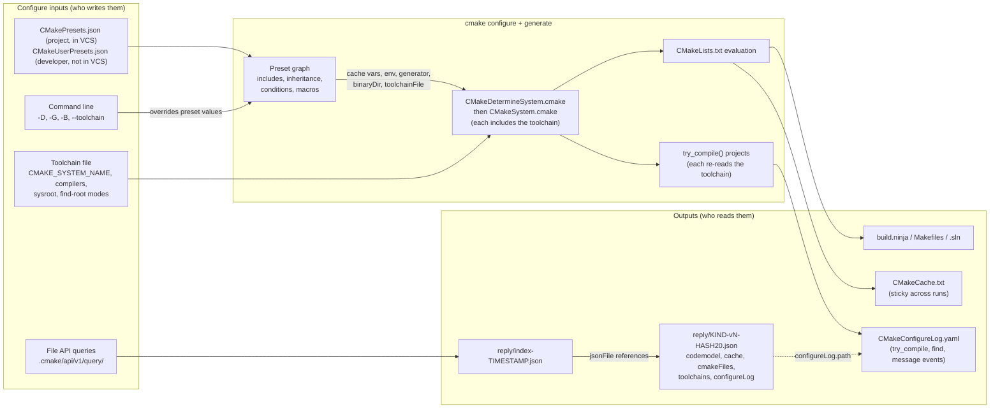

# CMake Presets, Toolchains, and the File API

> [!summary] Claim:
> CMake splits "how to configure" into three layers with three different lifetimes: a preset (`CMakePresets.json`) is a JSON recipe that CMake expands into command-line state before it reads any `CMakeLists.txt`, a toolchain file is CMake code that is evaluated once per project instance, including every `try_compile()` test project, and the cache (`CMakeCache.txt`) is the sticky result that outlives both.
> Presets resolve by depth-first inheritance in which the earlier parent wins, and macros such as `${presetName}` expand in the context of the preset being used, not the one that defined them.
> The file API (`<build>/.cmake/api/v1/`) is the read side: clients drop query files, CMake writes immutable reply files named by the first 20 hex digits of the SHA3-256 of their content, and a client finds the current state only through the newest timestamped `index-*.json`.
> The configure log (`CMakeFiles/CMakeConfigureLog.yaml`) records toolchain inspection events such as `try_compile()`, and a client must locate it through the file API's `configureLog` object rather than hard-coding its path.



## The Mechanism

[[Modern-CMake-Architecture-and-Targets]] owns what a project says: targets, properties, usage requirements, and generator expressions.
This note owns how a build tree is configured from outside the project and how tools read back what CMake decided.
Every behavior below is from the CMake 4.4 manuals and the v4.4.5 source tree unless another source is named, and statements marked (lab) are confirmed by the lab, first on CMake 4.4.5 and again on CMake 4.5.0, darwin-arm64.
CMake 4.5.0 is the current stable release (as of 2026-11); where it differs from 4.4, the text says so.

### 1. Why three mechanisms exist

Before presets, a team's real build configuration lived in READMEs, CI scripts, and shell history as long `cmake -G Ninja -DCMAKE_BUILD_TYPE=... -DCMAKE_TOOLCHAIN_FILE=...` lines that each IDE re-encoded in its own settings file.
Before the file API, IDEs either parsed generated Makefiles or drove `cmake-server(7)`, a long-running JSON protocol that CMake 3.15 deprecated and CMake 3.20 removed in favor of the file API introduced in CMake 3.14.
Presets arrived in CMake 3.19 to make the command line itself a versioned, shareable file.
The three layers differ in when they run, which is the source of most of their failure modes:

| Layer | Format | Evaluated | Persists in |
| :--- | :--- | :--- | :--- |
| Preset | JSON, schema `version` 1 to 12 (13 in CMake 4.5) | Once per `cmake --preset` invocation, before any CMake code runs | Nothing; it becomes `-D`, `-G`, `-B`, environment, and `--toolchain` |
| Toolchain file | CMake language | Every project instance: the top-level configure and each `try_compile()` project | `CMAKE_TOOLCHAIN_FILE` in the cache and an `include()` in `CMakeSystem.cmake` |
| Cache | `CMakeCache.txt` | Read at the start of every configure | The build tree, until deleted or `--fresh` |

### 2. Presets: files, includes, and the version gate

`CMakePresets.json` and `CMakeUserPresets.json` live next to the top-level `CMakeLists.txt` and share one format.
The project file is meant for version control and the user file is not; when both exist, `CMakeUserPresets.json` implicitly includes `CMakePresets.json` in every format version.
The root object holds `version` (required), `cmakeMinimumRequired`, `include` (format 4+), `vendor`, and arrays `configurePresets`, `buildPresets` and `testPresets` (format 2+), and `packagePresets` and `workflowPresets` (format 6+).
CMake 4.4 added `--presets-file <file>`, which reads presets from one named file and ignores both default files.

`cmCMakePresetsGraphReadJSON.cxx` at v4.4.5 hard-codes `MIN_VERSION = 1` and `MAX_VERSION = 12`, so a file that declares a newer format fails the whole read, not just the presets that use new fields (lab); CMake 4.5.0 raises the bound to 13, and the lab's `version` 99 file fails there with "must be >=1 and <=13" (lab).
`cmakeMinimumRequired` is a second gate on the CMake release rather than the schema; the lab's `{"major": 5}` fails with "major version 5 must be less than 4" (lab).
The format version is therefore a compatibility contract: declaring 12 locks every consumer, including CI images and IDE-bundled CMake, to CMake 4.4 or newer.
IDEs that parse presets themselves have their own ceiling: the VS Code CMake Tools documentation states support for presets versions 2 through 11 (as of 2026-11).

| Format | CMake | What it added (from the Versions section of cmake-presets(7)) |
| :--- | :--- | :--- |
| 1 | 3.19 | Configure presets and macro expansion |
| 2 | 3.20 | Build and test presets |
| 3 | 3.21 | `condition`, `installDir`, `toolchainFile`; `binaryDir` and `generator` become optional; `${hostSystemName}` |
| 4 | 3.23 | `include`, `resolvePackageReferences`, `${fileDir}` |
| 5 | 3.24 | `testOutputTruncation`, `${pathListSep}` |
| 6 | 3.25 | Package and workflow presets, `outputJUnitFile` |
| 7 | 3.27 | Configure `trace`; `$penv{}` in `include` |
| 8 | 3.28 | Root `$schema` |
| 9 | 3.30 | Other macros in `include` |
| 10 | 3.31 | `$comment` fields, configure `graphviz` |
| 11 | 4.3 | Test `execution.jobs` accepts `""` |
| 12 | 4.4 | `warnings.dev` and `errors.dev` renamed to `author`; new `errors.uninitialized`, `errors.unusedCli`, `installAbsoluteDestination`; `${fileDir}` fixed to the defining file; `testPassthroughArguments` |
| 13 | 4.5 | `strict` and `nonTargetDirective` in configure `warnings` and `errors`; `${configurePresetName}` |

JSON comments are not part of the format: the 3.19.6 release notes record that the implementation mistakenly accepted them in 3.19.0 through 3.19.5 and then stopped, and format 10's `$comment` key is the supported replacement.

Include rules are graph rules: cycles among files are errors, a file may be included many times, a preset may inherit only from presets in its own file or files it reaches through includes, and presets in `CMakePresets.json` may never inherit from `CMakeUserPresets.json`.
Names must be unique per preset kind across the union of both files, so the same name in both files is "Duplicate preset" rather than an override (lab).
A configure preset and a build preset may share a name, which is the usual convention.

### 3. Presets: how inheritance resolves

`ComputePresetInheritance()` in `cmCMakePresetsGraph.cxx` walks every preset with `VisitPreset()`, a depth-first search with a three-state mark (`Unvisited`, `InProgress`, `Verified`).
Meeting an `InProgress` preset reports "Cyclic preset inheritance for configure preset" and fails (lab).
For each name in `inherits`, in array order, it first resolves the parent recursively and then calls `VisitPresetInherit()`, whose `InheritString`, `InheritMap`, and `InheritOptionalValue` helpers fill a field only if the child has not set it yet.
Two documented rules fall out of that loop:

- The child always beats its parents, because the child's own fields are already set.
- Among parents, the earlier entry in `inherits` wins, because it fills the field first.

`cacheVariables` and `environment` are merged key by key under the same rule, so a child gets the union of its ancestors' maps; a value of `null` deletes a key even if a parent set it (lab).
`name`, `hidden`, `inherits`, `description`, and `displayName` are never inherited.
`VisitPreset()` takes the status map by value (`cmCMakePresetsGraph.cxx`, unchanged between v4.4.5 and v4.5.0), so a `Verified` mark does not escape the recursive call that set it, and an ancestor shared by several parents is walked once per inheritance path; this is invisible for normal files but means the work grows with the number of paths, not the number of presets.
Measured once on CMake 4.5.0 (darwin-arm64, as of 2026-11, outside the lab) with a chain of diamonds, where layer `i` has two hidden presets inheriting layer `i-1` and a hidden join preset inheriting both, `cmake --list-presets` took 0.06 s at 10 layers, 0.48 s at 14, 9.1 s at 18, and 54.6 s at 20, so each added layer roughly doubles the time; a 22-layer file was stopped after more than 120 s.
Real preset files have shallow, tree-like inheritance and never get near this, but a generated file with deep diamond inheritance can make every `cmake --preset` call appear to hang.

`condition` (format 3+) is evaluated after inheritance.
It may be a boolean, `null`, or an object of type `const`, `equals`, `notEquals`, `inList`, `notInList`, `matches`, `notMatches`, `anyOf`, `allOf`, or `not`; a child without a condition inherits its parent's, and a `null` condition enables the preset without passing a condition to its children.
A disabled preset is omitted from `--list-presets` and fails with "Cannot use disabled configure preset" when named (lab).
`hidden: true` presets are templates: they need no valid `generator` or `binaryDir` and cannot be passed to `--preset`.

### 4. Presets: macro expansion and environment

Macros are `$<namespace>{<name>}` tokens, expanded after inheritance and "in the context of the preset being used", so a hidden base that sets `"LAB_TAG": "${presetName}"` yields `dev` in preset `dev` and `rel` in preset `rel` (lab).
`${fileDir}` is the documented exception: under formats 4 to 11 it expanded to the directory of the file holding the preset being used, and format 12 makes it always the directory of the file that contains the macro, decided by the version of that file, not of the root file.

| Macro | Value |
| :--- | :--- |
| `${sourceDir}`, `${sourceParentDir}`, `${sourceDirName}` | Top-level source directory, its parent, its last path component |
| `${presetName}`, `${generator}` | Preset-specific; build and test presets see their configure preset's generator |
| `${configurePresetName}` | The associated configure preset's name in configure, build, test, and package presets, not workflow presets (format 13, CMake 4.5) |
| `${hostSystemName}` | Same as `CMAKE_HOST_SYSTEM_NAME` (format 3+) |
| `${fileDir}` | Directory of a presets file (format 4+; semantics changed in 12) |
| `${dollar}`, `${pathListSep}` | A literal `$`; `:` or `;` (format 5+) |
| `$env{NAME}` | The preset's `environment` value if defined there, else the parent process value, else empty |
| `$penv{NAME}` | The parent process value only, which is how you prepend to `PATH` without a self-reference |
| `$vendor{NAME}` | Reserved for IDEs; CMake ignores any preset that uses one |

`environment` entries may reference each other in any order; `VisitEnv()` expands them with the same three-state cycle check, so `A=$env{B}` with `B=$env{A}` is rejected.
The preset environment is applied to the CMake process and reaches the project as `$ENV{...}`, but it is not stored in the cache (lab): a later plain `cmake <build>` without `--preset` runs without it.
Build, test, and package presets inherit their configure preset's environment when `inheritConfigureEnvironment` is true, which is the default; the manual's `ExternalProject` note exists because a build-time sub-configure that needs `CC` and `CXX` from the preset only gets them through a build preset.

### 5. Presets: how they meet the command line and the cache

`cmake --preset X` reads presets "before all other command line options", then lets explicit options override them: `-D` beats `cacheVariables` (lab), and since CMake 3.21 `-B` may replace `binaryDir` (lab).
A configure preset becomes the same internal state as typing its options, so the cache rules are unchanged:

- A string-valued cache variable without a `type` is created as `UNINITIALIZED`, exactly like `-DNAME=value` (lab); `CMAKE_BUILD_TYPE` showed `STRING` in the lab only because `Modules/CMakeInitializeConfigs.cmake` declares it with `set(... CACHE STRING ...)`.
- Preset values are re-applied as `-D` options on every `cmake --preset` run, so they overwrite whatever an earlier `-D` put in the cache (verified locally with CMake 4.4.5, macOS, outside the lab); a preset-set variable the project never reads triggers CMake's "Manually-specified variables were not used by the project" warning like any other unused `-D`.
- Cache entries the preset does not mention are sticky: deleting a variable from a preset, or dropping a `-D`, does not remove it from an existing tree (lab).
- `--fresh` (CMake 3.24) deletes `CMakeCache.txt` and `CMakeFiles/` and re-creates them (lab); it is the only way to make a preset's file the whole truth again.
- Changing `CMAKE_<LANG>_COMPILER` on an existing tree makes CMake print "You have changed variables that require your cache to be deleted" and re-run from an empty cache, discarding every earlier `-D` (verified locally with CMake 4.4.5, macOS, outside the lab).

Build presets map one to one onto `cmake --build` options (`jobs`, `targets`, `configuration`, `cleanFirst`, `verbose`, `nativeToolOptions`), and infer the build directory from `configurePreset`.
Test presets map onto `ctest` options (`output`, `filter`, `execution`, `overwriteConfigurationFile`), and package presets onto `cpack`.
A workflow preset (format 6, `cmake --workflow`) is an ordered list whose first step must be a configure preset and whose later steps must all name presets with that same `configurePreset`, so a workflow cannot silently switch build trees (lab).
Since CMake 3.31, `cmake --workflow <name>` accepts the preset name without `--preset`.

The root and per-preset `vendor` maps are opaque to CMake except that they must be objects.
Microsoft documents a `microsoft.com/VisualStudioSettings/CMake/<version>` vendor map whose `hostOS` key hides presets in Visual Studio and Visual Studio Code, and states that the map does not change the CMake or CTest command line, apart from the `cacheRoot` and `cmakeGenerateCommand` options of Visual Studio's "Open Existing Cache" mode, which is what keeps one file valid for IDEs and CI; the VS Code CMake Tools extension supports presets from version 1.7, reads and evaluates the files itself rather than calling `cmake --preset`, and documents presets versions 2 through 11 (as of 2026-11).

### 6. Toolchain files: when and how often they run

A toolchain file is passed as `--toolchain <file>` (CMake 3.21), as `-DCMAKE_TOOLCHAIN_FILE=<file>`, through the `CMAKE_TOOLCHAIN_FILE` environment variable (3.21, read only when a build tree is first created), or through a preset's `toolchainFile` (format 3), which takes precedence over any `CMAKE_TOOLCHAIN_FILE` value.
A relative path is tried against the build directory and then the source directory, which is lines 147 to 161 of `Modules/CMakeDetermineSystem.cmake` at v4.4.5: an absolute existing path is included directly, otherwise `${CMAKE_BINARY_DIR}/<file>` is tried before `<file>`, and the resolved path is forced into the cache.

The file is ordinary CMake code, and it is evaluated more often than most authors expect.
On a fresh configure the lab's counting toolchain ran four times (lab):

1. `CMakeDetermineSystem.cmake` includes it to learn `CMAKE_SYSTEM_NAME` and friends.
2. CMake writes `CMakeFiles/<version>/CMakeSystem.cmake`, which includes the toolchain, and loads it; every later re-configure loads only this file, so a re-configure reads the toolchain once (lab).
   At v4.4.5 the generated line is `include("<toolchain>")`; CMake 4.5.0 writes `set(_CMAKE_SYSTEM_TOOLCHAIN_FILE "<toolchain>")` followed by `include("${_CMAKE_SYSTEM_TOOLCHAIN_FILE}")` and also records the original input as `_CMAKE_INPUT_TOOLCHAIN_FILE` "to detect changes requiring re-configuration" (lab; `Modules/CMakeDetermineSystem.cmake` at v4.5.0).
3. Each `try_compile()` test project re-reads it, which accounts for reads three and four here, each with `CMAKE_BINARY_DIR` pointing into `CMakeFiles/CMakeScratch/TryCompile-*` (lab); that the two projects are the compiler ABI detection and the one `check_cxx_source_compiles()` comes from the drafter's configure-log backtraces outside the lab, which prints only the count.

Two rules follow.
A toolchain file must be idempotent and side-effect free, because "once" is never true.
A toolchain file must not use `CMAKE_SOURCE_DIR` or `CMAKE_BINARY_DIR`, which point at the test project during `try_compile()`; `CMAKE_CURRENT_LIST_DIR` is the stable anchor.
A `-D` variable the toolchain reads is invisible inside the test projects unless the toolchain lists it in `CMAKE_TRY_COMPILE_PLATFORM_VARIABLES` (CMake 3.6): the lab's `LAB_TC_MODE=alpha` reached the two test-project reads only after it was listed (lab).
Variables CMake itself knows, such as `CMAKE_<LANG>_FLAGS`, propagate automatically, and since 3.24 (`CMP0137`) the listed variables also reach whole-project `try_compile()` calls.

### 7. Toolchain files: what belongs in one

`cmake-toolchains(7)` gives the canonical Linux cross file:

```cmake
set(CMAKE_SYSTEM_NAME Linux)
set(CMAKE_SYSTEM_PROCESSOR arm)
set(CMAKE_SYSROOT /home/devel/rasp-pi-rootfs)
set(CMAKE_STAGING_PREFIX /home/devel/stage)
set(tools /home/devel/gcc-4.7-linaro-rpi-gnueabihf)
set(CMAKE_C_COMPILER ${tools}/bin/arm-linux-gnueabihf-gcc)
set(CMAKE_CXX_COMPILER ${tools}/bin/arm-linux-gnueabihf-g++)
set(CMAKE_FIND_ROOT_PATH_MODE_PROGRAM NEVER)
set(CMAKE_FIND_ROOT_PATH_MODE_LIBRARY ONLY)
set(CMAKE_FIND_ROOT_PATH_MODE_INCLUDE ONLY)
set(CMAKE_FIND_ROOT_PATH_MODE_PACKAGE ONLY)
```

- `CMAKE_SYSTEM_NAME` set by hand is what turns on `CMAKE_CROSSCOMPILING`, even when it equals the host name (lab); Apple device platforms are the documented exception, selected through `CMAKE_OSX_SYSROOT`, and the manual advises against relying on `CMAKE_CROSSCOMPILING` there.
- `CMAKE_SYSROOT` becomes `--sysroot`, prefixes every `find_*` search, is stripped from installed `RPATH`, and "may only be set in a toolchain file"; `CMAKE_SYSROOT_COMPILE` and `CMAKE_SYSROOT_LINK` split it.
- `CMAKE_STAGING_PREFIX` is where `install` writes on the host, while `CMAKE_INSTALL_PREFIX` stays the runtime location on the target.
- The four `CMAKE_FIND_ROOT_PATH_MODE_*` variables take `ONLY`, `NEVER`, or `BOTH`: build-time tools come from the host (`PROGRAM NEVER`), and headers, libraries, and packages come from the target roots (`ONLY`).
- `CMAKE_<LANG>_COMPILER_TARGET` passes a triple to inherently cross compilers such as Clang and QCC, and `CMAKE_<LANG>_COMPILER_EXTERNAL_TOOLCHAIN` points the driver at external binutils.
- `CMAKE_TRY_COMPILE_TARGET_TYPE STATIC_LIBRARY` (3.6) stops checks from linking, for bare-metal toolchains that cannot link without a linker script.
- `CMAKE_CROSSCOMPILING_EMULATOR` (3.3; a list since 3.15; an environment variable since 3.28) runs `try_run()` binaries and prefixes `add_test()`, `add_custom_command()`, and `add_custom_target()` commands that run target executables; the lab's test ran through its stand-in emulator only in the cross tree (lab).

What does not belong in a toolchain file is everything that is not about the toolchain.
`CMAKE_PROJECT_TOP_LEVEL_INCLUDES` (3.24) runs files during the first `project()` call, after the toolchain and before any language is enabled, and is the documented injection point for package-manager setup such as a dependency provider registered with `cmake_language(SET_DEPENDENCY_PROVIDER)`.
Build type, warnings policy, and feature options belong in presets.
So does a compiler launcher: `CMAKE_<LANG>_COMPILER_LAUNCHER` (3.4, also read from an environment variable of the same name) is a per-tree choice such as `ccache`, not a property of the target platform, and [[Compiler-Caches-ccache-and-sccache]] owns how the launcher behaves.
[[Cross-Compilation-and-Sysroots]] owns triples, sysroot construction, and running foreign binaries; this note owns how CMake loads and propagates the file that names them.

### 8. The configure log

CMake 3.26 added `cmake-configure-log(7)`, a YAML document stream at `${CMAKE_BINARY_DIR}/CMakeFiles/CMakeConfigureLog.yaml` in this version, with the explicit warning that the location may change.
Each configure that logs new events appends one document that starts with `---`, holds an `events` sequence, and ends with `...` only if the configure finished normally, so a truncated last document is how a crash shows up.
The lab's `dev` tree had been configured twice, once by `cmake --preset dev` and once by the workflow, and still held one document (lab), because cached check results and the cache-guarded `message(CONFIGURE_LOG)` log nothing new.

Every event has `kind` (such as `try_compile-v1`), a `backtrace` from most recent to least recent frame as `file:line (command)`, and an optional `checks` stack of pending `message(CHECK_START)` texts.

| Event kind | Logged by | Key fields |
| :--- | :--- | :--- |
| `message-v1` | `message(CONFIGURE_LOG ...)` | `message` |
| `try_compile-v1` | `try_compile()` and the check modules built on it | `directories`, `cmakeVariables`, `buildResult.{variable, cached, stdout, exitCode}` |
| `try_run-v1` | `try_run()` | the above plus `runResult.{stdout, stderr, exitCode}` |
| `find-v1` (4.1) | `find_file`, `find_path`, `find_library`, `find_program` | `mode`, `names`, `candidate_directories`, search settings |
| `find_package-v1` (4.1) | `find_package()` in `CONFIG` mode | package name, components, searched configs |

Text blocks are YAML literal scalars with application-level escapes (`\\` and `\xXX`) because literal scalars cannot escape.
`message(CONFIGURE_LOG)` is meant for one-time checks guarded by a cache entry; calling it on every run appends an event every run.
Tools must ignore event kinds and versions they do not know, and must take both the path and the allowed kinds from the file API `configureLog` object's `path` and `eventKindNames`.

### 9. File API: the query side

The API lives in `<build>/.cmake/api/v1/` with `query/` written by clients and `reply/` owned by CMake; clients must never delete reply files.
There are three query forms, and CMake honors all of them on every configure or generate:

| Form | Path | Owner | Version semantics |
| :--- | :--- | :--- | :--- |
| Shared stateless | `query/<kind>-v<major>` (empty file) | Nobody; remove only with coordination | Reply in that major with CMake's highest minor |
| Client stateless | `query/client-<id>/<kind>-v<major>` | The client `<id>` | Same |
| Client stateful | `query/client-<id>/query.json` | The client `<id>` | First recognized version in the request's list |

A `query.json` request's `version` is an integer major, an object with `major` and optional `minor`, or an array of those in preference order; CMake takes the first entry it recognizes and answers with that major at its own highest minor, so `[3, 1]` for `toolchains` gets `v1.1` on CMake 4.4 and 4.5 (lab).
Unknown kinds produce error members rather than failures: "unknown query file" for a stateless file and "unknown request kind" for a `query.json` entry (lab).
Two more sources of queries exist: `cmake_file_api(QUERY API_VERSION 1 CODEMODEL 2 ...)` (3.27) adds in-memory shared queries from the project itself, which cannot ask for `configureLog` because that must be known before `CMakeLists.txt` is read, and since 3.31 the user-wide directory `CMAKE_CONFIG_DIR` (default `$HOME/Library/Application Support/CMake` on macOS and `$HOME/.config/cmake` on Linux) can hold `api/v1/query` files that apply to every build tree on the machine.
The lab sets `CMAKE_CONFIG_DIR` to an empty directory for exactly that reason.

Because queries are read at configure time, a client must write its query before the first configure of a tree, or trigger a re-configure afterwards.

### 10. File API: the reply protocol

`cmFileAPI::WriteJsonFile()` at v4.4.5 writes each object to `v1/tmp.json`, computes a suffix, and renames the temporary file to `<prefix>-<suffix>.json`, skipping the rename when a file of that name already exists ("assume it has proper content").
For object files, `ComputeSuffixHash()` uses SHA3-256 of the bytes and keeps 20 hex characters; the lab recomputed the hash of all 8 reply objects and matched every name (lab).
For the index, `ComputeSuffixTime()` formats UTC as `%Y-%m-%dT%H-%M-%S` plus a four-digit, zero-padded millisecond field, so names sort lexicographically in time order.
Names longer than 140 characters (an eCryptFS limit cited in the source) have their tail replaced by a SHA-256-derived 20-character hash.

The naming scheme is the concurrency design:

- A reply file is never replaced by a file of the same name with different content, so a reader that opened a referenced file reads a consistent object even while a new configure runs.
- An unchanged object keeps its name across configures, which the lab saw for all 8 objects on a no-op re-configure, while only the index was replaced (lab).
- A changed object gets a new name, and so does every object that references it: changing one definition renamed `target-app`, `target-core`, the `codemodel` that points at them, and `cache`, while `directory`, `target-iface`, `toolchains`, and `configureLog` kept their names (lab).
- After a successful run `RemoveOldReplyFiles()` deletes everything it did not just write, so a client that finds a referenced file missing knows a newer reply exists and restarts from the newest index.

The client algorithm is therefore: list `reply/`, pick the `index-*.json` with the largest name, read only files it references, and on a missing file start over.
Clients must not parse reply file names or target `id` strings; the lab's id `core::@6890427a1f51a3e7e1df` looks structured, but the manual calls the format unspecified.

CMake 4.1 added the error index: when generation fails, CMake writes `error-<time>.json` with the same layout, does not delete the old `index-*.json` or its replies, and fills only the `configureLog` object, giving every other kind an `error` member such as "no buildsystem generated" (lab).
The current index is the largest name after stripping the `index-` or `error-` prefix, so a client that only globs `index-*` silently shows the last good state after a broken edit.

The index itself records the producing CMake (`version`, with `isDirty` for a modified source build; `paths` to `cmake`, `ctest`, `cpack`, and `root`), the `generator` (`name`, `multiConfig` since 3.17, `platform`), the `objects` array of every object written, and a `reply` member that mirrors the `query/` tree and is how a client finds its own answers.

### 11. File API: the object kinds

| Kind | Major | Minor history | What it answers |
| :--- | :--- | :--- | :--- |
| `codemodel` | 2 (no v1, to avoid confusion with server mode) | 2.0 in 3.14; 2.1 3.18 `precompileHeaders`; 2.2 3.19 `languageStandard`; 2.3 3.21 `directory` objects and installers; 2.4 3.23 `fileSet` installers; 2.5 3.26 `fileSets`, `cxxModuleBmi`; 2.6 3.27 `frameworks`; 2.7 3.29 `launchers`; 2.8 4.0 `debugger`; 2.9 4.2 imported and all interface targets, `linkLibraries` and dependency arrays; 2.10 4.3 `interfaceSources`; 2.11 4.4 `fileSetIndexes`, per-source `backtraces`; 2.12 4.5 `interfaceIncludes` | Directories, projects, targets, and per-target compile and link details |
| `cache` | 2 | 2.0 | Every cache entry with `type` and properties such as `HELPSTRING` |
| `cmakeFiles` | 1 | 1.1 in 3.30 adds `globsDependent` | Every CMake input file, flagged `isGenerated`, `isExternal`, `isCMake`, and `CONFIGURE_DEPENDS` globs |
| `toolchains` | 1 | 1.0 in 3.20; 1.1 adds `commandFragment` | Per language: compiler path, id, version, target, implicit include and link directories and libraries, source extensions |
| `configureLog` | 1 | 1.0 in 3.26 | Path to the configure log and the event kinds a client may read |

The `codemodel` object is a set of index-linked arrays per configuration: `directories` (with `parentIndex`, `childIndexes`, `projectIndex`, `targetIndexes`, and a `jsonFile` for the directory object), `projects`, `targets`, and since 2.9 `abstractTargets` for imported targets and interface libraries that generate no build rules (lab).
A single-config generator has one configuration named after `CMAKE_BUILD_TYPE`; a multi-config generator has one per `CMAKE_CONFIGURATION_TYPES` entry.
Each target object carries `type`, `nameOnDisk`, `artifacts`, `sources`, `compileGroups`, `link` or `archive`, `dependencies`, `install`, and a `backtraceGraph`.

`compileGroups` are the IDE's real compile model: each group is a set of source indexes that share one language, standard, fragment list, include list, define list, and sysroot.
Every include, define, fragment, and dependency can carry a `backtrace` index into a per-file graph of `nodes` (each with `file`, `line`, `command`, and `parent`), `commands`, and `files`, which is how an IDE answers "which line of CMake gave this target `-DCORE_LEVEL=3`".
The answer is often surprising: in the lab, `app`'s `CORE_LEVEL=3` and its C++20 standard both trace to `target_link_libraries()` on line 23, the edge that carried `core`'s usage requirements, not to `target_compile_definitions()` in `core` (lab).
The 2.4 and 2.5 additions, `fileSets` and the `cxxModuleBmi` installer, are how tools see C++20 module file sets; [[Cpp-Modules-in-Build-Systems]] owns the scanning and BMI mechanics behind them.
`dependencies` is the transitive build-order graph and can omit link edges in static-library cycles, while the 2.9 `linkLibraries`, `compileDependencies`, and `orderDependencies` arrays separate direct link, usage-requirement, and ordering edges.

`compile_commands.json` (`CMAKE_EXPORT_COMPILE_COMMANDS`, 3.5) is the other machine-readable output, and the two are not substitutes.
It is a flat list of compiler command lines per translation unit, written only by the Makefile and Ninja generators, without targets, link steps, install rules, toolchain metadata, or backtraces, and the manual notes it does not work well with unity builds.
It is right for clang-based tools that want a command per file; the file API is right for anything that needs the target graph, works with every generator, and is versioned.

## Commands and Numbers to Know

| Item | Value | Platform and date | What it controls |
| :--- | :--- | :--- | :--- |
| Presets format range | `1` to `12` (`MIN_VERSION`, `MAX_VERSION`); `1` to `13` in 4.5.0 | Both (as of 2026-11, CMake 4.4.5 and 4.5.0) | A newer `version` fails the whole file |
| `cmake --preset <n>` | 3.19 | Both (as of 2026-11) | Reads presets before other options; `-D`, `-G`, `-B` override |
| `cmake --list-presets[=all]` | `configure` by default | Both (as of 2026-11) | Hides hidden and condition-false presets |
| `cmake --list-presets=<type>-defined` | 4.5 | Both (as of 2026-11) | Also lists unavailable non-hidden presets with the reason |
| `cmake --workflow <n>` | 3.25; bare name since 3.31 | Both (as of 2026-11) | Runs configure, build, test, package steps on one tree |
| `--presets-file <f>` | 4.4 | Both (as of 2026-11) | Ignores both default presets files |
| `cmake --fresh` | 3.24 | Both (as of 2026-11) | Deletes `CMakeCache.txt` and `CMakeFiles/` |
| `--toolchain <f>` | 3.21 | Both (as of 2026-11) | Same as `-DCMAKE_TOOLCHAIN_FILE=<f>` |
| `CMAKE_TOOLCHAIN_FILE` env | 3.21, first configure only | Both (as of 2026-11) | Default toolchain for new trees |
| Toolchain reads, fresh configure | 2 + one per `try_compile()` project | macOS lab, CMake 4.4.5 and 4.5.0 (as of 2026-11) | Side effects in a toolchain repeat |
| Toolchain reads, re-configure | 1 (via `CMakeSystem.cmake`) | macOS lab, CMake 4.4.5 and 4.5.0 (as of 2026-11) | Same |
| `CMAKE_TRY_COMPILE_PLATFORM_VARIABLES` | 3.6; whole-project `try_compile` since 3.24 | Both (as of 2026-11) | Forwards custom variables into test projects |
| `CMAKE_CROSSCOMPILING_EMULATOR` | 3.3; env var since 3.28 | Both (as of 2026-11) | Prefix for `try_run`, tests, custom commands |
| `CMAKE_PROJECT_TOP_LEVEL_INCLUDES` | 3.24 | Both (as of 2026-11) | Non-toolchain setup injected at first `project()` |
| File API directory | `<build>/.cmake/api/v1/{query,reply}` | Both (as of 2026-11) | API v1 is the only API version |
| Reply object name | `<kind>-v<major>-<SHA3-256[:20]>.json` | Both (as of 2026-11, cmFileAPI.cxx v4.4.5) | Immutable, content-addressed replies |
| Reply index name | `index-YYYY-MM-DDTHH-MM-SS-0mmm.json` (UTC) | Both (as of 2026-11) | Largest name is current |
| Error index | `error-<time>.json`, since 4.1 | Both (as of 2026-11) | Written on failed generation; only `configureLog` filled |
| Reply name length cap | 140 characters | Both (as of 2026-11, cmFileAPI.cxx v4.4.5) | Longer names get a 20-character SHA-256 tail |
| `codemodel` version | 2.11 in 4.4; 2.12 in 4.5 | Both (as of 2026-11, CMake 4.4 and 4.5) | Feature detection by minor |
| `toolchains`, `cache`, `cmakeFiles`, `configureLog` | 1.1, 2.0, 1.1, 1.0 | Both (as of 2026-11, CMake 4.4 and 4.5) | Same |
| `cmake_file_api(QUERY ...)` | 3.27 | Both (as of 2026-11) | Project-side queries, not for `configureLog` |
| `CMAKE_CONFIG_DIR` user-wide queries | 3.31 | Both (as of 2026-11) | Queries applied to every tree for this user |
| Configure log | `CMakeFiles/CMakeConfigureLog.yaml`, 3.26 | Both (as of 2026-11) | Path may change; get it from the file API |
| `CMAKE_EXPORT_COMPILE_COMMANDS` | 3.5; Makefile and Ninja only | Both (as of 2026-11) | Flat per-file compile commands |

## Multi-Language Comparison: C++ / Python / Rust

C++ has no language-level build configuration, so CMake supplies all three layers; Python and Rust split them differently.

| Concern | C++ with CMake 4.4 | Python native extensions (scikit-build-core) | Rust (Cargo) |
| :--- | :--- | :--- | :--- |
| Shared, versioned build recipe | `CMakePresets.json`, schema `version` 1 to 12 (13 in 4.5) | `[tool.scikit-build]` in `pyproject.toml`, including `cmake.define` and `build-dir` | `Cargo.toml` profiles and `.cargo/config.toml` |
| Per-developer overrides | `CMakeUserPresets.json`, not committed | `-C` config settings on `pip install` or `uv pip install`, or `SKBUILD_*` environment variables | `.cargo/config.toml` lookup in parent directories, `CARGO_*` environment variables, `--config` |
| Target platform description | Toolchain file, re-evaluated per `try_compile()` | Delegated to the CMake toolchain that scikit-build-core drives | `--target <triple>`, `[target.<triple>] linker` |
| Running foreign binaries | `CMAKE_CROSSCOMPILING_EMULATOR` | Delegated to CMake | `target.<triple>.runner` |
| Machine-readable build model | File API v1 replies, per-kind versions | The CMake file API underneath; no separate Python-level model | `cargo metadata --format-version 1` |
| Toolchain inspection log | `CMakeConfigureLog.yaml` | CMake's configure log | No equivalent; build script output is saved under `target/debug/build/<pkg>/output` (the Cargo Book notes the location may vary) |

The structural difference is that Cargo knows the target graph itself, so `cargo metadata` is a command that prints JSON on demand, while CMake's model exists only after a configure, so the file API is a query-reply mailbox inside the build tree.
[[Cargo-Build-Graph-and-Rustc-Pipelining]] owns Cargo's unit graph.

## Worked Lab Example

The lab is `code/06-Build-Systems/cmake_file_api/`; it needs CMake 4.4 or newer, Ninja, Python 3, and a C++ compiler, and runs on macOS as is.

```bash
cd code/06-Build-Systems/cmake_file_api
bash run.sh
```

`run.sh` copies `project/` and `broken/` into a temporary directory, sets `CMAKE_CONFIG_DIR` to an empty directory so user-wide queries cannot leak in, and replaces that directory with `<work>` in everything it prints.
The project is three targets: a static library `core` with a `PUBLIC` definition and `cxx_std_20`, an `INTERFACE` library `iface`, and an executable `app` that links both, plus one `check_cxx_source_compiles()` and one guarded `message(CONFIGURE_LOG)`.
`fileapi_client.py` is a standard-library file API client that follows the manual's rules and raises on any broken reference.

The lab fails, not just prints differently, when a mechanism is missing: each malformed presets file must make `cmake` fail, the forced configure failure must fail with its own message, `LAB_PATH` must equal `/opt/lab/bin:` plus the parent `PATH`, and every reply file name must equal its own SHA3-256 prefix.

### Verified output

First recorded with `python3 -m _harness.verify --record` on darwin-arm64 with CMake 4.4.5 and Apple clang on 2026-11-12; re-recorded once with `bash run.sh` on the same host with CMake 4.5.0 on 2026-11-14 after the version-gate check moved from `version` 13 (valid in 4.5) to 99, and the harness was not re-run; the file is `code/06-Build-Systems/cmake_file_api/expected/darwin-arm64.txt`.
Against the 4.4.5 recording, only the CMake version, the version-gate lines, the `CMakeSystem.cmake` include line, and the codemodel minor changed.

Part 1, presets:

```text
== 1. Presets (cmake 4.5)
Available configure presets:

  "dev"   - Developer (Debug, Ninja)
  "rel"
  "cross"

Available build presets:

  "dev"
  "cross"

Available test presets:

  "dev"
  "cross"

Available workflow presets:

  "dev"
(windows-only is absent: its condition is false on this host)

preset dev -> binaryDir <work>/out/dev
  CMAKE_BUILD_TYPE = Debug (STRING)
  LAB_TAG          = dev (UNINITIALIZED)
  LAB_TYPED        = typed-dev (STRING)
  LAB_OPT          = from-base (UNINITIALIZED)
preset rel -> binaryDir <work>/out/rel
  CMAKE_BUILD_TYPE = Release (STRING)
  LAB_TAG          = rel (UNINITIALIZED)
  LAB_TYPED        = typed-rel (STRING)
  LAB_OPT          = from-command-line (UNINITIALIZED)
preset cross -> binaryDir <work>/out/cross
  CMAKE_BUILD_TYPE = Debug (STRING)
  LAB_TAG          = cross (UNINITIALIZED)
  LAB_TYPED        = typed-cross (STRING)
  LAB_OPT          = (not in cache)

environment: configure saw LAB_PATH = /opt/lab/bin + ':' + parent PATH ($penv{PATH}): yes
environment: LAB_PATH stored in CMakeCache.txt: 0 entries

[cmake --preset windows-only] exit status non-zero
    CMake Error: Cannot use disabled configure preset in <work>/src: "windows-only"
[presets version 99] exit status non-zero
    CMake Error: Could not read presets from <work>/bad-version:
    CMakePresets.json:1: Unrecognized "version" 99: must be >=1 and <=13
    {"version": 99, "configurePresets": [{"name": "a"}]}
                ^
[inheritance cycle] exit status non-zero
    CMake Error: Could not read presets from <work>/bad-cycle:
    Cyclic preset inheritance for configure preset "a"
[same name in CMakePresets.json and CMakeUserPresets.json] exit status non-zero
    CMake Error: Could not read presets from <work>/bad-dup:
    Duplicate preset: "a"
[cmakeMinimumRequired 5.0] exit status non-zero
    CMake Error: Could not read presets from <work>/bad-min:
    CMakePresets.json:1: "cmakeMinimumRequired" major version 5 must be less than 4
    {"version": 6, "cmakeMinimumRequired": {"major": 5}, "configurePresets": [{"name": "a", "binaryDir": "x"}]}
                                                     ^

cache stickiness (preset dev, -B <work>/sticky overrides binaryDir):
  after 'cmake --preset dev -DLAB_STICKY=1':  LAB_STICKY = 1 (UNINITIALIZED)
  after 'cmake --preset dev' (no -D):         LAB_STICKY = 1 (UNINITIALIZED)
  after 'cmake --preset dev --fresh':         LAB_STICKY = (not in cache)

workflow preset dev:
  Executing workflow step 1 of 3: configure preset "dev"
  Executing workflow step 2 of 3: build preset "dev"
  Executing workflow step 3 of 3: test preset "dev"
  100% tests passed out of 1
```

Part 2, toolchain files:

```text
== 2. Toolchain files
reads of counting.cmake, fresh configure (count, context, LAB_TC_MODE seen):
  2 main LAB_TC_MODE=[alpha]
  2 try_compile LAB_TC_MODE=[]
reads on re-configure of the same tree:
  1 main LAB_TC_MODE=[alpha]
CMakeSystem.cmake re-includes the toolchain: include("${_CMAKE_SYSTEM_TOOLCHAIN_FILE}")
reads with CMAKE_TRY_COMPILE_PLATFORM_VARIABLES=LAB_TC_MODE:
  2 main LAB_TC_MODE=[alpha]
  2 try_compile LAB_TC_MODE=[alpha]

preset cross: CMAKE_SYSTEM_NAME equals CMAKE_HOST_SYSTEM_NAME: yes
preset cross: set(CMAKE_CROSSCOMPILING "TRUE")
preset dev:   set(CMAKE_CROSSCOMPILING "FALSE")
  app.launchers: type=emulator command=toolchains/../emu.sh arguments=['--quiet']
  cross ctest: 100% tests passed out of 1
  emulator log: emu.sh ran app
  dev ctest:   100% tests passed out of 1
  emulator log after dev ctest: 0 lines
```

Part 3, the file API:

```text
== 3. File API (build tree of preset dev)
index: generator=Ninja multiConfig=False cmake=4.5
objects written:
  codemodel v2.12
  configureLog v1.0
  cache v2.0
  toolchains v1.1
reply mirror of query/:
  bogus-v1: error: unknown query file
  client-lab/query.json client={"lab": "cmake_file_api"}
    asked toolchains [3, 1] -> toolchains v1.1
    asked cache 2 -> cache v2.0
    asked configureLog {"major": 1, "minor": 0} -> configureLog v1.0
    asked nope 1 -> error: unknown request kind 'nope'
  codemodel-v2: codemodel v2.12
codemodel: configurations=['Debug'] directories=1 projects=['PresetsLab']
  buildsystem targets: app, core
  abstract targets: iface
  target app: type=EXECUTABLE nameOnDisk=app
  target core: type=STATIC_LIBRARY nameOnDisk=libcore.a
  target iface: type=INTERFACE_LIBRARY abstract
  app.dependencies (build order): core
  app.linkLibraries: core, iface
  app.compileGroups[0]: language=CXX standard=20 (from CMakeLists.txt:23 target_link_libraries())
    define CORE_LEVEL=3 (from CMakeLists.txt:23 target_link_libraries())
  app.link.commandFragments roles: flags, libraries
  app.backtrace: CMakeLists.txt:22 add_executable()
toolchains: language=CXX compiler.id=AppleClang has path=True has version=True implicit keys=['includeDirectories', 'linkDirectories', 'linkFrameworkDirectories', 'linkLibraries']
cache: LAB_LEVEL=3 type=STRING
cache: CMAKE_GENERATOR=Ninja type=INTERNAL
configureLog: path=<build>/CMakeFiles/CMakeConfigureLog.yaml eventKindNames=['message-v1', 'try_compile-v1', 'try_run-v1', 'find-v1', 'find_package-v1']
  YAML documents=1 (closed with '...': 1) event kinds present=['find-v1', 'message-v1', 'try_compile-v1']
  lab message event logged: True
  try_compile event for LAB_HAVE_TRIVIAL: True
reply names: 8 files named by SHA3-256(content)[:20], 1 timestamped index

re-configure with no changes:
  unchanged names: cache-v2, codemodel-v2, configureLog-v1, directory-.-Debug, target-app-Debug, target-core-Debug, target-iface-Debug, toolchains-v1
  new names:       index-<time>
  removed names:   index-<time>
re-configure with -DLAB_LEVEL=4 (changes one compile definition):
  unchanged names: configureLog-v1, directory-.-Debug, target-iface-Debug, toolchains-v1
  new names:       cache-v2, codemodel-v2, index-<time>, target-app-Debug, target-core-Debug
  removed names:   cache-v2, codemodel-v2, index-<time>, target-app-Debug, target-core-Debug
reply names: 8 files named by SHA3-256(content)[:20], 1 timestamped index
index files present: 1
```

Part 4, the error index:

```text
== 4. Error index (CMake >= 4.1)
after a successful configure:
  reply files: codemodel-v2, configureLog-v1, directory-., index-<time>, target-core
  current index is index-<time>
  objects: codemodel v2.12, configureLog v1.0
  reply[codemodel-v2]: codemodel ok
  reply[configureLog-v1]: configureLog ok
after a failed configure (-DLAB_BREAK=ON):
  reply files: codemodel-v2, configureLog-v1, directory-., error-<time>, index-<time>, target-core
  current index is error-<time>
  objects: configureLog v1.0
  reply[codemodel-v2]: error: no buildsystem generated
  reply[configureLog-v1]: configureLog ok
```

### Reading the result

- `rel` inherits `["release-flags", "base"]` and gets `Release`, because the earlier parent fills `CMAKE_BUILD_TYPE` first; its `LAB_OPT` would be `from-release-flags` by the same rule, and the command-line `-D` beats both.
- `LAB_TAG` is `dev`, `rel`, and `cross` although only the hidden `base` defines it, which is macro expansion in the context of the preset being used.
- `LAB_OPT` is absent in `cross` because its `null` deleted an inherited key, and the untyped string variables are `UNINITIALIZED` in the cache while the object form with `"type": "STRING"` is `STRING`.
- The environment reached the configure step but left no cache entry, so it exists only while a preset is in use.
- `LAB_STICKY` survived a preset run without `-D` and disappeared only with `--fresh`.
- The toolchain ran twice in the main project (system detection, then `CMakeSystem.cmake`) and once in each of the two `try_compile()` projects, which did not see `LAB_TC_MODE` until the toolchain listed it in `CMAKE_TRY_COMPILE_PLATFORM_VARIABLES`.
- `cross` set `CMAKE_SYSTEM_NAME` to the host's own name and still got `CMAKE_CROSSCOMPILING "TRUE"`, the test went through the emulator, and the file API exposed the emulator as an `emulator` launcher relative to the source directory.
- `toolchains` was asked for `[3, 1]` and answered with `v1.1`, the first recognized major at CMake's highest minor.
- The `-std=gnu++20` and `CORE_LEVEL=3` that `app` compiles with both trace to the `target_link_libraries()` edge, which is the backtrace an IDE shows for "where did this flag come from".
- One changed definition renamed exactly the objects whose bytes changed plus their referrers, and the old files were deleted, which is content addressing plus garbage collection.
- The failed configure kept the last good `index-*` and its files, wrote an `error-*` index that is now current, and filled only `configureLog`.

## Pitfalls

> [!warning] Pitfall: bumping the presets `version` casually
> A file that declares `version: 12` is unreadable to every CMake older than 4.4, including the one bundled with an IDE or baked into a CI image, and the failure is the whole file, not one preset.
> Declare the lowest version whose fields you use, and change it in the same commit that raises the CI and IDE CMake floor.

> [!warning] Pitfall: expecting a preset to reset the cache
> A preset is translated into `-D` options for one run; it does not remove cache entries it no longer sets, and an old `-D` for a variable the preset does not set survives every later preset run.
> Use `--fresh` in CI and after changing presets, and never compare two developers' builds without comparing their caches.

> [!warning] Pitfall: untyped string cache variables
> `"FOO": "ON"` creates `FOO:UNINITIALIZED=ON`; boolean JSON values give `BOOL`, and the object form gives any type.
> An untyped entry takes its type from the project's later `set(... CACHE <type> ...)`, and per `cmake(1)` a relative value is converted to an absolute path only when that type is `PATH` or `FILEPATH`, so the meaning of a relative path depends on project code the preset author may not control.
> Give path variables an explicit `"type": "PATH"` or an absolute value built from `${sourceDir}`.

> [!warning] Pitfall: a toolchain file with side effects or build-tree paths
> The file runs at least twice in the main project and once per `try_compile()` project, with `CMAKE_BINARY_DIR` pointing at a scratch test project in the latter.
> Downloads, `file(WRITE)` calls, `message(FATAL_ERROR)` on unset `-D` options, and `CMAKE_SOURCE_DIR`-relative paths all misbehave; anchor on `CMAKE_CURRENT_LIST_DIR` and forward custom inputs with `CMAKE_TRY_COMPILE_PLATFORM_VARIABLES`.

> [!warning] Pitfall: changing compilers on an existing tree
> Setting a different `CMAKE_<LANG>_COMPILER` on an existing tree makes CMake wipe the cache and re-run, discarding every earlier `-D`.
> Changing the toolchain means a new binary directory, which presets make cheap with `binaryDir` set to `${sourceParentDir}/out/${presetName}` or similar.

> [!warning] Pitfall: `${fileDir}` across included files
> Under formats 4 to 11, `${fileDir}` in an included file's base preset expands to the including file's directory when a derived preset is used, so relative toolchain or sysroot paths silently point elsewhere.
> Format 12 fixes it per file, decided by the version of the file that contains the macro, so a mixed tree of old and new included files behaves differently in different places.

> [!warning] Pitfall: reading the file API like a directory of files
> Globbing `reply/target-*.json` reads stale objects from an older configure, or misses objects whose names were shortened past 140 characters, and parsing `codemodel-v2-<hash>` names or target ids breaks without notice.
> Read the newest index, follow `jsonFile` references, restart on a missing file, and consider `error-*` indexes when picking the newest one.

> [!warning] Pitfall: writing the query after the configure
> Replies are produced only for queries present when CMake runs, so an IDE that writes `query.json` after the user's first configure gets nothing until the next one.
> Write the query first, or trigger a re-configure, and remember that `CMAKE_CONFIG_DIR` user-wide queries add objects you did not ask for.

> [!warning] Pitfall: treating `compile_commands.json` as the build model
> It has no targets, link steps, install rules, toolchain data, or provenance, is not written by Visual Studio or Xcode generators, and does not handle unity builds well.
> Use it for clang tooling and the file API for anything that reasons about targets.

## At Scale

A single developer needs one presets file, one build directory per configuration, and an IDE that reads both.
The questions change once a configuration is shared by hundreds of repositories and thousands of engineers.

- The presets format and CMake floor become a fleet-wide contract: raising the presets `version` is a coordinated upgrade of every CI image, devcontainer, and IDE-bundled CMake, so treat it like a compiler upgrade with an owner and a date.
- Toolchain files become the place where compilers, sysroots, and target triples are pinned, which is where [[Hermetic-and-Reproducible-Builds]] meets CMake: a toolchain that says `c++` resolves through `PATH`, a toolchain that names a content-pinned compiler path does not.
- Shared presets usually live in an included file (format 4+) delivered with the toolchain package, so every repository gets the same `ci-linux-release` definition by name; with included files, set format 12 before relying on `${fileDir}`.
- At scale, the file API is how platform teams audit builds without parsing CMake code: a nightly job can query `codemodel` and `toolchains` across repositories to find targets compiled without the mandated standard, sysroot, or definitions, and the backtraces point at the offending line.
- The error index matters to IDE fleets: an IDE that reads only `index-*` shows the last good build state after every broken edit, which looks like stale IntelliSense rather than a configure failure.

Decision rules (the size bands are the author's judgment from how teams are organized, not measured or documented thresholds):

- One to roughly 50 engineers: commit `CMakePresets.json` with `dev`, `release`, and `ci` presets and matching build, test, and workflow presets; ignore `CMakeUserPresets.json` in Git.
- From roughly 50 to 1,000 engineers or several repositories: move shared base presets and toolchain files into a versioned package, include them, and make CI run `cmake --workflow` with `--fresh` so CI and developers use the same recipe.
- From about 1,000 to 50,000 engineers: pin the CMake version per toolchain release, keep the presets `version` at the fleet floor, and build compliance tooling on the file API rather than on `CMakeLists.txt` parsing or `compile_commands.json`.
- When most of the build graph is not C or C++, or remote execution and caching dominate cost, presets and toolchain files stop being the right layer; [[Build-Performance-Economics-and-Decision-Record]] owns that decision and [[Bazel-Skyframe-Bzlmod-and-Execution-Model]] the alternative.

## Practice Drill

> [!tip] Practice Drill:
> Copy the lab's `project/` and predict, before running anything, the cache value and type of every `LAB_*` variable for a new preset `fast` that inherits `["base", "release-flags"]`, with the order reversed from `rel`.
> Add a second presets file `presets/shared.json` with a hidden preset that sets `"LAB_DIR": "${fileDir}"`, include it from `CMakePresets.json`, inherit from it in `dev`, and predict `LAB_DIR` under formats 6 and 12 in the included file; then check with `grep LAB_DIR out/dev/CMakeCache.txt`.
> Make `counting.cmake` call `message(FATAL_ERROR)` when `LAB_TC_MODE` is unset and observe which configure step fails and why, then fix it without removing the check.
> Write a 30-line file API client in the language of your choice that prints, for each target, the CMake file and line that added each include directory, and test it against a tree configured twice in a row while the client runs.
> As a stretch, configure the lab with the Ninja Multi-Config generator and predict how many `target-app-*` reply files appear and what `multiConfig` says.

## Interview Questions

> [!question] L5: What is the difference between `CMakePresets.json` and `CMakeUserPresets.json`, and how do they combine?
>
> > [!success]- Answer
> > They have the same format; the project file is committed and holds shared recipes, and the user file is not committed and holds a developer's local variants.
> > When both exist, the user file implicitly includes the project file, so user presets can inherit from project presets but not the other way around.
> > Names must be unique per preset kind across both files, so a user cannot override a project preset by reusing its name; CMake reports "Duplicate preset" instead.
> > Both files must sit next to the top-level `CMakeLists.txt`, unless CMake 4.4's `--presets-file` names one file explicitly, which ignores both defaults.

> [!question] L5: Predict the output: given the lab's presets, what are `CMAKE_BUILD_TYPE` and `LAB_OPT` after `cmake --preset rel`, and after `cmake --preset rel -DLAB_OPT=x`?
>
> > [!success]- Answer
> > `rel` inherits `["release-flags", "base"]`, and the earlier parent wins, so `CMAKE_BUILD_TYPE` is `Release` and `LAB_OPT` is `from-release-flags`.
> > With `-DLAB_OPT=x`, the command line overrides the preset, so `LAB_OPT` is `x`, as the lab shows with `from-command-line`.
> > The subtle part is the next run: a plain `cmake --preset rel` on that tree sets `LAB_OPT` back to `from-release-flags`, because the preset re-applies its `cacheVariables` as `-D` options on every run (verified locally with CMake 4.4.5 and again with 4.5.0, macOS, outside the lab: `cli` became `from-release-flags`).
> > Only variables the preset does not mention stay sticky, which is what the lab's `LAB_STICKY` shows.
> > `LAB_OPT` is `UNINITIALIZED` in the cache because it is an untyped string; `CMAKE_BUILD_TYPE` is `STRING` because CMake's own `CMakeInitializeConfigs.cmake` declares it with that type.

> [!question] L5: Why does the CMake manual tell you not to use `CMAKE_BINARY_DIR` in a toolchain file?
>
> > [!success]- Answer
> > The toolchain file is evaluated in every project instance, including each `try_compile()` test project, and there `CMAKE_BINARY_DIR` is the scratch directory under `CMakeFiles/CMakeScratch/TryCompile-*`, not the user's build tree.
> > A path built from it therefore points at different places in the same configure; `CMAKE_CURRENT_LIST_DIR` is the directory of the toolchain file itself in every instance.
> > The lab counted four evaluations on a fresh configure, two of them in test projects.

> [!question] L6: Debug this: a toolchain file selects a sysroot from `-DBOARD=imx8`; configure fails in "Detecting CXX compiler ABI info" with the sysroot path empty, although `BOARD` is set; what is wrong?
>
> > [!success]- Answer
> > The ABI detection runs in a `try_compile()` test project, which re-reads the toolchain file but does not receive arbitrary `-D` variables from the parent, so `BOARD` is empty there.
> > The fix is `set(CMAKE_TRY_COMPILE_PLATFORM_VARIABLES BOARD)` in the toolchain file, which forwards `BOARD` into the test projects (and, since 3.24 with `CMP0137`, into whole-project `try_compile()` calls).
> > The configure log shows it directly: the failing `try_compile-v1` event lists the propagated `cmakeVariables`, and `BOARD` is missing from them.
> > The lab reproduces both halves: `LAB_TC_MODE=[]` in the test projects without the list and `[alpha]` with it.

> [!question] L6: An IDE writes `client-ide/query.json` and then reads `reply/target-*.json` by globbing, and users report stale include paths after edits and occasional crashes on missing files; explain both and give the correct client algorithm.
>
> > [!success]- Answer
> > Reply files are named by a hash of their content, so after a configure both the old and the new `target-app-*` files can exist until `RemoveOldReplyFiles()` deletes the old ones, and after a failed configure the old ones are never deleted; a glob can pick either.
> > The crash is the race the protocol anticipates: CMake deletes superseded files right after writing a new index, so a file the IDE listed can vanish before it is opened.
> > The correct client lists `reply/`, picks the newest index by name across `index-` and `error-` after stripping the prefix, reads only files referenced from that index, and restarts from the newest index if a referenced file is missing.
> > Because CMake never rewrites a name with different content, any file the client manages to open is internally consistent.

> [!question] L6: Why does the file API use content hashes in reply names and a timestamp only in the index?
>
> > [!success]- Answer
> > Content-hashed names make every reply file immutable and idempotent: an unchanged object is written to the same name, `WriteJsonFile()` skips the rename when that name exists, and a reader never sees a file change under it.
> > They also make change detection free for clients, because a changed name means changed content; the lab saw a no-op re-configure keep all 8 object names.
> > The index must change every run to point at the current set and to define "newest", so it gets a UTC timestamp with milliseconds that sorts lexicographically.
> > The cost is that every referrer of a changed object also changes, so one new definition renamed the target objects, the codemodel, and the cache.

> [!question] L7: Your company wants one source of truth for compiler, sysroot, and flags across 400 CMake repositories; where does each setting belong among presets, toolchain files, and project code?
>
> > [!success]- Answer
> > The toolchain file owns what describes the platform: `CMAKE_SYSTEM_NAME` and processor, pinned compiler paths, `CMAKE_SYSROOT`, find-root modes, compiler target triples, and the emulator; it must be idempotent and safe inside `try_compile()`.
> > Presets own how a build is configured: generator, binary directory layout, build type, warning-as-error policy, which toolchain file to use, and CI workflows; ship shared bases in an included file with the toolchain package so names are uniform.
> > Project code owns target semantics, and `CMAKE_PROJECT_TOP_LEVEL_INCLUDES` owns organization hooks such as dependency providers that are neither toolchain nor project.
> > Enforce it with the file API: a scheduled job reads `toolchains` and `codemodel` from each repository's CI tree and flags targets whose compile groups lack the mandated sysroot or standard, with backtraces to the line that diverged.
> > Pin the presets format at the fleet's CMake floor and upgrade it with the CMake version, because a newer format breaks every older reader at once.

> [!question] L7: A developer edits `CMakeLists.txt`, configure fails, and the IDE keeps showing the old targets with no error; what changed in CMake 4.1, and what should the IDE do?
>
> > [!success]- Answer
> > Since 4.1, a failed generation writes `error-<time>.json` next to the old `index-*.json`, keeps the old index and its replies, and provides only the `configureLog` object, with every other kind reported as an error such as "no buildsystem generated".
> > An IDE that only looks for `index-*` sees the last good state and never learns that the configure failed.
> > It should select the newest index across both prefixes, show the error state, and read the configure log through the `configureLog` object's `path` and `eventKindNames` to explain the failure, for example the failing `try_compile-v1` event and its `buildResult.stdout`.

> [!question] L8+: Design the build-configuration contract for a monorepo of mixed C++ and Rust used by 5,000 engineers on Linux and macOS, with an IDE fleet and remote CI.
>
> > [!success]- Answer
> > Version the configuration as a product: a toolchain release contains pinned compilers and sysroots, one toolchain file per target platform, a presets file of hidden bases and named workflows, and a declared CMake floor and presets format.
> > Make CI run `cmake --workflow --fresh <name>` on clean trees so CI and laptops share recipes but CI never inherits cache drift, and keep laptops on per-preset binary directories so toolchain switches never reuse a cache.
> > Expose the model through the file API, not through parsing: IDEs use stateful `query.json` with version lists, compliance jobs use `codemodel`, `toolchains`, and `cmakeFiles`, and failures surface through the error index and configure log.
> > For Rust, mirror the same platform facts in `.cargo/config.toml` (`linker`, `runner`) generated from the same toolchain release, and read Cargo's graph with `cargo metadata`, so one release defines both ecosystems.
> > Name the limits: CMake configures are not hermetic, the toolchain file is ordinary code that can read the environment, and presets cannot express remote execution, so the decision record should state when the organization moves heavy C++ graphs to a build system with sandboxed actions and remote caching.

> [!question] L8+: Why does the configure log exist when `--debug-trycompile` and `--trace` already do, and what versioning promise makes it usable by tools?
>
> > [!success]- Answer
> > `--debug-trycompile` keeps scratch directories and `--trace` prints every command, but neither is a stable, structured record of what toolchain inspection decided.
> > The configure log records only specific events, `try_compile`, `try_run`, `find`, `find_package`, and explicit `message(CONFIGURE_LOG)`, with backtraces, pending checks, the propagated variables, build output, and exit codes, appended per configure so history survives re-runs.
> > Each event kind is versioned independently, and a tool learns which versions it may read, and where the file is, from the file API's `configureLog` object; CMake may write several versions of the same event when asked, and tools must ignore unknown kinds.
> > That separation, a mutable human-readable log whose location and schema are discovered through a stable API, is what lets the log evolve without breaking IDEs.

## Further Reading

- `cmake-presets(7)`, CMake 4.4: the normative format, inheritance and macro rules, and the version table.
- `Help/manual/presets/schema.json` at v4.4.5: the machine-readable schema that editors use through `$schema`.
- `cmake-toolchains(7)`, CMake 4.4: cross-compiling variables and the per-platform recipes for Linux, Android, Apple, Emscripten, and others.
- `cmake-file-api(7)`, CMake 4.4: query forms, reply protocol, error index, and every object kind with its versions.
- `cmake-configure-log(7)`, CMake 4.4: document structure, text encoding, and the event kinds.
- `Source/cmFileAPI.cxx` at v4.4.5: the hashed naming, the temporary-file rename, the 140-character cap, and stale-reply removal.
- `Source/cmCMakePresetsGraph.cxx` and `cmCMakePresetsGraphReadJSON.cxx` at v4.4.5: the inheritance walk, cycle checks, macro expansion, and the version bounds.
- `Modules/CMakeDetermineSystem.cmake` at v4.4.5: where the toolchain file is first included and how relative paths are resolved.
- CMake release notes 3.14 to 4.4: when each preset format, file API object, and toolchain variable appeared.
- Microsoft, "CMakePresets.json and CMakeUserPresets.json Microsoft vendor maps": a worked example of how an IDE extends presets without changing the CMake command line.

## Related

- Prerequisites: [[Modern-CMake-Architecture-and-Targets]]
- Next: [[Meson-Build-System-and-WrapDB]]
- See also: [[Cross-Compilation-and-Sysroots]], [[Hermetic-and-Reproducible-Builds]], [[Make-and-Ninja-Mechanics]], [[Compiler-Caches-ccache-and-sccache]], [[Cpp-Modules-in-Build-Systems]]
- Lab: `code/06-Build-Systems/cmake_file_api/`
