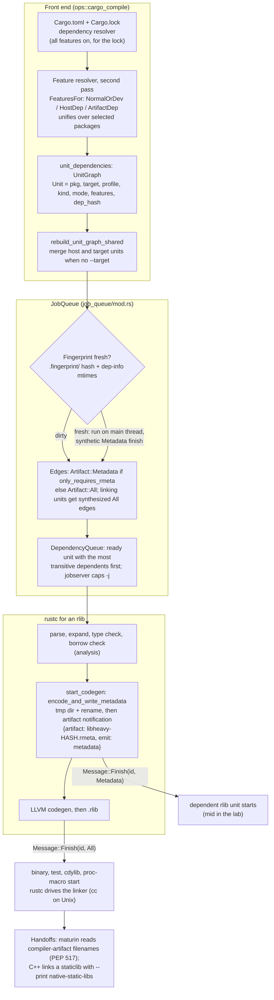

# Cargo Build Graph and rustc Pipelining

> [!summary] Claim:
> Cargo lowers a package-level `Resolve` into a graph of units, where a unit is one rustc invocation or one build script run, keyed by package, target, profile, mode, compile kind, and features.
> Every edge in Cargo's job queue is labeled `Metadata` or `All`: a library-to-library edge needs only the upstream `.rmeta`, which rustc writes and announces just before codegen, while anything that links (binaries, tests, `cdylib`, `dylib`, `staticlib`, proc macros) waits for full upstream objects.
> Freshness is two separate hashes: a `Metadata` hash that names files (`-C extra-filename`) and mangles symbols (`-C metadata`), and a `Fingerprint` that decides rebuilds; anything in the first creates a parallel artifact, anything only in the second overwrites one.
> Feature unification, `RUSTFLAGS`, build-script rerun rules, and crate types therefore decide not only what is built but how much parallelism and cache reuse a build gets.



## The Mechanism

### Packages, targets, crates, and units

Four nouns are easy to conflate, and Cargo's source keeps them apart.
A package is a `Cargo.toml` with a name and version, and it is the unit of resolution, publishing, and features.
A target is one crate root inside a package: at most one library, plus any number of binaries, examples, tests, and benchmarks, plus the build script, which Cargo models as a `custom-build` target.
A crate is what one rustc invocation compiles, and a target becomes a crate once Cargo picks its crate types (`lib`, `rlib`, `dylib`, `cdylib`, `staticlib`, `proc-macro`, `bin`).
A unit is what Cargo schedules: `UnitInner` in `src/compiler/unit.rs` holds the package, target, profile, `CompileKind` (host or a target triple), `CompileMode`, the sorted feature list, `rustflags`, `rustdocflags`, `links_overrides`, artifact-dependency flags, `is_std`, and a `dep_hash`.
`CompileMode` covers `Test`, `Build`, `Check`, `Doc`, `Doctest`, `Docscrape`, and `RunCustomBuild`, so a build script is two units: one `Build` of the script binary and one `RunCustomBuild` that executes it.
The same target can appear as several units, for example a library built once normally and once with `--test`, or a dependency built once for the target and once for a build script.

[[Rust-Cargo-Model-Packages-Targets-Features-and-Workspaces]] owns how to lay out packages, workspaces, and features; this note owns what Cargo does with them at build time.

### From Resolve to UnitGraph

`ops::cargo_compile::compile` runs the front end in a fixed order, as its module documentation lists:
1. Resolve the dependency graph, which for `Cargo.lock` purposes treats every feature of every workspace member as enabled, so optional dependencies are always locked.
2. Download packages.
3. Generate the root units for the targets selected on the command line (`UnitGenerator::generate_root_units`).
4. Walk the resolve from those roots to build the `UnitGraph`, a `HashMap<Unit, Vec<UnitDep>>` (`unit_dependencies.rs`).
5. Construct the `BuildContext`, which ends the front end, and then hand the graph to a `BuildRunner` and its `JobQueue`.

The feature resolver in `src/resolver/features.rs` is a second pass that can only narrow what the dependency resolver selected.
Its `FeatureOpts` carries `decouple_host_deps` (build dependencies and proc macros get their own feature namespace), `decouple_dev_deps` (dev-dependency features stay off unless dev units are built), and `ignore_inactive_targets` (features from `[target.'cfg(...)'.dependencies]` for other platforms are ignored).
Resolver `"2"` turns all three on; resolver `"3"`, the default for edition 2024 since Cargo 1.84, changes only version selection (`incompatible-rust-versions = "fallback"`), not feature unification.
Features are keyed by `(PackageId, FeaturesFor)`, where `FeaturesFor` is `NormalOrDev`, `HostDep`, or `ArtifactDep(target)`, so the same package can legitimately resolve to two different feature sets in one build.

Without `--target`, host and target are the same machine, and Cargo would like to build a shared dependency once.
`rebuild_unit_graph_shared` in `src/ops/cargo_compile/mod.rs` builds normal, build, and artifact dependencies as separate units first, then rewrites their `CompileKind` back to the host and merges units that are now identical.
It stamps each unit with a `dep_hash` of its dependencies, because two otherwise identical units may need to link different dependency builds; without it, the doc comment says, Cargo "would end up randomly choosing one value or the other".
The same pass turns debuginfo off for host-only dependencies, which is the `debug = false # when possible` line in the default `[profile.dev.build-override]`.
That profile difference is enough to split a unit: in the lab, `common` with feature `beta` is compiled once as fa's build dependency (debuginfo 0) and again as fb's normal dependency (debuginfo 2), with identical features.

The nightly `--unit-graph` flag (`cargo +nightly build --unit-graph -Z unstable-options`, tracking issue #8002, format `version: 1`) prints this graph without building it.
On the lab workspace, `-p fa` produced 5 units: `common` lib with `beta` and debuginfo 0, `common` lib with `alpha` and debuginfo 2, the `fa` binary, the `fa` build script compile, and its `run-custom-build` unit (hand run on cargo 1.101.0-nightly 2026-10-23, macOS arm64, as of 2026-11; not part of the golden file).
`cargo metadata` cannot show this, because the docs note it "fundamentally cannot represent the relationship of features between different dependency kinds".

### Two identities: the Metadata hash and the Fingerprint

Cargo gives every unit two different digests, and most surprising rebuild behavior comes from which one an input lands in.

`Metadata` (`compilation_files.rs`) holds three things derived from one `StableHasher`:
- `unit_id`, which identifies the unit in the graph and, when `c_extra_filename` is true, becomes the `-C extra-filename=-<16 hex>` suffix on output files and the `.fingerprint/<pkg>-<hash>` directory name.
- `c_metadata`, passed as `-C metadata=<16 hex>`, which rustc mixes into mangled symbols so two versions of one crate can link into the same binary.
- Flags for whether the filename and the package directory carry the hash at all.

`compute_metadata` hashes, in order: a `METADATA_VERSION` constant, the package id (relative to the workspace root, so renaming the checkout keeps the cache), enabled features, profile, mode, LTO setting, compile kind, target name and kind, the rustc version, the workspace wrapper for members (so `clippy` output stays separate), `__CARGO_DEFAULT_LIB_METADATA`, `is_std`, and whether host rustflags differ from target rustflags.
It then forks: `c_metadata` adds the dependencies' `c_metadata`, while `unit_id` adds the dependencies' `unit_id`, the `cargo rustc` extra arguments, and `RUSTFLAGS`, each skipped if it might contain `--remap-path-prefix`.
For stable compilers the full `rustc -vV` text is hashed, so 1.98 and 1.99 artifacts sit side by side; for nightly and beta only the channel name is hashed, so updating nightly overwrites rather than accumulates.

The `Fingerprint` is a separate 16-hex-digit hash stored in `<build-dir>/debug/.fingerprint/<unit dir>/`, next to a JSON file that exists only to explain why a unit is dirty, a binary dep-info file, and an `invoked.timestamp` file.
The fingerprint module's comparison table, abridged:

| Input | Fingerprint | `unit_id` (filename) | `c_metadata` (symbols) |
|---|---|---|---|
| rustc version, profile, mode, target name and kind, enabled features, compile kind, LTO | yes | yes | yes |
| Immediate dependencies' hashes | yes (bin dependencies excluded) | yes | yes |
| `RUSTFLAGS`, `cargo rustc` extra args | yes | yes, unless `--remap-path-prefix` | no |
| Declared (not enabled) features, `[lints]`, target source path, edition, `-C incremental` | yes | no | no |
| Source file mtimes | yes, by comparison only | no | no |
| `package_id`, `is_std`, `__CARGO_DEFAULT_LIB_METADATA` | no | yes | yes |

The rule that follows is mechanical.
An input in `unit_id` produces a new filename, so the old artifact survives and flipping back is free.
An input only in the Fingerprint overwrites the artifact in place, so flipping back costs a rebuild.
`RUSTFLAGS` shows the history: Cargo 1.33 added it to the metadata hash, 1.39 removed it ("any change to RUSTFLAGS will cause a recompile"), and 1.85 "Prevented build caches from being discarded after changes to `RUSTFLAGS`" by putting it in `unit_id` but not `c_metadata`, so symbols stay stable for PGO while files stay separate.

Some units get no filename hash at all.
`use_extra_filename` turns it off for path-package `dylib` and `cdylib` targets (an executable embeds the dylib's name), for MSVC executables (the PDB path is embedded), and for `wasm32-unknown-emscripten` executables, unless `__CARGO_DEFAULT_LIB_METADATA` is set, which only the standard library build does.
For those units every Fingerprint-relevant change is a rebuild and an overwrite, and the lab's `ext` crate (crate types `cdylib` and `rlib`) rebuilt on all four alternating feature flips with `the list of features changed`.
Binaries do carry the hash in `deps/app-<hash>`, and Cargo hard-links the one it just built out to `target/debug/app` (`link_targets`), so the uplifted path always points at whichever variant built last.

### Freshness: mtimes, dep-info, and propagation

A unit is dirty if its fingerprint file is missing, if any hashed field differs, or if its filesystem status is stale.
Staleness has two mtime checks (`fingerprint/mod.rs`):
1. The newest output of the unit is compared with every dependency's outputs; a missing output or a newer dependency output makes it stale.
2. For `LocalFingerprint::CheckDepInfo`, every source file listed in the translated dep-info file is compared with the mtime of that dep-info file, which Cargo rewinds to the build's start time from `invoked.timestamp`, so a file edited during a build is treated as not included and triggers the next build.

rustc's `--emit=dep-info` writes a Makefile-style `.d` file, and Cargo translates it into a binary form in the fingerprint directory, also reading `# env-var:` comments so that `env!` and `option_env!` inputs (including `CARGO_PKG_*` values) are tracked.
Registry and git packages contribute no source paths to dep-info, so their freshness rests on the package id alone.
A dependency's fresh-or-dirty status propagates because each Fingerprint embeds its dependencies' Fingerprints through shared `Arc`s.
The lab's touched `heavy/src/lib.rs` printed the three reasons in order: `the file ... has changed`, then `the dependency heavy was rebuilt`, then `the dependency mid was rebuilt`.

The module's own caveats are worth knowing by heart.
Docker zeroes the nanosecond part of mtimes in cached layers, which is why Cargo never hashes an mtime value and only compares them.
HFS on macOS has one-second resolution, and network filesystems may report server time.
The nightly `-Z checksum-freshness` (tracking issue #14136) replaces source mtimes with size and checksum comparisons, but files read by build scripts still use mtimes.
`cargo build -v` prints a `Dirty <pkg> v<ver> (<path>): <reason>` line from `DirtyReason` for every unit it rebuilds after a previous build, and `CARGO_LOG=cargo::compiler::fingerprint=trace` dumps the full comparison, using the module path that the 1.99 fingerprint documentation gives.

### Pipelining, rustc side: when the .rmeta exists

An rlib holds two things a dependent needs at different times: crate metadata, which the Rust 1.38 announcement describes as "the list of types, dependencies, exports", to compile against, and object code to link.
rustc's `start_codegen` in `rustc_interface/src/passes.rs` runs after `analysis`, which includes borrow checking and aborts on errors, and its first real step is `rustc_metadata::fs::encode_and_write_metadata`, before `codegen_crate`.
`encode_and_write_metadata` encodes into `full.rmeta` inside a temporary directory created in the output directory, then renames it into place, a comment says, "to avoid races with another rustc process scanning the output directory".
When `--json=artifacts` is on, it then emits an artifact notification with `"emit": "metadata"`; the rustc book documents the message shape as `{"$message_type": "artifact", "artifact": "libfoo.rlib", "emit": "link"}`.
So the `.rmeta` is complete and type-checked before a single LLVM function is generated, which is why a dependent can start and why a crate that fails to compile never publishes metadata.

Cargo passes `--error-format=json --json=diagnostic-rendered-ansi,artifacts,future-incompat` to every rustc, and its output parser in `src/compiler/mod.rs` treats any `artifact` message whose path ends in `.rmeta` as the signal: "looks like metadata finished early!", then `state.rmeta_produced()`.
The Rust 1.38 release (2019-09-26) turned pipelining on by default, reporting "10-20% compilation speed increases for optimized, clean builds of some crate graphs", while noting other graphs "did not improve much".
Alex Crichton's May 2019 evaluation thread collected user measurements such as wasmtime clean debug 39.5 s to 33.8 s and Lark clean release 71 s to 52 s, with some graphs, such as elefren on a 2016 laptop, within noise.
The config `build.pipelining` (added 1.36) was deprecated in Cargo 1.60, and the 1.99 configuration reference says it is "deprecated and unused. Cargo always has pipelining enabled."

### Pipelining, Cargo side: Metadata edges and synthesized All edges

`JobQueue::enqueue` labels every dependency edge with an `Artifact`:
- `Artifact::Metadata` when `BuildRunner::only_requires_rmeta(parent, dep)` holds: the parent does not require upstream objects and is in `CompileMode::Build`, and the dependency does not require upstream objects and is in `CompileMode::Build`.
- `Artifact::All` otherwise.

`requires_upstream_objects` is false only for a unit whose crate types are all `lib` or `rlib`, and true for every test (`is_any_test`) and for `bin`, `dylib`, `cdylib`, `staticlib`, and `proc-macro`, because those produce linkable output (`crate_type.rs`, `TargetKind::requires_upstream_objects`).
A linking unit also needs the objects of everything below its direct dependencies, so `enqueue` walks the dependencies of dependencies and inserts `All` edges to all of them; the comment's example is a binary `a` over lib `b` over lib `c`, where `b -> c` is `Metadata` but `a` must also wait for all of `c`.
A dirty rlib job sends `Message::Finish(id, Artifact::Metadata, Ok)` from `rmeta_produced` and later `Finish(id, All)`; the coordinator keeps the job active after the first and releases only `Metadata` waiters.
A fresh unit never runs rustc, so `run_to_finish` sends a synthetic `Metadata` finish, keeping the graph live, and fresh jobs run on the coordinator thread because "running a fresh job on the same thread is often much faster than spawning a new thread".

`build_base_args` picks the emit set from the same predicate: `--emit=dep-info,metadata` for `check`, `--emit=dep-info,metadata,link` for any unit that does not require upstream objects, and `--emit=dep-info,link` for the rest.
The lab shows the consequence of adding one crate type.
With `mid` as a plain library, its rustc line has `--emit=dep-info,metadata,link`, it starts no earlier than `heavy`'s `.rmeta` and before `heavy` finishes, and the timings data lists `mid` among the units `heavy` unblocked at its `.rmeta`.
With `crate-type = ["rlib", "cdylib"]`, `mid` gets `--emit=dep-info,link`, starts only after `heavy` finished, and `heavy` unblocks nothing at its `.rmeta`: one manifest line turned an overlapped pair into a serial chain.
The same rule makes proc macros a serialization point: a crate that uses `serde_derive` waits for the complete proc-macro dylib, which itself waits for complete objects of `syn` and everything under it.
Build-script compiles are binaries and wait the same way, and the library they configure waits for the `RunCustomBuild` unit to finish.

`check` units emit only metadata and carry `CompileMode::Check` in their hash, so `cargo check` and `cargo build` never share `.rmeta` files.
Embedding metadata in the rlib and also writing an `.rmeta` duplicates bytes on disk; the nightly `-Zembed-metadata=no` (introduced in Cargo 1.89 as `-Zno-embed-metadata`) passes `-Z embed-metadata=no` to rustc and writes `--emit=dep-info,metadata,link` for every unit whose crate type benefits (`lib`, `rlib`, `dylib`), and the unstable docs say this "should become the default".

### Scheduling and the jobserver

The job queue is a `DependencyQueue` whose nodes produce outputs at different times, exactly so that an edge can wait for one output and not another.
At `queue_finished`, each unit's priority is its own cost plus the cost of every transitive reverse dependency, and every cost is the fixed placeholder `100` (`JobQueue::enqueue`), so priority is 100 times one plus the number of units waiting on it, directly or indirectly.
`dequeue` picks the ready unit with the highest priority; Cargo 1.39 introduced this rule, replacing maximum topological depth.
Concurrency is a GNU make style jobserver: Cargo inherits one from `make` or creates its own, `-j` defaults to the number of logical CPUs, the module docs describe the relationship as "1 `cargo` to N `rustc`", and each rustc can request extra tokens for parallel codegen.
Each build script inherits one job slot and receives `NUM_JOBS` and `CARGO_MAKEFLAGS`; the docs recommend setting `MAKEFLAGS` from `CARGO_MAKEFLAGS` for sub-makes rather than passing `make -j`.
[[Make-and-Ninja-Mechanics]] owns the jobserver protocol itself, and [[Build-System-Theory-Schedulers-and-Rebuilders]] places this scheduler among the topological, restarting, and suspending designs.

### Feature unification and rebuild invalidation

Cargo builds one copy of a dependency per distinct feature set within one invocation, and the feature set is the union over every package selected for that invocation.
The resolver documentation is explicit: building several workspace members with `--workspace` or several `-p` flags unifies their dependencies' features, and avoiding that requires separate `cargo` invocations.
Because features are in `unit_id`, each union is a separate artifact, and the lab shows the costs as files and compile counts, not overwrites:
1. `-p fa` compiled `common[alpha]` for the binary and `common[beta]` for the build script.
2. `-p fb` compiled `common[beta]` again, because the build-script copy had a different profile.
3. `-p fa` again compiled nothing, because both variants were still on disk.
4. `-p fa -p fb` compiled a fourth variant, `common[alpha,beta]`, and rebuilt both binaries, and `fb` now ran with a feature it never asked for.

The deps directory ended with 4 distinct `libcommon-<hash>.rlib` files for one package.
Every feature is visible at runtime only through the binary that happened to build last, which is the hazard that [[Drill-Packaging-Cargo-Feature-Unification-Hazard]] drills.
Where artifacts have no filename hash, the same union differences become in-place rebuilds, as the `ext` rows show.

Two knobs exist (as of 2026-11).
`[resolver] feature-unification = "workspace" | "selected" | "package"` (default `"selected"`, RFC 3692) is nightly-only behind `-Z feature-unification`, and `package` was implemented in Cargo 1.90; the build performance guide recommends `workspace` to reuse more builds and lists "Requires using nightly Rust" as its cost.
On stable, the workaround the features guide gives is to add the missing features to the dependency declarations so the duplicates converge, found with `cargo tree --duplicates` and `cargo tree -e features -i <pkg>`.

### Build scripts: two units, rerun rules, and OUT_DIR

A build script is compiled for the host with the `build-override` profile (`opt-level = 0`, `codegen-units = 256`, `debug = false` when possible), then run with its package root as the working directory and `OUT_DIR`, `TARGET`, `HOST`, `NUM_JOBS`, `OPT_LEVEL`, `DEBUG`, `PROFILE`, `CARGO_FEATURE_<name>`, `CARGO_CFG_<cfg>`, `RUSTC`, `CARGO_ENCODED_RUSTFLAGS`, and any `DEP_<links>_<key>` variables in its environment.
Its stdout is parsed for `cargo::` instructions (the double-colon form needs Cargo 1.77; older Cargo needs `cargo:`) and stored in the unit's `output` file, with `stderr` and `root-output` beside it.

The rerun rule is the most common build-graph defect.
With no `rerun-if-changed` or `rerun-if-env-changed` line, the fingerprint is "old style" `LocalFingerprint::Precalculated`, the mtime of the newest file in the package, so editing a README, a test, or a data file reruns the script and then recompiles the library.
With at least one `rerun-if` line, only the listed paths (mtime compared against the script's `output` file) and environment variables are tracked, and a directory path is scanned recursively.
In the lab, touching an unrelated `notes.txt` reran only `script_old`, logged `the precalculated components changed`, and recompiled `script_old`'s library, while `script_new` stayed fresh; setting `LAB_FLAVOR=spicy` reran only `script_new` with `the env variable LAB_FLAVOR changed`.
An old-style script is invisible to environment changes it reads with `std::env::var` unless it declares them, so the opposite failure, a stale build, comes from the same omission.
`OUT_DIR` is never cleaned between runs, and the docs warn that scripts "should not rely on `OUT_DIR` being empty", which is why the lab's `cshim` script deletes its old `libshim.a` before `ar crs`.

`links = "shim"` does two things.
It is a resolver constraint: only one package per `links` name may appear in the graph, so two semver-incompatible versions of one `-sys` crate are a resolution error rather than a duplicate symbol.
It is a channel: `cargo::metadata=include=...` from that script becomes `DEP_SHIM_INCLUDE` in the build scripts of immediate dependents only, which the lab's `cuser` reads to find `shim.h`.
The nightly `-Zany-build-script-metadata` (Cargo 1.94) lets any build script publish metadata as `CARGO_DEP_<name>_<key>`.
[[Rust-Build-Scripts-and-Sys-Crates]] owns sys-crate design; this note owns the scheduling and invalidation behavior of the two units.

### Handoff to C and C++ linkers

rustc, not Cargo, runs the linker, and on Unix targets the rustc book says the C compiler (`cc` or `clang`) is used "as the linker here, serving as a linker driver"; `-C linker=` overrides it.
Since Rust 1.90, `x86_64-unknown-linux-gnu` links with LLD by default, with `-C linker-features=-lld` as the opt-out.
`cargo::rustc-link-search=native=DIR` and `cargo::rustc-link-lib=static=shim` become `-L native=DIR -l static=shim` on the package's library unit only, because every other target in the package links that library.
rustc bundles a static native library into the rlib by default, and the lab finds `shim.o` as a member of `libcshim-<hash>.rlib`, so the final binary link needs no `-lshim` and downstream builds need no access to `OUT_DIR`.
In the other direction, a `staticlib` crate is a self-contained archive of the crate and all its Rust dependencies, but not of system libraries, and `rustc --print native-static-libs` prints the flags the foreign linker must add: `-lSystem -lc -lm` for the lab on macOS arm64 (as of 2026-11).
The lab compiles a C++ `main.cpp` with `c++`, links `librstatic.a` plus those flags, and the C++ program calls the Rust function.
[[Symbols-Relocations-and-Static-Linking]] owns how the linker resolves these archives, and [[Rust-FFI-Packaging-cdylib-staticlib-and-cbindgen]] owns the ABI design.

### Handoff to Python PEP 517 backends

PEP 517 makes the build backend a Python object whose `build_wheel(wheel_directory, config_settings=None, metadata_directory=None)` hook the frontend calls "in a fresh subprocess", with the working directory "set to the root of the source tree", and it requires that the presence of caches not make "a material difference to the final result".
maturin 1.16.0 implements the Rust side of that contract (`src/compile.rs`):
- It runs `cargo rustc` with `--message-format json-render-diagnostics` and, for Rust 1.64 or newer, `--crate-type cdylib`, then reads the stream with `cargo_metadata::Message::parse_stream`.
- It takes the extension's path from the `CompilerArtifact` message for its crate, pairing `target.crate_types` with `filenames`, instead of guessing paths in `target/`.
- For PyO3 builds on macOS it pushes `-C link-arg=-undefined -C link-arg=dynamic_lookup` into `CARGO_ENCODED_RUSTFLAGS`, so the flags reach every crate in the graph.
- Its PEP 517 entry point sets the profile to `release` when none is given (`ensure_release_profile` in `src/commands/pep517.rs`).

The build-graph consequences follow from the hashing rules rather than from anything maturin documents.
Changed `RUSTFLAGS` give every dependency a new `unit_id`, so a mixed `cargo build --release` and `maturin build` routine on macOS keeps two parallel dependency trees, compiled once each, and rebuilds the unhashed extension `cdylib` whenever the two alternate (inferred from the lab's `RUSTFLAGS` rows and the maturin source; not run here).
`--crate-type cdylib` from `cargo rustc` also strips the extension crate to a linking unit, so its dependents, if any, lose pipelining on it.
[[Rust-PyO3-and-Maturin-Internals]] owns maturin, and [[Python-Wheels-Platform-Tags-Manylinux-and-ABI3]] owns the wheel tags it writes.

### Observing the graph

`cargo build --timings` (stable since Cargo 1.60) writes `target/cargo-timings/cargo-timing.html` and a timestamped copy.
The HTML embeds `const UNIT_DATA = [...]`, one object per unit with `i`, `name`, `version`, `mode`, `target`, `features`, `start`, `duration`, `unblocked_units`, `unblocked_rmeta_units`, and `sections`, rounded to centiseconds; with no `-Zsection-timings` data, `sections` is a `frontend` span ending at the rmeta time and a `codegen` span after it.
In 1.99 the `mode` field printed the literal string `todo` for every unit in the lab's report, so do not key scripts on it (observed on macOS arm64, as of 2026-11).
Cargo 1.94 removed the unstable `--timings=<FMT>` values and points machine-readable consumers to nightly `-Zbuild-analysis`, which writes JSONL logs under `$CARGO_HOME/log/` for `cargo report timings` and `cargo report rebuilds`.
[[Rust-Compile-Time-and-Binary-Size-Profiling]] owns reading the report and `-Z self-profile` traces inside a single rustc.

## Commands and Numbers to Know

| Item | Value | Platform | Notes |
|---|---|---|---|
| Pipelining default | always on since 1.38; `build.pipelining` deprecated 1.60 and unused (as of 2026-11) | Both | Cargo CHANGELOG and configuration reference at `rust-1.99.0`. |
| rlib emit set | `--emit=dep-info,metadata,link` (as of 2026-11) | Both | Units that do not require upstream objects; observed in `cargo build -v` with cargo 1.99. |
| Linking unit emit set | `--emit=dep-info,link` (as of 2026-11) | Both | `bin`, tests, `cdylib`, `dylib`, `staticlib`, `proc-macro`, and any lib that lists one of them. |
| `cargo check` emit set | `--emit=dep-info,metadata` (as of 2026-11) | Both | Separate `Check` units; never shares `.rmeta` with `build`. |
| rustc JSON flags from Cargo | `--error-format=json --json=diagnostic-rendered-ansi,artifacts,future-incompat` (as of 2026-11) | Both | `artifacts` carries the `.rmeta` notification. |
| Job priority | `100 * (1 + transitive dependents)` (as of 2026-11) | Both | Fixed placeholder cost in `JobQueue::enqueue`; rule since 1.39. |
| `-j` default | logical CPUs (as of 2026-11) | Both | Build scripts get one jobserver slot, plus `NUM_JOBS` and `CARGO_MAKEFLAGS`. |
| Hash width | 16 hex digits for `-C metadata`, `-C extra-filename`, fingerprint (as of 2026-11) | Both | `UnitHash` formats `{:016x}`. |
| `RUSTFLAGS` placement | in Fingerprint and `unit_id`, not `c_metadata`, since 1.85 (as of 2026-11) | Both | Hashed units keep both variants; unhashed units rebuild on every change. |
| Unhashed outputs | path-package `dylib`, `cdylib`; MSVC and emscripten executables (as of 2026-11) | Both | `use_extra_filename` in `compilation_files.rs`. |
| `build-override` defaults | `opt-level = 0`, `codegen-units = 256`, `debug = false` when possible (as of 2026-11) | Both | Applies to build scripts, proc macros, and their dependencies. |
| Resolver `"3"` | default for edition 2024, stable since 1.84; feature rules as `"2"` (as of 2026-11) | Both | Adds `incompatible-rust-versions = "fallback"`. |
| `resolver.feature-unification` | `selected` default; `workspace`, `package` nightly-only (as of 2026-11) | Both | `-Z feature-unification`, RFC 3692. |
| `cargo::` syntax | requires Cargo 1.77; `cargo:` for older (as of 2026-11) | Both | `cargo::error=` also exists in the 1.99 reference. |
| `build.build-dir` | stable since 1.91, defaults to `target-dir` (as of 2026-11) | Both | `CARGO_BUILD_BUILD_DIR`; layout inside is unstable. |
| `cargo build --timings` | `target/cargo-timings/cargo-timing.html` with `UNIT_DATA` (as of 2026-11) | Both | Stable since 1.60. |
| `cargo build -v` | prints `Dirty <pkg> ...: <reason>` before rebuilding (as of 2026-11) | Both | Reasons from `fingerprint/dirty_reason.rs`. |
| `CARGO_LOG=cargo::compiler::fingerprint=trace` | full fingerprint comparison log (as of 2026-11) | Both | Module path in the 1.99 source layout. |
| `cargo +nightly build --unit-graph -Z unstable-options` | unit graph JSON, `version: 1`, builds nothing (as of 2026-11) | Both | Tracking issue #8002. |
| `cargo tree -e features -i <pkg>` | why a feature is on (as of 2026-11) | Both | Plus `cargo tree --duplicates` for multiply built packages. |
| `rustc --print native-static-libs` | `-lSystem -lc -lm` for the lab staticlib (as of 2026-11) | macOS | rustc 1.99, aarch64-apple-darwin; Linux lists `-lgcc_s`, `-lc`, and others. |
| Default linker on x86_64 Linux | LLD since Rust 1.90; opt out with `-C linker-features=-lld` (as of 2026-11) | Linux | Other Unix targets use `cc` as the link driver. |

## Multi-Language Comparison: Who Waits for What

| Concern | C++ (CMake and Ninja) | Python native extension (PEP 517, setuptools or scikit-build-core) | Rust (Cargo and rustc) |
|---|---|---|---|
| Unit of compilation | translation unit (`.cpp` to `.o`) | whatever the backend schedules; setuptools compiles extension sources itself | crate (one rustc per unit), often thousands of lines |
| Interface artifact that unblocks dependents | headers are source, so a dependent TU never waits for upstream objects; with C++20 modules a BMI plays the `.rmeta` role ([[Cpp-Modules-in-Build-Systems]]) | none inside one extension; the frontend sees one opaque hook call | `.rmeta`, written after type and borrow checking and before codegen |
| Who waits for objects | the link step only | the link step inside the backend | every linking unit, including tests, `cdylib`, and proc macros |
| Change detection | depfiles plus mtime (`.ninja_deps`) ([[Make-and-Ninja-Mechanics]]) | setuptools `build_ext` mtime check on outputs | dep-info plus mtime, Fingerprint hash, optional nightly checksums |
| Configuration that splits artifacts | each build tree is one configuration | one build per interpreter and tag | features, profile, kind, and `RUSTFLAGS` in `unit_id` give side-by-side variants in one tree |
| Configuration unification | none: every target gets its own compile definitions | none | features are unioned over selected packages, so `-p` changes artifacts |
| Code that runs at build time | custom commands, configure-time scripts | the backend itself | `build.rs`, rerun only by its declared inputs, or by any package file when none are declared |
| Linker invocation | the build system calls the compiler driver | the backend calls the compiler driver | rustc calls `cc` (or LLD on x86_64 Linux) with `-l` flags collected from build scripts |
| Handoff contract | CMake targets, `pkg-config` | `build_wheel` returns a wheel filename | JSON `compiler-artifact` messages with `filenames`; `--print native-static-libs` for foreign links |

## Worked Lab Example

The lab lives at `code/06-Build-Systems/cargo_timings_inspect/` and has no `# requires:` line, because it runs on macOS as is with a stable `cargo`, a C and C++ compiler, `ar`, and `python3`.
It uses only path dependencies, so it needs no network, and it points `CARGO_HOME` at a scratch directory and unsets `RUSTFLAGS`, `RUSTC_WRAPPER`, `CARGO_TARGET_DIR`, `CARGO_INCREMENTAL`, and similar variables so user configuration cannot change the result.
`run.sh` checks for the tools, makes a scratch directory, and runs `inspect_build.py`, which copies the workspace in `ws/` twice and drives Cargo with `-j 4`, `-v`, and `--message-format=json`.
It prints only comparisons and names, never times, hashes, or paths:
1. It generates `heavy` with 6000 non-inlined functions so codegen is long, then builds `heavy -> mid -> app` with `--timings` and reads `UNIT_DATA` from the HTML report.
2. It repeats the build in a second copy where `mid` adds `crate-type = ["rlib", "cdylib"]`.
3. It runs a no-op rebuild, then bumps the mtime of `heavy/src/lib.rs` and prints the `Dirty` reasons.
4. It builds `fa` and `fb`, which want features `alpha` and `beta` of `common`, while `fa`'s build script also wants `beta`, in four `-p` combinations.
5. It flips features and `RUSTFLAGS` on the unhashed `ext` (`cdylib` plus `rlib`) and the hashed `fb`.
6. It touches unrelated files in an old-style and a new-style build-script package, then sets `LAB_FLAVOR`.
7. It builds a `links = "shim"` package whose build script compiles C with `$CC` and `ar`, a dependent that reads `DEP_SHIM_INCLUDE`, and a `staticlib` that a C++ program links.

### Verified output

Recorded by `python3 -m _harness.verify --record` on darwin-arm64 (macOS, cargo 1.99.0, rustc 1.99.0) on 2026-11-14; the file is `code/06-Build-Systems/cargo_timings_inspect/expected/darwin-arm64.txt`.
Per the paused lab checks, it was run once to record and not re-verified.

```text
cargo 1.99, jobs=4, heavy has 6000 functions

== 1. Pipelining: lib -> lib edges wait for .rmeta, linking waits for .rlib ==
  heavy kind=lib crate-types=lib        --emit=dep-info,metadata,link   outputs=.rlib,.rmeta
  mid   kind=lib crate-types=lib        --emit=dep-info,metadata,link   outputs=.rlib,.rmeta
  app   kind=bin crate-types=bin        --emit=dep-info,link            outputs=(executable)
  [rlib mid] facts from target/cargo-timings/cargo-timing.html UNIT_DATA:
  heavy wrote its .rmeta before it finished:      yes
  mid started no earlier than heavy's .rmeta:     yes
  mid started before heavy finished:             yes
  app started no earlier than heavy finished:    yes
  units heavy unblocked at its .rmeta:           mid
  units heavy unblocked when it finished:        app
  app prints: 11487562932646742369

== 2. Same graph, mid gains crate-type cdylib (a Python-extension shape) ==
  heavy kind=lib crate-types=lib        --emit=dep-info,metadata,link   outputs=.rlib,.rmeta
  mid   kind=rlib crate-types=rlib,cdylib --emit=dep-info,link            outputs=.dylib,.rlib
  app   kind=bin crate-types=bin        --emit=dep-info,link            outputs=(executable)
  [rlib+cdylib mid] facts from target/cargo-timings/cargo-timing.html UNIT_DATA:
  heavy wrote its .rmeta before it finished:      yes
  mid started no earlier than heavy's .rmeta:     yes
  mid started before heavy finished:             no
  app started no earlier than heavy finished:    yes
  units heavy unblocked at its .rmeta:           (none)
  units heavy unblocked when it finished:        mid

== 3. Freshness: a no-op rebuild, then one edited source file ==
  no-op rebuild compiled: (nothing); fresh: ['app/bin[-]', 'heavy/lib[-]', 'mid/lib[-]']
  after touching heavy/src/lib.rs compiled: ['app/bin[-]', 'heavy/lib[-]', 'mid/lib[-]']
    Dirty heavy: the file `heavy/src/lib.rs` has changed
    Dirty mid: the dependency `heavy` was rebuilt
    Dirty app: the dependency `mid` was rebuilt

== 4. Feature unification: what `-p` selects decides what gets built ==
  build -p fa       compiled: ['common/lib[alpha]', 'common/lib[beta]', 'fa/bin[-]', 'fa/custom-build[-]']
    fa prints: runtime common=alpha build-script common=beta
  build -p fb       compiled: ['common/lib[beta]', 'fb/bin[-]']
  build -p fa again compiled: (nothing)
  build -p fa -p fb compiled: ['common/lib[alpha,beta]', 'fa/bin[-]', 'fb/bin[-]']
                    fresh:    ['common/lib[beta]', 'fa/custom-build[-]']
    fa prints: runtime common=alpha+beta build-script common=beta
    fb prints: runtime common=alpha+beta
  distinct libcommon-<hash>.rlib files in target/debug/deps: 4

== 5. Artifacts without a filename hash rebuild on every flip ==
  features=[fast] ext compiled: yes; (fresh)
  features=[    ] ext compiled: yes; ext: the list of features changed
  features=[fast] ext compiled: yes; ext: the list of features changed
  features=[    ] ext compiled: yes; ext: the list of features changed
  ext output names carry a -<hash> suffix: no (libext.dylib, libext.rlib)
  RUSTFLAGS=-Cdebug-assertions=off compiled: ['common/lib[beta]', 'ext/cdylib[-]', 'fb/bin[-]']
  RUSTFLAGS=(unset)                compiled: ['ext/cdylib[-]']
  RUSTFLAGS=-Cdebug-assertions=off compiled: ['ext/cdylib[-]']
  RUSTFLAGS=(unset)                compiled: ['ext/cdylib[-]']

== 6. Build script rerun rules ==
  touched notes.txt in both: build scripts run: ['script_old']
    compiled: ['script_old/lib[-]']
    Dirty script_old: the precalculated components changed
  LAB_FLAVOR=spicy:          build scripts run: ['script_new']
    Dirty script_new: the env variable LAB_FLAVOR changed
  LAB_FLAVOR=spicy again:    build scripts run: (none)

== 7. Handoff to the C toolchain: links, DEP_<links>_<key>, static archives ==
  build scripts run: ['cshim', 'cuser']
  cshim rustc line has -L native=<OUT_DIR>: yes
  cshim rustc line has -l static=shim:      yes
  shim.o bundled into the cshim .rlib:      yes
  cuser prints: shim_add(2, 3) = 5, header seen by build script: yes
  -- Rust staticlib consumed by a C++ link --
  rustc --print native-static-libs: -lSystem -lc -lm
  C++ program prints: rs_mul_len(6, 7) from C++ = 242
```

### Reading the output

Sections 1 and 2 are a controlled pair that differ only in `mid`'s crate types.
In section 1, `heavy` unblocks `mid` at its `.rmeta` and `app` at its finish, which is the `Metadata` edge and the synthesized `All` edge from `app` to `heavy` that `JobQueue::enqueue` adds for linking units.
In section 2, `mid` has no `metadata` in its emit set, starts only after `heavy` is complete, and `heavy`'s `.rmeta` unblocks nothing, even though `heavy` still writes one.
`mid` started no earlier than the `.rmeta` in both, so that line is a control: it would read `no` only if Cargo started a dependent before its dependency's metadata existed.
The `mid` kind prints as `rlib` in section 2 because, for a library with explicit crate types, the JSON `target.kind` list holds those crate types and the lab prints its first entry.

Section 3 shows propagation: one touched file dirtied three units, each with a different reason class, and the no-op build compiled nothing.

Section 4 is feature unification as Cargo sees it.
`fa` and its build script link different copies of `common`, and `fb`'s `common[beta]` is yet another copy because of the build-override profile, so four `-p` invocations left 4 rlibs for one package.
Building both members together changed what `fb` prints, without any change to `fb`.

Section 5 isolates filename hashing.
The first `ext` line says `(fresh)` only because the lab prints that placeholder when Cargo gives no `Dirty` reason, which happens on a unit's first build; the unit was compiled.
Every later feature flip rebuilt `ext` with `the list of features changed`, because `libext.dylib` and `libext.rlib` have no hash suffix and share one fingerprint directory.
The `RUSTFLAGS` rows show the other side: `fb` and `common[beta]` compiled once under the new flag and were fresh when it flipped back and forth, while `ext` rebuilt on every flip.

Section 6 is the old-style versus new-style rerun rule, and it shows that an old-style rerun also recompiled the library it feeds.
Section 7 shows the C handoff end to end: the build script's `-L` and `-l` lines reach only `cshim`'s rustc invocation, the archive is bundled into the rlib, the dependent's build script sees `DEP_SHIM_INCLUDE`, and the C++ program links the Rust `staticlib` with exactly the flags rustc printed.

### What would change the output

- With `-j 1`, `mid` could not start before `heavy` finished in section 1, because the only token is `heavy`'s, so the overlap lines would read like section 2 even though the edge stays `Metadata` (reasoned from the jobserver model; not run here).
- With a `cdylib` in `heavy` instead of `mid`, `mid` would wait for all of `heavy`, because `only_requires_rmeta` also requires that the dependency not require upstream objects (read from the source; not run here).
- With `cargo::rerun-if-changed=build.rs` added to `script_old`, the first line of section 6 would list no build scripts.
- Under the nightly `resolver.feature-unification = "workspace"`, section 4 would compile `common[alpha,beta]` on the first `-p fa` and nothing new later (expected from the unstable docs; not run here).

## Pitfalls

> [!warning] Pitfall 1: A build script with no rerun-if lines
> Without any `cargo::rerun-if-changed` or `cargo::rerun-if-env-changed`, Cargo reruns the script whenever any file in the package changes, and then recompiles the library, as the lab's `script_old` shows after touching `notes.txt`.
> The same script also never reruns when an environment variable it reads changes, so the build goes stale instead.
> Declare every input, starting with `cargo::rerun-if-changed=build.rs`, and every environment variable the script reads.

> [!warning] Pitfall 2: Adding cdylib to a library that other crates depend on
> `crate-type = ["rlib", "cdylib"]` makes the target a linking unit: it stops emitting `.rmeta`, waits for complete upstream objects, and its dependents wait for its complete build, as section 2 of the lab shows.
> Keep the Python or C extension `cdylib` in its own leaf crate that depends on the real library, so the library stays a pipelined `rlib`.

> [!warning] Pitfall 3: Expecting `-p` to be a pure filter
> The features of shared dependencies are the union over the selected packages, so `cargo build -p a -p b` builds different dependency artifacts, and different binaries, than `-p a` and `-p b` separately.
> A test that passes in a workspace-wide CI run can fail when the package is built alone, because another member was enabling a feature it forgot to declare.
> Build and test each published package alone in CI, and check `cargo tree -e features -i <dep>`.

> [!warning] Pitfall 4: Flipping settings on unhashed artifacts
> A path-package `cdylib` or `dylib` has no filename hash, so feature, `RUSTFLAGS`, or profile-setting changes overwrite it and the next flip rebuilds it, as the lab's `ext` rows show.
> Editors, `cargo build`, and a PEP 517 backend such as maturin that sets `CARGO_ENCODED_RUSTFLAGS` will fight over that one file.
> Give such tools a separate `--target-dir` or `CARGO_BUILD_BUILD_DIR`, or align their flags in `.cargo/config.toml`.

> [!warning] Pitfall 5: Trusting mtimes on restored caches and odd filesystems
> Freshness compares mtimes, so a CI cache restore, a `git checkout` that rewrites files, or a network filesystem with server time can rebuild everything or, worse, miss a change.
> Docker's zeroed nanoseconds are handled, but a restore that sets source mtimes newer than the cached dep-info files rebuilds every path package.
> Restore `target/` with its mtimes intact, or consider nightly `-Z checksum-freshness` where mtimes are unreliable; build-script inputs still use mtimes either way.

> [!warning] Pitfall 6: Relying on OUT_DIR being clean
> Cargo never empties `OUT_DIR` between runs of a build script, so a script that appends to a file, or globs its own outputs, accumulates stale content.
> Write outputs by replacing them, as the lab's `cshim` does for `libshim.a`.

> [!warning] Pitfall 7: Proc macros on the critical path
> A proc macro is a host dylib, so every crate that uses it waits for its complete build, and it waits for the complete objects of `syn`, `quote`, and `proc-macro2`.
> Pipelining cannot overlap anything across that edge; the only levers are fewer proc-macro layers, smaller dependency features, and keeping heavy derive users off the critical path.
> Read `unblocked_rmeta_units` in `--timings` to see which edges actually overlapped.

> [!warning] Pitfall 8: Assuming `cargo check` warms `cargo build`
> Check units carry `CompileMode::Check` in their hash and emit only metadata, so they share nothing with build units.
> A CI job that runs `check` then `build` compiles the frontend of every dirty crate twice.

## At Scale

For one developer, the build graph mostly matters through two habits: declare build-script inputs and read `cargo build --timings` before blaming the compiler.
For a team, the cost moves to cache churn: several tools (editor, `cargo test`, maturin, `clippy`) sharing one target directory with different flags and features, each rebuilding what the others overwrote.
For 1,000 to 50,000 engineers, Cargo often stops being the outer build system, and Bazel or Buck2 run rustc directly ([[Bazel-Skyframe-Bzlmod-and-Execution-Model]], [[Buck2-DICE-Starlark-and-BXL]]).
Whether those rules split metadata and link actions the way Cargo does depends on the rule set and its version; check it before assuming pipelining survives the migration (UNVERIFIED: the Bazel and Buck2 Rust rules were not read for this note).

The critical path is what pipelining shortens.
In a chain of rlibs, a dependent can start at its dependency's `.rmeta`, so the chain costs roughly the sum of frontends plus the last codegen, instead of the sum of full compiles.
Every linking unit, proc macro, and build-script compile in the chain is a point where the full compile time counts again, which is why the Rust 1.38 announcement reported 10 to 20 percent on some clean optimized builds and little on others.
This note has no fleet benchmark; measure a specific graph with `--timings` and treat [[Build-Performance-Economics-and-Decision-Record]] as the place to price it.

Decision rules:
1. Keep library crates `rlib`-only; put `cdylib`, `staticlib`, and Python extension crate types in leaf crates.
2. Treat every proc-macro and build-script edge on the critical path as a cost to justify, and check `unblocked_rmeta_units` after graph changes.
3. Require `cargo::rerun-if-changed` and `cargo::rerun-if-env-changed` in every build script by review rule or lint.
4. Converge feature sets: declare the features each package needs, check `cargo tree --duplicates` in CI, and adopt `resolver.feature-unification = "workspace"` only when nightly is acceptable.
5. Pin one set of `RUSTFLAGS` per target directory in checked-in `.cargo/config.toml`, and give tools that inject flags their own build directory.
6. Share compiled dependencies across machines with a compiler cache or a remote-cache build system rather than by copying `target/` ([[Compiler-Caches-ccache-and-sccache]], [[Remote-Execution-API-and-Remote-Caching]]), and make the inputs reproducible first ([[Hermetic-and-Reproducible-Builds]]).
7. Pass `--target` explicitly, even for the host triple, when build scripts and proc macros must not receive the target's `RUSTFLAGS`, since with `--target` they are built separately and do not share them ([[Cross-Compilation-and-Sysroots]]).

> [!tip] Practice Drill: Find and break a serialization point
> Run the lab, then open the section 1 timings report and confirm that `mid` overlaps `heavy`'s codegen.
> Add a `proc-macro = true` crate between `heavy` and `mid`, rebuild with `--timings`, and explain from `requires_upstream_objects` why the overlap disappears.
> Move the `cdylib` from `mid` into a new leaf crate `mid_py` that depends on `mid`, and show that section 2's serialization is gone.
> Then do [[Drill-Build-Systems-Break-a-Dependency-Bottleneck]] and [[Drill-Packaging-Cargo-Feature-Unification-Hazard]].

## Interview Questions

> [!question] L5: What is a Cargo unit, and why can one package produce several?
> > [!success]- Answer
> > A unit is one rustc invocation or one build-script run, identified by package, target, profile, compile kind, mode, features, and a dependency hash.
> > A package's library can be built as a normal library, as a `--test` harness, as a `check` unit, and as a host dependency of a build script with a different profile or features.
> > A build script alone is two units: a `Build` of the script binary and a `RunCustomBuild` that runs it.

> [!question] L5: What is pipelined compilation, and which dependents cannot use it?
> > [!success]- Answer
> > rustc writes the crate's `.rmeta` after type and borrow checking and before codegen, and announces it with a JSON artifact notification.
> > Cargo starts a dependent library as soon as that notification arrives, because type checking needs only metadata.
> > Anything that links waits for full objects: binaries, tests, `cdylib`, `dylib`, `staticlib`, and proc macros, plus every crate that depends on a proc macro or on a lib that lists a linking crate type.

> [!question] L6: Predict the output.
> In a resolver 3 workspace, `fa` depends on `common` with feature `alpha` and has `common` with `beta` as a build dependency, and `fb` depends on `common` with `beta`.
> You run `cargo build -p fa`, `cargo build -p fb`, `cargo build -p fa`, then `cargo build -p fa -p fb`.
> Which `common` variants are compiled at each step?
> > [!success]- Answer
> > First `alpha` and `beta` (the build-script copy); then `beta` again, because the build-dependency copy was built with the `build-override` profile, which has debuginfo off; then nothing; then `alpha,beta`, with both binaries rebuilt.
> > The target directory ends with four `libcommon` rlibs, and `fb` now prints `alpha+beta`.
> > This is the lab's section 4 on cargo 1.99.

> [!question] L6: Debug this.
> A crate with a `build.rs` that generates bindings rebuilds every time anyone edits `README.md` or a test file, and also failed to rebuild when `LIBFOO_DIR` changed.
> What is wrong?
> > [!success]- Answer
> > The script prints no `rerun-if` lines, so its fingerprint is "old style": the mtime of the newest file in the package, which any edit bumps, and that rerun then recompiles the library.
> > The same mode does not track environment variables, so `LIBFOO_DIR` changes are invisible.
> > Print `cargo::rerun-if-changed=build.rs`, one line per real input file or directory, and `cargo::rerun-if-env-changed=LIBFOO_DIR`; confirm with `cargo build -v`, which prints the `Dirty` reason.

> [!question] L6: Why does changing `RUSTFLAGS` back and forth no longer rebuild most crates, but still rebuilds a Python extension crate every time?
> > [!success]- Answer
> > Since Cargo 1.85, `RUSTFLAGS` is hashed into `unit_id`, which becomes the `-C extra-filename` suffix, so each flag set gets its own files and flipping back finds them fresh.
> > It stays out of `-C metadata`, so symbol names do not change.
> > A path-package `cdylib` or `dylib` gets no filename hash, so its files are shared across flag sets and only the Fingerprint notices, which means a rebuild and an overwrite on each flip, as the lab's `ext` rows show.

> [!question] L7: Idle cores in a large clean build.
> A 300-crate workspace's clean build barely uses 16 cores in the middle of the build.
> How do you diagnose and fix it?
> > [!success]- Answer
> > Run `cargo build --timings` and read the unit chart for long serial stretches, then check `unblocked_rmeta_units` against `unblocked_units` to find edges that waited for full builds.
> > Typical causes are proc macros and their `syn` stack, build scripts compiling C, libraries with `cdylib` or `dylib` crate types, and one huge crate whose codegen everyone waits on through a linking unit.
> > Fixes are structural: split the hub crate, move linking crate types to leaves, reduce proc-macro layers and features, and declare build-script inputs; measure each change with another `--timings` run.

> [!question] L7: What exactly makes Cargo decide a unit is dirty, and what can fool it?
> > [!success]- Answer
> > The stored 16-digit Fingerprint must match the recomputed one, which covers rustc version, profile, features, flags, dependencies' fingerprints, and more, and the filesystem check must pass.
> > The filesystem check compares the unit's outputs with its dependencies' outputs and its dep-info sources with the dep-info file's mtime, which Cargo rewinds to the build start.
> > Restored caches with shifted mtimes, coarse filesystem clocks, network filesystems, and build scripts with undeclared inputs fool it; nightly `-Z checksum-freshness` removes mtimes for rustc inputs but not build-script inputs.

> [!question] L7: How does maturin get from a PEP 517 `build_wheel` call to the right `.so`, and what does that do to your Cargo cache?
> > [!success]- Answer
> > `build_wheel` runs maturin, which runs `cargo rustc --message-format json-render-diagnostics --crate-type cdylib` with the release profile by default, and takes the extension path from the `compiler-artifact` message's `filenames`.
> > For PyO3 on macOS it adds `-C link-arg=-undefined -C link-arg=dynamic_lookup` through `CARGO_ENCODED_RUSTFLAGS`, so every dependency gets a different `unit_id` than a plain `cargo build --release`.
> > Dependencies then exist twice in the target directory, and the unhashed extension `cdylib` rebuilds whenever the two workflows alternate, so give maturin its own target directory.

> [!question] L8+: Standardizing Cargo at 2,000 engineers.
> You own Rust build infrastructure for 2,000 engineers.
> What do you standardize about the Cargo build graph?
> > [!success]- Answer
> > Crate-type policy: libraries are `rlib`-only, and `cdylib`, `staticlib`, and extension crates are leaves, so pipelining survives.
> > Build-script policy: no script without declared inputs, no network, outputs only in `OUT_DIR` written by replacement, and native code through reviewed `-sys` crates.
> > Flag policy: one checked-in `.cargo/config.toml` per repository so editors, CI, and backends agree on `RUSTFLAGS` and features, with separate build directories for tools that inject flags.
> > Observability: `--timings` reports archived from CI, alerts on critical-path regressions and on `cargo tree --duplicates` growth, and a plan for when Cargo moves under Bazel or Buck2 with remote caching.

> [!question] L8+: Should a large monorepo keep Cargo as its build system or run rustc under Bazel or Buck2?
> > [!success]- Answer
> > Cargo gives pipelining, features, and build scripts for free, but its cache is per machine, keyed partly on mtimes, and its unit hashing assumes one workspace and one target directory.
> > Bazel and Buck2 give content-addressed remote caching and remote execution across languages, at the cost of re-describing every crate and build script in rules and of losing ecosystem tooling that expects Cargo.
> > Decide on measured cache hit rates and critical-path data, not taste, and record it in a decision record ([[Build-Performance-Economics-and-Decision-Record]]).

## Further Reading

- Cargo source, `src/compiler/job_queue/mod.rs` at `rust-1.99.0`: the `Artifact` edge labels and the synthesized `All` edges, in one function.
- Cargo source, `src/compiler/fingerprint/mod.rs`: the best single explanation of Cargo freshness, including the Fingerprint versus Metadata table.
- Cargo source, `src/compiler/build_runner/compilation_files.rs`: `compute_metadata` and `use_extra_filename`, which decide which changes coexist and which overwrite.
- rustc source, `rustc_interface/src/passes.rs` and `rustc_metadata/src/fs.rs` at 1.99.0: when and how the `.rmeta` is written.
- The Cargo Book, Build Scripts and Features chapters: the documented rerun rules, `links` metadata, and resolver 2 decoupling.
- The Cargo Book, Reporting build timings: how to read the unit and concurrency graphs.
- The rustc book, JSON Output and Command-line Arguments: artifact notifications and `--emit` kinds.
- Announcing Rust 1.38.0 and Alex Crichton's "Evaluating pipelined rustc compilation": the original rationale and user-reported numbers.
- PEP 517 and maturin's `src/compile.rs`: the contract a Python backend fulfills and how maturin consumes Cargo's JSON.

## Related

- Prerequisites: [[Build-System-Theory-Schedulers-and-Rebuilders]]
- Next: [[Build-Performance-Economics-and-Decision-Record]]
- See also: [[Make-and-Ninja-Mechanics]], [[Compiler-Caches-ccache-and-sccache]], [[Cross-Compilation-and-Sysroots]], [[Hermetic-and-Reproducible-Builds]], [[Cpp-Modules-in-Build-Systems]], [[Bazel-Skyframe-Bzlmod-and-Execution-Model]], [[Buck2-DICE-Starlark-and-BXL]], [[Remote-Execution-API-and-Remote-Caching]], [[Drill-Build-Systems-Break-a-Dependency-Bottleneck]], [[Rust-Cargo-Model-Packages-Targets-Features-and-Workspaces]], [[Rust-Build-Scripts-and-Sys-Crates]], [[Rust-FFI-Packaging-cdylib-staticlib-and-cbindgen]], [[Rust-PyO3-and-Maturin-Internals]], [[Rust-Compile-Time-and-Binary-Size-Profiling]], [[Drill-Packaging-Cargo-Feature-Unification-Hazard]], [[Python-Wheels-Platform-Tags-Manylinux-and-ABI3]], [[Symbols-Relocations-and-Static-Linking]]
- Lab: `code/06-Build-Systems/cargo_timings_inspect/`
