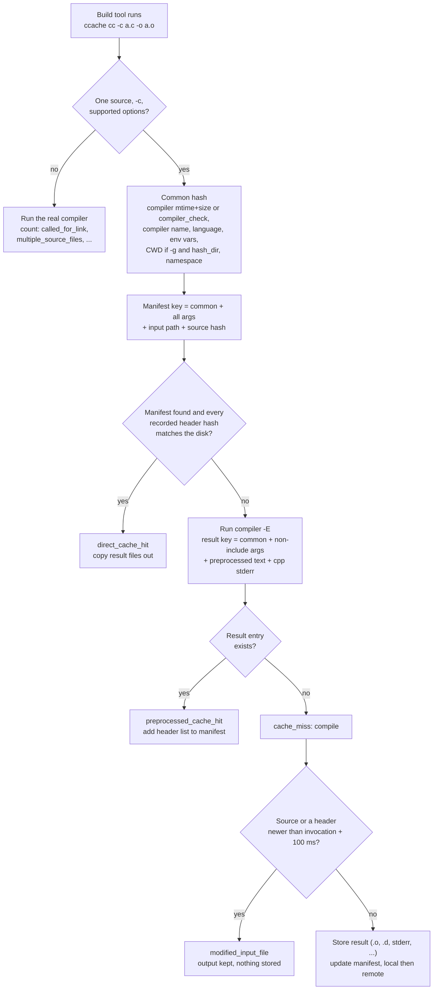

# Compiler Caches: ccache and sccache

> [!summary] Claim:
> A compiler cache is a wrapper that turns one compiler invocation into a key, the hash of every input that can change the output, and replays stored outputs when the key repeats.
> ccache builds that key two ways: preprocessor mode hashes the `-E` output, and direct mode hashes the source plus a manifest of every header the last compile read, falling back to preprocessor mode when a header hash differs.
> Absolute paths, the working directory under `-g`, time macros, and compiler identity are the usual reasons two "identical" compiles get different keys; `base_dir`, prefix maps, and `compiler_check` are the levers that make keys portable.
> sccache adds a long-lived daemon, cloud object-store backends, and a rustc front end, but it caches one rustc invocation per crate, and refuses `bin`, `proc-macro`, `dylib`, `cdylib`, and incremental crates, so Rust hit rates are bounded by crate granularity rather than by the cache.



## The Mechanism

Every fact below is from the ccache 4.14.3 manual, NEWS, or source, or from sccache 0.19.0 documentation, source, or release notes, unless another source is named.
The lab output in this note was recorded on darwin-arm64 with ccache 4.14.3, sccache 0.19.0, Apple clang 21.0.0, and rustc 1.99.0 (as of 2026-11).

### 1. What a compiler cache is, and why it is a wrapper

A build system decides which commands to run; a compiler cache decides whether a command needs to run at all.
In the vocabulary of [[Build-System-Theory-Schedulers-and-Rebuilders]], ccache is a constructive-trace store for a single task type, the compile of one translation unit: the key is a hash of the task's inputs and the value is the task's outputs.
It is implemented as a wrapper because a wrapper needs no cooperation from the build engine: Make, Ninja, CMake, Meson, autotools, and Cargo all already run "the compiler", and a wrapper can stand in for it.
The cost of that design is that the cache sees one process invocation at a time and has to reconstruct the task's inputs from the command line, the environment, and the files the compiler reads.
[[Remote-Execution-API-and-Remote-Caching]] owns the alternative, in which the build engine itself declares every input of an action and the cache never has to guess.

The two tools share the model and differ in process structure:

- ccache is a C++ program that runs once per compile, reads and writes a local cache directory, and optionally talks to remote storage; there is no daemon in the default configuration.
- sccache is a Rust program whose short-lived client forwards each compile to a long-lived local server, which holds the storage backend connection and the statistics.

### 2. Getting into the compile path

ccache has two run modes:

- Prefix: `ccache gcc -c example.c`.
- Masquerade: a symlink named `gcc` that points to `ccache`, placed before the real compiler in `PATH`; ccache then searches `PATH` for the first executable of that name that is not a symlink to itself, unless `path` (`CCACHE_PATH`) names where to look.

Build-system hooks are the usual route:

- CMake: `CMAKE_<LANG>_COMPILER_LAUNCHER` initializes the `<LANG>_COMPILER_LAUNCHER` target property, added in CMake 3.4, implemented for the Makefile and Ninja generators, and allowed to contain generator expressions since CMake 3.25.
- Cargo: `build.rustc-wrapper` (`RUSTC_WRAPPER`) wraps every rustc call; `build.rustc-workspace-wrapper` (`RUSTC_WORKSPACE_WRAPPER`) wraps only workspace members and changes Cargo's filename hash so wrapped artifacts are kept apart.
- Both wrappers receive the real compiler path as their first argument.

Stacking wrappers needs care.
ccache's manual recommends letting ccache run the other wrapper through `prefix_command` (`CCACHE_PREFIX=distcc`), because with `ccache distcc gcc ...` or a masqueraded distcc, ccache would hash the mtime and size of the distcc binary instead of the real compiler.
sccache 0.15.0 added detection of ccache in `PATH` to avoid caching the same compile twice.

### 3. Which calls are cacheable at all

ccache caches exactly one shape of call: compile one source file with `-c` into one object.
Anything else is passed through and counted under a named statistic, which `ccache -s -v` shows:

| Call | Counter | Lab line |
| :--- | :--- | :--- |
| Linking (`cc a.o b.o -o app`) | `called_for_link` | `link step` |
| Two sources in one `-c` call | `multiple_source_files` | `two sources in one -c call` |
| Preprocess only (`-E`) | `called_for_preprocessing` | `preprocess only (-E)` |
| Output to standard output (`-o -`) | `output_to_stdout` | not exercised |
| `.incbin` assembler directive | `unsupported_code_directive` | not exercised |
| `ccache:disable` in a comment in the first 4,096 bytes | `disabled` | not exercised |
| Autoconf probe | `autoconf_test` | not exercised |

The command-line parser decides what the input file is with a heuristic: any argument that names an existing file is an input.
`--ccache-skip` makes ccache pass the next argument through uninterpreted, but the manual notes it is still part of the direct-mode hash.

sccache's rustc parser is a whitelist table of known options (`ARGS` in `src/compiler/rust.rs`), and that has a sharp edge.
`--edition` is not in the table at v0.19.0, so `--edition 2021` written with a space parses as an unknown flag followed by a second positional input, and the call is refused as "multiple input files"; `--edition=2021`, which is what Cargo passes, is fine.
The lab's last rustc line shows exactly that refusal.

### 4. The common part of every key

ccache hashes with BLAKE3 and stores keys as 160-bit digests; cached data carries XXH3 checksums to detect corruption (both since 4.0, which replaced MD4; 4.0 also replaced Deflate compression with Zstandard, and 4.5 widened the entry checksum to 128-bit XXH3, per NEWS).
`hash_common_info()` in `ccache.cpp` feeds every key with:

- The compiler's identity, by default its mtime and size (`compiler_check = mtime`).
- The compiler's file name, because some compilers are hard links that behave differently by name.
- The source language, because the same preprocessed text can compile differently as C and as C++.
- `COMPILER_PATH`, `GCC_COMPARE_DEBUG`, `GCC_EXEC_PREFIX`, `I_MPI_CC`, and `I_MPI_CXX` when set, and on macOS `DEVELOPER_DIR` and `MACOSX_DEPLOYMENT_TARGET`, because `/usr/bin/clang` there is a wrapper that switches compilers on them; ccache also resolves the real compiler behind that wrapper before hashing it.
- The current working directory, but only when the compile generates debug information and `hash_dir` is true (the default), because DWARF records the compilation directory.
- The `namespace` string and the `extra_files_to_hash` contents.

`calculate_result_and_manifest_key()` then adds the cache entry and result format versions to every key, and the manifest format version to the direct-mode key only, before hashing the arguments.

`compiler_check` chooses how the compiler is identified:

- `mtime` (default): fast, but a rebuilt identical compiler misses, and a compiler wrapper hides upgrades of the real compiler.
- `content`: hashes the compiler binary.
- `string:<value>`: hashes a string you supply, such as a toolchain image digest.
- A command such as `%compiler% -dumpmachine; %compiler% -dumpversion`, run on every invocation, so it must be fast.
- `none`: hashes nothing, for experts only.

The lab's section 5 changes only `compiler_check=string:toolchain-1` to `string:toolchain-2` and gets a full miss, preprocessed mode included, which shows the identity is in the common part.

### 5. Preprocessor mode

Preprocessor mode is the original ccache algorithm.
The key is the common information plus:

- The output of running the compiler with `-E`.
- The command-line options except those that only affect preprocessing (`-I`, `-include`, `-D`, and similar), on the theory that if they matter at all they change the preprocessed text.
- Any standard error output from the preprocessor.

This key is robust: a comment edit, an unused `-D`, a reordered `-I` that resolves the same headers, or a header edit that preprocesses to the same text all keep the same key.
Its cost is that every lookup runs the preprocessor, which for heavy C++ headers is a large fraction of a compile.

Clang and GCC write line markers that name each file, so the preprocessed text contains absolute paths whenever the source or `-I` paths are absolute; that is why a second checkout misses in preprocessor mode too (lab line `bob, no base_dir`).

### 6. Direct mode and the manifest

Direct mode (since ccache 3.0, default on) avoids the preprocessor on a hit.
`get_manifest_key()` hashes, on top of the common information and every argument (`hash_argument()` with `direct_mode` true):

- `CPATH`, `C_INCLUDE_PATH`, `CPLUS_INCLUDE_PATH`, `OBJC_INCLUDE_PATH`, and the Clang and MSVC include variables, because they change header lookup without appearing on the command line.
- The input file path, so that `a/x.c` and an identical `b/x.c` never share a manifest; the source comment explains that sharing would let `a/r.h` satisfy `b/x.c`'s `#include "r.h"`, and would also expand `__FILE__` wrongly.
- The hash of the source file.

That digest names a manifest, not a result.
The manifest holds one or more entries, each pairing a result key with the list of include files read by that compile and their hashes and sizes.
On lookup, ccache hashes the include files currently on disk and walks the entries; the first entry whose files all match yields the result key.
On a mismatch it runs preprocessor mode, and when that produces a result (from cache or from compiling) it parses the include list out of the preprocessed output and adds a new entry to the manifest (`update_manifest()`).
With remote storage, `get_result_key_from_manifest()` can read the same manifest from more than one backend; when it read more than one, it stores the merged manifest locally.

The lab shows the two layers working together:

- `touch util.c` keeps a direct hit, because the key uses content hashes, not mtimes; a timestamp-based build tool rebuilds here and the cache absorbs it.
- A comment edit in `util.c` changes the source hash, so the manifest key changes and direct mode misses, but the preprocessed text is identical, so preprocessor mode hits.
- A comment edit in `config.h` keeps the manifest key, fails the header hash comparison, and again lands on a preprocessed hit.
- An unused `-DLAB_UNUSED=1` is in the direct-mode argument hash but excluded from the preprocessor-mode argument hash, so it is a direct miss and a preprocessed hit.
- `-O2` instead of `-O1` changes both keys, a full miss.

#### The negative-dependency hole

The manifest records the headers a compile read, not the headers it would have read had they existed.
If `-Ifoo -Ibar` resolves `x.h` to `bar/x.h` and someone later creates `foo/x.h`, the recorded `bar/x.h` still matches and direct mode returns a stale result.
ccache mitigates this by recording whether the directories given with `-I` and similar existed, and its manual says that it "can't check with 100% accuracy" whether a new header invalidates a result and that direct mode is safe in "the absolute majority of cases".
sccache's preprocessor cache documents the same hole.
Build systems that track absent files (Bazel's declared inputs, or sandboxing that hides undeclared headers, owned by [[Sandboxing-and-Hermetic-Execution-Internals]]) do not have it.

#### When direct mode turns itself off

Direct mode is disabled for one compile when:

- `direct_mode` is false.
- An include file's modification time is too new, per the manual; at v4.14.3 the source enforces that race guard as a store refusal in `to_cache()` rather than a mode switch (section 9).
- An include file named in the preprocessed output does not exist on disk (`remember_include_file()` in `ccache.cpp`), so the result is not added to a manifest.
- A `-Wp,` option other than `-Wp,-MD,<path>`, `-Wp,-MMD,<path>`, `-Wp,-D<macro[=defn]>`, or `-Wp,-U<macro>` is present, or most uses of `-Xpreprocessor`.
- The source contains `__TIME__`, a C23 `#embed`, or an `.incbin` directive (`hash_source_code_file()` in `hashutil.cpp` at v4.14.3; 4.14 added `#embed` detection in direct and depend mode and `.incbin` detection in depend mode).

An `.incbin` directive does not merely switch modes: with direct mode off, preprocessor mode scans the source again and refuses the call as `unsupported_code_directive` unless `sloppiness = incbin` is set, because ccache cannot know which external file the assembler will pull in.

The three time macros are treated differently, which is a favorite interview trap:

- `__TIME__` disables direct mode, because a hit within the same second is too unlikely to be worth a key; the preprocessed text then carries the expanded time, so even preprocessor mode rarely hits.
- `__DATE__` keeps direct mode and adds today's year, month, and day, plus `SOURCE_DATE_EPOCH` when set, because ccache cannot know whether the compiler honors it.
- `__TIMESTAMP__` keeps direct mode and adds the source file's mtime formatted with `%c`.
- `sloppiness = time_macros` ignores all three, and the cached output then carries the time of the compile that produced it.

The lab's `stamp.c` contains `__TIME__`; the debug log says direct mode was disabled, and with `time_macros` sloppiness the second compile is a direct hit.

### 7. Depend mode

Depend mode (opt-in since ccache 3.6) never runs the preprocessor, not even on a miss.
The key is the direct-mode hash plus the include list taken from the dependency file the compiler writes with `-MD` or `-MMD`, or from MSVC's `/showIncludes`, so depend mode is only possible when the build already asks for dependency files, as Ninja-based builds usually do through `depfile` rules (see [[Make-and-Ninja-Mechanics]]).

The trade-off is visible in the lab's section 4: a comment edit in `util.c` is a plain `cache_miss`, where the default configuration got a preprocessed hit, because there is no preprocessor fallback to notice the text did not change.
In exchange the miss path costs almost nothing beyond the compile, which matters when compiles run remotely through distcc or when most lookups miss anyway.
With `-MMD` system headers are not recorded, so changes to them go unnoticed; with `-MD` they are recorded and every hit pays to hash them.

### 8. Hashing headers fast: the inode cache

Each lookup must hash every header the manifest lists, which for a large C++ translation unit is thousands of files.
The inode cache (`inode_cache`) memoizes a file's hash under a key built from its device, inode, size, and timestamps, in a shared memory-mapped file in `temporary_dir`, so hashes are reused across processes and builds.
`inodecache.hpp` explains its race guard: a file rewritten with the same size inside one timestamp tick would keep its old key, so the inode cache only stores entries for files whose timestamps are older than `min_age`, "a conservative 2 seconds since not all file systems have subsecond resolution".
It is used only when `temporary_dir` is on a file system known to work with it.

Its history is a lesson in defaults:

- 4.0 added it as experimental and off by default.
- 4.7 turned it on by default where the file system is known to work.
- 4.7.5 turned it off again after reports of processes hanging on futex calls, and 4.8 replaced its pthread mutexes with spinlocks.
- 4.8 restored the default: `Config.hpp` at tag v4.8 initializes `m_inode_cache = true`, where the same file at v4.7.5 has `false`; the 4.8 NEWS entry for the spinlock change does not mention the default, so the source is the evidence.
- In 4.14.3 the compile-time default is true on non-Windows systems and false on Windows (`config.hpp`), where the implementation added in 4.10 is still experimental.

### 9. The newly-created-file race

ccache hashes a file and later the compiler reads it; if the file changes between those two reads, the cache would store new output under an old key.
`source_file_is_too_new()` closes the window: if the source or any include file has an mtime or ctime at or after the invocation time plus 100 ms, the result is not stored and the call counts as `modified_input_file`.
The check sits in `to_cache()`, the path that stores a fresh compile, not on the lookup path.

The lab proves that placement with a source whose mtime is in 2030:

- At `-O1`, a matching preprocessed result already existed, so ccache served it (`preprocessed_cache_hit`) without ever reaching the guard.
- At `-O3`, there was nothing to serve, the compile ran, and the store was refused (`modified_input_file=1`).

`sloppiness = include_file_mtime,include_file_ctime` disables the guard, which build systems that rewrite timestamps sometimes need.

### 10. Making keys portable across directories

Paths enter the key in three places: arguments (absolute source and `-I` paths), preprocessed text (line markers and `__FILE__`), and the working directory under `-g`.
[[Hermetic-and-Reproducible-Builds]] owns path remapping for reproducible outputs; here the question is narrower, which knobs make two checkouts produce the same cache key.

`base_dir` (`CCACHE_BASEDIR`) is a list of absolute directories, multiple entries allowed since 4.12.
For every absolute path under a base directory, ccache rewrites it relative to the current working directory before running the compiler and before hashing.
In the lab, Alice's tree is `ROOT/alice/proj` and Bob's is `ROOT/bob/work/proj`, at different depths, but both build from `proj/build`, so `ROOT/.../proj/src/util.c` becomes `../src/util.c` in both and Bob's compile is a direct hit.
The manual's own example explains the boundary conditions: `base_dir = /` also rewrites `/usr/include` into a CWD-dependent relative path, and a base directory below the project misses when a second project is referenced by absolute path.
The manual calls the rewrite "kind of a brittle hack": dependency files then contain relative paths, which can confuse Make and Ninja, and `absolute_paths_in_stderr` exists to undo it for diagnostics.

Under `-g`, `hash_dir` adds the working directory to the key, so the lab's Alice and Bob miss each other even with `base_dir`.
There are two fixes:

- Set `hash_dir = false` and accept wrong `DW_AT_comp_dir` values in cached objects.
- Pass `-fdebug-prefix-map=$PWD=.` (or `-ffile-prefix-map`), or `-fdebug-compilation-dir=.`.

The prefix map works because of two details in the source.
`hash_argument()` hashes only the option name for `-fdebug-prefix-map=`, `-ffile-prefix-map=`, `-fmacro-prefix-map=`, `-fprofile-prefix-path=`, and `-fcoverage-prefix-map=`, and "skips using the value" so the per-checkout path in the flag does not split the key.
`hash_common_info()` hashes the working directory after applying the debug prefix maps, so both checkouts hash `.`.
In the lab, Bob's `-g -fdebug-prefix-map=CWD=.` compile is a direct hit on Alice's entry.

sccache's equivalent is `SCCACHE_BASEDIRS` (sccache 0.14.0), which only affects the key: base directories are stripped from the preprocessed source and, since 0.18.0, from the places in arguments that spell a path (a whole argument, the value after `=`, either half of a prefix map, or the value glued to a short option such as `-I`).
A match must end at a path component boundary, the longest matching base wins, matching is case-insensitive only on Windows, and a relative base directory stops the server from starting.
`-DROOT="/home/user/project"` still splits the key, because the base directory is not in a path position there.

### 11. What is stored, and how it is evicted

A ccache result entry bundles every output of one compile: the object, the dependency file, standard error and standard output, split DWARF, coverage notes, and similar files, up to 256 raw files per result since 4.14.
Entries are compressed with Zstandard at level 1 by default (`compression_level = 0` means "choose", currently 1), checksummed with XXH3, and can be recompressed later with `-X`/`--recompress`.
`file_clone` (reflinks) and `hard_link` skip compression, and both are disabled when `remote_storage` is set (manual at 4.14.3); hard links are dangerous because an object modified in the build tree corrupts the cache entry, and shared inodes share mtimes, which makes timestamp-based build tools relink in other trees.
As a hard-link safety measure, ccache since 4.0 makes stored and fetched objects read-only and checks their size, which catches `strip file.o` but not a same-size modification.

The local cache defaults to 5 GiB (`max_size`) and no file-count limit, and lives in `$HOME/Library/Caches/ccache` on macOS or `$HOME/.cache/ccache` elsewhere unless a legacy `~/.ccache` exists (4.14.3).
After each store, if a limit is exceeded, ccache evicts in approximate LRU order by file mtime (a hit refreshes the mtime), scanning 1/256 of the cache per cleanup since 4.8 (it was 1/16 before), with at most one process cleaning at a time.
`--evict-older-than` and `--evict-namespace` give exact, age- or project-based eviction.

sccache's local disk cache defaults to 10 GiB (the lab prints `max_cache_size=10737418240`), compresses with zstd level 3 (`SCCACHE_CACHE_ZSTD_LEVEL`, 1 to 22), and "only supports a single sccache server at a time"; two servers on one directory race.

### 12. ccache remote storage

ccache 4.4 added `secondary_storage`, renamed `remote_storage` in 4.7.
It is a whitespace-separated list of URLs queried after the local cache, with per-backend properties:

| Local | Remote | Action (remote_only false) |
| :--- | :--- | :--- |
| miss | miss | Compile, write local, write remote unless `read-only` |
| miss | hit | Read remote, write local |
| hit | not asked | Read local; write remote only with `reshare` |

- Backends: `file:` (a directory, for NFS or a read-only mount; `@layout=local` since 4.14 reads a copied local cache), `crsh:` (an already running storage helper), and the built-in `http:` and `redis:`, which 4.14 deprecated for removal in the next non-bug-fix release.
- Storage helpers (4.13) are separate `ccache-storage-<scheme>` programs that ccache spawns, that keep connections open, and that exit after `idle-timeout` (default 10m); the protocol is specified in `remote_storage_helper_spec.md`.
- `shards=a(3),b(1),c(1.5)` spreads keys over servers with rendezvous hashing, in proportion to the weights.
- Timeouts default to `data-timeout=10s` and `request-timeout=1m`.
- `@layout=bazel` on the HTTP backend stores entries under `/ac/` as 64 hex digits so a Bazel HTTP cache server can hold them, possibly with action-result validation disabled.
- ccache never cleans remote storage; `--trim-dir` trims a file backend, and Redis needs its own LRU eviction.
- Statistics always stay in the local cache directory, even with `remote_only`.

### 13. sccache architecture

The `sccache` client spawns a server if none is running; it listens on `127.0.0.1:4226` by default, or on a Unix socket with `SCCACHE_SERVER_UDS`, and exits after 10 minutes idle (`SCCACHE_IDLE_TIMEOUT`, 0 means never).
In the default server-side mode the client forwards the whole compile; the server runs the preprocessor cache lookup, hashes, compiles on a miss, writes the outputs, and returns only stdout, stderr, and the exit code.
sccache 0.17.0 added client-side mode (`SCCACHE_CLIENT_SIDE`), in which the client runs the pipeline itself and uses the server only as a gateway to storage and a stats sink; the docs call it the recommended mode, expected to become the only one, and it is ignored when `SCCACHE_ERROR_LOG` or distributed compilation is configured (as of 2026-11, Both).
By default a failure to reach the server fails the build; `SCCACHE_IGNORE_SERVER_IO_ERROR=1` falls back to the local compiler.
The server joins a GNU Make jobserver when started from one, or creates its own with one slot per CPU, which matters for rustc's parallel codegen.

For C and C++, the sccache key is a BLAKE3 digest (`HashKeyParams::compute()` in `c.rs` at v0.19.0) of, in order: the compiler digest, a `++` byte, `CACHE_VERSION` (`13`), the language, the hashed arguments (the common arguments, which include profiling and coverage flags and `-fno-diagnostics-color`, followed by the architecture arguments), the digests of extra files (`SCCACHE_EXTRAFILES`, and each file named by `-fmodule-file=`), the digest of the assembler it hands off to (only when one is used: always for GCC, for Clang only with `-fno-integrated-as`), the allowlisted environment variables (`SCCACHE_C_CUSTOM_CACHE_BUSTER`, `SDKROOT`, `CCC_OVERRIDE_OPTIONS`, and the `*_DEPLOYMENT_TARGET` variables), and finally the preprocessed output with base directories stripped.
Preprocessor and dependency arguments are not hashed as arguments: they matter only through the preprocessed text, and `-fdiagnostics-color` is dropped from the key (it only sets the color mode of the compile command).
Its preprocessor cache mode, sccache's version of ccache's direct mode, arrived in 0.7.0 as opt-in, was made the default in 0.7.2, reverted in 0.7.3, and became the default for local storage only in 0.7.4.
It is skipped for non-C/C++ compiles, non-GCC/Clang compilers, non-local storage, `-MP`, `-Xpreprocessor`, `-Wp,`, a too-new header, or the time macros (unless `ignore_time_macros`).
Several `-arch` flags are cached only with `SCCACHE_CACHE_MULTIARCH`, and since 0.19.0 each architecture is preprocessed separately so code under `__aarch64__` reaches the key.

Storage backends at v0.19.0 are local disk, S3 and S3-compatible stores such as R2, Redis, Memcached, Google Cloud Storage, Azure Blob, the GitHub Actions cache, WebDAV, Alibaba OSS, and Tencent COS.
The documented backends offer a read-only mode (`SCCACHE_S3_RW_MODE=READ_ONLY`, `SCCACHE_GHA_RW_MODE`, `SCCACHE_LOCAL_RW_MODE`), and `SCCACHE_S3_NO_CREDENTIALS` gives anonymous read access, the documented pattern for pull-request builds that must not hold credentials.
Multi-level caching (0.15.0, `SCCACHE_MULTILEVEL_CHAIN=disk,redis,s3`) reads levels in order, backfills faster levels asynchronously after a slower hit, writes all writable levels, and by default fails a write only if level 0 fails (`SCCACHE_MULTILEVEL_WRITE_ERROR_POLICY=l0`).
Since 0.19.0 a remote read error such as bad credentials is reported as a cache error instead of being counted as a miss, which used to hide a dead backend behind a low hit rate.

`sccache-dist` adds icecream-style distributed compilation: a scheduler assigns jobs to 64-bit Linux or FreeBSD build servers, which run them in a bubblewrap overlay or Docker sandbox, and Linux clients package their local toolchain automatically.
sccache 0.8.1 disabled the preprocessor cache under distributed compilation.

### 14. Rust: why crate granularity bounds the hit rate

sccache caches a rustc call only if all of these hold (`docs/Rust.md` and `parse_arguments()` at v0.19.0):

- `--emit` contains `link` and only `link`, `metadata`, and `dep-info`; `--crate-name` and `--out-dir` are given; there is no `-o` and no stdin input.
- `--crate-type` is `lib`, `rlib`, or `staticlib` only, because other crate types (`bin`, `dylib`, `cdylib`, `proc-macro`) invoke the system linker, whose inputs sccache cannot see.
- `-C incremental` is absent; the source comment says incremental output "makes a mess of sccache's entire world view".

`generate_hash_key()` then hashes, in order: a cache version (`CACHE_VERSION = "7"`), digests of the compiler's shared libraries in the sysroot, the full argument list (with `-L`, `--extern`, `--out-dir`, and `--diagnostic-width` filtered, and `--extern`, `-L`, `--cfg` sorted), every source file rustc's own `--emit dep-info` pass lists, the contents of every `--extern` rlib and static library, a JSON target file if used, the environment variables dep-info lists plus every `CARGO_*` variable except `CARGO_MAKEFLAGS`, every `CARGO_REGISTRIES_*` variable (which carries registry tokens), `CARGO_BUILD_JOBS`, and `CARGO_ENCODED_RUSTFLAGS`, the working directory, and the compiler version.
There is no base-directory stripping on this path at v0.19.0: `SCCACHE_BASEDIRS` is applied in `c.rs`, not `rust.rs`, and the source still carries the TODO "there will be full paths here, it would be nice to normalize them".

Together these explain the Rust ceiling:

- The unit of caching is a whole crate, compiled by one rustc process into one rlib, so a one-line change anywhere in a crate recompiles all of it; a C++ project's unit is one translation unit, and a header change invalidates only the TUs that include it.
- Each dependent crate hashes the bytes of the rlibs it links against, so a changed leaf crate whose rlib bytes change invalidates every crate above it; there is no early cutoff unless the rlib is byte-identical.
- Cargo's dev profile defaults to `incremental = true` for workspace members and path dependencies, and sccache refuses every one of those calls, so on a developer laptop the crates you edit are exactly the crates that are never cached.
- Binaries, proc macros, and `cdylib`s are never cached, and proc macros are often among the most expensive crates to rebuild.
- The working directory and absolute paths are in the key, so the lab's identical lib crate built from another directory misses.

The cacheable part is mostly registry and git dependencies in CI and in fresh checkouts, which Cargo's own fingerprints already skip on a warm developer machine (see [[Cargo-Build-Graph-and-Rustc-Pipelining]]).
The levers are structural: disable incremental in CI (`CARGO_INCREMENTAL=0`), keep big binaries as a library plus a thin `bin` crate (the README's own advice), split very large crates, and build from a fixed checkout path.
Two 0.19.0 changes reduce friction without changing the ceiling: dep-info is now written locally instead of restored from cache, so an entry from another checkout no longer points Cargo at nonexistent paths, and `.rmeta` artifact notifications are streamed to Cargo before the compile finishes, so pipelining is not held back.

### 15. Precompiled headers and modules

Precompiled headers need `sloppiness = pch_defines,time_macros`, plus `-include header` (GCC and Clang), `-include-pch` (Clang), or `-fpch-preprocess` (GCC), and `-fno-pch-timestamp` for Clang; without that setup ccache falls back to the non-precompiled header or reports "Preprocessing failed".
ccache does not support standard C++20 modules as of 4.14.3; it supports Clang header modules (`-fmodules`) only with `sloppiness = modules` plus direct and depend modes, and hashes module files named by `-fmodule-file=` (since 4.14) and, since 4.14.1, all files in a `-fprebuilt-module-path=` directory by name and contents, because the command line does not say which `<module-name>.pcm` the compile reads; the manual notes this costs a hit when an unrelated module file in that directory changes.
Compiles using `-fprebuilt-implicit-modules` count as "Could not use modules" unless `sloppiness = modules` is set.
sccache 0.15.0 added partial C++20 named-module support for Clang: `clang.rs` at v0.19.0 parses `-fmodule-file=` (as `path` or `name=path`; the module file's contents are hashed as an extra file), `-fmodule-output[=path]`, `--precompile` and `--precompile-reduced-bmi` (which suppress the object output), and passes `-fmodules-reduced-bmi` through into the key.
0.19.0 extended it to clang-cl; GCC and MSVC modules bypass the cache.
Clang header modules are not supported at all: `-fmodules` and `-fmodules-ts` are refused as too hard in both parsers, as are `-fmodules-cache-path` and `-fmodules-user-build-path`.
[[Cpp-Modules-in-Build-Systems]] owns why modules break the one-TU-in-one-object-out model that compiler caches assume.

### 16. Debugging a miss

ccache:

- `ccache -z`, build, `ccache -s -v`: the verbose counters say whether misses are real or uncacheable calls.
- `stats_log` (`CCACHE_STATSLOG`) plus `--show-log-stats` or `--print-log-stats` gives per-build statistics unaffected by concurrent builds; the lab's section 7 uses it.
- `debug = true` (`CCACHE_DEBUG=1`) writes `<obj>.<timestamp>.ccache-input-text`, a diffable dump of everything hashed in the `COMMON`, `DIRECT MODE`, and `PREPROCESSOR MODE` sections, plus a per-object log; diff the files from two builds that should have matched.
- `log_file` (`CCACHE_LOGFILE`) logs decisions such as "Disabling direct mode".
- `--inspect`, `--extract-result`, `--checksum-file`, and `--hash-file` look inside entries.
- A bad object in the cache stays bad: remove it from the build tree and rebuild with `CCACHE_RECACHE=1`.

sccache:

- `sccache --show-stats` (or `--show-adv-stats`, `--stats-format json`) lists hits, misses, and a "not cached" table keyed by reason, which the lab parses.
- `SCCACHE_LOG=debug SCCACHE_ERROR_LOG=/tmp/sccache.log` logs from the server; `SCCACHE_START_SERVER=1 SCCACHE_NO_DAEMON=1 sccache` runs it in the foreground.
- `--debug-preprocessor-cache` prints the preprocessor cache entries, and `SCCACHE_RECACHE` overwrites entries.

### 17. Configuration precedence

ccache reads, highest priority first: `KEY=VALUE` on the command line (since 4.8), `CCACHE_*` environment variables, a directory-specific `ccache.conf` found by walking up from the working directory, the cache-specific `ccache.conf`, the system `ccache.conf`, and compile-time defaults; `CCACHE_CONFIGPATH` names the only file read.
The directory-specific file must be owned by the user and not world-writable, the walk stops at the home directory, a `.git` directory, another user's directory, or a mount point, and it cannot set "unsafe options" (commands, written files, remote storage) unless its directory is in `safe_dirs`; this exists because a cloned repository would otherwise be able to point your compiler at arbitrary programs.
Boolean environment variables are true when set, even to the empty string, and setting them to `0`, `false`, `disable`, or `no` is an error; the `CCACHE_NO<NAME>` form negates.
sccache reads `SCCACHE_CONF` or `~/.config/sccache/config` (Linux), `~/Library/Application Support/Mozilla.sccache/config` (macOS), and environment variables override the file; some variables only take effect when the server restarts.

## Commands and Numbers to Know

| Item | Value | Platform and date | What it controls |
| :--- | :--- | :--- | :--- |
| ccache `max_size` | 5 GiB | Both (as of 2026-11) | Local cache size before LRU eviction |
| ccache `max_files` | 0 (no limit) | Both (as of 2026-11) | File-count limit |
| ccache `compression_level` | 0, meaning zstd level 1 | Both (as of 2026-11) | Write cost versus cache density |
| ccache `direct_mode` | true | Both (as of 2026-11) | Skip the preprocessor on a manifest hit |
| ccache `depend_mode` | false | Both (as of 2026-11) | Never run the preprocessor; needs `-MD`/`-MMD` |
| ccache `hash_dir` | true | Both (as of 2026-11) | Hash CWD when compiling with debug info |
| ccache `compiler_check` | `mtime` | Both (as of 2026-11) | How compiler identity enters the key |
| ccache `inode_cache` | true; false on Windows | Both (as of 2026-11) | Reuse header hashes keyed by inode and timestamps |
| Inode cache `min_age` | 2 s | Both (as of 2026-11) | Files younger than this are not memoized |
| Too-new guard | invocation time + 100 ms | Both (as of 2026-11) | Newer source or header: no store, `modified_input_file` |
| Automatic cleanup scope | 1/256 of the cache | Both (as of 2026-11) | Approximate LRU by mtime, since 4.8 |
| Raw files per result | up to 256 | Both (as of 2026-11) | Outputs bundled in one entry, since 4.14 |
| Key hash, checksum | BLAKE3 160-bit, XXH3 128-bit | Both (as of 2026-11) | BLAKE3 since 4.0 (MD4 before); 128-bit XXH3 since 4.5 (64-bit in 4.0) |
| `ccache:disable` marker | first 4,096 bytes of the source | Both (as of 2026-11) | Per-file opt-out |
| Remote `data-timeout`, `request-timeout`, `idle-timeout` | 10s, 1m, 10m | Both (as of 2026-11) | Remote storage and helper lifetimes |
| `ccache -z`, `-s -v`, `--print-stats` | zero, show, machine-readable | Both (as of 2026-11) | Counters per build |
| `CCACHE_DEBUG=1` | writes `*.ccache-input-text` | Both (as of 2026-11) | Diff two builds' hashed inputs |
| sccache server | `127.0.0.1:4226`, idle exit 600 s | Both (as of 2026-11) | `SCCACHE_SERVER_PORT`, `SCCACHE_SERVER_UDS`, `SCCACHE_IDLE_TIMEOUT` |
| sccache `SCCACHE_CACHE_SIZE` | 10G | Both (as of 2026-11) | Local disk cache size |
| sccache `SCCACHE_CACHE_ZSTD_LEVEL` | 3 (range 1-22) | Both (as of 2026-11) | Compression of new entries |
| sccache preprocessor cache | on for local storage only | Both (as of 2026-11) | `SCCACHE_DIRECT`, since 0.7.4 |
| sccache `SCCACHE_BASEDIRS` | unset | Both (as of 2026-11) | Strip base dirs from C/C++ keys; not used for rustc |
| sccache `SCCACHE_CLIENT_SIDE` | off (opt-in) | Both (as of 2026-11) | Compile in the client, daemon as storage gateway |
| Cargo `RUSTC_WRAPPER` | unset | Both (as of 2026-11) | Wrap every rustc call |
| Cargo dev `incremental` | true (release: false) | Both (as of 2026-11) | Incremental rustc calls are never cached by sccache |
| CMake `CMAKE_<LANG>_COMPILER_LAUNCHER` | unset | Both (as of 2026-11) | Since CMake 3.4; Makefile and Ninja generators |

## Multi-Language Comparison: C++ / Python / Rust

| Concern | C++ (ccache or sccache) | Python | Rust (sccache) |
| :--- | :--- | :--- | :--- |
| Cached unit | One translation unit, one `.o` | One module's bytecode `.pyc` (CPython's own cache); C extensions are C++ rows | One crate, one rlib or staticlib |
| Hook | Prefix, masquerade, or `CMAKE_<LANG>_COMPILER_LAUNCHER` | Built in to the import system | `RUSTC_WRAPPER` or `build.rustc-wrapper` |
| Invalidation input | Content hashes of source, headers, args, compiler | Timestamp pycs by default; PEP 552 (Python 3.7) adds checked and unchecked hash-based pycs keyed by a 64-bit SipHash of the source | Content of sources from dep-info, extern rlibs, args, env, CWD, rustc version |
| mtime-only change | Hit (lab: `touch util.c`) | Rebuilds a timestamp pyc; a hash-based pyc stays valid | Hit if content unchanged |
| Path portability | `base_dir`, prefix maps (option values not hashed), `SCCACHE_BASEDIRS` | Not applicable | CWD and absolute args hashed as-is at v0.19.0 |
| Never cached | Links, multi-source calls, `-E`, `__TIME__` hits | Not applicable | `bin`, `dylib`, `cdylib`, `proc-macro`, incremental |
| Granularity cost of a one-line change | That TU only | That module only | The whole crate, plus dependents whose extern rlib bytes change |

The Python row is an analogy, not a third compiler cache: CPython faces the same design axis, timestamp versus content-hash invalidation, and PEP 552 moved it toward the content-hash side for reproducible builds.

## Worked Lab Example

The lab is `code/06-Build-Systems/ccache_hit_rate/`; it needs `ccache`, `sccache`, a C compiler, `rustc`, and `python3` on `PATH`, and no harness requirement on macOS.
`run.sh` builds every cache, config file, and daemon socket under a private temp directory, unsets every inherited `CCACHE_*`, `SCCACHE_*`, and `RUSTC_WRAPPER` variable, and points `CCACHE_CONFIGPATH` and `SCCACHE_CONF` at empty files, so the user's caches are never read or written.
It sets `HOME` to the temp directory as well, and pins `RUSTUP_HOME` and `CARGO_HOME` first, because the rustup proxy finds its toolchains through `HOME`.
Each step zeroes the counters, runs one compile, and prints the counters that moved; a step that moves no counter fails the lab, so a wrapper that silently stops seeing calls cannot produce a passing run.

The steps:

1. Direct mode and fallback: cold compile, repeat, `touch`, a comment edit in the source and in the header, an unused `-D`, and an `-O` change.
2. Portability: a second checkout at a different absolute path and depth, without and with `CCACHE_BASEDIR`, then with `-g`, then with `-g -fdebug-prefix-map=CWD=.`.
3. Time macros: a source using `__TIME__`, checked against the ccache log, then with `time_macros` sloppiness in a separate namespace.
4. Depend mode with `-MD -MF util.d` in its own namespace.
5. Compiler identity via `compiler_check=string:...`.
6. Uncacheable calls and the too-new guard.
7. Totals from `CCACHE_STATSLOG`.
8. rustc through a private sccache server: lib crate cold, warm, from another directory, incremental, a `bin` crate, and the `--edition 2021` parser trap.
9. A C compile through sccache, and the server's preprocessor-cache and size settings.

```bash
cd code/06-Build-Systems/ccache_hit_rate
bash run.sh
```

### Verified output

Recorded with `python3 -m _harness.verify --record` on darwin-arm64 on 2026-11-14; the file is `code/06-Build-Systems/ccache_hit_rate/expected/darwin-arm64.txt`.

```text
== ccache 4.14.3 ==

-- 1. Direct mode and its preprocessor-mode fallback --
cold compile                                 cache_miss=1 direct_cache_miss=1 preprocessed_cache_miss=1
same command again                           direct_cache_hit=1
touch util.c (mtime only)                    direct_cache_hit=1
edit a comment in util.c                     direct_cache_miss=1 preprocessed_cache_hit=1
edit a comment in config.h                   direct_cache_miss=1 preprocessed_cache_hit=1
add unused -DLAB_UNUSED=1                    direct_cache_miss=1 preprocessed_cache_hit=1
change -O1 to -O2                            cache_miss=1 direct_cache_miss=1 preprocessed_cache_miss=1

-- 2. A second checkout at another absolute path --
bob, no base_dir                             cache_miss=1 direct_cache_miss=1 preprocessed_cache_miss=1
alice, base_dir=ROOT (first time)            cache_miss=1 direct_cache_miss=1 preprocessed_cache_miss=1
bob, base_dir=ROOT                           direct_cache_hit=1
alice, base_dir, -g                          cache_miss=1 direct_cache_miss=1 preprocessed_cache_miss=1
bob, base_dir, -g (CWD is hashed)            cache_miss=1 direct_cache_miss=1 preprocessed_cache_miss=1
alice, -g -fdebug-prefix-map=CWD=.           cache_miss=1 direct_cache_miss=1 preprocessed_cache_miss=1
bob, -g -fdebug-prefix-map=CWD=.             direct_cache_hit=1

-- 3. Time macros --
stamp.c uses __TIME__                        cache_miss=1 direct_cache_miss=1 preprocessed_cache_miss=1
log: __TIME__ found, direct mode disabled for stamp.c
sloppiness=time_macros, first                cache_miss=1 direct_cache_miss=1 preprocessed_cache_miss=1
sloppiness=time_macros, again                direct_cache_hit=1

-- 4. Depend mode: no preprocessor, no fallback --
depend mode, cold                            cache_miss=1 direct_cache_miss=1
depend mode, again                           direct_cache_hit=1
depend mode, edit a comment in util.c        cache_miss=1 direct_cache_miss=1

-- 5. Compiler identity is part of the key --
compiler_check=string:toolchain-1            cache_miss=1 direct_cache_miss=1 preprocessed_cache_miss=1
compiler_check=string:toolchain-1 again      direct_cache_hit=1
compiler_check=string:toolchain-2            cache_miss=1 direct_cache_miss=1 preprocessed_cache_miss=1

-- 6. Calls ccache refuses to cache --
link step                                    called_for_link=1
two sources in one -c call                   multiple_source_files=1
preprocess only (-E)                         called_for_preprocessing=1
future mtime, a stored result exists         direct_cache_miss=1 preprocessed_cache_hit=1
future mtime, -O3 (would store)              direct_cache_miss=1 modified_input_file=1 preprocessed_cache_miss=1

-- 7. Whole-run totals from the stats log --
direct hits 7, preprocessed hits 4, misses 14
hit rate over cacheable calls: 11/25 = 44.0%

== sccache 0.19.0 ==
-- 8. rustc through sccache --
lib crate, cold                              miss[Rust]=1
lib crate, again                             hit[Rust]=1
lib crate, same args, other CWD              miss[Rust]=1
lib crate, -C incremental=inc                not_cached[incremental]=1
bin crate                                    not_cached[crate-type (bin)]=1
lib crate, --edition 2021 (space)            not_cached[multiple input files]=1

-- 9. C through sccache (preprocessor cache mode on local disk) --
C cold                                       miss[C/C++]=1
C again                                      hit[C/C++]=1
use_preprocessor_cache_mode=true max_cache_size=10737418240
```

### Reading the result

- Section 1 is the direct and preprocessor layering of the Mechanism section, one edit per line: content hashes ignore `touch`, comment and unused-define edits fall through to a preprocessed hit, and a code-generation flag misses both layers.
- Section 2: Alice's first `base_dir` compile misses although she compiled the same bytes before, because the rewritten relative command line is a new key; from then on Bob's tree hits.
  With `-g`, `hash_dir` splits the trees again, and the prefix map reunites them because ccache hashes the option name, not its per-checkout value, and remaps the CWD before hashing it.
- Section 3: the ccache log confirms direct mode was disabled (the grep matches any reason, but `stamp.c` contains only `__TIME__`, so the reason is unambiguous here); `time_macros` sloppiness restores direct hits at the price of a stale time string in the object.
- Section 4: depend mode's comment-edit line is a plain miss, where section 1's identical edit was a preprocessed hit.
- Section 6: the future-dated source was still served from cache at `-O1`, and refused for storage at `-O3`, because the too-new guard runs only on the store path.
- Section 7: the 25 cacheable calls include one unlabeled compile of `main.o` that the link step needs, which is why the log shows 14 misses where the labeled lines show 13.
  The 44.0% says nothing about a real project; it is a property of a script built to miss half the time.
- Section 8: the identical lib crate misses from another directory because the rustc key contains the working directory (the lab also changes absolute paths in the arguments, so it shows a path-dependent key rather than isolating the CWD alone), and the three refusals are the incremental rule, the linker rule, and the argument-parser trap.
- Section 9: sccache's preprocessor cache mode is on for local disk, and its default size is 10 GiB.

## Pitfalls

> [!warning] Pitfall: measuring hit rate across unrelated builds
> `ccache -s` totals the cache's whole lifetime and every concurrent build that shared it.
> Zero the counters (`ccache -z`) right before the build, or set `CCACHE_STATSLOG` per build and read `--show-log-stats`, and judge "misses" only after subtracting uncacheable calls such as links and autoconf probes.

> [!warning] Pitfall: CI checkouts at a different path every run
> Runners that check out into `/builds/<job-id>/...` put a different absolute path into every argument and every line marker, so the cache never hits across jobs.
> Set `CCACHE_BASEDIR` (or `SCCACHE_BASEDIRS`) to the checkout root, add `-ffile-prefix-map=<root>=.` or `-fdebug-prefix-map`, and verify with two `ccache-input-text` files that the `COMMON` sections match.

> [!warning] Pitfall: `compiler_check = mtime` on rebuilt toolchain images
> A container image rebuilt from the same compiler package gets new file mtimes, so every key changes and the shared cache goes cold on every image rebuild.
> Use `compiler_check = string:<image digest or compiler version>` or `content`, and never `none` unless the compiler really cannot change.

> [!warning] Pitfall: assuming a direct-mode hit is always correct
> Creating a header earlier in the include search path than the one a cached compile used does not invalidate the manifest, so direct mode can return an object built against the old header.
> When a build adds generated headers that shadow others, clean or use `CCACHE_RECACHE`, and treat the hermetic sandbox, not the cache, as the guarantee.

> [!warning] Pitfall: `hard_link = true` on a shared or multi-tree cache
> A hard-linked object shares its inode with the cache entry, so `strip`, an in-place `objcopy`, or a same-size edit in one tree corrupts every future hit, and a fetch in tree B touches the mtime of the object in tree A and triggers spurious relinks.
> Prefer `file_clone` on a reflink-capable file system, or plain copies.

> [!warning] Pitfall: sharing one writable cache with people you do not trust
> Any writer can store an arbitrary object under any key, and every reader links it.
> Let only trusted CI write (`read-only` on remote storage for everyone else, `SCCACHE_S3_RW_MODE=READ_ONLY` or `SCCACHE_S3_NO_CREDENTIALS` for pull requests), and keep `safe_dirs` empty so a repository's `ccache.conf` cannot redirect remote storage or commands.

> [!warning] Pitfall: expecting sccache to cache your Rust workspace on a laptop
> Dev-profile workspace members are built with `-C incremental`, which sccache refuses, and binaries and proc macros are never cached.
> On a laptop sccache mostly helps fresh clones and dependency rebuilds; for CI, set `CARGO_INCREMENTAL=0` and keep the checkout path fixed, because the rustc key includes the working directory.

> [!warning] Pitfall: hand-written rustc commands under sccache
> sccache's rustc parser only recognizes the options in its table, so `--edition 2021` (space-separated) is read as a second input file and silently not cached.
> Use the `--opt=value` form Cargo uses, and check `sccache --show-stats` for a "Non-cacheable reasons" entry.

> [!warning] Pitfall: two sccache servers on one local cache directory
> The local disk backend supports one server at a time, and concurrent servers race and cause spurious build failures.
> Give each concurrent CI job on a host its own `SCCACHE_DIR` and `SCCACHE_SERVER_UDS`, or one shared server.

## At Scale

A single developer needs nothing but the defaults: a 5 GiB local ccache, direct mode, and `ccache -s` when something looks slow.
The problems begin when one cache serves many trees, many machines, or many people, because every difference in path, toolchain, or flags becomes a cold key, and every writer becomes a trust boundary.

- One developer with several worktrees: set `base_dir` to the common parent and add `-ffile-prefix-map` to debug builds; consider `namespace` per project so `--evict-namespace` can drop a dead project.
- A team of 10 to 100 with CI: CI writes a remote cache (ccache file or helper backend, or sccache S3/GCS/Redis), developers read it with `read-only`, toolchains come from a pinned image with `compiler_check = string:<digest>`, and each build records its own stats log.
  Watch the uncacheable counters as closely as the hit rate.
- 100 to 1,000 engineers: shard the cache (`shards=` with rendezvous hashing for ccache, or an object store behind a regional tier with sccache multi-level caching), evict by age rather than by size, alert on remote errors (sccache 0.19.0 finally reports them), and treat cache-key drift as a regression: a hit-rate drop after a toolchain or flag change is a bug to bisect.
- 1,000 to 50,000 engineers: a wrapper cache cannot see the build graph, cannot prove an action hermetic, and cannot share outputs of non-compile actions such as code generation, tests, and links.
  At this scale the decision rule is to move the build to an engine with declared inputs and a REAPI action cache ([[Remote-Execution-API-and-Remote-Caching]], [[Bazel-Skyframe-Bzlmod-and-Execution-Model]]) and keep ccache or sccache only for islands that still build with CMake or Cargo directly.
  [[Build-Performance-Economics-and-Decision-Record]] owns the cost model that justifies the migration; [[Diagnose-Bazel-and-Buck2-Cache-Misses]] owns miss forensics on the far side of it.

Decision rules:

- Use ccache for C and C++ when the build is CMake, Make, Meson, or autotools and the cache is local or on a shared file system; its direct mode, depend mode, and portability knobs are the most mature.
- Use sccache when the cache must live in a cloud object store without extra helpers, when Rust is in the mix, or when GitHub Actions cache integration matters.
- Use depend mode when most lookups miss or compiles run remotely; keep the default when edits are often comment- or whitespace-only.
- Never trade correctness sloppiness (`time_macros`, `system_headers`, `file_stat_matches`) for hit rate without writing down why the relaxed input cannot affect the output.
- For Rust, invest in crate structure (lib plus thin bin, smaller crates, fewer proc macros) before investing in cache infrastructure, because granularity sets the ceiling.

## Practice Drill

> [!tip] Practice Drill:
> Run the lab, then enable `CCACHE_DEBUG=1` and repeat the `bob, base_dir, -g` step from section 2 by hand in both trees.
> Diff the two `util.o.<timestamp>.ccache-input-text` files and find the single `cwd` line that differs, then add `-fdebug-prefix-map` and confirm the `cwd` line now reads `.` in both.
> Next, predict the counters before running each of these against a warm cache: reorder two `-I` options that resolve the same headers; add `-Wp,-DFOO=1`; add `-Xpreprocessor -DFOO=1`; and create a header named `config.h` in a directory searched before `include/`.
> The last one is the negative-dependency hole: write down whether direct mode notices it, and why ccache's record of `-I` directory existence does or does not help when the directory already existed.
> Stretch: wrap a small Cargo workspace with `RUSTC_WRAPPER=sccache`, build it twice in dev and twice with `CARGO_INCREMENTAL=0`, and explain every line of `sccache --show-stats` in terms of section 14.

## Interview Questions

> [!question] L5: What is the difference between ccache's direct mode and preprocessor mode, and what is in a manifest?
>
> > [!success]- Answer
> > Preprocessor mode runs the compiler with `-E` and hashes the preprocessed text together with the compiler identity and the non-preprocessor arguments, so every lookup pays for preprocessing.
> > Direct mode hashes the source file, its path, and all arguments to find a manifest, which lists earlier results together with the paths and content hashes of every header those compiles read.
> > If all recorded headers still hash the same, the manifest yields the result key without running the preprocessor; otherwise ccache falls back to preprocessor mode and adds a new entry to the manifest.
> > Direct mode is faster on hits; preprocessor mode is more tolerant of edits that do not change the preprocessed text.

> [!question] L5: After `touch util.c`, Make rebuilds `util.o`; does ccache hit, and why?
>
> > [!success]- Answer
> > Yes, it is a direct hit, as the lab's `touch util.c (mtime only)` line shows.
> > ccache keys on file contents, and the manifest compares header content hashes, not timestamps; the inode cache uses timestamps only to memoize those content hashes.
> > Make keys on mtimes, so it reruns the command, and the cache turns that rerun into a file copy.
> > The exceptions are a source or header whose mtime or ctime is 100 ms or more after the invocation started, which is not stored, and `sloppiness = file_stat_matches`, which trusts size and timestamps instead of contents.

> [!question] L5 predict-the-output: On a warm cache with the default configuration, predict `ccache -s` for each separate change: a comment edit in the header, an unused `-DX=1`, and `-O1` to `-O2`.
>
> > [!success]- Answer
> > Header comment edit: direct miss, because the header's hash no longer matches the manifest, then a preprocessed hit, because comments vanish in `-E` output.
> > Unused `-DX=1`: direct miss, because all arguments are in the direct-mode key, then a preprocessed hit, because `-D` is excluded from the preprocessor-mode argument hash and the text is unchanged.
> > `-O2`: both modes miss and the compile runs, because optimization flags are in both keys.
> > The lab's section 1 shows exactly `direct_cache_miss=1 preprocessed_cache_hit=1`, the same again, and `cache_miss=1 direct_cache_miss=1 preprocessed_cache_miss=1`.

> [!question] L6: Why does `__TIME__` disable direct mode while `__DATE__` does not?
>
> > [!success]- Answer
> > With `__DATE__`, ccache can keep the direct-mode key correct cheaply: it adds the current date and any `SOURCE_DATE_EPOCH` to the source digest, so a hit is valid all day.
> > `__TIMESTAMP__` is handled the same way with the file's mtime string.
> > For `__TIME__` the equivalent key would change every second, so the source comment in `hashutil.cpp` concludes a later hit is too unlikely and disables direct mode instead; preprocessor mode then sees the expanded time in the text and also rarely hits.
> > `sloppiness = time_macros` ignores all three and accepts stale times in cached objects.

> [!question] L6 debug-this: A CMake project's local rebuilds hit ccache but its CI hit rate is near zero, with runners checking out into `/builds/<id>/repo` and building `RelWithDebInfo`; diagnose and fix it.
>
> > [!success]- Answer
> > Confirm first with `CCACHE_DEBUG=1` on two runs and a diff of the `ccache-input-text` files, after checking `ccache -s -v` that the misses are real and not uncacheable calls.
> > Expect three differences: absolute source and `-I` paths in the arguments, absolute paths in the preprocessed line markers, and a `cwd` entry because `-g` plus `hash_dir` hashes the working directory.
> > Fix with `CCACHE_BASEDIR=/builds/<id>/repo` (computed per job), `-ffile-prefix-map=${CMAKE_SOURCE_DIR}=.` or `-fdebug-prefix-map` in the debug flags, whose values ccache does not hash.
> > Then check compiler identity: if the runner image is rebuilt regularly, the compiler's mtime differs between images, so set `compiler_check = string:<image digest>`.
> > Verify by running two jobs in a row and confirming direct hits in the second job's stats log.

> [!question] L6: An identical Rust library crate hits sccache in one checkout and misses in a second checkout of the same commit; why, and what would you change?
>
> > [!success]- Answer
> > On the rustc path, sccache 0.19.0 hashes the full argument list and the working directory, and applies no base-directory stripping (`SCCACHE_BASEDIRS` is used only for C and C++); the source still has a TODO to normalize paths.
> > A second checkout has a different working directory and different absolute paths in Cargo's arguments, so the key changes, which the lab's `lib crate, same args, other CWD` line shows.
> > Build CI from a fixed path, for example a fixed workspace directory or container mount, so keys are stable; `--remap-path-prefix` fixes paths in the output but is itself an argument that differs per checkout unless the path is fixed.
> > Also confirm the misses are not refusals: incremental builds, `bin`, and `proc-macro` crates appear in the not-cached table, not as misses.

> [!question] L7: Why does ccache refuse to store a result when a source file is too new, but still serve a hit for that same file?
>
> > [!success]- Answer
> > The race is between hashing and compiling: ccache hashes a file, the file changes, the compiler reads the new contents, and the output would be stored under the old key, poisoning every later lookup.
> > `source_file_is_too_new()` rejects the store when the source or any header has an mtime or ctime at or after the invocation time plus 100 ms, counting `modified_input_file`.
> > A hit is not dangerous in the same way: the key was computed from the bytes on disk now and maps to an output produced earlier from bytes with that hash, so serving it cannot store anything wrong; at worst the build sees output for content that changes right afterwards, which a later build fixes.
> > That is why the guard lives in `to_cache()`, and why the lab's future-dated source still gets a preprocessed hit at `-O1` and only `-O3` trips the guard.

> [!question] L7: Design the compiler cache for a 2,000-engineer C++ organization that builds with CMake and Ninja.
>
> > [!success]- Answer
> > Toolchains come from pinned images, and the cache key carries the image digest through `compiler_check = string:<digest>`, so a toolchain change is a clean namespace rather than a stream of subtle misses.
> > CI is the only writer; developers and pull-request jobs read with `read-only` remote storage, which closes the poisoning path from untrusted code.
> > Paths are normalized at the build level with `-ffile-prefix-map` and a fixed or `base_dir`-normalized checkout root, verified by a canary job that builds the same commit in two directories and asserts a direct hit.
> > Storage is sharded with rendezvous hashing or an object store, eviction is age-based, and per-build stats logs feed dashboards of hit rate, uncacheable counts, and remote errors.
> > The design explicitly names its limits: it caches compiles only, trusts manifests that cannot see absent headers, and cannot cache codegen, tests, or links; when those dominate, the next step is an engine with a REAPI action cache.

> [!question] L8+: Explain why Rust crate granularity limits sccache compared with C++ translation units, and what you would change organizationally.
>
> > [!success]- Answer
> > A C++ build caches one object per translation unit, and a header edit invalidates only the units that include it, so the invalidation set is roughly proportional to the change.
> > A Rust crate is one rustc invocation producing one rlib; any edit recompiles the whole crate, every dependent crate hashes the bytes of the rlibs it links, so a changed rlib invalidates all crates above it, and there is no early cutoff unless the rlib bytes are identical.
> > sccache also refuses incremental compiles, which Cargo's dev profile uses for every workspace member, and every crate type that links (`bin`, `dylib`, `cdylib`, `proc-macro`), so on a laptop it mostly caches third-party dependencies that Cargo already skips via fingerprints.
> > Organizationally: keep crates small with narrow dependency fan-in, turn large binaries into a library plus a thin `bin`, reduce proc-macro use in hot paths, disable incremental in CI, and pin checkout paths.
> > At large scale, cache rustc actions in a build engine with declared inputs and path remapping, rather than through a wrapper that has to infer the inputs.

> [!question] L8+: When does a compiler cache stop being the right tool, and what replaces it?
>
> > [!success]- Answer
> > A wrapper cache infers inputs from one process's arguments, environment, and the files it reads, so it cannot prove hermeticity, has blind spots such as absent headers and undeclared environment, and can only cache compiles.
> > When most build time is in links, code generation, tests, or Rust crates that wrappers refuse, or when thousands of engineers need cross-machine hits with strong correctness guarantees, the economics favor a build engine with declared inputs, sandboxing, and a REAPI action cache, which caches every action type and lets remote execution reuse outputs without downloading them.
> > The migration has real costs in build rule rewrites and toolchain hermeticity, so the decision should rest on measured critical-path and cache-miss data, and compiler caches remain useful for the parts of the codebase that stay on CMake or Cargo.

## Further Reading

- ccache manual, 4.14.3: the normative description of direct, preprocessor, and depend modes, every option and default, remote storage, and the debugging workflow.
- ccache NEWS: dates every behavior change in this note, from direct mode in 3.0 to storage helpers in 4.13 and the HTTP and Redis deprecation in 4.14.
- `src/ccache/ccache.cpp` and `hashutil.cpp` at v4.14.3: `hash_common_info()`, `hash_argument()`, `get_manifest_key()`, `source_file_is_too_new()`, and the temporal macro rules, which answer most "why did this miss" questions exactly.
- `doc/remote_storage_helper_spec.md`: the protocol for writing a ccache storage helper for a new backend.
- sccache README and `docs/` at v0.19.0: architecture and client-side mode, hash inputs, preprocessor cache mode, Rust caveats, multi-level caching, and backend configuration.
- `src/compiler/rust.rs` at v0.19.0: the exact rustc cacheability rules and the ten hash inputs, including the working directory.
- sccache release notes 0.7.0 through 0.19.0: when preprocessor cache mode, base directories, multi-level caching, and client-side mode arrived.
- The Cargo Book, Configuration and Profiles: `rustc-wrapper`, `rustc-workspace-wrapper`, and the incremental defaults that decide what sccache can cache.
- CMake `<LANG>_COMPILER_LAUNCHER`: the supported way to insert a compiler cache into CMake builds.
- PEP 552: the same timestamp-versus-hash invalidation trade-off, applied to Python bytecode.

## Related

- Prerequisites: [[Hermetic-and-Reproducible-Builds]], [[Make-and-Ninja-Mechanics]]
- Next: [[Cross-Compilation-and-Sysroots]]
- See also: [[Remote-Execution-API-and-Remote-Caching]], [[Cargo-Build-Graph-and-Rustc-Pipelining]], [[Build-System-Theory-Schedulers-and-Rebuilders]], [[Modern-CMake-Architecture-and-Targets]], [[Cpp-Modules-in-Build-Systems]], [[Build-Performance-Economics-and-Decision-Record]]
- Lab: `code/06-Build-Systems/ccache_hit_rate/`
