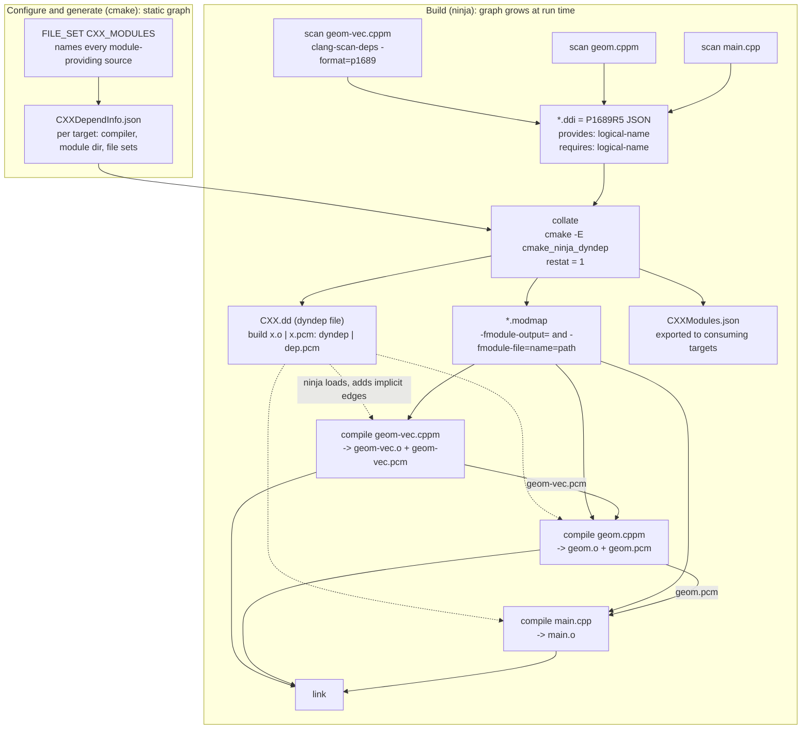

# C++20 Modules in Build Systems

> [!summary] Claim:
> A C++20 module interface unit compiles to a Built Module Interface (BMI) that every importer must read, so compilation is no longer embarrassingly parallel: the build graph needs edges that only the source text reveals.
> CMake's answer is a three-step protocol run during the build: the compiler scans each source and writes P1689R5 JSON (`provides` and `requires` by logical module name), a collator maps names to BMI paths and writes a Ninja dyndep file plus one module map per compile, and Ninja loads the dyndep file to add implicit BMI inputs and outputs before it schedules any compile.
> Correctness rests on the BMI being an explicit, build-system-named artifact with compiler-specific, flag-sensitive contents, so CMake supports only Ninja 1.11+ and Visual Studio generators, builds private BMIs for imported targets, and does not support header units.
> Incrementality rests on restat: CMake 4.5 lists only direct imports and marks BMI producers `restat = 1`, but compilers rewrite BMIs on every compile, so an unchanged interface still recompiles every importer unless something copies BMIs only when their bytes change.



## The Mechanism

[[Make-and-Ninja-Mechanics]] owns Ninja's graph, depfiles, the deps log, and the generic dyndep feature; [[Modern-CMake-Architecture-and-Targets]] owns targets, file sets, and usage requirements.
This note owns what C++20 named modules do to those mechanisms: the scan format, the collator, the module-specific use of dyndep, BMI compatibility, and what each build system ships as of 2026-11.

### 1. Why modules break the independent-TU model

With headers, each translation unit (TU) re-parses every declaration it needs, so any two TUs can compile in either order or at the same time; a depfile written during the compile is enough to rebuild correctly next time.
A module changes the producer and consumer relationship: compiling a module interface unit produces an extra output, the BMI (Clang `.pcm`, GCC `.gcm` which its manual calls a CMI, MSVC `.ifc`), and compiling any importer reads it.
GCC's manual states the consequence directly: "The import graph is a Directed Acyclic Graph (DAG).
You must build imports before the importer."
P1689R5 adds the second consequence: the ordering cannot come from a depfile, because a depfile is written while the consumer compiles, and the consumer cannot compile until the producer has run.
The paper also notes that this is "exactly analogous" to Fortran modules, which is why its format avoids C++-only vocabulary and why Ninja's dyndep manual uses a Fortran example.

The unit kinds decide what the graph must contain:

| Unit | Declaration | Produces a BMI | Imports implicitly | P1689 record |
| :--- | :--- | :--- | :--- | :--- |
| Primary module interface unit | `export module geom;` | Yes | Nothing | `provides: geom`, `is-interface: true` |
| Module interface partition | `export module geom:vec;` | Yes | Nothing | `provides: geom:vec`, `is-interface: true` |
| Internal partition | `module geom:detail;` | Yes | Nothing | `provides: geom:detail`, `is-interface: false` |
| Module implementation unit | `module geom;` | No | The primary interface of `geom` ([module.unit]p8) | `requires: geom` |
| Ordinary TU that imports | `import geom;` | No | Nothing | `requires: geom` |
| Header unit | `import <vector>;` | Yes, from a header | Nothing | `requires` with `lookup-method` and `unique-on-source-path` |

The lab's scan shows the implicit import of the implementation unit: `geom_impl.cpp` contains no `import` statement, yet its record says `requires=['geom']`.
An internal partition looks like an implementation unit of a partition, and cmake-cxxmodules(7) documents that only MSVC distinguishes such an "implementation partition"; Clang and GCC treat `module M:part;` as an internal partition, so CMake demands that the file be in a `CXX_MODULES` file set.

### 2. The design space, and why CMake chose scan plus dyndep

cmake-cxxmodules(7) classifies designs on two axes: explicit (the compiler is told the exact BMI file for each module) versus implicit (the compiler searches directories of BMIs), and static (all commands exist before the build), dynamic (commands are created during the build), or fixed (dependencies are computed while generating the build graph).
CMake's stated goals, in order, are correct builds, deterministic builds, support for generated sources, static communication through files, and minimal regeneration.
Each rejected design violates one of them:

- A fixed build scans at generate time, so every edit to a module-aware source could require regenerating the build graph, and generated sources need an unbounded number of regenerations as they appear.
- An implicit build leaves stale BMIs in search directories; the build tool cannot know which files are safe to delete (`ninja -t cleandead`), and BMIs that share a directory still need ordering.
- A module mapping service (GCC's `-fmodule-mapper` oracle, published as P1184 and implemented by libcody) answers "where is module X" during compilation, but neither Make nor Ninja can start and stop a service with the build, and a compiler waiting on an answer for a module nobody provides can hang, holding a job slot, memory, and file descriptors.

CMake therefore runs a static build whose graph contains every scan, collate, and compile command, and lets the build tool add the module edges at run time.
GCC's manual itself calls mapper functionality "in its infancy and ... intended for experimentation with build system interactions."

### 3. Step one: scanning to P1689R5

P1689R5 (Ben Boeckel and Brad King of Kitware, 2022-06-03, SG15 Tooling) is a JSON document with a required integer `version` (1 for R5), an optional `revision` (default 0), and a `rules` array with one object per compilation rule.
Each rule has four optional properties:

- `primary-output`: the object the rule will produce; the build system supplies it (the analogue of `-MT`) so it can match results to graph edges.
- `outputs`: other files the rule writes.
- `provides`: modules the future compile will provide, each with a required `logical-name` and optional `compiled-module-path`, `source-path`, `unique-on-source-path` (default false), and `is-interface` (default true).
- `requires`: modules the future compile needs, each with `logical-name` and optional `lookup-method` (`by-name`, the default, `include-angle`, or `include-quote`).

The format's rules are short and strict:

- The set of all `primary-output` and `outputs` across rules must be unique, because two rules writing one file is undefined behavior in build tools.
- `version` increments only when information required for a correct build changes; additive information increments `revision`.
- Vendor extensions use `_VENDOR_` property prefixes, and consumers "must be able to ignore all `_`-prefixed properties" without losing correctness.
- Paths may be relative or absolute and must be valid UTF-8; non-UTF-8 paths (unpaired surrogates, some Big-5 or Shift-JIS names) are out of scope.
- For header units, `logical-name` is how the header was named at the import site and `source-path` is the resolved file, with `unique-on-source-path: true`, so `import "h.h";` and `import <dir/h.h>;` can be recognized as one unit.

R4 removed `inputs`, `outputs`, and `depends` that would have replaced depfiles, because "implementation experience showed that parsing this information was extraneous work"; header dependencies of the scan still travel in an ordinary depfile.

Why the compiler, not a regex, must scan: imports can sit behind `#if`, macros, `__has_include`, and `__has_builtin`, and cmake-cxxmodules(7) states that "only the compiler itself can reliably answer preprocessor predicates like `__has_builtin`."
Each compiler ships a scanner, and CMake 4.5 stores the command template in `CMAKE_CXX_SCANDEP_SOURCE`:

| Compiler | Scanner command (CMake 4.5 template, abridged) | Notes |
| :--- | :--- | :--- |
| Clang 16+ | `clang-scan-deps -format=p1689 -- <compiler> <flags> -x c++ -c -o <OBJECT> -resource-dir <dir> -MT <DYNDEP_FILE> -MD -MF <DEP_FILE> <SOURCE> > <DYNDEP_FILE>.tmp && mv ...` | A separate tool; Clang's docs say it supports "only named modules" in P1689 mode |
| GCC 14+ | `<compiler> <flags> -E -x c++ <SOURCE> -MT <DYNDEP_FILE> -MD -MF <DEP_FILE> -fmodules-ts -fdeps-file=<DYNDEP_FILE> -fdeps-target=<OBJECT> -fdeps-format=p1689r5 -o <PREPROCESSED_SOURCE>` | A preprocessing run; `p1689r5` is "the only supported format" |
| MSVC 14.34+ | `<compiler> <flags> <SOURCE> -nologo -TP -showIncludes -scanDependencies <DYNDEP_FILE> -Fo<OBJECT>` | `/scanDependencies` exists since VS 2022 17.2, writes absolute paths, lists direct imports only |

The Clang template writes to `<DYNDEP_FILE>.tmp` and renames, with a source comment citing CMake issue 25419: Ninja "assumes that failed commands either delete or leave output files alone," so a half-written scan result must never replace a good one.
The `-MD -MF` depfile on the scan edge is what makes Ninja rescan when an included header changes, because a header can add or remove an `import`.
GCC's `-fdeps-format` also strips C++ module information from the `-MF` output "so that it does not use extended makefile syntax"; without it GCC writes `CXX_MODULES +=` lines that Ninja cannot parse, which P1689R5 cites as the reason Makefile snippets do not work.

### 4. Step two: collation

The collator (`cmake -E cmake_ninja_dyndep --tdi=<CXXDependInfo.json> --lang=CXX --modmapfmt=clang --dd=$out @$out.rsp` in the lab) reads, per target:

- `CXXDependInfo.json` from the generate step: compiler id and frontend variant, the `cxx-modules` map of objects to file sets (with visibility, compile options, and install destinations), the BMI directory, and source and build directories.
- The target's `.ddi` scan results.
- `CXXModules.json` from each dependent target's collation, which lists the modules that target provides and the modules each of them transitively imports.

It writes:

- `CXX.dd`, the dyndep file for the target's compile edges.
- `CXXModules.json` for targets that depend on this one.
- One `.modmap` per compile, in the format selected by `CMAKE_CXX_MODULE_MAP_FORMAT` (`clang`, `gcc`, or `msvc`) and passed with `CMAKE_CXX_MODULE_MAP_FLAG` (`@<MODULE_MAP_FILE>` for Clang and MSVC, `-fmodules-ts -fmodule-mapper=<MODULE_MAP_FILE> -MD -fdeps-format=p1689r5 -x c++` for GCC).
- `install-cxx-module-bmi-<CONFIG>.cmake` scripts and export fragments that set `IMPORTED_CXX_MODULES_<CONFIG>`, because BMI file names are only known at build time: CMake names BMIs after the module, not the source.

It enforces two invariants: one BMI per public module name across the program, and module visibility, meaning a module from a `PRIVATE` file set may not be imported by dependent targets or by `PUBLIC` interface units of the same target.
It does not detect import cycles; CMake leaves that to the build tool (CMake issue 26119 tracks improving it), and the lab shows Ninja's message.

Two details matter for incremental builds, and the lab's CMake output shows both:

- The module map names the whole import closure (`main.cpp.o.modmap` lists `report`, `geom`, and `geom:vec`), because Clang requires "all BMI dependencies must be specified explicitly, either directly or indirectly."
- The dyndep file lists only direct imports as implicit inputs (`main.cpp.o: dyndep | .../report.pcm`) and puts `restat = 1` on every BMI-producing statement.

### 5. Step three: Ninja dyndep, as modules use it

Dyndep is "Available since Ninja 1.10" (released 2020-01-28).
A build statement names the dyndep file in a `dyndep =` binding, and the manual requires that it "must name one of the build statement inputs"; CMake and the lab make it an order-only input (`|| modules.dd`) so the compile waits for collation without being dirtied by every rewrite of the file.
When the dyndep file is ready, `DyndepLoader::LoadDyndeps` in `src/dyndep.cc` parses it and, for each edge that names it:

1. Fails with "not mentioned in its dyndep file" if the edge has no statement, and fails on any statement "whose build statement does not have a dyndep binding," so the correspondence is one-to-one.
2. Adds `restat = 1` to the edge's binding scope if the statement carries it (the only binding the parser accepts: anything else is "binding is not 'restat'").
3. Appends the implicit outputs (the BMIs) and makes the edge their producer, failing with "multiple rules generate <path>" if another edge already produces one.
4. Inserts the implicit inputs (the imported BMIs) before the order-only inputs and registers the edge as their consumer.

The parser accepts `ninja_dyndep_version = 1` or `1.0` with any suffix, exactly one explicit output per statement, and the rule name `dyndep`; explicit inputs and order-only inputs are rejected.
So the dyndep file can only add edges between existing edges; it cannot create a compile command, which is why every module-providing source must be known when the graph is generated.
CMake requires Ninja 1.11 for C++ dyndep (`RequiredNinjaVersionForDyndepsCxx() { return "1.11"; }` in `cmGlobalNinjaGenerator.h`) but 1.10 for Fortran; UNVERIFIED: the specific 1.11 fix that motivated the higher floor is not named in the CMake source or docs I read.

### 6. Step four: compiling, BMI models, and BMI compatibility

Clang has two compilation models for an interface unit:

- One-phase: `-c x.cppm -fmodule-output=x.pcm -o x.o` writes the object and the BMI from one compile; CMake uses this model.
- Two-phase: `--precompile x.cppm -o x.pcm`, then `-c x.pcm -o x.o`; importers can start as soon as the BMI exists, in parallel with codegen, at the cost of twice the commands.

Clang's documentation gives the trade-off: with `B` importing `A`, one-phase compiles them serially, while two-phase lets `B` start "as soon as `A.pcm` is available."
cmake-cxxmodules(7) lists separate BMI generation as a possible future enhancement and explains why it is not done: only Clang can compile an object directly from a BMI, and GCC does not support two-phase generation.

Clang 22 made the Reduced BMI the default (Clang 23.1.5 docs: "As of Clang 22.x, the Reduced BMI is enabled by default").
A Reduced BMI omits unreachable global-module-fragment entities and the definitions of non-inline functions and variables, so it is smaller and depends on less; `-fno-modules-reduced-bmi` restores the full BMI, which two-phase builds need when they generate the object from the `.pcm`.
Starting with Clang 19, Clang's docs say changes to non-direct dependencies "should not directly affect the output BMI" unless they affect the compilation, because a BMI records hashes of the BMIs that potentially contributed to it; Clang calls this experimental "non-cascading changes" and recommends that build systems offer it as an option.

A BMI is a cache, not a library artifact:

- Clang rejects a consumer whose language dialect differs (the lab's `-std=c++23` consumer of a C++20 BMI fails with "C++23 was disabled in precompiled file"), while it accepts different `-O`, `-g`, and, today, different macro definitions such as `-DNDEBUG`.
- Clang may reopen the BMI's input files when consuming it, so the sources must stay at their original paths unless the BMI was built with `-fmodules-embed-all-files`, which matters for sandboxes and remote execution.
- GCC's manual says CMI contents are "tied to the compiler version" and to treat them as "a rebuildable cache artifact, not a distributable object"; GCC CMIs are ELF32 files with a human-readable `.gnu.c++.README` section, are written to a temporary file and renamed atomically, and are read lazily with `mmap`.
- Clang's docs say BMIs "cannot be shipped in an archive"; the object files carry the code.

CMake turns this into graph structure.
For an `IMPORTED` target that provides modules, it creates a synthetic target that compiles only BMIs from the installed interface sources, using `CMAKE_CXX_MODULE_BMI_ONLY_FLAG` (`-fmodule-only` for GCC, `-ifcOnly;-ifcOutput;<OBJECT>` for MSVC) or `CMAKE_CXX_COMPILE_BMI` (`--precompile` for Clang).
Before CMake 4.4 it assumed all consumers were compatible and built one set of BMIs per provider; since 4.4 it decides compatibility per consumer and creates synthetic targets whose `COMPILE_FEATURES` and `COMPILE_OPTIONS` come from the consumer and everything else from the provider.

### 7. What rebuilds after an edit

Ninja reruns an edge when an input is newer than its outputs, and `restat = 1` lets it skip dependents when a rerun leaves an output's mtime unchanged.
Compilers always rewrite the BMI, so in CMake 4.5 `restat` on a compile edge almost never prunes anything; cmake-cxxmodules(7) lists "BMI Modification Optimization" (a `copy_if_different` pass plus `restat`) as future work.
The lab measures three collator designs on the same five sources (Clang 23, darwin-arm64):

| Edit | A: transitive inputs | B: direct inputs plus restat (CMake 4.5 shape) | C: B plus copy-if-different |
| :--- | :--- | :--- | :--- |
| Body of `area()` in implementation unit `geom_impl.cpp` | not measured | 1 compile | not measured |
| Body of `dot()` in interface partition `geom-vec.cppm` | 5 compiles | 5 compiles | 4 compiles (`main.o` skipped) |
| `touch geom-vec.cppm`, no byte change | 5 compiles | 5 compiles | 1 compile |
| Same body edit after `report` re-exports `geom` | not measured | not measured | 5 compiles |

Variant C skips `main.o` because `report.pcm` kept its bytes when `geom.pcm` changed (the lab lists only `geom-vec.pcm` and `geom.pcm` as changed), which is Clang's non-cascading behavior; once `report.cppm` says `export import geom;`, `geom` is part of `report`'s interface and the cascade returns.
Variant B is no better than A on these edits because the BMI mtime always moves, so the cascade travels through `restat` untouched.

### 8. Ordering failures, and one that dyndep causes

- Without dyndep, an implicit build that searches `-fprebuilt-module-path=bmi` fails on a clean tree as soon as an importer runs first, and a hand-ordered implicit build under-builds: after `report.cppm` gains an export, only `report.o` recompiles and the importer `main.o` is never reconsidered, because no edge declares that it read `report.pcm`.
- An import cycle is ill-formed, and with dyndep it becomes a graph cycle that Ninja reports when it loads the dyndep file.
- Ninja issue 2666 (opened 2025-09-02): a compile's depfile is stored in `.ninja_deps`, and GCC's depfile lists the CMIs the compile read.
  If `a` imports `b` in one build and `b` imports `a` in the next, the old `a.o` deps-log entry still says `a.o` read `b.gcm` while the new dyndep file says `b.o` reads `a.gcm`, and Ninja reports a cycle that no longer exists.
  Clang's depfile records no BMI, so the same flip builds cleanly with Clang, which the lab shows side by side.
  Pull request 2680 ("Only load depsfile if not dirty") fixed it on Ninja's master branch on 2026-07-19, but the newest release, 1.13.2 (2025-11-20), predates the fix (as of 2026-11, Both), and cmake-cxxmodules(7) in CMake 4.5 still documents the issue.
  Bazel hit the same class of bug in its action cache and fixed it in commit cb9bd86152 (2025-12-10) by not reusing previously discovered inputs when mandatory inputs such as the modmap change.

### 9. `import std` and header units

`import std` became generally available in CMake 4.5 ("now available for all C++ 20 and later code with `CXX_SCAN_FOR_MODULES` enabled"), limited to Clang 18.1.2+ with libc++ or libstdc++, MSVC 14.36+, GCC 15+ (not on macOS), and GCC 16+ on macOS, and only with Ninja generators, because Visual Studio generators cannot build BMIs for `IMPORTED` targets.
The standard library ships interface sources plus a metadata file (`libc++.modules.json`, `libstdc++.modules.json`) that CMake reads to build a synthetic `std` target; `CMAKE_CXX_STDLIB_MODULES_JSON` (4.5) points at the file when the compiler cannot find it, and the manual warns that Ubuntu before 26.04 ships broken `libstdc++.modules.json` files.
The lab's CMake build wrote `CMakeFiles/@cmake_cxx_std.dir/CXXModules.json` although no source imports `std`, which is consistent with CMake preparing that synthetic target for every scanned C++20 target; UNVERIFIED beyond that directory name.
GCC alone offers a one-command path, `--compile-std-module`, which builds the `bits/stdc++.h` header unit and the `std` and `std.compat` modules before the sources on the command line.

Header units stay out of mainstream build systems as of 2026-11: cmake-cxxmodules(7) says "Header units are not supported" for all generators, Clang marks its header-unit options experimental, and clang-scan-deps reports named modules only.
They are hard for a scanner because a header unit exports macros, so `import <config.h>;` can change which later `#if` branches, and therefore which imports, are active; GCC's manual notes that detecting such imports requires preprocessing "to phase 4 (macro expansion)."
Buck2's prelude uses header units the other way round, as a precompiled-header replacement rather than as user-visible imports (section 10).

### 10. How the other build systems do it (as of 2026-11)

- **Bazel**: support landed as a five-part split of pull request 19940 by PikachuHyA: the `module_interfaces` attribute (2024-06-14), module tools (2024-08-28), the dependency-scanner action names `c++-module-deps-scanning`, `c++20-module-compile`, and `c++20-module-codegen` with `.ddi`, `.CXXModules.json`, and `.modmap` artifacts modeled on CMake (2024-08-30), and one-phase compilation (2025-10-31).
  Bazel 9.0.0 (2026-01-20) calls it "Introductory support for C++20 modules; it supports `cc_library` with a single module interface"; it needs `--experimental_cpp_modules` (named so in the Bazel 9.3.2 source) and the `cpp_modules` toolchain feature (rules_cc `docs/features.md`).
  Scan results go through `aggregate-ddi` and `generate-modmap` actions, and the compile action uses Skyframe's restart mechanism: "if the necessary C++20 Modules files are not ready during compilation, the current compilation will exit and wait."
  Multiple module interfaces per `cc_library` (commit cb9bd86152) is in 10.0.0rc3 and not in 9.3.2.
  A commit search on 2026-11-14 found parts 1 to 4 and no part 5 (two-phase compilation) in the history; UNVERIFIED that no other two-phase path exists.
  [[Bazel-Skyframe-Bzlmod-and-Execution-Model]] owns Skyframe restarts and input discovery.
- **Buck2**: the prelude (main branch) supports Clang header units built from a generated umbrella header with `-xc++-user-header -fmodule-header`, exported by a library through `export_header_unit` and consumed through `use_header_units` (`True`, `False`, or `"stub"`), and only when the toolchain sets `supports_two_phase_compilation`.
  The `"stub"` mode uses inert `.pcm.stub` files that are cached like real PCMs, to "estimate the overhead of precompiling modules in terms of additional uncached Buck actions" before migrating.
  I found no P1689 scanning or named-module rule attribute in the prelude files inspected (`compile.bzl`, `compile_types.bzl`, `cxx.bzl`, `cxx_library.bzl`, `cxx_toolchain.bzl`); UNVERIFIED that Buck2 has no named-module support elsewhere.
  Buck2's `dynamic_output` is the mechanism a scan-then-compile rule would use; [[Buck2-DICE-Starlark-and-BXL]] owns it.
- **Meson**: the Ninja backend uses dyndep for a C++ target only when its `cpp_args` contain what Meson treats as the compiler's module flag (`-fmodules` or `-fmodules-ts` for Clang and GCC, `/interface` for MSVC), or when it uses MSVC 19.28.28617 or newer with `cpp_std` set to a `latest` value, and its own `depscan.py` finds modules with the regular expressions `\w*import ([a-zA-Z0-9]+);` and `\w*export module ([a-zA-Z0-9]+);`, which miss dotted names, partitions, and anything behind the preprocessor (master branch; release 1.12.1).
  [[Meson-Build-System-and-WrapDB]] owns Meson.
- **MSBuild and Visual Studio**: CMake's Visual Studio generators support modules with VS 2022 17.4+, but cannot install BMIs or build BMIs for `IMPORTED` targets.
- **Make**: CMake rejects every Makefile generator for module targets at configure time (the lab prints the error); P1602 ("Make Me A Module") described a GNU Make proof of concept built on a module mapper.

## Commands and Numbers to Know

| Item | Value | Platform and date | What it controls |
| :--- | :--- | :--- | :--- |
| CMake modules support | Non-experimental since 3.28 | Both (as of 2026-11) | `FILE_SET CXX_MODULES`, scanning, collation |
| CMake compilers for scanning | MSVC 14.34+, Clang 16.0+, `clang-cl` 19.1+ (CMake 4.4+), GCC 14+ | Both (as of 2026-11) | `CMAKE_CXX_SCANDEP_SOURCE` is set only for these |
| CMake generators | `Ninja`, `Ninja Multi-Config`, `Visual Studio 17 2022`, `Visual Studio 18 2026` | Both (as of 2026-11) | Makefile generators fail at configure |
| Minimum Ninja for C++ modules | 1.11 (dyndep exists since 1.10) | Both (as of 2026-11) | `RequiredNinjaVersionForDyndepsCxx` |
| Policy `CMP0155` | Introduced 3.28; `NEW` scans C++20 sources by default | Both (as of 2026-11) | Unset means `OLD` with no warning |
| `CMAKE_CXX_SCAN_FOR_MODULES` | Set to `0` in projects without modules | Both (as of 2026-11) | Removes the scan edges; do not put it in the cache |
| `CXX_SCAN_FOR_MODULES` | Source, target, and (4.4+) file set property | Both (as of 2026-11) | `CXX_MODULES` file sets are always scanned |
| `import std` in CMake | 4.5+, Ninja generators only | Both (as of 2026-11) | Synthetic `std` target from `*.modules.json` |
| `CMAKE_CXX_STDLIB_MODULES_JSON` | 4.5+ | Both (as of 2026-11) | Path to the standard library's module metadata |
| P1689R5 `version` / `revision` | `1` / `0` | Both (as of 2026-11) | Version bumps only for build-relevant changes |
| `clang-scan-deps -format=p1689` | Named modules only | Both (as of 2026-11) | Clang's scanner; `-MD -MF` adds the header depfile |
| GCC scan flags | `-fdeps-format=p1689r5 -fdeps-file=F -fdeps-target=OBJ` | Both (as of 2026-11) | `p1689r5` is the only format |
| GCC `-fmodules` | Required; not implied by `-std=c++20` | Both (as of 2026-11) | CMake's template passes `-fmodules-ts`, which the GCC 16.2 manual no longer documents but the lab's GCC 16 build accepted |
| GCC `-fmodule-only` | CMI only, no object | Both (as of 2026-11) | CMake's BMI-only flag for GCC |
| GCC default mapper | `gcm.cache/` directory, `.gcm` suffix | Both (as of 2026-11) | Used when no `-fmodule-mapper` is given |
| MSVC `/scanDependencies` | VS 2022 17.2+ | Windows (as of 2026-11) | P1689R5 output with absolute paths |
| Clang one-phase flag | `-fmodule-output=<path>` | Both (as of 2026-11) | BMI as a by-product of `-c` |
| Clang two-phase flags | `--precompile`, `--precompile-reduced-bmi` | Both (as of 2026-11) | BMI as the main output |
| Clang BMI lookup | `-fmodule-file=<name>=<path>` (lazy), `-fprebuilt-module-path=<dir>` | Both (as of 2026-11) | `-fmodule-file=<path>` alone is deprecated for named modules |
| Clang Reduced BMI | Default since Clang 22; `-fno-modules-reduced-bmi` to disable | Both (as of 2026-11) | Omits non-inline definitions |
| Clang `-fmodules-embed-all-files` | Embeds input sources in the BMI | Both (as of 2026-11) | Consumers need not reopen sources |
| Ninja dyndep file header | `ninja_dyndep_version = 1` (CMake writes `1.0`) | Both (as of 2026-11) | Any other version is rejected |
| Ninja dyndep bindings | `restat` only | Both (as of 2026-11) | Anything else is a parse error |
| Ninja issue 2666 fix | On master since 2026-07-19, not in 1.13.2 | Both (as of 2026-11) | False cycle after an import flips, with GCC |
| Bazel | `--experimental_cpp_modules`, feature `cpp_modules`, attribute `module_interfaces` | Both (as of 2026-11) | One interface per `cc_library` in 9.x |
| ccache | "does currently not support standard C++20 modules" | Both (as of 2026-11) | Only Clang header modules with `sloppiness=modules` |

## Multi-Language Comparison: C++ / Python / Rust

Every language with separately compiled interfaces has to answer the same two questions: who decides the build order, and what artifact carries the interface.

| Concern | C++20 modules | Python | Rust (Cargo) |
| :--- | :--- | :--- | :--- |
| Interface artifact | BMI (`.pcm`, `.gcm`, `.ifc`), compiler- and flag-specific | `.pyc` bytecode in `__pycache__`, an optional cache keyed by interpreter version | `.rmeta` crate metadata, compiler-version-specific |
| Where the dependency graph is declared | In source (`import` lines), discovered by scanning during the build | In source, resolved at run time by the import system; no build-time graph | In `Cargo.toml`, known before any compile |
| Who orders compilation | Build tool, after a scan and collate step (Ninja dyndep, Bazel restarts) | Nobody: modules compile lazily on first import | Cargo's unit graph, static |
| Unit of compilation | One TU, which may provide one module or partition | One file at import time | One crate |
| Early start for dependents | Clang two-phase: importers start on the BMI before codegen | Not applicable | Pipelining: dependents start on `.rmeta` before codegen finishes |
| Cycles | Ill-formed; reported as a graph cycle | Allowed, with partially initialized modules | Forbidden between crates |
| Distributing interfaces | Ship interface sources; consumers rebuild BMIs | Ship sources or wheels; `.pyc` regenerated | Ship sources through crates.io; `.rmeta` rebuilt |

Fortran is the closest relative: its `.mod` files have the same producer-consumer problem, P1689R5 was written to cover it, and CMake's Ninja generator uses dyndep for both, requiring Ninja 1.10 for Fortran and 1.11 for C++.
Rust's pipelining is the analogue of Clang's two-phase model, and [[Cargo-Build-Graph-and-Rustc-Pipelining]] owns it.

## Worked Lab Example

The lab is `code/06-Build-Systems/cpp_modules_ninja/`.
It needs Clang 16 or newer with `clang-scan-deps` from the same toolchain, Ninja 1.11 or newer, CMake 3.28 or newer, and `python3`; Apple's Xcode clang ships no `clang-scan-deps`, so on macOS `run.sh` uses Homebrew's LLVM when `CXX` is unset.
A GCC 14 or newer, if one is on `PATH` as `g++-16`, `g++-15`, or `g++-14` (or named by `GXX`), adds the issue 2666 reproduction; without one, that line prints a skip notice instead.

The five sources form a three-level import graph:

- `geom-vec.cppm`: `export module geom:vec;`, a struct `Vec` and a non-inline `dot()` defined in the partition.
- `geom.cppm`: `export module geom;`, `export import :vec;`, and a declaration of `area()`.
- `geom_impl.cpp`: `module geom;` and the definition of `area()`.
- `report.cppm`: `export module report;`, `import geom;` (not re-exported), and `summary()`.
- `main.cpp`: `#include <cstdio>`, `import report;`, and `main()`.

`lab.py` writes a `build.ninja` with CMake's shape: a `scan` edge per source running `clang-scan-deps -format=p1689` (with a depfile), one `collate` edge with `restat = 1` running `collate.py`, and one `cxx` edge per source with `dyndep = modules.dd`, the dyndep file as an order-only input, and the source's `.modmap` as an implicit input.
The sources are listed in the manifest main-first, the reverse of their import order, so any correct order comes from the dyndep file.
`collate.py` is a toy `cmake_ninja_dyndep`: it maps logical names to `bmi/<name>.pcm` (with `:` replaced by `-`, Clang's partition convention), rejects duplicate providers and unprovided imports, computes each object's import closure for the module map, and writes every output only when its bytes change.
Three switches select the variants: `--direct-inputs`, `--restat`, and `--copy-if-different`, which redirects `-fmodule-output=` to `<bmi>.tmp` and makes the compile edge run `bmi_commit.py`, which keeps the old BMI, and its mtime, when the new bytes are identical.
Part 3 builds the same sources with `cmake/CMakeLists.txt` (`geom` as a static library with a `PUBLIC` `CXX_MODULES` file set, `report.cppm` in the executable's own file set) and prints what CMake wrote.

```bash
cd code/06-Build-Systems/cpp_modules_ninja
bash run.sh
```

Every check can fail: the scan records come from the compiler, the build order is Ninja's, the compile counts come from Ninja's output, BMI changes are byte comparisons, and the CMake files are read from the build tree.

### Verified output

Recorded by `python3 -m _harness.verify --record` on darwin-arm64 on 2026-11-14; the file is `code/06-Build-Systems/cpp_modules_ninja/expected/darwin-arm64.txt`, and every block below is copied from it.

The toolchain line and the scan:

```text
toolchain: clang 23, clang-scan-deps 23, ninja 1.13.2, cmake 4.5.0, gcc 16

== 1. P1689R5 scan results (one .ddi per source, written before any compile)
  main.cpp        provides=- requires=['report']
  report.cppm     provides=['report'] requires=['geom']
  geom_impl.cpp   provides=- requires=['geom']
  geom.cppm       provides=['geom'] requires=['geom:vec']
  geom-vec.cppm   provides=['geom:vec'] requires=-
  raw scan/geom.ddi:
    {
      "revision": 0,
      "rules": [
        {
          "primary-output": "obj/geom.o",
          "provides": [
            {
              "is-interface": true,
              "logical-name": "geom",
              "source-path": "src/geom.cppm"
            }
          ],
          "requires": [
            {
              "logical-name": "geom:vec"
            }
          ]
        }
      ],
      "version": 1
    }
```

The collated dyndep file and a module map:

```text
== 2. Collated dyndep file modules.dd, variant B (CMake 4.5 shape)
  ninja_dyndep_version = 1
  build obj/geom-vec.o | bmi/geom-vec.pcm: dyndep
    restat = 1
  build obj/geom.o | bmi/geom.pcm: dyndep | bmi/geom-vec.pcm
    restat = 1
  build obj/geom_impl.o: dyndep | bmi/geom.pcm
  build obj/main.o: dyndep | bmi/report.pcm
  build obj/report.o | bmi/report.pcm: dyndep | bmi/geom.pcm
    restat = 1
  variant A main.o line: build obj/main.o: dyndep | bmi/geom.pcm bmi/geom-vec.pcm bmi/report.pcm
  obj/main.o.modmap (every variant names the whole closure for the compiler):
    -fmodule-file=geom=bmi/geom.pcm
    -fmodule-file=geom:vec=bmi/geom-vec.pcm
    -fmodule-file=report=bmi/report.pcm
```

The clean build and the cheapest edit:

```text
== 3. Clean build with -j1, variant B: edge order after Ninja loads the dyndep file
  SCAN src/main.cpp
  SCAN src/report.cppm
  SCAN src/geom_impl.cpp
  SCAN src/geom.cppm
  SCAN src/geom-vec.cppm
  COLLATE modules.dd
  CXX obj/geom-vec.o
  CXX obj/geom.o
  CXX obj/report.o
  CXX obj/main.o
  CXX obj/geom_impl.o
  LINK app
  app prints: summary() = 95
  null build: ninja: no work to do.

== 4. Edit the body of a module implementation unit (geom_impl.cpp), variant B
  SCAN src/geom_impl.cpp
  COLLATE modules.dd
  CXX obj/geom_impl.o
  LINK app
```

Interface edits under the three collator designs:

```text
== 5. Edit a function body in interface partition geom-vec.cppm
  A (transitive BMI inputs, no restat): 5 compiles: obj/geom-vec.o, obj/geom.o, obj/report.o, obj/main.o, obj/geom_impl.o
    BMIs whose bytes changed: geom-vec.pcm, geom.pcm; app prints: summary() = 95
  B (direct BMI inputs, restat = 1 (CMake 4.5 shape)): 5 compiles: obj/geom-vec.o, obj/geom.o, obj/report.o, obj/main.o, obj/geom_impl.o
    BMIs whose bytes changed: geom-vec.pcm, geom.pcm; app prints: summary() = 95
  C (B plus copy-if-different BMIs): 4 compiles: obj/geom-vec.o, obj/geom.o, obj/report.o, obj/geom_impl.o
    BMIs whose bytes changed: geom-vec.pcm, geom.pcm; app prints: summary() = 95

== 6. touch geom-vec.cppm without changing its bytes
  A: 5 compiles: obj/geom-vec.o, obj/geom.o, obj/report.o, obj/main.o, obj/geom_impl.o
  B: 5 compiles: obj/geom-vec.o, obj/geom.o, obj/report.o, obj/main.o, obj/geom_impl.o
  C: 1 compiles: obj/geom-vec.o

== 7. Variant C after report.cppm switches to `export import geom;`, same body edit
  C: 5 compiles: obj/geom-vec.o, obj/geom.o, obj/report.o, obj/main.o, obj/geom_impl.o
```

Failure modes:

```text
== 8. No dyndep: implicit build, BMIs found through -fprebuilt-module-path=bmi
  ninja obj/main.o on a clean tree: src/main.cpp:3:8: fatal error: module 'report' not found
  full -j1 build, sources listed main-first: src/main.cpp:3:8: fatal error: module 'report' not found
  full -j1 build, sources hand-listed in import order: ok
  then report.cppm gains an export: 1 compiles: obj/report.o (main.o imports report)

== 9. Import cycle a -> b -> a (variant B)
  ninja: build stopped: dependency cycle: bmi/a.pcm -> bmi/b.pcm -> bmi/a.pcm.

== 10. Flip an import direction between two builds (ninja issue 2666)
  hand-written manifest, Clang, build 2 after the flip: ok
  .ninja_deps for obj/a.o: src/a.cppm (+1 absolute SDK path); no BMI
  CMake + GCC, build 2 after the flip: ninja: build stopped: dependency cycle: CMakeFiles/hasmodules.dir/a.gcm -> CMakeFiles/hasmodules.dir/b.gcm -> CMakeFiles/hasmodules.dir/a.gcm.
  .ninja_deps for atob.cpp.o: atob.cpp, CMakeFiles/hasmodules.dir/atob.cpp.o.modmap, CMakeFiles/hasmodules.dir/b.gcm
  build 3 after deleting .ninja_deps: ok

== 11. Consumer flags must match the BMI: main.cpp at -std=c++23 against C++20 BMIs
  error: C++23 was disabled in precompiled file 'bmi/report.pcm' but is currently enabled
```

CMake's own files for the same sources:

```text
  CXX_SCAN__app rule command: "<clang-scan-deps>" -format=p1689 -- <cxx> $DEFINES $INCLUDES $FLAGS -x c++ -c -o $OBJ_FILE -resource-dir "<resource-dir>" -MT $DYNDEP_INTERMEDIATE_FILE -MD -MF $DEP_FILE $in > $DYNDEP_INTERMEDIATE_FILE.tmp && mv $DYNDEP_INTERMEDIATE_FILE.tmp $DYNDEP_INTERMEDIATE_FILE
  CXX_DYNDEP__app rule command: <cmake> -E cmake_ninja_dyndep --tdi=CMakeFiles/app.dir/CXXDependInfo.json --lang=CXX --modmapfmt=clang --dd=$out @$out.rsp
  CMakeFiles/app.dir/src/main.cpp.o.modmap:
    -fmodule-file="report=CMakeFiles/app.dir/report.pcm"
    -fmodule-file="geom=CMakeFiles/geom.dir/geom.pcm"
    -fmodule-file="geom:vec=CMakeFiles/geom.dir/geom-vec.pcm"
  CMakeFiles/app.dir/src/report.cppm.o.modmap:
    -x c++-module
    -fmodule-output="CMakeFiles/app.dir/report.pcm"
    -fmodule-file="geom=CMakeFiles/geom.dir/geom.pcm"
    -fmodule-file="geom:vec=CMakeFiles/geom.dir/geom-vec.pcm"
  CMakeFiles/app.dir/CXX.dd:
    ninja_dyndep_version = 1.0
    build CMakeFiles/app.dir/src/main.cpp.o: dyndep | CMakeFiles/app.dir/report.pcm
    build CMakeFiles/app.dir/src/report.cppm.o | CMakeFiles/app.dir/report.pcm: dyndep | CMakeFiles/geom.dir/geom.pcm
      restat = 1
  CMakeFiles/geom.dir/CXX.dd:
    ninja_dyndep_version = 1.0
    build CMakeFiles/geom.dir/src/geom_impl.cpp.o: dyndep | CMakeFiles/geom.dir/geom.pcm
    build CMakeFiles/geom.dir/src/geom.cppm.o | CMakeFiles/geom.dir/geom.pcm: dyndep | CMakeFiles/geom.dir/geom-vec.pcm
      restat = 1
    build CMakeFiles/geom.dir/src/geom-vec.cppm.o | CMakeFiles/geom.dir/geom-vec.pcm: dyndep
      restat = 1
  touch src/geom-vec.cppm, rebuild: 5 compiles: CMakeFiles/geom.dir/src/geom-vec.cppm.o, CMakeFiles/geom.dir/src/geom.cppm.o, CMakeFiles/geom.dir/src/geom_impl.cpp.o, CMakeFiles/app.dir/src/report.cppm.o, CMakeFiles/app.dir/src/main.cpp.o

== 13. CMake with the Unix Makefiles generator
  configure exit status 1
  CMake Error in CMakeLists.txt:
  The target named "geom" has C++ sources that may use modules, but modules
  are not supported by this generator:
  Unix Makefiles
  Modules are supported only by Ninja, Ninja Multi-Config, and Visual Studio
  generators for VS 17.4 and newer.  See the cmake-cxxmodules(7) manual for
  details.  Use the CMAKE_CXX_SCAN_FOR_MODULES variable to enable or disable
  scanning.
```

The full expected file also lists the 20 module-related files CMake wrote under `CMakeFiles/` (`.ddi`, `.modmap`, `.pcm`, `CXX.dd`, `CXXDependInfo.json`, `CXXModules.json`).

### Reading the result

- Every scan runs before any compile, and the five compiles follow the import graph (`geom-vec`, `geom`, `report`, `main`, `geom_impl`) although the manifest lists them main-first; Ninja learned that order only from `modules.dd`.
- `geom_impl.cpp` has no `import` line but its record requires `geom`, which is [module.unit]p8's implicit import of the primary interface.
- `main.o.modmap` names three BMIs while its dyndep line names one, and CMake writes exactly the same split: the compiler needs the closure, the scheduler needs only direct edges.
- An edit inside an implementation unit costs one compile and a relink, and an edit inside an interface partition costs every downstream compile in A and B; the interface unit is the new header, and function bodies belong in implementation units.
- Variant C's `main.o` survives the interface edit only because `report.pcm` kept its bytes, and it stops surviving as soon as `report` re-exports `geom`.
- The `touch` row is the cost of an mtime-only change, which `git checkout`, code generators that rewrite identical files, and formatters produce routinely: CMake 4.5 recompiled all 5 objects, and copy-if-different cut it to 1.
- The Clang flip succeeds and the GCC flip fails on the same Ninja 1.13.2 because only GCC's depfile put `b.gcm` into `.ninja_deps`; deleting `.ninja_deps` is the workaround until a Ninja release carries pull request 2680.

## Pitfalls

> [!warning] Pitfall: turning on C++20 and paying for scanning you do not use
> With `cmake_minimum_required(VERSION 3.28)` or newer, `CMP0155` is `NEW` and every C++20 source gets a scan edge and joins a collate step, even in projects with no modules.
> Set `CMAKE_CXX_SCAN_FOR_MODULES` to `0` near the top of the top-level `CMakeLists.txt`, not in the cache, or it leaks into projects consumed through `FetchContent`.
> Scanned sources are also excluded from unity builds, because a TU may contain only one module declaration.

> [!warning] Pitfall: putting function bodies in interface units
> Any byte change in an interface unit changes its BMI and recompiles every importer, and the lab's body edit in `geom-vec.cppm` recompiled all 5 objects under CMake's shape.
> Declare in the interface and define in `module M;` implementation units, which provide no BMI.

> [!warning] Pitfall: writing `module M:part;` to mean "implementation of a partition"
> Clang and GCC read it as an internal partition, which provides a BMI, so CMake requires it in a `CXX_MODULES` file set and raises an error otherwise.
> Use `module M;` for every implementation unit.

> [!warning] Pitfall: importing a `PRIVATE` module from a `PUBLIC` interface
> The collator rejects it, because every importer of the public interface would also need the private module, and private interface units are not installed.
> Import private modules only from implementation units.

> [!warning] Pitfall: sharing one BMI across incompatible consumers
> A BMI is valid only for the dialect it was built with; Clang rejects a mismatched `-std` and silently accepts a mismatched `-DNDEBUG`.
> CMake 4.4 and newer build per-consumer synthetic BMIs for compatibility, but a hand-rolled or older build that shares BMIs across configurations can fail or, with macros, miscompile without a diagnostic.

> [!warning] Pitfall: shipping BMIs as library artifacts
> GCC calls CMIs "a rebuildable cache artifact, not a distributable object," tied to the compiler version, and Clang says BMIs cannot ship in an archive.
> Install the interface sources in a `CXX_MODULES` file set and let consumers build BMIs; CMake's Visual Studio generators cannot install BMIs at all.

> [!warning] Pitfall: an implicit build that "works"
> A `-fprebuilt-module-path` build ordered by hand compiles, then under-builds: the lab changed `report.cppm` and only `report.o` was rebuilt, though `main.o` imports it.
> Stale BMIs in a search directory are exactly the correctness hazard CMake cites for rejecting implicit builds.

> [!warning] Pitfall: a "dependency cycle" right after a refactor
> With GCC and Ninja 1.13.2, flipping which module imports which can produce a false cycle from stale `.ninja_deps` entries (issue 2666).
> Check the cycle against the current sources; if they are acyclic, delete `.ninja_deps` in the build directory (or rebuild from clean) and rebuild.

> [!warning] Pitfall: expecting ccache to cache module builds
> The ccache manual says it "does currently not support standard C++20 modules"; its `modules` sloppiness covers only Clang header modules (`-fmodules`).
> Measure cache hit rates before and after migrating, and see [[Compiler-Caches-ccache-and-sccache]] for alternatives.

> [!warning] Pitfall: running clang-scan-deps from a different toolchain
> The scanner runs its own copy of the Clang preprocessor with the compile command line you give it, and Clang's docs warn that a symlinked compiler path can make it fail to find `stddef.h` until you pass `-resource-dir`, which CMake's template does.
> Use the scanner that ships with the compiler; Apple's Xcode toolchain ships none, which is why CMake modules on macOS usually mean Homebrew or upstream LLVM.

## At Scale

For one developer, modules are a correctness feature with a scheduling cost: the scan and collate steps add edges, and the import graph serializes compiles that headers allowed to run in parallel.
At 1,000 to 50,000 engineers the questions change.

- **Critical path**: a module at the root of a deep import chain sits on the critical path of every build that touches it, and one-phase compilation adds the root's codegen time to that path; [[Build-Performance-Economics-and-Decision-Record]] owns critical-path economics.
- **Fan-out of an interface edit**: an interface edit recompiles every importer, so a widely imported interface unit is the modules version of a widely included header; keep interfaces small and stable and push bodies into implementation units.
- **Remote execution and caching**: a BMI is an action output that is also an input to many actions, and its key must include every flag that affects the dialect; Clang may reopen a BMI's sources, so remote actions need those sources in their input root or BMIs built with `-fmodules-embed-all-files` ([[Remote-Execution-API-and-Remote-Caching]]).
- **Compiler caches**: ccache does not support named modules, so an organization that relies on ccache for C++ throughput loses that cache on migrated targets.
- **Multiple configurations and toolchains**: BMIs multiply by every incompatible flag set, and CMake 4.4's per-consumer synthetic targets build one BMI set per compatible group of consumers.
- **Mixed build systems**: CMake describes imported modules through `IMPORTED_CXX_MODULES_<CONFIG>` properties tied to one configuration, which cmake-cxxmodules(7) admits causes friction with configuration-unaware build systems.

Decision rules:

- Below CMake 3.28, without Ninja 1.11 or Visual Studio 17.4, or on a Makefile generator, do not adopt modules; the build system cannot order them.
- If any supported compiler in your matrix is older than Clang 16, GCC 14, or MSVC 14.34, keep a header build for it and do not export modules from shared libraries yet.
- Adopt named modules leaf-first: convert libraries with few dependents, keep a header interface for external consumers, and measure clean-build and incremental-build time per target before and after, because fewer re-parses can be outweighed by serialization at higher optimization levels, as Clang's docs explain for IPO.
- Turn scanning off (`CMAKE_CXX_SCAN_FOR_MODULES 0`) in every C++20 target that does not use modules; scan edges are pure overhead there.
- Treat header units as unsupported in CMake, Bazel, and Meson; Buck2's header-unit mode is an internal PCH replacement, not a portable model.
- For Bazel monorepos, treat `--experimental_cpp_modules` as a pilot (one interface per `cc_library` in 9.x) and gate it on 10.x for multi-interface libraries.
- If touch-only rebuilds dominate CI cost, a copy-if-different BMI wrapper with `restat` is the measured fix (5 compiles to 1 in the lab), but it is not in CMake 4.5 and must be owned as a toolchain change.
- Keep `.ninja_deps` deletion in the runbook for GCC builds until a Ninja release contains the issue 2666 fix.

## Practice Drill

> [!tip] Practice Drill:
> Copy the lab and add a fourth level: `module util` imported by `geom-vec.cppm`, then predict the dyndep line for `obj/main.o` under variants A and B before running it.
> Add `import util;` to `main.cpp` behind `#ifdef USE_UTIL`, build without the macro, then add `-DUSE_UTIL` to `cxxflags` and predict which edges rerun; the scan edge depends on flags, so the answer tells you whether your scan rule has the right inputs.
> Swap Clang's one-phase compile for two-phase (`--precompile` to the BMI, then `-c` from the BMI) in a copy of `manifest()` and use `ninja -j8` with `ninja -t` tools to show `report.pcm` can start before `geom.o` finishes.
> Finally, with a GCC 14 or newer and CMake, reproduce issue 2666, inspect `ninja -t deps` for the stale `.gcm`, and confirm that deleting `.ninja_deps` clears it.
> The drill in [[Drill-Build-Systems-Fix-Broken-Incremental-Depfile]] covers the depfile side of the same failure class.

## Interview Questions

> [!question] L5: Why can a build system compile two header-based `.cpp` files in any order, but not a module interface and its importer?
>
> > [!success]- Answer
> > With headers, each TU re-parses the declarations it needs, so no compile reads another compile's output; a depfile written during the compile is enough to rebuild correctly later.
> > A module interface unit produces a BMI as an extra output, and every importer reads that BMI, so the importer's compile depends on the interface's compile.
> > That dependency is visible only in the source text (`import geom;`), and it is needed before the importer runs, so a depfile, which the importer would write, arrives too late.
> > Build systems therefore scan sources first (P1689R5 output), then order compiles, which is the scan, collate, and dyndep pipeline.

> [!question] L5: What do the `provides` and `requires` arrays in a P1689R5 rule contain, and who chooses `primary-output`?
>
> > [!success]- Answer
> > Each entry is a module description whose required field is `logical-name`, such as `geom` or `geom:vec`; `provides` entries may also carry `is-interface`, and `requires` entries may carry `lookup-method` for header units.
> > The build system chooses `primary-output`, the object the future compile will write, and passes it to the scanner (`-o` for clang-scan-deps, `-fdeps-target` for GCC), so it can match each scan result to a graph edge.
> > The paper leaves `compiled-module-path` optional and notes that in its example the scanner does not say where BMIs go; the build system names them, and CMake names them after the module.

> [!question] L6: Predict the output: in CMake 4.5 with Clang 23, you `touch` an interface partition imported, directly or transitively, by four other TUs, without changing it; how many compiles run, and why does the `restat = 1` in `CXX.dd` not help?
>
> > [!success]- Answer
> > Five: the partition itself and all four downstream TUs, which is what the lab's CMake build printed (`touch src/geom-vec.cppm, rebuild: 5 compiles`).
> > `restat = 1` lets Ninja skip dependents only if an output's mtime is unchanged after the edge runs, but Clang rewrites the BMI on every compile, so its mtime always moves even when its bytes do not.
> > cmake-cxxmodules(7) lists the missing piece, a `copy_if_different` step for the BMI, as a possible future enhancement; the lab's variant C adds it and the same `touch` costs 1 compile.

> [!question] L6: Why does CMake's module map for `main.cpp.o` list three BMIs while its line in `CXX.dd` lists only one?
>
> > [!success]- Answer
> > The module map feeds the compiler, and Clang needs every BMI in the import closure named explicitly, directly or indirectly, so `main.cpp` gets `report`, `geom`, and `geom:vec`.
> > The dyndep file feeds the scheduler, and direct edges are enough for ordering, because `report.pcm` cannot be produced before `geom.pcm`, which cannot be produced before `geom-vec.pcm`.
> > Listing only direct imports also limits rebuilds: with Clang 19 and newer, a BMI records hashes of the BMIs that contributed to it, so a change deep in the graph that does not change `report.pcm` need not recompile `main.cpp`, provided BMIs are replaced only when their bytes change.

> [!question] L6: Why did CMake choose scanning plus dyndep over a module mapper service like GCC's `-fmodule-mapper`?
>
> > [!success]- Answer
> > CMake's goals are correct, deterministic builds with static communication through files, and a mapper service conflicts with them.
> > Neither Make nor Ninja can start a service at the beginning of a build and stop it at the end, so session lifetime and resumption are unsolved.
> > A compiler that asks for a module nobody provides can wait indefinitely, and waiting compiles hold job slots, memory, and file descriptors, which can deadlock or starve the build.
> > Files on disk (`.ddi`, `CXX.dd`, `.modmap`) can be inspected, and any compile command can be rerun by hand during debugging.

> [!question] L7: Debug this: after a refactor that makes `b` import `a` instead of `a` importing `b`, a GCC build with CMake 4.5 and Ninja 1.13.2 fails with `dependency cycle: a.gcm -> b.gcm -> a.gcm` although the sources are acyclic; what happened, and what do you do?
>
> > [!success]- Answer
> > GCC's compile depfile lists the CMIs the compile read, and Ninja stores depfiles in `.ninja_deps`; the previous build recorded that `a.o` read `b.gcm`.
> > The new dyndep file says `b.o` reads `a.gcm`, and Ninja combines the stale deps-log edge with the new dyndep edge before `a.o` is rebuilt, so it sees a cycle; this is Ninja issue 2666.
> > Confirm with `ninja -t deps <a.o>`, which shows the stale `.gcm`, then delete `.ninja_deps` (or the build directory) and rebuild.
> > The fix (pull request 2680, "Only load depsfile if not dirty") is on Ninja's master branch since 2026-07-19 but not in 1.13.2; Clang builds do not hit it because Clang's depfile does not list BMIs.

> [!question] L7: A team ships a prebuilt static library plus its `.pcm` files so consumers can `import` it without building anything; what breaks, and what should they ship instead?
>
> > [!success]- Answer
> > BMIs are compiler-version-specific and dialect-sensitive: Clang rejects a consumer with a different `-std`, and GCC documents its CMIs as tied to the compiler version and "not a distributable object."
> > Clang may also reopen the BMI's input files at their original paths, which do not exist on the consumer's machine unless the BMI embedded them.
> > Ship the module interface sources installed from a `CXX_MODULES` file set together with the library; CMake exports `IMPORTED_CXX_MODULES_<CONFIG>` and builds BMIs on the consumer side in a synthetic target, which CMake 4.4 and newer split per compatible consumer.

> [!question] L7: Compare how CMake, Bazel, and Buck2 handle C++20 modules as of late 2026.
>
> > [!success]- Answer
> > CMake: non-experimental since 3.28; per-source scanning to P1689R5, a collator per target, Ninja dyndep or Visual Studio, one-phase compilation, `import std` since 4.5, and no header units.
> > Bazel: experimental behind `--experimental_cpp_modules` and the `cpp_modules` feature, with a `module_interfaces` attribute; it reuses CMake's artifact vocabulary (`.ddi`, `.CXXModules.json`, `.modmap`), runs one-phase compiles, and uses Skyframe restarts when a needed BMI is not ready; 9.x allows one interface per `cc_library`, and multiple interfaces arrive in 10.x.
> > Buck2: the prelude builds Clang header units from library headers (`export_header_unit`, `use_header_units`, a `"stub"` mode for cost modeling) and requires a two-phase-capable Clang toolchain; I found no named-module scanning in the prelude files I read.
> > The deciding difference is where the dynamic edge lives: in the build tool's file format (Ninja dyndep) or in the evaluator (Skyframe restarts); in Buck2 a scan-then-compile rule would use rule-level dynamic outputs (`dynamic_output`), which the prelude does not do for named modules in the files I read.

> [!question] L8+: Your 5,000-engineer C++ monorepo uses CMake, Ninja, ccache, and a remote cache; design a module migration and say what you would measure.
>
> > [!success]- Answer
> > Gate on toolchain floors first: CMake 4.4 or newer for per-consumer BMI compatibility, Ninja 1.11 or newer, and compilers with scanning support (Clang 16, GCC 14, MSVC 14.34) across every configuration, with scanning disabled in all targets that do not adopt modules.
> > Migrate leaf libraries first, keep header interfaces for external consumers, and forbid function bodies in interface units in code review, because interface edits fan out to every importer.
> > Plan for ccache losing hits on migrated targets, and make BMI-producing actions remote-cacheable with dialect flags in their keys and sources present in the input root, or `-fmodules-embed-all-files`.
> > Measure clean-build wall time and critical path, incremental rebuild counts for interface and implementation edits, cache hit rates, and the touch-only rebuild rate in CI; if touch-only rebuilds dominate, add a copy-if-different BMI wrapper with `restat`, and own it as a toolchain patch because CMake 4.5 does not do it.
> > Keep a runbook entry for Ninja issue 2666 until a release carries the fix, and track header units and two-phase compilation as future work rather than promising them.

> [!question] L8+: Why can Meson's regex scanner and a hypothetical "static scan at configure time" produce wrong builds, and when is a non-compiler scanner acceptable?
>
> > [!success]- Answer
> > Meson's `depscan.py` matches `import ([a-zA-Z0-9]+);` and `export module ([a-zA-Z0-9]+);`, so dotted names, partitions, imports behind `#if`, and macro-dependent code are missed or misread, which yields missing edges and order-dependent failures.
> > A configure-time scan fixes the graph before generated sources exist and must regenerate the build graph whenever an import line changes, violating CMake's "minimize regeneration" and "support generated sources" goals.
> > The compiler is the only reliable scanner because it evaluates the preprocessor with the real flags, including `__has_builtin` and `__has_include`.
> > A simpler scanner is acceptable only under an enforced coding rule, such as no conditional imports and no macro-generated module names, checked in CI against a compiler scan.

## Further Reading

- P1689R5, "Format for describing dependencies of source files" (Boeckel and King, 2022): the normative scan format, its versioning rules, and the header-unit examples.
- cmake-cxxmodules(7), CMake 4.5: the design goals, rejected alternatives, collator inputs and outputs, and known limitations, written by the implementers.
- `Modules/Compiler/*-CXX.cmake` in CMake 4.5: the exact scan, module-map, and BMI-only command templates for each compiler.
- Ninja manual, "Dynamic Dependencies," and `src/dyndep.cc` at v1.13.2: what a dyndep file may add and the errors it raises.
- Ninja issue 2666 and pull request 2680: a concrete case of deps-log state interacting badly with dyndep.
- Clang 23 "Standard C++ Modules": one-phase and two-phase models, Reduced BMI, consistency rules, and non-cascading changes.
- GCC 16 manual, "C++ Modules" and its subsections: `-fdeps-*`, the module mapper, CMI format and lifetime, and `--compile-std-module`.
- Microsoft `/scanDependencies`: MSVC's P1689 output and how it differs from `/sourceDependencies`.
- Bazel commits for "[1/5]" to "[4/5] support C++20 Modules" and the 9.0.0 release notes: how a Skyframe-based system models the same protocol.
- Kitware, "import CMake; the Experiment is Over!" (2023): the history of the feature's stabilization in CMake 3.28.

## Related

- Prerequisites: [[Make-and-Ninja-Mechanics]], [[Modern-CMake-Architecture-and-Targets]]
- Next: [[Bazel-Skyframe-Bzlmod-and-Execution-Model]]
- See also: [[02-Programming-Languages/C++/CPP_Zero_to_Godhood/manuscript/10-part-compilation/39_build_systems_and_modules|39_build_systems_and_modules]], [[Build-System-Theory-Schedulers-and-Rebuilders]], [[Buck2-DICE-Starlark-and-BXL]], [[Meson-Build-System-and-WrapDB]], [[Compiler-Caches-ccache-and-sccache]], [[Remote-Execution-API-and-Remote-Caching]], [[Cargo-Build-Graph-and-Rustc-Pipelining]], [[Build-Performance-Economics-and-Decision-Record]], [[Drill-Build-Systems-Fix-Broken-Incremental-Depfile]], [[Cpp-ODR-Violations-Static-Init-and-Linker-Template-Errors]]
- Lab: `code/06-Build-Systems/cpp_modules_ninja/`
