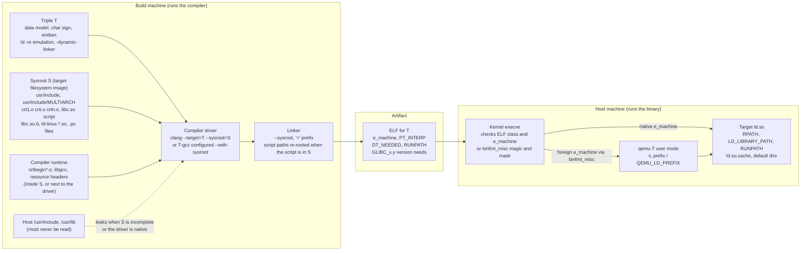

# Cross-Compilation, Triples, and Hermetic Sysroots

> [!summary] Claim:
> A target triple such as `aarch64-unknown-linux-gnu` is an ABI contract: it alone fixes the data model, `char` signedness, byte order, ELF `e_machine`, the linker emulation, and the dynamic loader path the binary will ask for.
> A sysroot is the target's filesystem as the build sees it, and `--sysroot` only re-roots the directories the driver considers "system"; anything the driver finds relative to its own install location, such as GCC's runtime directories, stays on the host.
> A sysroot is hermetic only when deleting a file from it makes the build fail; in the lab, a native gcc with `--sysroot` still links after `libc.so` is removed, while clang with a complete sysroot fails with `cannot find -lc`.
> At run time nothing knows about the sysroot: the target loader resolves `PT_INTERP`, `DT_NEEDED`, and `RUNPATH` against the target's root, and QEMU user mode or `ld.so --library-path` only emulate that root.



## The Mechanism

[[ELF-Mach-O-and-PE-Object-Formats]] owns the ELF header fields, and [[Dynamic-Linking-PLT-GOT-and-Loaders]] owns how `ld.so` binds symbols once it has found a library.
This note owns the step before both: choosing the target, assembling the files that stand in for the target system, making every tool read only those files, and testing the result on a machine of a different architecture.
Every measured line below comes from the lab, recorded in the harness container (Ubuntu 24.04 linux-aarch64, clang 18.1.3, gcc 13.3.0, binutils 2.42, glibc 2.39, as of 2026-11).

### 1. Three machines: build, host, and target

GCC's internals manual names the machines this way: build is "the machine you are building on", host is "the machine that you are building for", and target is "the machine that GCC will produce code for".
If all three are the same the build is native; if build and host match but target differs it is a cross (a cross compiler); if all three differ it is a Canadian cross, for example building on x86_64 Linux a compiler that runs on Windows and emits AArch64 code.
The target machine matters only for programs that themselves generate code: compilers, assemblers, linkers, and debuggers.
For an ordinary library or service there are two machines, and "cross-compiling" means build differs from host.

Each tool family spells the same idea differently, and the differences cause real misconfigurations:

| Concept | Autoconf and GCC | Meson | CMake | Bazel | Cargo |
| :--- | :--- | :--- | :--- | :--- | :--- |
| Machine running the compiler | `--build` | build machine | `CMAKE_HOST_SYSTEM_NAME` | host platform (Bazel itself) and execution platform (actions) | host tuple (`HOST` in build scripts) |
| Machine running the output | `--host` | host machine | `CMAKE_SYSTEM_NAME`, `CMAKE_SYSTEM_PROCESSOR` | target platform (`--platforms`) | target tuple (`--target`, `TARGET`) |
| Machine the output's output runs on | `--target` | target machine | none | none | none |

Two words collide.
Autoconf's "host" is the machine the output runs on, while Bazel's "host platform" is the machine Bazel runs on and Cargo's "host tuple" is the compiler's own machine.
Bazel also separates the execution platform, where actions run (possibly a remote worker), from the host where the Bazel server runs.

### 2. The triple: grammar, normalization, and what it decides

Autoconf's canonical form is `cpu-vendor-os`, where os "can be 'system' or 'kernel-system'", so `x86_64-pc-linux-gnu` is cpu `x86_64`, vendor `pc`, kernel `linux`, system `gnu`.
LLVM's `Triple.h` admits that the name is historical ("they used to contain exactly three fields") and defines the canonical form `ARCHITECTURE-VENDOR-OPERATING_SYSTEM-ENVIRONMENT`.
The `Triple` constructor stores the string as given; `Triple::normalize` reorders misplaced components and fills omitted ones with `unknown`.
Clang's cross-compilation page warns that an unrecognized value is silently treated as `unknown`, "which is not always desired".
Rust's documentation now says "target tuple" with the shape `<arch><sub>-<vendor>-<sys>-<abi>`.

Two canonicalizers disagree in small ways (as of 2026-11):
- GNU `config.sub` (timestamp 2026-05-17) maps `amd64-linux` to `x86_64-pc-linux-gnu`, `aarch64-linux-gnu` to `aarch64-unknown-linux-gnu`, `arm64-apple-darwin` to `aarch64-apple-darwin`, `riscv64-linux` to `riscv64-unknown-linux-gnu`, and `i686-linux` to `i686-pc-linux-gnu`.
- Clang 18 prints `x86_64-unknown-linux-gnu` for `--target=x86_64-linux-gnu`, not `x86_64-pc-linux-gnu`, and `armv7-unknown-linux-gnueabihf` for `--target=armv7a-linux-gnueabihf`, dropping the `a` profile letter (lab section 1).
- Debian's multiarch tuple is a third spelling and is not a normalized triple: amd64 is `x86_64-linux-gnu`, arm64 `aarch64-linux-gnu`, armhf `arm-linux-gnueabihf`, i386 `i386-linux-gnu`, ppc64el `powerpc64le-linux-gnu`, s390x `s390x-linux-gnu`, riscv64 `riscv64-linux-gnu`.
  The i386 tuple is fixed because "the GNU triplet varies according to the precise instruction set being targeted", so `i686-linux-gnu` code lives under `i386-linux-gnu` directories.

Compare triples after normalizing them, never as strings, and never use a triple as a directory name without mapping it to the tuple the tool actually uses.

What the triple decides is visible without a single header or library.
The lab compiles one freestanding function for eight Linux triples and reads the predefined macros, the object's ELF header, and the link command the driver would run (`-###`):
- `long` and pointer size: 4 bytes on `i686` and `armv7`, 8 bytes on the 64-bit targets.
- `long double`: 16 bytes on x86_64 (80-bit extended in 16 bytes of storage, per the x86-64 psABI), 12 on i686, 8 on armv7 (plain `double`), and 16 on aarch64 and riscv64 (IEEE binary128, per AAPCS64 and the RISC-V psABI).
- `char` signedness: signed on x86, unsigned on aarch64, armv7, riscv64, powerpc64, and s390x; AAPCS64 maps `char` to "unsigned byte" and the RISC-V psABI says "`char` is unsigned".
- Byte order: big-endian on `powerpc64` and `s390x`, little-endian on `powerpc64le` and the rest.
- `e_machine`: 62 (`EM_X86_64`), 3 (`EM_386`), 183 (`EM_AARCH64`), 40 (`EM_ARM`), 243 (`EM_RISCV`), 21 (`EM_PPC64`, both byte orders), and 22 (`EM_S390`), matching `include/uapi/linux/elf-em.h`.
- The linker emulation the driver passes with `-m`, such as `elf_x86_64` or `aarch64linux`.
- The `-dynamic-linker` path written into `PT_INTERP`, such as `/lib64/ld-linux-x86-64.so.2` or `/lib/ld-linux-riscv64-lp64d.so.1`, which matches the `ld=` names in glibc's per-architecture `shlib-versions` files.

The environment component carries ABI too: `gnueabihf` selects the hard-float procedure call standard and the loader `ld-linux-armhf.so.3`, while glibc names the soft-float loader `ld-linux.so.3`; `musl` and `android` select a different C library and loader entirely.
Code that assumes signed `char`, a 64-bit `long`, or little-endian layout compiles cleanly for the wrong triple and fails only at run time, so treat the psABI, not the CPU name, as the target; [[Calling-Conventions-System-V-AMD64-and-AAPCS64]] covers the psABI rules for the two most common 64-bit targets.

### 3. How a driver finds headers and libraries, and what `--sysroot` re-roots

A compiler driver builds two search lists: `#include <...>` directories and linker `-L` directories plus start files.
Each list mixes three kinds of entries:
1. Compiler-private entries found relative to the driver itself: clang's resource directory (`/usr/lib/llvm-18/lib/clang/18/include`), GCC's `lib/gcc/<triple>/<version>/include`, and GCC's runtime files `crtbegin*.o` and `libgcc`.
2. System entries: `/usr/local/include`, `/usr/include/<multiarch>`, `/usr/include`, `/lib/<multiarch>`, `/usr/lib/<multiarch>`, and the C library's `crt1.o`, `crti.o`, and `crtn.o`.
3. User entries: `-I`, `-isystem`, `-L`.

GCC documents `--sysroot=dir` as "the logical root directory for headers and libraries": the system entries are prefixed with `dir`.
`-isysroot` re-roots headers only, and when both are given "the --sysroot option applies to libraries, but the -isysroot option applies to header files".
A user entry is re-rooted only on request: an `-I`, `-iquote`, `-isystem`, or `-idirafter` path that begins with `=` or `$SYSROOT` has that prefix "replaced by the sysroot prefix", and GNU ld applies the same rule to `-L=` paths.
Compiler-private entries are never re-rooted, which is where hermeticity breaks.

Clang without a sysroot fills the gaps from the host.
In lab section 2, `clang --target=x86_64-linux-gnu` on the aarch64 host searches `/usr/lib/llvm-18/lib/clang/18/include`, `/usr/local/include`, and `/usr/include`; it lists no `/usr/include/x86_64-linux-gnu` because that directory does not exist.
`#include <stdio.h>` therefore finds the host's architecture-independent `/usr/include/stdio.h`, and fails on its first architecture-specific include, `bits/libc-header-start.h`.
That failure is the lucky case: a header with no architecture-specific includes would have compiled silently against the host's version of the library.
The link fails too, because the host's binutils only know aarch64 and 32-bit Arm emulations: `/usr/bin/ld: unrecognised emulation mode: elf_x86_64`.

Clang's Linux driver keys system directories on the multiarch tuple, not on the triple.
Lab section 3 builds one sysroot holding a `target_abi.h` under five tuple directories and shows the driver choosing `usr/include/i386-linux-gnu` for `i686-linux-gnu` and `usr/include/arm-linux-gnueabihf` for `armv7a-linux-gnueabihf`; `powerpc64le-linux-gnu` finds no directory and fails.
That is why one Debian multiarch sysroot can serve several targets: the architecture-independent headers are shared and the `bits/` headers sit under each tuple.

A native gcc with `--sysroot` is not a cross compiler.
Its header list is re-rooted correctly (`<SYSROOT>/usr/include/aarch64-linux-gnu`, `<SYSROOT>/usr/include`, plus its private `/usr/lib/gcc/aarch64-linux-gnu/13/include`), and lab section 5 shows `app.c` pulling 25 headers from the sysroot and 2 from GCC's private directory.
Its library list is not.
`gcc --sysroot=S -print-search-dirs` in the lab image starts with `/usr/lib/gcc/aarch64-linux-gnu/13/` and `/usr/lib/gcc/aarch64-linux-gnu/13/../../../aarch64-linux-gnu/`, which is the host's `/usr/lib/aarch64-linux-gnu/`, ahead of `S/lib/aarch64-linux-gnu/` (checked by hand in the same image).
Those directories come from GCC's install location (`GCC_EXEC_PREFIX` defaults to `prefix/lib/gcc/` and "is also used for finding files such as crt0.o"), and Ubuntu's gcc has `--prefix=/usr`, so "relative to the compiler" means "the host system".
Lab section 5's `ld --trace` shows the consequence: of 20 inputs, only the sysroot-only `libfoo.so` came from the sysroot, and `Scrt1.o`, `crti.o`, `libc.so`, `libc.so.6`, `libc_nonshared.a`, the loader, and libgcc all came from the host.
A real cross GCC is configured with `--with-sysroot=dir` (GCC treats `dir` "as the root of a tree that contains (a subset of) the root filesystem") and a separate prefix, so its install-relative directories hold only its own runtime.

Clang finds a GCC installation for `crtbegin*.o`, `libgcc`, and libstdc++ headers, and with `--sysroot` it looks inside the sysroot first.
In lab section 6 the sysroot contains `usr/lib/gcc/aarch64-linux-gnu/13`, and every one of the 20 inputs `ld --trace` printed is under the sysroot; the driver's `-L` list is five sysroot directories and nothing else.
With a sysroot that lacks `usr/lib/gcc`, clang 18 in the same image printed `Selected GCC installation: /usr/bin/../lib/gcc/aarch64-linux-gnu/13`, the host's runtime (checked by hand with `-v`, not part of the golden file).
Pin the runtime explicitly with `--gcc-install-dir=<dir>` ("Use GCC installation in the specified directory"), or put it in the sysroot, which on Debian and Ubuntu means including the `libgcc-<version>-dev` package that owns `usr/lib/gcc/<multiarch>/<version>` (the directory the lab copies).

Clang configuration files remove the need to repeat these flags: a driver invoked as `x86_64-pc-linux-gnu-clang++` loads `x86_64-pc-linux-gnu-clang++.cfg`, and options such as `--target=` affect which file is searched, so a toolchain can ship `--sysroot` and `--gcc-install-dir` in a `.cfg` beside the binary.

### 4. What a glibc sysroot must contain, and the linker-script rule

For a dynamically linked C program on glibc the sysroot needs, as lab section 4 assembles from the host's own packages:
- Headers: `usr/include` and `usr/include/<multiarch>` (the lab copies the image's whole `/usr/include`, 2281 files).
- Start files: `Scrt1.o` (PIE) or `crt1.o`, `crti.o`, `crtn.o` from the C library.
- `libc.so`, which is not a library but a GNU ld script, `libc.so.6`, `libc_nonshared.a`, and the loader at the path `PT_INTERP` names.
- The compiler runtime: `crtbegin*.o`, `crtend*.o`, `libgcc.a`, `libgcc_s.so` (itself a script), and `libgcc_s.so.1`; for C++ also libstdc++ headers and libraries.
- Every third-party dependency's headers, libraries, and `.pc` files, installed with the sysroot as their root.

The `libc.so` script names its members with absolute paths:

```text
GROUP ( /lib/aarch64-linux-gnu/libc.so.6 /usr/lib/aarch64-linux-gnu/libc_nonshared.a  AS_NEEDED ( /lib/ld-linux-aarch64.so.1 ) )
```

GNU ld's rule for `INPUT`, which `GROUP` follows, is what makes this work in a sysroot: "In case a sysroot prefix is configured, and the filename starts with the '/' character, and the script being processed was located inside the sysroot prefix, the filename will be looked for in the sysroot prefix."
A script can also force the prefix with a leading `=` or `$SYSROOT`.
The lab shows both outcomes: clang found the sysroot's `libc.so`, so ld opened `<SYSROOT>/lib/aarch64-linux-gnu/libc.so.6`; gcc found the host's `libc.so`, so the same absolute paths resolved on the host.
The rule is decided by where the script was found, so a single leaked `-L` directory flips every path in it.

Symbolic links follow different rules.
The kernel resolves a symlink against the process's root, not against `--sysroot`, so an absolute link such as `usr/lib/<multiarch>/libz.so -> /lib/<multiarch>/libz.so.1` inside a sysroot points at the build host's file or at nothing.
Sysroot builders rewrite such links as relative links; the lab's sysroot uses `libfoo.so -> libfoo.so.1`.

### 5. Building a hermetic sysroot reproducibly

A hermetic sysroot is an input artifact with a content hash, built from pinned package versions, never a directory someone copied from a board.
The common sources (as of 2026-11):
- Debian and Ubuntu: `mmdebstrap` (1.7.0) creates a root from a package list.
  `--variant` ranges from `extract` and `custom` (only the `--include` packages) through `essential`, `apt`, `buildd`, `required` (alias `minbase`), `important` (alias `debootstrap`), and `standard`.
  `--architectures` takes a list whose first entry is the native architecture inside the chroot.
  Its manual promises "Reproducible output by default if $SOURCE_DATE_EPOCH is set", and its `unshare` mode needs no root.
  `debootstrap --foreign` does only "the initial unpack phase", for the case where "the target architecture does not match the host architecture", and `--second-stage` finishes on the target or under emulation.
- Chromium's `build/linux/sysroot_scripts/sysroot_creator.py` pins a Debian snapshot (`ARCHIVE_TIMESTAMP = "20250129T203412Z"` on `snapshot.debian.org`), builds bullseye sysroots for amd64, i386, armhf, arm64, mipsel, mips64el, ppc64el, and s390x and trixie for riscv64, and `sysroots.json` records each tarball's `Sha256Sum`.
  Its `reversion_glibc.py` rewrites default symbol versions down to `MAX_ALLOWED_GLIBC_VERSION = [2, 26]`, so binaries built against the sysroot load on glibc 2.26 and newer.
- Yocto gives every recipe two sysroots: `RECIPE_SYSROOT` holds the target files from `DEPENDS`, and `RECIPE_SYSROOT_NATIVE` holds build-machine tools, which is the build and host split made physical.
- Bazel: `toolchains_llvm` takes a `sysroot` attribute (a path or a label, so it can be a hashed download), and `hermetic_cc_toolchain` builds on `zig cc`, whose overview says Zig "ships with 97 libcs"; the README aliases `linux_amd64_gnu.2.28` to the target `x86_64-linux-gnu.2.28`.
  The glibc-version suffix is documented in that README and in secondary sources, not on ziglang.org (UNVERIFIED against Zig's own documentation as of 2026-11).

The sysroot's glibc version is the binary's floor.
glibc keeps old symbol versions so that an old program "will continue to work against newer versions of glibc", but "You can't run a new program on an old glibc."
Lab section 8 shows the floor in the binary: linking against the sysroot's glibc 2.39 gives `__libc_start_main@GLIBC_2.34` next to `printf@GLIBC_2.17`, so the program refuses to start on any glibc older than 2.34.
GLIBC_2.17 is the oldest version set on aarch64; it is GLIBC_2.2.5 on x86_64 and GLIBC_2.27 on riscv64, per glibc's `shlib-versions`.
Pick the sysroot for the oldest target you support, not for the newest machine you build on; [[Cpp-Glibc-Symbol-Versioning-and-Portable-Linux-Binaries]] owns the symbol-versioning mechanics.

Hermeticity has a test, and it is subtraction: delete or rename a file in the sysroot and the build must fail.
Lab section 7 does this with `libc.so`; clang fails with `cannot find -lc: No such file or directory` and gcc links anyway against the host's copy.
[[Hermetic-and-Reproducible-Builds]] owns the broader determinism checks, and [[Sandboxing-and-Hermetic-Execution-Internals]] owns sandboxes that make host paths invisible, which turns a silent leak into an error.

### 6. Telling the build system: CMake, Meson, Bazel, Cargo, Autoconf, pkg-config

The compiler is the easy part; every build system also runs probes, finds packages, and runs helper programs, and each of those has a build-or-host choice.

**Autoconf.**
The Autoconf 2.72 manual states the rule directly: "configure enters cross-compilation mode if and only if --host is passed".
With `--host` but no `--build`, the generated `general.m4` code sets `cross_compiling=maybe`, and `_AC_COMPILER_EXEEXT_CROSS` then tries to run a compiled test program, setting `no` if it runs and `yes` if it does not; the manual calls this "fragile" and says "whenever you specify --host, be sure to specify --build too."
`AC_RUN_IFELSE` takes a fourth argument, action-if-cross-compiling; if it is omitted and configure is cross-compiling, "configure prints an error message and exits", and `autoconf` warns about each such call when it generates the script.
Tools are looked up with the host prefix (`aarch64-linux-gnu-gcc`), and configure warns about unprefixed ones.
Answers to run-time probes go in a site file: CPython's documentation shows `CONFIG_SITE=config.site-aarch64` holding lines such as `ac_cv_file__dev_ptmx=yes`.
[[19-Shell-and-Unix-Engineering/18-Build-Packaging-and-Bootstrap/Portable-sh-for-configure|Portable sh for configure]] covers the shell that runs these probes.

**CMake** (4.5.0, as of 2026-11; [[CMake-Presets-Toolchains-and-File-API]] owns toolchain files and presets in general).
Setting `CMAKE_SYSTEM_NAME` in a toolchain file makes `CMAKE_CROSSCOMPILING` true, even when it equals `CMAKE_HOST_SYSTEM_NAME`, so the variable means "the target was set by hand", not "the target differs".
`CMAKE_SYSROOT` is passed as `--sysroot`, prefixes the `find_*` search roots, "is also stripped from the RPATH/RUNPATH if necessary on installation", and may only be set in a toolchain file; `CMAKE_SYSROOT_COMPILE` and `CMAKE_SYSROOT_LINK` (added in 3.9) split it.
For clang, `CMAKE_<LANG>_COMPILER_TARGET` passes the triple, because "Clang [is] inherently [a] cross compiler".
`CMAKE_TRY_COMPILE_TARGET_TYPE STATIC_LIBRARY` (added in 3.6) stops the compiler checks from linking, for toolchains "that cannot link without custom flags or linker scripts".
`CMAKE_FIND_ROOT_PATH_MODE_PROGRAM`, `_LIBRARY`, `_INCLUDE`, and `_PACKAGE` take `NEVER`, `ONLY`, or `BOTH`, and the documented example sets `PROGRAM NEVER` and the other three `ONLY`, because "executables which must be run as part of the build should be found only on the host".
Leave them unset and CMake searches the host too: with CMake 4.5.0 on macOS, a Linux toolchain file with an empty `CMAKE_SYSROOT` and `CMAKE_PREFIX_PATH` pointing at a host directory found the host's `libbar.a` and `bar.h`; with `_LIBRARY` and `_INCLUDE` set to `ONLY` both were `NOTFOUND`, and `ONLY` found a copy only at `<sysroot>/<prefix>/lib/libbar.a` (checked by hand on 2026-11-14, not part of the lab).
`try_run` does not run its executable when cross-compiling unless `CMAKE_CROSSCOMPILING_EMULATOR` (added in 3.3) is set; otherwise it leaves cache entries `<runResultVar>` and `<runResultVar>__TRYRUN_OUTPUT` for you to fill in.
The emulator also prefixes `add_test()`, `add_custom_command()`, and `add_custom_target()` commands that run target executables, through the `CROSSCOMPILING_EMULATOR` target property.

A clang-based toolchain file for the sysroot in this note:

```cmake
set(CMAKE_SYSTEM_NAME Linux)
set(CMAKE_SYSTEM_PROCESSOR aarch64)
set(CMAKE_SYSROOT /opt/sysroots/bookworm-arm64)        # hashed artifact, unpacked read-only
set(CMAKE_C_COMPILER clang)
set(CMAKE_C_COMPILER_TARGET aarch64-linux-gnu)
set(CMAKE_CXX_COMPILER clang++)
set(CMAKE_CXX_COMPILER_TARGET aarch64-linux-gnu)
set(CMAKE_FIND_ROOT_PATH_MODE_PROGRAM NEVER)
set(CMAKE_FIND_ROOT_PATH_MODE_LIBRARY ONLY)
set(CMAKE_FIND_ROOT_PATH_MODE_INCLUDE ONLY)
set(CMAKE_FIND_ROOT_PATH_MODE_PACKAGE ONLY)
set(CMAKE_CROSSCOMPILING_EMULATOR qemu-aarch64;-L;/opt/sysroots/bookworm-arm64)
```

The sysroot path and its Debian release are placeholders, and the file was not run in the lab; a clang toolchain also needs a target-capable linker, such as lld selected with `-fuse-ld=lld`, because the host binutils cannot link other architectures (lab section 2).

**Meson** (1.12.1, as of 2026-11; [[Meson-Build-System-and-WrapDB]] owns the rest of Meson).
Meson uses the GNU three-machine vocabulary and a cross file:

```ini
[binaries]
c = ['clang', '--target=aarch64-linux-gnu']
cpp = ['clang++', '--target=aarch64-linux-gnu']
ar = 'llvm-ar'
strip = 'llvm-strip'
pkg-config = 'pkg-config'
exe_wrapper = ['qemu-aarch64', '-L', '/opt/sysroots/bookworm-arm64']

[properties]
sys_root = '/opt/sysroots/bookworm-arm64'
pkg_config_libdir = '/opt/sysroots/bookworm-arm64/usr/lib/aarch64-linux-gnu/pkgconfig'

[host_machine]
system = 'linux'
cpu_family = 'aarch64'
cpu = 'cortex-a76'
endian = 'little'
```

`sys_root` (since 0.52.0) and `pkg_config_libdir` (since 0.54.0) feed pkg-config; `exe_wrapper` makes Meson "automatically use the given wrapper when it needs to run host binaries", and without one Meson "will skip tests".
`needs_exe_wrapper` overrides the auto-detection, which compares the `system` and `cpu_family` of build and host.
A generator that must run during the build is declared with `native: true`, which compiles it for the build machine, and `dependency(..., native: true)` looks it up on the build machine.
Repeating `--cross-file` layers files (since 0.52.0), later values overriding earlier ones, so the sysroot and the CPU tuning can live in separate files.
This cross file was not run in the lab.

**Bazel** (9.3.2 latest stable, as of 2026-11; [[Bazel-Skyframe-Bzlmod-and-Execution-Model]] owns the evaluation model).
Bazel models machines as platforms: a `constraint_setting` "declares a type of property", a `constraint_value` "declares a possible value", and a `platform` is a set of constraint values.
`--platforms` names the target platform and defaults to `@platforms//host`; the host platform is always an available execution platform, and `--extra_execution_platforms` adds more.
Toolchain resolution, per the toolchains documentation, filters execution platforms by the target's `exec_compatible_with`, drops toolchains whose `target_settings` do not match, takes "the first available toolchain" for each toolchain type in registration order, and makes the first execution platform that has every mandatory toolchain the target's execution platform.
`--extra_toolchains` registrations win over `register_toolchains` ones, and `--toolchain_resolution_debug=<regex>` prints each decision.
C++ rules have used this platform-based resolution by default since Bazel 7.0.0, whose notes say `--incompatible_enable_cc_toolchain_resolution` "is now on"; the old `--cpu` flag is documented as "Deprecated... use `--platforms`".
A tool a rule runs during the build is an attribute with `cfg = "exec"`, which builds it in the exec configuration for the execution platform, while `cfg = "target"` "doesn't actually do anything"; Bazel before 6.0 had a separate "host" configuration instead.
A user-defined transition maps a configured target to another configuration, which is how one build produces an aarch64 binary and an x86_64 binary side by side; outgoing transitions can be one-to-many, incoming ones only one-to-one.
`target_compatible_with` marks targets that cannot build for a platform; they are skipped in `//...` expansion, "Incompatibility is transitive", and naming one explicitly fails the build.

**Cargo** (as of 2026-11; [[Cargo-Build-Graph-and-Rustc-Pipelining]] owns the build graph).
`--target <tuple>` or `build.target` selects the target, and the standard library for it comes from the toolchain distribution (`rustup target add <tuple>`).
Rust needs an external linker for `-gnu` targets, set with `target.<tuple>.linker`, which Cargo passes "via `-C linker`"; `target.<tuple>.runner` wraps `cargo run`, `cargo test`, and `cargo bench`, and each key has an environment form such as `CARGO_TARGET_AARCH64_UNKNOWN_LINUX_GNU_RUNNER`.
Build scripts and proc macros are compiled for the host: a build script sees `HOST` and `TARGET`, `cfg!` inside it describes the host, and the target's configuration arrives as `CARGO_CFG_TARGET_ARCH` and friends.
With `--target` given, `build.rustflags` does not reach "build scripts or proc macros"; a separate `[host]` table exists only behind `-Zhost-config` and `-Ztarget-applies-to-host` (unstable, as of 2026-11).
Tier 1 tuples, such as `x86_64-unknown-linux-gnu` and `aarch64-unknown-linux-gnu`, are "guaranteed to work"; tier 2, such as `aarch64-unknown-linux-musl` and `riscv64gc-unknown-linux-gnu`, are "guaranteed to build"; tier 3 "may or may not work".

**pkg-config.**
`.pc` files say `-I/usr/include/foo`, which is a host path until rewritten.
`PKG_CONFIG_SYSROOT_DIR` rewrites it: "a -I/usr/include/libfoo will become -I/var/target/usr/include/libfoo" (freedesktop pkg-config 0.29.2), and pkgconf prepends it to every path variable that begins with the `.pc` file's prefix.
Point the search at the sysroot with `PKG_CONFIG_LIBDIR`, which "Replaces the default pkg-config search directory"; `PKG_CONFIG_PATH` is the wrong knob, because "The default directory will always be searched after searching the path", so a missing target `.pc` silently falls back to the host's.

**Go, for contrast.**
Go cross-compiles pure Go code with `GOOS` and `GOARCH` and no sysroot, and cgo "is disabled by default when cross-compiling"; enabling it means supplying a C cross compiler through `CC` or `CC_FOR_${GOOS}_${GOARCH}`, at which point everything in this note applies.

**CPython** is the hard case for the build-or-host split: "Cross compiling requires a Python interpreter for the build platform", whose version "must match the version of the cross compiled host Python", passed with `--with-build-python` (added in 3.11), with `HOSTRUNNER` (also 3.11) naming an emulator for host binaries.

### 7. Run time: what the binary carries, and who resolves it

A linked ELF carries four things from the build into the target (lab section 8):
- `PT_INTERP`, the absolute loader path the kernel opens: `/lib/ld-linux-aarch64.so.1`, chosen by the triple, not by the sysroot location.
- `DT_NEEDED` entries, which hold sonames (`libfoo.so.1`, `libc.so.6`), not paths.
- `RUNPATH` or `RPATH`, if the link passed `-rpath`.
- Versioned symbol needs such as `__libc_start_main@GLIBC_2.34`.

The kernel's `execve` reads the ELF header, rejects a class or `e_machine` it cannot run, and starts `PT_INTERP`.
The loader then searches, per `ld.so(8)`: `DT_RPATH` (only when there is no `DT_RUNPATH`), `LD_LIBRARY_PATH`, `DT_RUNPATH`, `/etc/ld.so.cache`, and the default `/lib` and `/usr/lib` (or `lib64` variants).
None of those involve the sysroot.
Lab section 9 runs the sysroot-linked binary on the build host: it fails with `error while loading shared libraries: libfoo.so.1: cannot open shared object file`, exit 127, because `libfoo` exists only in the sysroot.
Running the sysroot's own loader with `--library-path` succeeds, and `LD_DEBUG=libs` shows `libc.so.6`, the loader, and `libfoo.so.1` initialized from the sysroot; that is the native equivalent of what QEMU's `-L` prefix arranges for a foreign binary.
Two link-time fixes behave very differently:
1. `-rpath <sysroot>/usr/lib/<multiarch>` makes the binary run here and writes `RUNPATH: <SYSROOT>/usr/lib/aarch64-linux-gnu`, a build-machine path that is wrong on every target and leaks the build layout into the artifact (CMake strips `CMAKE_SYSROOT` from install-time RPATHs for this reason).
2. `-rpath '$ORIGIN/../lib'` writes the literal `$ORIGIN/../lib`, which the loader expands to "the directory containing the program", so the binary finds a bundled library wherever the bundle is unpacked.

[[Diagnose-Dynamic-Linker-and-ABI-Failures]] owns the runbook for loader errors on the target, and [[Program-Startup-C-Runtime-Init-and-Auxiliary-Vectors]] owns what `Scrt1.o` and `crti.o` do once the loader hands over.

### 8. Testing cross builds: QEMU user mode and binfmt_misc

A cross-built test suite needs a machine that can run target binaries.
The options are target hardware, a full-system emulator, or user-mode emulation, which runs one Linux program of another architecture on the build host's kernel.

QEMU user mode (11.1.3 latest stable, as of 2026-11) translates the guest's instructions and system calls: "The translator takes care of adjusting endianness, 32/64 bit parameter size", it adjusts device-specific `ioctl()` calls, forwards host signals, and emulates `clone` as "a real host thread".
`-L path` (environment `QEMU_LD_PREFIX`) is "the elf interpreter prefix": QEMU loads the guest's `PT_INTERP` from under that prefix, which is where the sysroot goes.
Every option has an environment form in `linux-user/main.c`'s `arg_table`, such as `QEMU_CPU`, `QEMU_SET_ENV`, `QEMU_STRACE`, and `QEMU_GDB` for `-g`, which waits for a GDB connection on a port.
Its documented limits are the ones that hide bugs:
- "flags affecting namespaces (e.g. container runtimes) are not supported" in `clone`, so code that creates namespaces cannot be tested this way.
- ptrace is not implemented, so the guest's own `strace` or debugger does not work; use `-strace` or `-g` instead.
- "differences between the host and guest memory models can cause issues", which matters for lock-free code: an x86 host runs Arm code under a stronger ordering than Arm hardware gives, so a missing barrier can pass every emulated test.
- Timing and performance are meaningless: Docker's documentation says QEMU "can be much slower than native builds, especially for" compute-heavy work such as compilation.

`binfmt_misc` makes emulation transparent: writing `:name:type:offset:magic:mask:interpreter:flags` to `/proc/sys/fs/binfmt_misc/register` tells `execve` to start `interpreter` for any file whose leading bytes, ANDed with `mask`, equal `magic`.
QEMU's `scripts/qemu-binfmt-conf.sh` matches the first 20 bytes of the ELF header, so the aarch64 entry is:

```text
magic: \x7fELF\x02\x01\x01\x00\x00\x00\x00\x00\x00\x00\x00\x00\x02\x00\xb7\x00
mask:  \xff\xff\xff\xff\xff\xff\xff\x00\xff\xff\xff\xff\xff\xff\xff\xff\xfe\xff\xff\xff
```

Byte 4 is `ELFCLASS64`, byte 5 little-endian, the `\xfe` mask on byte 16 accepts both `ET_EXEC` (2) and `ET_DYN` (3), and `\xb7` at offset 18 is 183, `EM_AARCH64`.
The flags decide whether this works inside containers:
- `P` keeps the original `argv[0]` instead of replacing it with the binary's full path.
- `O` hands the interpreter an open descriptor of the binary.
- `C` computes credentials from the binary (setuid), and implies `O`; the script's `--credential` sets `OC`.
- `F` opens the interpreter at registration time, because lazy lookup "doesn't work very well in the face of mount namespaces and changeroots"; the script's `--persistent` sets it, and it is what lets a statically linked `qemu-aarch64` registered on the host serve every container and chroot.
Linux 6.7's execve pull request says binfmt_misc can now be used with mount namespaces ("binfmt_misc: enable sandboxed mounts"); the exact per-namespace semantics are UNVERIFIED here.
Docker lists three ways to build multi-platform images: "Using emulation, via QEMU", "a builder with multiple native nodes", and "cross-compilation with multi-stage builds", where `BUILDPLATFORM`, `TARGETPLATFORM`, `TARGETOS`, and `TARGETARCH` let a build stage run natively and emit target binaries.
`mmdebstrap`'s manual relies on the same qemu binfmt_misc support to check that a foreign architecture "can be executed" when the chroot is not the host's architecture.

## Commands and Numbers to Know

| Item | Value | Platform | Notes |
| :--- | :--- | :--- | :--- |
| `clang --target=T -print-effective-triple` | `x86_64-linux-gnu` prints `x86_64-unknown-linux-gnu`; `armv7a-linux-gnueabihf` prints `armv7-unknown-linux-gnueabihf` (as of 2026-11) | Linux | clang 18.1.3, lab section 1. |
| `clang -### ...` | prints the cc1 and ld commands without running them (as of 2026-11) | Both | Shows `-m`, `-dynamic-linker`, `-L`, start files. |
| `clang -v -fsyntax-only -x c /dev/null` | prints the `#include <...>` search list and `Selected GCC installation` (as of 2026-11) | Both | The first check for a leaking cross build. |
| `--gcc-install-dir=DIR` | pins the GCC runtime clang uses (as of 2026-11) | Linux | Otherwise clang may select the host's. |
| `gcc -print-search-dirs`, `-print-sysroot`, `-print-multiarch`, `-dumpmachine` | search lists, configured sysroot (empty for Ubuntu's native gcc), `aarch64-linux-gnu`, `aarch64-linux-gnu` (as of 2026-11) | Linux | gcc 13.3.0 in the lab image. |
| `-I=dir`, `-L=dir`, `$SYSROOT` prefix | re-rooted under the sysroot (as of 2026-11) | Both | GCC directory options and GNU ld `-L`. |
| `ld --trace` (`-t`) | prints every input file the linker opened (as of 2026-11) | Linux | The direct hermeticity check, lab sections 5 and 6. |
| `config.sub` | `amd64-linux` gives `x86_64-pc-linux-gnu` (timestamp 2026-05-17, as of 2026-11) | Both | GNU canonicalizer; LLVM prints `unknown` vendors instead. |
| Loader paths | x86_64 `/lib64/ld-linux-x86-64.so.2`, i686 `/lib/ld-linux.so.2`, aarch64 `/lib/ld-linux-aarch64.so.1`, armhf `/lib/ld-linux-armhf.so.3`, riscv64 `/lib/ld-linux-riscv64-lp64d.so.1`, ppc64le `/lib64/ld64.so.2`, ppc64 `/lib64/ld64.so.1`, s390x `/lib/ld64.so.1` (as of 2026-11) | Linux | clang 18 driver, lab section 1; names match glibc `shlib-versions`. |
| `e_machine` | 3 i386, 21 PPC64, 22 S390, 40 ARM, 62 X86_64, 183 AARCH64, 243 RISCV (as of 2026-11) | Both | `elf-em.h`; QEMU's binfmt magic uses the same bytes. |
| Oldest glibc version set | x86_64 GLIBC_2.2.5, aarch64 GLIBC_2.17, riscv64 GLIBC_2.27 (as of 2026-11) | Linux | glibc `shlib-versions`. |
| `__libc_start_main@GLIBC_2.34` | needed by any binary linked against glibc 2.34 or newer start files (as of 2026-11) | Linux | Lab section 8, glibc 2.39 sysroot. |
| glibc releases | 2.44 current (2026-07-25), a release every 6 months (as of 2026-11) | Linux | sourceware.org/glibc. |
| `CMAKE_FIND_ROOT_PATH_MODE_*` | `NEVER`, `ONLY`, `BOTH`; unset behaved as searching the host too (as of 2026-11) | Both | CMake 4.5.0, checked by hand. |
| `CMAKE_CROSSCOMPILING_EMULATOR` | added 3.3, list form 3.15, env initialization 3.28 (as of 2026-11) | Both | Used by `try_run`, `add_test`, custom commands. |
| `CMAKE_TRY_COMPILE_TARGET_TYPE` | `EXECUTABLE` default, `STATIC_LIBRARY` skips linking (as of 2026-11) | Both | Added in 3.6. |
| Meson `[properties]` | `sys_root` (0.52.0), `pkg_config_libdir` (0.54.0), `needs_exe_wrapper` (as of 2026-11) | Both | Meson 1.12.1. |
| Bazel | `--platforms`, `--extra_execution_platforms`, `--extra_toolchains`, `--toolchain_resolution_debug` (as of 2026-11) | Both | Bazel 9.3.2; C++ toolchain resolution default since 7.0.0. |
| Cargo | `target.<tuple>.linker`, `target.<tuple>.runner`, `CARGO_TARGET_<TUPLE>_RUNNER` (as of 2026-11) | Both | Build scripts see `HOST`, `TARGET`, `CARGO_CFG_*`. |
| `PKG_CONFIG_LIBDIR`, `PKG_CONFIG_SYSROOT_DIR` | replace the default search path; prefix `-I` and `-L` (as of 2026-11) | Both | `PKG_CONFIG_PATH` still falls back to host files. |
| QEMU user | `-L` / `QEMU_LD_PREFIX`, `-cpu` / `QEMU_CPU`, `-strace`, `-g PORT` (as of 2026-11) | Linux | QEMU 11.1.3; no guest ptrace. |
| binfmt_misc flags | `P` argv0, `O` open binary, `C` credentials, `F` fix interpreter at registration (as of 2026-11) | Linux | `qemu-binfmt-conf.sh --persistent` sets `F`. |
| CPython | `--with-build-python` and `HOSTRUNNER`, both added in 3.11 (as of 2026-11) | Both | Build Python must be the same version. |
| Go | cgo off by default when cross-compiling (as of 2026-11) | Both | `CC_FOR_${GOOS}_${GOARCH}` or `CC` to enable. |

## Multi-Language Comparison: C++ / Python / Rust

| Concern | C++ (clang or a GCC cross, with CMake, Meson, or Bazel) | Python (CPython and native extensions) | Rust (Cargo) |
| :--- | :--- | :--- | :--- |
| Naming the target | `--target=<triple>` or a `<triple>-gcc` toolchain; CMake `CMAKE_<LANG>_COMPILER_TARGET` | `configure --build --host` for CPython; the wheel platform tag for extensions | `--target <tuple>`; the tuple selects a prebuilt `std` |
| Where target libc comes from | The sysroot | The sysroot used to build CPython and the extension | The sysroot for `-gnu` targets; [[Rust-Binary-Distribution-with-dist-and-Cross-Compilation\|the Rust distribution note]] owns `-musl` and static linking |
| Linker | The driver's choice (`-fuse-ld`), with `-m` from the triple | The C toolchain the build backend calls | `target.<tuple>.linker`, usually a C driver given the sysroot |
| Code that runs during the build | Generators built `native: true` (Meson), `cfg = "exec"` (Bazel), or with a separate host build (CMake) | A build Python of the same version (`--with-build-python`) | Build scripts and proc macros, compiled for the host, reading `CARGO_CFG_*` |
| Run-time probes | `try_run` with `CMAKE_CROSSCOMPILING_EMULATOR` or cached answers | `CONFIG_SITE` with `ac_cv_*` answers | Build scripts must not run target code; they inspect `TARGET` |
| Running tests | `CMAKE_CROSSCOMPILING_EMULATOR`, Meson `exe_wrapper`, Bazel exec platforms with the right constraints | `HOSTRUNNER` for CPython's own tests | `target.<tuple>.runner` |
| Typical leak | Host headers, host GCC runtime, host `.pc` files | The build interpreter's `sysconfig` leaking into the extension's tag | `cfg!` in a build script describing the host |
| Owning note | this note | [[Python-Wheels-Platform-Tags-Manylinux-and-ABI3]] | [[Rust-Binary-Distribution-with-dist-and-Cross-Compilation]] |

## Worked Lab Example

The lab is `code/06-Build-Systems/cross_sysroot_demo/`, run with `bash run.sh`; its header says `# requires: linux`, so on macOS the harness runs it in the pinned Ubuntu 24.04 container with no network and no capabilities.
It needs gcc, clang, binutils, glibc development files, and python3 on a Debian-style multiarch host; a preflight exits 2 if `gcc -print-multiarch` is empty.
It needs no QEMU, no cross binutils, and no downloads: every non-native target stops at object files, and the sysroot is assembled from the host's own glibc packages, which is the same layout `mmdebstrap` would unpack.

`run.sh` does the following:
1. For eight Linux triples, it compiles `src/probe.c` freestanding, reads `__SIZEOF_LONG__`, `__SIZEOF_POINTER__`, `__SIZEOF_LONG_DOUBLE__`, and `__CHAR_UNSIGNED__` from `-E -dM`, decodes the object's ELF class, byte order, and `e_machine` with `src/elf_ident.py`, and extracts `-m` and `-dynamic-linker` from the `-###` link command.
2. It shows the x86_64 header search list with no sysroot, compiles a file that includes `<stdio.h>`, and links a freestanding x86_64 object with the host's `ld`.
3. It builds a sysroot whose only header is `target_abi.h` under five multiarch directories and asks six triples which one they include.
4. It assembles a real sysroot from the host's glibc: headers, start files, `libc.so` and its members, the loader at its `PT_INTERP` path, the GCC runtime directory, and a dependency `libfoo` that is installed only into the sysroot.
5. It links `src/app.c` with `gcc --sysroot` and with `clang --sysroot`, prints `ld --trace`, and counts the inputs inside and outside the sysroot.
6. It deletes `libc.so` from the sysroot and links again with both drivers.
7. It prints the binary's `PT_INTERP`, `DT_NEEDED`, `RUNPATH` count, and versioned imports.
8. It runs the binary plainly, through the sysroot's loader with `--library-path`, with an `-rpath` into the sysroot, and with `$ORIGIN/../lib`.

Run-specific paths are replaced by `<SYSROOT>`, `<WORK>`, and `<TMP>.o` before printing.

### Verified output

Recorded by the harness on linux-aarch64 (container `toolchain-labs:1192e7ee37dc`, Ubuntu 24.04, 2026-11-14); the file is `code/06-Build-Systems/cross_sysroot_demo/expected/linux-aarch64.txt`.

```text
== 1. What the triple decides (clang 18.1.3, no sysroot, freestanding objects)
--target                 effective triple                 long ptr ldbl char     ELF header              ld -m              -dynamic-linker
x86_64-linux-gnu         x86_64-unknown-linux-gnu         8    8   16   signed   ELF64 LE e_machine=62   elf_x86_64         /lib64/ld-linux-x86-64.so.2
i686-linux-gnu           i686-unknown-linux-gnu           4    4   12   signed   ELF32 LE e_machine=3    elf_i386           /lib/ld-linux.so.2
aarch64-linux-gnu        aarch64-unknown-linux-gnu        8    8   16   unsigned ELF64 LE e_machine=183  aarch64linux       /lib/ld-linux-aarch64.so.1
armv7a-linux-gnueabihf   armv7-unknown-linux-gnueabihf    4    4   8    unsigned ELF32 LE e_machine=40   armelf_linux_eabi  /lib/ld-linux-armhf.so.3
riscv64-linux-gnu        riscv64-unknown-linux-gnu        8    8   16   unsigned ELF64 LE e_machine=243  elf64lriscv        /lib/ld-linux-riscv64-lp64d.so.1
powerpc64le-linux-gnu    powerpc64le-unknown-linux-gnu    8    8   16   unsigned ELF64 LE e_machine=21   elf64lppc          /lib64/ld64.so.2
powerpc64-linux-gnu      powerpc64-unknown-linux-gnu      8    8   16   unsigned ELF64 BE e_machine=21   elf64ppc           /lib64/ld64.so.1
s390x-linux-gnu          s390x-unknown-linux-gnu          8    8   16   unsigned ELF64 BE e_machine=22   elf64_s390         /lib/ld64.so.1

== 2. Cross without a sysroot: the host's files fill the gaps (--target=x86_64-linux-gnu on aarch64-linux-gnu)
-- #include <...> search list:
 /usr/lib/llvm-18/lib/clang/18/include
 /usr/local/include
 /usr/include
-- compile a file that includes <stdio.h>:
/usr/include/stdio.h:28:10: fatal error: 'bits/libc-header-start.h' file not found
-- link a freestanding object for x86_64 with the host's binutils:
/usr/bin/ld: unrecognised emulation mode: elf_x86_64

== 3. One sysroot, many triples: the driver picks <sysroot>/usr/include/<multiarch tuple>
x86_64-linux-gnu         -> usr/include/x86_64-linux-gnu
i686-linux-gnu           -> usr/include/i386-linux-gnu
aarch64-linux-gnu        -> usr/include/aarch64-linux-gnu
armv7a-linux-gnueabihf   -> usr/include/arm-linux-gnueabihf
riscv64-linux-gnu        -> usr/include/riscv64-linux-gnu
powerpc64le-linux-gnu    -> 'target_abi.h' file not found

== 4. Build a sysroot from this host's own glibc (aarch64-linux-gnu); a real one comes from mmdebstrap or a vendor SDK
program interpreter: /lib/ld-linux-aarch64.so.1
headers copied: 2281
libc.so is a linker script with absolute paths:
GROUP ( /lib/aarch64-linux-gnu/libc.so.6 /usr/lib/aarch64-linux-gnu/libc_nonshared.a  AS_NEEDED ( /lib/ld-linux-aarch64.so.1 ) )

== 5. gcc --sysroot (a native gcc built without --with-sysroot)
headers: 2 /usr/lib/gcc/aarch64-linux-gnu/13/include
headers: 25 <SYSROOT>/usr/include
-- ld --trace:
/usr/lib/gcc/aarch64-linux-gnu/13/../../../aarch64-linux-gnu/Scrt1.o
/usr/lib/gcc/aarch64-linux-gnu/13/../../../aarch64-linux-gnu/crti.o
/usr/lib/gcc/aarch64-linux-gnu/13/crtbeginS.o
<TMP>.o
<SYSROOT>/usr/lib/aarch64-linux-gnu/libfoo.so
/usr/lib/gcc/aarch64-linux-gnu/13/libgcc.a
/usr/lib/gcc/aarch64-linux-gnu/13/libgcc_s.so
/usr/lib/gcc/aarch64-linux-gnu/13/../../../aarch64-linux-gnu/libgcc_s.so.1
/usr/lib/gcc/aarch64-linux-gnu/13/libgcc.a
/usr/lib/gcc/aarch64-linux-gnu/13/../../../aarch64-linux-gnu/libc.so
/lib/aarch64-linux-gnu/libc.so.6
/usr/lib/aarch64-linux-gnu/libc_nonshared.a
/lib/ld-linux-aarch64.so.1
/usr/lib/aarch64-linux-gnu/libc_nonshared.a
/lib/ld-linux-aarch64.so.1
/usr/lib/gcc/aarch64-linux-gnu/13/libgcc.a
/usr/lib/gcc/aarch64-linux-gnu/13/libgcc_s.so
/usr/lib/gcc/aarch64-linux-gnu/13/../../../aarch64-linux-gnu/libgcc_s.so.1
/usr/lib/gcc/aarch64-linux-gnu/13/libgcc.a
/usr/lib/gcc/aarch64-linux-gnu/13/crtendS.o
/usr/lib/gcc/aarch64-linux-gnu/13/../../../aarch64-linux-gnu/crtn.o
files opened: 1 inside the sysroot, 19 outside it

== 6. clang --sysroot with a complete sysroot (libgcc and crt files inside it)
-- ld --trace:
<SYSROOT>/usr/lib/aarch64-linux-gnu/Scrt1.o
<SYSROOT>/usr/lib/aarch64-linux-gnu/crti.o
<SYSROOT>/usr/lib/gcc/aarch64-linux-gnu/13/crtbeginS.o
<TMP>.o
<SYSROOT>/usr/lib/aarch64-linux-gnu/libfoo.so
<SYSROOT>/usr/lib/gcc/aarch64-linux-gnu/13/libgcc.a
<SYSROOT>/usr/lib/gcc/aarch64-linux-gnu/13/libgcc_s.so
<SYSROOT>/lib/aarch64-linux-gnu/libgcc_s.so.1
<SYSROOT>/usr/lib/gcc/aarch64-linux-gnu/13/libgcc.a
<SYSROOT>/usr/lib/aarch64-linux-gnu/libc.so
<SYSROOT>/lib/aarch64-linux-gnu/libc.so.6
<SYSROOT>/usr/lib/aarch64-linux-gnu/libc_nonshared.a
<SYSROOT>/lib/ld-linux-aarch64.so.1
<SYSROOT>/usr/lib/aarch64-linux-gnu/libc_nonshared.a
<SYSROOT>/lib/ld-linux-aarch64.so.1
<SYSROOT>/usr/lib/gcc/aarch64-linux-gnu/13/libgcc.a
<SYSROOT>/usr/lib/gcc/aarch64-linux-gnu/13/libgcc_s.so
<SYSROOT>/lib/aarch64-linux-gnu/libgcc_s.so.1
<SYSROOT>/usr/lib/gcc/aarch64-linux-gnu/13/libgcc.a
<SYSROOT>/usr/lib/gcc/aarch64-linux-gnu/13/crtendS.o
<SYSROOT>/usr/lib/aarch64-linux-gnu/crtn.o
files opened: 20 inside the sysroot, 0 outside it
-- library search path the driver passed:
-L<SYSROOT>/usr/lib/gcc/aarch64-linux-gnu/13
-L<SYSROOT>/lib/aarch64-linux-gnu
-L<SYSROOT>/usr/lib/aarch64-linux-gnu
-L<SYSROOT>/lib
-L<SYSROOT>/usr/lib

== 7. Prove it: delete libc.so from the sysroot and link again
clang: cannot find -lc: No such file or directory
gcc:   linked anyway, against the host's libc.so

== 8. What the binary carries to the target
PT_INTERP: /lib/ld-linux-aarch64.so.1
DT_NEEDED: libfoo.so.1
DT_NEEDED: libc.so.6
RUNPATH entries: 0
versioned imports (the sysroot's glibc sets this floor):
  __cxa_finalize@GLIBC_2.17
  __libc_start_main@GLIBC_2.34
  abort@GLIBC_2.17
  printf@GLIBC_2.17

== 9. Run time: the loader knows nothing about the sysroot
-- ./app
exit 127: error while loading shared libraries: libfoo.so.1: cannot open shared object file: No such file or directory
-- sysroot loader with --library-path (what qemu-user -L does for a foreign binary)
foo() = 42
calling init: <SYSROOT>/lib/aarch64-linux-gnu/libc.so.6
calling init: <SYSROOT>/lib/ld-linux-aarch64.so.1
calling init: <SYSROOT>/usr/lib/aarch64-linux-gnu/libfoo.so.1
-- link with -rpath pointing into the sysroot
RUNPATH: <SYSROOT>/usr/lib/aarch64-linux-gnu
foo() = 42
-- ship the dependency next to the binary with $ORIGIN
RUNPATH: $ORIGIN/../lib
foo() = 42
```

### Reading the output

Section 1 is the ABI table from the triple alone.
`powerpc64le` and `powerpc64` share `e_machine` 21 but differ in byte order, emulation (`elf64lppc` versus `elf64ppc`), and loader (`ld64.so.2` for ELFv2 versus `ld64.so.1`), so the machine number alone does not identify an ABI.
Six of the eight targets have unsigned `char`, and `long double` is 16 bytes on every 64-bit target but means 80-bit extended precision on x86_64 (10 significant bytes) and IEEE binary128 on aarch64 and riscv64.

Section 2 is the leak with no sysroot: the host's generic `/usr/include` answered first, and only an architecture-specific include stopped the build.
The link failure names the other missing half of a cross toolchain, binutils for the target.

Section 3 shows the multiarch tuple, not the triple, choosing directories: `i686` maps to `i386-linux-gnu` and `armv7a-...-gnueabihf` to `arm-linux-gnueabihf`.

Sections 5 to 7 are the central result.
Both drivers built the same program against the same sysroot, and both outputs run, but gcc's link read 19 of 20 inputs from the host, including `libc.so`, `libc.so.6`, and the loader.
That only looks harmless because the host and the sysroot hold the same glibc; with a bullseye sysroot on a newer host, the binary would silently get the host's newer version needs.
The subtraction test in section 7 is the one that tells them apart, and it is cheap enough to run in CI on every sysroot change.
The lab's `libgcc_s.so` lines also show a second linker script at work: GCC's `libgcc_s.so` names `libgcc_s.so.1` and `-lgcc`, which is why both appear twice.

Section 8 shows the artifact's view: the loader path from the triple, sonames, no `RUNPATH`, and a version floor of GLIBC_2.34 set by the sysroot's start files; `app.c` calls only `printf`, and `__libc_start_main`, `abort`, and `__cxa_finalize` come from `Scrt1.o` and `crtbeginS.o` (`nm` in the same image lists them as undefined there).

Section 9 is the run-time half: the plain run fails because the loader looks in the real root, the sysroot loader succeeds and `LD_DEBUG` shows every object coming from the sysroot, and the two `-rpath` variants both run here while only `$ORIGIN/../lib` is correct on a target.

## Pitfalls

> [!warning] Pitfall 1: A native gcc plus `--sysroot` is not a cross compiler
> Headers are re-rooted, but libraries and start files are found through GCC's install-relative directories first, which for a `/usr` prefix are the host's `/usr/lib/<multiarch>`.
> The lab's gcc link opened 19 of 20 inputs on the host and still linked after `libc.so` was deleted from the sysroot.
> Use a GCC configured with `--target` and `--with-sysroot`, or clang with `--target`, `--sysroot`, and a sysroot that contains the GCC runtime.

> [!warning] Pitfall 2: clang falls back to the host's GCC runtime
> With a sysroot that lacks `usr/lib/gcc/<triple>/<version>`, clang 18 selected `/usr/bin/../lib/gcc/aarch64-linux-gnu/13` from its own install location.
> The link succeeds and silently uses the host's `crtbegin*.o`, `libgcc`, and, for C++, libstdc++ headers.
> Check `Selected GCC installation` in `clang -v`, and pin it with `--gcc-install-dir` or a sysroot that includes the runtime.

> [!warning] Pitfall 3: `PKG_CONFIG_PATH` instead of `PKG_CONFIG_LIBDIR`
> pkg-config searches the default directory after `PKG_CONFIG_PATH`, so a dependency missing from the sysroot resolves to the host's `.pc` file and its `-I/usr/include` flags.
> Set `PKG_CONFIG_LIBDIR` to the sysroot's `pkgconfig` directories and `PKG_CONFIG_SYSROOT_DIR` to the sysroot; Meson's `pkg_config_libdir` and `sys_root` do the same.

> [!warning] Pitfall 4: CMake `find_*` modes left unset
> With `CMAKE_FIND_ROOT_PATH_MODE_LIBRARY` and `_INCLUDE` unset, CMake 4.5.0 found a host library and header for a Linux-on-macOS toolchain.
> Set `PROGRAM` to `NEVER` and the other three to `ONLY` in every cross toolchain file, and make generators that must run on the build machine separate host builds.

> [!warning] Pitfall 5: Baking the sysroot into `RUNPATH`
> Linking with `-rpath <sysroot>/usr/lib/...` makes local runs pass and ships a build-machine path in every binary.
> Use `$ORIGIN`-relative paths, as lab section 9 does, or install-time RPATH rewriting such as CMake's stripping of `CMAKE_SYSROOT`.

> [!warning] Pitfall 6: A sysroot newer than the oldest target
> Linking against glibc 2.39 start files gives `__libc_start_main@GLIBC_2.34`, so the program cannot start on glibc 2.33 or older, whatever the program's own code calls.
> Build against a sysroot whose glibc is the fleet's minimum, as Chromium does with bullseye and a 2.26 symbol cap.

> [!warning] Pitfall 7: Absolute symlinks inside the sysroot
> A sysroot extracted from packages can contain links such as `libz.so -> /lib/<multiarch>/libz.so.1`.
> The kernel resolves them against the build host's root, so the linker either fails or links the host's library.
> Rewrite links as relative when the sysroot is built, and test by building in a sandbox where host `/lib` is not visible.

> [!warning] Pitfall 8: Run-time probes and generators built for the wrong machine
> `AC_RUN_IFELSE` without a cross-compiling action, `try_run` without an emulator, and a code generator compiled for the target all fail in a cross build, or worse, run under binfmt emulation and report the emulator's answers.
> Supply cached answers (`CONFIG_SITE`, `TryRunResults.cmake`), build generators for the build machine (`native: true`, `cfg = "exec"`), and read the target's configuration from variables (`CARGO_CFG_*`) rather than from `cfg!` in a build script.

> [!warning] Pitfall 9: Treating `char` and `long` as portable
> Six of the lab's eight triples have unsigned `char`, and `long` is 4 bytes on the 32-bit ones.
> `char c = getc(f); if (c == EOF)` loops forever where `char` is unsigned, and code that serializes `long` changes its wire format.
> Use `int` for `getc` results, fixed-width types on wire formats, and `-fsigned-char` only as a migration aid.

> [!warning] Pitfall 10: Green tests under QEMU user mode
> QEMU translates syscalls on the build host's kernel, runs guest threads under the host's memory ordering, and implements no guest ptrace and no namespace flags in `clone`.
> Lock-free code missing a barrier, code that depends on the target kernel's version, and anything timing-sensitive can pass under emulation and fail on hardware.
> Keep a native-hardware test stage for concurrency and performance, and treat emulation as a smoke test.

## At Scale

For one developer, `clang --target --sysroot` with a sysroot unpacked from `mmdebstrap` and a CMake toolchain file or Meson cross file is enough, provided the subtraction test passes once.

For a team, the sysroot becomes a versioned artifact.
Build it from a pinned package snapshot with `SOURCE_DATE_EPOCH` set, publish it by SHA-256 as Chromium does in `sysroots.json`, and make the toolchain file name the hash rather than a path someone populated by hand.
Run the build in a sandbox where the host's `/usr/include` and `/usr/lib` are not visible, so a leak is an error instead of a silent success.

For 1,000 to 50,000 engineers, three economics decide the design:
1. Cache keys: in a remote cache the sysroot's digest and the toolchain's digest are action inputs, so a sysroot change invalidates every C and C++ action for that platform, and a leaked host file is an input the cache does not see, which poisons shared results; [[Remote-Execution-API-and-Remote-Caching]] owns the cache.
2. Build cost: cross-compiling on fast build-architecture machines is ordinary compilation, while building under QEMU emulation is, in Docker's words, "much slower"; this note has no benchmark, so measure your own ratio before planning capacity around it.
3. Test fidelity: emulation is cheap and wrong in exactly the places that matter for low-latency and concurrent code, so a fleet needs some native runners per target architecture.

Decision rules:
1. Cross-compile every target from one build architecture, with clang or GCC cross toolchains and hermetic sysroots; never build release artifacts under user-mode emulation.
2. Keep one sysroot per (architecture, C library, minimum version) and choose the minimum from fleet telemetry; raise it only after no production host is below it.
3. Gate every sysroot or toolchain change on the subtraction test, an `ld --trace` or `-v` audit for host paths, and a check of the highest `GLIBC_` version in shipped binaries.
4. In Bazel, describe targets with platforms and constraints, register toolchains whose `target_compatible_with` names those constraints, and let resolution pick; in CMake and Meson, keep one reviewed toolchain or cross file per platform in the repository.
5. Run unit tests under QEMU user mode for every target, and run concurrency, performance, and kernel-dependent tests on native hardware for each tier-1 platform.
6. Forbid build-machine paths in artifacts: scan shipped binaries' `RUNPATH`, `RPATH`, and debug paths for the sysroot and workspace prefixes.

## Practice Drill

> [!tip] Practice Drill:
> In the lab image, take the lab's sysroot and replace its glibc headers and libraries with an older Debian release's (for example from `mmdebstrap --variant=extract` of `libc6-dev` on bullseye, where the network allows).
> Rebuild `app.c` with both drivers and compare the highest `GLIBC_` version each binary needs; explain why gcc's result does not change.
> Then make gcc hermetic without changing compilers: try `-nostartfiles` plus explicit start files, or `-B` and `-L=` flags, and show with `ld --trace` that no host path remains; decide whether that is maintainable compared with a real cross GCC.
> Finally, write a Meson cross file and a CMake toolchain file for the lab's sysroot, and show with `meson setup` and `cmake --toolchain` that each finds `libfoo` only inside the sysroot.

## Interview Questions

> [!question] L5: Define build, host, and target, and say when the target machine matters.
> > [!success]- Answer
> > Build is where the compiler runs, host is where the output runs, and target is where the output's output runs.
> > Target matters only for code generators such as compilers, linkers, and debuggers; for a library or service only build and host matter.
> > Build equal to host equal to target is native, a different target is a cross compiler, and all three different is a Canadian cross.
> > Bazel and Cargo use "host" for the machine running the tools, which is Autoconf's build machine, so translate the vocabulary before reading a config.

> [!question] L5: Predict the output: what does clang 18 print for `--target=armv7a-linux-gnueabihf -print-effective-triple`, which multiarch include directory does it use under a Debian sysroot, and is `char` signed?
> > [!success]- Answer
> > It prints `armv7-unknown-linux-gnueabihf`: the vendor is filled in as `unknown` and the `a` profile letter is dropped.
> > It includes from `<sysroot>/usr/include/arm-linux-gnueabihf`, because Debian's multiarch tuple for armhf is not the triple.
> > `char` is unsigned, as on every Arm ABI, `long` and pointers are 4 bytes, `long double` is 8 bytes, and the loader is `/lib/ld-linux-armhf.so.3`.

> [!question] L6: Debug this: a cross build for an older aarch64 fleet links fine, but you suspect it is using the build machine's libraries. How do you prove or disprove it in five minutes?
> > [!success]- Answer
> > Relink with `-Wl,--trace` and look for any input outside the sysroot; in a hermetic build every line except the compiler's temporary objects is under the sysroot.
> > Check the header side with `-v` and `-M`, and `clang -v` for `Selected GCC installation`.
> > Then do the subtraction test: rename `libc.so` in the sysroot and relink; a hermetic build fails with `cannot find -lc`, a leaking one links anyway.
> > The usual causes are a native gcc with `--sysroot`, whose install-relative library directories precede the sysroot's, clang selecting the host's GCC runtime, or pkg-config falling back to host `.pc` files.

> [!question] L6: Why is `libc.so` a text file, and why does it matter where the linker found it?
> > [!success]- Answer
> > It is a GNU ld script that groups `libc.so.6`, `libc_nonshared.a`, and the loader, so `-lc` pulls the shared library plus static helpers.
> > It names them with absolute paths, and ld looks those paths up in the sysroot only when the script itself "was located inside the sysroot prefix".
> > If a leaked `-L` makes ld find the host's `libc.so` first, every member resolves on the host even though `--sysroot` is set, which is exactly what the lab's gcc trace shows.

> [!question] L6: A CMake cross build finds `OpenSSL` from the build machine. What is wrong in the toolchain file, and what should each `CMAKE_FIND_ROOT_PATH_MODE_*` be?
> > [!success]- Answer
> > The find modes were left unset, so CMake searched host prefixes as well as the re-rooted ones.
> > `PROGRAM` should be `NEVER`, because build-time tools must run on the build machine, and `LIBRARY`, `INCLUDE`, and `PACKAGE` should be `ONLY`, so libraries, headers, and package configs come only from `CMAKE_SYSROOT` and `CMAKE_FIND_ROOT_PATH`.
> > Also check pkg-config's environment, because pkg-config has its own search path: set `PKG_CONFIG_LIBDIR` and `PKG_CONFIG_SYSROOT_DIR` to the sysroot.

> [!question] L7: Design a reproducible, hermetic sysroot pipeline for three architectures with a glibc 2.31 floor.
> > [!success]- Answer
> > Build each sysroot with `mmdebstrap` from a pinned snapshot of a distribution whose glibc is 2.31, with an explicit package list including `libc6-dev`, `libgcc-*-dev`, libstdc++ headers, and every dependency's `-dev` package, and with `SOURCE_DATE_EPOCH` set.
> > Post-process: make absolute symlinks relative, drop documentation and executables not needed for linking, and normalize timestamps and ownership in the tarball.
> > Publish each tarball by SHA-256 and reference it by hash from the toolchain definition, as Chromium's `sysroots.json` does.
> > Gate changes on the subtraction test, an `ld --trace` audit, and a scan that no shipped binary needs a `GLIBC_` version above 2.31.

> [!question] L7: In Bazel, a `genrule` tool built in the same build crashes with `Exec format error` only when building for aarch64. Explain and fix.
> > [!success]- Answer
> > The tool was built for the target platform instead of the execution platform, so on an x86_64 executor Bazel tried to run an aarch64 binary.
> > A tool a rule runs must be an attribute with `cfg = "exec"`, which builds it in the exec configuration for the execution platform chosen by toolchain resolution.
> > In a `genrule` that means `tools`, not `srcs`: the genrule documentation says `srcs` "are built (if necessary) for the *target* configuration" and `tools` "are built for the *exec* configuration".
> > Check with `cquery` which configuration the tool was built in and with `--toolchain_resolution_debug` which execution platform was selected; do not paper over it with binfmt emulation on the executors.

> [!question] L7: Your aarch64 lock-free queue passes its tests under `qemu-aarch64` on x86_64 CI and fails on Graviton hosts. Why, and what do you change?
> > [!success]- Answer
> > QEMU user mode runs guest threads as host threads, and its documentation warns that host and guest memory-model differences "can cause issues"; an x86 host gives stronger ordering than Arm hardware, so a missing acquire or release can pass under emulation.
> > Emulation also hides timing: interleavings that are rare under slow translation are common on real cores.
> > Keep the emulated stage as a smoke test, add a native aarch64 stage for concurrency tests with ThreadSanitizer and stress runs, and fix the code by stating the orderings explicitly.

> [!question] L8+: You own the build platform for 5,000 engineers shipping to x86_64, aarch64, and riscv64. Do you build natively, under emulation, or by cross-compiling?
> > [!success]- Answer
> > Cross-compile everything from one build architecture with hermetic sysroots and pinned toolchains, because it gives one cache, one toolchain to audit, and ordinary compile speed.
> > Use QEMU user mode for unit tests on every target and native runner pools for concurrency, performance, and kernel-dependent tests, sized per target from measured demand.
> > Make the sysroot and toolchain digests explicit cache-key inputs, sandbox actions so host paths are invisible, and set each target's C library floor from fleet telemetry.
> > The cost is owning sysroot builds and per-target test hardware; the alternative of native builds multiplies build fleets and caches by the number of architectures.

> [!question] L8+: A team currently builds arm64 container images with `docker buildx` under QEMU and the builds take most of their CI time. Plan the migration.
> > [!success]- Answer
> > Switch the Dockerfiles to cross-compilation multi-stage builds: the compile stage runs on `BUILDPLATFORM` and emits binaries for `TARGETPLATFORM` using `TARGETOS` and `TARGETARCH`, with a hermetic sysroot for C and C++ and `--target` for Rust and Go.
> > Only the final stage, which copies binaries into a target base image, is target-architecture, and it runs no compiler.
> > Verify by comparing the old and new images' binaries for `e_machine`, `PT_INTERP`, highest `GLIBC_` version, and `RUNPATH`, and run the test suite under emulation and on one native runner before switching.
> > Measure the CI time before and after rather than promising a ratio, and keep a native builder for anything that cannot be cross-compiled.

## Further Reading

- Autoconf manual 2.72, "Specifying Target Triplets", "Hosts and Cross-Compilation", and "Runtime": the definitions of `--build`, `--host`, `--target` and how `AC_RUN_IFELSE` behaves when cross-compiling.
- GCC internals, "Configure Terms and History": the precise meaning of native, cross, and Canadian cross.
- GCC manual, "Options for Directory Search" and "Developer Options": `--sysroot`, `-isysroot`, the `=` prefix, and the `-print-*` options that expose the search lists.
- GNU ld manual, "Command-line Options" and "Commands Dealing with Files": `--sysroot`, `-L=`, and the sysroot rule for absolute paths in linker scripts.
- Clang "Cross-compilation using Clang", the command line reference, and the User's Manual section on configuration files: `--target`, `--gcc-install-dir`, and `.cfg` files.
- LLVM `Triple.h`: the canonical triple grammar and `normalize`.
- Debian Wiki, Multiarch/Tuples: the directory names a sysroot actually uses.
- cmake-toolchains(7) and the `CMAKE_SYSROOT`, `CMAKE_FIND_ROOT_PATH_MODE_*`, and `CMAKE_CROSSCOMPILING_EMULATOR` pages: the CMake contract for cross builds.
- Meson "Cross compilation" and "Machine files": cross files, `exe_wrapper`, `sys_root`, and `native: true`.
- Bazel "Platforms", "Toolchains", and "Configurations": constraint modeling, toolchain resolution, and transitions.
- The rustc book "Platform Support" and the Cargo configuration reference: target tiers, `linker`, and `runner`.
- QEMU "User space emulator" and the kernel's binfmt_misc documentation: what user-mode emulation translates and how the kernel dispatches foreign binaries.
- `ld.so(8)`: the loader's search order and `$ORIGIN`.
- Chromium `build/linux/sysroot_scripts`: a production example of hashed, snapshot-pinned sysroots with a glibc symbol cap.
- mmdebstrap(1): building reproducible Debian roots without root privileges.

## Related

- Prerequisites: [[Modern-CMake-Architecture-and-Targets]], [[Hermetic-and-Reproducible-Builds]]
- Next: [[Cargo-Build-Graph-and-Rustc-Pipelining]]
- See also: [[19-Shell-and-Unix-Engineering/18-Build-Packaging-and-Bootstrap/Portable-sh-for-configure|Portable sh for configure]], [[CMake-Presets-Toolchains-and-File-API]], [[Meson-Build-System-and-WrapDB]], [[Bazel-Skyframe-Bzlmod-and-Execution-Model]], [[Sandboxing-and-Hermetic-Execution-Internals]], [[Remote-Execution-API-and-Remote-Caching]], [[ELF-Mach-O-and-PE-Object-Formats]], [[Dynamic-Linking-PLT-GOT-and-Loaders]], [[Diagnose-Dynamic-Linker-and-ABI-Failures]], [[Program-Startup-C-Runtime-Init-and-Auxiliary-Vectors]], [[Calling-Conventions-System-V-AMD64-and-AAPCS64]], [[Cpp-Glibc-Symbol-Versioning-and-Portable-Linux-Binaries]], [[Python-Wheels-Platform-Tags-Manylinux-and-ABI3]], [[Rust-Binary-Distribution-with-dist-and-Cross-Compilation]]
- Lab: `code/06-Build-Systems/cross_sysroot_demo/` (requires: linux)
