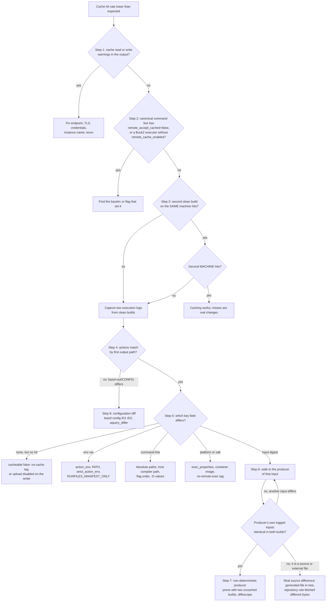
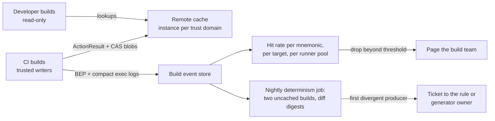

# Playbook: Diagnose Bazel and Buck2 Remote Cache Misses

> [!summary] Claim:
> A remote cache hit requires the action digest to match byte for byte, and the action digest is a hash over the command line, the environment, the output paths, the working directory, the platform properties, the input root Merkle digest, the timeout, and a salt.
> Every cache miss is therefore a difference in one of those fields, and diagnosis is the search for which field differs and which upstream action or flag put it there.
> Misses come in two classes: key divergence, where an input, flag, or environment variable differs, and output non-determinism, where the same key produced different bytes that then change every downstream key.
> The procedure is: confirm the cache is reachable and accepted, capture execution logs from two clean builds, match actions by first output, diff the key fields, walk upstream to the first divergent producer, and fix it at the source rather than by widening the cache key.

The Remote Execution API services, the Merkle tree of the input root, and the ActionCache and CAS semantics are owned by [[Remote-Execution-API-and-Remote-Caching]].
Skyframe, configurations, and the analysis phase that produce Bazel actions are owned by [[Bazel-Skyframe-Bzlmod-and-Execution-Model]], and DICE and Buck2 rules are owned by [[Buck2-DICE-Starlark-and-BXL]].
File-level hunting for the bytes that differ between two outputs is drilled in [[Drill-Build-Systems-Hunt-Non-Determinism-with-Diffoscope]], and the general theory of deterministic builds is owned by [[Hermetic-and-Reproducible-Builds]].
This playbook owns the incident procedure that turns "the cache hit rate dropped" into a named action, a named field, and a fix.

## Trigger and Symptoms

Activate this playbook when a Bazel or Buck2 build re-executes actions that should have been served from a cache.

- The Bazel summary line shows fewer cache hits than expected.
  The Bazel documentation's example is `INFO: 11 processes: 6 remote cache hit, 3 internal, 2 remote.`, where `internal` counts small bookkeeping actions such as symlink creation and local cache hits are not counted at all.
  A disk cache hit is reported with the runner name `disk cache hit`, per the `runner` field comment in `spawn.proto` (Bazel 9.3.2).
- A clean CI build that used to take minutes now takes the full uncached time, with no change in the sources it built.
- A developer laptop and CI build the same commit, and the laptop gets no hits from the cache that CI populated.
- The second of two identical clean builds on the same machine re-executes actions; this is the strongest signal, because nothing about the host changed.
- Bazel prints `WARNING: Error reading from the remote cache:` or `WARNING: Error writing to the remote cache:`; local builds do not fail when caching fails, so these warnings are easy to miss (Bazel `cache-local` documentation).
- In Buck2, `buck2 log what-ran` shows the executor `local` or one beginning with `re` for actions you expected to show `cache`.

## Decision Tree



## Prerequisites

### Tools

```bash
command -v bazel bazelisk python3 jq diffoscope
bazel --version
python3 -c 'import sys; print(sys.version_info >= (3, 14))'
```

- Bazel 9.3.2 through bazelisk, with `USE_BAZEL_VERSION=9.3.2` or a `.bazelversion` file, so both builds you compare use the same Bazel; a different Bazel version is itself a source of key differences.
- The Bazel execution log tools live in the Bazel source tree, not in the release binary: `//src/tools/execlog:parser` and `//src/tools/execlog:converter`.
  Building them needs a Bazel checkout and network access for its dependencies.
- The lab for this note ships a stdlib-only decoder of the compact log, `execlog.py`, which needs Python 3.14 or later for `compression.zstd`, or the `zstd` command-line tool as a fallback.
- `diffoscope` for comparing two output files once an action is known to be non-deterministic; release 339 was current on 2026-11-13 (as of 2026-11, Both).
- For Buck2, the `buck2` binary that ran the builds, because `buck2 log` subcommands read that version's event-log schema.

### Permissions and data handling

- Read access to the remote cache, and for the cross-machine step, a second machine or CI runner with the same credentials.
- Execution logs contain every command line and every action environment variable, so treat them like build logs that may contain tokens; do not attach them to public tickets.
- Writing to a shared cache from a diagnostic build pollutes it; run diagnostic builds with `--noremote_upload_local_results` (Bazel) or without `allow_cache_uploads` (Buck2) unless the experiment is specifically about writes.

**Verification:**

```bash
bazel --version
```

It printed `bazel 9.3.2` on the lab host (bazelisk 1.30.0, macOS, 2026-11-14); run it on both machines you will compare.

## What Goes Into the Key

Every step in the Bazel and Buck2 runbooks compares fields of this structure, so learn it first.
The digest function is SHA-256 unless both client and server are configured otherwise: Bazel's lab logs carried 64-hex-digit action digests, and Buck2 documents `SHA256` as its default, with `[buck2] digest_algorithms` accepting `BLAKE3`, `SHA1`, or `SHA256`.

### Bazel 9.3.2

`RemoteExecutionService.buildRemoteAction` computes the key for both the remote cache and the disk cache:
1. `buildCommand` writes a REAPI `Command`: the output paths sorted with `PROTO_STRING_COMPARATOR` (as `output_paths`, or split into `output_files` and `output_directories` for older servers), the platform, the arguments (each passed through the scrubber if one applies), the environment sorted by variable name through a `TreeSet`, and the working directory.
2. `Utils.buildAction` writes the `Action`: the command digest, the input root Merkle digest, the timeout in whole seconds only when it is non-zero, `do_not_cache` only when the spawn may not be cached remotely, the platform again, and a salt.
3. `buildSalt` serializes a `CacheSalt` (`cache_salt.proto`) with `may_be_executed_remotely`, an optional `workspace` from the `differentiate-workspace-cache` execution requirement, and an optional scrub salt.
4. `digestUtil.computeActionKey(action)` hashes the serialized `Action`; that hash is the `digest` field of the execution log and the file name under the disk cache's `ac/` directory.

Two consequences are not obvious.
The `CacheSalt` comment says `may_be_executed_remotely` exists so that "adding/removing the `no-remote-exec` tag from a target forces a local/remote rebuild", so toggling that tag changes the key even for a cache-only setup.
The input root holds paths relative to the execution root, so the absolute output base path is not part of the key unless an action writes it into an argument, an environment value, or an output; the lab demonstrates both halves of that sentence.

### Buck2 (main at 5b3b13d3)

`re_create_action` in `buck2_execute/src/execute/command_executor.rs` builds the same two REAPI messages:
1. The `Command` holds the arguments, the platform (in the deprecated `Command.platform` field), the working directory, the environment from a sorted map (`BuckFixedSortedMap`), and the outputs laid out according to `remote_output_paths` (`Compatibility` lists a file-or-directory output in both `output_files` and `output_directories`, `Strict` lists it once, `OutputPaths` uses `output_paths`).
2. The `Action` holds the input root digest, the command digest, the timeout, `do_not_cache`, and a `salt` from `ActionSalt`, which `request.rs` describes as "bytes folded into an action's digest without being part of its command or inputs, so that the action key covers dependencies the command observes only by content".

`CommandExecutorConfig(remote_execution_action_key = ...)` is not a cache-key input despite its name.
`ReActionIdentity::new` prepends it to a string `action_key` whose comment reads "Actions with the same action key share e.g. memory requirements learnt by RE"; it is scheduling metadata sent to the RE service, and the action digest is computed without it.
Changing the `--isolation-dir` changes output paths, which `buck2 --help` states "will cause cache misses (and slower builds)".

| Key field | Bazel source of the value | Buck2 source of the value | Typical leak |
| :--- | :--- | :--- | :--- |
| Arguments | Rule implementation, toolchain flags, `--copt` and friends | `ctx.actions.run(cmd)` | Absolute paths, host compiler path, a timestamp `-D` |
| Environment | `--action_env`, strict action env PATH, `RUNFILES_MANIFEST_ONLY` | `ctx.actions.run(env = ...)` | Per-user PATH, CI variables passed through |
| Output paths | Configuration directory `bazel-out/CONFIG/bin` | Isolation dir and configuration hash in `buck-out` | Different `--compilation_mode`, transitions, isolation dir |
| Working directory | Execution root relative | Project relative | Rare |
| Platform | `exec_properties`, `--remote_default_exec_properties` | `remote_execution_properties` | Container image tag drift |
| Input root | Every input file digest, including tools | Every input file digest | A non-deterministic upstream output |
| Timeout | Spawn timeout, for example a test timeout | Request timeout | Changing `--test_timeout` |
| Salt | `CacheSalt`: remote-exec eligibility, workspace, scrub salt | `ActionSalt` | Toggling `no-remote-exec` |

## Commands and Numbers to Know

| Item | Platform | Value `(as of 2026-11)` | Why it matters |
| :--- | :--- | :--- | :--- |
| `--execution_log_compact_file` | Both | Bazel 7.1.0 added it as `--experimental_execution_log_compact_file`; 7.4.0 made the unprefixed name primary and kept the old one as `oldName` | Recommended format: zstd-compressed, length-delimited `ExecLogEntry` protos, with files and input sets written once and referenced by ID. |
| `--execution_log_binary_file` / `--execution_log_json_file` | Both | Length-delimited or newline-delimited JSON `SpawnExec` | The help text for both says "Prefer `--execution_log_compact_file`, which is significantly smaller and cheaper to produce". |
| Execution log formats | Both | Mutually exclusive | Bazel exits with "Must specify at most one of --execution_log_binary_file, --execution_log_json_file and --execution_log_compact_file". |
| `--execution_log_sort` | Both | `true` | Sorts binary and JSON logs at the end of the build at a CPU and memory cost; "the compact format is never sorted". |
| Logged spawns | Both | Only spawns that ran or hit a disk or remote cache | "Spawns whose owning action hits the persistent action cache are never reported at all" (`spawn.proto`), so always log a clean build. |
| `--remote_accept_cached` | Both | `true` | `false` disables cache lookups entirely. |
| `--remote_upload_local_results` | Both | `true` | Uploads locally executed results "if the remote cache supports it and the user is authorized to do so". |
| `--experimental_remote_require_cached` | Both | `false` | When true, fails the build if an action that can run remotely is not cached, "without spuriously injecting new results into the cache". |
| `--incompatible_strict_action_env` | Both | `true` since Bazel 9.0.0; `false` in 7.6.1, 8.0.0, and 8.4.2 | When true, PATH is the static `/bin:/usr/bin:/usr/local/bin` on non-Windows hosts and `LD_LIBRARY_PATH` is not inherited. |
| `--stamp` | Both | `false` | Stamped actions read `stable-status.txt`, which always contains `BUILD_HOST` and `BUILD_USER`. |
| `--disk_cache` layout | Both | `ac/` and `cas/`, each sharded by the first two hex digits of the digest | `DiskCacheClient.java`; the lab finds each hit's action digest at `ac/XX/DIGEST`. |
| `--experimental_disk_cache_gc_max_size` / `_max_age` / `_idle_delay` | Both | `0`, `0`, `5m` | Disk cache garbage collection is off unless a size or age is set. |
| `--remote_download_outputs` | Both | `toplevel` | Intermediate outputs are not downloaded, so you cannot diffoscope them without `all` or a CAS fetch. |
| `--remote_print_execution_messages` | Both | `failure` | Set `all` to see server-side execution messages. |
| `--remote_grpc_log` | Both | Unset; old name `--experimental_remote_grpc_log` | Writes the remote gRPC calls as a sequence of varint-size-prefixed `RemoteExecutionLog.LogEntry` protos. |
| `aquery_differ` | Both | `tools/aquery_differ` at tag 9.3.2; `scripts/aquery_differ` on master | The aquery documentation still shows `bazel run //tools/aquery_differ`. |
| `buck2 build --no-remote-cache` | Both | Off | "Do not perform remote cache queries or cache writes"; the RE service may still deduplicate. |
| `buck2 build --upload-all-actions` | Both | Off | Uploads every action so that a cached result whose action blob has expired can still be inspected. |
| `CommandExecutorConfig(allow_cache_uploads)` | Both | `False` | Buck2 does not upload locally executed results unless this is set (or the per-action `allow_cache_upload` override applies). |
| `buck2 --isolation-dir` | Both | `v2` | A non-default value changes output paths and causes misses. |

## Step-by-Step Execution (Bazel)

Each step ends with a check.
Do not move past a failed check; go to Failure Modes.
`//your:target` stands for the target set that regressed.

### Step 1: Prove the cache is reachable

```bash
bazel clean
bazel build //your:target 2>&1 | tee /tmp/build1.txt
grep -E 'WARNING: Error (reading from|writing to) the remote cache' /tmp/build1.txt
grep -E '^INFO: [0-9]+ processes' /tmp/build1.txt
```

`bazel clean` removes the output tree and the local action cache, so local hits cannot mask remote behavior (Bazel `cache-remote` documentation, step 2).
If a warning appears, the message after it names the problem (mistyped endpoint, credentials, TLS, instance name); add `--verbose_failures` when it does not.

**Verification:** no cache warnings, and an `INFO: N processes:` line exists; on the second run of an unchanged build every non-internal process should be a cache hit.

### Step 2: Prove the cache is accepted and written

```bash
bazel build //your:target --build_event_text_file=/tmp/bep.txt
grep -n -A400 'command_line_label: "canonical"' /tmp/bep.txt | grep -E 'remote_accept_cached|remote_upload_local_results|disk_cache|remote_cache|remote_instance_name'
```

The `structured_command_line` message with `command_line_label: "canonical"` lists every option after bazelrc expansion, so it is the ground truth when several rc files and `--config` groups are involved.
`remote_accept_cached` set to `false` disables reads, and `remote_upload_local_results` set to `false` on every machine means nobody ever writes the entries you are missing.
A different `remote_instance_name` is a different cache namespace in the REAPI, so two machines with different values never share entries.

**Verification:** the reader has `remote_accept_cached` true, at least one writer (usually CI) has `remote_upload_local_results` true, and both name the same instance.

### Step 3: Capture two execution logs from clean builds

Same machine first, because it removes the host as a variable:

```bash
bazel clean
bazel build //your:target --execution_log_compact_file=/tmp/exec1.log
bazel clean
bazel build //your:target --execution_log_compact_file=/tmp/exec2.log
```

Then across machines, after a small change that guarantees no existing entry matches (Bazel `cache-remote` documentation): build on machine 1 into `/tmp/exec1.log` and on machine 2, with the same change, into `/tmp/exec2.log`.
The clean before each logged build is not optional: an action that hits the persistent action cache produces no spawn, so it is missing from the log, and the diff shows it as "only in the first log".

**Verification:** both files exist and decode; with the parser, `bazel-bin/src/tools/execlog/parser --log_path=/tmp/exec1.log | head` prints records with `mnemonic`, `target_label`, `runner`, and `cacheable`.

### Step 4: Align the two logs

```bash
git clone https://github.com/bazelbuild/bazel.git && cd bazel
bazel build //src/tools/execlog:parser
bazel-bin/src/tools/execlog/parser \
  --log_path=/tmp/exec1.log --log_path=/tmp/exec2.log \
  --output_path=/tmp/exec1.log.txt --output_path=/tmp/exec2.log.txt
diff -u /tmp/exec1.log.txt /tmp/exec2.log.txt | less
```

The parser converts the first log as is and reorders the second to match it; an action matches "if the first file contains an action with the same name of the first output", and unmatched actions go to the end of the second file (`ParserOptions.java`).
Execution order is not deterministic under parallelism, which is why a raw text diff of two unsorted logs is noise.
`--restrict_to_runner=linux-sandbox` (or another runner name) filters the output to one strategy.
To convert formats, `bazel-bin/src/tools/execlog/converter --input compact:/tmp/exec1.log --output json:/tmp/exec1.json` works, with `--sort` for a deterministic order; the README says large logs may need `--jvm_flag=-Xmx4g`.

**Verification:** the number of actions only in one log is small and explained; a large unmatched set means the output paths themselves differ, which is Step 8.

### Step 5: Read the diff field by field

For each matched action whose `digest` differs, find the first field that differs, in this order, because earlier fields usually explain later ones:
1. `cacheable` and `remote_cacheable`: if false, the action can never hit, whatever its key; look for `no-cache`, `no-remote-cache`, `no-remote`, or `local` tags via `mnemonic` and `target_label`.
2. `environment_variables`: a value that names a user, a home directory, a CI job ID, or a PATH entry.
3. `command_args`: an absolute path, a host-specific tool path, or a `-D` value that changes.
4. `platform`: a property such as a container image.
5. `inputs`: a path whose digest differs; this one needs Step 6.
6. `listed_outputs`: different output paths mean a different configuration; see Step 8.

`spawn.proto` documents that `digest` is "only available when remote execution, remote cache or disk cache was enabled for this spawn", which is why the lab's `nonce_gen` action, tagged `no-cache`, appears without one.

**Verification:** every action with a changed digest has a one-line reason, for example `env LAB_FLAVOR: alpha -> beta` or `input digest changed: bazel-out/<cfg>/bin/nonce.h`.

### Step 6: Walk upstream to the first divergent producer

An input digest difference is a symptom, not a cause.
Find the action whose first output is that input, in the same two logs, and repeat Step 5 on it:
- If that producer's own logged inputs, arguments, and environment are identical but its `actual_outputs` digest differs, it is non-deterministic: go to Step 7.
- If one of its inputs differs, keep walking.
- If the differing input is a source file or a file under `external/`, the difference is real: a generated file checked into or written into the source tree, a `glob` picking up an untracked file, or a repository rule that fetched different bytes.

`bazel aquery 'outputs(".*nonce.h", //...)'` names the action that produces a given path when the logs alone are hard to search.

**Verification:** you can name one action, the first divergent producer, whose inputs are equal and outputs differ, or one source file whose content differs.

### Step 7: Prove non-determinism with two uncached builds

```bash
bazel --output_base=/tmp/ob1 build //your:producer --noremote_accept_cached --noremote_upload_local_results \
  --execution_log_compact_file=/tmp/nd1.log
bazel --output_base=/tmp/ob2 build //your:producer --noremote_accept_cached --noremote_upload_local_results \
  --execution_log_compact_file=/tmp/nd2.log
```

Two fresh output bases force both executions and also change the absolute path of the execution root, which is exactly what a second machine does.
If a disk cache is configured in a bazelrc, use `--ignore_all_rc_files` or point `--disk_cache` at an empty directory, because `--noremote_accept_cached` gates only the remote half of the combined cache in `getReadCachePolicy`.
Compare the `actual_outputs` digests; copy the two outputs out of `/tmp/ob1/execroot/_main/bazel-out/...` and `/tmp/ob2/...` and run:

```bash
diffoscope --text - /tmp/a/libfoo.a /tmp/b/libfoo.a
```

diffoscope exits 0 if the inputs are the same, 1 if they differ, and 2 on trouble (diffoscope(1)), and it recursively unpacks archives and transforms binary formats into readable form, so the difference has a name such as a timestamp in an `ar` header, a `DW_AT_comp_dir`, or a reordered table.

**Verification:** the two output digests differ while the logged inputs are identical, and diffoscope names the bytes.

### Step 8: Diagnose configuration differences

When the first outputs do not match at all, the configuration directory differs (`bazel-out/k8-fastbuild` versus `bazel-out/k8-opt`, or a transition suffix), and every action key differs because every output path differs.

```bash
bazel config                        # lists configuration IDs from the last build in this server
bazel config ID_FROM_BUILD_1 ID_FROM_BUILD_2
bazel aquery --output=proto 'mnemonic("CppCompile", //your:target)' > /tmp/before.proto
# repeat with the other build's flags into /tmp/after.proto, then, from a Bazel 9.3.2 checkout:
bazel run //tools/aquery_differ -- --before=/tmp/before.proto --after=/tmp/after.proto \
  --input_type=proto --attrs=cmdline --attrs=inputs
```

`aquery_differ.py` accepts `--input_type` of `proto` (the default), `textproto`, or `streamed_proto`, not `jsonproto`, and `--attrs` of `cmdline` (the default) or `inputs`.

`bazel config` with two IDs prints the difference between the configurations, but only for configurations still in the Skyframe cache, so pass it the same flags as the build; its usage text says the command "is experimental and unsupported".
`aquery_differ` compares two aquery outputs and reports actions present in only one and actions whose command line or inputs differ; it lives at `tools/aquery_differ` in the 9.3.2 tag and moved to `scripts/aquery_differ` on master.
`--experimental_platform_in_output_dir` and `--experimental_output_paths` control how the output directory name is derived; the latter's help text calls it "highly experimental" and says Starlark actions opt into path mapping with the `supports-path-mapping` execution requirement.

**Verification:** you can name the option that differs between the two configurations, and it explains the output path difference.

### Step 9: Fix at the source and confirm

Apply the fix from the Remediation Catalog, then repeat Step 3 on both machines and confirm the diff is empty for the affected actions.
As a regression gate, run the second clean build with `--experimental_remote_require_cached`: it fails if any remotable action is not cached and does not write new results while checking.

**Verification:** the second clean build reports only cache hits and `internal` processes, and the cross-machine execution logs have identical digests for the repaired actions.

## Step-by-Step Execution (Buck2)

Buck2 records every invocation in a zstd-compressed protobuf event log, and the `buck2 log` subcommands read it, by default from the most recent command in the current isolation directory.

### Step B1: See how each action ran

```bash
buck2 build //your:target --write-build-id /tmp/build1.id
buck2 log what-ran --trace-id "$(cat /tmp/build1.id)" --format json > /tmp/what1.jsonl
buck2 log what-ran --skip-cache-hits
buck2 log what-ran --emit-cache-queries
```

The executor labels come from `CommandReproducer::executor` in `buck2_event_observer/src/what_ran.rs`: `cache` for an action cache hit, `re_dep_file_cache` and `dep_file` for remote and local dep-file cache hits, `local`, `worker`, `worker_init`, and labels beginning with `re` for remote execution, with `_served_from_cache` or `_deduplicated` appended when the RE service reports it did not actually run the action.
For RE actions the last column is the action digest in `hash:size` form; for local actions it is the shell-quoted command.

**Verification:** you have the list of actions that ran instead of hitting, with their digests.

### Step B2: Check that local results are uploaded at all

```bash
buck2 log what-uploaded
```

`CommandExecutorConfig` defaults `allow_cache_uploads` to `False`, and `ctx.actions.run` accepts `allow_cache_upload: None | bool` per action.
`upload_local_outputs` in `caching.rs` uploads only successful, locally executed actions, rejects outputs larger than `max_cache_upload_mebibytes`, and checks upload permission before writing the `Action` blob to the CAS and the `ActionResult` to the action cache.
A team that runs builds locally with uploads off and never on CI has nothing in the cache to hit.

**Verification:** the writer invocation shows uploads for the actions the reader misses.

### Step B3: Find the first divergent action

```bash
buck2 build //your:target --no-remote-cache --write-build-id /tmp/a.id
buck2 build //your:target --no-remote-cache --write-build-id /tmp/b.id
buck2 log diff action-divergence --trace-id1 "$(cat /tmp/a.id)" --trace-id2 "$(cat /tmp/b.id)"
```

`action_divergence.rs` builds a map from each action's `ActionKey` to its action digest and the "tiny digests" of its outputs for both logs, then walks the second log in event order and prints the first action that is either present only in the second build or present in both "with differing output digests", and stops.
Both builds must execute the actions: if both are served from cache, the outputs are equal by construction and the command prints `No divergent actions found.`.
The help text for `--no-remote-cache` warns that "the RE service might still deduplicate actions", so for this experiment with RE enabled, use `--local-only` or a fresh `--isolation-dir`, accepting that the isolation dir itself changes output paths.

**Verification:** the command prints a `First Divergent Action` block with the action identity and the two tiny output digests, or `No divergent actions found.`.

### Step B4: Check configuration and executor differences

```bash
buck2 log diff external-configs --trace-id1 "$(cat /tmp/a.id)" --trace-id2 "$(cat /tmp/b.id)"
buck2 aquery //your:target
```

`external-configs` "identifies the diff between external buckconfigs between two commands" and takes the same `--path1`, `--trace-id1`, or `--recent1` selectors as `action-divergence`.
Executor settings that change the key include `remote_execution_properties` (in `Command.platform`), `remote_output_paths` (output layout), and `use_bazel_protocol_remote_persistent_workers`, which adds a `persistentWorkerKey` platform property.

**Verification:** the differing config key or executor property explains the divergent action from Step B3.

## Remediation Catalog

### Volatile environment variables

- `--action_env=NAME` passes the client's value of `NAME` into the environment of every action in the configuration, not only the actions that read it; the lab's build D changed one such variable and all five actions missed, including four that never read it.
  Prefer `--action_env=NAME=VALUE` with a fixed value, a toolchain that sets the variable on the actions that need it, or `ctx.actions.run(env = ...)` scoped to one action.
- Before Bazel 9.0.0, `--incompatible_strict_action_env` defaulted to `false`, and on Linux and macOS the action PATH was inherited from the client (`env.put("PATH", null)` in `BazelRuleClassProvider`), so two developers with different shells had different keys for every action.
  Bazel 9 defaults it to `true` with PATH `/bin:/usr/bin:/usr/local/bin`; a repository that sets `--noincompatible_strict_action_env` in its bazelrc reintroduces the problem.
- `--action_env` does not propagate to the exec configuration, per the comment in `pathOrDefault` citing issue 8536; tools built for the exec configuration need `--host_action_env`.
- When runfiles are disabled, Bazel adds `RUNFILES_MANIFEST_ONLY=1` to every action; its source comment notes this "will discard cache for all actions once `--enable_runfiles` changes", so keep that flag identical across CI and developer configurations.

### Absolute paths and host leakage

- Bazel runs actions in the execution root with relative paths, so the absolute output base path is absent from keys by default; the lab's `path_leak` action hit the cache from a different output base for this reason.
- An action that writes `$PWD`, a home directory, or a host name into its output is still non-deterministic across machines: the cache serves whichever machine wrote first, which hides the leak, and a fresh execution produces different bytes that change every downstream key.
- For C and C++, the usual leak is `DW_AT_comp_dir` and file names in debug info.
  GCC's `-ffile-prefix-map=OLD=NEW` is "equivalent to specifying all the individual `-f*-prefix-map` options" and records paths as if the files resided in `NEW`; clang additionally offers `-ffile-compilation-dir=` and `-fdebug-compilation-dir=` (both listed by `clang --help` in Apple clang 21.0.0 on the lab host), which take a relative value such as `.` and so keep the absolute path out of the command line.
  A `-fdebug-prefix-map=/abs/execroot=.` flag that spells out the absolute path fixes the output but puts that path into the arguments, which changes the key on every machine.
- The default rules_cc Unix toolchain (rules_cc 0.2.28, `unix_cc_configure.bzl`) passes `-Wno-builtin-macro-redefined` with `-D__DATE__="redacted"`, `-D__TIMESTAMP__="redacted"`, and `-D__TIME__="redacted"`, and its macOS archiver feature sets `ZERO_AR_DATE`, which removes the classic timestamp leaks from C and C++ objects and archives.

### Non-deterministic generators

- Time: generators that embed the build time; read `SOURCE_DATE_EPOCH` instead, as specified by the Reproducible Builds project, and see [[Hermetic-and-Reproducible-Builds]].
- Randomness and hashing: a random nonce (the lab's `nonce_gen`), Python set or dict-of-set iteration under hash randomization, Go map iteration, and unordered Java collections; sort before writing.
- Directory listing order: `os.listdir`, `readdir`, and `find` return file-system order; sort the list.
- Parallel output order: a tool that writes results from worker threads in completion order.
- Archives: zip and jar entries carry modification times and are sensitive to entry order; normalize both.
- Stamping: stamped actions read `bazel-out/stable-status.txt`, which "always" includes `BUILD_HOST` and `BUILD_USER`, so a stamped action's key differs per host and user by design.
  Keep `--stamp` off (the default) except for release builds, and keep stamped actions at the leaves of the graph so only the final link or package differs.
  The user manual says Bazel "pretends that the volatile file never changes" for invalidation.
  In the 9.3.2 source, `SkyframeExecutor.makeWorkspaceStatusAction` creates `volatile-status.txt` through `getConstantMetadataArtifact`, and `FileArtifactValue.ConstantMetadataValue` reports a fixed one-byte digest for such artifacts, so a changing volatile file is not expected to change a stamped action's input digest; `stable-status.txt` is an ordinary derived artifact whose content digest is an input.
  UNVERIFIED: the Merkle tree construction that turns that metadata into the remote input root was not read, and no stamped build was run in the lab.

### Tags and execution requirements

- `no-cache` disables local and remote caching for the action, with the disk cache counted as local; `no-remote-cache` disables only the remote cache; `no-remote-exec` prevents remote execution but allows remote caching; `no-remote` is both; `local` precludes remote caching, remote execution, and sandboxing (Bazel 9.3.2 common definitions).
- Because `may_be_executed_remotely` is in the salt, adding or removing `no-remote-exec` changes the key, so a rollout of that tag is a one-time miss for every affected action.
- `--modify_execution_info` adds or removes execution info keys by mnemonic regex, with the syntax `regex=[+-]key,...` (for example `Genrule=+no-remote-cache`), which is useful for experiments without editing BUILD files; it applies only to actions that support execution info, such as `Genrule`, `CppCompile`, `Javac`, `StarlarkAction`, and `TestRunner`.

### Toolchain drift

- An autodetected host toolchain puts the host compiler path and its headers into action inputs and arguments, so two machines with different compiler installs never share entries; a hermetic toolchain fetched by digest fixes it, which is the subject of [[Migrate-a-Polyglot-Codebase-to-Hermetic-Builds]].
- Remote execution platforms carry the container image in platform properties; a moving tag such as `latest` changes nothing in the key while the image underneath changes, which is a correctness risk, while pinning by digest changes the key exactly when the image changes.

### Key scrubbing, the last resort

`--experimental_remote_scrubbing_config` reads a `remote_scrubbing.proto` text config whose rules match actions by `kind`, `label`, `mnemonic`, and `match_tools`, and transform the key by `omitted_inputs`, `arg_replacements`, and a `salt`.
Its help text says it is meant for sharing a cache "between actions executing on different platforms but targeting the same platform", that it "should be used with extreme care" because it can share entries incorrectly, that scrubbed actions "will always be executed locally", and that changing the config requires a clean build.
Use it only when the differing field provably does not affect the output, and record why.

## Worked Example: Cache Miss Diagnosis Lab

The lab in `code/06-Build-Systems/cache_miss_diagnosis/` runs the Bazel procedure on a five-target workspace whose genrules each model one behavior.

1. `workspace/BUILD.bazel` defines `nonce_gen` (writes `$RANDOM$RANDOM$RANDOM` into `nonce.h`, tagged `no-cache` to model a generator that re-runs on every machine), `consumer` (copies `nonce.h`), `flavored` (writes `$LAB_FLAVOR`), `path_leak` (writes `$PWD`), and `stable` (uppercases a source file).
2. `run.sh` copies the workspace to a temporary directory, pins `USE_BAZEL_VERSION=9.3.2`, and runs four clean builds with `--ignore_all_rc_files`, each in its own `--output_base`, each with `--action_env=LAB_FLAVOR` and `--execution_log_compact_file`.
   Build A uses a fresh disk cache with `LAB_FLAVOR=alpha`; build B reuses that disk cache with `alpha`, modeling a second machine; build D reuses it with `beta`; build C uses a second fresh disk cache with `alpha`.
3. `execlog.py` decompresses each log with `compression.zstd` (or `zstd -dc`), decodes the varint-delimited `ExecLogEntry` stream by hand, rebuilds each spawn's inputs by walking its `InputSet` DAG (transitive sets first, then direct entries), and matches spawns across logs by first output, the same rule the Bazel parser uses.
4. `diff` lists every key field that differs; `disk-cache` checks that each cache hit's action digest exists as `ac/XX/DIGEST` under the disk cache; `determinism` marks a spawn whose logged inputs are identical but whose outputs differ as non-deterministic, and a spawn whose key changed only through such a producer's output as its victim.

What the output proves:
- Build B's three hits came from a different output base, so the absolute execution root path is not in those keys; `path_leak`, which writes that path, hit too, so build B received bytes containing build A's path.
- `consumer` missed in build B even though nothing about it changed: its input `nonce.h` changed because `nonce_gen` re-ran, which is how one non-deterministic generator turns into misses for everything downstream of it.
- `nonce_gen` has no action digest in the log, because it is not cacheable, which matches the `spawn.proto` comment that `digest` exists only when a cache was enabled for the spawn.
- Build D shows that `--action_env=LAB_FLAVOR` keyed all five actions on the variable, including the four that never read it.
- The determinism pass, which needs two executions with no cache, is the only pass that exposes `path_leak`; builds A and B cannot, because the cache masked it.
- The disk-cache check ties the log's `digest` field to the on-disk entry, so it confirms that `digest` really is the cache key and not a different hash.

### Verified output

Recorded by the harness with `TOOLCHAIN_LABS_NETWORK=1` on darwin-arm64 (macOS, Bazel 9.3.2 through bazelisk 1.30.0, Python 3.15.2) on 2026-11-14; the file is `code/06-Build-Systems/cache_miss_diagnosis/expected/darwin-arm64.txt`.

```text
=== Build A: cold cache, LAB_FLAVOR=alpha ===
spawns: 5, cache hits: 0, executed: 5
  consumer   Genrule  cacheable     executed
  flavored   Genrule  cacheable     executed
  nonce_gen  Genrule  NOT cacheable executed
  path_leak  Genrule  cacheable     executed
  stable     Genrule  cacheable     executed

=== Build B: other output base, shared cache, LAB_FLAVOR=alpha ===
spawns: 5, cache hits: 3, executed: 2
  consumer   Genrule  cacheable     executed
  flavored   Genrule  cacheable     disk cache hit
  nonce_gen  Genrule  NOT cacheable executed
  path_leak  Genrule  cacheable     disk cache hit
  stable     Genrule  cacheable     disk cache hit

=== Why B missed: A vs B, matched by first output ===
  consumer: KEY CHANGED, executed
      input digest changed: bazel-out/<cfg>/bin/nonce.h
  flavored: same action digest, disk cache hit
  nonce_gen: same logged inputs, executed
  path_leak: same action digest, disk cache hit
  stable: same action digest, disk cache hit

=== Disk cache cross-check for B ===
cache hits whose action digest is a file under ac/<first 2 hex>/: 3 of 3
spawns logged without an action digest: nonce_gen
action digest length in hex digits: 64

=== Build D: shared cache, LAB_FLAVOR=beta; why D missed: A vs D ===
spawns: 5, cache hits: 0, executed: 5
  consumer   Genrule  cacheable     executed
  flavored   Genrule  cacheable     executed
  nonce_gen  Genrule  NOT cacheable executed
  path_leak  Genrule  cacheable     executed
  stable     Genrule  cacheable     executed
  consumer: KEY CHANGED, executed
      env LAB_FLAVOR: alpha -> beta
      input digest changed: bazel-out/<cfg>/bin/nonce.h
  flavored: KEY CHANGED, executed
      env LAB_FLAVOR: alpha -> beta
  nonce_gen: KEY CHANGED, executed
      env LAB_FLAVOR: alpha -> beta
  path_leak: KEY CHANGED, executed
      env LAB_FLAVOR: alpha -> beta
  stable: KEY CHANGED, executed
      env LAB_FLAVOR: alpha -> beta

=== Determinism: A vs C, both executed with a fresh cache ===
  consumer   key changed only because of: nonce_gen
  flavored   deterministic
  nonce_gen  NON-DETERMINISTIC (same inputs, different output)
  path_leak  NON-DETERMINISTIC (same inputs, different output)
  stable     deterministic
```

The lab scrubs the configuration directory to `bazel-out/<cfg>/` and prints target names rather than strategies, so the comparison does not depend on `darwin-sandbox` versus `linux-sandbox`.
It declares `# requires: network` because bazelisk downloads Bazel when it is not cached and Bzlmod may consult the Bazel Central Registry, so the harness runs it only with `TOOLCHAIN_LABS_NETWORK=1`.
It has been recorded only on darwin-arm64; no Linux host has run it.

## Rollback Procedure

The procedure adds flags, writes logs, and may change cache-key inputs; undo each.

1. **Remove diagnostic flags.** Drop `--execution_log_*`, `--build_event_text_file`, `--remote_grpc_log`, and `--experimental_remote_require_cached` from any bazelrc you edited; logging costs CPU and disk on every build, and the binary and JSON formats sort at the end of the build unless `--noexecution_log_sort`.
   **Check:** the canonical command line in a fresh BEP file no longer lists them.
2. **Delete logs.** Execution logs, BEP files, and gRPC logs contain command lines and environment values.
   **Check:** `ls /tmp/exec*.log /tmp/bep.txt` fails, and the incident ticket records where any retained copy lives.
3. **Revert a fix that changed keys fleet-wide.** A change to `--action_env`, strict action env, a toolchain, or a tag invalidates every affected entry once; reverting it invalidates them again, so revert only if the fix is wrong, and schedule either change outside peak hours.
   **Check:** the hit rate recovers on the second CI run after the revert.
4. **Revert a scrubbing config.** Remove `--experimental_remote_scrubbing_config` and run `bazel clean`, because its help text says outputs in the local file system and internal caches are not invalidated by a config change.
5. **Quarantine poisoned entries.** A non-deterministic or wrong output already in the cache is served to everyone with that key.
   REAPI clients cannot delete action cache entries in general, so move readers to a new namespace: a new `--remote_instance_name`, or a new value of a platform property the server ignores, which changes the key because platform properties are hashed in both `Command` and `Action`.
   For a disk cache, delete the directory.
   **Check:** an affected action re-executes once and then hits.
6. **Buck2:** remove `--no-remote-cache`, `--upload-all-actions`, and any non-default `--isolation-dir` from scripts, and revert any `allow_cache_uploads` change made only for the experiment.

## Failure Modes of the Procedure

| Failure | How it shows up | Recovery |
| :--- | :--- | :--- |
| Actions missing from a log | The diff shows many "only in first log" entries | The second build was not clean, so persistent action cache hits produced no spawns; `bazel clean` or a fresh `--output_base`. |
| No actions match | Every first output differs | The configuration differs; Step 8 with `bazel config` and `aquery_differ`. |
| Digests equal, still no hit | Same `digest`, `cacheable` true, runner not a cache hit | Reads disabled (`remote_accept_cached` false), a different instance name, the entry was never written (uploads off everywhere), or it was evicted; check the writer's log. |
| Parser build fails | `bazel build //src/tools/execlog:parser` errors | It builds from a Bazel checkout with its own `.bazelversion`; use bazelisk, or decode the compact log directly as the lab does. |
| Log too large | Converter or parser runs out of heap | `--jvm_flag=-Xmx4g` per the README, or restrict the build to the regressed targets. |
| Non-determinism not reproducible | Two uncached builds on one machine give equal outputs | The variable is host-level (user, host name, absolute path, locale, time zone, CPU count); repeat Step 7 on two machines or with two output bases and different `TZ` and `LC_ALL`. |
| Buck2 divergence finds nothing | `No divergent actions found.` | Both builds were served from cache or deduplicated by RE; rerun with `--local-only` or fresh isolation dirs. |
| Intermediate output unavailable | Cannot diffoscope an intermediate file | `--remote_download_outputs=toplevel` (the default) did not download it; rebuild with `--remote_download_outputs=all` or fetch it from the CAS by the digest in the log. |
| Fix moved the problem | Hit rate unchanged after the fix | The first divergent producer was misidentified; repeat Step 6 from the new diff instead of guessing. |

## Pitfalls

> [!warning] Diffing unsorted logs
> Parallel execution logs spawns in completion order, so a plain `diff` of two text logs shows nearly every line as changed.
> Align by first output with the parser's two-`--log_path` mode, or sort the binary or JSON format with `--execution_log_sort` (the default), which the compact format never does.

> [!warning] Blaming the victim
> The action that misses is usually not the action that is broken.
> In the lab, `consumer` is perfectly deterministic and still misses on every machine, because `nonce_gen` changes its input; fixing or tagging `consumer` changes nothing.

> [!warning] The cache hides non-determinism
> A non-deterministic action hits the cache on its second run because its key did not change, so same-machine hit tests pass while the leak spreads.
> Only two executions without a cache reveal it, which is why determinism checks belong in CI as their own job.

> [!warning] Widening the key to make a miss go away
> Adding an environment variable or a `--action_env` "to be safe" keys every action on it, as the lab's build D shows.
> Each new key input must be scoped to the actions whose output depends on it.

> [!warning] Hitting is not the same as being correct
> Scrubbing, a moving container image tag, or an undeclared input can make two actions share a key while their outputs should differ.
> That is a correctness bug that a higher hit rate hides; prefer misses to wrong hits.

> [!warning] Developer writes into a shared cache
> If every developer machine uploads, one machine with a broken toolchain or a local patch to a generated file can poison entries that CI then serves.
> Let trusted CI write, and give developer machines read access with `--noremote_upload_local_results` or no `allow_cache_uploads`.

## At Scale

At 1,000 to 50,000 engineers, a cache miss is a fleet cost, and the hit rate is a service-level indicator with an owner.



### Operating rules

- Measure hit rate per mnemonic and per target from the build event stream rather than from the single summary line; one slow mnemonic with a 0% hit rate disappears inside a 95% aggregate.
- Run a scheduled determinism job: two clean builds of the whole repository in different output bases, ideally on different hosts, with caches disabled, then diff the execution logs and file a ticket for each first divergent producer.
- Gate changes to `.bazelrc`, toolchains, and execution platforms on a cache-impact check: build before and after with execution logs and count how many action digests change; a one-line rc change that rekeys the whole graph should be a conscious decision.
- Separate trust domains by instance name: CI-written entries are served to everyone, while developer-written entries, if allowed at all, live in a separate namespace.
- Pin every input that is not a source file: the Bazel version, toolchains by digest, container images by digest, and repository rules by checksum.

### Decision rules

- If the same machine cannot get hits on a second clean build, stop cross-machine work; the cause is in the build itself, and execution logs from that machine are sufficient.
- If only cross-machine hits fail, look first at environment, toolchain, and platform fields; the inputs are usually identical.
- If the first divergent producer is a generator you own, fix its output order or its time source; if it is a third-party tool, wrap it with normalization (sorting, `SOURCE_DATE_EPOCH`, prefix maps) and keep the wrapper's own output deterministic.
- Reach for key scrubbing only when the field provably cannot affect the output, and record the justification next to the config.

## Practice Drill

> [!tip] Practice Drill: Break and repair the cache in the lab
> Copy `code/06-Build-Systems/cache_miss_diagnosis/` to a scratch directory on a macOS or Linux host with network access, run `bash run.sh`, and confirm the output matches `expected/darwin-arm64.txt` (the stdout is written to be platform independent, but no Linux run has been recorded, so treat a Linux match as a prediction to check).
> Then make one change at a time, predict the output before running it, and explain the difference.
> 1. Change `--action_env=LAB_FLAVOR` to `--action_env=LAB_FLAVOR=alpha` in `run.sh`: build D now hits like build B, because the value no longer comes from the client.
> 2. Remove the `no-cache` tag from `nonce_gen`: build B now hits for all five actions, `nonce_gen` gains an action digest, and the determinism pass still flags `nonce_gen` and `path_leak`, because the cache masks non-determinism but does not remove it.
> 3. Replace `$$RANDOM$$RANDOM$$RANDOM` with a fixed string: `consumer` hits in build B and becomes deterministic in the determinism pass.
> 4. Replace `$$PWD` with `$$(basename $$PWD)`: predict whether `path_leak` becomes deterministic, then explain the answer from the execution root layout `OUTPUT_BASE/execroot/_main`.
> 5. Add `tags = ["no-remote-exec"]` to `stable` after build A, run build B by hand with the same disk cache, and explain the miss from `CacheSalt.may_be_executed_remotely`.
> Target time: under 30 minutes, then do [[Drill-Build-Systems-Hunt-Non-Determinism-with-Diffoscope]] on a real C++ archive.

## Interview Questions

> [!question] L5
> The Bazel summary says `INFO: 9 processes: 4 internal, 5 linux-sandbox.` on the second CI run of an unchanged commit.
> What do you check first?
>
> > [!success]- Answer
> > No line item says `remote cache hit` or `disk cache hit`, so nothing came from a cache.
> > First check for `WARNING: Error reading from the remote cache:` lines, because a failing cache does not fail the build.
> > Then read the canonical command line from `--build_event_text_file` for `remote_accept_cached`, `remote_cache`, and `remote_instance_name`, since a bazelrc or `--config` may have disabled reads or pointed at another namespace.
> > Then check whether anyone writes: if every runner has `--noremote_upload_local_results`, there is nothing to hit.
> > Only after those are ruled out, capture two execution logs and diff them.

> [!question] L5
> Why must both builds be clean before you compare their execution logs?
>
> > [!success]- Answer
> > The execution log records spawns, and `spawn.proto` states that spawns whose owning action hits the persistent action cache are never reported.
> > An incremental build skips most actions locally, so they are missing from its log and look like "only in the first log" differences.
> > `bazel clean` or a fresh `--output_base` removes the local action cache, so every action either executes or is looked up in the disk or remote cache, and appears in the log.

> [!question] L5
> What is the difference between `no-cache`, `no-remote-cache`, `no-remote-exec`, and `no-remote` in Bazel?
>
> > [!success]- Answer
> > `no-cache` disables caching both locally and remotely, with the disk cache counted as local.
> > `no-remote-cache` disables only the remote (HTTP or gRPC) cache; the action may still use the disk cache and may still execute remotely.
> > `no-remote-exec` forbids remote execution but allows remote caching.
> > `no-remote` is `no-remote-cache` plus `no-remote-exec`.
> > A subtle cost: `no-remote-exec` changes the action key through `CacheSalt.may_be_executed_remotely`, so adding the tag causes a one-time miss even for a cache-only setup.

> [!question] L6
> Predict the output: in the lab, build B uses a different output base and the same disk cache as build A, and `path_leak` writes `$PWD` into `where.txt`.
> Does `path_leak` hit, and what path is inside build B's `where.txt`?
>
> > [!success]- Answer
> > It hits: the recorded output shows `path_leak: same action digest, disk cache hit`.
> > The key contains the command, environment, relative output paths, platform, and the input root, all relative to the execution root, so the absolute output base is not part of it.
> > Because the result came from the cache, build B's `where.txt` has the bytes build A produced, so it names a directory under build A's output base, a path that does not exist from build B's point of view.
> > This is why the cache hides non-determinism: only the uncached determinism pass between builds A and C flags `path_leak`.

> [!question] L6
> Debug this: after a developer adds `--action_env=CI_JOB_ID` to the shared `.bazelrc` so that a test can read it, the CI cache hit rate drops from about 95% to near zero.
> Why, and what is the right fix?
>
> > [!success]- Answer
> > `--action_env=NAME` puts the client's value of `NAME` into the environment of every action in the configuration, and the environment is part of the REAPI `Command`, so every action's digest now includes the job ID, which is unique per CI job.
> > The lab's build D reproduces this: changing one `--action_env` variable made all five actions miss, including four that never read it.
> > Fix it by removing the flag and giving only the test the value, for example through `--test_env=CI_JOB_ID`, which keys only the test actions: `TestRunnerAction` hashes the test action environment into its local key, and `StandaloneTestStrategy.createTestRunnerSpawn` puts the computed test environment into the spawn environment that becomes the REAPI `Command` (confirm on your build with an execution log), or by writing the value into a file that only the test depends on.
> > Verify with two execution logs from consecutive CI jobs: the diff should show the variable only on the test action.

> [!question] L6
> A C++ link action misses on every CI runner, and the execution log shows its inputs `foo.o` differ, while `foo.o`'s compile action has identical arguments and inputs on both runners.
> What is happening and how do you prove and fix it?
>
> > [!success]- Answer
> > The compile action is non-deterministic: same key, different output bytes, and the link action is its victim.
> > Prove it with two uncached builds in different output bases, compare the `actual_outputs` digests of `foo.o`, and run diffoscope on the two objects.
> > The usual finding is an absolute path in debug info, such as `DW_AT_comp_dir` naming the sandbox or execution root, or a `__DATE__`-style macro in a custom toolchain.
> > Fix it with a relative compilation directory (`-ffile-compilation-dir=.` on clang) or a prefix map that does not put the absolute path into the arguments, or with the date redaction that the default rules_cc toolchain applies.
> > Do not scrub `foo.o` out of the link key; that would make the cache serve links built from different objects.

> [!question] L7
> Compare how Bazel and Buck2 let you find the first non-deterministic action between two builds, and the limits of each.
>
> > [!success]- Answer
> > Bazel writes an execution log per build; the parser aligns two logs by first output, and you diff `inputs` and `actual_outputs` and walk upstream by hand, or script it as the lab does with the compact format's input-set DAG.
> > Buck2's `buck2 log diff action-divergence` matches actions by `ActionKey` across two event logs, walks the second build in event order, and prints the first action present in both with different output tiny digests, or present only in the second, together with both action digests.
> > Both need both builds to execute: a cache hit returns the same output by construction, and Buck2's `--no-remote-cache` help warns that RE may still deduplicate, so use `--local-only` or fresh isolation dirs.
> > Bazel's approach shows every changed field but leaves the walk to you; Buck2 automates "first divergent" but reports only one action and only output divergence, not key-field differences.
> > Bazel matches by output path, so a configuration change defeats matching; Buck2 matches by action key, so it survives some path changes but not changes in the action set.

> [!question] L7
> Design a cache-health program for a 5,000-engineer monorepo that shares one remote cache.
>
> > [!success]- Answer
> > Writers: only trusted CI pools write, developers read; separate instance names per trust domain so a laptop cannot poison what CI serves.
> > Telemetry: ingest the BEP and compact execution logs from CI into a store; compute hit rate per mnemonic, target, and runner pool, and alert on drops beyond a threshold rather than on the global average.
> > Determinism: a nightly job builds the repository twice with caches off on different hosts, diffs digests, and files a ticket per first divergent producer with the diffoscope report attached.
> > Change control: any change to rc files, toolchains, platforms, or `--action_env` must show the number of action digests it changes, measured from before and after execution logs.
> > Pinning: Bazel version, toolchains, images, and external repositories by digest.
> > Guardrails: run a second clean CI build with `--experimental_remote_require_cached` on a sample of targets so a regression fails loudly instead of slowly.

> [!question] L8+
> A team proposes `--experimental_remote_scrubbing_config` to drop the host compiler path from compile keys so macOS and Linux developers share entries.
> Evaluate the proposal.
>
> > [!success]- Answer
> > Scrubbing changes only the cache key, not execution; its help text says it is meant for actions "executing on different platforms but targeting the same platform", warns that improper settings cause incorrect sharing, and says scrubbed actions always run locally, which removes them from remote execution.
> > Dropping the compiler path is safe only if the two compilers are provably byte-identical for the same inputs; a different compiler version or a different default sysroot produces different objects, and the cache would then serve one platform's objects to the other.
> > The durable fix is a hermetic toolchain fetched by digest, so the compiler is an input with a digest and sharing happens because the inputs really are equal.
> > If scrubbing is used as a bridge, scope the matcher to exact mnemonics and labels, add a salt so scrubbed entries never collide with unscrubbed ones, audit with a determinism job across both platforms, and set an expiry date for the config.

## Further Reading

- Bazel, Debugging Remote Cache Hits for Remote Execution, https://bazel.build/remote/cache-remote.
  The official same-machine, cross-machine, and log comparison procedure this playbook extends.
- Bazel, Debugging Remote Cache Hits for Local Execution, https://bazel.build/remote/cache-local.
  The read and write warning messages and cache-reading pitfalls for a cache without remote execution.
- Bazel `spawn.proto` at 9.3.2, https://github.com/bazelbuild/bazel/blob/9.3.2/src/main/protobuf/spawn.proto.
  The exact meaning of every execution log field, including which spawns are never logged.
- Bazel `src/tools/execlog/README.md`, https://github.com/bazelbuild/bazel/tree/9.3.2/src/tools/execlog.
  Parser alignment rules and the converter between compact, binary, and JSON formats.
- Bazel `RemoteExecutionService.java` at 9.3.2, https://github.com/bazelbuild/bazel/blob/9.3.2/src/main/java/com/google/devtools/build/lib/remote/RemoteExecutionService.java.
  The authoritative answer to "what is in the key", in `buildCommand`, `buildSalt`, and `buildRemoteAction`.
- Bazel aquery documentation, https://bazel.build/query/aquery.
  Action graph queries and `aquery_differ` for configuration-level differences.
- Buck2 Remote Execution, https://buck2.build/docs/users/remote_execution/.
  Executor configuration and digest algorithm settings.
- Buck2 `action_divergence.rs`, https://github.com/facebook/buck2/blob/main/app/buck2_cmd_log_client/src/diff/action_divergence.rs.
  How `buck2 log diff action-divergence` matches actions and decides divergence.
- REAPI `remote_execution.proto`, https://github.com/bazelbuild/remote-apis/blob/main/build/bazel/remote/execution/v2/remote_execution.proto.
  The `Action` and `Command` messages both tools hash.
- GCC `-ffile-prefix-map`, https://gcc.gnu.org/onlinedocs/gcc/Overall-Options.html.
  Removing absolute paths from compiler output.
- Reproducible Builds, `SOURCE_DATE_EPOCH`, https://reproducible-builds.org/docs/source-date-epoch/, and diffoscope, https://diffoscope.org/.
  The standard time source for generators and the tool that names differing bytes.

## Related

- Prerequisites: [[Remote-Execution-API-and-Remote-Caching]], [[Bazel-Skyframe-Bzlmod-and-Execution-Model]]
- Next: [[Migrate-a-Polyglot-Codebase-to-Hermetic-Builds]]
- See also: [[Buck2-DICE-Starlark-and-BXL]], [[Hermetic-and-Reproducible-Builds]], [[Drill-Build-Systems-Hunt-Non-Determinism-with-Diffoscope]], [[Sandboxing-and-Hermetic-Execution-Internals]], [[Build-Performance-Economics-and-Decision-Record]]
- Lab: `code/06-Build-Systems/cache_miss_diagnosis/` (requires: network)
