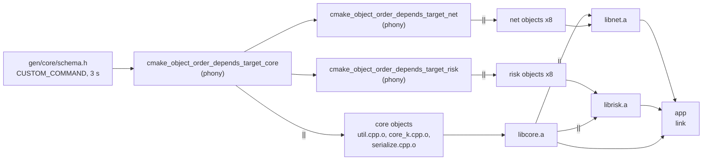

# Drill: Break a Critical-Path Dependency Bottleneck

> [!summary] Scope
> Owns an optimization scenario where an enterprise monorepo build exhibits high parallel core starvation because of a serialized critical-path header bottleneck.
> Reaches the Debug and Use rungs by utilizing Ninja execution logs and build profiling traces to pinpoint the serialization blocker.
> Requires refactoring monolithic target boundaries into fine-grained interface targets and measuring an immediate major reduction in end-to-end wall-clock build time.

> [!summary] Claim:
> In a CMake build driven by Ninja, a code generator attached to a widely linked library puts an order-only edge in front of every object file of every target that links it, directly or transitively, through the phony `cmake_object_order_depends_target_<name>` nodes.
> That edge does nothing on an incremental build and serializes a clean build: the cores sit idle while one job, the generator, runs.
> Header hygiene alone fixes incremental fan-out but not the clean build, and splitting targets alone either races or fails, so the fix is both at once, plus a check that the generator's own target has no upstream link dependencies.
> Removing one such gate can at most halve the wall clock, because before it the build costs about gate plus work over cores and after it at least the larger of the two.

Edge types, `.ninja_log`, and the deps log are owned by [[Make-and-Ninja-Mechanics]].
Target usage requirements and `PUBLIC` / `PRIVATE` / `INTERFACE` scopes are owned by [[Modern-CMake-Architecture-and-Targets]].
The economics of critical-path work across a fleet are owned by [[Build-Performance-Economics-and-Decision-Record]], and scheduler theory by [[Build-System-Theory-Schedulers-and-Rebuilders]].
This drill owns the diagnosis and the refactor for one concrete, very common shape of the problem.

## Reproduction

The lab is `code/06-Build-Systems/drill_dependency_bottleneck/`; run it with `bash run.sh`.
It needs `cmake` 3.28 or newer (the project declares `cmake_minimum_required(VERSION 3.20)`, but variant H calls `cmake_policy(SET CMP0154 NEW)`, which older CMake rejects, and variant G's variable needs 3.27), `ninja` 1.11 or newer (for `-t missingdeps`), `python3`, and a C++17 compiler, and it has no harness requirements: it runs as is on macOS and on Linux.
It runs eight clean builds with real sleeps, so expect it to take a minute or more.

The project is a toy "monorepo" of 24 translation units (TUs) in four libraries and one executable:

| Target | Sources | Role |
| :--- | :--- | :--- |
| `core` (monolith) | `util.cpp`, `core_0..4.cpp`, `serialize.cpp`, generated `schema.h` | Utilities everyone needs, plus the one TU that needs the schema |
| `net`, `risk` | eight TUs each | Link `core` (or `core_util` after the split) |
| `app` | `main.cpp` | Links `net`, `risk`, and whichever target owns `serialize.cpp` |

Two costs are injected on purpose and are the same on every host:
- `tools/gen_schema.py` is the code generator; it sleeps `DRILL_CODEGEN_SECONDS=3` before writing `gen/core/schema.h`, standing in for `protoc`, `flatc`, or LLVM `tablegen` on a large input.
- `tools/heavy_tu.sh` is installed as `CMAKE_CXX_COMPILER_LAUNCHER` and sleeps `DRILL_TU_SECONDS=1` before running the real compiler, standing in for a heavy TU.
  `<LANG>_COMPILER_LAUNCHER` has existed since CMake 3.4.

Sleep uses no CPU, so the shape of the schedule does not depend on how many cores the host has, and `-j8` is fixed in `run.sh`.
On macOS, `run.sh` calls the real `clang++` found by `xcrun -f clang++` instead of `/usr/bin/c++`, because the `xcrun` shim adds its own start-up cost to every compile, which would blur the nominal 1-second jobs.

`gen_tree.py` writes the 22 repetitive TUs (`core_0..4.cpp`, `net_0..7.cpp`, `risk_0..7.cpp`, `main.cpp`) in one of two include modes; `util.cpp` and `serialize.cpp` are fixed files:
- `umbrella`: every generated TU includes `core/core.h`, which includes the generated `core/schema.h`.
- `precise`: generated TUs include only `core/util.h`; `main.cpp` adds `core/serialize.h`, which declares a function and does not include the schema; only `serialize.cpp` includes `core/schema.h`.

`run.sh` builds eight configurations, each from clean:

| Variant | Layout | Includes | What it isolates |
| :--- | :--- | :--- | :--- |
| A | monolith `core` | umbrella | The baseline bottleneck |
| B | monolith `core` | precise | Header hygiene without any graph change |
| C | split `core_util` + `core_schema`, generated include dir global | umbrella | Splitting without fixing includes: a race |
| D | split, generated include dir scoped to `core_schema` | umbrella | The same mistake with scoped usage requirements: a hard error |
| E | split, `core_schema` links `core_util` | precise | The generator's own target waits for upstream libraries |
| H | monolith `core` with a `PUBLIC FILE_SET HEADERS` and policy `CMP0154` NEW | precise | Fix without splitting, CMake 3.28+ |
| G | as E, plus `CMAKE_ADD_CUSTOM_COMMAND_DEPENDS_EXPLICIT_ONLY=ON` | precise | Removing the generator's implicit wait, CMake 3.27+ |
| F | split, `core_schema` is a leaf target | precise | The full fix |

## Observed Symptom

A clean CI build of the baseline takes much longer than its total work divided by its job slots, and the progress line stalls near the start.
Set `NINJA_STATUS="[%f/%t r=%r] "` and the `%r` placeholder, which the Ninja manual documents as "the number of currently running edges", stays at 1 for the first seconds of the build while the code generator runs.
The trace view tells the same story: convert the log with `ninjatracing build/.ninja_log > trace.json` and open it in `ui.perfetto.dev`, and the first lane holds one long `gen/core/schema.h` slice with every other lane empty beneath it.

The lab prints the same symptom as numbers it derives from `.ninja_log` and the graph (darwin-arm64, 2026-11-15; the full output is in the Verified Output section):

```text
== A: monolith core, umbrella header (baseline) ==
  clean build: ok
  edges run: 29 (24 compiles)
  compiles with a graph path to the code generator: 24 of 24
  code generator waits for: nothing
  order-only chain: CMakeFiles/net.dir/net/net_0.cpp.o || cmake_object_order_depends_target_net || cmake_object_order_depends_target_core || gen/core/schema.h
  slot model: W 27 s, T_inf 4 s, W/p 3.375 s, makespan at p=8: 6 s
  slot model critical path: codegen -> compile -> archive -> archive -> link
  measured: most jobs running alongside the code generator: 0 of 7
```

`most jobs running alongside the code generator: 0 of 7` is the starvation: for the whole 3 seconds of code generation, seven of eight slots were empty.
`net_0.cpp.o` does not include `schema.h` any more than `util.cpp` does, yet it waits for it.

## Background: How the Wait Gets Into the Graph



### Order-only edges in Ninja

A Ninja build line can name explicit inputs, implicit inputs after `|`, and order-only inputs after `||`.
The manual defines the third kind precisely: "When these are out of date, the output is not rebuilt until they are built, but changes in order-only dependencies alone do not cause the output to be rebuilt."
It also names their purpose: bootstrapping dependencies discovered only at build time, "for example, to generate a header file before starting a subsequent compilation step", after which the depfile records the real header dependency.
So an order-only edge is a scheduling constraint, not a rebuild trigger.
That is why the bottleneck in this drill is invisible on a warm incremental build and dominates every clean one: CI runners, fresh checkouts, cache-cold branches, and the first build after a toolchain bump.

### What CMake's Ninja generator emits

Since CMake 3.9 the Ninja generator lets object files of one target compile before the libraries they link are built.
The 3.9 release notes put it this way: "Object compilation now depends only on custom targets and custom commands associated with libraries on which the object's target depends and no longer depends on the libraries themselves."
The remaining dependency is exactly the one in this drill.
CMake represents it as one phony node per target, which every object of that target lists after `||`; in the lab's `build.ninja` (CMake 4.5.0, as of 2026-11, Both), the chain is:

```text
build cmake_object_order_depends_target_core: phony || gen/core/schema.h
build cmake_object_order_depends_target_net: phony || cmake_object_order_depends_target_core
build CMakeFiles/net.dir/net/net_0.cpp.o: CXX_COMPILER__net_unscanned_ .../net_0.cpp || cmake_object_order_depends_target_net
```

The phony node of a target lists the phony nodes of every target it links, so the wait is transitive: `app`'s node lists both `core`'s and `net`'s.
CMake has no way to know which TUs of `net` read `schema.h`, because that is only discovered from depfiles after compiling, so it assumes all of them might, which is correct and conservative.
In a scratch configure with CMake 4.5.0 (not part of the lab output), a target that linked only an `INTERFACE` facade library over `core` got the same `|| cmake_object_order_depends_target_core` edge, so a compatibility facade does not hide the generator.

Two more edges matter, and the lab output shows both:
- A static archive order-depends on the archives of the libraries it links: `build libnet.a: ... || libcore.a`.
  That is why the slot model's critical path in A reads `codegen -> compile -> archive -> archive -> link`: it runs through `libcore.a` and then `libnet.a`.
  Archiving is cheap, so this edge rarely costs much, but it puts every link of a dependent target behind the slowest compile of `core`.
- A custom command inherits the target-level dependencies of the target that uses its output.
  In variant E the generator's edge has `libcore_util.a` among its inputs (after `||` in `build.ninja`: `build gen/core/schema.h ...: CUSTOM_COMMAND ... || libcore_util.a` in a configure of variant E with CMake 4.5.0), so the generator cannot start until `core_util` is compiled and archived.
  The `add_custom_command` documentation states the rule: "Without this option, if any target uses the output of the custom command, CMake will consider that target's dependencies as implicit dependencies for the custom command in case this custom command requires files implicitly created by those targets."
  The option is `DEPENDS_EXPLICIT_ONLY` (CMake 3.27), and "Only the Ninja Generators actually use this information to remove unnecessary implicit dependencies."

The Makefile generators order whole targets instead.
In a scratch configure with the Unix Makefiles generator (CMake 4.5.0), `CMakeFiles/Makefile2` contains `CMakeFiles/net.dir/all: CMakeFiles/core.dir/all`, so no object of `net` starts until all of `core`, link step included, is done; under Make every library boundary is a full barrier, not just a generator.

### What Ninja does with the free slots

Ninja 1.12.0 (2024-04-11) added a critical-path scheduler, pull request 2177.
Its release note says it "orders the jobs by their runtime history", but the merged code does not use history: the pull request describes itself as a simplified alternative that "instead of using historical runtime ... simply assigns a priority of 1 to everything except phony edges", and `EdgeWeightHeuristic` in `src/build.cc` still returns `edge->is_phony() ? 0 : 1` in v1.13.2.
`Plan::ComputeCriticalPath` propagates, for every edge, the largest count of non-phony edges between it and a requested target, over all inputs including order-only ones; the ready queue (`EdgePriorityQueue` in `src/graph.h`) pops the largest weight first and the lowest edge ID on ties.
Pull request 2443, in 1.12.1, made that pass a topological sort and reports that on a Fuchsia plan of 93339 edges it cut `ComputeCriticalPath` from 1.9 s to 80 ms.
Consequence for this drill: a generator with many downstream edges is started first, which is what you want, but the priority counts edges, not seconds, so Ninja cannot see that `schema.h` costs 3 seconds and a compile costs 1.
When no `-j` is given, `GuessParallelism` in `src/ninja.cc` uses 2 for 0 or 1 processors, 3 for 2, and processors plus 2 otherwise (v1.13.2, Both).

### The bound that sizes the win

For any greedy scheduler that never idles a slot while some job is ready, the bounds below hold, and the lab checks them on every successful build.
Brent (1974) states the upper bound as `W / p + T_inf` (tighter: `T_inf + (W - T_inf) / p`), and Graham's list-scheduling analysis (1966) is the earlier source for greedy schedules (as of 2026-11; the form was read in a secondary source, and the papers were not accessible, so the note relies on the short argument below):

Proof sketch:
- Take a longest path of the schedule backwards: at every instant either all `p` slots are busy, or the running jobs include the next job on a critical chain, because a ready job is never left waiting.
- The busy-slot instants total at most `W / p`, and the instants where a slot idles each advance a distinct stretch of one longest path, totalling at most `T_inf`.

```text
max(W / p, T_inf)  <=  T_p  <=  W / p + T_inf
```

`W` is total work, `p` the slot count, and `T_inf` the longest path through the graph with real durations.
With a gate of length `g` in front of nearly all the work, the build costs about `g + W/p`; once the gate is off every path but its own consumer's, it costs about `max(g + c, W/p)`, where `c` is the consumer's compile.
The ratio of the two is never below one half, so a single gate removal is at most a 2x win, reached when `g` roughly equals `W/p`.
Wins larger than 2x come from removing a chain of gates (generator after generator, as the Makefile generator's per-target barriers produce), or from shrinking `W` itself with caching, which is [[Compiler-Caches-ccache-and-sccache]] and [[Remote-Execution-API-and-Remote-Caching]] territory.

## Commands and Numbers to Know

| Command, field, or number | Meaning | Since / as of |
| :--- | :--- | :--- |
| `# ninja log v7` | `.ninja_log` header; lines are `start_ms end_ms mtime_ns output command_hash`, tab-separated; times are milliseconds since that ninja run began | Ninja v1.13.2 writes v7 and rejects older logs ("build log version is too old; starting over") (as of 2026-11, Both) |
| `ninja -t query OUT` | Inputs of the edge that builds `OUT`, with implicit (`\|`) and order-only (`\|\|`) marked, and its outputs | Both |
| `ninja -t inputs TARGET` | All inputs used to rebuild targets | Ninja 1.11 |
| `ninja -t missingdeps` | Targets that, per the deps log, read a generated file but have no explicit or order-only path to its generator | Ninja 1.11 |
| `ninja -t deps` | Depfile dependencies recorded per output, as `OUT: #deps N, deps mtime T (VALID)` then one path per line | Both |
| `ninja -t graph TARGET \| dot -Tsvg` | Graphviz view of a target's graph | Both |
| `ninja -d explain` | Why each edge ran | Both |
| `NINJA_STATUS="[%f/%t r=%r] "` | `%r` is running edges; a value stuck at 1 is the symptom | `%r` documented in v1.13.2 manual |
| Ninja scheduling weight | Count of non-phony edges to the target, ties by lowest edge ID | Ninja 1.12.0 through 1.13.2 (as of 2026-11, Both) |
| Ninja default `-j` | 2 for 0-1 CPUs, 3 for 2, else CPUs + 2 | Ninja v1.13.2 |
| `cmake_object_order_depends_target_<t>` | Phony node every object of `<t>` order-depends on; collects custom commands of `<t>` and of linked targets | CMake 4.5.0 output (as of 2026-11, Both) |
| `cmake_object_order_depends_target_<t>_private` | Extra node for `<t>`'s own objects when `CMP0154` is NEW and `<t>` uses file sets | CMake 4.5.0 output (as of 2026-11, Both) |
| `CMP0154` | Generated files are private by default in targets using file sets; dependents drop the conservative edge | CMake 3.28; file sets since 3.23 |
| `DEPENDS_EXPLICIT_ONLY`, `CMAKE_ADD_CUSTOM_COMMAND_DEPENDS_EXPLICIT_ONLY` | A custom command waits only for its `DEPENDS`; Ninja generators only | CMake 3.27 |
| `OPTIMIZE_DEPENDENCIES`, `CMAKE_OPTIMIZE_DEPENDENCIES` | Prune target-level dependencies of static and object libraries; keeps any dependency that contains generated sources | CMake 3.19 |
| `cmake-instrumentation(7)` with `"options": ["trace"]` | CMake-written Google Trace file of compile, link, and custom commands under `<build>/.cmake/instrumentation/v1/data/trace` | Added in CMake 4.3; data version 1.2 in 4.5 |
| `-ftime-trace` | Clang writes a per-TU Chrome-trace JSON next to the object file | Clang 9 |
| Bazel JSON trace profile | Written by default to the output base; has a `Critical Path` row, one block per critical action | as of 2026-11 |
| `buck2 log critical-path` | Lists every node on a build's critical path with durations and potential improvement | as of 2026-11 |

## Progressive Hint Ladder

> [!tip]- Hint 1
> Do not start from total CPU time or the slowest file.
> Ask how many jobs were running at each instant of the clean build, and what the idle slots were waiting for.
> `.ninja_log` has the start and end of every edge; ninjatracing turns it into a timeline in one command.

> [!tip]- Hint 2
> Pick any object file that started late and ask Ninja why it could not start: `ninja -t query CMakeFiles/net.dir/net/net_0.cpp.o`.
> Then query whatever follows `||`, and keep going.
> Where does the chain end, and does `net_0.cpp` actually read that file?

> [!tip]- Hint 3
> Find out who really reads the generated header: `ninja -t deps | awk '/^[^ ]/ {t = $1} /schema\.h/ {print t}'` lists every object whose depfile names it.
> If that list is long, the edge is real and the fix starts in the sources; if it is short, the edge is CMake being conservative about target boundaries.

> [!tip]- Hint 4
> There are two independent problems in the baseline: what the sources include, and what the target graph promises.
> Fixing only one of them either changes nothing on a clean build or breaks it.
> After you fix both, query the generator's own edge too: what is after its `||`?

> [!tip]- Hint 5
> Prove the fix with three checks, not one timing: a clean build at high `-j`, `ninja -t missingdeps` after it, and an incremental build after touching the schema.
> Size the expected win with `max(W/p, T_inf)` before you measure, so you know whether a 2x result is a success or a ceiling.

## Model Solution

> [!success]- Solution
> **Diagnosis.**
> The schedule shows one job for the first 3 seconds; the lab prints `most jobs running alongside the code generator: 0 of 7`.
> `ninja -t query` on any `net` object leads through `cmake_object_order_depends_target_net` and `cmake_object_order_depends_target_core` to `gen/core/schema.h`, so all 24 compiles have a graph path to the generator.
> The depfiles say otherwise about need: with the umbrella header, 23 objects read `schema.h`, and with precise includes only `serialize.cpp.o` does.
> The slot model of A, the lab's deterministic list schedule of the real graph with nominal costs, gives `W 27 s`, `T_inf 4 s`, `W/p 3.375 s`, makespan 6 s: generator 3 s, then 24 compiles in three waves of eight.
>
> **Step 1: fix the includes (variant B).**
> Replace the umbrella include with what each TU uses, and keep the generated type out of public headers: `serialize.h` exposes a function, and only `serialize.cpp` includes `schema.h`.
> B's incremental check shows the effect, `after adding a schema field: 1 TUs recompiled` against 23 for A.
> B's clean build is unchanged (`compiles with a graph path to the code generator: 24 of 24`, makespan 6 s), because the order-only edge comes from target boundaries, not from includes.
>
> **Step 2: fix the target boundary (variant F).**
> Move the generator and its single consumer into their own target and point everything else at the generator-free one:
>
> ```cmake
> add_library(core_util STATIC core/util.cpp core/core_0.cpp ...)   # no generated sources
> target_include_directories(core_util PUBLIC "${CMAKE_CURRENT_SOURCE_DIR}")
>
> add_library(core_schema STATIC core/serialize.cpp "${SCHEMA_H}")  # owns the generator
> target_include_directories(core_schema PUBLIC "${CMAKE_CURRENT_SOURCE_DIR}" "${GEN_DIR}")
> # Deliberately no target_link_libraries(core_schema ... core_util): see variant E.
>
> target_link_libraries(net  PUBLIC core_util)
> target_link_libraries(risk PUBLIC core_util)
> target_link_libraries(app  PRIVATE net risk core_schema)
> ```
>
> F prints `compiles with a graph path to the code generator: 2 of 24` (`serialize.cpp.o` and `main.cpp.o`, since `app` links `core_schema`), `most jobs running alongside the code generator: 7 of 7`, and a slot-model makespan of 4 s against 6 s.
> That is the bound in action: 6 s was `g + W/p`, and 4 s is `g + c`, the generator plus its one consumer.
>
> **Step 3: check the generator's own inputs (variant E).**
> If `core_schema` links `core_util`, which looks natural, the generator edge gets `libcore_util.a` as an order-only input, and the lab prints `code generator waits for: libcore_util.a` and `code generator started at least 1 s into the build: yes`.
> The slot model's critical path becomes `compile -> archive -> codegen -> compile -> archive -> link` and the makespan 5 s.
> Either keep the generator's target a leaf (F), or set `DEPENDS_EXPLICIT_ONLY` on the custom command, or `CMAKE_ADD_CUSTOM_COMMAND_DEPENDS_EXPLICIT_ONLY=ON` for the project (G), which restores `code generator waits for: nothing` and 4 s.
> `DEPENDS_EXPLICIT_ONLY` is correct only when `DEPENDS` really lists everything the generator reads, including any file another target produces.
>
> **Alternative step 2 without a split (variant H, CMake 3.28+).**
> Declare `core`'s public headers in a `PUBLIC FILE_SET HEADERS` and set policy `CMP0154` to NEW (or require CMake 3.28).
> CMake 4.5.0 then emits `cmake_object_order_depends_target_core: phony || .` for dependents and a separate `cmake_object_order_depends_target_core_private` that carries `gen/core/schema.h` for `core`'s own objects.
> H prints `7 of 24` gated compiles (the seven TUs of `core` itself) and a 4 s slot-model makespan.
> The cost: every TU of the monolith still waits for the generator, so this works only while `core` is small next to the rest of the build.
>
> **Verification.**
> F's clean build succeeds, `ninja -t missingdeps` prints `no missing dependencies`, the incremental check recompiles 1 TU, and the lab checks `F faster than A: yes` from the measured wall clocks.
> A ratio check was tried and removed: on the shared recording host `F <= 0.8 x A` held on one run and failed on another, so the lab prints only orderings with a 2-second model gap, and the slot model carries the size of the win.

## Verified Output

Recorded with `python3 -m _harness.verify --record 06-Build-Systems/drill_dependency_bottleneck/` on darwin-arm64 (macOS 27.3, Apple clang 21.0.0, CMake 4.5.0, Ninja 1.13.2, Python 3.15.2) on 2026-11-15; the file is `code/06-Build-Systems/drill_dependency_bottleneck/expected/darwin-arm64.txt`.
The lab was not re-run with `verify` afterwards, because lab checks are paused for this wave, and no Linux expected file was recorded.

```text
ninja 1.13.2, cmake 4.5.0, -j8, codegen 3 s, each TU 1 s plus real compile time

== A: monolith core, umbrella header (baseline) ==
  clean build: ok
  edges run: 29 (24 compiles)
  compiles with a graph path to the code generator: 24 of 24
  code generator waits for: nothing
  order-only chain: CMakeFiles/net.dir/net/net_0.cpp.o || cmake_object_order_depends_target_net || cmake_object_order_depends_target_core || gen/core/schema.h
  slot model: W 27 s, T_inf 4 s, W/p 3.375 s, makespan at p=8: 6 s
  slot model critical path: codegen -> compile -> archive -> archive -> link
  measured: most jobs running alongside the code generator: 0 of 7
  measured: code generator started at least 1 s into the build: no
  measured: wall clock within 3.5 s above the slot model: yes
  measured: max(W/p, T_inf) <= wall <= W/p + T_inf: yes
  after adding a schema field: 23 TUs recompiled

== B: monolith core, precise includes (header hygiene only) ==
  clean build: ok
  edges run: 29 (24 compiles)
  compiles with a graph path to the code generator: 24 of 24
  code generator waits for: nothing
  order-only chain: CMakeFiles/net.dir/net/net_0.cpp.o || cmake_object_order_depends_target_net || cmake_object_order_depends_target_core || gen/core/schema.h
  slot model: W 27 s, T_inf 4 s, W/p 3.375 s, makespan at p=8: 6 s
  slot model critical path: codegen -> compile -> archive -> archive -> link
  measured: most jobs running alongside the code generator: 0 of 7
  measured: code generator started at least 1 s into the build: no
  measured: wall clock within 3.5 s above the slot model: yes
  measured: max(W/p, T_inf) <= wall <= W/p + T_inf: yes
  after adding a schema field: 1 TUs recompiled

== C: split targets, umbrella header kept, global gen include dir ==
  clean build: FAILED (missing header core/schema.h)
  second ninja run in the same tree: ok
  ninja -t missingdeps: 21 object files read schema.h with no path to its generator

== D: split targets, umbrella header kept, gen include dir scoped to core_schema ==
  clean build: FAILED (missing header core/schema.h)
  second ninja run in the same tree: FAILED (missing header core/schema.h)

== E: split targets, precise includes, core_schema links core_util ==
  clean build: ok
  edges run: 30 (24 compiles)
  compiles with a graph path to the code generator: 2 of 24
  code generator waits for: libcore_util.a
  order-only chain: CMakeFiles/net.dir/net/net_0.cpp.o || cmake_object_order_depends_target_net || cmake_object_order_depends_target_core_util
  slot model: W 27 s, T_inf 5 s, W/p 3.375 s, makespan at p=8: 5 s
  slot model critical path: compile -> archive -> codegen -> compile -> archive -> link
  measured: most jobs running alongside the code generator: 7 of 7
  measured: code generator started at least 1 s into the build: yes
  measured: wall clock within 3.5 s above the slot model: yes
  measured: max(W/p, T_inf) <= wall <= W/p + T_inf: yes

== H: monolith core kept, precise includes, PUBLIC FILE_SET + CMP0154 NEW (CMake 3.28+) ==
  clean build: ok
  edges run: 29 (24 compiles)
  compiles with a graph path to the code generator: 7 of 24
  code generator waits for: nothing
  order-only chain: CMakeFiles/net.dir/net/net_0.cpp.o || cmake_object_order_depends_target_net || cmake_object_order_depends_target_core
  slot model: W 27 s, T_inf 4 s, W/p 3.375 s, makespan at p=8: 4 s
  slot model critical path: codegen -> compile -> archive -> archive -> link
  measured: most jobs running alongside the code generator: 7 of 7
  measured: code generator started at least 1 s into the build: no
  measured: wall clock within 3.5 s above the slot model: yes
  measured: max(W/p, T_inf) <= wall <= W/p + T_inf: yes
  after adding a schema field: 1 TUs recompiled
  ninja -t missingdeps: no missing dependencies

== G: as E, plus CMAKE_ADD_CUSTOM_COMMAND_DEPENDS_EXPLICIT_ONLY=ON (CMake 3.27+) ==
  clean build: ok
  edges run: 30 (24 compiles)
  compiles with a graph path to the code generator: 2 of 24
  code generator waits for: nothing
  order-only chain: CMakeFiles/net.dir/net/net_0.cpp.o || cmake_object_order_depends_target_net || cmake_object_order_depends_target_core_util
  slot model: W 27 s, T_inf 4 s, W/p 3.375 s, makespan at p=8: 4 s
  slot model critical path: codegen -> compile -> archive -> link
  measured: most jobs running alongside the code generator: 7 of 7
  measured: code generator started at least 1 s into the build: no
  measured: wall clock within 3.5 s above the slot model: yes
  measured: max(W/p, T_inf) <= wall <= W/p + T_inf: yes

== F: split targets, precise includes, generator target is a leaf (the fix) ==
  clean build: ok
  edges run: 30 (24 compiles)
  compiles with a graph path to the code generator: 2 of 24
  code generator waits for: nothing
  order-only chain: CMakeFiles/net.dir/net/net_0.cpp.o || cmake_object_order_depends_target_net || cmake_object_order_depends_target_core_util
  slot model: W 27 s, T_inf 4 s, W/p 3.375 s, makespan at p=8: 4 s
  slot model critical path: codegen -> compile -> archive -> link
  measured: most jobs running alongside the code generator: 7 of 7
  measured: code generator started at least 1 s into the build: no
  measured: wall clock within 3.5 s above the slot model: yes
  measured: max(W/p, T_inf) <= wall <= W/p + T_inf: yes
  after adding a schema field: 1 TUs recompiled
  ninja -t missingdeps: no missing dependencies

== Measured comparison ==
  G faster than A: yes
  F faster than A: yes
  H faster than A: yes
```

What each line proves, and what it does not:
- Lines marked `measured` come from `.ninja_log` and are printed only as counts or yes/no checks, because milliseconds vary between runs; `analyze.py` writes the raw milliseconds to stderr, which the harness does not compare.
- `slot model` lines are deterministic: `analyze.py` reads the real graph with `ninja -t query`, assigns the nominal costs (generator 3 s, compile 1 s, archive and link 0), and list-schedules it on 8 slots with Ninja's priority rule (largest count of non-phony edges to the target first; ties go to the lower output name, where Ninja uses the lower edge ID).
  The `wall clock within 3.5 s above the slot model` check ties the model to the run, and it can fail: real compile time and host load are the only slack it allows.
- `compiles with a graph path to the code generator` and `code generator waits for` are pure graph facts from `ninja -t query`; they would read the same on any host with CMake 4.5.0.
- C proves the race is real and self-hiding: the clean build fails, the second run in the same tree succeeds because the generator finished while Ninja drained running jobs, and only `ninja -t missingdeps` still reports the 21 objects (5 of `core_util`, 8 of `net`, 8 of `risk`) that read `schema.h` without a path to its generator.
- D proves that scoping the generated include directory to its owning target turns the same mistake into a deterministic error that a retry cannot hide.
- `code generator started at least 1 s into the build` is a hard floor, not a timing guess: in E the generator must wait for at least one 1-second compile and an archive.
  It was added because the more natural check, `G faster than E`, compares a 1-second model gap and failed once on the shared host.
- The lab does not prove anything about Make: the Makefile generator observation in the Background section came from a scratch configure, not from this output.

## Core Takeaway

A clean build's wall clock is bounded below by `max(W/p, T_inf)`, and a generated header attached to a widely linked target quietly adds the generator's time to nearly every path in the graph.
The fix is a pair: sources include only what they use, and the target graph puts the generator behind only the targets whose sources read it, with the generator's own target free of upstream link dependencies.
Prove it with the graph (`ninja -t query`, `ninja -t missingdeps`) before the stopwatch, and size it with the bound so you know a 2x win is the ceiling for one gate.
Target scopes and usage requirements are owned by [[Modern-CMake-Architecture-and-Targets]]; the economics of buying back critical-path time are owned by [[Build-Performance-Economics-and-Decision-Record]].

## Pitfalls

> [!warning] Pitfalls:
> - **Splitting the target and keeping the umbrella header.**
>   Variant C: the clean build fails, the retry succeeds, and from then on nobody sees it except a clean CI runner, intermittently, depending on which job reaches the header first.
>   Scope the generated include directory to its owning target (variant D) so the mistake is a hard error, and run `ninja -t missingdeps` in CI after a clean build.
> - **Re-adding the edge through a facade.**
>   An `INTERFACE` library that links both halves for "compatibility" passes the generator's order-only node to everyone who links the facade (observed in a scratch configure with CMake 4.5.0).
>   Migrate consumers to the half they need; keep the facade only for consumers that really use both.
> - **Linking the generator's target to the libraries it does not need.**
>   Variant E: the generator waits for `libcore_util.a`, which delays it by a full compile and archive, and the slot model's critical path starts with `compile -> archive -> codegen`.
> - **Reaching for `OPTIMIZE_DEPENDENCIES` here.**
>   It prunes target-level dependencies of static and object libraries, but its documentation keeps any dependency that "contains any source files that were generated by a custom command", which is exactly the dependency in this drill (unless `CMP0154` is NEW and the dependency uses file sets, the variant H setup, where only `PUBLIC`, `INTERFACE`, or `CXX_MODULES` generated files count); in a scratch configure (CMake 4.5.0) it left the order-only edges in place.
> - **Turning on `DEPENDS_EXPLICIT_ONLY` everywhere without auditing `DEPENDS`.**
>   It removes the target's dependencies from the custom command, so a generator that reads a file another target writes must name that file in `DEPENDS`, or it races.
> - **Judging the fix on an incremental build.**
>   Order-only edges never trigger rebuilds, so a warm local tree shows no difference; measure from clean, at CI's `-j`.
> - **Trusting a single wall-clock ratio.**
>   On the shared recording host, `F <= 0.8 x A` passed on one run and failed on the next; compare against a model, or repeat the runs and compare distributions rather than single samples.
> - **Expecting Ninja's scheduler to hide the generator.**
>   Ninja 1.12+ ranks jobs by edge count to the target, not by duration, so it starts the generator early but cannot overlap work that the graph forbids.
> - **Expecting more than 2x from one gate.**
>   At `p` large enough that `W/p` is small next to the gate, the gate plus its consumer is `T_inf`, and removing the gate from other paths buys nothing more.
> - **Using the Makefile generator for parallel builds.**
>   Its per-target barriers (`net.dir/all: core.dir/all`) serialize at every library boundary, generator or not; Ninja's object-level graph is the precondition for this whole fix.

## At Scale

### From one gate to a gate per layer

Real monorepos rarely have one generator.
Protobuf or FlatBuffers schemas, IDL compilers, version stamps, and configuration headers each attach to some library, and each becomes a gate for everything above it.
Gates on different layers compose in series when each generator's target links the layer below, which is the variant E mechanism repeated, so a stack of four gates costs four gate times before the bulk of the compiles can start.
That is where the larger-than-2x wins in practice come from: each removed gate is bounded by 2x, but the chain is not.

### A real example: LLVM and Clang

Clang's top-level `clang/CMakeLists.txt` says "All targets below may depend on all tablegen'd files.", builds a `clang-tablegen-targets` custom target, and appends it to `LLVM_COMMON_DEPENDS`; `llvm_add_library` in `AddLLVM.cmake` then calls `add_dependencies(${name} ${LLVM_COMMON_DEPENDS})` for every library (llvm-project commit 7075e15f, as of 2026-11).
It also appends `intrinsics_gen` to that list when `LLVM_ENABLE_MODULES` is on, because a Clang modules build reads whole umbrella directories.
In 2019 LLDB copied the same approach to fix "non-deterministic module build failures" (r368975, D66208), with the author calling it Clang's "hack until we figure out how to get Clang's dependencies right".
LLVM also ships a detector for the missing-edge direction: with `LLVM_DEPENDENCY_DEBUGGING`, `setup_dependency_debugging` wraps compiles in `sandbox-exec` with a profile that denies reads of `Attributes.inc` and `Intrinsics.inc` for targets that do not list `intrinsics_gen`, turning a race into a deterministic failure on macOS, the same idea as variant D.
The trade is explicit: a coarse gate is always correct and costs parallelism on every clean build, a precise one is fast and needs a detector to stay correct.

### Decision rules

- If more than one target's objects show the generator in their `ninja -t query` chain but `ninja -t deps` shows few readers, split or use `CMP0154` file sets; it is almost free.
- If the generated header really is included everywhere, the gate is real; shrink it instead: make the generator faster, cache its output, or change the API so the generated type stays behind a function, as `serialize.h` does here.
- Prefer the leaf-target split (F) for anything large; prefer `CMP0154` file sets (H) when the owning target is small and the minimum CMake version allows 3.28.
- Add `ninja -t missingdeps` after the clean CI build as a required check whenever generated headers exist, so the fix cannot regress into variant C.
- Track `T_inf` and `W/p` from `.ninja_log` for every clean CI build; a jump in `T_inf` with flat `W` is a new gate, and a jump in `W` with flat `T_inf` is ordinary growth that caching, not refactoring, should answer.
- In Bazel and Buck2 the same diagnosis uses their own tools, the JSON trace profile's `Critical Path` row and `buck2 log critical-path`; target granularity there is owned by [[Bazel-Skyframe-Bzlmod-and-Execution-Model]] and [[Buck2-DICE-Starlark-and-BXL]].

### Instrumenting a fleet

`.ninja_log` is enough for one build, but it is a per-tree file and keeps only the latest run of each output.
CMake 4.3 added `cmake-instrumentation(7)`: a query file under `<build>/.cmake/instrumentation/v1/query/` with `"options": ["trace"]` makes CMake write a Google Trace file of the compile, link, and custom commands it recorded whenever indexing runs (at the hooks the query names, such as `postBuild`), and `"compileTrace"` (CMake 4.4) collects Clang `-ftime-trace` files alongside.
Clang's `-ftime-trace` (Clang 9) and ClangBuildAnalyzer answer the next question, why a single TU on the critical path is slow, which is the right follow-up once the graph is no longer the bottleneck.

## Interview Questions

> [!question] L5
> What is an order-only dependency in Ninja, and why does a CMake build use one between a code generator and compiles in other targets?
>
> > [!success]- Answer
> > It is an input listed after `||` that must be built before the edge runs but does not by itself make the edge out of date.
> > CMake cannot know, before compiling, which TUs of a dependent target include a generated header, because that is learned from depfiles after the compile.
> > So it orders every object of every dependent target after the generator, through `cmake_object_order_depends_target_<name>`, and lets the depfile record the true dependency afterwards.

> [!question] L5
> A clean build at `-j64` shows one running job for the first 40 seconds; incremental builds are fine.
> What do you run first?
>
> > [!success]- Answer
> > `ninjatracing build/.ninja_log > trace.json` and look at the first seconds, or simply read the edge that is running.
> > Then run `ninja -t query` on an object that started late, and follow the `||` chain to the generator.
> > Incremental builds are fine because order-only edges do not trigger rebuilds; the symptom is clean-build only.

> [!question] L6 (predict the output)
> In the lab's baseline, the generator takes 3 s, there are 24 compiles of 1 s, and archives and links are free.
> Predict the slot-model makespan before and after the leaf-target fix at `p = 8`, and again at `p = 24`.
>
> > [!success]- Answer
> > At `p = 8`: before, 3 s of generator then three waves of eight compiles, 6 s; after, the generator runs beside 21 compiles in three waves on seven slots, then `serialize.cpp` and the last compiles, 4 s.
> > The lab prints both: `makespan at p=8: 6 s` for A and `4 s` for F.
> > At `p = 24`: before, 3 s plus one wave, 4 s; after, still 3 s plus `serialize.cpp`, 4 s.
> > The fix buys nothing at 24 slots, because the gate plus its consumer is `T_inf`, and both schedules sit on the `max(W/p, T_inf)` floor.
> > This prediction is arithmetic from the lab's model, not a lab measurement at `p = 24`.

> [!question] L6 (debug this)
> After a refactor that split `core` into `core_util` and `core_schema`, CI fails about one time in five with `fatal error: 'core/schema.h' file not found` in a `net` TU; a retry always passes, and nobody can reproduce it locally.
> Find the bug and make it impossible to regress.
>
> > [!success]- Answer
> > This is variant C: some `net` TUs still include the umbrella header, which includes `schema.h`, but `net` now links only `core_util`, so nothing orders its compiles after the generator.
> > The generated include directory is global, so whichever compile starts after the generator finishes succeeds, which is why it is intermittent and a retry passes.
> > `ninja -t missingdeps` after any successful build lists the offending objects; in the lab it reports 21.
> > Fix the includes, scope the generated include directory to `core_schema` so a stray include is a hard error (variant D), and run `missingdeps` as a CI check.

> [!question] L6
> Why does header hygiene alone (variant B) fix the incremental build but not the clean one?
>
> > [!success]- Answer
> > Incremental rebuilds follow depfile dependencies, so once only `serialize.cpp` includes `schema.h`, a schema change recompiles one TU (`1 TUs recompiled` against 23).
> > The clean-build schedule follows the order-only edges CMake derives from target links, which do not change when includes change, so B still prints `24 of 24` gated compiles and a 6 s makespan.

> [!question] L6
> You split the targets correctly, yet the generator still starts late, after a library compiles.
> Why, and what are the two fixes?
>
> > [!success]- Answer
> > The generator's target links another library, and CMake makes a custom command wait for the target-level dependencies of the target that uses its output; the lab shows `code generator waits for: libcore_util.a`.
> > Either keep the generator's target a leaf, or mark the command `DEPENDS_EXPLICIT_ONLY` (or set `CMAKE_ADD_CUSTOM_COMMAND_DEPENDS_EXPLICIT_ONLY`, CMake 3.27+, Ninja generators only), after checking that `DEPENDS` names everything the generator reads.

> [!question] L7
> Prove that removing one serialization gate can give at most a 2x speedup, and say where bigger wins come from.
>
> > [!success]- Answer
> > Before, Ninja schedules greedily (it never idles a slot while an edge is ready), so the build takes at most `W/p + T_inf` by the upper bound above.
> > After, any schedule takes at least `max(W/p, T_inf')`, and `T_inf' = T_inf` when the longest path is the gate plus its own consumer, which removing the gate from the other paths does not shorten (4 s in both A and F in the lab).
> > `(W/p + T_inf) / max(W/p, T_inf)` is at most 2, with equality when `W/p = T_inf`; in gate terms, `(g + W/p) / max(g, W/p)` is at most 2, with equality when `g = W/p`.
> > Larger wins need several gates in series, which is common when each generator's target links the layer below, or a smaller `W` from caching or remote execution.

> [!question] L7
> Ninja 1.12 added a "critical path scheduler".
> Why does it not make this refactor unnecessary?
>
> > [!success]- Answer
> > It only reorders ready jobs; it cannot run a job whose order-only input is not built, so it cannot overlap the generator with compiles the graph says must wait.
> > Its priority is the count of non-phony edges to the target, not measured duration; the release note's "runtime history" wording does not match the merged pull request 2177 or the v1.13.2 code, where `EdgeWeightHeuristic` returns 1 for every non-phony edge.
> > It does help a little in the good case: the generator has more downstream edges than plain compiles, so it starts first.

> [!question] L8+
> Your company has 3,000 engineers on one CMake monorepo with 40 code generators and a clean CI build whose `T_inf` keeps growing.
> Design the program that keeps it in check.
>
> > [!success]- Answer
> > Make the graph observable: export `T_inf`, `W`, and `W/p` from `.ninja_log` (or `cmake-instrumentation(7)` traces) for every clean CI build, and alert on `T_inf` jumps with flat `W`, which mean a new gate.
> > Make the gates cheap to remove: a paved-road CMake function that puts each generator in a leaf target with a `PUBLIC FILE_SET` for its headers and `CMP0154` NEW, so the conservative edge only reaches true consumers.
> > Make regressions impossible: `ninja -t missingdeps` after the clean build, and scoped generated include directories so a stray include fails deterministically.
> > Keep the arithmetic honest: each gate is worth at most 2x of its own window, so rank them by measured `g` against `W/p` and fix the biggest first; once the graph is flat, the remaining lever is `W`, through caching and remote execution, which [[Build-Performance-Economics-and-Decision-Record]] prices.

## Further Reading

- Ninja manual, v1.13.2, https://github.com/ninja-build/ninja/blob/v1.13.2/doc/manual.asciidoc.
  The authoritative definitions of order-only inputs, `-t query`, `-t missingdeps`, `-t deps`, and `NINJA_STATUS`.
- Ninja `src/build.cc` and `src/graph.h`, v1.13.2.
  `ComputeCriticalPath` and `EdgePriorityQueue`, the scheduler as shipped rather than as announced.
- Ninja pull requests 2177 and 2443, https://github.com/ninja-build/ninja/pull/2177 and https://github.com/ninja-build/ninja/pull/2443.
  Why the scheduler weights edges uniformly, and how its cost was cut on a 93339-edge plan.
- CMake 3.9 release notes, https://cmake.org/cmake/help/latest/release/3.9.html.
  When object compilation stopped waiting for linked libraries in the Ninja generator.
- CMake policy CMP0154, https://cmake.org/cmake/help/latest/policy/CMP0154.html.
  The in-place fix for generated-header gates, and why the old behavior is conservative.
- CMake `add_custom_command`, `DEPENDS_EXPLICIT_ONLY`, https://cmake.org/cmake/help/latest/command/add_custom_command.html.
  The documented rule that makes a generator wait for its target's dependencies.
- CMake `OPTIMIZE_DEPENDENCIES`, https://cmake.org/cmake/help/latest/prop_tgt/OPTIMIZE_DEPENDENCIES.html.
  What target-level pruning can and cannot remove.
- cmake-instrumentation(7), CMake 4.5, https://cmake.org/cmake/help/v4.5/manual/cmake-instrumentation.7.html.
  CMake-native build traces for fleets.
- Graham 1966, https://doi.org/10.1002/j.1538-7305.1966.tb01709.x, and Brent 1974, https://doi.org/10.1145/321812.321815.
  The list-scheduling bounds that size every critical-path fix.
- ninjatracing, https://github.com/nico/ninjatracing.
  One command from `.ninja_log` to a timeline.
- Clang 9 release notes (`-ftime-trace`) and ClangBuildAnalyzer, https://releases.llvm.org/9.0.0/tools/clang/docs/ReleaseNotes.html and https://github.com/aras-p/ClangBuildAnalyzer.
  The next step once a single TU, not the graph, is the critical path.
- `clang/CMakeLists.txt` and `AddLLVM.cmake` at llvm-project commit 7075e15f.
  A large project choosing a coarse gate on purpose, and a sandbox-based detector for the opposite mistake.

## Related

- Prerequisites: [[Build-Performance-Economics-and-Decision-Record]], [[Modern-CMake-Architecture-and-Targets]]
- See also: [[Make-and-Ninja-Mechanics]], [[Build-System-Theory-Schedulers-and-Rebuilders]], [[Drill-Build-Systems-Fix-Broken-Incremental-Depfile]], [[Cpp-Modules-in-Build-Systems]]
- Lab: `code/06-Build-Systems/drill_dependency_bottleneck/`
