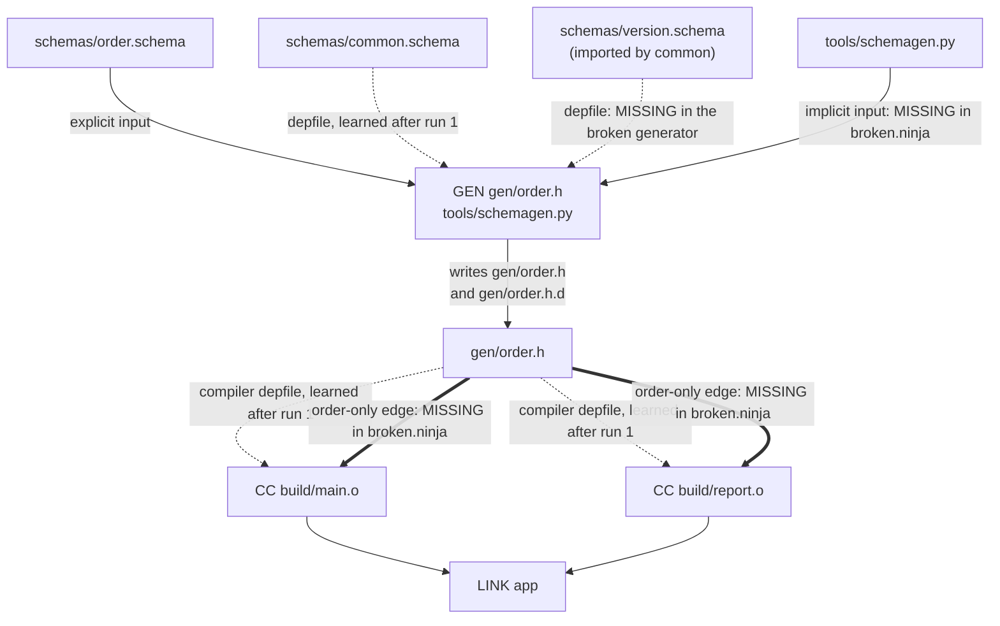

# Drill: Fix a Broken Incremental Depfile Generator

> [!summary] Claim:
> A depfile is a promise from a command to the build tool: "these are every file I read".
> Ninja believes it without checking, so a generator that under-reports leaves stale output with a green build, and one that over-reports or misspells a path rebuilds forever.
> A depfile is also learned only after a command runs, so it can never order the first build of a generated header or a newly added `#include`; that needs a static order-only edge.
> This drill reproduces five generator bugs and two manifest bugs in a schema-to-header code generator under Ninja and CMake, and fixes each with a check that fails on the broken version.

The general mechanics of `.ninja_log`, `.ninja_deps`, `depfile`, pools, and `dyndep` are owned by [[Make-and-Ninja-Mechanics]].
The theory of why a rebuilder needs complete dependency traces is owned by [[Build-System-Theory-Schedulers-and-Rebuilders]].
How CMake models targets and usage requirements is owned by [[Modern-CMake-Architecture-and-Targets]].
This note owns the debugging drill: finding and fixing a code generator whose dependency metadata is wrong.



Dotted edges exist only after a command has run and written its depfile, and only in `.ninja_deps`.
Thick edges are static and exist from the first parse of `build.ninja`.
Every bug in this drill is a dotted edge that is wrong or a thick edge that is missing.

## Reproduction

The lab is `code/06-Build-Systems/drill_broken_depfile/`.

```bash
cd code/06-Build-Systems/drill_broken_depfile
bash run.sh
```

It needs Ninja 1.11 or newer (for `-t missingdeps`), CMake 3.29 or newer, `python3`, and a C compiler (`${CC:-cc}`); `run.sh` fails with a message naming the missing tool.
It needs no network, no root, and no container, so it has no `# requires:` line.

| File | Role |
| :--- | :--- |
| `schemagen_broken.py` | The generator as shipped: correct header text, wrong build metadata. This is the file you fix. |
| `schemagen_fixed.py` | The model solution. Read it only after the hint ladder. |
| `manifests/broken.ninja` | The manifest as shipped: no order-only edges, generator script not an input, no `restat`. |
| `manifests/fixed.ninja` | The model manifest; each change is marked `FIX`. |
| `project/` | Schemas (`order` imports `common`, which imports `version`; `vendor schemas/money.schema` has a space in its path) and two C sources. |
| `cmake/CMakeLists.txt` | The same generator wired through `add_custom_command(... DEPFILE ...)`. |
| `drill.py` | Builds a fresh scratch tree per scenario and prints derived facts, never raw mtimes or paths. |

The schema language is four directives: `import <path>` (relative to `--root`, spaces allowed), `const NAME VALUE`, `struct Name`, and `field name ctype`; `#` starts a comment that never reaches the header.
The generator is invoked as `schemagen.py --root ROOT IN.schema OUT.h OUT.h.d`, and in both Ninja manifests the rule is:

```ninja
rule schemagen
  command = $python tools/schemagen.py --root . $in $out $out.d
  depfile = $out.d
  deps = gcc
  description = GEN $out
```

Two fault-injection knobs behave identically in both generators: `SCHEMAGEN_DELAY=SECONDS` sleeps after parsing and before writing (a slow generator), and `SCHEMAGEN_CRASH_MIDWRITE=1` dies after writing half of the header bytes.
Scenarios 1 to 5 build both generators with `fixed.ninja` (or a one-line variant of it), so only the generator differs; scenario 6 uses the fixed generator with both manifests, so only the manifest differs.

## Observed Symptom

The ticket, as it arrives, reports four things:
- After bumping `SCHEMA_VERSION` in `version.schema`, `ninja` says `no work to do` and the binary still reports version 1.
- CI with `-j64` fails about once a week with `'order.h' file not found`.
- A teammate saw `main` and `report` disagree about the schema version in the same binary.
- Some no-op builds recompile everything, and a clean rebuild always makes every problem go away.

The broken-generator lines of the recorded run reproduce every clause (darwin-arm64, macOS 27.3, Ninja 1.13.2, CMake 4.5.0, Apple clang 21.0.0, Python 3.15.2, recorded 2026-11-14; excerpt from `expected/darwin-arm64.txt`):

```text
=== 1. Edit a schema imported two levels down (version.schema: SCHEMA_VERSION 1 -> 2) ===
[broken generator] recorded deps: gen/order.h: #deps 2, deps mtime MTIME (VALID) -> schemas/order.schema | schemas/common.schema
[broken generator] rebuild after the edit: no work to do
[broken generator] app: main sees SCHEMA_VERSION 1, report sees 0, sizeof(struct Order) 16
```

```text
=== 2. Import a path that contains a space (vendor schemas/money.schema) ===
[broken generator] recorded deps: gen/order.h: #deps 4, deps mtime MTIME (VALID) -> schemas/order.schema | schemas/common.schema | vendor | schemas/money.schema
[broken generator] explain: vendor is dirty
[broken generator] explain: schemas/money.schema is dirty
[broken generator] explain: gen/order.h is dirty
[broken generator] explain: build/main.o is dirty
[broken generator] second build, nothing edited: GEN gen/order.h, CC build/main.o, LINK app
[broken generator] third build, nothing edited: GEN gen/order.h, CC build/main.o, LINK app
```

```text
=== 6. Generated-header ordering under -j4 with a slow generator (fixed generator in both) ===
[broken manifest] clean build, -j4: FAILED, the compiler could not find order.h
[fixed manifest] clean build, -j4: succeeded
[broken manifest] incremental build, -j4: CC build/report.o, GEN gen/order.h, CC build/main.o, LINK app
[broken manifest] app: main sees SCHEMA_VERSION 2, report sees 1, sizeof(struct Order) 16
```

The last line is the dangerous one: the build exited 0, and two translation units in one binary were compiled against different versions of the same generated header.
For a struct layout instead of a constant, that is an ODR violation (undefined behavior) that can corrupt memory at run time without any diagnostic.

## Progressive Hint Ladder

Work from the symptom with Ninja's own diagnostics before reading the generator.

> [!tip]- Hint 1: Ask Ninja what it believes, not what you believe
> `ninja -t deps gen/order.h` prints the dependency list stored in `.ninja_deps` for that output, with a `VALID` or `STALE` flag.
> `ninja -n -d explain` prints why each edge is dirty, without running anything.
> Compare the stored list against the set of files the generator actually opens.
> On Linux, `strace -f -e trace=open,openat -o trace.txt ninja gen/order.h` shows the real set; on macOS, add a print of every opened path to the generator.

> [!tip]- Hint 2: The stored list is short, and short means stale
> For the broken generator the stored list has 2 entries; the generator opened 3 files.
> `version.schema` is imported by `common.schema`, not by `order.schema`, so a generator that records only the top-level file's own imports misses it.
> Ninja cannot know about a file nobody told it about; it rebuilds only when a recorded input is newer than the output's recorded mtime.

> [!tip]- Hint 3: Read the depfile as Ninja's parser reads it
> Run `ninja -d keepdepfile gen/order.h` so Ninja does not delete `gen/order.h.d` after reading it, then read the file.
> Ninja parses the Makefile subset that GCC and Clang emit: whitespace separates paths, `\ ` is a literal space, `\#` is a literal `#`, `$$` is a literal `$`, and other backslashes are literal.
> An unescaped `vendor schemas/money.schema` is two paths, `vendor` and `schemas/money.schema`, and neither exists.

> [!tip]- Hint 4: The target name is checked in one mode and ignored in the other
> Look at the left-hand side of the broken depfile: `order.h:`, not `gen/order.h:`.
> With `deps = gcc`, Ninja v1.13.2 never compares the target with the edge's output; the code says `// XXX check depfile matches expected output.`
> Delete the `deps = gcc` line and Ninja re-reads the depfile at every startup and does check it; run `ninja -n -d explain` and read the message.

> [!tip]- Hint 5: Count the compiles after a comment-only edit
> Add a comment to `order.schema`; the header text cannot change.
> The broken generator still rewrites `gen/order.h`, so its mtime moves and every consumer recompiles.
> Writing only when the bytes differ is half of the fix; find the Ninja rule binding that makes Ninja look at the mtime after the command and prune what depends on it.
> Then predict what happens over the next three builds if you do only one half.

> [!tip]- Hint 6: A depfile cannot order the first build
> `ninja -t missingdeps` lists every target whose depfile names a generated file but which has no static path to that file's generator.
> On a clean tree there is no deps log, so `build/main.o` has no edge to `gen/order.h` and `-j4` starts both at once.
> On an incremental build, a newly added `#include "order.h"` in `report.c` is in no deps log either.
> Which kind of dependency is built for exactly this, and why must it not be an implicit (`|`) one?

> [!tip]- Hint 7: Make the write unobservable until it is complete
> `open(path, "w")` truncates the existing header immediately; any reader in that window, and any reader after a crash, sees a partial file.
> Look at `rename(2)`: what does it promise to a concurrent reader of the destination path?

## Model Solution

> [!success]- Solution
> **Diagnosis.**
> `schemagen_broken.py` emits a correct header but lies in its depfile and write path five ways, and `broken.ninja` is missing two static edges.
>
> | # | Bug | Where | Symptom | Fix |
> | :--- | :--- | :--- | :--- | :--- |
> | 1 | Depfile lists the schema and its direct imports only | generator | Edit of `version.schema` is ignored: stale header, green build | Record every file opened, transitively, as it is opened |
> | 2 | Depfile target is `basename(out)` (`order.h`), not the declared output (`gen/order.h`) | generator | Silent under `deps = gcc`; perpetual rebuild with a plain `depfile` | Write `$out` exactly as Ninja passed it |
> | 3 | Paths are not escaped | generator | A path with a space becomes two missing inputs: rebuild every time, and the real file is untracked | Escape space as `\ `, `#` as `\#`, `$` as `$$`; refuse newlines |
> | 4 | Header rewritten unconditionally | generator | A comment-only edit recompiles every consumer | Write only if the bytes differ, plus `restat = 1` |
> | 5 | Header written in place with truncation | generator | Concurrent readers and post-crash readers see a partial header | Temporary file in the same directory, then `rename(2)` |
> | 6 | Consumers have no order-only edge to the generated header | manifest | Clean `-j` build fails; new `#include` compiles against the old header | `\|\| gen/order.h` on every compile in the target |
> | 7 | Generator script is not an input | manifest | Editing the generator does not regenerate | `\| tools/schemagen.py` on the generator edge |
>
> **Fixed generator (the parts that matter).**
> The full file is `schemagen_fixed.py`.
>
> ```python
> def parse(root, path, consts, structs, opened, stack):
>     if path in stack:
>         raise SystemExit(f"import cycle: {' -> '.join(stack + (path,))}")
>     if path not in opened:
>         opened.append(path)  # record before reading: a failed read still names its input
>     ...
>             if word == "import":
>                 parse(root, rest, consts, structs, opened, stack + (path,))
>
> def escape(path):
>     if "\n" in path or "\r" in path:
>         raise SystemExit(f"cannot express a newline in a depfile path: {path!r}")
>     return path.replace("$", "$$").replace("#", "\\#").replace(" ", "\\ ")
>
> def write_atomically(path, text):
>     fd, tmp = tempfile.mkstemp(prefix=".schemagen-", dir=os.path.dirname(path) or ".")
>     with os.fdopen(fd, "w", encoding="ascii") as f:
>         f.write(text)
>     os.replace(tmp, path)
>
> # main
> if not unchanged:
>     write_atomically(out, text)
> deps = " ".join(escape(depfile_path(root, p)) for p in opened)
> write_atomically(depfile, f"{escape(out)}: {deps}\n")
> ```
>
> `depfile_path` spells each input relative to Ninja's working directory when it lies under it and absolute otherwise, because Ninja compares path strings, not inodes: the manual says an absolute and a relative path to the same file "are considered different by Ninja".
> The temporary file must be in the same directory as the output, because `rename(2)` is atomic only within one filesystem.
>
> **Fixed manifest.**
>
> ```ninja
> rule schemagen
>   command = $python tools/schemagen.py --root . $in $out $out.d
>   depfile = $out.d
>   deps = gcc
>   restat = 1
>   description = GEN $out
>
> build gen/order.h: schemagen schemas/order.schema | tools/schemagen.py
> build build/main.o: cc src/main.c || gen/order.h
> build build/report.o: cc src/report.c || gen/order.h
> ```
>
> The edge must be order-only (`||`), not implicit (`|`).
> An implicit edge would recompile every object in the target whenever the header changes, including objects that never include it; order-only means "build this first" and leaves "rebuild when it changes" to the compiler's own depfile, which names the header only for objects that include it.
>
> **Why each fix works, at the code level (Ninja v1.13.2).**
> 1. `Builder::FinishCommand` calls `ExtractDeps`, which parses the depfile and writes the input list to `.ninja_deps` via `DepsLog::RecordDeps`; on the next run `ImplicitDepLoader::LoadDepsFromLog` splices those nodes into the edge as implicit inputs.
>    A file not in the list is not in the graph, so no mtime of it is ever compared.
> 2. In `ExtractDeps` (the `deps = gcc` path) the parsed targets are never compared with the edge's outputs.
>    In `ImplicitDepLoader::LoadDepFile` (no `deps` binding) the first target is canonicalized and compared with the edge's first output; a mismatch records `expected depfile '%s' to mention '%s', got '%s'` and returns false, which marks the edge dirty, and a second target that is not a declared output is a hard error (`depfile mentions '...' as an output, but no such output was declared`).
> 3. `DepfileParser::Parse` treats an unescaped space as a separator.
>    A depfile input that does not exist and has no producing edge is marked dirty in `RecomputeNodeDirty`, which makes the consuming edge dirty on every run; `Plan::AddSubTarget` does not abort on it because the node was created by the dep loader, which is the mechanism the manual describes as letting you "delete a header file and rebuild without the build aborting".
> 4. With `restat = 1`, `FinishCommand` re-stats each output after the command; an unchanged mtime calls `Plan::CleanNode`, which removes now-unneeded consumers from the plan, and the build log records the command's start time as the output's mtime.
>    On the next run `RecomputeOutputDirty` sees a `restat` edge with a log entry and compares the logged mtime, not the on-disk mtime, against the newest input, so the untouched header is clean.
> 5. Per `rename(2)`, an existing destination "will be atomically replaced, so that there is no point at which another process attempting to access newpath will find it missing".
>    A reader opens either the old inode or the new one.
> 6. An order-only input is skipped when computing dirtiness (`edge->is_order_only(...)` in `RecomputeNodeDirty`) but still has to be ready before the edge can start, so the compile waits for the generator without rebuilding when only the header's mtime moves.
>
> **Verification.**
> Every fix is checked by a scenario in which the broken version produces a different line; see the recorded output below.

### Verified output

Recorded by `python3 -m _harness.verify --record` on darwin-arm64 (macOS 27.3, Ninja 1.13.2, CMake 4.5.0, Apple clang 21.0.0, Python 3.15.2) on 2026-11-14; the file is `code/06-Build-Systems/drill_broken_depfile/expected/darwin-arm64.txt`.
Re-recorded on the same host on 2026-11-15 with `bash run.sh`, after `drill.py` began sorting consecutive `CC` steps, because compiles that `-j4` runs together finish in either order; the only line that changed is scenario 6's fixed-manifest incremental build.
The harness compares stdout only; `MTIME` replaces the nanosecond mtimes that `ninja -t deps` prints.

```text
Lab: broken versus fixed depfile generator (ninja >= 1.11 confirmed)

=== 1. Edit a schema imported two levels down (version.schema: SCHEMA_VERSION 1 -> 2) ===
[broken generator] recorded deps: gen/order.h: #deps 2, deps mtime MTIME (VALID) -> schemas/order.schema | schemas/common.schema
[broken generator] rebuild after the edit: no work to do
[broken generator] app: main sees SCHEMA_VERSION 1, report sees 0, sizeof(struct Order) 16
[fixed generator] recorded deps: gen/order.h: #deps 3, deps mtime MTIME (VALID) -> schemas/order.schema | schemas/common.schema | schemas/version.schema
[fixed generator] rebuild after the edit: GEN gen/order.h, CC build/main.o, LINK app
[fixed generator] app: main sees SCHEMA_VERSION 2, report sees 0, sizeof(struct Order) 16

=== 2. Import a path that contains a space (vendor schemas/money.schema) ===
[broken generator] recorded deps: gen/order.h: #deps 4, deps mtime MTIME (VALID) -> schemas/order.schema | schemas/common.schema | vendor | schemas/money.schema
[broken generator] explain: vendor is dirty
[broken generator] explain: schemas/money.schema is dirty
[broken generator] explain: gen/order.h is dirty
[broken generator] explain: build/main.o is dirty
[broken generator] second build, nothing edited: GEN gen/order.h, CC build/main.o, LINK app
[broken generator] third build, nothing edited: GEN gen/order.h, CC build/main.o, LINK app
[fixed generator] recorded deps: gen/order.h: #deps 4, deps mtime MTIME (VALID) -> schemas/order.schema | schemas/common.schema | schemas/version.schema | vendor schemas/money.schema
[fixed generator] second build, nothing edited: no work to do
[fixed generator] third build, nothing edited: no work to do

=== 3. Depfile target name: deps = gcc versus a plain depfile ===
[broken generator, deps = gcc] second build, nothing edited: no work to do
[fixed generator, deps = gcc] second build, nothing edited: no work to do
[broken generator, plain depfile] explain: expected depfile 'gen/order.h.d' to mention 'gen/order.h', got 'order.h'
[broken generator, plain depfile] second build, nothing edited: GEN gen/order.h, CC build/main.o, LINK app
[fixed generator, plain depfile] second build, nothing edited: no work to do

=== 4. Comment-only schema edit: write-if-changed and restat ===
[broken generator, no restat] build after the edit: GEN gen/order.h, CC build/main.o, LINK app
[broken generator, no restat] next build, nothing edited: no work to do
[broken generator, no restat] and the next: no work to do
[fixed generator, no restat] build after the edit: GEN gen/order.h, CC build/main.o, LINK app
[fixed generator, no restat] next build, nothing edited: GEN gen/order.h, CC build/main.o, LINK app
[fixed generator, no restat] and the next: GEN gen/order.h, CC build/main.o, LINK app
[fixed generator, restat = 1] build after the edit: GEN gen/order.h
[fixed generator, restat = 1] next build, nothing edited: no work to do
[fixed generator, restat = 1] and the next: no work to do

=== 5. Generator dies halfway through writing the header ===
[broken generator] ninja exit status: 1
[broken generator] gen/order.h on disk after the crash: TRUNCATED
[broken generator] leftover temporary files in gen/: 0
[broken generator] what the next build plans: GEN gen/order.h, CC build/main.o, LINK app
[fixed generator] ninja exit status: 1
[fixed generator] gen/order.h on disk after the crash: complete (old contents)
[fixed generator] leftover temporary files in gen/: 1
[fixed generator] what the next build plans: GEN gen/order.h, CC build/main.o, LINK app

=== 6. Generated-header ordering under -j4 with a slow generator (fixed generator in both) ===
[broken manifest] clean build, -j4: FAILED, the compiler could not find order.h
[fixed manifest] clean build, -j4: succeeded
[broken manifest] incremental build, -j4: CC build/report.o, GEN gen/order.h, CC build/main.o, LINK app
[broken manifest] app: main sees SCHEMA_VERSION 2, report sees 1, sizeof(struct Order) 16
[broken manifest] missingdeps: Missing dep: build/main.o uses gen/order.h (generated by schemagen)
[broken manifest] missingdeps: Missing dep: build/report.o uses gen/order.h (generated by schemagen)
[broken manifest] missingdeps: Processed 4 nodes.
[broken manifest] missingdeps: Error: There are 2 missing dependency paths.
[broken manifest] missingdeps: 2 targets had depfile dependencies on 1 distinct generated inputs (from 1 rules)  without a non-depfile dep path to the generator.
[broken manifest] missingdeps: There might be build flakiness if any of the targets listed above are built alone, or not late enough, in a clean output directory.
[broken manifest] missingdeps exit status: 3
[broken manifest] what the next build plans: CC build/report.o, LINK app
[fixed manifest] incremental build, -j4: GEN gen/order.h, CC build/main.o, CC build/report.o, LINK app
[fixed manifest] app: main sees SCHEMA_VERSION 2, report sees 2, sizeof(struct Order) 16
[fixed manifest] missingdeps: Processed 4 nodes.
[fixed manifest] missingdeps: No missing dependencies on generated files found.
[fixed manifest] missingdeps exit status: 0
[fixed manifest] what the next build plans: no work to do

=== 7. The same generators under CMake's Ninja generator (add_custom_command DEPFILE) ===
[CMake build.ninja] custom command edge sets deps = gcc: yes
[CMake build.ninja] custom command edge sets restat = 1: yes
[CMake build.ninja] Ninja reads CMake's transformed copy under CMakeFiles/d/: yes
[CMake build.ninja] command runs cmake -E cmake_transform_depfile: yes
[CMake build.ninja] output also declared under its absolute path: yes
[CMake build.ninja] main.c.o has an order-only dependency: yes
[CMake build.ninja] that order-only phony depends on gen/order.h: yes
[CMake, broken generator] rebuild after editing version.schema: 0 steps
[CMake, broken generator] app: main sees SCHEMA_VERSION 1, report sees 0, sizeof(struct Order) 16
[CMake, fixed generator] rebuild after editing version.schema: 3 steps (GEN, CC main.c.o, LINK)
[CMake, fixed generator] app: main sees SCHEMA_VERSION 2, report sees 0, sizeof(struct Order) 16
```

### Reading the output scenario by scenario

**Scenario 1, transitive imports.**
The broken deps list has 2 entries and the edit to `version.schema` produces `no work to do` with a stale binary; the fixed list has 3 and the edit runs exactly `GEN`, the one compile that includes the header, and the link.
`report.o` does not rebuild in either case because `report.c` does not include `order.h`; the compiler's own depfile, not the order-only edge, decides who recompiles.

**Scenario 2, unescaped space.**
`ninja -t deps` shows the split: `vendor` and `schemas/money.schema` instead of `vendor schemas/money.schema`.
Both are missing and have no producing edge, so `explain` reports them dirty, and the dirtiness propagates to `gen/order.h` and then to `build/main.o`.
The result is a perpetual rebuild, which masks the staleness: the real `money.schema` is never tracked, but nobody notices because everything rebuilds anyway.
The fixed generator records 4 correct entries, including the transitive `version.schema` and the escaped path, and a second build is `no work to do`.

**Scenario 3, target name.**
Under `deps = gcc` the broken `order.h:` target is accepted silently, matching the `XXX` comment in `Builder::ExtractDeps`.
With the `deps` line removed, Ninja rejects the same file at startup with the exact `expected depfile ... to mention ...` explanation from `ImplicitDepLoader::LoadDepFile` and rebuilds every time.
The bug is latent until someone drops `deps = gcc`, runs the generator under another tool that checks targets, or feeds the depfile to Make.

**Scenario 4, restat.**
The broken generator rewrites the header, so one comment edit costs a compile and a link, after which the tree is clean.
The half-fix (write-if-changed without `restat`) is worse than no fix: the header keeps its old mtime, which stays older than the edited schema, so `RecomputeOutputDirty` finds `output gen/order.h older than most recent input` on every run and the generator, compile, and link repeat forever.
With both halves, the comment edit costs one generator run and no compile, and the next build is clean because the build log holds the command start time as the header's recorded mtime.

**Scenario 5, crash mid-write.**
Both builds fail with status 1 and both plan a rerun next time, because the failed command wrote no new build log entry and the schema is newer than the old one.
The difference is what is on disk in between: the broken generator leaves a truncated `gen/order.h` for any IDE indexer, language server, or hand-run compiler to read, while the fixed one leaves the old complete header and one orphaned `.schemagen-*` temporary file.
Ninja removes outputs only when a build is interrupted or aborts on an internal error (`Builder::Cleanup`, which, for edges still running, deletes every output of an edge that uses a depfile and any other output whose mtime changed), not when a command exits with an error.

**Scenario 6, ordering.**
Both runs use the fixed generator, so every difference is the manifest.
With `broken.ninja`, a clean `-j4` build starts the compile and the slow generator together and the compile fails; that is the weekly CI flake.
The incremental run is the silent version: `report.o` has a fresh `#include "order.h"` that is in no deps log yet, so it compiles immediately against the old header while the generator sleeps, and `report.o` finishes first.
`main.o` waits correctly because its deps log entry already names `gen/order.h`, so the binary mixes versions 2 and 1.
`ninja -t missingdeps` flags both objects, not just `report.o`, because it checks for a static path to the generator, and `main.o` only has a learned one; it exits with status 3, which `ToolMissingDeps` returns when it finds anything.
The next build would heal the tree (`CC build/report.o, LINK app`), because the header is now newer than `report.o`; that self-healing is why the bug looks like flakiness instead of a defect.

**Scenario 7, CMake.**
CMake 4.5.0's Ninja generator already supplies both manifest fixes: the custom command edge gets `deps = gcc` and `restat = 1`, and every object of `app` has an order-only edge to a `cmake_object_order_depends_target_app` phony that depends on `gen/order.h`, because the header is listed as a source of `app`.
It cannot fix the generator: with the broken generator the `version.schema` edit runs 0 steps and the binary is stale, with the fixed one it runs `GEN`, the one compile, and the link.

## What CMake does with DEPFILE

The scenario 7 checks are derived from the generated `build.ninja`; the shape they test, observed on the recording host with CMake 4.5.0, is:

```ninja
build cmake_object_order_depends_target_app: phony || gen/order.h

build CMakeFiles/app.dir/src/main.c.o: C_COMPILER__app_unscanned_ /ABS/src/src/main.c || cmake_object_order_depends_target_app

build gen/order.h | ${cmake_ninja_workdir}gen/order.h: CUSTOM_COMMAND /ABS/src/schemas/order.schema /ABS/src/schemagen.py
  COMMAND = cd /ABS/build && ... schemagen.py --root /ABS/src schemas/order.schema gen/order.h gen/order.h.d && cmake -E cmake_transform_depfile Ninja gccdepfile ... /ABS/build/gen/order.h.d /ABS/build/CMakeFiles/d/<sha256>.d
  DESC = GEN gen/order.h
  depfile = CMakeFiles/d/<sha256>.d
  deps = gcc
  restat = 1
```

`/ABS` stands for the scratch directory and the command is shortened; the compile rule in `CMakeFiles/rules.ninja` was `-MD -MT $out -MF $DEP_FILE` with `deps = gcc`.
Points that follow from it:
- Under policy CMP0116 (introduced in CMake 3.20), a relative `DEPFILE` and the relative paths inside it are interpreted relative to `CMAKE_CURRENT_BINARY_DIR`; CMake leaves your depfile untouched and writes a transformed copy that Ninja reads, which is the `cmake_transform_depfile` step.
  With the policy `OLD`, the depfile went to Ninja unaltered, so a custom command in a subdirectory had to spell paths relative to the top-level build directory.
- The output is declared twice, as `gen/order.h` and as `${cmake_ninja_workdir}gen/order.h`, so a depfile that names the generated file by its absolute path still matches the producing edge.
  An exploratory `ninja -t deps gen/order.h` in the CMake tree on the same host listed the three schemas by absolute path, because they live outside the build directory.
- `DEPFILE` was added in CMake 3.7 for the Ninja generator, gained Ninja Multi-Config in 3.17, Makefile generators in 3.20, and Visual Studio (2012 and newer) and Xcode plus generator expressions in 3.21; since 3.29 the Ninja generators put the dependencies into the deps log when the depfile is not listed in `OUTPUTS` or `BYPRODUCTS`, which is the `deps = gcc` line above.
  Using `DEPFILE` with any other generator is an error.
- `DEPFILE` cannot be combined with `APPEND` (policy CMP0175), and for Makefile generators not with `IMPLICIT_DEPENDS`.
- CMake's documentation warns: "Do not list the output in more than one independent target that may build in parallel or the instances of the rule may conflict."
  That is a CMake-level version of bug 5 with two writers instead of a writer and a reader; the documented fix is one `add_custom_target` that owns the command, with the consumers depending on it.
- The order-only edge exists only for targets that list the generated header as a source or depend, through `add_dependencies` or a linked target, on a target that does.
  A second executable in another directory that includes `gen/order.h` through an include path, without either, gets no edge and reproduces scenario 6.
  A configure-only check on darwin-arm64 with CMake 4.5.0 and Ninja 1.13.2 showed it: the top-level `app` listing `gen/order.h` as a source got `build cmake_object_order_depends_target_app: phony || gen/order.h`, while a subdirectory `other` that only had `-I.../gen` got `build cmake_object_order_depends_target_other: phony || .`, with no reference to the header (not part of the lab, so no recorded output).
  The `add_custom_command` documentation's multiple-targets example gives the same advice from the other side: attach the output to one target and make every consumer depend on that target.

## Core Takeaway

A depfile is an unverified side channel, so a generator that writes one owns three obligations: report every file it read (transitively, including ones that failed to parse), spell each path exactly as the manifest spells it with Make escaping, and change its outputs only when their bytes change, atomically.
The manifest owns the fourth: a static order-only edge from every possible consumer to every generated header, because learned dependencies cannot order the build that learns them.
`ninja -t deps`, `ninja -n -d explain`, `ninja -d keepdepfile`, and `ninja -t missingdeps` turn each obligation into something you can check in seconds.
The owning concept note for the underlying Ninja machinery is [[Make-and-Ninja-Mechanics]]; the theory of complete traces and early cutoff (which is what `restat` implements) is in [[Build-System-Theory-Schedulers-and-Rebuilders]].

## Commands and Numbers to Know

| Item | Platform | Value `(as of 2026-11)` | Why it matters |
| :--- | :--- | :--- | :--- |
| `ninja -t deps TARGET` | Both | Prints `TARGET: #deps N, deps mtime M (VALID\|STALE)` then one input per line | The ground truth of learned dependencies; `STALE` means the output is missing or newer than the record (`ToolDeps`, v1.13.2). |
| `ninja -n -d explain` | Both | Prints `ninja explain: ...` lines to stderr | Why each edge is dirty, without running anything. |
| `ninja -d keepdepfile` | Both | Keeps depfiles that `deps = gcc` would delete | The only way to read what a `deps` rule's command actually wrote. |
| `ninja -t missingdeps` | Both | Since Ninja 1.11; exit status 3 when it finds missing paths, 0 otherwise (v1.13.2 source) | Finds consumers of generated files with no static path to the generator; a dep on `build.ninja` itself is exempt. |
| `deps = gcc` | Both | Since Ninja 1.3; parse after the command, store in `.ninja_deps`, delete the depfile | Target name in the depfile is not checked (v1.13.2). |
| Plain `depfile =` (no `deps`) | Both | Re-read at every startup; first target must equal the edge's first output | A missing depfile makes the edge dirty (`depfile '%s' is missing`). |
| Missing depfile with `deps = gcc` | Both | Treated as empty: the output is recorded with zero deps | A generator that forgets to write its depfile is silently untracked. |
| `restat = 1` | Both | Re-stat outputs after the command; unchanged mtime prunes consumers | Required for write-if-changed generators, or they regenerate forever. |
| `.ninja_deps` format | Both | Signature `# ninjadeps\n`, version 4; deps record = size word with high bit, node id, 64-bit mtime, input ids | One record per output; a record is capped at `(1 << 19) - 1` bytes, which is 131068 inputs per output. |
| `.ninja_log` format | Both | `# ninja log v7`; fields start ms, end ms, mtime, output, command hash | The logged mtime is the command start time, from statting `.ninja_lock` when the edge starts; for a `restat` or `generator` edge that did change an output, it is the newest output mtime if that is later. |
| Order-only `\|\| dep` | Both | Must be built first; changes alone do not rebuild the output | The fix for generated headers; implicit `\| dep` over-rebuilds. |
| Depfile escapes Ninja accepts | Both | `\ ` space, `\#` hash, `\:` colon not followed by whitespace, `$$` dollar | Other backslashes are literal; a path cannot contain a newline. |
| CMake `add_custom_command(DEPFILE)` | Both | Ninja since 3.7; Makefile 3.20; VS and Xcode 3.21; deps log since 3.29 | Lab: CMake 4.5.0 emitted `deps = gcc` and `restat = 1` for the custom command. |
| CMake CMP0116 | Both | Introduced 3.20; NEW transforms depfile paths relative to `CMAKE_CURRENT_BINARY_DIR` | Always NEW for Makefile, Visual Studio, and Xcode generators. |
| GCC `-MD` / `-MMD` | Both | Depfile as a side effect of compiling; `-MMD` omits system headers | Ninja's rules use them with `-MF $out.d`. |
| GCC `-MT` / `-MQ` | Both | Set the depfile target exactly; `-MQ` also escapes Make specials | Without them, `-M` names the target after the input file with its directories and suffix removed plus the object suffix, the same trap as bug 2; CMake passes `-MT $out`. |
| GCC `-MP` | Both | Adds an empty rule per header so Make survives a deleted header | Ninja does not need it, and its parser tolerates the extra rules. |
| GCC `-MG` | Both | Treats a missing header as generated and lists it without error | A way to discover generated headers, not a substitute for ordering. |

## Pitfalls

> [!warning] Testing incrementality with clean builds
> Every bug in this drill is invisible on a clean build at `-j1` except the ordering bug, and that one is invisible whenever the generator happens to win the race.
> A CI job that only builds from scratch proves nothing about incremental correctness.
> Test the edit-then-rebuild path explicitly: edit each kind of input, rebuild, and assert both the commands that ran and the resulting artifact, as `drill.py` does.

> [!warning] Fixing staleness by over-declaring
> Making every object depend on every generated header (`|` instead of `||`), or adding `always`-dirty phony inputs, hides bugs 1 to 3 by rebuilding too much.
> It turns a correctness bug into a performance bug that grows with the codebase, and it hides the next under-reporting bug too.

> [!warning] Write-if-changed without restat
> Scenario 4 shows the half-fix regenerating and recompiling on every build.
> The two halves are one change: the generator must not touch an unchanged output, and the rule must say `restat = 1`.
> CMake's Ninja generator sets `restat = 1` on custom commands for you; a hand-written `build.ninja` does not.

> [!warning] Path spelling
> `gen/order.h`, `./gen/order.h`, and `/abs/build/gen/order.h` are three spellings of one file.
> Ninja canonicalizes `./` and `..` components but never turns a relative path into an absolute one, so an absolute path in a depfile does not match a relative output in the manifest, and the generated file looks like an unrelated leaf.
> Emit paths relative to the build directory when they are inside it, or declare both spellings as CMake does.

> [!warning] Depfile from a command that failed
> With `deps = gcc`, `FinishCommand` runs `ExtractDeps` even for a failing command, to filter compiler output, but records deps only on success.
> A generator that writes its depfile first and then fails leaves nothing recorded; one that writes the header and exits 0 before the depfile is complete records a short list, which is bug 1 again.
> Write the depfile last, atomically, and exit nonzero on any parse error.

> [!warning] Orphaned temporary files
> Scenario 5 shows the fixed generator leaving one `.schemagen-*` file after a crash.
> Give temporaries a recognizable prefix in the output directory, never in `/tmp` (a different filesystem breaks the atomic rename), and sweep stale ones at generator start.

> [!warning] Inputs that are not files
> Environment variables, the generator's own version, and the current time are inputs a depfile cannot express.
> Put them on the command line, where Ninja's command hash in `.ninja_log` catches changes, or into a stamp file that the generator reads and declares; never read the clock.
> See [[Hermetic-and-Reproducible-Builds]].

## At Scale

At 1,000 to 50,000 engineers, generated code is a large fraction of the build graph (RPC stubs, schema headers, protocol tables), and a single under-reporting generator produces a steady trickle of "works after a clean build" tickets that nobody can reproduce.

- **Make the checks mechanical.**
  Run `ninja -t missingdeps` after every CI build and fail on exit status 3; it costs one deps log scan.
  The manual's own verification method is to build each listed target alone in a clean output directory and expect a missing-include failure.
- **Fuzz incrementality, not just builds.**
  A nightly job that touches each input class (schema, generator, header, flag) and asserts which edges rerun catches bug classes 1 to 4 before users do.
  A build whose second no-op run is not `no work to do` should fail CI.
- **Own generators as products.**
  Each generator ships with a contract test like this lab: transitive inputs, escaping, exact target spelling, write-if-changed, atomic replace, and a nonzero exit on any error.
- **Prefer systems that do not trust depfiles.**
  Bazel and Buck2 require declared inputs, and under sandboxed or remote execution an undeclared file is not visible to the action, so under-reporting fails loudly instead of silently; see [[Bazel-Skyframe-Bzlmod-and-Execution-Model]] and [[Sandboxing-and-Hermetic-Execution-Internals]].
  The cost is that every input must be known before the action runs, which is exactly what a depfile avoids.
- **Caches amplify the damage.**
  A local compiler cache or a remote cache keyed by declared inputs can serve an object built against a stale generated header to every engineer who shares the key; see [[Compiler-Caches-ccache-and-sccache]] and [[Remote-Execution-API-and-Remote-Caching]].
- **Decision rule.**
  For a generated header consumed by more than one target, give it one owning target (CMake `add_custom_target`, or one Ninja edge) and make consumers depend on that target; never let two independent targets each run the generator.
  When a consumer's dependency set is only known after scanning (C++20 modules, Fortran modules), depfiles are the wrong tool and `dyndep` is the right one; see [[Cpp-Modules-in-Build-Systems]].

## Practice Drill

> [!tip] Practice Drill: Re-break it one bug at a time
> Copy the lab to a scratch directory, replace `schemagen_fixed.py` with your own fix of `schemagen_broken.py`, and run `bash run.sh`; your fix is complete when every `[fixed ...]` line matches `expected/darwin-arm64.txt`.
> Then reintroduce one bug at a time into the fixed generator and predict which scenario lines change before you run it.
> 1. Record only direct imports again: scenario 1 shows 2 deps and `no work to do`; scenario 2 shows 3 deps for the fixed generator.
> 2. Replace `escape(out)` with `os.path.basename(out)`: scenario 3's plain-depfile line for the fixed generator now prints the `expected depfile` explanation and a full rebuild.
> 3. Remove `|| gen/order.h` from `report.o` only: scenario 6 reports `report sees 1`, and `missingdeps` lists only `build/report.o`.
> 4. Write the temporary file under `tempfile.gettempdir()` instead of the output directory: `os.replace` fails with `EXDEV` (`Invalid cross-device link` on Linux, `Cross-device link` on macOS) on any host where the temp directory is on another filesystem.
> 5. Stretch: add a second generated header `gen/fill.h` that `#include`s `order.h`, and make both the generator and the manifest express the new chain without an implicit edge.
> Target time: under 30 minutes for the main fix, then continue with [[Drill-Build-Systems-Break-a-Dependency-Bottleneck]].

## Interview Questions

> [!question] L5
> What is a depfile, and what does `deps = gcc` change about how Ninja uses it?
>
> > [!success]- Answer
> > A depfile is a Makefile-syntax file, written by the command itself, listing the inputs the command discovered while running (headers for a compiler, imports for a generator).
> > Without `deps`, Ninja re-reads every depfile at startup, checks that its first target equals the edge's first output, and leaves the files on disk.
> > With `deps = gcc` (since Ninja 1.3), Ninja parses the depfile right after the command succeeds, stores the inputs in the binary `.ninja_deps` log, and deletes the depfile; startup then reads one log instead of thousands of small files.
> > In v1.13.2 the `deps = gcc` path does not check the target name at all, which the source marks with an `XXX` comment.

> [!question] L5
> Why can a generated header not rely on the compiler's depfile for ordering, and what is the fix in Ninja?
>
> > [!success]- Answer
> > The compiler's depfile exists only after the compile has run, so on a clean build, or for an `#include` added since the last build, Ninja has no edge from the object to the header and may start the compile before the generator.
> > The fix is an order-only dependency, `build obj.o: cc src.c || gen/header.h`, which forces the generator to run first without making the object rebuild whenever the header's mtime moves.
> > After the first compile, the depfile adds the real implicit dependency for objects that actually include the header, so they recompile on content changes.
> > `ninja -t missingdeps` (since 1.11) finds every object that is missing such a path.

> [!question] L5
> A generator emits `out/gen.h: in/a.schema in/my file.schema`.
> What does Ninja record, and what happens on later builds?
>
> > [!success]- Answer
> > Ninja's parser splits on unescaped whitespace, so it records three inputs: `in/a.schema`, `in/my`, and `file.schema`.
> > The last two do not exist and have no producing edge, so they are dirty on every scan, which makes `out/gen.h` and everything downstream rebuild on every build.
> > The real `in/my file.schema` is not tracked at all, which the perpetual rebuild hides.
> > The generator must write `in/my\ file.schema`; Ninja also accepts `\#` and `$$`, and treats other backslashes as literal.

> [!question] L6 (predict the output)
> A generator writes its header only when the content changes, and the rule has no `restat`.
> You add a comment to the input schema and run `ninja` three times.
> What runs each time?
>
> > [!success]- Answer
> > Every time: the generator, every compile that includes the header, and the link; the lab recorded `GEN gen/order.h, CC build/main.o, LINK app` on all three runs.
> > The generator leaves the header's old mtime in place, so it stays older than the edited schema, and without `restat` Ninja compares the on-disk mtime and finds `output gen/order.h older than most recent input` on every scan.
> > The consumers are dirty because their input `gen/order.h` is dirty, and without `restat` Ninja does not re-stat after the command to discover that nothing changed.
> > With `restat = 1`, the first run executes only the generator, Ninja records the command start time in `.ninja_log`, and later runs compare that logged mtime, so they print `no work to do`.

> [!question] L6 (debug this)
> CI at `-j64` fails about once a week with `fatal error: 'proto_gen.h' file not found`; local `-j8` builds never fail, and retrying always passes. `ninja -t missingdeps` prints (first three lines):
>
> ```text
> Missing dep: obj/rpc/client.o uses gen/proto_gen.h (generated by protoc_header)
> Processed 18342 nodes.
> Error: There are 1 missing dependency paths.
> ```
>
> What is wrong and how do you fix it?
>
> > [!success]- Answer
> > `client.o` includes a generated header but has no static (explicit, implicit, or order-only) path to the `protoc_header` edge; its only link to the header is the learned one in `.ninja_deps`.
> > On a CI runner with an empty or partial build directory there is no learned link, so at `-j64` the scheduler can start `client.o` before `protoc` finishes; at `-j8` the generator usually wins.
> > Retrying passes because the first attempt already generated the header.
> > Fix the manifest generator, not the build directory: in CMake, list the header as a source of the target that compiles `client.cc`, or add `add_dependencies(client_lib proto_gen_target)` for a target in another directory; in hand-written Ninja, add `|| gen/proto_gen.h` to the compile.
> > Verify with `ninja -t missingdeps` returning status 0 and with `ninja obj/rpc/client.o` in a clean output directory, which is the manual's suggested check.

> [!question] L6
> Why does the fixed generator write to a temporary file and rename it, and what are the two conditions for that to be safe?
>
> > [!success]- Answer
> > Opening the header with truncation makes the old content disappear immediately; until the write completes, a concurrent reader (a compile with a missing order-only edge, an IDE indexer, a language server, another build directory sharing the source tree) sees an empty or partial header, and a crash leaves it that way.
> > `rename(2)` replaces an existing destination atomically: a reader opens either the old file or the new one, never a mix, and never finds the path missing.
> > Condition one: the temporary file must be on the same filesystem as the destination, so put it in the output directory, not in `/tmp`; otherwise the rename fails with `EXDEV`.
> > Condition two: the rename must be the last step, after the content is fully written and closed, and the depfile must be written after the header.
> > Atomicity does not order anything; it only removes torn reads, so the order-only edge is still required.

> [!question] L7+
> Your company's CMake build has hundreds of custom code generators written by different teams.
> How do you make incremental correctness a property of the platform instead of a per-team hope?
>
> > [!success]- Answer
> > Provide one CMake function that wraps `add_custom_command`: it requires `DEPFILE`, adds the generator script and its version to `DEPENDS`, attaches the output to exactly one owning target, and exports that target so consumers link it, which gives every consumer an order-only edge.
> > Ship a generator test kit like this lab (transitive inputs, escaping, exact target spelling, write-if-changed, atomic replace, nonzero exit on error) and require it in the generator's own CI.
> > In the monorepo CI, fail on `ninja -t missingdeps` status 3 and on any second no-op build that is not `no work to do`, and run a nightly edit-and-rebuild fuzzer over input classes.
> > Measure the remaining "clean build fixed it" tickets as an SLO.
> > For generators whose inputs cannot be enumerated reliably, move them to a sandboxed system (Bazel or Buck2) where undeclared inputs are invisible, and accept the cost of declaring inputs up front.

> [!question] L7+
> Compare depfiles, Ninja `dyndep`, and Bazel's declared-input model as ways of handling dependencies discovered at build time.
>
> > [!success]- Answer
> > A depfile reports inputs after the command ran; it can only add implicit inputs for the next build, cannot add outputs, and cannot order the build that produces it, so correctness rests on the command telling the truth and on separate static ordering edges.
> > `dyndep` (since Ninja 1.10) loads a file produced earlier in the same build that can add inputs and implicit outputs to edges before they run, which is what C++20 module and Fortran module builds need, because one compile's output (a module interface) is another compile's input; see [[Cpp-Modules-in-Build-Systems]].
> > Bazel requires every action input to be declared before the action runs, and with sandboxed or remote execution an undeclared file is simply not visible to the action, so under-reporting fails loudly; it trades depfile-style precision for up-front declaration work.
> > The common invariant: either the build system verifies the dependency set (sandboxing, hashing declared inputs), or it trusts the tool, and trust needs tests.

> [!question] L8+
> A remote cache keyed on declared inputs is serving an object file compiled against a stale generated header to most of the company.
> Walk through the causal chain and the systemic fix.
>
> > [!success]- Answer
> > The generator under-reported its inputs, so one developer's local build produced a header from stale transitive inputs, or a compile ran before the header was regenerated because the consumer had no ordering edge.
> > The compile action's cache key covered its declared inputs, and if the generated header's bytes were not part of the key (a learned, not declared, input), a poisoned object was uploaded under a key that every other engineer computes identically.
> > Fixes, in order: purge entries by key prefix or time window; make generated headers declared inputs of every consumer so their content hash enters the key; allow cache writes only from trusted CI workers that build in clean sandboxes, never from developer machines; and add the generator contract tests and `missingdeps` gate so the root bug cannot recur.
> > See [[Remote-Execution-API-and-Remote-Caching]] for how action keys are formed.

## Further Reading

- The Ninja manual, v1.13.2, https://github.com/ninja-build/ninja/blob/v1.13.2/doc/manual.asciidoc.
  The authoritative semantics of `depfile`, `deps`, `restat`, the three dependency kinds, and the `deps` and `missingdeps` tools, with the version each appeared in.
- Ninja `src/graph.cc` and `src/build.cc`, v1.13.2, https://github.com/ninja-build/ninja/tree/v1.13.2/src.
  `RecomputeOutputDirty`, `LoadDepFile`, `ExtractDeps`, and `FinishCommand` are the exact code paths every scenario in this drill exercises.
- Ninja `src/depfile_parser.in.cc`, v1.13.2, https://github.com/ninja-build/ninja/blob/v1.13.2/src/depfile_parser.in.cc.
  The precise escaping rules, including the backslash-run rules that differ from GNU Make.
- CMake `add_custom_command` documentation, https://cmake.org/cmake/help/latest/command/add_custom_command.html.
  `DEPFILE` syntax and generator support by version, and the documented race for outputs listed in more than one target.
- CMake policy CMP0116, https://cmake.org/cmake/help/latest/policy/CMP0116.html.
  Why CMake rewrites depfile paths for Ninja and what changed in 3.20.
- GCC Preprocessor Options, https://gcc.gnu.org/onlinedocs/gcc/Preprocessor-Options.html.
  The `-M` family that defines the depfile dialect every build tool parses.
- rename(2), https://man7.org/linux/man-pages/man2/rename.2.html.
  The atomic-replacement guarantee and its same-filesystem limit.

## Related

- Prerequisites: [[Make-and-Ninja-Mechanics]]
- Next: [[Drill-Build-Systems-Break-a-Dependency-Bottleneck]]
- See also: [[Modern-CMake-Architecture-and-Targets]], [[Build-System-Theory-Schedulers-and-Rebuilders]], [[Cpp-Modules-in-Build-Systems]]
- Lab: `code/06-Build-Systems/drill_broken_depfile/`
