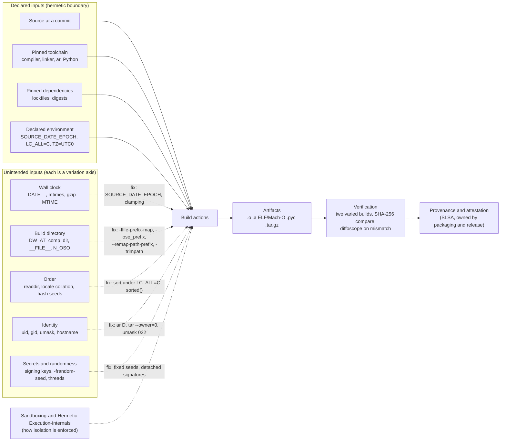

# Hermetic and Reproducible Builds

> [!summary] Claim:
> A build is reproducible when anyone who has the same source, build environment, and build instructions can recreate bit-for-bit identical artifacts, and hermetic when the build can see no inputs except the ones it declares.
> Almost every real-world difference between two builds of the same commit comes from a short list of unintended inputs: the wall clock, the build directory, file system order, locale and time zone, seeded or scheduling randomness, the user and umask, and signing keys.
> Each has a standard fix: `SOURCE_DATE_EPOCH` replaces the clock, prefix maps rewrite paths, sorting under `LC_ALL=C` fixes order, and deterministic `ar`, `tar`, `gzip`, and `.pyc` modes strip metadata.
> You verify reproducibility by building twice under deliberately different conditions and comparing hashes, then use `diffoscope` to find the field that differs; you never verify it by building twice on one machine.



## The Mechanism

### 1. Three properties that are often confused

The Reproducible Builds project defines the property precisely: "A build is reproducible if given the same source code, build environment and build instructions, any party can recreate bit-by-bit identical copies of all specified artifacts."
Three parts of that sentence carry the weight.

- "Build environment" means the relevant attributes only, such as dependency versions, configuration flags, and the environment variables the build reads; the project advises keeping that set small.
- "Any party" means a third party on another machine, which is why a second build on the same host proves almost nothing.
- "Specified artifacts" are the primary outputs, such as executables, packages, and file system images; build logs are usually excluded.

Bazel's documentation defines the neighboring property: "When given the same input source code and product configuration, a hermetic build system always returns the same output by isolating the build from changes to the host system."
It splits hermeticity into isolation ("Hermetic build systems treat tools as source code") and source identity (inputs identified by content hashes).

Russ Cox's account of the Go 1.21 toolchain adds the vocabulary that makes the difference operational.
A relevant input is anything whose change can change the output, and an unintentional input is a relevant input nobody meant to have; the current time is "the most common unintentional input in build systems".
A build is reproducible if every relevant input can be supplied again, and "perfectly reproducible" when the only relevant input left is the source code, which Go claims for toolchains from Go 1.21.0 onward.

The three properties relate as follows.

| Property | Question it answers | Typical mechanism | Owning note |
| :--- | :--- | :--- | :--- |
| Deterministic | Same inputs, same process: same bytes? | No clock, no seeds, no unsorted iteration in tools | This note |
| Hermetic | Can the build see anything it did not declare? | Pinned toolchains, no network, sandboxed actions | This note (principle), [[Sandboxing-and-Hermetic-Execution-Internals\|Sandboxing internals]] (enforcement) |
| Reproducible | Can a third party recreate the exact bytes? | Deterministic plus hermetic plus recorded environment | This note |
| Attested | Who built it, from what, and can I prove it? | Signed provenance (SLSA, in-toto) | Packaging and release pillar |

A hermetic build that runs a nondeterministic compiler is not reproducible, and a deterministic build that reads `/usr/include` from the host is reproducible only on hosts that happen to match.
Reproducibility also feeds attestation: SLSA v1.1 Build L2 allows provenance to be generated "during the original build, an after-the-fact reproducible build, or some equivalent system", while SLSA v1.0 deferred its earlier "hermetic builds (SLSA L4)" requirement to a future version.

### 2. Why bit-for-bit matters: verification and caching

Ken Thompson's 1984 Turing lecture (CACM 27(8)) showed that a compiler binary can insert a backdoor into the programs it compiles, including future copies of itself, with no trace in any source file.
Reading the source cannot detect that; comparing binaries can.
If two independent parties build the same source and get the same hash, a single compromised builder would have to compromise the other as well.
David Wheeler's 2009 dissertation turns this into a procedure, Diverse Double-Compiling: compile the source of the compiler's parent with a second, trusted compiler, compile the compiler's source with the result, and if the output is bit-for-bit identical to the untrusted executable, "the source code accurately represents the executable".
DDC requires reproducible compiler builds; without them the comparison is meaningless.

The second payoff is caching.
A content-addressed cache keys each action by the hashes of its inputs, as [[Build-System-Theory-Schedulers-and-Rebuilders]] describes under constructive traces.
When a compile emits a fresh timestamp, its output hash changes on every build, so every downstream action misses the cache even though nothing meaningful changed, and early cutoff can never fire.
Go's build cache made this concrete: Go 1.10 introduced a content-aware build cache, and because the toolchain is itself one of the cache's inputs, the bootstrap "would only converge if the toolchain build on a single machine was reproducible".
[[Remote-Execution-API-and-Remote-Caching]] and [[Compiler-Caches-ccache-and-sccache]] inherit the same dependency: nondeterminism is a cache-miss generator.

### 3. The variation taxonomy

Debian's CI builds every package twice with deliberately different environments, and its published table (as of 2026-11-15) is the most complete list of axes in production use.

| Axis | First build | Second build |
| :--- | :--- | :--- |
| `TZ` | `/usr/share/zoneinfo/Etc/GMT+12` | `/usr/share/zoneinfo/Etc/GMT-14` |
| `LANG` / `LC_ALL` | `C.UTF-8` / not set | `et_EE.UTF-8` on amd64, `nl_BE.UTF-8` on arm64 |
| `uid` / `gid` / `USER` / `HOME` | 1111 / 1111 / `pbuilder1` / `/nonexistent/first-build` | 2222 / 2222 / `pbuilder2` / `/nonexistent/second-build` |
| `umask` | `0022` | `0002` |
| Date | today | a "future" build 398 days later (2027-12-18 for a build on 2026-11-15), also run 6 h 23 min ahead |
| Hostname, domain name | real host, `debian.net` | `i-capture-the-hostname`, `i-capture-the-domainname` (UTS namespace) |
| `/bin/sh` | dash | bash |
| `PATH` | standard | adds `/i/capture/the/path` |
| Parallelism | `DEB_BUILD_OPTIONS=parallel=N` | a different N on amd64 |
| Kernel version | systematically varied on amd64 | |
| Build path | `/build/reproducible-path/$pkg-$ver` | same ("not varied anymore") |
| File system order | `tmpfs` | `disorderfs`, marked "temporarily not" varied |

Two entries deserve attention.
Debian stopped varying the build path, because a fixed path is part of its declared environment and `.buildinfo` files record it; projects that cannot fix the path must remap it instead (section 5).
The 398-day jump is chosen to cross a year boundary, so a year that leaks into an artifact always shows up.
`reprotest` 0.7.33 exposes the same axes as named variations (`environment`, `build_path`, `kernel`, `aslr`, `num_cpus`, `time`, `user_group`, `fileordering`, `domain_host`, `home`, `locales`, `exec_path`, `timezone`, `umask`; the `VARIATIONS` table in `reprotest/build.py`) and runs its control build on one CPU "to try to reduce nondeterminism that might exist due to multithreading".

### 4. Time: `SOURCE_DATE_EPOCH` and clamping

#### The specification

`SOURCE_DATE_EPOCH` Revision 1.1 (27 November 2017; Revision 1.0 was 1 September 2015) defines the variable as a UNIX timestamp, "an ASCII representation of an integer with no fractional component", identical to `date +%s`.
Its rules, quoted from the specification:

- The value "MUST be exported through the operating system's usual environment mechanism" and "MUST be reproducible (deterministic) across different executions of the build".
- It "SHOULD be set to the last modification time of the source", which in practice is the last commit time (`git log -1 --format=%ct`) or the newest changelog entry.
- Builds "MUST use this variable for embedded timestamps in place of the 'current' date and time", and timestamps of files created during the build must be no later than it, which is clamping.
- Builds "MUST NOT unset this variable for child processes if it is already present".
- Formatting "MUST be deferred until runtime if an end user should observe the value in their own locale or timezone", which in effect means format it in UTC at build time.
- A malformed value "SHOULD exit with a non-zero error code".

Clamping matters because a build should rewrite only times it created.
A source file committed at time T keeps its real mtime if it is older than `SOURCE_DATE_EPOCH`, while a freshly compiled object gets `min(mtime, SOURCE_DATE_EPOCH)`.
GNU tar implements this as `--clamp-mtime --mtime=...` (tar 1.29 and later), and `strip-nondeterminism` as `--clamp-timestamp`, documented as not yet implemented for every file format.

#### Compiler implementations

GCC reads the variable through a libcpp callback, `cb_get_source_date_epoch()` in `gcc/c-family/c-common.cc`.
It first appears in `releases/gcc-7.1.0` and is absent from `releases/gcc-6.1.0` (both checked in the source tree).
The callback parses with `strtoll` (`strtol` on hosts without `long long`), rejects trailing garbage, negative values, and values above `MAX_SOURCE_DATE_EPOCH`, and reports "environment variable 'SOURCE_DATE_EPOCH' must expand to a non-negative integer less than or equal to 253402300799".
Because libcpp asks only when it expands `__DATE__` or `__TIME__`, GCC 16.2.0 accepted `SOURCE_DATE_EPOCH=junk` for a file that never uses them (exit 0) and failed only for a file that does (as of 2026-11, macOS, Homebrew GCC).

Clang added support in commit `2c090162746a` (Fangrui Song, October 2022), first released in Clang 16.0.0, whose release notes say the variable replaces the current time in `__DATE__`, `__TIME__`, and `__TIMESTAMP__`.
The patch parses the variable once in `CompilerInvocation.cpp`, caps it at `min(numeric_limits<time_t>::max(), 253402300799)` (9999-12-31T23:59:59Z), and in `ComputeDATE_TIME()` switches from `localtime(time(nullptr))` to `gmtime(SourceDateEpoch)`.
That design difference is observable:

- Apple clang 21.0.0 rejects `SOURCE_DATE_EPOCH=junk` for every translation unit, even one with no date macros: "must be a non-negative decimal integer <= 253402300799" (as of 2026-11, macOS).
- `SOURCE_DATE_EPOCH=1700000000 TZ=Asia/Tokyo` yields `"Nov 14 2023 22:13:20"` from both Apple clang 21.0.0 and GCC 16.2.0, the UTC rendering, not Tokyo time (as of 2026-11, macOS).
- `__TIMESTAMP__` differs: Apple clang replaced it with `Tue Nov 14 22:13:20 2023`, while GCC 16.2.0 still printed the source file's mtime in local time (`Thu Jan  2 03:04:05 2020` for a file touched to that local time; under `TZ=Asia/Tokyo` the same file gave a different hour), which the clang commit message predicted ("GCC as of today does not update `__TIMESTAMP__`") (as of 2026-11, macOS).

Both compilers warn with `-Wdate-time`: clang says "expansion of date or time macro is not reproducible" and GCC says "macro '__DATE__' might prevent reproducible builds".
The Linux kernel documents that it does not use `__DATE__` or `__TIME__`, enables warnings if they are used, and takes its own build time from `KBUILD_BUILD_TIMESTAMP`, with `KBUILD_BUILD_USER` and `KBUILD_BUILD_HOST` for the `/proc/version` banner.

#### Other consumers

- Python's `py_compile` defaults `invalidation_mode` to `PycInvalidationMode.CHECKED_HASH` when `SOURCE_DATE_EPOCH` is set (since 3.7.2; 3.7.0 forced it), producing PEP 552 hash-based pycs whose header holds a 64-bit SipHash of the source instead of its mtime.
- PEP 552's header is four 32-bit words: magic, a flags word (bit 0 hash-based, bit 1 `check_source`), then either mtime and size or the 8-byte hash; the lab prints flags `3`.
- nixpkgs stdenv exports `SOURCE_DATE_EPOCH=315532800` when nothing sets it, because ZIP cannot store dates before 1980 and Python wheels are ZIP files; 315532800 is 1980-01-01T00:00:00Z, although the comment in `setup.sh` says "12:00:00".
- Python's `zipfile.ZipInfo` defaults `date_time` to `(1980, 1, 1, 0, 0, 0)` and raises on older mtimes unless `strict_timestamps=False`, which clamps to 1980-01-01 (and to 2107-12-31 at the top).
- Go chose not to zero archive times because "we thought it would look surprising and possibly even break some tools"; since Go 1.21, `go/VERSION` carries `time 2023-08-04T20:14:06Z`, and the packager stamps every archive member with it.

### 5. Paths: prefix maps and their blind spots

#### What records the build directory

A compiler records paths in at least three places: `__FILE__` (through `assert`, logging macros, and panic messages), DWARF (`DW_AT_comp_dir`, `DW_AT_name`, and the line table's directory list), and sometimes the command line itself.
Linkers add more: ld64 writes an `N_OSO` stab per object into the executable's debug map, holding the object's absolute path and mtime so that `dsymutil` can find it later.
Python embeds the path it was given into each code object's `co_filename`.

#### The flags

| Flag | Rewrites | Introduced |
| :--- | :--- | :--- |
| `-fdebug-prefix-map=OLD=NEW` | Debug information | All GCC versions the project lists; Clang 3.8 |
| `-fmacro-prefix-map=OLD=NEW` | `__FILE__` and related macros | GCC 8, Clang 10 |
| `-ffile-prefix-map=OLD=NEW` | Every `-f*-prefix-map` at once | GCC 8 (`common.opt` in `releases/gcc-8.1.0`, not 7.1.0), Clang 10 (release notes) |
| `-fcanon-prefix-map` (GCC) | Compares canonicalized paths instead of raw text | Documented in current GCC |
| `--remap-path-prefix=FROM=TO` (rustc) | Diagnostics, debug info, `file!()`, and metadata | Rust 1.26.0 |
| `--remap-path-scope=...` (rustc) | Limits remapping to `macro`, `diagnostics`, `debuginfo`, `coverage`, or `object` | Stable in Rust 1.95.0 |
| `trim-paths` (Cargo profile) | Sanitizes paths with fixed prefixes such as `/rustc/<hash>` and `/cargo/registry/<id>` | Unstable (`-Z trim-paths`), as of 2026-11 |
| `go build -trimpath` | Replaces the source directory with the module path | Used for Go 1.21 release toolchains |
| `-oso_prefix PATH` (ld64) | Strips `PATH` from `N_OSO` entries; `.` means the current directory | Apple `ld(1)` |
| `py_compile` `dfile`, `compileall -d`, `-s`, `-p` | `co_filename` in `.pyc` | Python standard library |

GCC documents that `-ffile-prefix-map` is "equivalent to specifying all the individual -f*-prefix-map options" and adds that "Directories referenced by directives are not affected by these options."
The rustc book warns that rustc metadata keeps local paths unless the `all` scope applies, so `.rlib` and `.rmeta` files leak paths under `--remap-path-scope=object`, and that "on Apple platforms, linkers generate OSO entries which are not remapped by the compiler and need to be manually remapped with -oso_prefix."

#### Textual matching, symlinks, and tools that keep their own copy

A prefix map is a string-prefix replacement on the path the tool actually holds, not on the path you think of.
The lab hit this on its first run: it passed `-ffile-prefix-map=/var/folders/.../proj=.`, but Apple clang still recorded `/private/var/folders/.../proj` as the compilation directory.
The cause is how the compiler learns its directory: `llvm::sys::fs::current_path()` in `llvm/lib/Support/Unix/Path.inc` returns `$PWD` when it is absolute and names the same file as `.`, and otherwise falls back to `getcwd()`, which on macOS resolves the `/var` symlink to `/private/var`.
The lab clears the environment, so there is no `PWD` and the map's text no longer matches; `env -i PATH=/usr/bin:/bin cc -g -ffile-prefix-map=$D=. -c t.c` left two `/private/var` strings in the object, and adding `PWD=$D` left none (as of 2026-11, macOS, Apple clang 21.0.0).
The fix is to map every spelling of the root (the lab maps both `str(root)` and `os.path.realpath(root)`), or with GCC to add `-fcanon-prefix-map`.

The second blind spot is a tool that the compiler drives but does not remap.
Homebrew GCC 16.2.0 on macOS, given `-ffile-prefix-map`, wrote mapped `.file` directives into its assembly, yet the object's DWARF 5 line table still held the absolute directory as `include_directories[0]`.
`gcc -v` shows why: the driver runs Apple's `as`, which runs `clang -cc1as` with `-fdebug-compilation-dir=<cwd>`; adding `-Wa,-fdebug-prefix-map=OLD=NEW` or `-Wa,-fdebug-compilation-dir=.` removed the leak (as of 2026-11, macOS).

The third is a flag that records the flags.
GCC enables `-grecord-gcc-switches` by default, appending the command line to `DW_AT_producer`; GCC 16.2.0's producer string (`GNU C23 16.2.0 -fPIC -mmacosx-version-min=27.0.0 -mcpu=apple-m1 -mlittle-endian -mabi=lp64 -g`) omitted the prefix-map option itself, so the map did not leak the path it was hiding.
Clang's opt-in `-grecord-command-line` did leak it: the object then contained the absolute path once (as of 2026-11, macOS).
A changed optimization flag also changes the producer string, which is correct behavior but surprises teams that compare debug builds made with different flags.

Post-processing is a weaker fix.
The build-path page notes that `debugedit` rewrites strings in place without reordering the string hash table, so "the resulting bytes are still depending on the original build path".

### 6. Order: file systems, locales, hash seeds, and threads

Directory listings come back in an order the file system chooses; "Most filesystems do not guarantee that listing files in a directory always results in the same order" (Reproducible Builds, Stable order for inputs).
Every tool that globs a directory, from `tar -cf archive.tar src` to a Makefile `$(wildcard *.c)`, inherits that order, and through it the member order of archives and the link order of executables.

Sorting fixes the order only if the sort is locale independent.
On macOS 27.3, `/usr/bin/sort` placed the names `seed.o stamp.o table.o zone.o` as `seed.o stamp.o zone.o table.o` under `LC_ALL=et_EE.UTF-8`, because Estonian collation puts `z` between `s` and `t`, and in byte order under `LC_ALL=C`; it also placed `B.o` after `a.o` under `en_US.UTF-8` but before it under `C`.
That is why Debian varies its second build into `et_EE.UTF-8`, and why the project's guidance is `LC_ALL=C sort -z` and GNU tar's `--sort=name` (tar 1.28 and later), which is locale independent.

In-process order has the same failure.
CPython salts `str` and `bytes` hashes per process unless `PYTHONHASHSEED` is set (an integer pins it; "random" or unset means a random seed), so iterating a `set` of strings writes a different order on each run; Perl (`PERL_HASH_SEED`), Ruby, and Rust's `HashMap` behave alike, and the Reproducible Builds "Stable order for outputs" page singles out `HashMap` iteration inside `build.rs`, fixed by switching to `BTreeMap`.
Pinning the seed hides the bug for one interpreter version; sorting before output fixes it for every version, which is what the lab's generator does.

Concurrency adds a third source.
Go's toolchain had to sort the output of map iteration and of "running work in multiple goroutines serialized with locks", and it copied its own `sort` and `compress/zlib` packages into the bootstrap tree because a sort that may order equal elements differently, or a compressor tuned between versions, changes bytes without changing meaning.
A build that writes a manifest in completion order, or a linker that sorts symbols with an unstable sort on a non-total key, is reproducible only at `-j1`.

### 7. Archives: the metadata nobody asked for

#### `ar`

An `ar` member header is 60 ASCII bytes: name (16), `ar_date` (12, decimal seconds), `ar_uid` (6), `ar_gid` (6), `ar_mode` (8, octal), `ar_size` (10), and a 2-byte terminator (FreeBSD `ar(5)`); the BSD 4.4 variant that Apple uses stores long names as `#1/<len>` with the name at the start of the member body.
Three of those fields are environment, not content.

GNU `ar`'s `D` modifier makes it "use zero for UIDs, GIDs, timestamps, and use consistent file modes for all files", and binutils configured with `--enable-deterministic-archives` makes `D` the default (Debian since binutils 2.25-6); `U` turns it off, and a deterministic archive makes the `u` (update only newer) modifier ineffective because every mtime is zero.

Apple's `ar` and `libtool` read an undocumented environment variable instead.
In `cctools`, `ar/archive.c` writes `ar_date = 0` when `ZERO_AR_DATE` is present, whatever its value, and `misc/libtool.c` uses it for the table of contents "to allow testing and comparing things for exact binary equality".
On macOS 27.3 with Xcode's tools, `ZERO_AR_DATE=1 ar rcs` wrote mtime, uid, and gid as `0`, but copied each object's mode, so umask `022` and `002` produced members with modes `644` and `664`.
Apple's `libtool(1)` documents `-D` as setting "user ids, group ids, dates, and file modes to reasonable defaults", yet `libtool -static -D` produced the same `644` versus `664` split in the same test, so on this toolchain the fix for modes is a fixed umask, not a flag (as of 2026-11, macOS, ld-27106.1).
`ZERO_AR_DATE` matters at link time as well: ld64 then writes `0` instead of each object's mtime into the `N_OSO` entries.

#### `tar`

GNU tar's manual gives the full recipe, to be run "in the C locale": `--sort=name`, `--format=posix`, `--pax-option='exthdr.name=%d/PaxHeaders/%f'` (only needed when `POSIXLY_CORRECT` would put tar's PID in the extended header name), `--pax-option='delete=atime,delete=ctime'`, `--clamp-mtime --mtime="$SOURCE_EPOCH"`, `--numeric-owner --owner=0 --group=0`, and `--mode='go+u,go-w'`, checked against the manual's section 8.4 on 2026-11-15 (the `--pax-option` `exthdr.name` option "is needed only if POSIXLY_CORRECT is set in the environment").
With `--format=posix --pax-option='delete=atime,delete=ctime' --clamp-mtime --mtime="$SOURCE_EPOCH"`, timestamps on integer-second boundaries, and every non-source file newer than `$SOURCE_EPOCH`, it notes, GNU tar "should generate an archive in ustar format" because no POSIX features are needed and the archive is in the ustar subset of posix format.
macOS ships bsdtar 3.5.3 (libarchive 3.7.4), which has `--uid`, `--gid`, and `--numeric-owner` but not GNU's `--sort` or `--clamp-mtime`, so portable build scripts sort the file list themselves or use a library, as the lab does with Python's `tarfile` (whose default format has been PAX since Python 3.8).

#### Compression and ZIP

RFC 1952 gives every gzip member a 4-byte `MTIME` at byte offset 4, "the most recent modification time of the original file", or the time compression started, with `0` meaning none; the `FNAME` field can add the original name.
`gzip -n` (`--no-name`) omits both, and Python's `gzip.GzipFile(mtime=0, filename="")` does the same; leaving `mtime=None` writes the current time.
The compressor itself is a relevant input: the same data compressed by two zlib versions, or by zlib and zlib-ng, can produce different valid streams, which is why Go vendored `compress/zlib` and why the archives page recommends `git archive --format=tar TAG | gzip -6 -n`: "`tar` output is typically stable, but the internal `gzip` implementation is not."
ZIP stores local MS-DOS times without a zone, so the Reproducible Builds pages recommend `zip -X` (no extra attribute fields) and unpacking with `TZ=UTC`.

### 8. Randomness, identity, and signatures

- GCC's `-frandom-seed=string` "provides a seed that GCC uses in place of random numbers in generating certain symbol names that have to be different in every compiled file"; the Reproducible Builds randomness page names Link-Time Optimization as the common case and suggests the file name as the seed.
- The kernel's `CONFIG_RANDSTRUCT` needs a pre-generated `scripts/basic/randstruct.seed`, and `CONFIG_MODULE_SIG_ALL` generates a new signing key per build unless the build is split so that detached signatures become source.
- Signatures are inherently unreproducible by third parties, because the key is secret; Go's verifier compares macOS binaries "after stripping code signatures", and the same split (reproduce the unsigned bytes, verify the signature separately) applies everywhere.
- On Apple Silicon, ld64 ad-hoc signs every executable by default, and the signature's identifier is the output file name: two otherwise identical links to `p3` and `p4` differed in exactly one byte, inside the code signature, while their `LC_UUID` matched (as of 2026-11, macOS, ld-27106.1).
- ld64 derives `LC_UUID` from "a hash of the output file's content", and its man page warns that `-random_uuid` trades that away for link speed.
- User and host names reach artifacts through archive owners, kernel banners, and Bazel's stable status keys `BUILD_USER` and `BUILD_HOST`.

### 9. Hermeticity: removing undeclared inputs

Determinism makes the output a function of the inputs; hermeticity makes the set of inputs closed and known.
Bazel's list of common non-hermetic inputs is a good checklist: arbitrary processing in `.mk` files, tools that write build IDs or timestamps, "System binaries that differ across hosts (such as /usr/bin binaries, absolute paths, system C++ compilers for native C++ rules autoconfiguration)", and actions that write into the source tree.
The fixes are structural:

- Treat the toolchain as source: download pinned compilers, sysroots, and interpreters by digest instead of using whatever is on `PATH`, as [[Cross-Compilation-and-Sysroots]] does for target libraries.
- Pin every dependency by content hash in a lockfile, and forbid network access during build actions; a fetch at build time is an input whose value nobody recorded.
- Run each action with only its declared inputs visible, which is the job of [[Sandboxing-and-Hermetic-Execution-Internals]].
- Clear the environment and set the few variables the build needs (`SOURCE_DATE_EPOCH`, `LC_ALL=C`, `TZ=UTC0`) explicitly, as the lab's driver does.

Bazel's stamping contract shows how a hermetic system still embeds build metadata without poisoning its cache.
`--workspace_status_command` prints key-value pairs; keys starting with `STABLE_` go to `bazel-out/stable-status.txt` and invalidate stamped actions when they change, while the rest go to `volatile-status.txt`, which Bazel "pretends ... never changes", so a new `BUILD_TIMESTAMP` alone never triggers a rebuild.
`*_binary` rules default to `stamp = -1` (follow `--[no]stamp`), `*_test` rules to `stamp = 0`, Bazel "never stamps binaries that are built for the exec configuration", and the manual calls `--nostamp` "generally desireable for build performance".
The pattern generalizes: put the commit ID, not the build time, into artifacts, and inject anything volatile in a final, uncached packaging step.

### 10. Verification: from a hash mismatch to the responsible byte

The verification loop has three tools.

1. `reprotest` (0.7.33) builds twice with chosen variations and calls `diffoscope` on any difference; for example, `reprotest --vary=-user_group,-domain_host,-fileordering auto -- null` builds a Debian source package with three variations disabled.
2. `diffoscope` (339, as of 2026-11-15) "will recursively unpack archives of many kinds and transform various binary formats into more human-readable form to compare them", and exits 0 when inputs are the same, 1 when they differ, and 2 on trouble, so it scripts cleanly in CI.
3. `strip-nondeterminism` post-processes formats it knows (`ar`, `gzip`, `jar`, `zip`) by stripping timestamps or setting them with `--timestamp`, for builds that cannot be fixed at the source.

At distribution scale, Debian records each build's environment in `.buildinfo` files and reports (as of 2026-11-15) 38,308 of 39,949 source packages, 95.9 percent, reproducible in its varied CI on `forky/amd64`, and 39,078 of 41,799, 93.5 percent, on `unstable/amd64`.
Those numbers measure two CI builds against each other, not the binaries users download; the same page points to `reproduce.debian.net`, which "aims for 100% bit-for-bit identical rebuilds of Debian", and rebuilding what was actually distributed is the check a user's trust depends on.
Go runs the strongest version of the loop on itself: every release is built on a Linux/x86-64 and a Windows/x86-64 system, which must produce bit-for-bit identical archives before the release proceeds, and `golang.org/x/build/cmd/gorebuild` lets anyone repeat the check.

## Commands and Numbers to Know

| Item | Value or form | Platform and date | Why it matters |
| :--- | :--- | :--- | :--- |
| `SOURCE_DATE_EPOCH` | Decimal seconds since the epoch, UTC, no fraction | Both (as of 2026-11) | Spec Revision 1.1, 2017-11-27 |
| Compiler maximum | `253402300799` (9999-12-31T23:59:59Z) | Both (as of 2026-11) | GCC 16.2.0 and Apple clang 21.0.0 reject anything larger |
| GCC support | Since GCC 7.1.0 (`__DATE__`, `__TIME__`; not `__TIMESTAMP__` in 16.2.0) | Both (as of 2026-11) | Error raised lazily, at first expansion |
| Clang support | Since Clang 16.0.0 (`__DATE__`, `__TIME__`, `__TIMESTAMP__`) | Both (as of 2026-11) | Error raised eagerly, for every compile |
| `-Wdate-time` | Warns on date and time macros | Both (as of 2026-11) | Finds the leak before a rebuild does |
| `-ffile-prefix-map=OLD=NEW` | GCC 8, Clang 10 | Both (as of 2026-11) | Textual prefix match; map every spelling of the root |
| `-fcanon-prefix-map` | Canonicalize before matching | Both, GCC only (as of 2026-11) | Survives `/var` to `/private/var` style symlinks |
| `-Wl,-oso_prefix,.` | Strip cwd from `N_OSO` paths | macOS (as of 2026-11) | The compiler's prefix map cannot reach linker stabs |
| `ZERO_AR_DATE=1` | Any value enables it | macOS (as of 2026-11) | Zeroes `ar` mtimes and ld64 `N_OSO` mtimes; not modes |
| `ar D` / `--enable-deterministic-archives` | Zero uid, gid, mtime; fixed modes | Linux (as of 2026-11) | Debian default since binutils 2.25-6 |
| GNU tar | `--sort=name` (1.28), `--clamp-mtime` (1.29) | Linux (as of 2026-11) | Full recipe in tar manual section 8.4 |
| `gzip -n` | No name, no `MTIME` | Both (as of 2026-11) | `MTIME` is bytes 4 to 7 of the header (RFC 1952) |
| `PYTHONHASHSEED` | Integer pins it; `random` or unset randomizes | Both (as of 2026-11) | Masks, does not fix, unsorted `set` and `dict` output |
| `py_compile` with `SOURCE_DATE_EPOCH` | Defaults to `CHECKED_HASH` (flags `3`) | Both (as of 2026-11) | Since Python 3.7.2 |
| `--remap-path-scope` | `macro`, `diagnostics`, `debuginfo`, `coverage`, `object`, `all` | Both (as of 2026-11) | Stable since Rust 1.95.0; metadata is remapped only by `all` |
| Cargo `trim-paths` | `"none"` default, `"object"`, `"all"` | Both, unstable (as of 2026-11) | Needs `-Z trim-paths` or `cargo-features` |
| nixpkgs fallback | `SOURCE_DATE_EPOCH=315532800` (1980-01-01T00:00:00Z) | Both (as of 2026-11) | ZIP cannot store pre-1980 dates |
| Debian CI date jump | 398 days | Linux (as of 2026-11-15) | Crosses a year boundary |
| Debian `forky/amd64` | 38,308 of 39,949 source packages, 95.9 percent | Linux (as of 2026-11-15) | Varied CI builds, not archive rebuilds |
| `diffoscope` exit status | `0` same, `1` different, `2` trouble | Both (as of 2026-11) | Version 339 on PyPI (as of 2026-11-15) |
| Bazel status files | `STABLE_*` invalidates; volatile never does | Both (as of 2026-11) | Keep timestamps out of stable keys |

## Multi-Language Comparison: C++ / Python / Rust

| Concern | C and C++ (GCC, Clang) | Python (CPython, pip ecosystem) | Rust (rustc, Cargo) |
| :--- | :--- | :--- | :--- |
| Build clock | `__DATE__`, `__TIME__`, `__TIMESTAMP__`; honor `SOURCE_DATE_EPOCH` (GCC 7, Clang 16) | `.pyc` source mtime; `SOURCE_DATE_EPOCH` selects hash-based pycs (PEP 552) | No date macros in the language; build scripts that read the clock must honor `SOURCE_DATE_EPOCH` themselves |
| Build path | `-ffile-prefix-map`, plus `-Wa,...` for a separate assembler and `-oso_prefix` for ld64 | `co_filename`; `py_compile` `dfile`, `compileall -d`, `-s`, `-p` | `--remap-path-prefix`, `--remap-path-scope` (1.95.0), Cargo `trim-paths` (unstable) |
| Iteration order | Unordered containers in generators; unstable sort on ties | `set` and `dict` order of `str` keys under `PYTHONHASHSEED` | `HashMap` and `HashSet` iteration, especially in `build.rs` and proc macros |
| Compiler randomness | `-frandom-seed` for per-file unique symbol names | None in the compiler; hash seed is per process | Crate metadata hashes come from inputs (`-C metadata`), not randomness |
| Archives | `ar D`, or `ZERO_AR_DATE` plus fixed umask on macOS | Wheels are ZIP: dates clamp at 1980, nixpkgs default 315532800 | `.rlib` is an `ar` archive written by rustc |
| Verification | Rebuild, compare hashes, `diffoscope` on `.o` and ELF or Mach-O | Rebuild the wheel or sdist, compare, `diffoscope` unpacks ZIP | Rebuild with `--locked`, compare, `diffoscope` |

[[Cargo-Build-Graph-and-Rustc-Pipelining]] covers how Cargo derives unit metadata hashes, and [[19-Shell-and-Unix-Engineering/18-Build-Packaging-and-Bootstrap/Nix-Builders-and-stdenv-Phases|Nix Builders and stdenv Phases]] shows the same fixes wired into every Nix build.

## Worked Lab Example

The lab is `code/06-Build-Systems/reproducible_build/`.
It needs a C compiler (`"${CC:-cc}"`), `ar`, `nm`, `sort`, and `python3`, and runs on macOS as is; a Linux run takes the non-Darwin branches (`ar rcsD`, no `-oso_prefix`) and needs the `en_US.UTF-8` and `et_EE.UTF-8` locales to show the collation difference.

`project/` is a small C program with a Python code generator and a shipped `.pyc`:

- `gen_manifest.py` writes `manifest.h` from a `set` of feature names and a timestamp formatted with `time.localtime()`, two classic generator bugs.
- `stamp.c` returns `__DATE__ " " __TIME__`, and `main.c` prints it along with `__FILE__` (also expanded by `assert`).
- `seed.c`, `stamp.c`, `table.c`, and `zone.c` are named so that `en_US` and `et_EE` collation order them differently; their sorted list becomes both the `ar` member order and the link order, as a Makefile `$(shell ls | sort)` would.

`repro.py` builds the project twice per stage, as build A and build B, with Debian-style differences: directory `alpha` versus `bravo-second-builder`, source mtimes from a checkout in 2024 versus 2025, `TZ` `Etc/GMT+12` versus `Etc/GMT-14`, `LC_ALL` `en_US.UTF-8` versus `et_EE.UTF-8`, `PYTHONHASHSEED` `1` versus `2`, umask `022` versus `002`, and build B starting in a later wall-clock second.
Each build gets a cleared environment containing only `PATH` and the variables the stage sets.
Stages add one fix each, cumulatively, so every stage shows only what the earlier fixes missed.
For every artifact whose SHA-256 differs, a small format-aware differ names the cause: it parses `ar` headers, `tar` members, and the gzip and `.pyc` headers, searches for either build directory (both spellings), compares embedded `__DATE__ __TIME__` strings, compares `nm -n` function order, and on macOS compares `N_OSO` entries.
A reason is printed only when the bytes behind it differ, and the last stage exits non-zero unless all ten artifacts are identical.

```bash
cd code/06-Build-Systems/reproducible_build
bash run.sh
```

### Verified output

Recorded by `python3 -m _harness.verify --record` on darwin-arm64 (macOS 27.3, Apple clang 21.0.0, ld-27106.1, Python 3.15.2) on 2026-11-12; the file is `code/06-Build-Systems/reproducible_build/expected/darwin-arm64.txt`.

```text
stage 0: naive build, no fixes
  identical: 0 of 10 artifacts
  gen/manifest.h     FEATURES order differs (set iteration under PYTHONHASHSEED); GENERATED_ON differs (wall clock and TZ)
  obj/main.o         embeds the build directory
  obj/seed.o         embeds the build directory
  obj/stamp.o        embeds the build directory; embeds __DATE__ __TIME__
  obj/table.o        embeds the build directory
  obj/zone.o         embeds the build directory
  out/libapp.a       embeds the build directory; embeds __DATE__ __TIME__; member order differs; member mtime differs; member mode differs
  out/app            embeds the build directory; embeds __DATE__ __TIME__; function layout differs (link order); debug map N_OSO entries record object mtimes
  out/version.pyc    embeds the build directory; pyc header records the source mtime (flags=0, timestamp mode)
  out/bundle.tar.gz  gzip header mtime differs; tar member mtime differs; tar member mode differs; contents differ: app, libapp.a, manifest.h, version.pyc

stage 1: +export SOURCE_DATE_EPOCH (compiler dates, generator date, hash-based .pyc)
  identical: 0 of 10 artifacts
  gen/manifest.h     FEATURES order differs (set iteration under PYTHONHASHSEED); GENERATED_ON differs: A 2023-11-14 10:13:20 -1200 | B 2023-11-15 12:13:20 +1400
  obj/main.o         embeds the build directory
  obj/seed.o         embeds the build directory
  obj/stamp.o        embeds the build directory
  obj/table.o        embeds the build directory
  obj/zone.o         embeds the build directory
  out/libapp.a       embeds the build directory; member order differs; member mtime differs; member mode differs
  out/app            embeds the build directory; function layout differs (link order); debug map N_OSO entries record object mtimes
  out/version.pyc    embeds the build directory
  out/bundle.tar.gz  gzip header mtime differs; tar member mtime differs; tar member mode differs; contents differ: app, libapp.a, manifest.h, version.pyc

stage 2: +export TZ=UTC0
  identical: 0 of 10 artifacts
  gen/manifest.h     FEATURES order differs (set iteration under PYTHONHASHSEED)
  obj/main.o         embeds the build directory
  obj/seed.o         embeds the build directory
  obj/stamp.o        embeds the build directory
  obj/table.o        embeds the build directory
  obj/zone.o         embeds the build directory
  out/libapp.a       embeds the build directory; member order differs; member mtime differs; member mode differs
  out/app            embeds the build directory; function layout differs (link order); debug map N_OSO entries record object mtimes
  out/version.pyc    embeds the build directory
  out/bundle.tar.gz  gzip header mtime differs; tar member mtime differs; tar member mode differs; contents differ: app, libapp.a, manifest.h, version.pyc

stage 3: +export LC_ALL=C (object list order)
  identical: 0 of 10 artifacts
  gen/manifest.h     FEATURES order differs (set iteration under PYTHONHASHSEED)
  obj/main.o         embeds the build directory
  obj/seed.o         embeds the build directory
  obj/stamp.o        embeds the build directory
  obj/table.o        embeds the build directory
  obj/zone.o         embeds the build directory
  out/libapp.a       embeds the build directory; member mtime differs; member mode differs
  out/app            embeds the build directory; debug map N_OSO entries record object mtimes
  out/version.pyc    embeds the build directory
  out/bundle.tar.gz  gzip header mtime differs; tar member mtime differs; tar member mode differs; contents differ: app, libapp.a, manifest.h, version.pyc

stage 4: +sorted() in the generator (set order)
  identical: 1 of 10 artifacts
  obj/main.o         embeds the build directory
  obj/seed.o         embeds the build directory
  obj/stamp.o        embeds the build directory
  obj/table.o        embeds the build directory
  obj/zone.o         embeds the build directory
  out/libapp.a       embeds the build directory; member mtime differs; member mode differs
  out/app            embeds the build directory; debug map N_OSO entries record object mtimes
  out/version.pyc    embeds the build directory
  out/bundle.tar.gz  gzip header mtime differs; tar member mtime differs; tar member mode differs; contents differ: app, libapp.a, version.pyc

stage 5: +path maps: -ffile-prefix-map, -oso_prefix on macOS, py_compile dfile
  identical: 7 of 10 artifacts
  out/libapp.a       member mtime differs; member mode differs
  out/app            debug map N_OSO entries record object mtimes
  out/bundle.tar.gz  gzip header mtime differs; tar member mtime differs; tar member mode differs; contents differ: app, libapp.a

stage 6: +deterministic ar (ZERO_AR_DATE=1 on macOS, the D modifier elsewhere)
  identical: 8 of 10 artifacts
  out/libapp.a       member mode differs
  out/bundle.tar.gz  gzip header mtime differs; tar member mtime differs; tar member mode differs; contents differ: libapp.a

stage 7: +umask 022 for every build (Apple ar and libtool -D copy each member's mode)
  identical: 9 of 10 artifacts
  out/bundle.tar.gz  gzip header mtime differs; tar member mtime differs

stage 8: +normalized tarball: sorted names, clamped mtimes, owner 0, fixed modes, gzip mtime 0
  identical: 10 of 10 artifacts

Final artifacts are bit-for-bit identical across both builds.
  app prints   stamp: Nov 14 2023 22:13:20
  app prints   file: src/main.c
  app prints   features: huge-pages,io-uring,lto,numa,pgo,simd,tls,zstd
  app prints   generated: 2023-11-14 22:13:20 +0000
  version.pyc  flags word = 3 (1 = hash-based, 2 = check_source)
  bundle       gzip mtime field = 0
  bundle       app          mode 755 uid 0 gid 0 mtime 1700000000
  bundle       libapp.a     mode 644 uid 0 gid 0 mtime 1700000000
  bundle       manifest.h   mode 644 uid 0 gid 0 mtime 1700000000
  bundle       version.pyc  mode 644 uid 0 gid 0 mtime 1700000000
  libapp.a     __.SYMDEF SORTED   mtime 0 uid 0 gid 0 mode 100644
  libapp.a     seed.o             mtime 0 uid 0 gid 0 mode 644
  libapp.a     stamp.o            mtime 0 uid 0 gid 0 mode 644
  libapp.a     table.o            mtime 0 uid 0 gid 0 mode 644
  libapp.a     zone.o             mtime 0 uid 0 gid 0 mode 644
```

### Reading the result

- Every artifact differs in the naive build, and most differ for several reasons at once, which is why fixing one cause rarely changes a CI verdict and why the differ must name causes, not just report a mismatch.
- Stage 1 removes every `__DATE__ __TIME__` string and turns `version.pyc` hash-based, yet nothing becomes identical: the `.pyc` now differs only by its embedded path, and the generator's date still differs because it formats `SOURCE_DATE_EPOCH` in local time.
- The stage 1 manifest line shows how far a time zone moves a fixed instant: the same second renders as `2023-11-14 10:13:20 -1200` and `2023-11-15 12:13:20 +1400`, 26 hours and a calendar day apart.
- Stage 3 fixes the `ar` member order and the executable's function layout at once, because both came from the same locale-sorted object list.
- Stage 5 is the largest single step (1 to 7 identical), because the build directory reached every object; it needed both spellings of the root on macOS, as section 5 describes.
- Stage 6 shows `ZERO_AR_DATE` removing the `ar` mtimes and the `N_OSO` mtimes but not the member modes, and stage 7 shows the umask as the cause.
- After stage 7 the payload of the bundle is identical and only its wrapper differs: the gzip `MTIME` and the tar member mtimes, which stage 8 sets to `0` and to the clamped `1700000000`.
- The final `__FILE__` is `src/main.c`: Apple clang rewrote `<root>/src/main.c` to a relative path under the `.` mapping.
- uid and gid never differ in this lab because both builds run as one user; the normalization to `0` is applied but not exercised, which a `reprotest` `user_group` variation would test.

## Pitfalls

> [!warning] Pitfall: verifying reproducibility on one machine
> Two builds in the same directory, minutes apart, by the same user share the path, locale, time zone, umask, and usually the second-resolution clock.
> They agree while every one of those inputs still leaks; vary them deliberately, as the lab, Debian, and `reprotest` do.

> [!warning] Pitfall: a prefix map that matches nothing
> `-ffile-prefix-map` is a textual prefix match on the path the tool holds, so a symlinked spelling (`/var` versus `/private/var` on macOS), a relative path, or a path with a trailing slash can slip through untouched.
> Check the output with `strings` or `llvm-dwarfdump` for the root, map every spelling, or use GCC's `-fcanon-prefix-map`.

> [!warning] Pitfall: remapping the compiler but not the tools it drives
> A separate assembler, the linker's debug map (`N_OSO` on macOS), rustc metadata under a narrow `--remap-path-scope`, and Cargo build scripts all record paths outside the compiler's prefix map.
> Pass the map to each tool (`-Wa,...`, `-Wl,-oso_prefix,.`) and verify the final artifact, not the object.

> [!warning] Pitfall: pinning the hash seed instead of sorting
> `PYTHONHASHSEED=0` makes one interpreter version repeatable, but the iteration order changes across Python versions and across set sizes, so the "reproducible" output breaks on the next toolchain upgrade.
> Sort at the point of output; treat a pinned seed as a temporary mask.

> [!warning] Pitfall: zeroing every timestamp
> Setting all mtimes to 0 or 1970 breaks ZIP (no dates before 1980), confuses tools that treat epoch zero as unset, and destroys the source's real history.
> Clamp to `SOURCE_DATE_EPOCH` instead, so source files keep their commit times and only build products are rewritten.

> [!warning] Pitfall: trusting a deterministic flag's documentation
> Apple's `libtool -static -D` is documented to reset file modes, yet on Xcode's ld-27106.1 toolchain it copied 644 and 664 from the objects; GNU `ar D` does fix modes.
> Treat every determinism flag as a claim to verify with a varied rebuild on your exact toolchain.

> [!warning] Pitfall: formatting the epoch in local time
> `SOURCE_DATE_EPOCH` is an instant, and `localtime()` turns it into a TZ-dependent string; the lab's generator rendered one second as two different calendar days.
> Format with `gmtime()` or export `TZ=UTC0`, and include the zone in any time string.

> [!warning] Pitfall: stamping volatile data into cached actions
> Embedding the build time or host name in an early action changes its output hash on every build and cascades into cache misses across the graph.
> Embed the commit ID, and inject volatile values only in a final, uncached step, the way Bazel's volatile status file works.

> [!warning] Pitfall: comparing signed artifacts directly
> A signature is a function of a secret key, so an independent rebuild can never match a signed binary byte for byte, and even an ad-hoc signature on macOS embeds the output file name.
> Compare unsigned bytes, or strip signatures before comparing, as Go's `gorebuild` does for macOS binaries.

## At Scale

For one developer, reproducibility is mostly hygiene: a CI job that builds twice with variations catches regressions cheaply.
The economics change as the organization grows, because nondeterminism stops being a correctness curiosity and becomes a cache hit-rate and supply-chain problem.

- At about 1 to 50 engineers, enable the cheap fixes globally in the toolchain wrapper: `SOURCE_DATE_EPOCH` from the commit time, `LC_ALL=C`, `TZ=UTC0`, `umask 022`, prefix maps for every spelling of the workspace root, deterministic `ar`, and a normalized packaging step; then add one varied double build per merge.
- At about 50 to 1,000 engineers on a shared remote cache, every nondeterministic action multiplies misses downstream, so measure it: run each action twice in CI and alert on any output digest mismatch, and use [[Diagnose-Bazel-and-Buck2-Cache-Misses]] when hit rates drop.
- At 1,000 to 50,000 engineers, reproducibility becomes policy: release artifacts must be rebuilt by a second, independently operated builder before publication, mismatches block the release, and the gate covers the toolchain itself, as in Go's Linux and Windows dual build.

Decision rules:

- Require bit-for-bit reproducibility for anything shipped to customers or deployed to production; allow developer debug builds to keep absolute paths, as Go keeps full paths in non-release builds and as Cargo's unstable `trim-paths` can be set to `"object"` in `[profile.release]` alone (its default is `"none"` for every profile).
- Fix nondeterminism at its source first, use post-processing such as `strip-nondeterminism` only for formats you do not control, and keep a registry of every exception with an owner.
- Treat signing as a separate, final step: reproduce the unsigned artifact, then verify that the signature covers exactly those bytes.
- Fix the build path in the declared environment when you control every builder, as Debian does with `/build/reproducible-path`; remap it when you do not, as with developer laptops and heterogeneous CI.
- Budget for toolchain upgrades: a compiler or zlib upgrade legitimately changes bytes, so pin toolchains by digest and roll them as explicit, reviewed changes, never as drift.
- Hand the "who built it and from what" question to signed provenance, and use reproducibility to make that provenance independently checkable; [[Migrate-a-Polyglot-Codebase-to-Hermetic-Builds]] sequences the migration, and [[Build-Performance-Economics-and-Decision-Record]] prices the cache gains.

## Practice Drill

> [!tip] Practice Drill:
> Run the lab, then delete one fix at a time in `repro.py`'s `STAGES` and predict which artifacts and reasons reappear before rerunning; removing `locale` should bring back both the `ar` member order and the executable's function layout.
> Next, prove the symlink trap by hand: compile a file from a directory under `/var/folders` with `env -i PATH=/usr/bin:/bin` and a prefix map that names only the `/var` spelling, then search the object for `/private/var` with `strings`.
> Then add a new leak to the project, for example a generator that writes `os.getcwd()` or the host name into `manifest.h`, and extend `explain()` so that it names the cause without printing the varying value.
> As a stretch, install `diffoscope`, make the lab keep the stage 0 outputs, and compare the two `libapp.a` files and the two `bundle.tar.gz` files; check that it reports the same fields as the lab's differ.
> [[Drill-Build-Systems-Hunt-Non-Determinism-with-Diffoscope]] continues the exercise on a larger project.

## Interview Questions

> [!question] L5: What is the difference between a hermetic build and a reproducible build, and can you have one without the other?
>
> > [!success]- Answer
> > A hermetic build sees only declared inputs: pinned toolchains, pinned dependencies, no network, no host files, and usually a sandbox.
> > A reproducible build lets any party recreate bit-for-bit identical artifacts from the same source, environment, and instructions.
> > A hermetic build can still be irreproducible if a declared tool embeds the clock or iterates a hash map, and a deterministic build that reads host headers is reproducible only on matching hosts.
> > In practice hermeticity closes the input set and determinism makes the output a function of it; you need both, plus a recorded environment, for third-party verification.

> [!question] L5 (predict the output): `stamp.c` contains `const char *s = __DATE__ " " __TIME__;`, and you compile it with `SOURCE_DATE_EPOCH=1700000000 TZ=Asia/Tokyo` using Apple clang 21 and then GCC 16; what string is embedded, and what changes if the file also uses `__TIMESTAMP__`?
>
> > [!success]- Answer
> > Both compilers embed `"Nov 14 2023 22:13:20"`, the UTC rendering of 1700000000, because both format `SOURCE_DATE_EPOCH` with `gmtime()` and ignore `TZ`; Tokyo time would be 07:13:20 on Nov 15.
> > With `__TIMESTAMP__`, clang (since 16.0.0) also uses the epoch and embeds `Tue Nov 14 22:13:20 2023`.
> > GCC 16.2.0 still expands `__TIMESTAMP__` to the source file's mtime, so the object changes whenever the checkout time changes.
> > `-Wdate-time` flags all three macros in both compilers.

> [!question] L5: Why is `PYTHONHASHSEED=0` in the build environment a weak fix for a generator whose output order changes between builds?
>
> > [!success]- Answer
> > CPython salts `str` and `bytes` hashes per process, so iterating a `set` or a key-hash-ordered structure yields a run-dependent order; pinning the seed makes one interpreter repeat itself.
> > The order still depends on the hash function, the set size, and implementation details that change between Python versions, so the output changes on the next interpreter upgrade or when one element is added.
> > The fix is to sort at the point of output, which makes the order a property of the data; the lab's generator does exactly that in stage 4.

> [!question] L6 (debug this): On macOS, your CI compiles with `-ffile-prefix-map=$WORKSPACE=.`, but `strings` still finds `/private/var/folders/...` in every object, while the same command typed in a terminal produces clean objects; what is happening and how do you fix it?
>
> > [!success]- Answer
> > A prefix map is a textual prefix match on the path the compiler actually records, and `$WORKSPACE` is the `/var/folders/...` spelling.
> > The CI runner launches the compiler with no `PWD` in its environment, so LLVM's `current_path()` falls back to `getcwd()`, which resolves the `/var` symlink to `/private/var`; that string does not start with the mapped prefix and passes through untouched.
> > In the terminal, `PWD` carries the unresolved spelling, so the map matches, which is why the bug does not reproduce interactively.
> > Map every spelling of the root (`$WORKSPACE` and `realpath $WORKSPACE`), or use GCC's `-fcanon-prefix-map`, and check the linked binary too, since ld64's `N_OSO` paths need `-Wl,-oso_prefix,.`.

> [!question] L6: Your static library differs between two CI runners even with `ZERO_AR_DATE=1` on macOS; the diff is in the `ar` headers only; walk through the diagnosis.
>
> > [!success]- Answer
> > Parse the 60-byte member headers: name, `ar_date`, `ar_uid`, `ar_gid`, octal `ar_mode`, and size; `ZERO_AR_DATE` explains zero dates, so look at the other fields.
> > If the modes differ (644 against 664), the runners have different umasks, and cctools' `ar` copies each object's mode into the header; on Xcode's ld-27106.1 toolchain even `libtool -static -D` copied it, despite its man page.
> > If the member order differs, the object list came from an unsorted glob or a locale-dependent sort.
> > Fix the umask at `022` in the build wrapper (or `chmod` objects before archiving) and sort the list under `LC_ALL=C`; on Linux, `ar D` zeroes uid, gid, and mtime and uses consistent modes.

> [!question] L6: Why does `SOURCE_DATE_EPOCH` specify clamping rather than setting every timestamp to the epoch value?
>
> > [!success]- Answer
> > The specification asks builds to use timestamps "no later than" the variable, so files that come from the source keep their real, older times while files the build creates are pulled back to the source date.
> > That preserves meaningful history, keeps archives faithful to the source tree, and still removes the wall clock, because only times later than the last source change are rewritten.
> > Setting everything to one fixed old value also breaks formats with floors such as ZIP's 1980, which is why nixpkgs defaults to 315532800.
> > GNU tar implements it as `--clamp-mtime --mtime=@$SOURCE_DATE_EPOCH`, and the lab clamps tar member mtimes the same way.

> [!question] L7: A remote cache's hit rate falls from 90 percent to 40 percent after a toolchain upgrade, though nobody changed sources; how would you find and fix the cause?
>
> > [!success]- Answer
> > Run one action twice with identical inputs and compare output digests; if they differ, the new toolchain introduced nondeterminism, and every downstream action keyed on that output now misses.
> > Use the build system's execution logs to find the first action whose outputs differ, then `diffoscope` the two outputs to find the field: a new date macro, a path in debug info, an unsorted symbol table, or a timestamp in an archive.
> > Fix it at the source (a flag, a sort, `SOURCE_DATE_EPOCH`), add a CI check that runs a sample of actions twice and alerts on digest mismatches, and pin the toolchain by digest so upgrades are reviewed changes.
> > [[Diagnose-Bazel-and-Buck2-Cache-Misses]] covers the execution-log comparison in detail.

> [!question] L7: Design a stamping strategy that embeds version information in binaries without destroying cacheability.
>
> > [!success]- Answer
> > Separate stable from volatile data: the commit ID and release label change rarely and can be inputs; the build time and host change every build and must not be.
> > Bazel encodes this: `STABLE_*` keys in `stable-status.txt` invalidate stamped actions, while `volatile-status.txt` is treated as never changing, so a new `BUILD_TIMESTAMP` alone causes no rebuild.
> > Keep stamping off for tests and the exec configuration, link the stamp into a tiny final object or a packaging step so only that step reruns, and prefer the commit time from `SOURCE_DATE_EPOCH` over the build time for any human-readable date.

> [!question] L8+: You must let customers verify that your shipped binaries come from your published source; what do you build, and what do you refuse to promise?
>
> > [!success]- Answer
> > Make the release build hermetic and deterministic: toolchains and dependencies pinned by digest, no network during build actions, `SOURCE_DATE_EPOCH` from the release commit, path remapping, sorted outputs, and normalized archives.
> > Publish the source, the exact build recipe, and a record of the environment, in the spirit of Debian's `.buildinfo`, and run at least two independently operated builders that must agree before release, as Go does with Linux and Windows hosts.
> > Ship a verifier that rebuilds and compares, with documented exceptions such as code signatures, which are stripped or verified separately.
> > Do not promise reproducibility across toolchain versions or that reproducibility proves the source is benign; it proves only that the binary matches the source, and Thompson's attack moves the question to the compiler, which DDC addresses.

> [!question] L8+: Where does reproducibility end and supply-chain attestation begin, and how should the two interact in a large organization?
>
> > [!success]- Answer
> > Reproducibility is a property of the build: the same inputs give the same bytes, checkable by anyone.
> > Attestation is a signed claim about a specific build: which platform built it, from which source revision and inputs; SLSA's Build track grades how hard such claims are to forge.
> > They reinforce each other: SLSA Build L2 allows provenance generated by "an after-the-fact reproducible build", and a reproducible build lets a second party confirm the provenance instead of trusting the builder.
> > Organizationally, the build platform team owns hermeticity and determinism, the release team owns provenance and signing, and the policy is that no artifact is promoted unless its provenance verifies and an independent rebuild matches; SLSA v1.0 deferred its old hermetic L4 requirement, so the reproducibility half is your own policy.

## Further Reading

- Reproducible Builds project, "Definitions" and the documentation index: the canonical definition and one page per variation source.
- `SOURCE_DATE_EPOCH` specification, Revision 1.1 (2017): the normative MUST and SHOULD rules every tool implements.
- Russ Cox, "Perfectly Reproducible, Verified Go Toolchains" (2023): the best engineering account of eliminating unintentional inputs from a real toolchain.
- GNU tar manual, section 8.4: the complete, explained command line for reproducible tarballs.
- GCC manual, Overall and Debugging Options, and the rustc book's "Remap source paths": the exact semantics and limits of path remapping.
- PEP 552: why `.pyc` files were not deterministic and how hash-based pycs fix it.
- Linux kernel `Documentation/kbuild/reproducible-builds.rst`: a large project's checklist, including module signing and `CONFIG_RANDSTRUCT`.
- Bazel "Hermeticity" and the stamping options: how a hermetic build system defines and enforces closed inputs.
- Debian's statistics and "Variations tested" pages: live numbers and the environment axes worth varying.
- Ken Thompson, "Reflections on Trusting Trust" (1984), and David A. Wheeler's DDC dissertation (2009): why bit-for-bit comparison is a security primitive.

## Related

- Prerequisites: [[Build-System-Theory-Schedulers-and-Rebuilders]]
- Next: [[Sandboxing-and-Hermetic-Execution-Internals]]
- See also: [[19-Shell-and-Unix-Engineering/18-Build-Packaging-and-Bootstrap/Nix-Builders-and-stdenv-Phases|Nix Builders and stdenv Phases]], [[Drill-Build-Systems-Hunt-Non-Determinism-with-Diffoscope]], [[Remote-Execution-API-and-Remote-Caching]], [[Compiler-Caches-ccache-and-sccache]]
- Lab: `code/06-Build-Systems/reproducible_build/`
