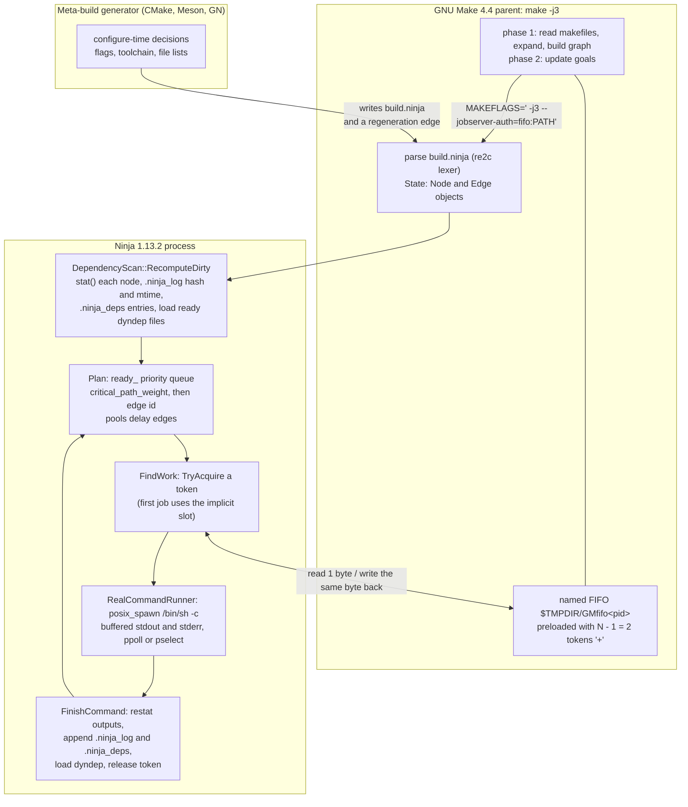

# Make and Ninja Mechanics

> [!summary] Claim:
> Make and Ninja are file-level build executors: each loads a static graph of files and commands, decides staleness from file modification times, and runs the commands of stale edges in dependency order with bounded parallelism.
> GNU Make is a programming language that builds its graph while it reads makefiles (two phases, rule search, remade makefiles and restarts), while Ninja is an "assembler" whose generated `build.ninja` holds no decisions, so its startup is a parse, a stat of every node, and two log lookups.
> Ninja adds what Make lacks: an implicit dependency on the command line (a 64-bit hash per output in `.ninja_log`), a binary header-dependency database (`.ninja_deps`), `restat` pruning, pools, multi-output edges, and `dyndep` for dependencies that must be discovered before the first build, which C++20 modules and Fortran need.
> Parallelism across nested tools is coordinated by the GNU Make jobserver: a pool of N - 1 one-byte tokens in a pipe or, since GNU Make 4.4, a named FIFO, plus one implicit slot per child; POSIX.1-2024 standardizes the token-pool semantics of `-j` but not this transport, and Ninja 1.13 joins it as a client only.



## The Mechanism

[[Build-System-Theory-Schedulers-and-Rebuilders]] owns the abstract model: tasks, schedulers (topological, restarting, suspending), and rebuilders (dirty bits, verifying traces, constructive traces).
In that vocabulary, Make and Ninja are topological schedulers with an mtime rebuilder, and Ninja's command hash, deps log, and `restat` are pieces of a verifying trace bolted onto the mtime model.
This note owns how the two executors really work: file formats, syscalls, scheduling, the jobserver protocol, and the failure modes that follow.
Every Ninja fact is from the v1.13.2 tag (released 2025-11-20) and every GNU Make fact is from the 4.4.1 distribution (26 Feb 2023) unless another source is named; both were the newest releases on their official channels (as of 2026-11, Both).

### 1. The shared model: a static file graph and modification times

Both tools model a build as a directed acyclic graph of files.
An edge (a Make rule with a recipe, a Ninja `build` statement) has inputs and outputs and one command.
An output is stale when it is missing or older than one of its inputs, and staleness propagates: an edge whose input will be rebuilt must also run.
Neither tool hashes file contents, so a file rewritten with identical bytes still looks new, and a file restored to an older mtime (some `git checkout` and `cp -p` flows) can look clean when it is not.

Both store time at nanosecond granularity where the OS provides it.
Ninja's `RealDiskInterface::Stat()` returns `st_mtim` (Linux) or `st_mtimespec` (macOS) as 64-bit nanoseconds, and treats an mtime of 0 as 1 so that 0 can mean "missing" (Flatpak sets mtimes to 0).
GNU Make packs a timestamp into a `FILE_TIMESTAMP` with 30 low bits of nanoseconds when built with `FILE_TIMESTAMP_HI_RES` (`src/filedef.h`), warns "File '...' has modification time ... s in the future" on clock skew (`src/remake.c`), and offers `.LOW_RESOLUTION_TIME` for targets created by tools such as `cp -p` that truncate timestamps to seconds.

What differs is everything around that core: how the graph is obtained, what else counts as an input, and how work is scheduled.

### 2. GNU Make: a language that builds its own graph

#### Two phases and when text is expanded

GNU Make reads all makefiles first, then updates goals (`How make Reads a Makefile` in the manual).
In phase 1 it expands everything in an "immediate" context: target and prerequisite lists, the right side of `:=`, `::=`, `:::=`, and `!=`, and conditionals; the right side of `=` and `?=` and every recipe stay "deferred" until used.
Consequently a `$(shell ...)` in a prerequisite list or in a `:=` assignment runs on every invocation, even for `make -n` and even for a no-op build, and it runs once per restart.
`$(wildcard ...)` and `$(shell find ...)` in phase 1 are how makefiles discover sources; they are also why a large Make build spends its startup reading directories.

#### Remaking makefiles and restarts

After phase 1, Make treats every makefile it read, including `include`d ones, as a goal and tries to update it.
If any was actually rebuilt, Make "starts with a clean slate and reads all the makefiles over again" and increments `MAKE_RESTARTS`.
This is how the classic auto-dependency scheme works: `include $(SRCS:.c=.d)` with a rule that builds each `.d` makes Make build the `.d` files, re-exec its reading phase, and only then build objects.
The cost is a full re-read per restart, and a makefile marked `.PHONY` or given a double-colon rule with a recipe but no prerequisites is never remade, precisely to avoid an infinite restart loop (manual, `How Makefiles Are Remade`).
`.PHONY: Makefile` or `Makefile:: ;` lets you skip the implicit-rule search for the makefile itself.

#### Rule search, prerequisite kinds, and special targets

For a target with no explicit recipe, Make searches pattern rules (`%.o: %.c`), old-style suffix rules, and a built-in catalogue (dump it with `make -p -f /dev/null`), and it can chain rules through intermediate files that it deletes afterwards unless they are `.SECONDARY`, `.PRECIOUS`, or (since 4.4) `.NOTINTERMEDIATE`.
`make -r` disables built-in rules, which large builds do both for speed and to stop surprise matches.
Prerequisites to the right of `|` are order-only: they must exist and be built first, but their timestamps never make the target stale, which is the standard way to create output directories.
`.DELETE_ON_ERROR` deletes a target whose recipe changed it and then failed; without it, a truncated output left by a failed recipe is newer than its inputs and the next run considers it up to date.

#### Multiple outputs

A rule `a b: deps ; recipe` declares two independent targets that happen to share a recipe, so under `-j` Make can run the recipe twice, once per target, concurrently.
GNU Make 4.3 added grouped targets, `a b &: deps ; recipe`, which run the recipe once for all of them; detect support with `grouped-target` in `.FEATURES`.
Before 4.3 the portable workaround was a pattern rule with two targets (`%.h %.c: %.y`), which Make has always treated as one recipe producing both, or a stamp file.
The lab measures the difference: the independent form ran its recipe twice at `-j4` and once at `-j1`, and `&:` ran it once at both.

#### Header dependencies under Make

Make knows nothing about `#include`, so header edges come from the compiler.
GCC and Clang `-MD` and `-MMD` (user headers only) write a makefile fragment as a side effect of compilation, `-MF` names it, `-MT` sets its target, and `-MP` adds an empty phony rule for each header "to work around errors make gives if you remove header files" (GCC preprocessor options).
The pattern Paul Smith (the GNU Make maintainer) recommends is `DEPFLAGS = -MT $@ -MMD -MP -MF $(DEPDIR)/$*.d` with `include $(wildcard $(DEPFILES))`, generating dependencies during compilation instead of through a separate `.d` rule and restart.
Without `-MP`, deleting a header that a stale `.d` still names stops the build with "No rule to make target 'util.h', needed by 'main.o'", as the lab shows; with `-MP` the empty rule `util.h:` makes the missing header "newer than" the object, the object rebuilds, and the new `.d` no longer names it.

#### Parallelism in GNU Make

The default is one job; `-jN` allows N recipes at once and a bare `-j` allows unlimited jobs.
`-l L` stops starting new jobs while at least one runs and the load average is at or above L; since 4.4, on Linux, Make reads `/proc/loadavg` for the count of runnable jobs instead of using a heuristic.
Parallel-safety is declared, not inferred: `.NOTPARALLEL` with no prerequisites serializes the whole instance, `.NOTPARALLEL: t` (4.4) serializes the prerequisites of `t`, and `.WAIT` (4.4, and standardized by POSIX.1-2024) between prerequisites stops Make from starting anything to its right until everything to its left is done.
Both only apply when building the target whose list contains them; another target listing the same prerequisites without `.WAIT` can still run them in parallel, which is why the manual calls them less reliable than a real prerequisite edge.
`--shuffle[=random|reverse|SEED|none]` (4.4) reorders goals and prerequisites to flush out missing edges, prints the seed so a failure can be reproduced, and does not shuffle lists that contain `.WAIT` or makefiles with `.NOTPARALLEL`.
`-O`/`--output-sync` (4.0) buffers each job's output and prints it whole; the default mode with no argument is `target`, and the price is that output goes through a file, so tools that detect a terminal typically stop emitting colors and progress control characters (make.texi, Terminal Output, says `--output-sync` defeats terminal detection).

#### Recursive Make

`$(MAKE) -C sub` starts a child Make with its own graph, so dependencies that cross directories are invisible to every individual Make.
Peter Miller's "Recursive Make Considered Harmful" (AUUGN, 1998) shows the consequences: under-specified builds, needless serialization at directory boundaries, and repeated stat work, and argues for one Make reading the whole graph.
Recursion survives because it composes separate projects, and the jobserver below is what keeps its parallelism bounded.

#### Versions that matter

Feature availability is the most common Make portability trap, because macOS still ships GNU Make 3.81 as `/usr/bin/make` (verified on darwin-arm64, as of 2026-11), while Homebrew installs 4.4.1 as `gmake`.

| Feature | First GNU Make release | Source |
| :--- | :--- | :--- |
| `.ONESHELL` | 3.82 (2010) | NEWS |
| `--output-sync` / `-O`, `--trace`, `!=`, `::=`, Guile | 4.0 (2013) | NEWS |
| `--jobserver-auth` documented as stable (renamed from `--jobserver-fds`) | 4.2 (2016) | NEWS |
| Grouped targets `&:`, `.EXTRA_PREREQS`, `-j` in `MAKEFLAGS`, `posix_spawn()` | 4.3 (2020) | NEWS |
| FIFO jobserver, `--jobserver-style`, `.WAIT`, `.NOTPARALLEL` with prerequisites, `--shuffle`, `.NOTINTERMEDIATE` | 4.4 (2022) | NEWS |
| FIFO jobserver disabled on GNU/Hurd and Cygwin | 4.4.1 (2023) | NEWS |

[[19-Shell-and-Unix-Engineering/18-Build-Packaging-and-Bootstrap/Make-Recipe-Execution|Make Recipe Execution]] and [[19-Shell-and-Unix-Engineering/18-Build-Packaging-and-Bootstrap/ONESHELL-and-SHELLFLAGS|ONESHELL and SHELLFLAGS]] own what happens inside a recipe: one shell per line, `@`, `-`, `+`, `.SHELLFLAGS`, and `.ONESHELL`.

### 3. The jobserver protocol

#### The problem

Each process that parallelizes on its own (a child Make, Ninja, a multi-threaded linker, `gcc -flto=N`, Cargo) sizes its pool independently, so `make -j8` that starts four children which each use `-j8` can run 32 jobs.
The jobserver turns the top-level `-jN` into a machine-wide budget that every cooperating process draws from.

#### What POSIX does and does not define

POSIX.1-2024 (Issue 8) specifies `-j maxjobs` in terms of a token pool: when `maxjobs` is greater than 1 "make shall create a pool of up to maxjobs - 1 tokens", a token is removed only for the second and later concurrent targets, and a sub-make invoked through `$(MAKE)` or a `+` line with the same `maxjobs` passed in `MAKEFLAGS` "shall use the same token pool".
The standard says this is "not intended to prescribe a particular implementation design", so it specifies no pipe, no FIFO, no `--jobserver-auth` syntax, and no protocol a non-make tool could use; that protocol exists only in the GNU Make manual (`Job Slots`, `POSIX Jobserver`, `Windows Jobserver`).

#### The GNU Make 4.4 transport

The top-level Make with `-jN` calls `jobserver_setup(job_slots - 1, style)` (`src/main.c`), which on POSIX:

1. Builds a name `<tmpdir>/GMfifo<pid>` (`get_tmpdir()` tries `MAKE_TMPDIR`, then `TMPDIR`, each only if it names an existing directory, then the compile-time default, `/tmp` on a typical Unix build) and calls `mkfifo(name, 0600)`; if that fails, or `--jobserver-style=pipe` was given, it falls back to `pipe()`.
2. Opens the read side with `O_RDONLY|O_NONBLOCK` (a blocking open would hang until a writer appears) and the write side with `O_WRONLY`.
3. Writes N - 1 copies of the token character `'+'`.
4. Exports `--jobserver-auth=fifo:PATH` (or `R,W` file descriptors for a pipe) in `MAKEFLAGS`; it unlinks the FIFO in `jobserver_clear()` at exit.

Every child is born holding one implicit slot, so `make -j3` runs at most three jobs: one on the implicit slot and two on tokens.
A client must parse `MAKEFLAGS`, use only the last `--jobserver-auth=` word, read one byte to get an extra slot, write back the same byte it read when the job ends, return every token even on errors and `SIGINT`, and never return the implicit slot.
The top-level Make counts tokens at exit and reports a mismatch; a leaked token silently lowers parallelism for the rest of the build.
If the first word of `MAKEFLAGS` contains `n`, Make was run with `-n` and a client may do nothing.

The FIFO is what made the protocol usable by arbitrary tools.
With a pipe, Make passes the descriptors only to commands it recognizes as recursive (`$(MAKE)` or a `+` prefix); for any other command it closes them and appends `--jobserver-auth=-2,-2` so a client cannot mistake recycled descriptors for the jobserver (4.4 NEWS).
A path survives `exec`, a shell, and a wrapper script, so with a FIFO every command can join, marked `+` or not.
The lab prints both cases: a plain recipe under `--jobserver-style=pipe` receives `--jobserver-auth=R,W --jobserver-auth=-2,-2`, and the same recipe with `+` receives only `R,W`.

Inside Make, `pselect()` waits atomically for a token byte or `SIGCHLD`, with `SIGCHLD` blocked everywhere else; where `pselect()` is unavailable, Make reads from a duplicate descriptor that its `SIGCHLD` handler closes to break a blocking `read()` (`src/posixos.c`).
On Windows the jobserver is a named semaphore whose name appears as `--jobserver-auth=NAME`, and `sem` is the only `--jobserver-style`.

#### Other participants

- GCC's `-flto=jobserver` uses Make's jobserver for parallel link-time optimization and the GCC manual tells you to prefix the calling recipe with `+`; `-flto=auto` uses the jobserver if one is available and otherwise falls back to autodetecting the CPU thread count (GCC optimize options).
- Cargo runs its own jobserver for rustc and build scripts and exposes it to build scripts as `CARGO_MAKEFLAGS`; Cargo does not set `MAKEFLAGS`, so a build script that runs `make` must pass it on (Cargo Book).
- The Rust `jobserver` crate connects to and forwards the GNU Make 4.4 FIFO style; its client parses `fifo:PATH` or `R,W` and writes `'|'` tokens (`src/unix.rs` in jobserver-rs).
- Ninja 1.13 is a client; its source notes that GNU Make writes `'+'` tokens and the Rust implementation writes `'|'`, and it writes back whatever byte it read (`src/jobserver.h`).

### 4. Ninja: an executor with no decisions

#### Why Ninja exists

Evan Martin started Ninja in 2010 for Chrome on Linux, where generated Makefiles took about ten seconds to start building after a one-file change, against under a second for Ninja (manual, Introduction).
His design rule is that "build systems get slow when they need to make decisions", so a generator makes every decision at configure time, and `build.ninja` has no functions, conditionals, globbing, rule search, or built-in rules.
Variables are immutable bindings expanded once at parse time, except rule variables, which are expanded per edge so `$in` and `$out` work; lookup order is `$in`/`$out`, the build block, the rule, the file, then enclosing `subninja` files.
`include` shares the current scope and `subninja` opens a child scope.

#### Loading: parse, canonicalize, intern

The lexer is generated by re2c (`lexer.in.cc`), and the manifest parser builds a `State` of `Node` (file) and `Edge` (command) objects.
Paths are canonicalized (`foo/../bar.h` becomes `bar.h`) and interned in a hash map keyed by `StringPiece` and hashed with rapidhash (`hash_map.h`), so every spelling of a path maps to one `Node`; paths are compared textually, so an absolute and a relative spelling of the same file are two different nodes.
Martin's AOSA chapter reports that path handling and log loading were the hot spots, and that hashing commands instead of storing them shrank Chrome's Mac build log from 200 MB to under 2 MB and made it over 20 times faster to load.

#### The dirty scan

`DependencyScan::RecomputeDirty()` walks the requested targets depth first, stats each node once, and detects cycles (`dependency cycle: a -> b -> a`).
For each non-phony edge, `RecomputeOutputDirty()` marks an output dirty when, in order:

1. The output does not exist.
2. The output is older than the newest input, unless the edge is `restat` and has a log entry, in which case only the logged mtime is compared.
3. The edge is not a `generator` and the 64-bit rapidhash of the fully expanded command differs from the hash in `.ninja_log`, explained as "command line changed for ...".
4. The mtime recorded in `.ninja_log` is older than the newest input, which catches outputs written by a command that then failed or was interrupted.
5. The edge is not a `generator` and the output has no log entry at all.

A phony edge with no inputs is dirty only if its output is missing, and a phony edge with inputs takes the newest input mtime so that dependents compare against it.
Header dependencies enter the scan through `ImplicitDepLoader`: from the deps log when the rule has `deps`, otherwise by parsing the `depfile` named by the edge, and in both cases they are spliced into the edge's inputs as implicit dependencies, ahead of the order-only ones.
A deps log entry is ignored ("stored deps info out of date") when the output is newer than the mtime stored with the entry, and a depfile whose first target is not the edge's first output marks the edge dirty.
`ninja -d explain` prints each of these decisions, which is the first tool for any "why did this rebuild" question.

#### `.ninja_log`: the command hash and the start-time mtime

The build log lives in `$builddir` or the build root, starts with `# ninja log v7`, and appends one line per finished edge: start ms, end ms, recorded mtime, output path, and the command hash in hex, tab separated (`BuildLog::WriteEntry`).
A log with an older or newer version is deleted and every output is rebuilt.
On load, the log is recompacted when it has more than 100 entries and more than three times as many entries as unique outputs.

The recorded mtime is not the output's mtime.
`Builder::StartEdge()` writes an empty `.ninja_lock` file in the build directory and stats it before spawning the command, and `FinishCommand()` records that start time.
For `restat` and `generator` edges it re-stats the outputs and records the later of the start time and the newest output mtime, except that it falls back to the start time when `restat` found an unchanged output.
Pull request 1943 (shipped in 1.12) chose this so that an input edited while its command runs leaves the output recorded as older than that input, and the next run rebuilds it instead of trusting an output computed from the old contents.

#### `.ninja_deps`: a binary append-only database

`deps = gcc` (or `msvc`) tells Ninja to parse the depfile (or the `/showIncludes` lines on stdout) as soon as the command succeeds, store the result in `.ninja_deps`, and delete the `.d` file; it exists because loading tens of thousands of text depfiles at startup was slow, especially on Windows (manual, `deps`).
The format (`deps_log.h`, version 4) is designed to be written as a stream and read whole at startup:

- A 12-byte signature `# ninjadeps\n` and a 4-byte version, 4, in host byte order.
- A sequence of records, each a 4-byte size whose high bit marks a deps record; records are capped at 512 KiB - 1 (`kMaxRecordSize = (1 << 19) - 1`).
- A path record is the path, NUL padding to a 4-byte boundary, and the one's complement of its own index, so two Ninja processes appending to one log are detected at the next load.
- A deps record is 32-bit integers: output id, output mtime low and high halves, then input ids.

Later records for the same output win, so an update is an append.
A truncated tail is cut back to the last whole record with the warning "premature end of file; recovering", a bad signature or version deletes the file and rebuilds, and the log is recompacted when it has more than 1,000 deps records and more than three per live output.
The lab decodes this file with `depslog.py`: after three builds of one object it holds 5 path records and 3 deps records for 1 live output.

#### `restat`: stopping propagation

With `restat = 1`, Ninja stats the outputs after the command; an output whose mtime did not change is treated "as though it had never needed to be built", and `Plan::CleanNode()` removes downstream edges from the plan when none of their other inputs are dirty.
Generators of headers and modules use it with a write-if-changed command, which is exactly the lab's toy compiler: editing the body of `a.src` rebuilt `a.o`, left `m.mod` untouched, and did not rebuild `b.o`.

#### Scheduling: plan, priority, pools

`Plan` marks every edge it wants and keeps a `ready_` priority queue of edges whose inputs are ready.
Since 1.12, `Plan::ComputeCriticalPath()` topologically sorts the wanted edges and gives each a `critical_path_weight`: the largest count of non-phony edges on any path from it to a requested target.
The 1.12 release notes describe this as ordering "jobs by their runtime history", but the merged code (pull request 2177, "simplified critical path scheduler") weights every non-phony edge 1 and phony edges 0 (`EdgeWeightHeuristic()` in v1.13.2), so priority is depth in the graph, and ties go to the lower edge id, which is declaration order.
The release note's warning still holds: changing the order hides or exposes missing dependencies, which is why the lab declares `b.o` before `a.o` and uses `-j1` to make the missing-dyndep failure deterministic.

Pools (since 1.1) cap concurrent edges per pool with `depth`; the default pool has depth 0, meaning no limit beyond `-j`, an empty `pool =` on a build statement returns it to the default pool, and the predefined `console` pool (1.5) has depth 1 and gives its single job Ninja's real stdin, stdout, and stderr while buffering everything else.
Pools never raise parallelism above `-j`.

The command runner admits `-j` jobs, default `GuessParallelism()` = CPUs + 2 (3 for 2 CPUs, 2 for 0 or 1), lowered when `-l` is set and the load average is high, but never to zero while nothing runs.
`subprocess-posix.cc` starts each command with `posix_spawn("/bin/sh", {"sh", "-c", command})`, puts non-console jobs in their own process group with stdin from `/dev/null` and stdout and stderr on one pipe, restores the original signal mask, and waits with `ppoll()` or `pselect()`.
Output is buffered per command, so parallel output never interleaves and a failure prints the full command next to its output, prefixed with `FAILED: [code=N]` since 1.13.
Before spawning, Ninja creates output and depfile directories and writes any `rspfile`, which it deletes after success unless `-d keeprsp` is set.

#### Jobserver client (1.13)

`NinjaMain::SetupJobserverClient()` parses `MAKEFLAGS` unless `-n` or an explicit `-j` was given, and accepts only `fifo:PATH` on POSIX and a semaphore name on Windows; a pipe-style value produces "Ignoring jobserver: Pipe-based protocol is not supported!" and Ninja falls back to its own `-j`.
In client mode `RealCommandRunner::CanRunMore()` reports unlimited capacity, `Plan::FindWork()` calls `TryAcquire()` before popping the next ready edge, and `Plan::EdgeFinished()` releases the edge's slot.
`TryAcquire()` hands out the implicit slot first, then does a non-blocking one-byte `read()` on the FIFO, which is opened `O_RDONLY|O_NONBLOCK|O_CLOEXEC`; no byte means no new job this round.
`-l` still applies, and Ninja is not a jobserver server in 1.13, so commands it runs see whatever `MAKEFLAGS` it inherited.
The lab shows the result under `make -j3`: 3 concurrent edges as a client, 8 with an explicit `-j8`, and Ninja's own default when the parent uses a pipe.

#### Dynamic dependencies (`dyndep`, since 1.10)

A depfile is enough for headers because a header edge matters only from the second build: the first build compiles everything anyway (manual, `C/C++ header dependencies`).
Fortran modules and C++20 modules break that argument, because `b` cannot compile at all until `a` has produced `m.mod`, so the order must be known before the first build.
A `dyndep = file` binding names one of the edge's inputs, normally an order-only one, as a dyndep file: a file in Ninja syntax that starts with `ninja_dyndep_version = 1` and holds one `build out | implicit-outs: dyndep | implicit-ins` statement per edge, with an optional `restat`.
When the scan reaches an edge whose dyndep file is already up to date it loads it at once; otherwise the file is built first, because it is an input, and `Plan::NodeFinished()` loads it when its edge finishes, then `Plan::DyndepsLoaded()` walks the newly discovered part of the graph and adds dirty edges to the plan.
`DyndepLoader::UpdateEdge()` appends implicit outputs and inputs to the edge and rejects an output that another edge already produces ("multiple rules generate", restored in 1.13.1), a missing statement ("not mentioned in its dyndep file"), and an extra one ("whose build statement does not have a dyndep binding").
CMake's C++ module support builds on exactly this: it scans sources to P1689R5 JSON, collates them into dyndep files, and supports only the Ninja and Visual Studio generators, requiring Ninja 1.11 or newer (`cmake-cxxmodules(7)`, CMake 4.5.0); [[Cpp-Modules-in-Build-Systems]] owns that pipeline.

#### Self-regeneration and validations

If `build.ninja` is itself an output of an edge and is out of date, Ninja rebuilds it and reloads before building anything else; generators mark that edge `generator = 1` so a changed generator command line does not force regeneration, and `ninja -t clean` keeps generator outputs unless given `-g`.
Validations (`|@ v`, since 1.11) add `v` to the top level whenever the edge is wanted, without making the edge wait for `v`, which lets static analysis run beside the build instead of on its critical path.

### 5. The boundary with meta-build systems

Make is both a language and an executor; Ninja is only an executor, and CMake, Meson, and GN are languages that emit it.
The boundary has three consequences.

- Decisions belong to the generator: compiler detection, option handling, globbing, and target-level usage requirements, which [[Modern-CMake-Architecture-and-Targets]] and [[Meson-Build-System-and-WrapDB]] own.
- File lists are frozen at generation time, so adding a source requires regeneration; CMake's `CONFIGURE_DEPENDS` globs and Meson's regeneration edges are generator features layered onto Ninja's self-regeneration.
- Correctness that needs more than mtimes and command lines, such as content hashing, sandboxing, and remote caching, lives above the executor in [[Hermetic-and-Reproducible-Builds]], [[Compiler-Caches-ccache-and-sccache]], and [[Bazel-Skyframe-Bzlmod-and-Execution-Model]].

## Commands and Numbers to Know

| Item | Value | Platform and date | What it controls |
| :--- | :--- | :--- | :--- |
| Ninja default `-j` | CPUs + 2; 3 for 2 CPUs; 2 for 0 or 1 | Both (as of 2026-11) | `GuessParallelism()`; an explicit `-j` also disables the jobserver client |
| `ninja -l N` | no limit by default | Both (as of 2026-11) | Stops starting jobs above load N, but always allows one |
| `NINJA_STATUS` | `"[%f/%t] "` | Both (as of 2026-11) | Progress prefix; `%e` since 1.2; `%E`, `%w`, `%W`, `%P` since 1.12 (manual) |
| `.ninja_log` | `# ninja log v7`, 5 tab-separated fields | Both (as of 2026-11) | Start ms, end ms, recorded mtime, path, command hash |
| Build log compaction | more than 100 entries and 3x unique outputs | Both (as of 2026-11) | Rewrites the log at load |
| `.ninja_deps` | `# ninjadeps\n`, version 4 | Both (as of 2026-11) | Binary header-dependency database |
| Deps record cap | 524,287 bytes | Both (as of 2026-11) | `kMaxRecordSize`; about 131,000 inputs per output |
| Deps log compaction | more than 1,000 records and 3x live outputs | Both (as of 2026-11) | Rewrites via `.ninja_deps.recompact` |
| `.ninja_lock` | empty file in `$builddir` | Both (as of 2026-11) | Its mtime at edge start is what `.ninja_log` records |
| `console` pool | depth 1 | Both (as of 2026-11) | Direct terminal access; other output buffered meanwhile |
| Default pool | depth 0, unlimited | Both (as of 2026-11) | Only `-j` bounds it |
| `ninja_dyndep_version` | `1` or `1.0`, any suffix | Both (as of 2026-11) | Required first line of a dyndep file |
| `ninja -d explain`, `-d stats`, `-d keepdepfile`, `-d keeprsp` | off | Both (as of 2026-11) | Why edges are dirty; timing; keep `.d` and `.rsp` files |
| `ninja -t deps`, `-t missingdeps`, `-t cleandead`, `-t recompact`, `-t restat`, `-t compdb` | tools | Both (as of 2026-11) | Inspect deps log, find generated-file races (1.11), delete stale outputs (1.10) |
| `-w phonycycle=err` | warn by default | Both (as of 2026-11) | In 1.13.2 `-w dupbuild=...` only prints "deprecated warning 'dupbuild'" |
| GNU Make default `-j` | 1; bare `-j` is unlimited | Both (as of 2026-11) | Number of job slots |
| Jobserver tokens | N - 1 bytes `'+'`, plus 1 implicit slot per child | Both (as of 2026-11) | `make -j3` runs at most 3 jobs in total |
| FIFO path | `$TMPDIR/GMfifo<pid>`, mode 0600 | Linux and macOS (as of 2026-11) | `--jobserver-auth=fifo:PATH`; GNU Make 4.4 and later |
| `--jobserver-style` | `fifo` default where `mkfifo` works; `pipe`; `sem` on Windows | Both (as of 2026-11) | Pipe is forced on GNU/Hurd and Cygwin since 4.4.1 |
| Non-recursive pipe child | `--jobserver-auth=-2,-2` appended | Both (as of 2026-11) | Disables the jobserver for commands not marked `+` |
| `jobserver-fifo` in `.FEATURES` | present in 4.4 and later | Both (as of 2026-11) | Feature test for the FIFO jobserver |
| `-O` / `--output-sync` | `target` when given without a mode | Both (as of 2026-11) | `none`, `line`, `target`, `recurse` |
| `--shuffle` | `random` when given without a mode | Both (as of 2026-11) | `random`, `reverse`, an integer seed, `none` |
| `/usr/bin/make` | GNU Make 3.81 | macOS (as of 2026-11) | No `&:`, `.WAIT`, `-O`, `--shuffle`, or FIFO jobserver; use Homebrew `gmake` |
| GNU Make timestamp | 30 low bits of nanoseconds when hi-res | Both (as of 2026-11) | `FILE_TIMESTAMP_HI_RES`; `.LOW_RESOLUTION_TIME` for second-truncating tools |

## Multi-Language Comparison: C++ / Python / Rust

| Concern | C++ (GCC, Clang, CMake) | Python (CPython, Meson) | Rust (Cargo) |
| :--- | :--- | :--- | :--- |
| Who writes the executor graph | CMake's Ninja or Makefile generators; GN for Chrome | Meson, written in Python, uses the `ninja` backend by default (Visual Studio and Xcode backends exist); Ninja ships `misc/ninja_syntax.py` for Python generators | Cargo has its own unit graph and scheduler and does not emit Make or Ninja ([[Cargo-Build-Graph-and-Rustc-Pipelining]]) |
| Header or import dependencies | `-MD`/`-MMD` depfiles, consumed by `deps = gcc` or `include`d by Make | C extensions built by Meson get the same compiler depfiles through Ninja | `rustc --emit=dep-info` writes a Makefile-syntax `.d` file; Cargo writes one per artifact (absolute paths by default) so an outer Make or Ninja knows when to rerun Cargo |
| Dependencies needed before the first build | C++20 modules: P1689R5 scan plus Ninja `dyndep`; CMake supports them on Ninja (1.11 or newer) and Visual Studio generators only | Not applicable to Python sources | Crate order comes from `Cargo.toml`, so no scan is needed |
| Jobserver role | GNU Make is the server; `gcc -flto=jobserver` and Ninja 1.13 are clients | A Meson build joins an outer Make jobserver only through Ninja 1.13 or newer | Cargo is a server for rustc and build scripts (`CARGO_MAKEFLAGS`) and, through the `jobserver` crate, a client of an outer Make |
| Command-line change detection | Ninja command hash; Make needs a hand-written flags stamp | Inherited from Ninja under Meson | Cargo fingerprints flags and inputs itself |

## Worked Lab Example

The lab is `code/06-Build-Systems/ninja_dyndep/`; it needs Ninja 1.13 or newer, GNU Make 4.4 or newer (as `gmake` or `make`), `python3`, and a C compiler, and it declares `# requires: macos` because it was recorded only on macOS with Homebrew (no Linux expected file exists, and the Linux lab image ships no Ninja and GNU Make 4.3).
`run.sh` builds everything in a temporary directory and checks tool versions first, so an old `/usr/bin/make` fails loudly instead of producing a misleading result.

1. dyndep: `modc.py` is a toy module compiler in which `module m` makes a source write `m.mod` (only when its content changes) and `use m` fails unless `m.mod` exists.
   `modscan.py` scans the sources and writes `mods.dd`.
   `build.ninja` declares `b.o` before `a.o`, binds `dyndep = mods.dd` on both, and gives Ninja no other ordering between them.
2. restat: the lab edits a non-export line of `a.src`, then an export line, and reports whether `b.o` rebuilt each time.
3. Missing dyndep: the same graph without the `dyndep` bindings is built clean at `-j1`; because ties go to the lower edge id, `b.o` runs first and fails, which proves the ordering in step 1 came from the dyndep file and not from luck.
4. Deps log and build log: a C file with two headers is compiled with `deps = gcc`; `depslog.py` decodes `.ninja_deps` and raises on any format violation, `ninja -t deps` cross-checks it, and `-d explain` names the reason after a flags-only change.
   Then a header is deleted and its `#include` removed.
5. The same header deletion under GNU Make, with `-MMD` and then `-MMD -MP`.
6. Grouped targets: one recipe with two outputs, written with `:` and with `&:`, at `-j1` and `-j4`, counting recipe runs.
7. Jobserver: nine Ninja edges each sample how many edges are running, under `make -j3` in four configurations; the samples, not Ninja's word, give the concurrency.

```bash
cd code/06-Build-Systems/ninja_dyndep
bash run.sh
```

### Verified output

Recorded with `python3 -m _harness.verify --record` on darwin-arm64 (12 CPUs, Ninja 1.13.2 and GNU Make 4.4.1 from Homebrew, Apple clang) on 2026-11-13 and re-checked with `python3 -m _harness.verify` (PASS); the file is `code/06-Build-Systems/ninja_dyndep/expected/darwin-arm64.txt`.

```text
== Versions
ninja 1.13.2
GNU Make 4.4.1
jobserver-fifo in .FEATURES: jobserver-fifo

== 1. dyndep: discovering module dependencies during the build
-- clean build at -j8; execution order from compile.log:
  scan b.src a.src
  compile a.src
  compile b.src
-- generated dyndep file mods.dd:
  ninja_dyndep_version = 1
  build b.o: dyndep | m.mod
  build a.o | m.mod: dyndep
    restat = 1
-- second run:
  ninja: no work to do.
-- edit a.src outside its exports (m.mod content unchanged, restat = 1):
  scan b.src a.src
  compile a.src
  b.o rebuilt: no
-- edit a.src exports (m.mod content changes):
  scan b.src a.src
  compile a.src
  compile b.src
  b.o rebuilt: yes
-- same graph without the dyndep bindings, clean build at -j1:
  FAILED: [code=1] b.o 
  modc: b.src: error: module 'm' not found (m.mod missing)
  ninja: build stopped: subcommand failed.
  ninja exit status: 1

== 2. deps = gcc: the binary .ninja_deps log and the command-hash .ninja_log
  [1/1] CC main.o
  depfile main.o.d left on disk: no
-- .ninja_deps decoded by depslog.py:
  signature '# ninjadeps', version 4
  5 path records, 1 deps records, 1 live outputs
  main.o: mtime stored=yes; deps: <SDK>/SDKSettings.json main.c config.h util.h
-- ninja -t deps (mtime scrubbed):
  main.o: #deps 4, deps mtime N (VALID)
      <SDK>/SDKSettings.json
      main.c
      config.h
      util.h
-- .ninja_log header and fields per entry:
  # ninja log v7
  tab-separated fields per entry: 5 
-- change cflags only, then ninja -d explain:
  ninja explain: command line changed for main.o
-- second run:
  ninja: no work to do.
-- delete util.h and stop including it:
  [1/1] CC main.o
  ninja exit status: 0
-- deps after the rebuild:
  5 path records, 3 deps records, 1 live outputs
  main.o: mtime stored=yes; deps: <SDK>/SDKSettings.json main.c config.h

== 3. GNU Make: the same header deletion with -MMD, then with -MMD -MP
-- DEPFLAGS = -MMD; main.d:
  main.o: <SDK>/SDKSettings.json main.c config.h util.h
  make: *** No rule to make target 'util.h', needed by 'main.o'.  Stop.
  make exit status after deleting util.h: 2
-- DEPFLAGS = -MMD -MP; main.d:
  main.o: <SDK>/SDKSettings.json main.c config.h util.h <SDK>/SDKSettings.json: config.h: util.h:
  make exit status after deleting util.h: 0

== 4. GNU Make: one recipe with two outputs, ':' versus '&:'
  rule 'gen.h gen.c :' at -j1: recipe ran 1 time(s)
  rule 'gen.h gen.c :' at -j4: recipe ran 2 time(s)
  rule 'gen.h gen.c &:' at -j1: recipe ran 1 time(s)
  rule 'gen.h gen.c &:' at -j4: recipe ran 1 time(s)

== 5. Ninja as a GNU Make jobserver client
-- make -j3, plain recipe, ninja with no -j (joins the fifo jobserver)
  MAKEFLAGS jobserver words: --jobserver-auth=fifo:PATH 
  ninja: Jobserver mode detected: s -j3 --jobserver-auth=fifo:PATH
  edges: 9, max concurrent: 3
-- make -j3, plain recipe, ninja -j8 (an explicit -j disables the client)
  MAKEFLAGS jobserver words: --jobserver-auth=fifo:PATH 
  edges: 9, max concurrent: 8
-- make -j3 --jobserver-style=pipe, plain recipe (make hides the pipe)
  MAKEFLAGS jobserver words: --jobserver-auth=R,W --jobserver-auth=-2,-2 
  edges: 9, more than 3 at once: yes (Ninja's own default is nproc + 2)
-- make -j3 --jobserver-style=pipe, '+' recipe (ninja sees the pipe and declines it)
  MAKEFLAGS jobserver words: --jobserver-auth=R,W 
  ninja: warning: Ignoring jobserver: Pipe-based protocol is not supported! [s -j3 --jobserver-auth=R,W]
  edges: 9, more than 3 at once: yes (Ninja's own default is nproc + 2)
```

### Reading the result

- The clean build ran the scan, then `a.src`, then `b.src` at `-j8` even though `b.o` was declared first: the dyndep file added `m.mod` as an implicit output of `a.o` and an implicit input of `b.o` after the scan finished.
- Editing a non-export line rebuilt `a.o` but not `b.o`, because `modc.py` left `m.mod` untouched and the dyndep file marked the edge `restat = 1`; editing an export changed `m.mod` and rebuilt `b.o`.
- Without the dyndep bindings, `b.o` ran first and failed, and Ninja reported it as `FAILED: [code=1] b.o` with the compiler's message; the scan still runs, but nothing tells Ninja what it found.
- `deps = gcc` deleted `main.o.d` after reading it, and Apple clang added the SDK's `SDKSettings.json` as an absolute path to every depfile, which is a real input that a generator cannot know in advance.
- A flags-only change was explained as `command line changed for main.o`, which Make cannot detect without a hand-made stamp file.
- Deleting `util.h` broke Make without `-MP` (exit status 2) but not Ninja, which treats depfile inputs as implicit dependencies that may vanish; the deps log then held 3 deps records for 1 live output, the append-only design at work.
- `gen.h gen.c :` ran its recipe twice at `-j4` and once at `-j1`, because serially Make finds `gen.c` already created when it reaches it; `&:` ran once in both cases.
- Under `make -j3` with the FIFO jobserver, Ninja ran exactly 3 edges at once (the implicit slot plus 2 tokens); `-j8` bypassed the budget; with a pipe jobserver Ninja either never saw it (`-2,-2`) or declined it, and ran at its own default.

## Pitfalls

> [!warning] Pitfall: a multi-output rule written with `:`
> `y.tab.c y.tab.h: parse.y ; bison -d parse.y` declares two independent targets, so `make -j` can run Bison twice at the same time and interleave writes to both files.
> Use `&:` (GNU Make 4.3 or newer), a two-target pattern rule, or a stamp file; in Ninja, list both outputs on one `build` line.

> [!warning] Pitfall: depfiles without `-MP`
> A stale `.d` that names a deleted header stops Make with "No rule to make target".
> Use `-MMD -MP`, include the `.d` files with `$(wildcard ...)`, and generate them during compilation rather than with a `.d` rule that forces a makefile restart.

> [!warning] Pitfall: order-only edges used as real dependencies
> `||` in Ninja and `|` in Make order the first build but never trigger a rebuild, so a generated header listed only as order-only rebuilds dependents only once a depfile records it.
> An object that includes a generated header with no path to its generator works by accident until a clean build schedules it early; `ninja -t missingdeps` (1.11) finds those edges from the deps log.

> [!warning] Pitfall: a nested Ninja that ignores the jobserver
> Ninja 1.13 joins only the FIFO style, so under GNU Make 4.3 or older, under `--jobserver-style=pipe`, or with an explicit `-j` it runs its own CPUs + 2 jobs on top of Make's, and a recipe that hard-codes `ninja -j$(nproc)` oversubscribes every time.
> Run GNU Make 4.4 or newer at the top, omit `-j` in nested Ninja calls, and check for "Jobserver mode detected" in the log.

> [!warning] Pitfall: leaking jobserver tokens
> A client killed with `SIGKILL`, or one that returns tokens only on success, permanently removes slots from the pool, and the rest of the build runs slower with no error until the top-level Make reports the count at exit.
> Return tokens from signal handlers and on every error path, and never write back the implicit slot.

> [!warning] Pitfall: mtime surprises
> Tools that copy files with preserved timestamps, network file systems with clock skew, and timestamp-truncating tools can make outputs look newer than inputs.
> Ninja compares textual paths, so `/abs/foo.h` from a depfile and `foo.h` from the manifest are different nodes; emit relative paths consistently.

> [!warning] Pitfall: `$(shell ...)` and globbing in Make's parse phase
> Phase 1 expansion runs on every invocation, on every restart, and under `make -n`.
> A `$(shell git describe)` or `$(shell find ...)` at top level puts a process spawn or a tree walk in front of every no-op build; compute it once into a file that is a normal target.

> [!warning] Pitfall: relying on declaration order
> Ninja 1.12 and later run ready edges by graph depth and then declaration order, and GNU Make runs prerequisites left to right unless shuffled.
> A missing edge that "always worked" can break when an unrelated edge is added; run `make --shuffle` in CI, and build individual targets from a clean tree in Ninja.

> [!warning] Pitfall: dyndep files that do not match the manifest exactly
> Every edge bound to a dyndep file needs exactly one statement in it, an extra statement is an error, and a discovered implicit output must not be produced by any other edge.
> CMake 4.5's documentation also warns that when an import order reverses between two builds (a imports b becomes b imports a), Ninja can report a false dependency cycle (Ninja issue 2666).
> The fix, pull request 2680 ("Only load depsfile if not dirty"), was merged to Ninja's master on 2026-07-19 but is in no release, so v1.13.2 still has the bug (as of 2026-11, Both).

## At Scale

A single developer rarely sees these mechanisms: the generator writes `build.ninja`, and incremental builds take well under a second to start.
The economics change as the graph and the organization grow.

- Startup cost is parse plus one `stat()` per node plus loading two logs; Martin reports that getting a file's mtime "seems to be about 100 times slower on Windows than it is on Linux", so Windows-heavy shops feel the node count first.
- Recursive Make multiplies startup by the number of directories and hides cross-directory edges; one non-recursive graph, generated or hand-written, removes both costs.
- When several build tools nest (Make calling Ninja calling Cargo), only a shared jobserver keeps total parallelism at the machine budget; without it, the product of every `-j` decides how much the machine thrashes.
- mtime rebuilders cannot share results between machines; once clean builds dominate cost, the next step is [[Compiler-Caches-ccache-and-sccache]], then content-addressed execution in [[Remote-Execution-API-and-Remote-Caching]].

Decision rules:

- One developer to a few hundred engineers: let CMake or Meson generate Ninja, keep `deps = gcc`, never hand-tune `-j`, and use `ninja -d explain` and `-t missingdeps` before guessing.
- New hand-written build logic: write Make only for small task runners and glue; for anything with more than a few hundred files, write a generator and let Ninja execute.
- Mixed Make and Ninja estates of 1,000 to 50,000 engineers: standardize on GNU Make 4.4 or newer everywhere (macOS ships 3.81), FIFO jobserver at the top, Ninja 1.13 or newer underneath, and no explicit `-j` below the top level; alert on oversubscription with load average per CI runner.
- Code generators: make them write-if-changed and mark their edges `restat`, which cuts rebuild fan-out from generated headers.
- C++20 modules or Fortran: use Ninja, because Make has no dyndep equivalent and CMake does not support module scanning on its Makefile generators.
- When correctness needs more than mtimes and command hashes (hermetic inputs, cross-machine caching, distributed execution), move up to a system that hashes content; the choice is recorded in [[Build-Performance-Economics-and-Decision-Record]].

## Practice Drill

> [!tip] Practice Drill:
> Write a 200-file `build.ninja` generator in Python (use `misc/ninja_syntax.py` from the Ninja source) with one code generator that emits a header used by half the sources.
> Give the header only an order-only edge, run `ninja -t missingdeps`, then build one dependent object from a clean tree to watch it fail.
> Make the generator write-if-changed with `restat = 1`, change only a comment in its input, and confirm with `ninja -d explain` that no object rebuilds.
> Then wrap it in a Makefile, run `gmake -j4`, and read the FIFO path from "Jobserver mode detected"; kill Ninja with `SIGKILL` mid-build and see what the top-level Make reports at exit.
> [[Drill-Build-Systems-Fix-Broken-Incremental-Depfile]] is the guided version of the depfile half.

## Interview Questions

> [!question] L5: You change `-O2` to `-O3` in a hand-written Makefile and `make` says nothing to do, but the same change in a CMake Ninja build rebuilds every object; why?
>
> > [!success]- Answer
> > Make's staleness test is only "output missing or older than a prerequisite", and the recipe text is not a prerequisite.
> > Ninja records a 64-bit hash of each output's fully expanded command in `.ninja_log`, and `RecomputeOutputDirty()` marks the output dirty when the current command hashes differently; `ninja -d explain` prints "command line changed for ...".
> > The Make workaround is a flags stamp file that is rewritten only when the flags change and is a prerequisite of every object.
> > Ninja exempts `generator` edges from the check so that regenerating `build.ninja` does not loop.

> [!question] L5 (predict the output): With GNU Make 4.4.1, `gen.h gen.c: ; @echo run >>runs.log; sleep 0.2; touch gen.h gen.c` and both files missing, how many lines does `runs.log` have after `make -j1 gen.h gen.c`, after `make -j4 gen.h gen.c`, and with `&:` instead of `:`?
>
> > [!success]- Answer
> > One line at `-j1`, two at `-j4`, and one at both levels with `&:`, which is what the lab recorded on darwin-arm64.
> > A `:` rule with two targets is shorthand for two independent rules with the same recipe.
> > Serially, the first run creates `gen.c` before Make considers it, so `gen.c` has no prerequisites and already exists; in parallel, both targets are out of date when their jobs start.
> > `&:` (GNU Make 4.3 or newer) declares grouped targets that one recipe run produces together.

> [!question] L5 (debug this): After a refactor deletes `util.h`, `make` fails with `No rule to make target 'util.h', needed by 'main.o'.  Stop.` although nothing includes `util.h` any more; what happened, and why does the Ninja build not fail?
>
> > [!success]- Answer
> > The included `main.d` was written by `-MMD` during the last compile and still lists `util.h` as a prerequisite of `main.o`, and Make has no rule to create a missing prerequisite.
> > Adding `-MP` makes the compiler emit `util.h:` with no prerequisites or recipe, so the missing file counts as updated, `main.o` rebuilds, and the new depfile drops it; the lab shows exit status 2 without `-MP` and 0 with it.
> > Ninja loads depfile and deps log entries as implicit dependencies and "implicitly adds extra build edges such that it is not an error if the listed dependency is missing", so a deleted header just makes the object dirty.

> [!question] L6: Explain the GNU Make jobserver from the top-level `make -j8` to a client tool, and say what goes wrong if the client returns too few or too many tokens.
>
> > [!success]- Answer
> > The top-level Make creates a FIFO `$TMPDIR/GMfifo<pid>` (or a pipe), writes 7 `'+'` bytes, and puts `--jobserver-auth=fifo:PATH` in `MAKEFLAGS`.
> > Every child starts with one implicit slot, so the eighth job needs no token; a client reads one byte per extra job, writes back the same byte when that job ends, and never writes back the implicit slot.
> > Too few returned tokens permanently lower parallelism for the rest of the build; too many raise it above the budget; the top-level Make reports a mismatch at exit.
> > With the pipe style, only commands marked recursive (`$(MAKE)` or `+`) get the descriptors, and others see `--jobserver-auth=-2,-2`, which is why GNU Make 4.4 switched to a FIFO that any command can open by path.

> [!question] L6: Why is a depfile sufficient for C headers but not for Fortran or C++20 modules, and how does Ninja's `dyndep` solve the gap?
>
> > [!success]- Answer
> > A header dependency matters only for incremental builds: the first build compiles every source anyway, and the depfile written during that compile makes later builds correct.
> > A module dependency is an ordering constraint for the first build: `b` cannot compile until `a` has produced `m.mod`, so the edge must be known before compilation starts.
> > `dyndep = file` names an input of the edge, usually order-only, that a scanner produces; when it finishes, Ninja loads it, adds the declared implicit outputs and inputs, and replans the newly discovered part of the graph.
> > The lab shows both halves: with dyndep the order is correct at `-j8`, without it the module consumer runs first and fails.

> [!question] L6: What does `restat = 1` change in Ninja's bookkeeping, and why does Ninja record the edge's start time rather than the output's mtime for ordinary edges?
>
> > [!success]- Answer
> > After a `restat` edge runs, Ninja stats its outputs, and any output whose mtime did not change is cleaned, which can remove downstream edges from the plan.
> > For a `restat` edge, later scans compare the mtime logged in `.ninja_log` against the inputs instead of the output's on-disk mtime, so an unchanged output does not make the edge dirty forever.
> > For ordinary edges, `StartEdge()` touches `.ninja_lock` and records its mtime, the moment the command began, as the output's mtime in `.ninja_log`.
> > If an input changes while the command runs, the output was computed from old contents but has a newer on-disk mtime; the logged start time is older than the edited input, so the next build reruns it (pull request 1943, Ninja 1.12).

> [!question] L7: A team's top-level `make -j16` calls three Ninja builds and the CI machine's load climbs to about 60; diagnose it.
>
> > [!success]- Answer
> > Check the Make and Ninja versions and the Ninja logs first: Ninja 1.13 joins only the FIFO jobserver, so with GNU Make 4.3 or older, or with `--jobserver-style=pipe`, it prints "Ignoring jobserver" or sees `-2,-2` and runs CPUs + 2 jobs each.
> > An explicit `-j` in the recipe also disables the client, and Ninja older than 1.13 has no client at all.
> > The fix is GNU Make 4.4 or newer at the top, Ninja 1.13 or newer, no `-j` on nested calls, and "Jobserver mode detected" in each log; the lab shows 3 concurrent edges under `make -j3` in client mode and 8 with `-j8`.
> > Also check other tools in the tree, such as `gcc -flto=N` or a multithreaded linker, which need `-flto=jobserver` or their own flags.

> [!question] L7: Ninja 1.12's release notes say jobs are now ordered "by their runtime history"; what does v1.13.2 actually do, and what does that mean for a build with one very long compile?
>
> > [!success]- Answer
> > The merged pull request 2177 is a simplified scheduler: `EdgeWeightHeuristic()` returns 1 for every non-phony edge and 0 for phony edges, and `ComputeCriticalPath()` gives each edge the largest count of edges on its path to a requested target.
> > Ready edges run highest weight first, ties by lower edge id, so code generators deep in the graph start early, but `.ninja_log` durations are not used.
> > A single long compile at low depth gets no priority over short ones of the same depth and can still end up last, which the pull request itself names as the weakness.
> > Mitigations are splitting the translation unit, declaring it earlier in the generator, or a pool for the heavy edges, and the first step is to measure: `.ninja_log` holds the start and end time of every edge.

> [!question] L7: Why is `.ninja_deps` a binary append-only log with ids, a one's complement check, and periodic recompaction, rather than a database or the raw `.d` files?
>
> > [!success]- Answer
> > It must be written as a stream during a build that can be interrupted, and read in one pass at startup, which `deps_log.h` states as the two design constraints.
> > Dense integer ids replace repeated path strings, so a deps record is a few 32-bit integers, and the Chrome numbers in the header (90 MB of depfile text, about 2 MB of unique path strings) show the saving.
> > Appending a new record for an output makes updates O(record), and a later record wins at load; recompaction runs only past 1,000 records and three per live output, and a torn tail is truncated to the last whole record.
> > The one's complement of each path record's index detects two Ninja processes appending to one log, and a bad header simply deletes the file, because an empty log only costs a rebuild.

> [!question] L8+: You own the build for 3,000 engineers on a 20-year-old recursive Make tree with hand-written dependencies; lay out the migration and the decision points.
>
> > [!success]- Answer
> > Start by measuring: no-op build time, clean build time, critical path from logs, and how often developers run `make clean` to fix incorrect builds, which is the real cost of missing edges.
> > Make the existing build honest first: GNU Make 4.4 everywhere, `-MMD -MP` depfiles, `&:` for multi-output rules, `.DELETE_ON_ERROR`, and `--shuffle` in CI to expose missing prerequisites.
> > Then move decisions into a generator (CMake or Meson emitting Ninja) one subtree at a time, with the top-level Make as the FIFO jobserver so mixed Make and Ninja subtrees share one budget; a non-recursive graph removes the directory-boundary serialization Miller described.
> > Decide on the next tier by data: if clean or CI builds dominate cost, add a compiler cache; if correctness or cross-machine reuse dominates, plan a hermetic, content-hashed system with [[Migrate-a-Polyglot-Codebase-to-Hermetic-Builds]] as the runbook.

> [!question] L8+: When is an mtime plus command-hash rebuilder fundamentally insufficient, and what replaces it?
>
> > [!success]- Answer
> > It cannot express inputs it does not see: environment variables, tool versions not on the command line, files read but not declared, and network state, so builds are only as correct as the declared graph.
> > It cannot reuse work across machines or branches, because timestamps are local and a rebuilt-but-identical output still looks new without `restat`.
> > It is not reproducible by construction: two machines can produce different outputs from the same graph.
> > Content-addressed, sandboxed systems hash every input, isolate the action, and cache results by key; the theory is in [[Build-System-Theory-Schedulers-and-Rebuilders]] and the practice in [[Bazel-Skyframe-Bzlmod-and-Execution-Model]] and [[Remote-Execution-API-and-Remote-Caching]].
> > Ninja remains the right executor under CMake and Meson when those properties are not needed, because it is the fastest way to run a correct local graph.

## Further Reading

- The Ninja manual (v1.13.2): the only normative description of the manifest language, depfile and deps handling, pools, validations, dyndep, and the jobserver client.
- Ninja `src/graph.cc`, `build.cc`, `build_log.cc`, `deps_log.cc`, `dyndep.cc`, and `jobserver-posix.cc` at v1.13.2: the dirty test, scheduler, log formats, and token handling in about 3,000 lines.
- Evan Martin, "Ninja", in *The Performance of Open Source Applications* (2013): why Ninja exists and where its startup time went, with Chrome-scale numbers.
- The GNU Make manual (4.4.1), sections "How make Reads a Makefile", "How Makefiles Are Remade", "Parallel Execution", and "Sharing Job Slots with GNU make": phases, restarts, parallel controls, and the jobserver protocol.
- GNU Make `src/posixos.c` and `src/main.c` (4.4.1): the FIFO and pipe jobserver, token accounting, and the `pselect()` and `SIGCHLD` handling.
- POSIX.1-2024 `make`: the standardized `-j` token-pool semantics, `.WAIT`, `.NOTPARALLEL`, `.PHONY`, and the new assignment operators, with rationale.
- Paul D. Smith, "Auto-Dependency Generation": the canonical `-MMD -MP` recipe and why the older `.d`-rule scheme is slower.
- Peter Miller, "Recursive Make Considered Harmful": the argument for a single whole-project graph.
- `cmake-cxxmodules(7)` (CMake 4.5.0): how a real generator uses P1689R5 scans and Ninja dyndep, and its known Ninja limitation.

## Related

- Prerequisites: [[Build-System-Theory-Schedulers-and-Rebuilders]]
- Next: [[Modern-CMake-Architecture-and-Targets]]
- See also: [[19-Shell-and-Unix-Engineering/18-Build-Packaging-and-Bootstrap/Make-Recipe-Execution|Make Recipe Execution]], [[19-Shell-and-Unix-Engineering/18-Build-Packaging-and-Bootstrap/ONESHELL-and-SHELLFLAGS|ONESHELL and SHELLFLAGS]], [[Cpp-Modules-in-Build-Systems]], [[Drill-Build-Systems-Fix-Broken-Incremental-Depfile]]
- Lab: `code/06-Build-Systems/ninja_dyndep/` (requires: macos)
