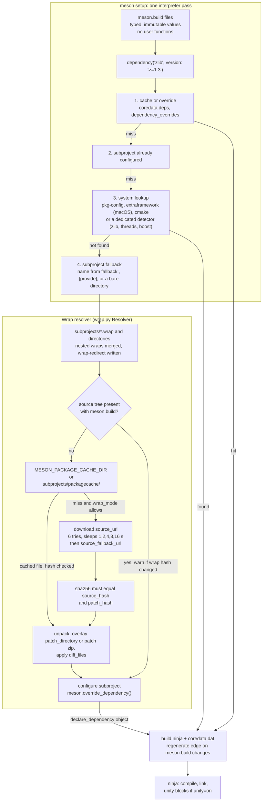

# Meson Build System and WrapDB

> [!summary] Claim:
> Meson is a meta-build system: `meson setup` runs a typed interpreter over `meson.build` files once and writes a Ninja file plus a pickled `meson-private/coredata.dat`.
> Ninja then does all the work and re-runs Meson only when a `meson.build`, an options file, a machine file, or `coredata.dat` changes.
> The language has no user-defined functions and only bounded loops (`foreach` over a finite array or dictionary), and every object is immutable, so a build definition always terminates and reads top to bottom.
> `dependency()` tries four candidates in a fixed order: a cached or overridden result, an already-configured subproject, the system (pkg-config, then macOS frameworks, then CMake), and finally a subproject fallback.
> A wrap file is an INI pin of a source tarball and an overlay by sha256; WrapDB is a curated index of such pins, and those hashes are the main thing that stops a tampered download.



## The Mechanism

### 1. Configure once, then get out of the way

Meson splits the build into a configure step written in Python and a build step run by a backend, which is Ninja by default (`backend` choices in 1.12.1 are `ninja`, `vs`, `vs2010` through `vs2026`, `xcode`, and `none`).
`meson setup builddir` creates the build directory, evaluates every `meson.build` reachable from the root through `subdir()` and `subproject()`, runs compiler checks, and writes `build.ninja`, `compile_commands.json`, the `meson-info/intro-*.json` introspection files, and `meson-private/coredata.dat`.
`coredata.dat` is a `pickle` of the whole `CoreData` object (`coredata.save`), so options, the found-dependency cache, and the compiler-check caches survive between runs.
`meson setup --reconfigure` re-runs the interpreter with those caches, and `--clearcache` empties the dependency and compiler-check caches first (`msetup.py`, `coredata.clear_cache`).

The build file never reconfigures itself from inside a compile.
Instead, `build.ninja` contains a `REGENERATE_BUILD` rule that runs `meson --internal regenerate`, and its `build build.ninja:` edge lists every `meson.build`, every options file (`meson.options` or `meson_options.txt`), the cross and native machine files, and `meson-private/coredata.dat` as inputs (`backends.py`, `get_regen_filelist`).
When one of them is newer than `build.ninja`, Ninja rebuilds the manifest first and restarts, which is ordinary Ninja manifest regeneration as described in [[Make-and-Ninja-Mechanics]].
Wrap files are not in that input list, so editing a `.wrap` does nothing until someone reconfigures, and even then it only warns (section 4).

A build directory is tied to a Meson release line.
`coredata.major_versions_differ` compares everything before the last dot, so a directory made by 1.11.x refuses to load under 1.12.x and asks for `--reconfigure` or `--wipe`, while 1.12.0 and 1.12.1 can share one.
Out-of-tree builds are mandatory: the design rationale says "Writing stray files in the source directory is not permitted under any circumstances."
That rule is why one source tree can carry a debug, a release, a sanitizer, and a cross build directory side by side.

The original design goals put numbers on the speed claim: configuring "a moderate sized project must not take more than five seconds," and a no-op compile of "a fully up to date tree of 1000 source files must not take more than 0.1 seconds" (Design rationale).
Meson's own 2013 benchmark of 1000 trivial C files on "a 2011 era MacBook Pro running Ubuntu 13/04" reported a 0.03 second no-op build, Autotools "almost one order of magnitude slower," and an Autotools configure step "over an order of magnitude slower than the second slowest."
That is a self-benchmark of a toy project with unstated tool versions; treat it as a statement of intent, not evidence about a modern codebase.

### 2. A non-Turing-complete, typed, immutable language

The language has integers, booleans, strings, arrays, and dictionaries (since 0.47.0), plus opaque objects returned by functions, such as build targets, dependencies, and compilers.
The Syntax page says "all objects are immutable", so `b += [2]` builds a new array and rebinds `b` without changing any alias of the old one; the lab's `a has 1 element(s), b has 2` line shows it.
The Syntax page also says "Meson does not currently support user-defined functions or methods", and the FAQ calls functions a muddle that "goes directly against this design goal."
The only loop is `foreach` over an array or dictionary, with `break` and `continue` since 0.49.0, so every loop is bounded by a value that already exists.
There is no `while`, no recursion, and no way to define a callable, so a `meson.build` file cannot fail to terminate.
`subdir()` refuses to enter a directory twice ("which has already been visited"), and a subproject cannot include itself recursively, so the evaluation order of files is a tree walk known before running.

Types are checked when a value is used, during configure, not when the build runs.
The lab's `'libfoo-' + 1` fails at `meson.build:2:16` with ``The `+` operator of str does not accept objects of type int (1)``.
Every built-in function declares its keyword arguments with `typed_kwargs`, including a type and the first Meson version that accepted it, so `executable('demo', 'main.c', sourcez: [...])` fails with `executable got unknown keyword arguments "sourcez" (did you mean "sources"?)` instead of being ignored.
The same `since` metadata drives `FeatureNew` warnings: a project that declares `meson_version: '>=0.60'` and uses a 1.2.0 keyword is told so at configure time.
The parser is a hand-written lexer and recursive-descent `Parser` in `mparser.py`, and machine files are read by the same lexer in `machinefile` mode, so a cross file's values are Meson literals, not free-form strings.

The escape hatches are explicit, not general.
`run_command()` runs a program at configure time, `custom_target()` and `generator()` run one at build time, and the modules (`pkgconfig`, `gnome`, `rust`, `python`, `cmake`, and others) are Python code shipped inside Meson, not user code.
The cost of this design is repetition: logic that a CMake `function()` would factor out becomes a `foreach` over a dictionary, a module feature request, or a script in `custom_target`.
The benefit is that a reviewer can read any `meson.build` without running it, and a tool such as `meson rewrite` or `meson format` can change it safely.

### 3. Targets and dependency objects

Targets are declared with `executable()`, `static_library()`, `shared_library()`, `both_libraries()`, `library()` (which follows the `default_library` option, default `shared`), `shared_module()`, and `custom_target()`.
Sources must be listed explicitly; the FAQ says that because Meson "must be fast," "all source files must be specified explicitly," so adding a file means editing a `meson.build`, which in turn triggers regeneration.

`declare_dependency()` is how a library publishes what a consumer needs, the usage requirements that CMake attaches to targets in [[Modern-CMake-Architecture-and-Targets]].
Its keyword arguments in 1.12.1 (`interpreter.py`, `func_declare_dependency`) are `compile_args`, `link_args`, `link_with`, `link_whole` (0.46.0), `include_directories`, `dependencies`, `sources`, `extra_files` (1.2.0), `variables` (0.54.0, list form 0.56.0), `version` (defaults to the project version), `objects` (1.1.0), and `d_import_dirs` and `d_module_versions` (0.62.0).
The result is an `InternalDependency`, the same kind of object `dependency()` returns, so a consumer cannot tell a system library, a CMake package, and a subproject apart.
Everything in `dependencies:` travels transitively: in the lab, `app` lists only `mylib_dep`, yet its compile line gets `-DMYLIB_FEATURE=1` and the include path, and its link line gets `libmylib.a` and the static zlib that `mylib_dep` itself depends on.

`meson.override_dependency(name, dep)` (0.54.0) registers a dependency object under a name for the rest of the configure run, keyed by `for_machine`.
After that, every `dependency(name)` in any project of the build returns the override with `(overridden)` in the log, which is how a subproject tells its parent "this is the `zlib` you asked for."
The lab's `Dependency zlib for host machine found: YES 1.3.1 (overridden)` line comes from WrapDB's zlib build calling `meson.override_dependency('zlib', ...)`.

### 4. How `dependency()` resolves a name

`DependencyFallbacksHolder.lookup()` in 1.12.1 builds a candidate list and tries it in order; only the last candidate is treated as required:
1. For each name, the dependency cache: an override from `meson.override_dependency()` or an earlier implicit override, else the on-disk `coredata.deps` cache from a previous run.
2. If a fallback subproject is known and already configured, its dependency.
3. Unless fallback is forced, a system lookup through `find_external_dependency()`.
4. Configuring the fallback subproject, then reading the override it registered, or the variable named by `fallback: ['proj', 'var']` or by the wrap's `[provide]` section.
Whichever candidate wins is installed as an implicit override for every name, so later lookups in the same configure are consistent even if the system changes mid-run.

The system lookup has its own order.
Some names have a dedicated detector in the `packages` table: in 1.12.1 these include `zlib`, `threads`, `boost`, `openmp`, `gtest`, `gmock`, `llvm`, `cuda`, `mpi`, `hdf5`, `openssl`, `iconv`, `intl`, `atomic`, and `dl`.
`zlib`'s factory tries pkg-config, CMake's `ZLIB` package, and then a system library search, in that order (`dependencies/dev.py`).
Any other name with `method: 'auto'` tries pkg-config, then `extraframework` on macOS only, then CMake last, with a source comment that CMake is "a last resort, since it might not work 100%."
The lab's `Run-time dependency mylib found: NO  (tried pkg-config, framework and cmake)` line is that order on macOS.
`method:` (0.40.0) can force one of `pkg-config`, `cmake`, `config-tool`, `system`, `extraframework`, `builtin`, `sysconfig`, or `dub`.

Where does the fallback name come from when the call has no `fallback:` keyword?
`Resolver.find_dep_provider()` looks the name up, lowercased, in the `[provide]` sections of every loaded wrap, where `foo.wrap` implicitly provides `foo`.
A plain directory under `subprojects/` with no wrap also becomes an implicit provider of its own name, which is how the lab's `dependency('mylib')` finds `subprojects/mylib/`.
With `subprojects/wrapdb.json` present (written by `meson wrap update-db`), a name that no local wrap provides is looked up in that copy of the WrapDB index and its wrap is downloaded on demand (automatic fallback since 0.64.0, per Using wraptool).
An implicit fallback is used only when the dependency is `required`, when `allow_fallback: true` (0.56.0) is passed, when fallback is forced, or when that subproject is already configured; a `required: false` lookup with no `allow_fallback` keyword does not trigger one.

The cache key is the name plus the lookup-shaping keywords: `get_dep_identifier()` deliberately ignores `version`, `native` (handled by machine), `required`, `fallback`, `allow_fallback`, `default_options`, `not_found_message`, and `include_type`.
Because `version` is not part of the key, the cache re-checks the version on every hit, and a cached system result that no longer satisfies the constraint is discarded rather than reported as not found.
`dependency('foo', static: true)` adds `default_library=static` to the fallback subproject's forced options, which is why the lab's zlib links statically: `app links a libz dylib: no (static fallback)`.

Wrap modes and fallback switches, from `wrap/__init__.py` and `dependencyfallbacks.py`:

| Setting | Effect |
|---|---|
| `--wrap-mode=default` | System first, then any subproject fallback, downloading if needed. |
| `--wrap-mode=nofallback` | Never use a subproject fallback for `dependency()`; explicit `subproject()` calls still download. |
| `--wrap-mode=nodownload` | No network for wraps at all; cached tarballs, local packagefiles, existing trees, and git submodules still work. |
| `--wrap-mode=forcefallback` | Skip the system lookup for every dependency that has a fallback. |
| `--wrap-mode=nopromote` (0.56.0) | Use only the main project's wraps; do not merge wraps found inside subprojects. |
| `--force-fallback-for=a,b` | Force the fallback for the named dependencies or subprojects; takes precedence over `nofallback`, and since 1.12.0 also applies to `find_program()` through `program_names`. |

### 5. Subprojects: one flat directory, one build graph

A subproject is a complete Meson project placed in the parent's `subproject_dir` (default `subprojects/`), configured inside the same interpreter run, and compiled by the same Ninja graph.
Its targets become ordinary nodes in `build.ninja`, so Ninja schedules zlib's objects alongside the app's, and there is no separate install step as there is with CMake's `ExternalProject_Add`.
Every subproject, including subprojects of subprojects, lives in the top-level `subprojects/` directory; the Subprojects page gives the reasons as keeping "any sort of sanity," letting users "easily see what subprojects any project has," and avoiding many copies of one dependency.
When a subproject brings its own wrap, the resolver merges it into the main resolver (`load_and_merge`), and when the main project resolves it, Meson writes a `[wrap-redirect]` file into the main `subprojects/` pointing at the nested wrap.
The lab shows that redirect: `filename = mylib/subprojects/zlib.wrap`, with zlib extracted to the top-level `subprojects/zlib-1.3.1/`.
`--wrap-mode=nopromote` turns that merging off, and `meson wrap promote <path>` copies a nested wrap up on purpose.

Options are scoped per project.
A parent can set a subproject's defaults with `subproject('foo', default_options: [...])` or `dependency(..., default_options: [...])`, and a user can override any of them with `-Dfoo:opt=value`.
Built-in options lists `default_library` and `werror` as settable per subproject since 0.54.0, `warning_level` since 0.56.0, `buildtype`, `debug`, `optimization`, `default_both_libraries`, `strip`, `unity`, and `unity_size` since 1.8.0, and `namingscheme` since 1.10.0, and compiler options have been per-subproject since 0.63.0; the 1.8.0 release notes call the change "a major change in how options are handled."
The precedence, lowest to highest, is the parent's `default_options`, the subproject's `default_options`, the machine file, the command line, and then the `subp:opt` forms from the parent's defaults, the `subproject()` call, the machine file, and the command line (Built-in options).
Subprojects "must not set global arguments" (`add_global_arguments`), because a global argument cannot be applied consistently across projects.

`meson subprojects` (since 0.49.0) manages the trees: `download`, `update` (with `--reset` to delete and re-extract), `checkout`, `foreach` (0.51.0), `purge`, and `packagefiles`.
Without `--reset`, `update` on a `wrap-file` subproject logs that the subproject "has not changed, or the new source/patch needs to be extracted on the same location" and leaves the tree as it is.

### 6. The wrap file format

A wrap is an INI file read by `configparser` with interpolation off; its first section must be `[wrap-file]`, `[wrap-git]`, `[wrap-hg]`, `[wrap-svn]`, or the internal `[wrap-redirect]`, and an optional `[provide]` section follows.
A real WrapDB wrap, the one the lab pins:

```ini
[wrap-file]
directory = zlib-1.3.1
source_url = https://zlib.net/fossils/zlib-1.3.1.tar.gz
source_fallback_url = https://github.com/mesonbuild/wrapdb/releases/download/zlib_1.3.1-3/zlib-1.3.1.tar.gz
source_filename = zlib-1.3.1.tar.gz
source_hash = 9a93b2b7dfdac77ceba5a558a580e74667dd6fede4585b91eefb60f03b72df23
patch_filename = zlib_1.3.1-3_patch.zip
patch_url = https://wrapdb.mesonbuild.com/v2/zlib_1.3.1-3/get_patch
patch_hash = fe43804f04c4dedc11fe6b5e1790666989cf9983f4e20ae0fad3fe88a428abad
wrapdb_version = 1.3.1-3

[provide]
dependency_names = zlib
```

The keys, with the versions from the Wrap dependency system manual:
- `directory`: the extracted tree's name, which must be a bare name, not a path (`PackageDefinition` raises otherwise).
- `source_url`, `source_filename`, `source_hash`: the upstream tarball and its sha256; `source_fallback_url` (0.55.0) is tried after the primary URL fails.
- `patch_url`, `patch_filename`, `patch_hash`, `patch_fallback_url`: an overlay archive that adds `meson.build` files to a project that has none; usable in every wrap type since 0.55.0.
- `patch_directory` (0.55.0): the same overlay taken from `subprojects/packagefiles/<dir>` instead of a download, and `diff_files` (0.63.0): real patches applied with `patch -l -f -p1`, or `git apply --ignore-whitespace -p1` when `patch` is missing.
- `lead_directory_missing`: create `directory` for an archive without a top-level folder.
- `method` (1.3.0): `meson` (default, needs `meson.build`), `cmake` (needs `CMakeLists.txt`), or `cargo` (needs `Cargo.toml`); the manual marks the last two experimental.
- For `wrap-git`: `url`, `revision` (a commit, tag, branch, or `HEAD`), `depth` (shallow clone), `clone-recursive` (0.48.0), and `push-url` (0.37.0).
- `wrapdb_version`: the `version-revision` that `meson wrap update` and `meson subprojects update` compare against the index.
- `[provide]`: `dependency_names` and `program_names` lists, or `name = variable` pairs for projects that do not call `meson.override_dependency()`; the parser rejects a misspelled `[provides]` section.

### 7. The trust chain in `wrap.py`

`Resolver.resolve()` and the `_resolve()` it wraps do the following for a missing tree:
1. `resolve()` takes a lock on `subprojects/.wraplock`, so two Meson processes do not extract into one directory.
2. If `<directory>` exists and has the build file for the wrap's `method`, it uses it as is, and only compares the stored sha256 of the wrap file with the current one, printing `revision may be out of date` on a mismatch.
3. If `<directory>` is a git submodule, it runs `git submodule update --init`, which works even with `nodownload`.
4. If the cache directory (`MESON_PACKAGE_CACHE_DIR` since 1.3.0, else `subprojects/packagecache/`) holds an extracted `<directory>`, it copies that tree.
5. Otherwise it fetches the source: a `source_filename` in the cache is re-hashed and used; else `check_can_download()` enforces `nodownload` and the URL is downloaded.
6. It unpacks with `shutil.unpack_archive`, applies the overlay and `diff_files`, deletes the tree if the overlay or a diff fails (an unpack failure raises without that cleanup), and writes the wrap file's sha256 to `<directory>/.meson-subproject-wrap-hash.txt`.

The download path, `get_data_with_backoff()`, is worth knowing exactly:
- It calls `get_data()` up to six times, sleeping 1, 2, 4, 8, and 16 seconds between attempts, so a dead primary URL costs 31 seconds of sleep before `source_fallback_url` is tried.
- Each attempt streams into a `NamedTemporaryFile(dir=cachedir, delete=False)` while hashing in 10 KiB blocks; a failed request raises before that file is removed, so every failed attempt leaves a `tmp*` file in the package cache, and the lab counts six.
- After a download the hash is compared with `source_hash` or `patch_hash`; a mismatch deletes the file and raises `Incorrect hash for source`.
- A cached tarball is re-hashed on every use, and a mismatch there is fatal rather than a trigger to re-download, as the lab's tampered-cache step shows.
- A `source_filename` taken from `subprojects/packagefiles/` with no `source_url` has its hash checked only if `source_hash` is present (`check_hash(..., hash_required=False)`).

The WrapDB-specific path is narrower: `open_wrapdburl()` only accepts an `https` URL whose host ends with `wrapdb.mesonbuild.com`, and `get_data()` rejects any other URL that merely contains that string as "a WrapDB-impersonating URL."
On Python 3.14 and later, `wrap.py` sets `tarfile.TarFile.extraction_filter` to `fully_trusted_filter` when it is imported, which turns off the `'data'` filter that PEP 706 made the 3.14 default.
That makes the sha256 in the wrap the only guard against a malicious tarball that writes outside the tree or sets special permissions; Homebrew's Meson 1.12.1 runs on Python 3.14, so this path is live on the lab host (as of 2026-11, macOS).
A `wrap-git` pin is only as strong as its `revision`: a full 40- or 64-hex commit ID is fetched and checked out exactly, while a branch, a tag, or `HEAD` follows whatever the remote serves, and no hash is checked.
`.netrc` credentials are sent only for `https` (as Basic auth) and `ftp`, and `sftp:` URLs are fetched with the system `sftp` client.

### 8. WrapDB

WrapDB is the curated catalogue: a single GitHub repository, `mesonbuild/wrapdb`, holding one `.wrap` per project, overlay directories under `subprojects/packagefiles/`, and a `releases.json` index that the service publishes.
Submissions are "a working subproject," must pass CI that "builds the project and runs tests" (`tools/sanity_checks.py`), and must use a name matching `[a-z0-9._]+`, preferably the project's pkg-config name (Adding new projects to WrapDB).
Each release is `upstream_version-revision`, such as `1.3.1-3`; the revision counts packaging changes, and "All the old releases remain unaltered," so a pinned wrap keeps resolving.
`releases.json` maps each name to `versions` (newest first) and optional `dependency_names` and `program_names`; the index fetched on 2026-11-13 listed 367 projects and 2513 releases, with zlib at `1.3.2-1`.
On that date `https://wrapdb.mesonbuild.com/v2/releases.json` answered with a 301 redirect to `https://mesonbuild.com/wrapdb/releases.json`, which `urllib` follows.
WrapDB v1 URLs have been discontinued for years, and 1.9.0 started printing a deprecation warning for them.

`meson wrap` is the client (`wraptool.py`): `list`, `search` (which also searches `dependency_names`), `info`, `install` (several names at once since 1.12.0), `update`, `status`, `promote`, and `update-db`, whose help text says "Since 0.61.0."
`install` takes the first, newest entry in `versions` and writes `subprojects/<name>.wrap`; it refuses if the wrap or directory already exists.

A WrapDB pin can rot without anyone touching it.
On 2026-11-13 the newest zlib wrap, `zlib_1.3.2-1`, had `source_url = https://zlib.net/zlib-1.3.2.tar.xz`, and that URL returned HTTP 404 while zlib.net's index page listed `zlib-1.4.tar.gz`, so every fresh fetch of it went through the six-attempt backoff before using the fallback URL (seen in a Meson 1.12.1 configure and with `curl` on the lab host; not part of the recorded lab output).
The older `zlib_1.3.1-3` wrap points at `zlib.net/fossils/`, which still served the file, which is why the lab pins it.

### 9. Cross compilation: machine files describe machines, not toolchains

Meson names three machines: the build machine "doing the actual compiling," the host machine "on which the compiled binary will run," and the target machine, which matters only when building a compiler and defaults to the host.
A cross build needs a cross file, passed with `--cross-file`; native-only settings go in `--native-file`.
Both are machine files with `[constants]` (0.56.0, supporting `+` concatenation and `/` path joining), `[binaries]`, `[properties]`, `[built-in options]`, `[project options]` (0.56.0), `[cmake]` (0.56.0), and in cross files `[host_machine]` and `[target_machine]` with `system`, `subsystem`, `kernel`, `cpu_family`, `cpu`, and `endian`.
Several files layer, later values replacing earlier ones ("cross files can be layered since Meson 0.52.0"), so a team ships one toolchain file and one site-policy file and passes both.
Since 1.11.0, machine files expand `~` to the home directory, and since 1.3.0 `@GLOBAL_SOURCE_ROOT@` and `@DIRNAME@` are substituted before parsing.
Cross files are searched relative to the current directory, then in `$XDG_DATA_HOME/meson/cross` (default `~/.local/share/meson/cross`), then in system data directories, except on Windows (0.44.0).

Every target belongs to one machine.
`native: true` on a target or `dependency()` puts it on the build machine, so a code generator can run during the build while the product targets the host; the lab's `gen` is `arm64` and its `app` is `x86_64`.
Since 1.12.0, `subproject()` and `meson.override_find_program()` take `native`, so a build-time tool can come from a subproject built for the build machine, and such a subproject installs nothing.
Meson decides whether it can run host binaries with `envconfig.machine_info_can_run()`: same `system`, same `subsystem` if set, and the same `cpu_family`, except that an `x86_64` build machine may run `x86`, and a `mips64` one may run `mips`.
So an `x86_64` macOS host on an `aarch64` Mac counts as not runnable even though Rosetta 2 could run it, and the lab prints `can_run_host_binaries=false` until a second cross file sets `needs_exe_wrapper = false`.
When host binaries cannot run, tests and `run_command` on host executables need `exe_wrapper` in `[binaries]`, such as `qemu-aarch64` or `wine`; sysroots, triples, and QEMU belong to [[Cross-Compilation-and-Sysroots]].

### 10. Unity builds

`-Dunity=on` makes Meson concatenate each target's C, C++, and Objective-C sources into generated files named `<target>-unity<N>.<suffix>` in the target's private directory, each holding `#include<absolute path>` lines (`backends.py`, `generate_unity_files`).
`unity_size` (default 4, minimum 2) is the number of sources per file, and the files are filled in source-list order: the first source opens block 0, and a new block starts every `unity_size` sources.
`unity=subprojects` unity-builds only the subprojects, which suits vendored dependencies that nobody edits.
Assembly and LLVM IR sources are compiled normally, and so are sources in languages listed in `LANGS_CANT_UNITY`, which Meson reports with a `FIXME` log line.
The generated files are written as `.tmp` and swapped in with `replace_if_different`, so an unchanged block keeps its timestamp and does not recompile.

The documented gain is "it is not uncommon to obtain more than 50% speedup in compile times" (Unity builds), from parsing shared headers once per block instead of once per source; this note has no measurement of it.
The documented costs are name clashes between `static` functions and variables, incremental builds that recompile a whole block, and more memory per compile.
The lab shows the sharpest edge: with sources `a.c main.c b.c`, `unity_size=4` puts all three in one block and fails with `redefinition of 'helper'`, while `unity_size=2` splits them as `[a.c main.c] [b.c]` and builds.
So whether a unity build breaks depends on block boundaries, and adding one file to a list can move a clashing pair into the same block.
Turn it off for one target with `override_options: ['unity=off']`.

### 11. Meson against CMake and Autotools

| Concern | Meson 1.12 | CMake 4.x | Autotools |
|---|---|---|---|
| Language | Typed, immutable DSL; no user functions; `foreach` only | General scripting language with `function()`, `macro()`, and `while()` | M4 macros expanded into a POSIX `sh` `configure` script |
| Build tree | Out-of-tree only | Out-of-tree recommended, in-source allowed | In-source by default, VPATH builds supported |
| Backends | Ninja (default), Visual Studio, Xcode, none | Many generators (Make, Ninja, Visual Studio, Xcode) | Make |
| Regeneration | Ninja `REGENERATE_BUILD` edge on `meson.build`, options files, machine files, `coredata.dat` | Re-runs when a `CMakeLists.txt` or included file changes | `config.status --recheck` and Automake rebuild rules |
| Check cache | Pickled in `meson-private/coredata.dat` | `CMakeCache.txt` | `config.cache`, only with `configure -C` |
| Third-party sources | Wraps pinned by sha256, WrapDB index | `FetchContent` (3.11), `FetchContent_MakeAvailable` (3.14), `find_package` first via `FIND_PACKAGE_ARGS` (3.24) | None built in; distribution packages |
| Cross compilation | Machine files describing build, host, target | Toolchain files ([[CMake-Presets-Toolchains-and-File-API]]) | `--build`, `--host`, `--target` triples and `config.site` |
| Fallback order | Cache, configured subproject, system, subproject | `find_package` or fetch, chosen by the author | Whatever the macros check |

Meson's own Comparisons page lists its strengths as "Not Turing complete so build definition files are easy to read and understand" and its weaknesses as Visual Studio and Xcode backends "not as high quality as Ninja one"; it calls Autotools "Needlessly slow, complicated, hard to use correctly."
Those are the project's claims about itself.
The verifiable differences are structural: a Meson file cannot run arbitrary loops, cannot write into the source tree, and gets its configure-time errors with file, line, and column, while a CMake project can encode policy in functions that Meson would need a module for.
Autotools still has the broadest support for old Unix systems and the shell-level portability that [[19-Shell-and-Unix-Engineering/18-Build-Packaging-and-Bootstrap/Autoconf-and-configure|Autoconf and configure]] covers.
The full selection matrix, including Bazel and Buck2, is in [[Build-Performance-Economics-and-Decision-Record]].

## Commands and Numbers to Know

| Item | Value | Platform | Notes |
|---|---|---|---|
| Current release | 1.12.1; 1.12.0 released 10 August 2026 (as of 2026-11) | Both | Homebrew bottle on the lab host. |
| Python requirement | 3.10 or newer from 1.12.0 (as of 2026-11) | Both | 1.11 was the last line supporting 3.7 to 3.9. |
| Build dir compatibility | Same `major.minor` only, such as 1.12.x (as of 2026-11) | Both | `coredata.major_versions_differ`; otherwise `--reconfigure` or `--wipe`. |
| `meson setup --reconfigure --clearcache` | Re-runs with cleared dependency and check caches (as of 2026-11) | Both | The caches live in `meson-private/coredata.dat`. |
| `dependency()` auto order | pkg-config, extraframework (macOS only), cmake (as of 2026-11) | Both | Names with a dedicated detector use their own list; zlib is pkg-config, cmake, system. |
| `wrap_mode` | `default`, `nofallback`, `nodownload`, `forcefallback`, `nopromote` (as of 2026-11) | Both | `--force-fallback-for` overrides `nofallback`. |
| Download retries | 6 attempts, sleeps 1, 2, 4, 8, 16 s, then fallback URL (as of 2026-11) | Both | `get_data_with_backoff`; 30 s socket timeout per request (`REQ_TIMEOUT`). |
| Package cache | `MESON_PACKAGE_CACHE_DIR` (1.3.0), else `subprojects/packagecache/` (as of 2026-11) | Both | Used even with `nodownload`; hash re-checked on each use. |
| Wrap hash file | `<subproject>/.meson-subproject-wrap-hash.txt`, sha256 of the wrap (as of 2026-11) | Both | Mismatch only warns. |
| `meson wrap install a b` | Several wraps at once since 1.12.0 (as of 2026-11) | Both | Non-zero exit if any fails. |
| `meson wrap update-db` | Writes `subprojects/wrapdb.json`; automatic WrapDB fallback since 0.64.0 (as of 2026-11) | Both | Delete it or use `nodownload` to stop auto-downloads. |
| `meson subprojects update --reset` | Deletes and re-extracts a wrap-file tree (as of 2026-11) | Both | Without `--reset`, a changed wrap is not applied. |
| WrapDB index | 367 projects, 2513 releases on 2026-11-13 (as of 2026-11) | Both | Counted from `releases.json`; not part of the lab output. |
| `unity` / `unity_size` | `off` / 4, minimum 2 (as of 2026-11) | Both | Per-subproject since 1.8.0. |
| `default_library` | `shared` (as of 2026-11) | Both | `dependency(..., static: true)` forces `static` in the fallback. |
| `buildtype` mapping | `debug` = debug true, opt 0; `debugoptimized` = true, 2; `release` = false, 3; `minsize` = true, s (as of 2026-11) | Both | Any other pair reports `custom`. |
| `namingscheme` | `classic` default, `platform` since 1.10.0 (as of 2026-11) | Both | Expected to become `platform` in a future major version. |
| Cross file search | `./`, then `$XDG_DATA_HOME/meson/cross`, then system dirs (as of 2026-11) | Linux, macOS | Not on Windows. |
| `meson.can_run_host_binaries()` | true only for the same system and cpu_family, or x86_64 to x86, mips64 to mips (as of 2026-11) | Both | `needs_exe_wrapper` overrides it. |

## Multi-Language Comparison: What Meson Does for C++, Python, and Rust

| Concern | C++ | Python extensions | Rust |
|---|---|---|---|
| How Meson builds it | Native compilers detected per machine; `cpp_std` and other compiler options per target or per subproject | `python` module (`py.extension_module`); `meson-python` is the PEP 517 backend that wraps a Meson build into a wheel | Native `rust` language support and `rust` module; Cargo packages as `method = cargo` wraps (experimental) |
| Third-party dependencies | WrapDB wraps, pkg-config, CMake packages | C and C++ dependencies as wraps or system packages, like any other Meson target | `Cargo.lock` turned into wraps since 1.5.0, one top-level `Cargo.lock` since 1.10.0, workspaces since 1.10.0 |
| Dependency name in `dependency()` | Upstream pkg-config name, such as `zlib` or `fmt` | `py.dependency()` for `Python.h` and the library | `<package>-<version>-rs`, where `0.x.y` gives `0.x` (version part since 1.4) |
| Unity builds | Supported | Supported for the C or C++ sources | Not applicable; rustc compiles crates, not files |
| Modules or newer features | Experimental `import std` with `cpp_importstd` since 1.10.0; named modules belong to [[Cpp-Modules-in-Build-Systems]] | `python.allow_limited_api` option (default true) | `clippy-json` Ninja target since 1.12.0 |
| Owning note | [[Modern-CMake-Architecture-and-Targets]] for the CMake contrast | [[Python-Native-Build-Backends-scikit-build-core-meson-python-and-maturin]] | [[Cargo-Build-Graph-and-Rustc-Pipelining]] |

## Worked Lab Example

The lab lives at `code/06-Build-Systems/meson_wrap_build/`, and `run.sh` is tagged `# requires: macos, network`.
It needs macOS because the cross step uses Apple clang's `-arch x86_64` and `lipo`, and network access because the WrapDB step downloads zlib 1.3.1 once.
It also needs `meson`, `ninja`, and a C compiler; a preflight stops with exit 2 and names a missing tool.
It unsets `CFLAGS`, `LDFLAGS`, `CPPFLAGS`, and `PKG_CONFIG_PATH`, and uses `--force-fallback-for=zlib` so that no system zlib can change the result.

The `projects/` directory holds six small Meson projects:
1. `dsl_ok/`, `dsl_typeerr/`, and `dsl_kwarg/` show immutability, a type error, and an unknown keyword argument.
2. `app/` is a main project whose only dependency is `dependency('mylib')`, found because `subprojects/mylib/` is a bare directory.
   `mylib` calls `dependency('zlib', version: '>=1.3', static: true)`, publishes `declare_dependency(include_directories:, compile_args: ['-DMYLIB_FEATURE=1'], link_with:, dependencies: zlib_dep)`, and calls `meson.override_dependency('mylib', mylib_dep)`.
   The pinned WrapDB wrap `zlib_1.3.1-3` sits inside `mylib`, at `subprojects/mylib/subprojects/zlib.wrap`, so the main project has to promote it.
3. `unity/` builds `a.c main.c b.c`, where `a.c` and `b.c` each define `static int helper(void)`.
4. `cross/` builds a `native: true` generator that writes `table.h` for a host program, with a cross file for `x86_64` macOS and a second cross file that only sets `needs_exe_wrapper = false`.

`run.sh` does the following in a temporary directory:
1. It configures the three DSL projects and prints the `Message:` lines and the first `ERROR:` line of each failing configure.
2. It configures `app` with `--wrap-mode=nodownload` and an empty `MESON_PACKAGE_CACHE_DIR`, and expects the download refusal.
3. It configures a fresh copy normally, prints the resolver's log lines, the `wrap-redirect` Meson wrote, the cache contents, and two hash comparisons, then builds and runs the app and checks with `otool -L` that no `libz` dylib is linked.
4. It configures another copy with `nodownload` and the now-warm cache, then a copy whose cached tarball has one extra byte.
5. It appends a comment to the nested wrap and reconfigures, expecting only a warning.
6. It replaces `source_url` in a copy of the wrap with a GitHub release URL that does not exist, configures with a new empty cache, and counts the retry warnings, the fallback download, and the `tmp*` files left in the cache.
7. It builds `unity/` three ways and prints the number of entries in `compile_commands.json`, the contents of each `u-unity<N>.c`, and the build result.
8. It configures `cross/` once with the x86_64 cross file and once with both cross files, and reads the two binaries' architectures with `lipo -archs`.

### Verified output

Recorded with `python3 -m _harness.verify --record` on darwin-arm64 (macOS 27.3, Meson 1.12.1, Ninja 1.13.2, Apple clang 21.0.0) on 2026-11-13; the file is `code/06-Build-Systems/meson_wrap_build/expected/darwin-arm64.txt`.

```text
meson 1.12.1, ninja 1.13.2

=== 1. The DSL is typed and checked at configure time ===
Message: immutability: a has 1 element(s), b has 2
Message: dict keys: lto opt
Message: foreach total: 7
dsl_typeerr/meson.build:2:16: ERROR: The `+` operator of str does not accept objects of type int (1)
dsl_kwarg/meson.build:2:0: ERROR: executable got unknown keyword arguments "sourcez" (did you mean "sources"?)

=== 2. WrapDB fallback, the package cache, and sha256 pinning ===
nodownload, empty cache: ERROR: Automatic wrap-based subproject downloading is disabled
Run-time dependency mylib found: NO  (tried pkg-config, framework and cmake)
mylib| Using subprojects/mylib/subprojects/zlib.wrap
mylib| Building fallback subproject with default_library=static
mylib| Dependency zlib for host machine found: YES 1.3.1 (overridden)
Dependency mylib for host machine found: YES 0.3.0 (overridden)
main subprojects/zlib.wrap written by Meson:
  [wrap-redirect]
  filename = mylib/subprojects/zlib.wrap
cache holds: zlib-1.3.1.tar.gz zlib_1.3.1-3_patch.zip
cached source sha256 matches wrap: yes
hash of wrap recorded in subprojects/zlib-1.3.1/.meson-subproject-wrap-hash.txt: sha256 of the wrap file
MYLIB_FEATURE reached main.c through declare_dependency: 1
zlib version seen by mylib: 1.3.1
deflate/inflate round trip: ok
app links a libz dylib: no (static fallback)
nodownload, warm cache: mylib| Using zlib source from cache.
tampered cache: ERROR: Incorrect hash for source:
edited wrap on reconfigure: WARNING: Subproject zlib's revision may be out of date; its wrap file has changed since it was first configured

=== 3. A dead primary URL: retries, fallback URL, and leftovers ===
retry warnings before giving up on source_url: 5
fallback used: 1
temporary files left in the package cache: 6

=== 4. Unity builds: block assignment decides whether static names clash ===
unity=off unity_size=4: compile commands=3; builds, a+b=3
unity=on unity_size=4: compile commands=1; u-unity0.c=[a.c main.c b.c]; fails: redefinition of 'helper'
unity=on unity_size=2: compile commands=2; u-unity0.c=[a.c main.c] u-unity1.c=[b.c]; builds, a+b=3

=== 5. Cross file: build machine runs the generator, host machine runs the app ===
Message: is_cross_build=true can_run_host_binaries=false
Message: build_machine=darwin/aarch64 host_machine=darwin/x86_64
gen (native: true) arch: arm64
app (host) arch: x86_64
with a second cross file setting needs_exe_wrapper = false:
Message: is_cross_build=true can_run_host_binaries=true
```

### Reading the output

Section 1 shows that the language's guarantees are enforced, not conventions.
`a` keeps one element after `b += [2]`, the `foreach` skips 3 and sums to 7, and both bad files fail at configure time with a file, line, and column.

Section 2 is the resolution order of `DependencyFallbacksHolder` in action.
`mylib` is not on the system, so pkg-config, the framework search, and CMake are all tried and fail, and the bare `subprojects/mylib/` directory becomes the fallback.
Inside `mylib`, the forced fallback skips the system, `static: true` becomes `default_library=static`, and Meson reads the nested wrap and records a `wrap-redirect` in the main `subprojects/`.
Both dependencies report `(overridden)`, because each subproject called `meson.override_dependency()`.
The app's output proves propagation through `declare_dependency`: the define reached a file that never mentions zlib, and zlib was linked statically into a binary whose own `meson.build` names only `mylib`.
The nodownload pair shows that the policy is about the network, not about wraps: an empty cache is refused and a warm cache works offline.
The tampered tarball is rejected by its sha256, while an edited wrap only produces a warning, because Meson does not re-fetch a tree that already exists.

Section 3 makes the download loop visible.
Five warnings plus one final failure are the six attempts of `get_data_with_backoff`, and the GitHub fallback URL then supplied the file.
The six `tmp*` files are the leftovers of those six failed attempts, which accumulate in a shared `MESON_PACKAGE_CACHE_DIR` until someone deletes them.

Section 4 shows that unity block boundaries follow source order.
With one block, `a.c` and `b.c` share a translation unit and their `static` helpers collide; with blocks of two, they land in different blocks and the same code builds.

Section 5 separates the two machines.
`gen` was built with `native: true` for `arm64` and ran during the build to write `table.h`, while `app` was built for `x86_64`.
Meson considered the host binaries unrunnable until the layered second cross file said otherwise, which is exactly the `cpu_family` rule in `machine_info_can_run`.

## Pitfalls

> [!warning] Pitfall 1: Editing a wrap does not update the subproject
> A subproject tree that exists and has its build file is used as is.
> Bumping `source_url` and `source_hash` in the wrap and running `ninja` does nothing, because wraps are not inputs to the `REGENERATE_BUILD` edge, and a reconfigure only prints `revision may be out of date`, as the lab shows.
> Run `meson subprojects update --reset <name>` or `meson subprojects purge --confirm` and reconfigure, and gate CI on a clean checkout.

> [!warning] Pitfall 2: A WrapDB pin can rot upstream
> WrapDB's `zlib_1.3.2-1` wrap pointed `source_url` at a zlib.net path that returned 404 on 2026-11-13, so every fresh configure sleeps 31 seconds in `get_data_with_backoff` before using `source_fallback_url` and leaves six temp files in the cache, the same pattern the lab records for a synthetic dead URL.
> A wrap with no fallback URL fails outright.
> Mirror tarballs into an internal `MESON_PACKAGE_CACHE_DIR` or artifact store, and run CI with `--wrap-mode=nodownload` against it.

> [!warning] Pitfall 3: Trusting archives beyond their hash
> On Python 3.14 and later, Meson 1.12.1 turns off PEP 706's `'data'` extraction filter for every tarball, and a local `packagefiles` source without `source_hash` is not checked at all.
> A `wrap-git` with a branch or `HEAD` revision has no integrity check.
> Require `source_hash` and `patch_hash` on every `wrap-file`, and full commit IDs on every `wrap-git`, in code review or a pre-commit check.

> [!warning] Pitfall 4: `required: false` silently skips the fallback
> `dependency('foo', required: false)` without `allow_fallback: true` does not use a wrap that provides `foo`, so a feature turns off on machines without a system `foo`.
> A `required: get_option('foo')` feature option set to `auto` behaves the same way.
> Pass `allow_fallback: true`, or set `-Dfoo=enabled` in CI.

> [!warning] Pitfall 5: Unity builds that pass by accident
> A unity build can pass today and fail when one source is added, because blocks are filled in source order (`a.c main.c b.c` fails at `unity_size=4` and builds at 2 in the lab).
> Incremental builds also recompile a whole block for a one-line change.
> Keep one CI job with `unity=off` so non-unity correctness is enforced, give `static` helpers unique names or an anonymous namespace per file in C++, and prefer `unity=subprojects` for vendored code.

> [!warning] Pitfall 6: Assuming the system and the fallback give the same library
> The default mode prefers a system library that satisfies the version constraint, so a developer laptop links Homebrew's shared zlib while CI, where it is missing, builds the static fallback.
> The two differ in version, ABI, and link mode.
> Pin the choice with `--force-fallback-for=zlib` or `--wrap-mode=forcefallback` for hermetic builds, or `nofallback` for distribution packaging, and print the `meson-info/intro-dependencies.json` result in CI logs.

> [!warning] Pitfall 7: Cross builds that try to run host binaries
> A test, `run_command()`, or `custom_target()` that runs a host executable fails or is skipped when `can_run_host_binaries()` is false.
> Generators must be `native: true`, and their dependencies must be looked up with `native: true` too, or the generator links against host libraries.
> Supply `exe_wrapper` (QEMU, Wine) for tests, and use `needs_exe_wrapper = false` only when the host really can run the binaries, as with Rosetta 2.

> [!warning] Pitfall 8: Upgrading Meson under a live build directory
> A build directory made by 1.11.x does not load in 1.12.x, so a CI image or developer machine that upgrades Meson breaks every cached build directory at once.
> Pin Meson per repository (for example in a lockfile or a `pip` constraint), declare `meson_version:` in `project()`, and wipe build directories when the pin moves.

## At Scale

For one developer, Meson's defaults are the right ones: system dependencies first, wraps as a fallback, one build directory per configuration, and `meson wrap install` to add a library.
The interesting costs start when many machines must produce the same result.

For a team of tens, the risk is drift between machines.
The same `meson.build` links a system library on one laptop and a fallback on another, and a wrap edit applies on one checkout and not on another.
The decision rules:
1. Choose one wrap mode per build purpose: `forcefallback` (or a `force_fallback_for` list) for hermetic product builds, `nofallback` for distribution packaging, and `default` only for local development.
2. Run CI from a clean tree with `--wrap-mode=nodownload` and a pre-populated `MESON_PACKAGE_CACHE_DIR`, so the network is never in the critical path.
3. Treat a `.wrap` edit like a lockfile change: review the new hashes, and run `meson subprojects update --reset` in the same change.

For 1,000 to 50,000 engineers, Meson usually sits inside a larger system: as the build of individual C and C++ libraries, as the backend for Python extensions through `meson-python`, or as the build that a distribution or monorepo wraps.
The trade-offs change:
- The flat `subprojects/` directory and version pinning per project mean that two products can pin different zlib releases; nothing at the org level unifies them, which is the problem Bazel's Bzlmod and its minimal version selection solve ([[Bazel-Skyframe-Bzlmod-and-Execution-Model]]).
- Meson has no built-in remote cache or remote execution; caching comes from a compiler cache such as ccache or sccache ([[Compiler-Caches-ccache-and-sccache]]), whose hit rate depends on Meson's stable command lines and out-of-tree paths.
- WrapDB is a curated public catalogue with 367 projects on 2026-11-13, not an enterprise registry; a large organization runs an internal mirror of `releases.json`, wraps, and tarballs, or vendors sources with `meson dist --include-subprojects`.
- The non-Turing-complete language is an advantage when thousands of engineers each read a few `meson.build` files a year, and a cost when a platform team wants to encode policy, which in Meson means a module, a wrapper script, or machine files rather than shared functions.
- Determinism needs the usual work from [[Hermetic-and-Reproducible-Builds]]: Meson's unity files include each source by absolute path, so reproducible artifacts still need prefix maps and `SOURCE_DATE_EPOCH` handling.

Decision rule for choosing Meson: pick it for C, C++, and mixed native projects of up to a few thousand targets that need fast configure, cross builds, and readable build files, and that will be consumed by distributions or Python packaging.
Pick CMake when consumers expect `find_package` config files and IDE generators, and pick Bazel or Buck2 when the requirement is one hermetic graph with remote execution across a monorepo.

> [!tip] Practice Drill: Break and repair a WrapDB pin
> In a copy of the lab's `app/`, add `'cpp'` to the languages of `mylib`, run `meson wrap install fmt` from `subprojects/mylib/`, call `fmt::format` from a new `fmt_user.cpp` in `mylib`, and build.
> Change the fmt wrap's `source_hash` by one character, run `ninja`, and explain why nothing happens; then reconfigure and explain the warning, and finally use `meson subprojects update --reset fmt` and read the hash error.
> Point `source_url` at a dead URL, time the configure, and count the `tmp*` files in `MESON_PACKAGE_CACHE_DIR`.
> Finish by running the configure with `--wrap-mode=nodownload` against a cache you populated, and write the CI policy you would enforce.
> For the build-graph half, compare the result with [[Drill-Build-Systems-Fix-Broken-Incremental-Depfile]].

## Interview Questions

> [!question] L5: What does `declare_dependency()` give you that passing a library target does not?
> > [!success]- Answer
> > It bundles every usage requirement into one object: include directories, compile and link arguments, the libraries to link (`link_with`, `link_whole`), generated sources, other dependencies, and string variables.
> > A consumer that adds the object to `dependencies:` gets all of it, transitively, which is how the lab's app gets `-DMYLIB_FEATURE=1` and a static zlib while naming only `mylib`.
> > Because `dependency()` returns the same kind of object, a consumer cannot tell a system package from a subproject, so the provider can switch without consumer edits.

> [!question] L5: Why does this print 1, and what does it say about the language? `a = [1]`, `b = a`, `b += [2]`, `message(a.length())`
> > [!success]- Answer
> > All Meson objects are immutable, so `+=` builds a new array and rebinds only `b`; `a` still refers to the one-element array.
> > The language also has no user-defined functions and only `foreach` loops over existing arrays and dictionaries, so a build file always terminates and can be read top to bottom.
> > The trade is that shared logic is expressed as data plus a loop, a module, or a script, not as a function.

> [!question] L6: Predict the output. `executable('u', 'a.c', 'main.c', 'b.c')`, where `a.c` and `b.c` each define `static int helper(void)`. What happens with `-Dunity=on -Dunity_size=4`, and with `-Dunity_size=2`?
> > [!success]- Answer
> > Meson fills unity files in source order, starting a new file every `unity_size` sources.
> > With 4, all three files go into `u-unity0.c`, which includes `a.c` and `b.c` in one translation unit, so the compile fails with `redefinition of 'helper'`.
> > With 2, the blocks are `[a.c main.c]` and `[b.c]`, the helpers are in different translation units, and the program builds and prints `a+b=3`, which the lab records.
> > The lesson is that unity correctness depends on block boundaries, so keep a `unity=off` CI job.

> [!question] L6: Walk through what happens on `dependency('zlib', version: '>=1.3')` in a project that has `subprojects/zlib.wrap`.
> > [!success]- Answer
> > Meson first checks the dependency cache and the overrides, re-checking the version on a hit.
> > It then checks whether the zlib subproject is already configured, and otherwise looks on the system with zlib's dedicated detector: pkg-config, CMake's `ZLIB` package, then a system library search.
> > If none satisfies `>=1.3`, the wrap's `[provide]` section (a `zlib.wrap` provides `zlib` implicitly) names the fallback, the resolver extracts or downloads the tarball and patch, checks both sha256 values, and configures the subproject.
> > The subproject's `meson.override_dependency('zlib', ...)` supplies the object, and Meson installs it as an implicit override so every later lookup gets the same zlib.
> > `--wrap-mode=forcefallback` or `--force-fallback-for=zlib` skips the system step, and `nofallback` skips the subproject step.

> [!question] L6: Debug this. A developer bumped `subprojects/zlib.wrap` from 1.3.1 to 1.3.2, ran `ninja`, and the binary still reports 1.3.1. A reconfigure only printed a warning. Why, and what is the fix?
> > [!success]- Answer
> > The `build.ninja` regeneration edge depends on `meson.build` files, options files, machine files, and `coredata.dat`, not on wrap files, so `ninja` did not reconfigure.
> > On reconfigure, the resolver found `subprojects/zlib-1.3.1/` (or the old directory) with its `meson.build` present and used it, only comparing the wrap's sha256 with `.meson-subproject-wrap-hash.txt` and warning `revision may be out of date`.
> > If the new wrap's `directory` changed to `zlib-1.3.2`, the new tree would be fetched, but an unchanged `directory` keeps the old sources.
> > Run `meson subprojects update --reset zlib`, or `meson subprojects purge --confirm` and reconfigure, and make CI build from a clean tree so this cannot reach a release.

> [!question] L6: In a cross build from an arm64 Mac to x86_64 macOS, why does `meson.can_run_host_binaries()` return false, and how do you build a code generator that must run during the build?
> > [!success]- Answer
> > `machine_info_can_run` requires the same system and the same `cpu_family`, with exceptions only for x86_64 running x86 and mips64 running mips, so `aarch64` to `x86_64` is false even though Rosetta 2 exists.
> > Mark the generator `native: true` so it is compiled for the build machine, and look up its dependencies with `native: true`; the lab's `gen` is arm64 and its output feeds the x86_64 `app`.
> > If the host really can run the binaries, a layered cross file with `needs_exe_wrapper = false` flips the answer; otherwise provide `exe_wrapper` for tests.

> [!question] L7: What exactly does a wrap file protect against, and where are the gaps?
> > [!success]- Answer
> > A `wrap-file` pins the source tarball and the overlay by sha256, checked after every download and on every use of a cached file, so a compromised mirror or a corrupted cache cannot supply different bytes; the lab's one-byte change is rejected.
> > The gaps: a `wrap-git` with a branch, tag, or `HEAD` revision has no hash; a local `packagefiles` source without `source_hash` is not checked; the wrap file itself is trusted as fetched over HTTPS from WrapDB; and on Python 3.14 Meson 1.12.1 extracts archives with `tarfile`'s `fully_trusted` filter, so a malicious archive with a matching hash is unpacked without path checks.
> > An existing tree is never re-verified against the wrap; only the wrap's own hash is compared, and only with a warning.
> > Policy: require hashes and full commit IDs in review, mirror tarballs internally, and run CI with `nodownload` from a clean tree.

> [!question] L7: A 300-engineer C++ organization asks whether to standardize on Meson or CMake. How do you decide?
> > [!success]- Answer
> > Start with the consumers: if downstream projects expect `find_package` config packages and IDE generators, CMake is the integration point, and Meson can still produce pkg-config files and be consumed through CMake's pkg-config support.
> > Meson wins on readability, configure-time errors, fast no-op builds through Ninja, machine-file cross compilation, and a single build graph that includes vendored dependencies.
> > CMake wins on generator breadth, the size of its package ecosystem, and the ability to write shared functions for platform policy.
> > Neither gives a remote cache or hermetic execution, so if those are the requirement, the comparison is with Bazel or Buck2 instead, as in [[Build-Performance-Economics-and-Decision-Record]].
> > Measure configure and no-op build time on a real slice of the codebase rather than quoting either project's own benchmarks.

> [!question] L8+: You own the native build platform for 5,000 engineers whose libraries use Meson and WrapDB. What do you standardize?
> > [!success]- Answer
> > A pinned Meson version per repository, because build directories do not survive a minor-version change, and `meson_version:` in every `project()`.
> > An internal mirror of WrapDB's `releases.json`, wraps, and tarballs exposed through `MESON_PACKAGE_CACHE_DIR`, with CI running `--wrap-mode=nodownload` from a clean tree, so upstream URL rot such as the 2026 zlib.net 404 cannot break builds.
> > A wrap policy enforced in review: `source_hash` and `patch_hash` always, full commit IDs for git wraps, `wrapdb_version` present, and a forced fallback list for anything that ships, so laptops and CI link the same library.
> > A shared compiler cache, machine files per target platform layered with a site-policy file, a non-unity CI job, and a cleanup job for the `tmp*` files that failed downloads leave in shared caches.

> [!question] L8+: The non-Turing-complete language is often sold as Meson's main advantage. When does it become a liability, and what do you do then?
> > [!success]- Answer
> > It pays off when many people read build files occasionally: every file terminates, has no hidden control flow, and fails at configure time with a location.
> > It becomes a liability when a platform team wants to encode policy once, such as standard warning sets, sanitizer matrices, or code-generation conventions, because there are no user functions.
> > The answers, in order of preference, are data plus `foreach`, machine files and per-subproject options for policy, `custom_target` or `generator` for code generation, and an upstream or forked Meson module for real abstractions.
> > If the organization needs programmable rules, providers, and aspects, that is a signal to use a system built for it, such as Bazel or Buck2, rather than fight Meson's language.

## Further Reading

- Meson 1.12.1 source, `mesonbuild/wrap/wrap.py`: the resolver, download retries, hash checks, and the Python 3.14 tar filter override described here.
- Meson 1.12.1 source, `mesonbuild/interpreter/dependencyfallbacks.py` and `dependencies/detect.py`: the exact candidate order of `dependency()`.
- Wrap dependency system manual: every wrap key and its first Meson version.
- Subprojects and Using wraptool: the subproject rules, wrap modes, `meson subprojects`, and `meson wrap` commands.
- Adding new projects to WrapDB: how WrapDB releases are reviewed, named, and versioned.
- Syntax and FAQ: the language's types, immutability, and the reasons for having no user functions or globs.
- Design rationale and A simple comparison: the original speed goals and benchmark, useful as history rather than evidence.
- Cross compilation and Machine files: build, host, and target machines, layering, and every machine file section.
- Built-in options: defaults, the buildtype mapping, and per-subproject option precedence.
- Unity builds: the documented benefits and costs of unity mode.
- Release notes for 1.8.0 through 1.12.0: per-subproject options, `namingscheme`, Cargo workspaces, and `native` subprojects.
- CMake FetchContent documentation: the closest CMake equivalent to wraps, for comparison.
- PEP 706: the `tarfile` extraction filters that Meson overrides on Python 3.14.

## Related

- Prerequisites: [[Make-and-Ninja-Mechanics]]
- Next: [[Cpp-Modules-in-Build-Systems]]
- See also: [[19-Shell-and-Unix-Engineering/18-Build-Packaging-and-Bootstrap/Autoconf-and-configure|Autoconf and configure]], [[Modern-CMake-Architecture-and-Targets]], [[CMake-Presets-Toolchains-and-File-API]], [[Cross-Compilation-and-Sysroots]], [[Compiler-Caches-ccache-and-sccache]], [[Hermetic-and-Reproducible-Builds]], [[Build-Performance-Economics-and-Decision-Record]], [[Cargo-Build-Graph-and-Rustc-Pipelining]], [[Python-Native-Build-Backends-scikit-build-core-meson-python-and-maturin]], [[Cpp-CMake-Package-Configs-pkg-config-and-CPS]], [[Lockfiles-Vendoring-and-Offline-Mirrors]]
- Lab: `code/06-Build-Systems/meson_wrap_build/` (requires: macos, network)
