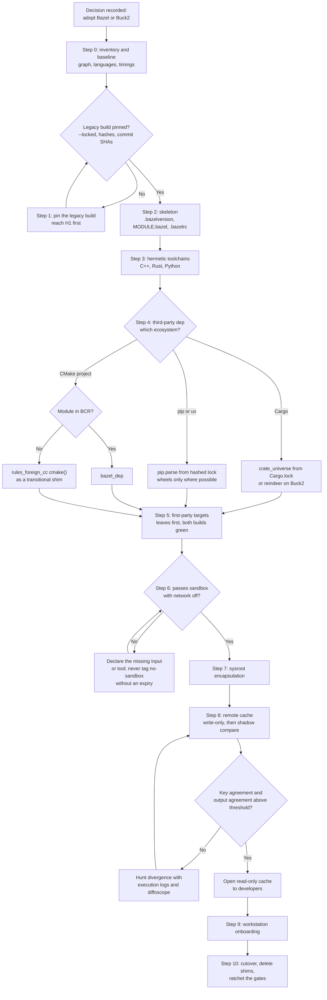
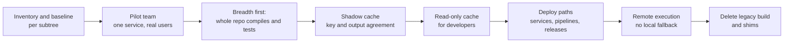

# Playbook: Migrate a Polyglot Codebase to Hermetic Builds

> [!summary] Claim:
> A hermetic build is one whose every action sees only declared inputs: pinned sources, pinned third-party code, pinned toolchains, a fixed environment, and no network.
> Hermeticity is what makes a shared cache safe, because a cache key is a hash of declared inputs and anything undeclared that changes the output turns a cache hit into a wrong answer.
> A migration from CMake, Cargo, and pip to Bazel or Buck2 therefore has two independent axes: moving targets into the new graph, and tightening hermeticity until cache keys are trustworthy.
> Run it as a strangler fig: both builds coexist, leaf targets move first, every stage has a verification gate and a one-flag rollback, and the remote cache earns trust in shadow mode before anyone reads from it.

This playbook owns the migration procedure and its staging.
The mechanisms it leans on have their own owners: action keys and cache-miss forensics in [[Diagnose-Bazel-and-Buck2-Cache-Misses]], the reproducibility toolkit (`SOURCE_DATE_EPOCH`, prefix maps, diffoscope) in [[Hermetic-and-Reproducible-Builds]], sandbox internals in [[Sandboxing-and-Hermetic-Execution-Internals]], the Remote Execution API in [[Remote-Execution-API-and-Remote-Caching]], sysroot construction in [[Cross-Compilation-and-Sysroots]], and the tool choice and its cost model in [[Build-Performance-Economics-and-Decision-Record]].

## Trigger and Symptoms

Activate this playbook when the decision to adopt Bazel or Buck2 is already recorded (see [[Build-Performance-Economics-and-Decision-Record]]) and the codebase builds with more than one native build tool.
Typical shapes are a C++ core under CMake, Rust services or extensions under Cargo, and Python research or tooling code under pip or uv, glued together by shell scripts and CI YAML.

Symptoms that the current build is not hermetic, and that a cache would amplify rather than fix:
- "Works on my machine": the same commit builds on one laptop and fails on another, and the difference is a compiler version, a Homebrew library, or a `PATH` entry.
- CI caches keyed on lockfile hashes (`actions/cache` keyed on `Cargo.lock` or `requirements.txt`) restore stale build trees and produce failures that `rm -rf build/` fixes.
- A clean build takes long enough that engineers avoid it, so the team no longer knows whether a clean build works.
- Cross-language edges are implicit: a Python extension links a CMake-built `.a` by path, a Rust `build.rs` calls `cmake` or `pkg-config` on the host, and nothing records that dependency.
- Third-party code floats: `FetchContent` on a branch name, `pip install` without hashes, or `cargo build` without `--locked` in CI.
- Release artifacts cannot be rebuilt bit for bit from a tag, which breaks provenance claims (see [[Reproducible-Builds-as-a-Security-Control]]).

Do not activate it to fix one slow build.
A compiler cache ([[Compiler-Caches-ccache-and-sccache]]) or a dependency-graph fix ([[Drill-Build-Systems-Break-a-Dependency-Bottleneck]]) is cheaper by an order of magnitude in engineer time; Airbnb's JVM monorepo migration took 4.5 years.

## The Hermeticity Ladder

The procedure measures progress on two axes, and confusing them is the most common way migrations stall.
Graph coverage is the fraction of first-party targets that build in the new system.
Hermeticity is how much of the world an action can see.
The rungs in this table are this playbook's rubric, not an industry standard; each has a mechanical check in the Step-by-Step section.

| Rung | Name | What holds | Mechanical check |
| :--- | :--- | :--- | :--- |
| H0 | Legacy | Host toolchains, floating third-party versions | none |
| H1 | Pinned | Lockfiles enforced in the legacy build; toolchain versions pinned | `cargo build --locked`, `pip install --require-hashes`, FetchContent on commit hashes |
| H2 | Declared | Targets build in Bazel or Buck2 with declared inputs, locally sandboxed (Bazel), fixed action environment | build passes with sandboxing on and `--incompatible_strict_action_env` |
| H3 | Encapsulated | C++, Rust, and Python toolchains and the Linux sysroot are repository-pinned; no host autodetection; no network in actions | `BAZEL_DO_NOT_DETECT_CPP_TOOLCHAIN=1`, `--sandbox_default_allow_network=false`, no `/usr/include` in `aquery` |
| H4 | Verified cacheable | Action keys agree across machines and outputs agree across re-executions | shadow-mode disagreement under its threshold |
| H5 | Remote-executable | The full build passes on remote execution with no local fallback | `--remote_executor` with `--noremote_local_fallback` |

Buck2 compresses H2 and H5: its README states that Buck2 "currently does not sandbox local-only build steps" and that "Buck2 using Remote Execution is always hermetic by design", so on Buck2 remote execution is the hermeticity enforcement mechanism, not an optimization.

## Decision Tree



## Prerequisites

### Tools and versions

```bash
command -v bazelisk bazel cmake cargo python3 jq git
bazel --version
cat .bazelversion 2>/dev/null
```

On the test host `bazel` resolved to Bazelisk 1.30.0 from Homebrew and printed `bazel 9.3.2` (as of 2026-11, macOS 27.3 arm64).
Bazelisk picks the Bazel version from `USE_BAZEL_VERSION`, then a `.bazeliskrc`, then `.bazelversion`, per its README.
Every flag default quoted in this note was read from `bazel help build --long` on that Bazel 9.3.2 binary.

Bazel 9 is the baseline this playbook assumes, and it changes the migration materially:
- Bazel 8 disabled `WORKSPACE` by default and Bazel 9.0 (announced 2026-01-20 as an LTS release) removed the code; `--enable_bzlmod` and `--enable_workspace` are no-ops, so every external dependency goes through `MODULE.bazel`.
- All C++ rules moved out of Bazel into `rules_cc`, and `--incompatible_autoload_externally` defaults to empty in 9.0, so every `cc_library`, `py_binary`, and similar rule needs an explicit `load()`.
- `--incompatible_strict_action_env` was flipped to true in 9.0 (bazelbuild/bazel PR 26587, per the 9.0.0 release notes), which removes the single largest source of cross-machine cache misses by default.
- The `bazel sync` command was removed; `bazel fetch --all` replaces it.
- `--incompatible_sandbox_hermetic_tmp` was removed; mount the whole `/tmp` explicitly with `--sandbox_add_mount_pair=/tmp` if an action needs it.

For Buck2 there is no version-manager equivalent in the README; pin the `buck2` binary in the repository's tool bootstrap (for example a checked-in launcher that downloads a hashed release) and record it in onboarding docs.

### Permissions and infrastructure

- Write access to the CI configuration and a way to run two CI jobs per commit (legacy and new build) for the whole coexistence period.
- A remote cache endpoint (bazel-remote, BuildBuddy, EngFlow, Buildbarn, or another REAPI server) with separate credentials for writers (CI) and readers (developers).
  The Bazel remote-caching documentation says to take care who can write and describes the common setup where only CI writes.
- A credential helper conforming to the Credential Helper Specification: Bazel invokes it with `get`, writes `{"uri": ...}` on stdin, and reads `{"headers": {...}}` from stdout; Bazel caches the result for `--credential_helper_cache_duration` (default `30m`) when the helper returns no expiry, and waits `--credential_helper_timeout` (default `10s`).
- An artifact mirror or Remote Asset API endpoint if CI has no direct internet egress, wired with `--downloader_config` or `--experimental_remote_downloader`.

### Verification

```bash
bazel version | head -2
bazel info release
```

On the test host `bazel version` began with `Bazelisk version: 1.30.0` and `Build label: 9.3.2`, so `head -1` shows the launcher, and `bazel info release` printed `release 9.3.2`.
If the build label differs from `.bazelversion`, or no `Bazelisk version:` line appears, the `bazel` on `PATH` is not Bazelisk.

## Commands and Numbers to Know

Every Bazel value in this table was read from `bazel help build --long` on Bazel 9.3.2 (as of 2026-11, Both).

| Item | Platform | Value `(as of 2026-11)` | Why it matters in a migration |
| :--- | :--- | :--- | :--- |
| `--incompatible_strict_action_env` | Both | `true` (flipped in 9.0) | Fixed `PATH`, no `LD_LIBRARY_PATH`; measured `PATH` inside actions on macOS was `/bin:/usr/bin:/usr/local/bin`. |
| `--sandbox_default_allow_network` | Both | `true` | Network is allowed in sandboxed actions until you set it to `false`. |
| `--spawn_strategy` | Both | `""`, meaning `remote,worker,sandboxed,local` | Local actions are sandboxed by default where a sandbox exists. |
| `--experimental_use_hermetic_linux_sandbox` | Linux | `false` | When true, `/` is not mounted; only `--sandbox_add_mount_pair` paths are visible. |
| `--remote_upload_local_results` | Both | `true` | Every authenticated client writes; set `false` for developer reads. |
| `--remote_accept_cached` | Both | `true` | `--noremote_accept_cached` stops remote cache reads; measured: it did not stop `--disk_cache` reads. |
| `--remote_download_outputs` | Both | `toplevel` | Build without the Bytes is on by default; intermediate outputs stay remote. |
| `--remote_local_fallback` | Both | `false` | Remote execution failures fail the build rather than silently running locally. |
| `--remote_cache_compression` | Both | `false`; threshold `100` bytes | zstd on blobs above the threshold when enabled. |
| `--experimental_remote_cache_eviction_retries` | Both | `5` | Retries a build when blobs were evicted between lookup and download. |
| `--lockfile_mode` | Both | `update` | Use `error` in CI so a stale `MODULE.bazel.lock` fails the build. |
| `--check_direct_dependencies` | Both | `warning` | Use `error` so MVS silently upgrading a direct `bazel_dep` fails. |
| `--repository_disable_download` | Both | `false` | Blocks `ctx.download` but not `ctx.execute`, so it is not a full network ban. |
| `--execution_log_compact_file` | Both | unset | zstd-compressed `ExecLogEntry` stream, never sorted; recommended over binary and JSON. |
| `--execution_log_sort` | Both | `true` | Applies to binary and JSON logs only. |
| `--experimental_disk_cache_gc_max_size` / `_max_age` | Both | `0` / `0` (no limit) | The disk cache grows without bound unless set; GC runs after `5m` idle. |
| `--credential_helper_cache_duration` | Both | `30m` | Cached credentials when the helper returns no expiry. |
| `--guard_against_concurrent_changes` | Both | `lite` | Checks main-repository sources before cache upload; `full` checks all inputs; set `full` on CI writers. |
| `--stamp` | Both | `false` | Stamped actions embed volatile workspace status and should be limited to release targets. |
| `--incompatible_disallow_empty_glob` | Both | `true` | A `glob()` that matches nothing fails, which catches mistyped migrated paths. |
| `BAZEL_DO_NOT_DETECT_CPP_TOOLCHAIN=1` | Both | via `--repo_env` | Disables rules_cc host compiler autodetection, so a missing hermetic toolchain fails loudly. |
| `BAZEL_USE_LEGACY_MACOS_TOOLCHAIN=1` | macOS | via `--repo_env` | rules_cc disabled its macOS autodetected toolchain by default on 2026-07-20; this restores it temporarily. |
| `cargo build --locked` / `--frozen` | Both | Cargo 1.99 | `--locked` fails if `Cargo.lock` is missing or would change; `--frozen` is `--locked` plus `--offline`. |
| `pip install --require-hashes` | Both | pip | All-or-nothing: every requirement pinned and hashed. |
| `FETCHCONTENT_FULLY_DISCONNECTED` | Both | `OFF` (CMake 4.5.0) | No download or update at all; intended only after the first configure. |
| `buck2 log diff action-divergence` | Both | Buck2 | "Identifies the first divergent action between two builds." |

## Step-by-Step Execution

Each step ends with a check.
Do not start a step until the previous step's check passes on CI, not only on one laptop.
The example repository is called `trading-platform`, with `cpp/` (CMake), `rust/` (a Cargo workspace), and `py/` (pip with a lock file); the names are illustrative.

### Step 0: Inventory the graph and record a baseline

You cannot migrate leaves first without knowing which targets are leaves, and you cannot claim a speedup without a baseline.

```bash
# C++: target graph from CMake (Graphviz), one node per target
cmake -S cpp -B build/inv -G Ninja --graphviz=build/inv/targets.dot
grep -c -- '->' build/inv/targets.dot

# Rust: packages, features, and build scripts from Cargo
cargo metadata --manifest-path rust/Cargo.toml --format-version 1 --locked \
  | jq '[.packages[] | select(.source == null)] | length'
cargo metadata --manifest-path rust/Cargo.toml --format-version 1 --locked \
  | jq -r '.packages[] | select(any(.targets[]; .kind | index("custom-build"))) | .name'

# Python: what is actually installed, including transitive deps
python3 -m pip freeze --all > build/inv/py-freeze.txt
grep -c '==' build/inv/py-freeze.txt
```

The CMake File API gives a machine-readable codemodel with per-target sources and include paths, which is the better input for a BUILD-file generator; see [[CMake-Presets-Toolchains-and-File-API]].
The Cargo query lists every package with a `custom-build` target (a `build.rs`), because each one is a hermeticity audit item: a build script can run arbitrary host commands.

Record the baseline with the same commands CI runs, on a quiet machine, at least five runs each, and keep the raw numbers:
- Clean build wall time per language, and the no-op rebuild time.
- CI pre-merge p50 and p90, and the fraction of CI time spent rebuilding unchanged code.
- Flaky-test rate and the "works locally, fails in CI" ticket count for the last quarter.

**Verification:** a checked-in `migration/inventory.md` lists every first-party target with its language, its direct dependencies, whether it has a build script or code generator, and its owner; a `migration/baseline.csv` holds the raw timings.
Airbnb's lesson applies here: replicate existing behavior first and optimize granularity after the move, because optimizing before migrating lengthened their timeline.

### Step 1: Pin the legacy build first (reach H1)

Every pin you add here is one fewer moving part during coexistence, and it is valuable even if the migration stops.

```bash
# Rust: fail if Cargo.lock would change
cargo build --manifest-path rust/Cargo.toml --locked

# Python: a fully hashed lock, wheels only
python3 -m pip install --require-hashes --only-binary :all: -r py/requirements.lock

# C++: FetchContent declared with commit hashes, then built disconnected
cmake -S cpp -B build/pin -G Ninja
cmake -S cpp -B build/pin -DFETCHCONTENT_FULLY_DISCONNECTED=ON
cmake --build build/pin
```

The CMake FetchContent documentation says "it is advisable to use a hash for `GIT_TAG` rather than a branch or tag name", and `FETCHCONTENT_FULLY_DISCONNECTED` is meant to be turned on only after the first configure has populated the sources; since CMake 3.30, when policy CMP0170 is `NEW` (for example under `cmake_minimum_required(VERSION 3.30)`), it enforces that the source directory is already populated, so a first configure with it set fails instead of silently skipping population.
`--only-binary :all:` refuses sdists, so no package's build backend runs on the CI host; packages that ship only sdists become an explicit list to prebuild into wheels (see [[Python-Wheels-Platform-Tags-Manylinux-and-ABI3]]).
Pin the compiler too: record `cc --version`, `rustc --version`, and `python3 --version` in CI logs and fail when they differ from a checked-in expectation.

**Verification:** on a CI runner with egress blocked after a warm-up fetch, `cargo build --frozen`, the hashed pip install, and the disconnected CMake build all succeed; any network access is now a build failure rather than a silent upgrade.
The ecosystem-wide lockfile and mirror strategy is owned by [[Lockfiles-Vendoring-and-Offline-Mirrors]].

### Step 2: Stand up the skeleton next to the legacy build

The new build lives in the same repository and builds nothing at first.
Both tools can share a repository; the Bazel Maven migration guide recommends having "both build tools running in parallel until you have fully migrated".

`.bazelversion`:

```text
9.3.2
```

`MODULE.bazel` (versions are placeholders; pin the current release from registry.bazel.build and let `MODULE.bazel.lock` record the resolution):

```python
module(name = "trading_platform")

bazel_dep(name = "rules_cc", version = "X.Y.Z")
bazel_dep(name = "rules_rust", version = "X.Y.Z")
bazel_dep(name = "rules_python", version = "X.Y.Z")
bazel_dep(name = "toolchains_llvm", version = "X.Y.Z")
bazel_dep(name = "rules_foreign_cc", version = "X.Y.Z")
```

`.bazelrc`:

```text
# Hermeticity floor, enforced everywhere
common --repo_env=BAZEL_DO_NOT_DETECT_CPP_TOOLCHAIN=1
build --incompatible_strict_action_env
build --sandbox_default_allow_network=false
common --check_direct_dependencies=error

# CI is the only cache writer
common:ci --lockfile_mode=error
build:ci --remote_cache=grpcs://cache.example.internal
build:ci --remote_upload_local_results=true
build:ci --execution_log_compact_file=/tmp/execlog.zst

# Developers read, never write
build:dev --remote_cache=grpcs://cache.example.internal
build:dev --remote_upload_local_results=false

build --enable_platform_specific_config
build:linux --sandbox_add_mount_pair=/tmp

# Per-user overrides (disk cache path, local jobs); never committed
try-import %workspace%/user.bazelrc
```

`--incompatible_strict_action_env` is already the Bazel 9 default; stating it keeps the file correct on Bazel 8 branches and documents intent.
`try-import` does not fail when the file is missing, while `import` does, per the bazelrc documentation.
With `--enable_platform_specific_config`, a `build` on a Linux host automatically applies the `build:linux` lines.
`cache.example.internal` stands for your cache endpoint.

**Verification:**

```bash
bazel mod graph | head
bazel build --nobuild //...
```

`bazel mod graph` prints the resolved module graph from `<root>`, and `bazel build --nobuild //...` completes loading and analysis without running actions; `--lockfile_mode=error` under `--config=ci` then fails if a developer changed `MODULE.bazel` without committing the updated lockfile.

### Step 3: Encapsulate the toolchains (C++, Rust, Python)

A target that builds with a host compiler has moved graphs without becoming hermetic.
Pin each toolchain as a repository download before migrating any first-party code, so no BUILD file is ever written against a host toolchain.

C++ with toolchains_llvm (the README's Bzlmod form; the LLVM version is the README's example):

```python
llvm = use_extension("@toolchains_llvm//toolchain/extensions:llvm.bzl", "llvm")
llvm.toolchain(
    name = "llvm_toolchain",
    llvm_version = "23.1.5",
    supported_platforms = ["linux", "darwin-aarch64"],
)
use_repo(llvm, "llvm_toolchain")
register_toolchains("@llvm_toolchain//:all")
```

The alternative is hermetic_cc_toolchain, which wraps `zig cc` and describes itself as bundling "clang-17, musl, glibc 2.17-2.38, all in a ~40MB package", with toolchains named by glibc floor such as `x86_64-linux-gnu.2.28`.
Its README warns that the Zig cache lives outside the output base (`$HOME/.cache/zig`), so `bazel clean --expunge` does not clear it, and that macOS target support "is not well tested".

Rust with rules_rust (the setup page's form; choose your own version):

```python
rust = use_extension("@rules_rust//rust:extensions.bzl", "rust")
rust.toolchain(
    edition = "2024",
    versions = ["1.85.0"],
)
```

Without a `rust.toolchain` call rules_rust registers a `stable` and a `nightly` toolchain of its own choosing, which ties your compiler version to whichever rules_rust release you upgrade to; always pin `versions` explicitly.

Python with rules_python (interpreters come from python-build-standalone builds):

```python
python = use_extension("@rules_python//python/extensions:python.bzl", "python")
python.toolchain(python_version = "3.12")
```

rules_python's toolchain docs say a system interpreter is still used to "bootstrap" Python targets by default; the `bootstrap_impl` setting (added in rules_python 0.33.0) has `system_python` as its default, a bootstrap "that requires a system Python available in order to start programs", and `script` as the alternative that uses "an arbitrary executable script (usually a shell script)".
Set `--@rules_python//python/config_settings:bootstrap_impl=script` in `.bazelrc` once your targets pass with it, so no host `python3` participates at run time.
The "autodetecting" Python toolchain is misnamed: per the docs "it doesn't autodetect anything" and only runs `python3` from the environment, so it must never be the registered toolchain.

**Verification:**

```bash
bazel build //cpp/smoke:hello
bazel aquery 'mnemonic("CppCompile", //cpp/smoke:hello)' | grep -m1 -o 'external/[^/ ]*'
bazel aquery 'mnemonic("CppCompile", //cpp/smoke:hello)' | grep -c '/usr/include' || true
```

The first `grep` must name the LLVM toolchain repository, and the second must print `0`.
With `BAZEL_DO_NOT_DETECT_CPP_TOOLCHAIN=1`, deleting the `register_toolchains` line must make the build fail with a toolchain resolution error; if it still builds, a host toolchain is still being picked up.

### Step 4: Move the third-party boundary

Third-party code is the cheapest place to start, because the legacy lockfiles already list exactly what to pin, and it is a strangler-fig seam: once `@crates`, `@pypi`, and the C++ dependencies are Bazel repositories, first-party targets can move one at a time.

Rust, keeping `Cargo.toml` and `Cargo.lock` as the source of truth:

```python
crate = use_extension("@rules_rust//crate_universe:extensions.bzl", "crate")
crate.from_cargo(
    name = "crates",
    cargo_lockfile = "//rust:Cargo.lock",
    manifests = ["//rust:Cargo.toml", "//rust/pricer:Cargo.toml"],
)
crate.annotation(
    crate = "openssl-sys",
    gen_build_script = "on",
)
use_repo(crate, "crates")
```

First-party targets depend on `@crates//:serde` style labels or on the `all_crate_deps()` macro from `@crates//:defs.bzl`.
The crate_universe Bzlmod page (read 2026-11-15) still documents repinning as `CARGO_BAZEL_REPIN=1 bazel sync --only=crates`, with `CARGO_BAZEL_REPIN_ONLY` as "a comma-delimited allowlist for rules to execute repinning" when several crate universes are declared.
The Bazel 9.0 release notes state that "The `bazel sync` command has been removed. Use `bazel fetch --all` instead", so that documented command fails on Bazel 9.
The same page says that "the `CARGO_BAZEL_REPIN` (or `REPIN`) environment variables can be used to force the rule to update dependencies", but the rules_rust docs show no Bazel 9 invocation, and an attempt to run `CARGO_BAZEL_REPIN=1 bazel fetch --all` on Bazel 9.3.2 (2026-11-15, macOS arm64) did not finish within the time limit, so this note does not endorse a specific replacement command.
Treat the repin command as a Step 2 decision: try the variable with `bazel fetch` on your pinned Bazel and the pinned rules_rust release, and record the command that works in the migration runbook.
If `crate.from_cargo` sets `lockfile` ("The path to a file to use for reproducible renderings"), repinning rewrites that file; commit it together with `MODULE.bazel.lock` when CI runs under `--lockfile_mode=error`.
Every `-sys` crate with a build script is an H3 item: its `build.rs` probes the host for a C library unless an annotation points it at a Bazel-built one.

On Buck2 the equivalent is Reindeer: `reindeer vendor` downloads crate sources into the repository, `reindeer buckify` "will analyze the Cargo dependencies and (re)generate the BUCK file", and per-crate `fixups.toml` entries such as `buildscript.run = true`, `cargo_env`, `rustc_flags`, and `extra_srcs` replace what a build script would have done.
Without vendoring, generated targets "include steps to perform the crate download at build time".

Python:

```python
pip = use_extension("@rules_python//python/extensions:pip.bzl", "pip")
pip.parse(
    hub_name = "pypi",
    python_version = "3.12",
    requirements_lock = "//py:requirements.lock",
)
use_repo(pip, "pypi")
```

rules_python also accepts `uv_lock = "//:uv.lock"` in place of `requirements_lock`, and recommends `@pypi//numpy` style labels in new code.
Hashes are not required by `pip.parse`, so keep the Step 1 `--require-hashes` lock as the input and do not regress to an unhashed one.
The docs state that the `pip` extension "will ensure that the bazel downloader is used for downloading the wheels", so the credential helper and `--downloader_config` apply to wheels; they do not say the same for sdists.
`download_only = True` makes pip ignore sdists, and the docs warn this "will not work for sdists with C extensions"; an sdist that must be built is built during repository fetch, which is outside the action cache and outside remote execution, so prebuild such packages into wheels in a separate, pinned pipeline.

C++ third-party: prefer a Bazel Central Registry module (`bazel_dep`) when one exists; otherwise wrap the project's own CMake build with `rules_foreign_cc` as a transitional shim:

```python
load("@rules_foreign_cc//foreign_cc:defs.bzl", "cmake")

cmake(
    name = "quantlib",
    lib_source = "@quantlib_src//:all_srcs",
    cache_entries = {
        "CMAKE_BUILD_TYPE": "Release",
        "BUILD_SHARED_LIBS": "OFF",
    },
    generate_args = ["-G Ninja"],
    out_static_libs = ["libQuantLib.a"],
)
```

`cmake()` generates a CMake toolchain file from the Bazel C++ toolchain when `generate_crosstool_file` is true (the default), so the wrapped build uses the Step 3 compiler rather than the host one; if `CMAKE_TOOLCHAIN_FILE` is passed in `cache_entries`, that file wins instead.
The default generator is Unix Makefiles on Linux and macOS, so pass `-G Ninja` explicitly.
The whole CMake project is one Bazel action, so any change to any of its files rebuilds all of it, and its outputs must be listed by name (`out_static_libs`, `out_shared_libs`, `out_binaries`).
That coarseness is why it is a shim for third-party code you do not own, and the wrong tool for first-party code you intend to keep.

**Verification:**

```bash
bazel build @crates//:all @pypi//numpy
bazel build //third_party/quantlib:quantlib
bazel mod show_repo @pypi
```

The builds succeed with `--sandbox_default_allow_network=false` in effect, which proves no third-party action downloads at build time; `bazel mod show_repo` prints the rule that generated the repository, which is the audit trail for where each dependency came from.

### Step 5: Move first-party targets leaves first, with both builds green

The strangler fig needs seams; in a build graph the natural seams are library targets with few dependents.
Fowler's 2024 description of the pattern is a "gradual process of modernization" that moves "bits of behavior from the legacy system into the new code base", supported by transitional architecture that will be deleted afterward.

Order the work by reverse topological order of the Step 0 graph: a target moves only after all its dependencies have moved.
Write one `BUILD.bazel` per directory with granular targets; the Maven guide advises starting coarse is acceptable but granular targets give more parallelism and less invalidation, and Airbnb's generator produced over 10x more Bazel targets than they had Gradle projects.

The coexistence shims run in both directions, and each is transitional code with an owner and a deletion date:

1. **Bazel consumes legacy:** a not-yet-migrated CMake library is wrapped with `rules_foreign_cc` exactly like a third-party project in Step 4, so migrated targets can depend on it.
2. **Legacy consumes Bazel:** a migrated library is built by Bazel and imported into CMake, so not-yet-migrated targets keep linking it.

```bash
bazel build //cpp/pricing:pricing
bazel cquery --output=files //cpp/pricing:pricing
```

`cquery --output=files` prints the output paths relative to the execution root, for example `bazel-out/darwin_arm64-fastbuild/bin/...` on the test host; a CMake `IMPORTED` target then points at it:

```cmake
add_library(pricing STATIC IMPORTED GLOBAL)
set_target_properties(pricing PROPERTIES
  IMPORTED_LOCATION "${BAZEL_BIN}/cpp/pricing/libpricing.a"
  INTERFACE_INCLUDE_DIRECTORIES "${CMAKE_SOURCE_DIR}/cpp/pricing/include")
```

3. **Generated BUILD files from the legacy source of truth:** Gazelle generates Python BUILD content (the rules_python Gazelle plugin), crate_universe reads `Cargo.toml`, and for large C++ or JVM graphs teams write a generator over the legacy build's own model, as Airbnb did when Gazelle lacked the performance and cycle handling they needed.
   One fact must have one source: while a generator runs, hand edits to generated BUILD files are forbidden, and a CI check regenerates and fails on any diff.

Parity gate in CI for every migrated target, on every commit:
- Both builds compile it, and its tests pass in both.
- The test lists agree: a test that exists in CTest, `cargo test`, or pytest but not in `bazel query 'tests(//...)'` was dropped by the migration.
- Exported symbols agree for libraries (`nm -g --defined-only` on both archives, sorted and diffed), which catches a missing source file or a different `#define`.
  Airbnb found that Bazel-built jars were not identical to Gradle-built jars and validated with startup and integration tests instead; for native code, symbol and test parity is the practical equivalent.

**Verification:** a coverage metric, migrated targets over total targets, computed from `migration/inventory.md` and published per commit; it must only go up, and the CI parity job must be green for every migrated target.

### Step 6: Turn the sandbox and network gates on (reach H2)

Sandboxing is how Bazel finds undeclared inputs before a remote executor or a cache does.
On macOS the measured strategy name is `darwin-sandbox` (`INFO: 3 processes: 1 internal, 2 darwin-sandbox.` on the test host); on Linux it is `linux-sandbox`.

```bash
bazel build //... --config=ci
bazel build //cpp/pricing:pricing --sandbox_debug --verbose_failures
```

`--sandbox_debug` keeps the sandbox directory after a failure so you can see which file was missing.
A missing header, a script that calls a tool by bare name, a test that reads `~/.config`, or a `build.rs` that runs `pkg-config` are all fixed by declaring the input or the tool, never by `tags = ["no-sandbox"]`; if a tag is unavoidable for a week, give it a ticket and an expiry, and count tagged targets as not migrated.
On Linux, `--experimental_use_hermetic_linux_sandbox` stops mounting `/` and exposes only `--sandbox_add_mount_pair` paths, which flushes out actions that silently read `/usr/lib`; it is experimental (default `false`) in Bazel 9.3.2.
Keep `--sandbox_default_allow_network=false` from Step 2; an action that needs the network is a repository rule in disguise and belongs in `MODULE.bazel`.

**Verification:** `bazel build //... --config=ci` passes with sandboxing and network off, and `bazel query 'attr(tags, "no-sandbox", //...)'` lists only targets with an open, dated ticket.

### Step 7: Encapsulate the sysroot (reach H3)

A pinned compiler that still reads `/usr/include` and links `/usr/lib/x86_64-linux-gnu/libc.so` is only half hermetic: two CI images with different glibc versions produce different binaries under the same cache key, and the key does not include the host filesystem.

For Linux targets, package a sysroot (headers and libraries for the oldest glibc you support) as a tarball, host it on your mirror, and pin it by SHA-256 as a repository, then hand it to the toolchain:

```python
llvm.sysroot(
    name = "llvm_toolchain",
    label = "@sysroot_linux_x86_64//:sysroot",
    targets = ["linux-x86_64"],
)
```

The `sysroot` tag class in `toolchain/extensions/llvm.bzl` on the main branch (read 2026-11-15) takes `name` (default `llvm_toolchain`, must match a `llvm.toolchain` tag or the extension fails), `targets` (a list of target strings; empty means all), `label` (the sysroot's files with the package path as the sysroot path), and `path` (an absolute path).
Each tag must set exactly one of `label` or `path` (the extension calls `fail()` otherwise); the tag's own doc does not list target strings, but the README documents exact OS/architecture keys such as `linux-x86_64` and `darwin-aarch64` (`aarch64`, not `arm64`), so confirm the key against the release you pin.
A path on the user's system is not hermetic; only the label form is.
The README suggests building a sysroot with `docker export` of a base image or with the Chromium sysroot scripts; the construction details belong to [[Cross-Compilation-and-Sysroots]].
The toolchains_llvm README also notes that "bundled LLD is preferable for hermetic or remote builds", because a host linker is an execution-platform dependency.

macOS cannot be encapsulated through a downloadable sysroot tarball in the same way.
Section 2 ("Internal Use License and Restrictions") of Apple's Xcode and Apple SDKs Agreement licenses installation only "on Apple-branded computers that are owned or controlled by You" (2.2A); it permits copying "only the entire package" and expressly prohibits "separately using the Apple SDKs" (2.5); and it bars making the software "available over a network where they could be run or used by multiple computers at the same time" and agreeing to "upload to or host on any website or server, sell, redistribute, or sublicense" it (2.7).
An extracted SDK tarball served from an artifact mirror is a separated, server-hosted copy of exactly that kind, so macOS builds cannot package the SDK as an `@sysroot` repository; this is a reading of the agreement text, not legal advice.
The practical engineering rule is to pin the Xcode version and build number per runner image, make the Xcode build identifier part of the execution platform's identity (ensuring runners with differing Xcode builds never share cache entries), and use an Apple-aware toolchain such as `apple_support`.
Furthermore, rules_cc disabled its autodetected macOS toolchain by default in commit 0c36f2bb (2026-07-20, PR 755), with `--repo_env=BAZEL_USE_LEGACY_MACOS_TOOLCHAIN=1` provided as a transitional escape hatch.

**Verification:**

```bash
bazel aquery 'mnemonic("CppLink", //cpp/pricing:pricing_bench)' | grep -o -- '--sysroot=[^ ]*'
bazel aquery 'mnemonic("CppCompile", //...)' | grep -c -E '(^| )-I/usr|/usr/include' || true
```

The first prints a `--sysroot=` that points into `external/`, and the second prints `0`.
Then build the same target on two CI images with different host glibc versions and compare the output digest; identical digests prove the host libc no longer leaks in.

### Step 8: Earn trust in the remote cache in shadow mode (reach H4)

A cache is a correctness system, not only a speed system: a poisoned entry serves a wrong artifact to every reader with the same key.
The Bazel remote-caching documentation lists a known issue that "When an input file is modified during a build, Bazel might upload invalid results to the remote cache"; its guard is spelled `--experimental_guard_against_concurrent_changes` there, but on Bazel 9.3.2 the flag is `--guard_against_concurrent_changes` with default `lite`, which checks only source files in the main repository, and `full` also checks the ctime of every action input before upload.
The same page notes that only environment variables passed with `--action_env` enter the action definition, so differing variables such as `PATH` reduce hits.
The Remote Execution API makes the key explicit: an `Action` names `command_digest`, `input_root_digest`, `timeout`, `do_not_cache`, `salt`, and `platform`; `Command.environment_variables` and `Platform.properties` "MUST be lexicographically sorted", so two clients computing the same action produce the same digest.
The `salt` field exists "to place this `Action` into a separate cache namespace", which is the mechanism for giving an untrusted writer its own key space.

Run the cache in three phases, each gated:

**Phase A, write-only population.**
CI writes and nobody reads: `--config=ci --noremote_accept_cached`.
Builds stay exactly as fast as before, and the cache fills with entries whose keys you can study.

**Phase B, shadow comparison.**
For every CI build, a second job on a different runner (different image patch level, different user, different checkout path) builds the same commit with no cache reads and its own execution log, and a comparator joins the two logs per action:
- **Key agreement:** for each `targetLabel` and output path, do both runs compute the same action digest?
  A mismatch means a host property leaked into the key: an absolute path, an environment variable, a toolchain path, or an unpinned repository.
- **Output agreement:** for actions with equal keys, do the output digests match?
  A mismatch means the action is non-deterministic, and caching it would serve whichever run wrote first.
  Hand the pair to diffoscope; the variation taxonomy and fixes live in [[Hermetic-and-Reproducible-Builds]] and [[Drill-Build-Systems-Hunt-Non-Determinism-with-Diffoscope]].

```bash
bazel build //... --config=ci --noremote_accept_cached \
  --execution_log_compact_file=/tmp/exec_a.zst
# on the second runner, same commit
bazel build //... --config=ci --noremote_accept_cached --noremote_upload_local_results \
  --execution_log_compact_file=/tmp/exec_b.zst
```

Bazel's documented comparison path builds the log parser from a Bazel source checkout with `bazel build //src/tools/execlog:parser`, then runs `bazel-bin/src/tools/execlog/parser --log_path=/tmp/exec1.log --log_path=/tmp/exec2.log --output_path=/tmp/exec1.log.txt --output_path=/tmp/exec2.log.txt`, which sorts the second log to match the first, and diffs the text files.
The procedure for diagnosing each individual miss is owned by [[Diagnose-Bazel-and-Buck2-Cache-Misses]].
On Buck2, `buck2 log diff action-divergence` "Identifies the first divergent action between two builds", and `buck2 log what-ran` lists everything an invocation ran.

**Phase C, read-only developers.**
When key agreement and output agreement both hold above your threshold for two consecutive weeks, give developers `--config=dev`: they read, and `--remote_upload_local_results=false` keeps a laptop's state out of the cache.
Pick the threshold from consequences, not from a convention: for actions that produce release artifacts the target is zero output disagreements; for test actions a small, tracked set of known non-deterministic actions can be tagged `no-remote-cache` and burned down.

Two measured traps for the shadow jobs, from the section Worked Example: Measuring Key and Output Agreement Locally:
- `--noremote_accept_cached` did not stop reads from `--disk_cache` on Bazel 9.3.2: a build with it reported `2 disk cache hit`, so a shadow job that keeps a disk cache is not re-executing anything.
  Run shadow jobs with no disk cache, or with an empty one.
- Without any cache configured, the JSON execution log entries had no action `digest` field at all, so key agreement can only be computed from runs that have a cache (remote or disk) configured.

**Verification:** the comparator's daily report shows key agreement and output agreement per mnemonic, with the top divergent targets named; Phase C starts only when the report is under threshold, and the cache's `INFO:` line on developer builds shows `remote cache hit` counts (the documented form is `INFO: 11 processes: 6 remote cache hit, 3 internal, 2 remote.`).

### Step 9: Onboard developer workstations

A migration fails socially before it fails technically: Airbnb's pilot developers were slow to switch even though Bazel was faster, until the team spent several more months fixing missing integrations and bugs, and Airbnb reports build satisfaction (CSAT) rising from 38% to 68% across the migration.
Onboarding is a product with its own checklist:

1. **One entry point:** Bazelisk installed by the standard bootstrap; `.bazelversion` in the repository; `BAZELISK_BASE_URL` pointed at the internal mirror (Bazelisk appends `/<VERSION>/<FILENAME>`), and `BAZELISK_VERIFY_SHA256` in a `.bazeliskrc` where you pin a binary hash.
2. **Credentials without secrets in files:** a credential helper on `PATH` and `--credential_helper=*.example.internal=%workspace%/tools/credential-helper` style scoping in `.bazelrc`; a scope is a domain with an optional leading `*` wildcard, and a helper with no scope applies to every URI.
3. **Local caching:** a `user.bazelrc` template with `build --disk_cache=/absolute/path` and `build --experimental_disk_cache_gc_max_size=50G`, because the disk cache has no size limit by default.
4. **Remote cache read-only:** `build --config=dev` in the template.
5. **C and C++ IDE:** `bazel run @hedron_compile_commands//:refresh_all` writes `compile_commands.json` for clangd; it must be `bazel run`, not `bazel build`, and with Build without the Bytes generated headers may need `--remote_download_regex`.
6. **Rust IDE:** `bazel run @rules_rust//tools/rust_analyzer:setup -- vscode` writes `.vscode/settings.json`; re-run it after a toolchain or `MODULE.bazel` change.
   During coexistence `cargo` and rust-analyzer's Cargo mode still work because `Cargo.toml` remains the source of truth.
7. **Python IDE:** point the editor at the interpreter Bazel uses, and keep a plain virtual environment generated from the same hashed lock for tools that cannot follow Bazel runfiles.
8. **Escape hatch:** a documented way to build with the legacy system for the whole coexistence period; Airbnb kept the ability to disable Bazel and fall back to Gradle and used it during remote cache and remote execution incidents.

**Verification:** a fresh machine image runs one script that installs nothing outside the bootstrap, then `bazel test //cpp/pricing/...` passes and `INFO:` shows `remote cache hit` entries; time-to-first-green-build for a new hire is measured and published.

### Step 10: Cut over, delete the shims, and ratchet

Cutover is per subtree, not per repository.
When a subtree's coverage is 100% and its parity job has been green for a fixed period, make Bazel the required check for it, keep the legacy job as non-blocking for one release, then delete the legacy files.

Ratchets that keep hermeticity from eroding afterward:
- A CI check fails on any new `CMakeLists.txt`, `setup.py`, or Cargo build script that is not referenced by a migration ticket.
- `--lockfile_mode=error`, `--check_direct_dependencies=error`, and `--sandbox_default_allow_network=false` are in the committed `.bazelrc` and cannot be overridden by `--config=ci`.
- `--downloader_config` with `allow` lines for the internal mirror only, so a new `http_archive` pointing at the public internet fails at fetch time.
- The count of `no-sandbox`, `no-remote-cache`, and `rules_foreign_cc` targets on first-party code is tracked and only goes down.
- Remote execution with `--noremote_local_fallback` (the default) for CI once H5 is reached; on Buck2 this is the step that makes the build hermetic at all.

**Verification:** the legacy CI job is gone, the shim count is zero for first-party code, and the shadow comparator keeps running as a permanent canary for non-determinism.

## Worked Example: Measuring Key and Output Agreement Locally

This note has no lab; the run in this section was executed once on the test host to capture real output for the claims in Steps 6 and 8.
Host: macOS 27.3 arm64, Bazel 9.3.2 via Bazelisk 1.30.0, run on 2026-11-14, with `--output_user_root` and `--disk_cache` in a scratch directory.

The workspace has two genrules: one deterministic, one that writes its shell PID, which stands in for any action with a timestamp or random value in its output.

```python
# MODULE.bazel
module(name = "shadow_demo")
```

```python
# BUILD.bazel
genrule(
    name = "stable",
    outs = ["stable.txt"],
    cmd = "echo hello > $@",
)

genrule(
    name = "clock",
    outs = ["clock.txt"],
    cmd = "echo $$$$ > $@",
)
```

Five builds of `//:all`, each after `bazel clean`, sharing one disk cache; "base `PATH`" means `/usr/bin:/bin` followed by the directory holding the `bazel` launcher (`/opt/homebrew/bin`):
- A: strict environment (default), base `PATH`, empty disk cache.
- B: strict environment, base `PATH` with `/opt/extra/bin` prepended.
- C: `--noincompatible_strict_action_env`, base `PATH`.
- D: `--noincompatible_strict_action_env`, base `PATH` with `/opt/extra/bin` prepended.
- E: strict environment, base `PATH`, `--noremote_accept_cached`.

Measured summary lines:

```text
== A: strict env, PATH=/usr/bin:/bin, cold disk cache
INFO: 3 processes: 1 internal, 2 darwin-sandbox.
== B: strict env, different client PATH, after clean
INFO: 3 processes: 2 disk cache hit, 1 internal.
== C: non-strict env, PATH=/usr/bin:/bin, after clean
INFO: 3 processes: 1 internal, 2 darwin-sandbox.
== D: non-strict env, different client PATH, after clean
INFO: 3 processes: 1 internal, 2 darwin-sandbox.
== E: shadow re-execution, strict env, cache writes on, reads off
INFO: 3 processes: 2 disk cache hit, 1 internal.
```

A sixth build F ran with no disk cache at all and re-executed both actions (`INFO: 3 processes: 1 internal, 2 darwin-sandbox.`).
Each build wrote `--execution_log_json_file`, and a short Python script printed the action key prefix, the cache-hit flag, and the output digest prefix per action:

```text
a //:clock key=a17489615b1f cacheHit=False out=844914185b42
a //:stable key=c9bb95f1995e cacheHit=False out=5891b5b522d5
b //:clock key=a17489615b1f cacheHit=True out=844914185b42
b //:stable key=c9bb95f1995e cacheHit=True out=5891b5b522d5
c //:clock key=1cba3ebe1aa3 cacheHit=False out=b4b37801d7c3
c //:stable key=9360fdfc15b1 cacheHit=False out=5891b5b522d5
d //:clock key=46dca86c4fe2 cacheHit=False out=e3520aad6d24
d //:stable key=161eb30eefb2 cacheHit=False out=5891b5b522d5
e //:clock key=a17489615b1f cacheHit=True out=844914185b42
e //:stable key=c9bb95f1995e cacheHit=True out=5891b5b522d5
```

Run F's `clock` output digest prefix was `170c5b65074d` and its `stable` output was again `5891b5b522d5`; F's entries had no action `digest` field.
An independent re-run on 2026-11-15 on the same host reproduced all six `INFO:` lines, every action key prefix above, the `stable` digest, the action `PATH` values, and the missing `digest` field in F; `clock` produced new output digests on each execution, as a non-deterministic action should.

What the run proves:
- **Strict environment makes keys independent of the client `PATH`.** A and B have identical keys, so B is served entirely from cache although its client `PATH` differed.
  The `environmentVariables` entry inside the action in A, B, and E was `PATH=/bin:/usr/bin:/usr/local/bin`.
- **Non-strict environment leaks the client into every key.** C and D each re-executed, with four distinct keys for two actions.
  The action `PATH` in C was `$HOME/Library/Caches/bazelisk/downloads/sha256/<hash>/bin:/usr/bin:/bin:/opt/homebrew/bin`: the directory of the Bazel binary that Bazelisk downloaded had been prepended to the client `PATH` (this run did not isolate whether Bazelisk or the Bazel client adds it).
  That single user-specific path is enough to give every developer a private key space on a shared cache.
- **Key agreement and output agreement are different checks.** `stable` has the same output digest in all six runs, under four different keys, so it is deterministic even where the key is not portable.
  `clock` has a different output digest every time it actually executes (A, C, D, F), so it is non-deterministic; B and E report A's digest only because they read A's cache entry.
- **A shadow run must not read any cache.** E passed `--noremote_accept_cached` and still reported `2 disk cache hit`; only F, with no cache configured, re-executed, and only the A-versus-F comparison exposed `clock`.
- **The JSON log is a stream of pretty-printed objects.** The `--execution_log_json_file` output on Bazel 9.3.2 was not one object per line, so parse it with a streaming JSON decoder rather than line by line; the help text describes it as "newline-delimited JSON", and the compact format is the one Bazel recommends for real use.

## Rollback Procedure

Every stage is designed so that rollback is a configuration change, not a code revert.

1. **Steps 1 and 2 (pins and skeleton):** the legacy build never depended on the skeleton, so rolling back is deleting `MODULE.bazel`, `.bazelrc`, and `.bazelversion` from the branch; pins in the legacy build stay because they are improvements on their own.
   **Check:** the legacy CI job is green on the rollback commit.
2. **Step 3 (toolchains):** a toolchain regression is rolled back by pinning the previous toolchain version in `MODULE.bazel`; do not re-enable host autodetection, because that silently changes every key.
   **Check:** `bazel aquery` again names the previous toolchain repository.
3. **Steps 4 and 5 (third-party and first-party targets):** a migrated target with a production problem is rolled back by flipping its consumers back to the legacy artifact; the parity gate guarantees the legacy build of it is still green.
   Keep this possible until cutover by never deleting a legacy build file before Step 10.
   **Check:** the release built from the legacy path passes the same integration tests.
4. **Step 6 (sandbox gates):** never roll back globally; tag the single target with a dated ticket.
   **Check:** the tagged-target count in the ratchet report increased by exactly the targets you tagged.
5. **Step 8 (remote cache):** on suspected poisoning, set `--noremote_accept_cached` for all readers through the committed `.bazelrc` (one-line change), keep CI writing to a new instance name or salt, and let the shadow comparator confirm the new namespace before re-enabling reads; the Bazel documentation's recovery for a poisoned cache is to create a clean cache by deleting its contents.
   **Check:** the developer `INFO:` lines show no `remote cache hit` until reads are re-enabled.
6. **Step 9 (workstations):** the escape hatch is the legacy build; announce it, do not hide it.
7. **Step 10 (cutover):** reversible only while the legacy job still exists in non-blocking mode, which is why it stays for one release after the switch.

## Failure Modes

| Failure | How it shows up | Recovery |
| :--- | :--- | :--- |
| Migrating graph without hermeticity | Coverage at 100%, cache hit rate low, CI and laptops disagree | Track both axes; do not open the cache before H4. |
| Host toolchain picked up | Builds pass on a laptop with Homebrew LLVM and fail in CI, or produce different keys | `BAZEL_DO_NOT_DETECT_CPP_TOOLCHAIN=1`; check `aquery` for `external/` compilers. |
| Client environment in keys | Every developer misses on CI's entries | Keep strict action env; pass only fixed values with `--action_env=NAME=value`; the measured Bazelisk `PATH` leak shows why. |
| Stale lockfile | `MODULE.bazel.lock` differs across machines; resolution changes silently | `--lockfile_mode=error` on CI; `--check_direct_dependencies=error`. |
| Build scripts probing the host | A `-sys` crate links the host OpenSSL in CI and a different one on laptops | Annotate the crate to use a Bazel-built library, or vendor and fix up with Reindeer on Buck2. |
| Sdist builds during fetch | Repository fetch runs a package's build backend with the host compiler | Wheels only (`download_only = True`); prebuild the rest in a pinned pipeline. |
| rules_foreign_cc on first-party code | Any edit rebuilds the whole wrapped project; no incremental benefit | Treat it as third-party only; rewrite first-party CMake as `cc_library` targets. |
| Cache poisoning | A wrong artifact appears on machines that never built it | Only CI writes; use a new instance name or `salt`; rerun shadow comparison before re-enabling reads. |
| Shadow job reading a cache | Comparator reports perfect agreement too early | No `--disk_cache` and `--noremote_accept_cached` on the shadow job; verify that its `INFO:` line shows executions, not hits. |
| Undeclared input hidden by the host | Local sandbox passes, remote execution fails | Enable the hermetic Linux sandbox on CI, then remote execution with no local fallback. |
| Buck2 local builds look hermetic | Local Buck2 builds pass, RE builds fail on undeclared inputs | Buck2 does not sandbox local-only steps; make RE the CI path early. |
| Generated BUILD drift | Hand edits overwritten, or generator output differs from committed | One source of truth; CI regenerates and fails on diff. |
| Velocity collapse | Developers wait on two builds and complain | Parity jobs run in parallel, never serially; the new build is non-blocking until a subtree is cut over. |
| Optimizing before moving | Migration slips quarters while targets are being split | Replicate behavior first, then split targets (Airbnb's stated lesson). |

## Pitfalls

> [!warning] A high cache hit rate is not proof of correctness
> A non-deterministic action that hits the cache reports success with whichever output was written first.
> Measure output agreement on re-execution, not hit rate, before you trust a cache with release artifacts.

> [!warning] `--noremote_accept_cached` is not "no cache"
> On Bazel 9.3.2 it stopped remote reads but a build with it still took `2 disk cache hit` from `--disk_cache`.
> A shadow or verification job must run without a disk cache.

> [!warning] Stamping defeats caching
> `--stamp` embeds workspace status such as time, user, and host into stamped actions, so every stamped action is a new key.
> Keep it off (the default) except for release targets, and keep volatile values out of `--workspace_status_command` keys that are not `STABLE_`.

> [!warning] `--repository_disable_download` is not a network ban
> Its help text states that `ctx.execute` "could still run an arbitrary executable that accesses the Internet".
> Use egress controls on CI plus `--downloader_config` allowlists, and audit repository rules that call `execute`.

> [!warning] Python's bootstrap still uses the host by default
> With the default `bootstrap_impl=system_python`, a host `python3` starts every Python binary even with a hermetic toolchain registered.
> Move to `bootstrap_impl=script` deliberately and test it, rather than assuming the toolchain alone made Python hermetic.

> [!warning] macOS cannot be fully encapsulated
> The SDK and linker come from the installed Xcode, which you cannot redistribute.
> Make the Xcode version part of the execution platform so different versions never share cache entries, and keep release builds of Linux artifacts on Linux.

> [!warning] Two sources of truth for dependencies
> If both `Cargo.toml` and a hand-written `BUILD.bazel` list a crate's dependencies, they will drift.
> Let crate_universe or Reindeer generate from Cargo, and fail CI on generator drift.

## At Scale

At 1,000 to 50,000 engineers the migration is a program with a staffed platform team, not a project.



### Sequencing at scale

- **Pilot, then breadth, then depth.** Airbnb piloted on Viaduct, a GraphQL service with about 300 monthly product engineers, then got the whole repository compiling and testing before tackling deploys.
- **Deploys are the long tail.** Of about 700 Airbnb services, about 100 failed startup or integration tests after the build switch, mostly from reflection-loaded dependencies and version mismatches; after fixes a single-digit percentage hit production runtime issues, and of about 400 paved-path data pipelines about 3% had production issues.
  Budget for this: each deployable needs its own validation, even when the build is green.
- **Target-level test selection pays for the migration.** Dropbox's CI extracts the dependency graph with `bazel query`, runs only affected tests, unions affected tests across a time window to save resources, and bisects failures across the window; packages declare `release_tests` instead of requiring the whole repository green.

### Decision rules

- Do not open the shared cache to readers before shadow comparison meets its threshold; the cost of a poisoned release artifact exceeds any speedup.
- Make CI the only writer, and give every trust domain (CI, release, experimental runners) its own instance name or `salt`.
- Prefer one canonical toolchain per language across the repository; every extra toolchain version multiplies cache key spaces and halves hit rates for the targets it touches.
- Keep the legacy build runnable until cutover of the subtree, and treat the fallback path as an incident tool, not a failure.
- On Buck2, put remote execution on the critical path of CI early, because local Buck2 builds do not enforce declared inputs.
- Report two numbers per subtree every week: migration coverage and hermeticity rung; a subtree at 100% coverage and H2 is not done.

## Practice Drill

> [!tip] Practice Drill: Reproduce the key and output agreement table
> On a machine with Bazelisk, create the two-genrule workspace from the worked example in an empty directory, and run builds A to F with `--execution_log_json_file`.
> Predict, before each run, the `INFO:` line and which keys change.
> 1. Confirm that A and B share keys and C and D do not, and find the user-specific path in C's action `PATH`.
> 2. Replace `echo $$$$` with `echo fixed` and show that `clock` now has one output digest across A, C, D, and F.
> 3. Add `--action_env=TZ=UTC` and show that it changes the key of both actions exactly once, then stays stable.
> 4. Set `--sandbox_default_allow_network=false` and add a genrule that runs `curl https://example.com`; confirm it fails on Linux, and record what happens on macOS.
> 5. As a stretch goal, write the comparator that joins two logs by `targetLabel` and output path and prints key agreement and output agreement per mnemonic.
> Target time: 30 minutes for steps 1 to 4.

## Interview Questions

> [!question] L5
> What does `--incompatible_strict_action_env` change, and why does a migration care?
>
> > [!success]- Answer
> > With it, Bazel runs actions with a static `PATH` and does not inherit `LD_LIBRARY_PATH` from the client, so the client's shell no longer enters the action key.
> > It is the default since Bazel 9.0; on the test host the action `PATH` was `/bin:/usr/bin:/usr/local/bin`.
> > Without it, two developers with different `PATH`s compute different keys for every action and never share cache entries, even when their outputs are identical.
> > Variables that really are inputs go in explicitly with `--action_env=NAME=value`, which puts a fixed value in the key.

> [!question] L5
> Why pin the legacy build with `cargo build --locked`, hashed pip installs, and commit-hash `FetchContent` before writing any BUILD file?
>
> > [!success]- Answer
> > The migration needs a stable reference to compare against; if the legacy build floats, a parity failure could be the migration's fault or an upstream release, and you cannot tell which.
> > The pins are also the inputs for the new build: crate_universe reads `Cargo.lock` and `pip.parse` reads the hashed lock, so getting them right once serves both builds.
> > They pay off even if the migration stops: `--locked` fails when `Cargo.lock` would change, and pip's hash-checking mode is all or nothing.

> [!question] L5
> When is `rules_foreign_cc`'s `cmake()` the right tool, and when is it the wrong one?
>
> > [!success]- Answer
> > It is right for third-party CMake projects you do not own and that have no Bazel module: it runs the project's own build as one action, with a generated toolchain file so the Bazel C++ toolchain is used.
> > It is wrong for first-party code you will keep: the whole project is one action, so any edit rebuilds all of it, outputs must be listed by name, and you get no per-file incrementality or fine-grained caching.
> > In a migration it is a transitional shim with a deletion date.

> [!question] L6 (predict the output)
> Two genrules, one writing `hello` and one writing its shell PID, are built four times in sequence, each after `bazel clean`, with a shared disk cache on Bazel 9.3.2: strict env with a base `PATH`; strict env with `/opt/extra/bin` prepended; non-strict env with the base `PATH`; non-strict env with `/opt/extra/bin` prepended.
> What does each `INFO:` line report?
>
> > [!success]- Answer
> > Run 1 executes both: `INFO: 3 processes: 1 internal, 2 darwin-sandbox.` on macOS.
> > Run 2 hits both: `2 disk cache hit, 1 internal`, because the strict environment's fixed `PATH` makes the keys identical.
> > Run 3 executes both, because the non-strict action `PATH` is the client's and differs from the strict one.
> > Run 4 executes both again, because the client `PATH` changed and is in the key.
> > The PID genrule's output differs on every real execution, but run 2's hits return run 1's bytes, which is why hit rate alone cannot reveal non-determinism.

> [!question] L6 (debug this)
> After opening the remote cache to developers, CI shows a 90% remote hit rate but developer builds show nearly zero, and nobody changed `.bazelrc`.
> How do you find the cause?
>
> > [!success]- Answer
> > Capture `--execution_log_compact_file` on a developer machine and on CI for the same commit after `bazel clean`, convert both with the execlog parser, and diff one action that should match.
> > Look first at `environmentVariables`, then at input paths and the toolchain repository names, then at `platform` properties.
> > Typical culprits are a `--noincompatible_strict_action_env` or `--action_env=PATH` in a user or system bazelrc (the measured Bazelisk download directory then appears in every developer key), a different Xcode or host toolchain because autodetection was left on, or `--remote_instance_name` differing between configs.
> > Check which rc files applied with `--announce_rc`, and, as the Bazel cache debugging guide describes, check `remote_accept_cached` in the canonical command line in a `--build_event_text_file`.

> [!question] L6
> Design the shadow-mode verification for a new remote cache.
>
> > [!success]- Answer
> > Phase A: CI writes with `--noremote_accept_cached`, so build behavior is unchanged while the cache fills.
> > Phase B: a second runner with a different image, user, and checkout path builds the same commit with no cache reads, including no disk cache, and both runs write execution logs.
> > A comparator joins actions by target and output path and reports key agreement (host leakage into keys) and output agreement for equal keys (non-determinism), per mnemonic, with the worst targets named.
> > Phase C opens read-only access to developers once both metrics hold under threshold for a sustained period, with zero output disagreements for release artifacts.
> > The comparator keeps running after launch as a canary.

> [!question] L7
> Plan the migration order for a 3-million-line repository with a CMake C++ core, a Cargo workspace, and pip-managed Python research code.
>
> > [!success]- Answer
> > Inventory and baseline first, then pin the legacy builds to reach H1, because every later comparison needs a stable reference.
> > Stand up the skeleton and the hermetic toolchains before any first-party target, so no BUILD file is written against a host compiler.
> > Move the third-party boundary next: crate_universe from `Cargo.lock`, `pip.parse` from the hashed lock with wheels only, BCR modules or `rules_foreign_cc` shims for C++ dependencies.
> > Then first-party targets in reverse topological order, leaves first, with two-way shims and a parity gate in CI, choosing a pilot team with a real service.
> > Sandbox and network gates, then sysroot encapsulation, then shadow-mode cache, then read-only developer cache, then remote execution, then cutover per subtree.
> > Throughout, report coverage and hermeticity separately, keep the legacy path as an escape hatch, and replicate behavior before optimizing granularity.

> [!question] L7
> Your team prefers Buck2.
> What changes in this playbook?
>
> > [!success]- Answer
> > Buck2 does not sandbox local-only build steps, and its README states that with remote execution Buck2 "is always hermetic by design", so the H2 gate is remote execution rather than a local sandbox; put RE on the CI path early.
> > Third-party Rust goes through Reindeer (`vendor`, `buckify`, `fixups.toml`) instead of crate_universe, and toolchains are hermetic only when written to download tools with `http_archive` rather than the prelude's system toolchains, which expect tools on `PATH`.
> > RE is configured in `[buck2_re_client]` in `.buckconfig` (`engine_address`, `action_cache_address`, `cas_address`, `instance_name`) and on execution platforms (`remote_enabled`, `local_enabled`, `use_limited_hybrid`).
> > Shadow comparison uses `buck2 log diff action-divergence` and `buck2 log what-ran` in place of Bazel execution logs.

> [!question] L7
> A C++ target's outputs differ between two CI images even though `aquery` shows the same LLVM toolchain.
> What is still leaking, and how do you close it?
>
> > [!success]- Answer
> > The compiler is pinned but the sysroot is not: headers under `/usr/include` and libraries such as the host glibc come from each image, and the host filesystem is not part of the action key.
> > Package a sysroot for the oldest supported glibc, pin it by SHA-256 as a repository, hand it to the toolchain as a label (not a host path), and use the bundled LLD rather than a host linker.
> > Verify with `aquery` that link lines carry a `--sysroot=` into `external/` and that no `/usr/include` appears, then build on both images and compare output digests.

> [!question] L8+
> When should an organization not migrate to hermetic Bazel or Buck2 at all?
>
> > [!success]- Answer
> > When the pain is a slow build that a compiler cache, a better dependency graph, or more CI hardware would fix at a fraction of the cost; Airbnb's migration took 4.5 years and a dedicated team.
> > When the codebase is a single ecosystem whose native tool already gives locked, reproducible builds and the cross-language edges are few.
> > When the organization cannot staff a platform team to own toolchains, the cache, IDE integration, and onboarding for years, because a half-migrated repository with two builds is worse than either.
> > The decision belongs in a recorded trade-off (see [[Build-Performance-Economics-and-Decision-Record]]), and the cheaper intermediate step, pinning the legacy build to H1, is worth doing regardless.

## Further Reading

- Bazel Blog, Bazel 9.0, https://blog.bazel.build/2026/01/20/bazel-9.html.
  The WORKSPACE removal, the `rules_cc` move, and the empty autoload default that every migration on Bazel 9 starts from.
- Bazel 9.0.0 release notes, https://newreleases.io/project/github/bazelbuild/bazel/release/9.0.0.
  The full list of flags flipped in 9.0, including `--incompatible_strict_action_env`.
- Bazel, Debugging Remote Cache Hits for Remote Execution, https://bazel.build/remote/cache-remote.
  The execution-log capture and comparison procedure, and the `INFO:` line format.
- Bazel, Remote Caching, https://bazel.build/remote/caching.
  Who should write, read-only clients, known issues, and disk cache garbage collection.
- Bazel, Bzlmod Migration Guide, https://bazel.build/external/migration.
  Moving every external dependency to `MODULE.bazel`, which Bazel 9 makes mandatory.
- Remote Execution API, `remote_execution.proto`, https://github.com/bazelbuild/remote-apis/blob/main/build/bazel/remote/execution/v2/remote_execution.proto.
  What an action key contains, sorting rules, `do_not_cache`, and `salt`.
- rules_rust crate_universe, https://bazelbuild.github.io/rules_rust/crate_universe_bzlmod.html.
  Generating Bazel targets from `Cargo.toml` and `Cargo.lock`, repinning, and build-script annotations.
- rules_python PyPI integration and toolchains, https://rules-python.readthedocs.io/en/latest/pypi/download.html.
  `pip.parse`, `uv_lock`, wheel-only fetching, and hermetic interpreters.
- rules_foreign_cc `cmake`, https://bazel-contrib.github.io/rules_foreign_cc/cmake.html.
  The transitional shim for third-party CMake projects and its toolchain-file generation.
- toolchains_llvm (README and `toolchain/extensions/llvm.bzl`) and hermetic_cc_toolchain READMEs, https://github.com/bazel-contrib/toolchains_llvm and https://github.com/uber/hermetic_cc_toolchain.
  The two common hermetic C++ toolchains, their sysroot handling, and their platform limits.
- Buck2 README and Remote Execution docs, https://github.com/facebook/buck2 and https://buck2.build/docs/users/remote_execution/.
  Why Buck2 hermeticity comes from remote execution, and how to configure it.
- Reindeer manual, https://github.com/facebookincubator/reindeer/blob/main/docs/MANUAL.md.
  Cargo dependencies for Buck2: vendoring, BUCK generation, and fixups.
- Martin Fowler, Strangler Fig Application, https://martinfowler.com/bliki/StranglerFigApplication.html.
  The incremental-replacement pattern and transitional architecture this playbook applies to builds.
- Airbnb, Migrating Airbnb's JVM Monorepo to Bazel, https://airbnb.tech/?p=497.
  A 4.5-year migration with coexistence, a custom BUILD generator, pilot teams, deploy validation numbers, and a Gradle fallback.
- Dropbox, Continuous integration and deployment with Bazel, https://dropbox.tech/infrastructure/continuous-integration-and-deployment-with-bazel.
  What the finished graph buys: affected-test selection, rollups, and per-package release tests.
- Apple Inc., Xcode and Apple SDKs Agreement, https://www.apple.com/legal/sla/docs/xcode.pdf.
  Section 2 (2.2, 2.5, 2.7): installation on Apple-branded computers you own or control, no separate use of the SDKs, and no hosting or redistribution.

## Related

- Prerequisites: [[Build-Performance-Economics-and-Decision-Record]], [[Diagnose-Bazel-and-Buck2-Cache-Misses]]
- Next: [[Rebuild-Content-Hashed-Build-System-Lab]]
- See also: [[Hermetic-and-Reproducible-Builds]], [[Sandboxing-and-Hermetic-Execution-Internals]], [[Remote-Execution-API-and-Remote-Caching]], [[Bazel-Skyframe-Bzlmod-and-Execution-Model]], [[Buck2-DICE-Starlark-and-BXL]], [[Cross-Compilation-and-Sysroots]], [[Cargo-Build-Graph-and-Rustc-Pipelining]], [[Compiler-Caches-ccache-and-sccache]], [[CMake-Presets-Toolchains-and-File-API]], [[Drill-Build-Systems-Hunt-Non-Determinism-with-Diffoscope]], [[Drill-Build-Systems-Break-a-Dependency-Bottleneck]], [[Lockfiles-Vendoring-and-Offline-Mirrors]], [[Python-Wheels-Platform-Tags-Manylinux-and-ABI3]], [[Reproducible-Builds-as-a-Security-Control]]
