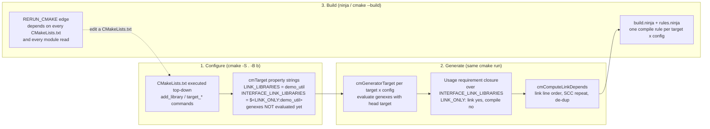

# Modern CMake Architecture and Target-Centric Design

> [!summary] Claim:
> CMake is a meta-build system: a configure step runs the `CMakeLists.txt` program and records targets whose properties are still unevaluated strings, and a separate generate step evaluates generator expressions per target and per configuration and writes a native build graph such as `build.ninja`.
> Each target carries two parallel property sets: a build specification (`INCLUDE_DIRECTORIES`, `COMPILE_DEFINITIONS`, `LINK_LIBRARIES`, ...) used to build it, and usage requirements (`INTERFACE_*`) that consumers must also obey; `PRIVATE` writes the first, `INTERFACE` the second, and `PUBLIC` both.
> At generate time a consumer's effective property is its own value plus the `INTERFACE_*` values collected over the transitive closure of `INTERFACE_LINK_LIBRARIES`, except that entries wrapped in `$<LINK_ONLY:...>` contribute to the link line but not to compile properties; `target_link_libraries(PRIVATE)` on a static library writes exactly that wrapper, because an archive cannot carry its own dependencies.
> Language levels are requested as compile features (`cxx_std_20`) that propagate like any usage requirement and resolve to the maximum over the graph, and policies (`CMP0000` to `CMP0219` in CMake 4.4) let one binary of CMake run code written for many CMake versions by recording which behaviour each directory and target was written against.



## The Mechanism

This note pins CMake 4.4.5 (Homebrew, darwin-arm64), whose bundled manuals were read with `cmake --help-manual` and `cmake --help-command` and cross-checked against the v4.4 online documentation; the latest release on cmake.org is 4.5.0 (as of 2026-11, Both).
[[Make-and-Ninja-Mechanics]] owns what happens after generation: how Ninja reads `build.ninja`, depfiles, `.ninja_deps`, and the jobserver.
[[CMake-Presets-Toolchains-and-File-API]] owns how a build tree is configured from outside the project: presets, toolchain files, and the machine-readable file API.
This note owns the model inside the project: targets, their properties, how those properties propagate, and the versioning machinery that keeps old projects working.

### 1. A meta-build system with three phases

CMake does not build anything itself.
`cmake -S <src> -B <build>` runs two phases in one process, and the native tool runs the third:

1. **Configure.**
   CMake executes `CMakeLists.txt` as a program, top to bottom, entering each `add_subdirectory()` as it is reached.
   Commands such as `add_library()` and `target_include_directories()` create targets and append strings to their properties; a generator expression like `$<CONFIG>` is stored verbatim, because the configuration is not known yet for multi-config generators.
   The log line `-- Configuring done` marks the end of this phase.
2. **Generate.**
   For each target and each configuration, CMake builds a generator-side view of the target (the `cmGeneratorTarget` class that `cmComputeLinkDepends`'s constructor takes at v4.4.5), evaluates every generator expression with that target as the "head", computes the transitive usage requirements, orders the link line, and writes the native files.
   `-- Generating done` marks the end; errors that only exist once the graph is known, such as incompatible interface properties or a malformed generator expression, are reported in this phase, after configuring has already succeeded.
3. **Build.**
   Ninja, Make, Xcode, or MSBuild runs the generated graph.
   The generated `build.ninja` contains a `build build.ninja ...: RERUN_CMAKE` edge whose implicit inputs are every `CMakeLists.txt` and every CMake module the configure step read, so editing a `CMakeLists.txt` makes the next `ninja` re-run CMake before compiling (verified in the worked example's build tree).

The phase split is the root of most CMake confusion.
`message()` runs at configure time and cannot print a generator expression's value, which is why `cmake-generator-expressions(7)` recommends `file(GENERATE)` or a custom target that echoes the expression.
`if(CMAKE_BUILD_TYPE STREQUAL Debug)` runs at configure time and is wrong for multi-config generators, which choose the configuration at build time; `$<$<CONFIG:Debug>:...>` is the correct form because it is evaluated per configuration at generate time (`cmake-buildsystem(7)`, Build Configurations).

### 2. Targets are the unit of design

`cmake-buildsystem(7)` organizes everything around "high-level logical targets".
The kinds a project uses:

| Kind | Created by | Produces | Can appear on the right of `target_link_libraries` | Notes |
| :--- | :--- | :--- | :--- | :--- |
| Executable | `add_executable(t ...)` | Program | Only with `ENABLE_EXPORTS` | Can be a `COMMAND` in `add_custom_command()` |
| Static library | `add_library(t STATIC ...)` | Archive (`.a`, `.lib`) | Yes | Made by an archiver, so it cannot record its own dependencies; CMake carries them for consumers |
| Shared library | `add_library(t SHARED ...)` | `.so`, `.dylib`, `.dll` | Yes | `POSITION_INDEPENDENT_CODE` defaults to true; defines `<target>_EXPORTS` while compiling its sources |
| Module library | `add_library(t MODULE ...)` | Plugin for `dlopen` | No | Must not be linked by other targets |
| Object library | `add_library(t OBJECT ...)` | Loose `.o` files | Yes, since 3.12 | Objects join only *direct* consumers; through `INTERFACE_LINK_LIBRARIES` it acts as an interface library |
| Interface library | `add_library(t INTERFACE)` | Nothing (may hold sources since 3.19) | Yes | Header-only libraries and pure usage-requirement bundles; added in CMake 3.0 |
| Imported target | `add_library(t <TYPE> IMPORTED [GLOBAL])` | Nothing; points at an existing file | Yes | Directory-scoped unless `GLOBAL`; include directories are treated as `SYSTEM` by default |
| Alias target | `add_library(ns::t ALIAS t)` | Nothing; a read-only name | Yes | Not mutable, installable, or exportable; may alias a non-global imported target since 3.18 |
| Symbolic interface | `add_library(t INTERFACE SYMBOLIC)` | Nothing | Yes | Added in 4.2 for optional package components; no usage requirements |
| Custom target | `add_custom_target(t ...)` | Whatever its commands do | No | Has no output file and is always considered out of date |

The `target_link_libraries` command rejects any other right-hand side: `TLL::HandleLibrary()` in `cmTargetLinkLibrariesCommand.cxx` (v4.4.5) fails with "One may link only to INTERFACE, OBJECT, STATIC or SHARED libraries, or to executables with the ENABLE_EXPORTS property set."
A name containing `::` is assumed to be an imported or alias target, and linking to one that does not exist is an error instead of a silent `-lns::t` (policy `CMP0028`, introduced in 3.0 and always `NEW` since 4.0 removed its `OLD` behaviour), which is the practical reason every library should be consumed through a namespaced alias.

### 3. Build specification and usage requirements

Every compile and link setting exists as a pair of target properties:

| Build specification (used to build the target) | Usage requirement (imposed on consumers) | Populated by |
| :--- | :--- | :--- |
| `COMPILE_DEFINITIONS` | `INTERFACE_COMPILE_DEFINITIONS` | `target_compile_definitions()` |
| `COMPILE_OPTIONS` | `INTERFACE_COMPILE_OPTIONS` | `target_compile_options()` |
| `COMPILE_FEATURES` | `INTERFACE_COMPILE_FEATURES` | `target_compile_features()` (3.1) |
| `INCLUDE_DIRECTORIES` | `INTERFACE_INCLUDE_DIRECTORIES`, `INTERFACE_SYSTEM_INCLUDE_DIRECTORIES` | `target_include_directories()` |
| `SOURCES` | `INTERFACE_SOURCES` | `target_sources()` (3.1) |
| `PRECOMPILE_HEADERS` | `INTERFACE_PRECOMPILE_HEADERS` | `target_precompile_headers()` (3.16) |
| `LINK_LIBRARIES` | `INTERFACE_LINK_LIBRARIES` | `target_link_libraries()` |
| `LINK_DIRECTORIES` | `INTERFACE_LINK_DIRECTORIES` | `target_link_directories()` (3.13) |
| `LINK_OPTIONS` | `INTERFACE_LINK_OPTIONS` | `target_link_options()` (3.13) |
| `LINK_DEPENDS` | `INTERFACE_LINK_DEPENDS` | `set_property()` |

The scope keyword selects which column a `target_*` call writes:

- `PRIVATE` appends to the build specification only.
- `INTERFACE` appends to the usage requirement only.
- `PUBLIC` appends to both.

The documented rule for choosing is about headers: a dependency used only in the library's `.cpp` files is `PRIVATE`; one that also appears in its public headers, for example as a base class, is `PUBLIC`; one used only by the headers, never by the implementation, is `INTERFACE`.
`cmake-buildsystem(7)` adds that usage requirements must be "requirements, not merely recommendations": putting `-Wall` or `-O3` in `INTERFACE_COMPILE_OPTIONS` forces it on every consumer, transitively.

The plain signature `target_link_libraries(t a b)` makes `a` and `b` both linked and transitive; mixing the plain and keyword signatures on one target is an error (`CMP0023`).
Since CMake 3.13 `target_link_libraries()` may name a target created in another directory (`CMP0079`); the entries are then wrapped in an unspecified `::@(directory-id)` marker so that names are looked up in the caller's scope, and the marker is stripped on export.

### 4. How propagation is computed

#### What `target_link_libraries(PRIVATE)` really writes

`TLL::HandleLibrary()` at v4.4.5 always appends the item to `LINK_LIBRARIES` for `PRIVATE` and `PUBLIC`.
For a `PRIVATE` item it then returns early, unless the target on the left is a `STATIC_LIBRARY` or `OBJECT_LIBRARY`; for those it appends the item to `INTERFACE_LINK_LIBRARIES` wrapped as `$<LINK_ONLY:item>`, but only when the item is a valid target name or contains a generator expression (a literal path such as `/usr/lib/libz.a` is appended unwrapped).
The reason is physical: an archive is not linked, so the libraries it needs must appear on the link line of whatever finally links it, yet the archive's private headers and definitions must not leak into that consumer's compile.
The worked example shows the stored strings exactly:

```text
-- demo_codec: LINK_LIBRARIES=[demo_util] INTERFACE_LINK_LIBRARIES=[$<LINK_ONLY:demo_util>]
-- demo_net: LINK_LIBRARIES=[Demo::codec] INTERFACE_LINK_LIBRARIES=[Demo::codec]
```

#### The closure

When CMake generates target T it computes, for each compile property P, the union of:

1. T's own P.
2. `INTERFACE_P` of each target named in T's `LINK_LIBRARIES`.
3. `INTERFACE_P` of every target reached by following `INTERFACE_LINK_LIBRARIES` transitively from those, *skipping* entries guarded by `$<LINK_ONLY:...>`.

For link properties (`INTERFACE_LINK_LIBRARIES` itself, `INTERFACE_LINK_OPTIONS`, `INTERFACE_LINK_DIRECTORIES`, `INTERFACE_LINK_DEPENDS`) the walk *includes* `LINK_ONLY` entries.
That inclusion for options, directories, and depends is policy `CMP0099` (3.17); with it `OLD`, a static library's private dependency contributes its library but not its `INTERFACE_LINK_OPTIONS`.
Order is maintained for properties where order matters, such as include directories, which follow the order of the `target_link_libraries()` calls; the documented escape hatch is to set the property directly with `$<TARGET_PROPERTY:lib3,INTERFACE_INCLUDE_DIRECTORIES>`.

`$<TARGET_PROPERTY:tgt,P>` evaluates with the same rules, so it can be used to inspect the closure.
Two policies brought it into line with buildsystem generation: `CMP0166` (3.30) makes it follow `LINK_ONLY` entries for the three link properties, and `CMP0189` (4.1) makes `LINK_LIBRARIES` and `INTERFACE_LINK_LIBRARIES` themselves evaluate transitively.
With `CMP0189` `NEW`, the worked example's `$<TARGET_PROPERTY:demo_net,INTERFACE_LINK_LIBRARIES>` evaluates to `Demo::codec;demo_util`, not to the stored `Demo::codec`.

Three refinements complete the model:

- `$<COMPILE_ONLY:...>` (3.27) is the dual of `LINK_ONLY`: content used only when collecting compile properties, for header-only or template dependencies with no link requirement; it needs `CMP0099` `NEW`.
- `$<LINK_ONLY:...>` may also be used in `LINK_LIBRARIES` since 3.24 (`CMP0131`).
- Custom transitive properties (3.30): a target lists property names in `TRANSITIVE_COMPILE_PROPERTIES` or `TRANSITIVE_LINK_PROPERTIES`, and `$<TARGET_PROPERTY:t,NAME>` then unions `INTERFACE_NAME` over the graph with the same `LINK_ONLY` rules.

#### Consumer context

A generator expression inside a usage requirement is evaluated in the context of the *consumer*, not the target that wrote it.
`$<TARGET_PROPERTY:TYPE>` inside `INTERFACE_COMPILE_DEFINITIONS` yields `EXECUTABLE` for an executable consumer and `SHARED_LIBRARY` for a shared one, and `$<TARGET_POLICY:CMP0182>` yields the policy as it was when the consumer was created (`cmake-buildsystem(7)`, Build Specification with Generator Expressions).
Since 3.26, a *target name* inside `$<TARGET_PROPERTY:tgt,prop>` in a usage requirement is looked up in the directory of the target that specified it rather than the consumer's directory.
Expressions that need a head target fail where there is none: the worked example's first run put `$<TARGET_POLICY:CMP0099>` in a plain `file(GENERATE)` and got "`$<TARGET_POLICY:prop>` may only be used with binary targets", which `file(GENERATE ... TARGET demo_app)` fixed.

### 5. From the property graph to a link line

`cmComputeLinkDepends.cxx` documents its algorithm in a long comment at the top of the file (v4.4.5):

1. Build a graph of link items by breadth-first search from the target over its link interface; edges point from an item to the items that must follow it.
2. Collapse strongly connected components (mutually dependent static libraries) so the component graph is a DAG, and compute a topological order that stays close to discovery order.
3. Emit the user's *original* link line first, then append pending components and their dependencies in topological order until every dependency is satisfied; a non-trivial component counts as satisfied only after all its entries have been seen twice.
4. Filter the result to remove duplicates the linker would reuse anyway.

`LINK_LIBRARIES_STRATEGY` (3.31) chooses the nominal order.
The default `REORDER_MINIMALLY` keeps the direct entries first and in order and appends what they still need, so the documented example (`B` and `C` privately need static `A`, `main` links `A B C`) is nominally `A B C A`; `REORDER_FREELY` may reorder direct entries and gives `B C A`.
Toolchain filtering then removes duplicates: `CMP0156` (3.29) explains that Apple and Windows linkers, and LLD, record symbols from archives already seen, and under its `NEW` behaviour CMake de-duplicates all libraries when targeting Apple and Windows platforms; `CMP0179` (3.31) makes de-duplication keep the first occurrence of a static library on every platform.
On darwin-arm64 with Apple's linker the worked example measured `libA.a libB.a libC.a` for `REORDER_MINIMALLY` and `libB.a libC.a libA.a` for `REORDER_FREELY`.

For a dependency cycle between static archives, CMake repeats the whole component; the documentation says `A B A B`, and `LINK_INTERFACE_MULTIPLICITY` raises the repeat count when two passes are not enough.
The worked example measured both behaviours of the same cycle on darwin-arm64: with `cmake_minimum_required(VERSION 3.25)` (`CMP0156` unset, so `OLD`) the link line is `libA.a libB.a libA.a libB.a`, and with `VERSION 3.25...4.4` (`CMP0156` `NEW`) it is `libA.a libB.a`.
A traditional single-pass linker such as GNU `ld` with archives needs the repetition, which is why CMake keeps it there; that platform was not measured here.

`$<LINK_LIBRARY:feature,libs>` and `$<LINK_GROUP:feature,libs>` (3.24) express *how* to link rather than *what*: `WHOLE_ARCHIVE` keeps every object of an archive (registration-by-static-constructor plugins need this), and `RESCAN` wraps a group so a traditional linker rescans it.
[[Symbols-Relocations-and-Static-Linking]] owns the archive-resolution rules these features work around.

### 6. Compatible interface properties

Some properties must agree across a target and everything it links, rather than accumulate.
`POSITION_INDEPENDENT_CODE` is built in: if a dependency sets `INTERFACE_POSITION_INDEPENDENT_CODE ON` and another sets it `OFF`, generation fails.
A project extends the check to its own properties by listing them on a dependency in `COMPATIBLE_INTERFACE_BOOL`, `COMPATIBLE_INTERFACE_STRING`, `COMPATIBLE_INTERFACE_NUMBER_MAX`, or `COMPATIBLE_INTERFACE_NUMBER_MIN`, and setting `INTERFACE_<NAME>` on each dependency.
The STRING form is a cheap ABI fence: two libraries built against incompatible versions of a dependency publish different `INTERFACE_ABI_TAG` values, and any target that links both fails at generate time (measured in the worked example).
The NUMBER forms compute a maximum or minimum, which consumers read with `$<TARGET_PROPERTY:NAME>`.
A given property name may appear in only one of the four lists for a dependency.

### 7. Generator expressions

Generator expressions are a small, pure, string-valued language evaluated at generate time, once per target and configuration.
The families that matter for target design:

| Family | Examples | Use |
| :--- | :--- | :--- |
| Logic | `$<BOOL:x>`, `$<AND:..>`, `$<OR:..>`, `$<NOT:..>`, `$<IF:c,a,b>`, `$<c:text>` | Conditions; parameters of `AND`, `OR`, `NOT` must be `0` or `1` |
| Configuration | `$<CONFIG>`, `$<CONFIG:Debug,RelWithDebInfo>` | Per-configuration settings; case-insensitive match, honours `MAP_IMPORTED_CONFIG_<CONFIG>`; multiple names since 3.19 |
| Toolchain | `$<CXX_COMPILER_ID:GNU,Clang>`, `$<COMPILE_LANG_AND_ID:CXX,MSVC>`, `$<COMPILE_LANGUAGE:CXX>`, `$<LINK_LANGUAGE:..>` | Compiler- and language-specific flags without `if()` at configure time |
| Features | `$<COMPILE_FEATURES:cxx_std_20>` | True when the head target's compile features include the list |
| Target query | `$<TARGET_PROPERTY:t,p>`, `$<TARGET_FILE:t>`, `$<TARGET_OBJECTS:t>`, `$<TARGET_EXISTS:t>` | Read properties and artifact paths; `TARGET_PROPERTY` does not add a dependency |
| Export context | `$<BUILD_INTERFACE:..>`, `$<INSTALL_INTERFACE:..>`, `$<BUILD_LOCAL_INTERFACE:..>` (3.26), `$<INSTALL_PREFIX>` | Different usage requirements in the build tree and in an installed package |
| Link context | `$<LINK_ONLY:..>`, `$<COMPILE_ONLY:..>` (3.27), `$<LINK_LIBRARY:..>`, `$<LINK_GROUP:..>` (3.24) | Split compile and link propagation; link features |
| Meta | `$<GENEX_EVAL:..>`, `$<TARGET_GENEX_EVAL:t,..>` (3.12) | Evaluate a property whose value is itself a generator expression |
| Escapes | `$<COMMA>`, `$<SEMICOLON>`, `$<ANGLE-R>`, `$<QUOTE>` | Literal characters that would otherwise be syntax |

The export-context trio decides which half of a usage requirement survives each consumer:

- `$<BUILD_INTERFACE:x>` is `x` for consumers in the same build and for targets exported with `export()` to the build tree, and empty in an `install(EXPORT)` file.
- `$<INSTALL_INTERFACE:x>` is `x` only in an `install(EXPORT)` file, where relative paths are relative to the install prefix.
- `$<BUILD_LOCAL_INTERFACE:x>` is `x` only for consumers in the same build, and empty in both kinds of export.

That is why `target_include_directories(lib PUBLIC $<BUILD_INTERFACE:${CMAKE_CURRENT_SOURCE_DIR}/include> $<INSTALL_INTERFACE:include>)` is the canonical include declaration: an absolute source path must never reach an installed package.
[[Cpp-CMake-Package-Configs-pkg-config-and-CPS]] owns `install(EXPORT)`, `export()`, config-file packages, and the relocatability rules that consume these expressions.

Quoting is the classic failure.
Generator expressions are parsed after command-argument splitting, so a space, newline, or semicolon inside one splits it into several arguments; an expression indented across lines turns into `$<AND:;...;>` and fails with "Parameters to $<AND> must resolve to either '0' or '1'" (measured).
The manual's fix is to build the expression from named variables and quote the final argument.

### 8. Compile features and language standards

`target_compile_features(t PUBLIC cxx_std_20)` states a requirement rather than a flag, and CMake chooses the flag.
The meta-features `cxx_std_98` through `cxx_std_26` (the last added in CMake 3.30, per `CMAKE_CXX_KNOWN_FEATURES`) request "at least" that standard; CMake 4.4.5 with AppleClang 21 reports exactly those seven meta-features and 64 C++ compile features in total (measured).
Fine-grained features such as `cxx_constexpr` still exist, named mostly after Clang's feature-test macros, but the meta-features are what modern projects use.

Because `COMPILE_FEATURES` is a usage requirement, the standard a target is compiled with is the maximum over itself and its closure.
In the worked example `demo_util` asks for `cxx_std_17` and `demo_net` for `cxx_std_20`; `demo_util` compiles with `-std=gnu++17`, while `demo_app`, which links `demo_net`, compiles with `-std=gnu++20` although it requested nothing.

The flag CMake emits depends on three inputs:

1. The compiler's default standard and extension mode, detected at configure time as `CMAKE_CXX_STANDARD_COMPUTED_DEFAULT` and `CMAKE_CXX_EXTENSIONS_DEFAULT`; for AppleClang 21.0.0 they are `14` and `ON` (measured), which matches `__cplusplus == 201402L` with no flag.
2. The requested level: CMake may omit `-std=` when the default already satisfies it, so `cxx_std_11` and `cxx_std_14` produced no flag at all on this compiler (measured).
3. `CXX_EXTENSIONS`, initialized from `CMAKE_CXX_EXTENSIONS_DEFAULT` under `CMP0128` (3.22); setting it `OFF` turns `gnu++17` into `c++17`, and a flag is added when the extension mode differs from the default even if the level does not.

The `CXX_STANDARD` property is the older interface and has a trap: without `CXX_STANDARD_REQUIRED ON` an unsupported value silently "decays" to an earlier standard.
`CXX_STANDARD 26` is accepted since CMake 3.25, and gave `-std=gnu++26` on AppleClang 21 (measured).

Flag placement changed in 3.26: for Ninja, Makefile, and Xcode generators the standard flag goes right after `CMAKE_CXX_FLAGS` and `CMAKE_CXX_FLAGS_<CONFIG>` and *before* `target_compile_options()`.
So a stray `target_compile_options(t PRIVATE -std=c++14)` on a target that requires `cxx_std_23` produced `-std=gnu++23 ... -std=c++14`, and Clang honours the last flag, compiling as C++14 without any CMake diagnostic (measured: `__cplusplus` is `201402L` for that flag order).

### 9. Policies: running old code on a new CMake

`cmake-policies(7)` defines a policy as "a deprecation mechanism, not a feature toggle": each `CMP<NNNN>` documents an `OLD` behaviour and a preferred `NEW` behaviour introduced in some release.
CMake 4.4.5 documents 220 policies, `CMP0000` to `CMP0219`; the 66 introduced before CMake 3.5 (`CMP0000` to `CMP0065`) were removed in CMake 4.0 and are always `NEW` (as of 2026-11, Both).
CMake 4.5.0 extends the list to `CMP0226` (as of 2026-11, Both; `cmake --help-policy-list` and the 4.5.0 online `cmake-policies(7)`).

**Policy version.**
`cmake_minimum_required(VERSION <min>[...<policy_max>])` calls `cmake_policy(VERSION ...)`, which sets every policy introduced at or before the policy version to `NEW` and leaves later ones unset; the policy version is `<policy_max>` if given, else `<min>`, raised to `CMAKE_POLICY_VERSION_MINIMUM` if that is higher.
Unset means `OLD`, with a warning for some policies and silently for others: `CMP0099`, `CMP0156`, `CMP0166`, `CMP0179`, and `CMP0189` do not warn, so a project that never raises its policy version silently keeps the old propagation and link-line behaviour.
The `...<policy_max>` syntax arrived in 3.12, and older CMake parses the dots as version separators and ignores it, which is what makes ranges safe to adopt.

**Removal schedule.**
CMake versions released at least 2 years after a policy was introduced may warn when a project sets it `OLD`, and versions released at least 6 years after, with a higher major version, may remove the `OLD` behaviour (`cmake-policies(7)`, Transition Schedule, in the v4.5.0 online manual; the bundled 4.4.5 text shows unexpanded `|POLICY_OLD_DELAY_WARNING|` placeholders).
4.0 exercised that rule: a policy version below 3.5 is an error, and since 3.31 a policy version below 3.10 is a deprecation warning.
`CMAKE_POLICY_VERSION_MINIMUM` (4.0, also read from the environment) lets a packager configure an unmaintained project without editing it; the worked example shows the error, then the same project configuring with `-DCMAKE_POLICY_VERSION_MINIMUM=3.5`, reporting `CMP0065=NEW` (a removed policy) and `CMP0099` unset.
`CMAKE_POLICY_DEFAULT_CMP<NNNN>` sets the default for one unset policy from outside.

**Scope.**
Policy settings live on a stack.
Every `add_subdirectory()` gets a new entry, as do files loaded by `include()` and `find_package()` unless `NO_POLICY_SCOPE` is given; `cmake_policy(PUSH)`/`POP` and, since 3.25, `block(SCOPE_FOR POLICIES)` manage entries explicitly.
Functions and macros record the policies in effect where they were *defined* and use them when invoked, so a helper module keeps its own semantics inside a project with a different policy version.
Targets record many policies at creation (`$<TARGET_POLICY:...>` reads them), and generator expressions are evaluated using each directory's settings as of the end of its `CMakeLists.txt` (`CMP0189` documentation).
The practical consequence is that a vendored dependency added with `add_subdirectory()` keeps its own `cmake_minimum_required()` and therefore its own propagation semantics, even inside a project that is fully `NEW`.

### 10. Design idioms built from the primitives

- **Namespaced alias for every library.**
  `add_library(Demo::codec ALIAS demo_codec)` lets consumers write the same name whether the library is built in-tree or found as an imported target from a package, and a typo becomes a hard error under `CMP0028`, reported in the generate phase after `-- Configuring done` (measured with CMake 4.5.0; `CMP0028` is always `NEW` since 4.0).
- **Header-only libraries as interface libraries with a header file set.**
  `target_sources(lib PUBLIC FILE_SET HEADERS BASE_DIRS include FILES ...)` (3.23) makes the base directories include directories automatically and gives `install(TARGETS ... FILE_SET HEADERS)` the list to install.
  CMake 4.4 added a `SOURCES` file-set type and policy `CMP0211`, which allows a file in at most one non-`HEADERS` file set per target; the `CXX_MODULES` file-set type (3.28) and module scanning (`CMP0155`) belong to [[Cpp-Modules-in-Build-Systems]].
- **Flags as targets.**
  An interface library such as `project_warnings` holding `INTERFACE_COMPILE_OPTIONS` guarded by `$<CXX_COMPILER_ID:...>`, linked `PRIVATE` by each target, expresses a build policy as a graph edge instead of a global variable; linking it `PUBLIC` would impose the warnings on every downstream consumer.
- **Object libraries for shared objects without an archive.**
  `target_link_libraries(B PUBLIC obj)` puts `obj`'s objects into `B` and propagates `obj`'s usage requirements, but the objects themselves reach only *direct* consumers; `$<TARGET_OBJECTS:obj>` (fully supported in `target_link_libraries` since 3.21) places them before all libraries on the link line.
- **System includes for third-party code.**
  Imported targets are `SYSTEM` by default, so their headers do not trigger the consumer's warnings; for in-tree third-party code, `add_subdirectory(... SYSTEM)` or `FetchContent_Declare(... SYSTEM)` (3.25) initializes the `SYSTEM` target property, and `NO_SYSTEM_FROM_IMPORTED` on a consumer opts back in.
- **Origin debugging.**
  `set(CMAKE_DEBUG_TARGET_PROPERTIES INCLUDE_DIRECTORIES COMPILE_DEFINITIONS)` prints, for each target, which call contributed each entry; `cmake --graphviz=deps.dot` writes the target graph with private edges dotted, interface edges dashed, and public edges solid (`Source/cmGraphVizWriter.cxx` at v4.4.5).

### 11. Why directory-scoped commands are legacy

`include_directories()`, `add_compile_definitions()`, `add_compile_options()`, `link_libraries()`, and `CMAKE_CXX_FLAGS` apply to every target created afterwards in the directory and below.
They cannot express "consumers need this", so the information is lost at the target boundary: a library's include path set with `include_directories()` must be re-declared by every consumer, and an installed package cannot carry it at all.
They also couple unrelated targets through creation order inside a file.
They remain correct for settings that genuinely belong to a whole build tree, such as a sanitizer flag chosen by the person configuring the build, which is why [[CMake-Presets-Toolchains-and-File-API]] passes such settings through cache variables and toolchain files rather than through `CMakeLists.txt`.

## Commands and Numbers to Know

| Item | Value | Platform and date | What it controls |
| :--- | :--- | :--- | :--- |
| CMake version used here | 4.4.5 (latest release 4.5.0) | Both (as of 2026-11) | All behaviour described; Homebrew build on darwin-arm64 |
| Policies documented | `CMP0000` to `CMP0219` (220) in 4.4.5; to `CMP0226` in 4.5.0 | Both (as of 2026-11) | 66 policies before 3.5 removed in 4.0, always `NEW` |
| Minimum policy version | `3.5` (error below), `3.10` (warning below since 3.31) | Both (as of 2026-11) | `cmake_minimum_required(VERSION 3.4)` fails in 4.x |
| Policy removal delays | warn after 2 years, may remove after 6 years and a new major | Both (as of 2026-11) | `cmake-policies(7)` transition schedule |
| `CMAKE_POLICY_VERSION_MINIMUM` | unset; cache or environment | Both (as of 2026-11) | Raise an unmaintained project's policy version from outside (4.0) |
| `CMAKE_POLICY_DEFAULT_CMP<NNNN>` | unset | Both (as of 2026-11) | Default for one policy left unset by the project |
| `CXX_STANDARD` values | `98 11 14 17 20 23 26` (`26` since 3.25) | Both (as of 2026-11) | Without `CXX_STANDARD_REQUIRED` an unsupported value decays |
| AppleClang 21.0.0 defaults | standard `14`, extensions `ON` | macOS (as of 2026-11) | Why `cxx_std_14` adds no flag there |
| C++ meta-features | `cxx_std_98` to `cxx_std_26` | Both (as of 2026-11) | Minimum standard, resolved to the maximum over the closure |
| Standard flag position | after `CMAKE_CXX_FLAGS[_<CONFIG>]`, before `target_compile_options` | Both (as of 2026-11) | Since 3.26 for Ninja, Makefile, Xcode generators |
| `LINK_LIBRARIES_STRATEGY` | `REORDER_MINIMALLY` | Both (as of 2026-11) | Direct entries first and in order (3.31) |
| Static cycle repetition | at least 2 passes | Both (as of 2026-11) | Raise with `LINK_INTERFACE_MULTIPLICITY` |
| `CMP0156` / `CMP0179` | 3.29 / 3.31, unset means `OLD`, no warning | Both (as of 2026-11) | Linker-aware de-duplication; keep first static occurrence |
| `CMP0099` / `CMP0166` / `CMP0189` | 3.17 / 3.30 / 4.1, no warning | Both (as of 2026-11) | Link-property propagation through `LINK_ONLY`; `TARGET_PROPERTY` transitivity |
| `POSITION_INDEPENDENT_CODE` | true for `SHARED`/`MODULE`, else `CMAKE_POSITION_INDEPENDENT_CODE` or false | Both (as of 2026-11) | A static library linked into a shared one needs it on Linux |
| Standard configurations | `Debug`, `Release`, `RelWithDebInfo`, `MinSizeRel` | Both (as of 2026-11) | Single-config `CMAKE_BUILD_TYPE` default is often empty, not `Debug` |
| `cmake --graphviz=<file>` | DOT target graph | Both (as of 2026-11) | Private edges dotted, public solid, interface dashed |
| `CMAKE_DEBUG_TARGET_PROPERTIES` | unset | Both (as of 2026-11) | Origin of each entry of `INCLUDE_DIRECTORIES`, `COMPILE_DEFINITIONS`, and others |
| `cmake --trace-expand`, `--trace-format=json-v1` | off | Both (as of 2026-11) | Trace configure-time command execution |
| `file(GENERATE OUTPUT f CONTENT "$<...>" TARGET t)` | n/a | Both (as of 2026-11) | Print a generator expression's value for head target `t` |
| `ninja -t commands <target>` | n/a | Both (as of 2026-11, Ninja 1.13.2) | Exact compile and link commands CMake generated |

## Multi-Language Comparison: How Each Ecosystem Carries Usage Requirements

| Concern | C++ with CMake | Python native extensions | Rust with Cargo |
| :--- | :--- | :--- | :--- |
| Unit of declaration | Target, with `PRIVATE`/`PUBLIC`/`INTERFACE` scopes | One extension module (a `setuptools` `Extension`, or a CMake target linked to `Python::Module`, 3.15) | Crate and its build script |
| Header and include propagation | `INTERFACE_INCLUDE_DIRECTORIES` over the transitive closure | Per extension; a CMake-built extension inherits from its linked targets, a `setuptools` extension lists its own `include_dirs` | No headers; the compiler reads dependency metadata (`.rmeta`) |
| Native library propagation | `INTERFACE_LINK_LIBRARIES`, `$<LINK_ONLY>` for archives' private deps | Whatever the extension's own link line contains; the stable ABI variant links `Python::SABIModule` (3.26) | `cargo::rustc-link-lib` is passed to the package's library target; `links` allows at most one package per native library |
| Passing build metadata to dependents | Any `INTERFACE_*` or custom transitive property, transitively | Not modelled by the build backend | `cargo::metadata=KEY=VALUE` becomes `DEP_<LINKS>_<KEY>` for *immediate* dependents only |
| Language level | `cxx_std_NN`, maximum over the closure | The extension's own C or C++ build decides it; the Python ABI the module targets is a separate axis, see [[Python-Wheels-Platform-Tags-Manylinux-and-ABI3]] | Per-crate `edition`, which does not propagate |
| Version compatibility machinery | Policies `CMP<NNNN>` and policy version ranges | Build-backend version pins | Editions and `rust-version` |

The contrast is instructive: Cargo deliberately stops metadata at the first edge, while CMake propagates by default and makes the author opt out with `PRIVATE` or `LINK_ONLY`.
[[Cargo-Build-Graph-and-Rustc-Pipelining]] owns the Cargo side.

## Worked Lab Example

This note has no harness lab under `code/`, so nothing here is checked by `make verify`.
The transcripts below were captured once on 2026-11-12 from the scratch projects in this job's `scratch/demo/` and `scratch/probes/` directories, and are saved in `scratch/transcripts/darwin-arm64.txt`.
Host: macOS 27.3 on darwin-arm64, CMake 4.4.5, Ninja 1.13.2, Apple clang 21.0.0 (clang-2100.4.1.1); absolute paths are replaced with `<root>`.
An independent re-run of the same projects with CMake 4.5.0 on the same host during verification (as of 2026-11, macOS) reproduced Steps 1, 4 (link line), 5, 6 (ABI tag), and 7 exactly, the `RERUN_CMAKE` edge, the quoting error, and the count of 64 C++ compile features.

### The project

Four targets in four directories, under `cmake_minimum_required(VERSION 3.25...4.4)`, so every policy through 4.4 is `NEW`:

```cmake
# util/CMakeLists.txt
add_library(demo_util STATIC util.cpp)
target_compile_definitions(demo_util PRIVATE UTIL_BUILDING INTERFACE UTIL_CONSUMER)
target_compile_features(demo_util PUBLIC cxx_std_17)

# codec/CMakeLists.txt
add_library(demo_codec STATIC codec.cpp)
add_library(Demo::codec ALIAS demo_codec)
target_include_directories(demo_codec PUBLIC
  $<BUILD_INTERFACE:${CMAKE_CURRENT_SOURCE_DIR}/include>
  $<INSTALL_INTERFACE:include>)
target_compile_definitions(demo_codec PUBLIC CODEC_API=1)
target_link_libraries(demo_codec PRIVATE demo_util)

# net/CMakeLists.txt
add_library(demo_net SHARED net.cpp)
target_include_directories(demo_net PUBLIC ${CMAKE_CURRENT_SOURCE_DIR}/include)
target_compile_features(demo_net PUBLIC cxx_std_20)
target_link_libraries(demo_net PUBLIC Demo::codec)

# app/CMakeLists.txt
add_executable(demo_app main.cpp)
target_link_libraries(demo_app PRIVATE demo_net)
target_compile_definitions(demo_app PRIVATE $<$<CONFIG:Debug>:APP_DEBUG>)
add_executable(demo_app2 main2.cpp)        # also calls codec_encode() directly
target_link_libraries(demo_app2 PRIVATE demo_net)
```

`main.cpp` contains `#ifdef UTIL_CONSUMER` / `#error`, so the build itself fails if `demo_util`'s usage requirements leak through the private edge.
The top-level file prints the stored property strings with `get_target_property()` at configure time and the evaluated ones with `file(GENERATE)`.

```bash
cmake -S demo -B b -G Ninja -DCMAKE_BUILD_TYPE=Debug
cmake --build b
ninja -C b -t commands app/demo_app | tail -1
```

### Step 1: stored strings at configure time

```text
-- demo_util: LINK_LIBRARIES=[ll-NOTFOUND] INTERFACE_LINK_LIBRARIES=[ill-NOTFOUND]
-- demo_codec: LINK_LIBRARIES=[demo_util] INTERFACE_LINK_LIBRARIES=[$<LINK_ONLY:demo_util>]
-- demo_net: LINK_LIBRARIES=[Demo::codec] INTERFACE_LINK_LIBRARIES=[Demo::codec]
-- demo_app: LINK_LIBRARIES=[demo_net] INTERFACE_LINK_LIBRARIES=[ill-NOTFOUND]
-- CXX standard computed default: 14, extensions default: ON
```

- The `PRIVATE` edge from the static `demo_codec` was written twice: plainly into `LINK_LIBRARIES`, and wrapped in `$<LINK_ONLY:...>` into `INTERFACE_LINK_LIBRARIES`, exactly as `TLL::HandleLibrary()` does.
- The `PRIVATE` edge from the executable `demo_app` left no `INTERFACE_LINK_LIBRARIES` at all, because an executable is not static.
- The alias is stored by name (`Demo::codec`) and resolved at generate time.

### Step 2: evaluated values at generate time

```text
codec INTERFACE_LINK_LIBRARIES (raw):  demo_util
net   INTERFACE_LINK_LIBRARIES (raw):  Demo::codec;demo_util
app   COMPILE_DEFINITIONS (evaluated):  APP_DEBUG;CODEC_API=1
app   COMPILE_FEATURES (evaluated):     cxx_std_20
util  COMPILE_DEFINITIONS (evaluated):  UTIL_BUILDING
CMP0099 for head target demo_app: 1
```

- The two lines labelled "raw" in the drafting script are not raw: `$<TARGET_PROPERTY:...>` evaluates, so `$<LINK_ONLY:demo_util>` becomes `demo_util` (link context) and, under `CMP0189`, `demo_net`'s `INTERFACE_LINK_LIBRARIES` expands transitively to `Demo::codec;demo_util`; Step 1 is the only true raw view.
- `demo_app`'s compile definitions contain `CODEC_API=1` (from `demo_codec`, reached through `demo_net`'s `PUBLIC` edge) and not `UTIL_CONSUMER` (behind `LINK_ONLY`).
- `demo_app` requested no feature but inherited `cxx_std_20` from `demo_net`.

### Step 3: the generated compile commands

From `b/compile_commands.json`:

```text
/usr/bin/c++ -DUTIL_BUILDING -g -std=gnu++17 -arch arm64 -o util/CMakeFiles/demo_util.dir/util.cpp.o -c <root>/demo/util/util.cpp
/usr/bin/c++ -DCODEC_API=1 -DUTIL_CONSUMER -I<root>/demo/codec/include -g -std=gnu++17 -arch arm64 -o codec/CMakeFiles/demo_codec.dir/codec.cpp.o -c <root>/demo/codec/codec.cpp
/usr/bin/c++ -DCODEC_API=1 -Ddemo_net_EXPORTS -I<root>/demo/net/include -I<root>/demo/codec/include -g -std=gnu++20 -arch arm64 -fPIC -o net/CMakeFiles/demo_net.dir/net.cpp.o -c <root>/demo/net/net.cpp
/usr/bin/c++ -DAPP_DEBUG -DCODEC_API=1 -I<root>/demo/net/include -I<root>/demo/codec/include -g -std=gnu++20 -arch arm64 -o app/CMakeFiles/demo_app.dir/main.cpp.o -c <root>/demo/app/main.cpp
```

- `demo_codec` is compiled *with* `-DUTIL_CONSUMER`: a private dependency's usage requirements apply to the target that declared it.
- `demo_codec`'s `PUBLIC` include directory and definition reach `demo_net` and `demo_app`; `demo_net`'s own include comes first because it is its own build specification.
- `-Ddemo_net_EXPORTS` and `-fPIC` appear only on the shared library, the automatic `DEFINE_SYMBOL` and the default `POSITION_INDEPENDENT_CODE`.
- `demo_codec` was compiled without `-fPIC` yet linked into a shared library; that works here because Apple's arm64 toolchain generates position-independent code anyway, but on x86-64 Linux the same graph typically fails at link time with a relocation error until `demo_codec` sets `POSITION_INDEPENDENT_CODE ON` (not measured here).

### Step 4: the link lines and a duplicate-code hazard

```text
: && /usr/bin/c++ -g -arch arm64 -dynamiclib -Wl,-headerpad_max_install_names -o net/libdemo_net.dylib -install_name @rpath/libdemo_net.dylib net/CMakeFiles/demo_net.dir/net.cpp.o  codec/libdemo_codec.a  util/libdemo_util.a && :
: && /usr/bin/c++ -g -arch arm64 -Wl,-search_paths_first -Wl,-headerpad_max_install_names app/CMakeFiles/demo_app2.dir/main2.cpp.o -o app/demo_app2  -Wl,-rpath,<root>/b/net  net/libdemo_net.dylib  codec/libdemo_codec.a  util/libdemo_util.a && :
```

Both archives are linked into `libdemo_net.dylib` *and* listed again for every executable, because `demo_net` declared `Demo::codec` `PUBLIC` and the `LINK_ONLY` entry rides along.
Whether that duplicates code depends on symbol visibility, which `nm` shows:

```text
## nm default visibility
== b/net/libdemo_net.dylib
0000000000000f20 T __Z12codec_encodei
0000000000000ef8 T __Z8net_sendi
0000000000000f48 T __Z8util_addii
== b/app/demo_app2
                 U __Z12codec_encodei
                 U __Z8net_sendi
## nm hidden visibility
== bh/net/libdemo_net.dylib
0000000000000f20 t __Z12codec_encodei
0000000000000ef8 T __Z8net_sendi
0000000000000f48 t __Z8util_addii
== bh/app/demo_app2
00000001000011b0 t __Z12codec_encodei
                 U __Z8net_sendi
00000001000011d8 t __Z8util_addii
```

- With default visibility the dylib exports `codec_encode`, the dylib precedes the archives on the link line, and `demo_app2` binds to the dylib's copy (`U`).
- Rebuilt with `-DCMAKE_CXX_VISIBILITY_PRESET=hidden` (and `net_send` explicitly exported), the dylib's copies become local (`t`), so the linker pulls a *second* copy of `codec_encode` and `util_add` out of the archives into `demo_app2`.
- Two copies of code are harmless here, but two copies of a static variable, a registry, or an allocator are an ODR bug that no compiler diagnoses; [[Cpp-ODR-Violations-Static-Init-and-Linker-Template-Errors]] owns that failure and [[Cpp-ABI-Stability-Symbol-Visibility-and-SONAME]] owns the visibility rules.
- The design fix is to make the archive a `PRIVATE` dependency of the shared library when it is not part of the shared library's API, or to make it a shared library itself.

### Step 5: link order, cycles, and policies (probe projects)

```text
main_min  (REORDER_MINIMALLY): ... CMakeFiles/main_min.dir/m.cpp.o -o main_min  libA.a  libB.a  libC.a
main_free (REORDER_FREELY):    ... CMakeFiles/main_free.dir/m.cpp.o -o main_free  libB.a  libC.a  libA.a
cycle, VERSION 3.25...4.4:     ... CMakeFiles/main.dir/m.cpp.o -o main  libA.a  libB.a
cycle, VERSION 3.25:           ... CMakeFiles/main.dir/m.cpp.o -o main  libA.a  libB.a  libA.a  libB.a
```

The four lines are abbreviated from `ninja -t commands`; only the policy version differs between the two cycle builds, and the second line is `CMP0156` `OLD` repeating the strongly connected component twice for a linker that does not need it.

```text
CMake Error at CMakeLists.txt:1 (cmake_minimum_required):
  Compatibility with CMake < 3.5 has been removed from CMake.

  Update the VERSION argument <min> value.  Or, use the <min>...<max> syntax
  to tell CMake that the project requires at least <min> but has been updated
  to work with policies introduced by <max> or earlier.

  Or, add -DCMAKE_POLICY_VERSION_MINIMUM=3.5 to try configuring anyway.
```

With `-DCMAKE_POLICY_VERSION_MINIMUM=3.5` the same project configures, warns that compatibility with CMake below 3.10 will be removed, and reports `CMAKE_MINIMUM_REQUIRED_VERSION=3.4 CMP0065=NEW CMP0099=[]`: the variable keeps the project's own minimum, a removed policy reads as `NEW`, and a post-3.5 policy is unset.

### Step 6: generate-time diagnostics

```text
-- Configuring done (0.3s)
CMake Error: The INTERFACE_ABI_TAG property of "abi_v3" does
not agree with the value of ABI_TAG already determined
for "mixed".

-- Generating done (0.0s)
CMake Generate step failed.  Build files cannot be regenerated correctly.
```

`abi_v2` lists `ABI_TAG` in `COMPATIBLE_INTERFACE_STRING` with `INTERFACE_ABI_TAG v2`, `abi_v3` sets `v3`, and `mixed` links both; configuring succeeded and generation failed, which is the phase split in action.

```text
CMake Debug Log at CMakeLists.txt:10 (target_link_libraries):
  Used includes for target exe:

   * <root>/_b/debugprops/dep_inc

CMake Debug Log at CMakeLists.txt:10 (target_link_libraries):
  Used compile definitions for target exe:

   * DEP_API
```

`CMAKE_DEBUG_TARGET_PROPERTIES` attributes each inherited entry to the `target_link_libraries()` call that brought it in, which is the fastest way to answer "where did this `-I` come from".

### Step 7: what the standard flags really are

```text
none         /usr/bin/c++   -arch arm64 ...
feat14       /usr/bin/c++   -arch arm64 ...
feat11       /usr/bin/c++   -arch arm64 ...
std17_noext  /usr/bin/c++   -std=c++17 -arch arm64 ...
std26        /usr/bin/c++   -std=gnu++26 -arch arm64 ...
feat23_opt   /usr/bin/c++   -std=gnu++23 -arch arm64 -std=c++14 ...
```

`feat11` and `feat14` get no flag because AppleClang's default (`gnu++14`) already satisfies them; `feat23_opt` requires `cxx_std_23` but also has `target_compile_options(-std=c++14)`, and since the options come after the standard flag, Clang compiles it as C++14.

## Pitfalls

> [!warning] Pitfall: a static library's PUBLIC dependency inside a shared library
> When a shared library links a static library `PUBLIC`, the archive is linked into the shared library and listed again on every consumer's link line.
> With hidden visibility each consumer that calls into the archive gets its own copy, and two copies of a global are an ODR violation with no diagnostic (worked example, Step 4).
> Make the edge `PRIVATE` unless the archive's types are part of the shared library's API, and if they are, consider making the archive shared.

> [!warning] Pitfall: expecting PRIVATE to hide a static library's dependencies from the linker
> `PRIVATE` on a static library hides compile requirements, not link requirements: CMake writes `$<LINK_ONLY:dep>` so `dep` still reaches every final link.
> This is required for correctness, so do not "fix" missing symbols by changing the edge to `PUBLIC`, which also leaks the dependency's headers and definitions.

> [!warning] Pitfall: never raising the policy version
> `cmake_minimum_required(VERSION 3.14)` leaves every later policy `OLD`, and `CMP0099`, `CMP0156`, `CMP0166`, `CMP0179`, and `CMP0189` change propagation and link lines without any warning.
> Write `cmake_minimum_required(VERSION <oldest supported>...<newest tested>)` and raise the upper bound deliberately, with a diff of `compile_commands.json` and of the link lines, when CI moves to a new CMake.

> [!warning] Pitfall: CMAKE_BUILD_TYPE logic in multi-config generators
> `if(CMAKE_BUILD_TYPE STREQUAL "Debug")` is evaluated once at configure time, is empty for Visual Studio, Xcode, and Ninja Multi-Config, and compares case-sensitively.
> Use `$<CONFIG:Debug>`, which is evaluated per configuration and compares case-insensitively.

> [!warning] Pitfall: raw -std flags and compile options overriding compile features
> Since CMake 3.26 the standard flag precedes `target_compile_options()`, so a hand-written `-std=` silently wins (worked example, Step 7).
> Request standards only with `target_compile_features()` or `CXX_STANDARD` plus `CXX_STANDARD_REQUIRED ON`, and grep `compile_commands.json` for duplicated `-std=` flags in CI.

> [!warning] Pitfall: CXX_STANDARD without CXX_STANDARD_REQUIRED
> An unsupported `CXX_STANDARD` value decays to an older standard with no error.
> A meta-feature such as `cxx_std_20` fails at configure time instead when the compiler cannot provide it, which is the behaviour a build wants.

> [!warning] Pitfall: generator expressions split across lines or unquoted
> Spaces, newlines, and semicolons split a generator expression into separate arguments before it is parsed, producing errors like "Parameters to $<AND> must resolve to either '0' or '1'" or, worse, a silently non-matching literal.
> Build complex expressions from named variables and pass the result as one quoted argument.

> [!warning] Pitfall: absolute or source-tree paths in usage requirements of installable targets
> An absolute library path or a source-tree include path in `INTERFACE_*` can end up in the installed package and point at the build machine; the `target_link_libraries` documentation warns about exactly this for library file paths.
> Wrap build-tree paths in `$<BUILD_INTERFACE:...>`, give installed paths relative to the prefix in `$<INSTALL_INTERFACE:...>`, and link imported targets instead of file paths.

> [!warning] Pitfall: flags in INTERFACE_COMPILE_OPTIONS as recommendations
> `-Werror`, `-O3`, or `-ffast-math` in `INTERFACE_COMPILE_OPTIONS` applies to every transitive consumer, including third-party code that includes your headers.
> Put project policy in a `PRIVATE`-linked interface library such as `project_warnings`, and reserve usage requirements for flags consumers truly need, such as an ABI-affecting definition.

> [!warning] Pitfall: imported targets defined in a subdirectory
> A non-`GLOBAL` imported target is visible only in the directory that created it and below, so `find_package()` in one subdirectory does not make its targets visible to a sibling.
> Call `find_package()` in a common parent directory, or create the imported targets `GLOBAL`.

## At Scale

A single developer can treat CMake as a list of targets and get away with directory-scoped flags.
At hundreds of targets the property graph *is* the dependency graph that every compile depends on, and at thousands of engineers it is an API that teams publish to one another.

- **Over-propagation is a build-performance bug.**
  Every unnecessary `PUBLIC` edge adds include directories and definitions to every downstream compile, which lengthens command lines, widens the header search, and changes command lines that compiler caches key on; [[Compiler-Caches-ccache-and-sccache]] owns why a changed definition is a cache miss, and [[Cpp-Compile-Time-Profiling-ftime-trace-and-ClangBuildAnalyzer]] owns measuring the header cost.
- **Under-propagation is a correctness bug that hides.**
  A library that needs a definition in its headers but declares it `PRIVATE` compiles fine itself and breaks only consumers, often in another team's repository; a test target in the library's own tree that consumes it like an outsider catches this.
- **Policies are a fleet migration.**
  A monorepo on one CMake binary still has many policy versions, because every vendored `add_subdirectory()` keeps its own; raising them is a large-scale change that should be driven by generated diffs of compile and link commands, as [[Large-Scale-Changes-and-Codemods-Across-Repos]] describes.
- **The graph needs lint.**
  Rules worth enforcing mechanically: no directory-scoped `include_directories()` or `add_compile_options()` in library directories, every library has a namespaced alias, no absolute paths in `INTERFACE_*`, no `-std=` in compile options, and every `PUBLIC` edge from a shared library to a static one is reviewed.
  `cmake --graphviz` and the file API (owned by [[CMake-Presets-Toolchains-and-File-API]]) give the graph to such a linter.

Decision rules:

- From 1 to about 50 engineers: one top-level `cmake_minimum_required(VERSION X...Y)`, targets only, a `project_warnings` interface library, and presets for the configurations people actually use.
- From about 50 to 1,000 engineers: treat each library's `PUBLIC` surface as an API owned by its team, require namespaced aliases, and run a CI job that builds each library's consumers from an installed package to catch under-propagation and absolute paths.
- From about 1,000 to 50,000 engineers: CMake's configure step and graph become a measurable cost and the target graph is shared across many repositories; that is the point at which [[Build-Performance-Economics-and-Decision-Record]] weighs moving to a hermetic system such as [[Bazel-Skyframe-Bzlmod-and-Execution-Model]], where visibility and propagation are enforced by the tool rather than by review.

## Practice Drill

> [!tip] Practice Drill:
> Rebuild the worked example's four-target project from the listings above, then predict, before each run, the `-D` and `-I` flags of `demo_app` and the archives on its link line.
> Change `demo_codec`'s edge to `demo_util` from `PRIVATE` to `PUBLIC` and confirm that `main.cpp`'s `#error` now fires; change it to `INTERFACE` and explain why `codec.cpp` loses `-DUTIL_CONSUMER` but `demo_app` gains it.
> Change `demo_net`'s edge to `Demo::codec` to `PRIVATE`, rebuild with `-DCMAKE_CXX_VISIBILITY_PRESET=hidden`, and use `nm` to show that `demo_app2` no longer gets a second copy of `codec_encode`; note what breaks and why `main2.cpp` must now be fixed.
> Lower the policy version to `3.25` and diff `compile_commands.json` and the link lines against the `3.25...4.4` build; list every difference and the policy that explains it.
> Stretch: add `TRANSITIVE_COMPILE_PROPERTIES ABI_FLAVOR` to a new interface library and show with `file(GENERATE)` that `$<TARGET_PROPERTY:demo_app,ABI_FLAVOR>` collects `INTERFACE_ABI_FLAVOR` from the whole graph except behind `LINK_ONLY`.

## Interview Questions

> [!question] L5: What do PRIVATE, PUBLIC, and INTERFACE mean in `target_link_libraries(lib PUBLIC a PRIVATE b INTERFACE c)`?
>
> > [!success]- Answer
> > `a` is linked into `lib` and added to `lib`'s `INTERFACE_LINK_LIBRARIES`, so consumers of `lib` get `a`'s usage requirements and link `a`.
> > `b` is used to build `lib` only; its include directories and definitions do not reach consumers.
> > `c` is not used to build `lib` at all, only added to the interface for consumers, which fits a dependency used by `lib`'s headers but not its sources.
> > One detail separates good answers: if `lib` is a static library, CMake also writes `b` into `INTERFACE_LINK_LIBRARIES` as `$<LINK_ONLY:b>`, so consumers still link `b` even though they do not compile against it.

> [!question] L5: Why is `if(CMAKE_BUILD_TYPE STREQUAL "Debug")` wrong, and what replaces it?
>
> > [!success]- Answer
> > It runs once at configure time, but multi-config generators (Visual Studio, Xcode, Ninja Multi-Config) pick the configuration at build time and do not use `CMAKE_BUILD_TYPE`.
> > Even with a single-config generator the variable is often empty by default and the comparison is case-sensitive, so `debug` or an empty value silently miss.
> > `$<$<CONFIG:Debug>:...>` is evaluated at generate time for each configuration and compares case-insensitively, so it is correct for every generator.

> [!question] L5 (predict the output): Which sources see `-DUTIL_CONSUMER`, and which archives are on `app`'s link line?
>
> `util` is a STATIC library with `target_compile_definitions(util INTERFACE UTIL_CONSUMER)`; `codec` is STATIC and links `util` PRIVATE; `net` is SHARED and links `codec` PUBLIC; `app` links `net` PRIVATE.
> Consider `codec.cpp` and `main.cpp`.
>
> > [!success]- Answer
> > `codec.cpp` sees `-DUTIL_CONSUMER`, because a target consumes the usage requirements of its own private dependencies.
> > `main.cpp` does not: `codec`'s interface holds `$<LINK_ONLY:util>`, which compile-property collection skips.
> > `app`'s link line is `libnet.dylib libcodec.a libutil.a` (the worked example measured this shape on darwin-arm64 with CMake 4.4.5): `codec` comes through `net`'s `PUBLIC` edge and `util` through the `LINK_ONLY` entry, so both archives are listed even though they are already inside the shared library.

> [!question] L6 (debug this): A consumer cannot find your library's header although the library builds; what is wrong, and how do you prove it?
>
> The consumer fails with "fatal error: 'mylib/config.hpp' file not found", yet the library itself builds and its tests pass.
> The library uses `target_include_directories(mylib PRIVATE include)`.
>
> > [!success]- Answer
> > `PRIVATE` puts `include` in the library's `INCLUDE_DIRECTORIES` only, so the library's own sources and any test that includes the header through the library's sources compile, but consumers receive no include path.
> > Prove it with `set(CMAKE_DEBUG_TARGET_PROPERTIES INCLUDE_DIRECTORIES)` or by reading the consumer's command in `compile_commands.json`: the path is missing, and `$<TARGET_PROPERTY:mylib,INTERFACE_INCLUDE_DIRECTORIES>` evaluates empty.
> > The fix is `PUBLIC` with `$<BUILD_INTERFACE:${CMAKE_CURRENT_SOURCE_DIR}/include>` and `$<INSTALL_INTERFACE:include>`, or a `FILE_SET HEADERS` with `BASE_DIRS include`.
> > The process fix is a test target that consumes the library only through `target_link_libraries`, so the next under-propagation fails in the library's own CI.

> [!question] L6: Why does CMake write `$<LINK_ONLY:dep>` for a static library's private dependency but nothing for a shared library's?
>
> > [!success]- Answer
> > A shared library is linked: its own link step resolves `dep`, and the loader finds `dep` at run time through the shared library's dependency entries, so consumers need neither `dep`'s headers nor `dep` on their link line.
> > A static library is an archive made by an archiver, not a linker, so nothing records that its objects need `dep`; the final link that pulls those objects must also see `dep`.
> > CMake therefore propagates the link requirement but suppresses compile requirements by wrapping it in `LINK_ONLY`, which is exactly what `TLL::HandleLibrary()` does for `STATIC_LIBRARY` and `OBJECT_LIBRARY` targets.
> > Policy `CMP0099` extends that propagation to `INTERFACE_LINK_OPTIONS`, `INTERFACE_LINK_DIRECTORIES`, and `INTERFACE_LINK_DEPENDS`.

> [!question] L6: A target requires `cxx_std_23`, yet `__cplusplus` inside it reports `201402L`; what happened?
>
> > [!success]- Answer
> > Something added a raw `-std=` flag after CMake's standard flag; since CMake 3.26 the standard flag is placed after `CMAKE_CXX_FLAGS` and before `target_compile_options()`, and GCC and Clang honour the last `-std=` on the command line.
> > Check `compile_commands.json` for two `-std=` flags; the usual sources are `target_compile_options()`, an `INTERFACE_COMPILE_OPTIONS` inherited from a dependency, or a toolchain file.
> > If the inherited flag is in `CMAKE_CXX_FLAGS` instead, it comes before CMake's flag and loses, which is why the bug appears only for some targets.
> > The fix is to delete raw `-std=` flags everywhere and express levels only as compile features.

> [!question] L7: Explain how CMake orders a link line, including cycles and de-duplication, and why the same project gives different link lines on macOS and Linux.
>
> > [!success]- Answer
> > `cmComputeLinkDepends` builds an item graph from the target's link interface, collapses strongly connected components of mutually dependent static libraries, and computes a topological order.
> > It emits the original direct entries first (`REORDER_MINIMALLY`, the default strategy since it became selectable in 3.31), then appends whatever dependencies remain, repeating each non-trivial component until every entry has been seen at least twice, or `LINK_INTERFACE_MULTIPLICITY` times.
> > The nominal list is then filtered per toolchain: under `CMP0156` CMake de-duplicates every library when targeting Apple and Windows platforms, whose linkers resolve symbols from archives already seen, keeping the first static occurrence under `CMP0179`, and keeps the repetition that traditional single-pass linkers need.
> > On darwin-arm64 a two-archive cycle linked as `libA.a libB.a` with the 4.4 policies and as `libA.a libB.a libA.a libB.a` with policy version 3.25, so a policy bump, not a code change, can alter which archive member satisfies a symbol when two archives define it.

> [!question] L7: What exactly does `cmake_minimum_required(VERSION 3.20...4.4)` do on CMake 4.4, on CMake 3.25, and on CMake 3.11?
>
> > [!success]- Answer
> > On CMake 4.4 it requires at least 3.20 and sets the policy version to 4.4, so every policy through `CMP0219` is `NEW`.
> > On CMake 3.25 every policy that 3.25 knows is introduced at or before the policy version 4.4, so all of them are `NEW`; nothing errors because `<policy_max>` "does not signify that later CMake versions are forbidden".
> > On CMake 3.11 the command fails, because 3.11 is below the minimum 3.20; for a project whose minimum is older, CMake before 3.12 reads `...4.4` as extra version components and ignores the range, keeping the pre-3.12 behaviour of using the minimum as the policy version.
> > In every case policy settings are scoped: subdirectories and `find_package()` files get their own stack entries, functions keep the policies of their definition site, and generator expressions use each directory's policies as of the end of its `CMakeLists.txt`.

> [!question] L8+: Design the CMake surface of a shared-library SDK that wraps a dozen static libraries and is consumed by 300 services.
>
> > [!success]- Answer
> > Expose one imported target, `Sdk::sdk`, whose interface is only what consumers compile against: public include directories through `$<INSTALL_INTERFACE:include>`, the compile features the public headers need, and ABI-affecting definitions.
> > Link the internal static libraries `PRIVATE` and build them with `POSITION_INDEPENDENT_CODE ON` and hidden visibility, so none of their symbols or usage requirements leak and no consumer can link a second copy of their globals.
> > Mark ABI-defining knobs with `COMPATIBLE_INTERFACE_STRING` so a service that links two incompatible SDK flavours fails at generate time, and keep warnings in a `PRIVATE` interface library.
> > Gate releases with a consumer build against the *installed* package in a clean tree, a check that no `INTERFACE_*` contains an absolute path, and a symbol-export diff; packaging and export details belong to [[Cpp-CMake-Package-Configs-pkg-config-and-CPS]].
> > The trade-off is that consumers cannot reach internal helpers, which is the point: the target graph enforces the API boundary that code review alone cannot.

> [!question] L8+: When is CMake's target model the wrong tool, and what would make you migrate a large codebase off it?
>
> > [!success]- Answer
> > CMake's model is advisory: `PRIVATE` controls propagation, but nothing stops a source file from including a header it never declared a dependency on if the path happens to be on the include line, and CMake does not sandbox actions or key caches on declared inputs.
> > At small and medium scale that is acceptable because the native generator plus a compiler cache is fast and the ecosystem of `find_package()` packages is unmatched.
> > The case for migration appears when the measured costs are configure time, cache misses from undeclared inputs, and cross-team breakage from accidental dependencies, which hermetic systems address with strict deps, sandboxing, and remote caching.
> > The decision should rest on measured build latency and cache-hit data, as [[Build-Performance-Economics-and-Decision-Record]] frames it, not on taste; many organizations keep CMake for the edges and package boundaries even after moving the monorepo core.

## Further Reading

- `cmake-buildsystem(7)` (CMake 4.4): the normative description of targets, build specifications, usage requirements, compatible interface properties, and pseudo targets.
- `cmake-generator-expressions(7)` (CMake 4.4): every expression, the quoting rules, debugging advice, and the transitive evaluation rules of `TARGET_PROPERTY`.
- `cmake-compile-features(7)` (CMake 4.4): meta-features, standard decay, extension handling, and flag placement.
- `cmake-policies(7)` (CMake 4.5.0 online): the transition schedule and every policy's `OLD` and `NEW` behaviour; read the entries for `CMP0099`, `CMP0156`, `CMP0166`, `CMP0179`, and `CMP0189` before raising a policy version.
- `target_link_libraries`, `LINK_LIBRARIES_STRATEGY`, and `INTERFACE_LINK_LIBRARIES` reference pages (CMake 4.4): link signatures, object libraries, static cycles, and link-line strategies.
- `Source/cmTargetLinkLibrariesCommand.cxx` at v4.4.5: where `PRIVATE` edges of static libraries become `$<LINK_ONLY:...>`.
- `Source/cmComputeLinkDepends.cxx` at v4.4.5: the header comment is the only complete description of link-line ordering, component repetition, and de-duplication.
- CMake 3.0 and 4.0 release notes: the introduction of interface libraries and the `cmake-buildsystem(7)` manual, and the removal of compatibility with CMake before 3.5.
- Daniel Pfeifer, "Effective CMake", C++Now 2017: the talk that popularized target-centric design; useful for its rationale, though it predates file sets, compile-only propagation, and the 4.x policies.

## Related

- Prerequisites: [[Make-and-Ninja-Mechanics]]
- Next: [[CMake-Presets-Toolchains-and-File-API]]
- See also: [[02-Programming-Languages/C++/CPP_Zero_to_Godhood/Appendices/Appendix_T_Appendix_T_THE_MASTERS_GUIDE_TO_CMAKE|Appendix_T_Appendix_T_THE_MASTERS_GUIDE_TO_CMAKE]], [[02-Programming-Languages/C++/CPP_Zero_to_Godhood/Volume_09_Specialized_Mastery/Chapter_110_Build_Systems_and_Tooling/Chapter_110_Build_Systems_Dependency_Management_and_Tooling|Chapter_110_Build_Systems_Dependency_Management_and_Tooling]]
