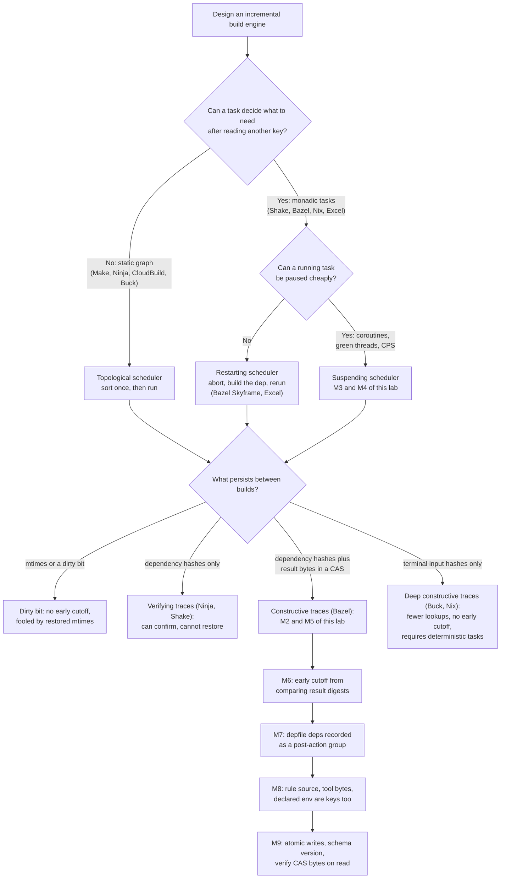

# Rebuild Lab: Implementing a Content-Hashed Build System

> [!summary] Claim:
> A build system is two orthogonal pieces: a scheduler that decides the order in which tasks run, and a rebuilder that decides whether a task must run at all.
> A suspending scheduler runs each task as a coroutine that stops at every `need`, so dependencies can be discovered while the task runs and every key still executes at most once.
> A constructive-trace rebuilder records, per key, the content digest of every dependency in the order it was requested plus the digest of the result, and keeps the result in a content-addressable store, so a matching trace either confirms the output on disk or restores it without running anything.
> Early cutoff falls out of hashing: a task that reruns and produces identical bytes leaves its dependents' traces valid, and the rebuild stops there.
> In about 560 lines of Python the lab builds exactly that engine and proves each property against a from-scratch oracle build.

The formal model (keys, tasks, the scheduler and rebuilder taxonomy, minimality, correctness) is owned by [[Build-System-Theory-Schedulers-and-Rebuilders]].
The determinism requirements that make content hashes meaningful are owned by [[Hermetic-and-Reproducible-Builds]].
Ninja's own depfile handling, `.ninja_deps`, and `dyndep` are owned by [[Make-and-Ninja-Mechanics]], and the production action cache is owned by [[Remote-Execution-API-and-Remote-Caching]].
This playbook owns the implementation: the milestone specification, the code, and the experiments that show where each mechanism earns its keep.

## Trigger and Symptoms

Run this rebuild when one of these is true:

- You can recite "Bazel restarts, Shake suspends, Make uses mtimes" but cannot say what a trace stores, in what order its dependencies are checked, or why that order matters.
- You are debugging a cache miss or a stale output in Bazel, Buck2, Ninja, ccache, or a home-grown CI cache and need a mental model precise enough to predict which key changed.
- You are about to write a code generator, a task runner, a notebook recomputation engine, or a data pipeline that "only reruns what changed", which is a build system whether or not anyone calls it one.
- You are interviewing for build infrastructure, developer productivity, or low-latency toolchain roles, where "design an incremental build system" is a standard L6 and L7 prompt.

The finished engine supports dynamic dependencies (read a file, then decide what else to need), depfile dependencies discovered after an action runs, parallel actions, early cutoff, restoration from a shared content-addressable store, self-tracking of rule changes, declared environment variables, cycle detection, corrupt-cache detection, and detection of an input edited mid-action.

## Decision Tree

The tree is the sequence of design decisions the milestones make, with the alternative each one rejects.



The paper's Table 2 places real systems in the scheduler-by-rebuilder grid: Make is topological with a dirty bit, Excel restarting with a dirty bit, Ninja topological with verifying traces, Shake suspending with verifying traces, CloudBuild topological with constructive traces, Bazel restarting with constructive traces, Buck topological with deep constructive traces, and Nix suspending with deep constructive traces (Mokhov, Mitchell, Peyton Jones, ICFP 2018, section 4.4).
The suspending-plus-constructive cell was empty in 2018, and the paper names that combination Cloud Shake; this lab implements it.

## Prerequisites

```bash
python3 --version   # 3.11 or later: the lab uses hashlib.file_digest
make --version | head -1
```

- Python 3.11 or later, because `hashlib.file_digest` was added in 3.11 (Python hashlib documentation).
  The lab was recorded with Python 3.15.2 on macOS 27.3, arm64 (as of 2026-11, macOS).
- `make` on `PATH`, used only to show where an mtime rebuilder disagrees with a content-hashed one; the recording used GNU Make 3.81, which is `/usr/bin/make` on the recording host (as of 2026-11, macOS).
- No compiler: the lab's "compiler" is `toycc.py`, a Python program that expands `#include "..."`, strips `//` comments, reads one environment variable, and writes a GCC-style depfile.
  That keeps every byte of output deterministic across hosts while still exercising every code path a real compiler would.
- Read [[Build-System-Theory-Schedulers-and-Rebuilders]] first for the vocabulary: key, value, task, store, input, minimality, correctness.

**Verification:** `bash code/06-Build-Systems/mini_build_system/run.sh | head -7` prints the clean-build block shown in Step M4.

## Commands and Numbers to Know

| Item | Platform | Value (as of 2026-11) | Why it matters |
| :--- | :--- | :--- | :--- |
| SHA-256 digest | Both | 32 bytes, 64 lowercase hex characters | The lab's value type; REAPI uses the same lowercase hex form. |
| REAPI `Digest` | Both | `hash` (lowercase hex, zero-padded to the function length) plus `size_bytes`, and the size is "an integral part of the digest" | A production digest carries the size, which lets a server reject a truncated blob before hashing it. |
| REAPI `DigestFunction` | Both | `SHA256`, `SHA1`, `MD5`, `VSO`, `SHA384`, `SHA512`, `MURMUR3`, `SHA256TREE`, `BLAKE3`, `GITSHA1` | `MURMUR3` is marked "not a cryptographic hash function"; a shared cache keyed on it trusts every writer. |
| `hashlib` GIL release | Both | Released while hashing "more than 2047 bytes of data at once" | Hashing big outputs on worker threads parallelizes in CPython; tiny files do not. |
| `hashlib.file_digest` | Both | Added in Python 3.11; "may bypass Python's I/O and use the file descriptor" | The lab's file hash call. |
| `os.replace` | Both | Atomic "if successful" (a POSIX requirement); "may fail" across filesystems | Temp file plus `os.replace` in the same directory is the lab's crash-safety primitive. |
| `st_mtime_ns` | Both | Integer nanoseconds, added in Python 3.3 | Float `st_mtime` loses nanoseconds; never compare floats in a stat cache. |
| PEP 342 | Both | `send()`, `throw()`, `close()`, `yield` as an expression; Python 2.5 | What makes a Python generator a suspendable task. |
| Ninja `.ninja_log` | Both | `# ninja log v7`; fields start, end, mtime, output, command hash (rapidhash, hex) | Ninja keys staleness on mtimes plus the command line, not on content. |
| Ninja log recompaction | Both | When entries exceed 100 and exceed 3 times the unique outputs | Append-only logs need compaction; the lab rewrites its JSON whole instead. |
| Ninja `deps = gcc` / `deps = msvc` | Both | Since Ninja 1.3; the depfile is deleted after it is read into `.ninja_deps` | The lab copies the idea: the depfile is consumed and the trace becomes the database. |
| Ninja `dyndep` | Both | Since Ninja 1.10 | Ninja's escape hatch for dependencies a static graph cannot know (Fortran and C++ modules). |
| Ninja `-d explain` | Both | Prints "what caused a command to execute" (`ninja -d list`, `src/ninja.cc`; latest release v1.13.2) | The production equivalent of the lab's `executed` and `verified` lines. |
| GCC `-MD` / `-MMD` | Both | Write `OUT.d` as a side effect; `-MMD` omits system headers | The source of the lab's discovered dependencies. |
| GCC `-MP` | Both | A phony target for each dependency other than the main file | Lets Make survive a deleted header; Step M7 shows why a hash rebuilder does not need it. |
| Lab trace cap | Both | `MAX_TRACES_PER_KEY = 4` | More traces per key let an undo or a branch switch restore instead of rebuild, at the cost of verification work. |

## Step-by-Step Execution

The milestones build the engine in `code/06-Build-Systems/mini_build_system/minibuild.py` from the bottom up.
Each step states the specification, the design reason, the code that implements it, and the lab output that proves it.
The output blocks are copied from `expected/darwin-arm64.txt`, recorded with `python3 -m _harness.verify --record` on darwin-arm64 (macOS 27.3, Python 3.15.2, GNU Make 3.81) on 2026-11-14.

### Step M1: Keys, values, and a stat-cached content hash

**Specification.**
A key is a workspace-relative path, or a pseudo-key: `env:NAME` (an environment variable), `tool:NAME` (the bytes of a tool), or `rule:NAME` (the source text of a rule function).
A value is the SHA-256 of the key's bytes, or the sentinel `missing`.
Paths are relative so that two checkouts at different absolute paths produce identical keys, which is what makes a shared cache possible (Step M5, scenario 10).

Hashing every input on every build costs time proportional to the bytes in the tree, so the engine caches `path -> (stat key, digest)` and re-hashes only when the stat key changes.
The stat key is the design decision that matters:

```python
STRONG_STAT = ("st_size", "st_mtime_ns", "st_ctime_ns", "st_ino", "st_dev", "st_mode")
WEAK_STAT = ("st_size", "st_mtime_ns")  # what a naive cache keys on
```

`mtime` is under user control: `cp -p`, `rsync -t`, `tar x`, and `touch -r` all set it, and Bazel's `FileContentsProxy` notes that `mv` preserves it, so a naive `(size, mtime)` key can certify a changed file as unchanged.
`ctime` cannot be set by the `utime` family; any write or `utime` call moves it to the current time, so including it closes that hole.
POSIX leaves it to the implementation whether `rename` updates the renamed file's `ctime` (POSIX.1-2017 `rename`, Rationale), but a file renamed into place is a different inode from the one cached, which `st_ino` catches.
Bazel's `FileContentsProxy` makes the same choice: "On Linux, macOS and Windows we use both ctime and mtime, on Linux and macOS also the inode number", with the comment that "'mv' preserves mtime" (as of 2026-11, Bazel master).

Git's index caches the same family of fields (`st_mtime`, `st_ctime`, `st_ino`, `st_uid`, `st_gid`, `st_size`, and parts of `st_mode`) and documents the remaining hole, the "racy git" problem: a file modified again within the same timestamp tick as the cached stat looks unchanged.
Git's fix is to treat an entry whose cached mtime is the same as or newer than the index file's own timestamp as suspect and compare contents, and to smudge such entries' cached size to zero when it writes the index (`Documentation/technical/racy-git.adoc`).
The lab does not implement a racy guard.
On the recording host's APFS volume a fresh file's `st_ctime_ns` ended in `...738140`, so timestamps carry digits below the microsecond and the window is small (measured 2026-11-14, re-measured 2026-11-15, macOS 27.3).
The racy-git document's remark that ext2, ext4, and XFS "work" is about a different hole: whether nanosecond timestamps survive an inode being evicted from the in-core cache, which is why Git compares nanoseconds only with `core.useNanosec`; it is not a statement that the racy window is closed on those filesystems.
A guard based on wall-clock time would also make the lab's counts depend on how fast the scenarios run; Failure Modes lists what to add for coarse-timestamp filesystems.

**Verification.** Scenario 8 edits `src/util.c` without changing its size, then restores its old mtime with `os.utime(p, ns=(atime, mtime))`, which is what `cp -p` does.

```text
== 8. Same-size edit of src/util.c with its old mtime restored ==
make -q mk/util.o: up to date
stat cache keyed on (size, mtime): files hashed 0, executed: -
  matches clean build: NO (stale output)
stat cache keyed on (size, mtime, ctime, inode, dev, mode): files hashed 3, executed: out/app out/util.o
  matches clean build: yes
```

Make's comparison of target and prerequisite mtimes says the object is up to date, and it is wrong.
The weak stat cache hashes nothing and is equally wrong, even though the engine behind it hashes content: a content-hashed build system is only as good as the cache in front of its hash function.
The strong key notices the new `ctime`, re-hashes `src/util.c`, and rebuilds; its other two hashed files are the rebuilt outputs.

### Step M2: A content-addressable store

**Specification.**
`CAS.put(path, digest)` stores a file at `cas/<first two hex digits>/<remaining 62>`; `CAS.materialize(digest, dst)` copies it out after re-hashing the bytes.

```python
    def put(self, src: str, digest: str) -> None:
        dst = self.path(digest)
        if os.path.exists(dst):
            return
        os.makedirs(os.path.dirname(dst), exist_ok=True)
        tmp = f"{dst}.tmp.{os.getpid()}"
        shutil.copyfile(src, tmp)
        os.replace(tmp, dst)  # atomic on POSIX: readers see all or nothing

    def materialize(self, digest: str, dst: str) -> None:
        blob = self.path(digest)
        with open(blob, "rb") as f:
            data = f.read()
        if sha256_bytes(data) != digest:
            os.remove(blob)  # quarantine: never serve it again
            raise CorruptBlob(f"CAS blob {digest[:12]} failed verification")
```

Design reasons:
- The two-character fan-out keeps directories small; Git's loose objects use the same layout, see [[Git-Packfiles-and-Delta-Compression]].
- Writes are idempotent: two builds that store the same digest concurrently both write identical bytes, and `os.replace` makes the last rename win atomically, so no lock is needed.
- Reads verify: a content address is a checksum you already have, and serving an unverified blob turns disk corruption or a malicious cache writer into a silent wrong build.
- A corrupt blob is deleted rather than retried, so the rebuild that follows writes a fresh copy.

**Verification.** Scenario 11 flips the first byte of `out/main.o`'s blob and deletes `out/main.o`.

```text
== 11. Corrupt the CAS blob of out/main.o, then delete out/main.o ==
executed: out/main.o
verified: out/app out/extra.o out/util.o
restored: -
executed but result unchanged (early cutoff point): out/main.o
corrupt CAS blobs detected: 1
files hashed: 1
out/app digest: c963ca7463b9
matches clean build: yes
```

The trace matched, the restore failed verification, the engine fell through to executing the task, the result digest equalled the recorded one, and `out/app` was cut off (Step M6).

### Step M3: Tasks as coroutines that request effects

**Specification.**
A rule is a Python generator function `fn(ctx, key)`.
It yields `Need([keys])` and receives a list of values; it yields `Run(argv, outputs, env, depfile)` and receives the finished action.
It never touches the store directly, so the engine sees every dependency it uses.

```python
def link(ctx, key):
    # A monadic dependency: which objects to need is read from app.list at build time.
    yield Need(["app.list", "tool:toycc"])
    objs = ctx.read_text("app.list").split()
    yield Need(objs)
    yield Run([ctx.python, ctx.tool("toycc"), "link", *objs, "-o", key], outputs=[key])
```

This is the paper's `Task Monad`: the second `Need` depends on the value of the first, which a static graph cannot express, because the set of objects is not known until `app.list` is read.
A `Task Applicative` would have to declare all of its dependencies before seeing any value; the topological systems of Table 2 (Make, Ninja, CloudBuild, Buck) are in that class, because a topological scheduler can only sort dependencies it can extract up front (section 4.1.1).
Ninja's `dyndep` (since 1.10) is its bounded exception: a build statement may name an input file that supplies more dependencies at build time (Ninja manual).
Generators are the cheapest suspension mechanism in Python: PEP 342 made `yield` an expression and added `send()` and `throw()`, "to make them usable as simple coroutines" (PEP 342, Python 2.5).
The paper records that Shake originally suspended with green threads and blocking and, by 2018, used continuation-passing style (section 4.1.3); the generator is the same continuation, reified by the language.

A `Need` carries a batch of keys.
The batch is the unit of parallelism: the scheduler starts every missing key in the batch at once, the way Skyframe's `env.getValues()` asks for "multiple other nodes" that "are evaluated in parallel" (Bazel Skyframe documentation).

**Verification.** Scenario 7 adds a line to `app.list` and a new source file.

```text
== 7. Add out/extra.o to app.list (a dependency read from a file) ==
executed: out/app out/extra.o
verified: out/main.o out/util.o
restored: -
files hashed: 4
out/app digest: 2844b6e65537
matches clean build: yes
```

The engine discovered `out/extra.o` only after the link task read the new `app.list`, built it, and resumed the link.

### Step M4: The suspending scheduler

**Specification.**
`Engine.build(targets)` runs a single-threaded event loop over jobs, one job per key that has a rule, and a thread pool for actions.
State: `values` (finished keys), `running` (key to job), `waiters` (key to the jobs blocked on it), `ready` (jobs to resume), `futures` (actions in flight).

```python
        if isinstance(req, Need):
            job.need = req.keys
            for k in req.keys:
                if k in self.values or k in job.waiting_on:
                    continue
                if k in self.failed:
                    self._finish(job, None, BuildError(f"{job.key}: dependency {k} failed"))
                    return
                if k in self.running:
                    cyc = self._cycle_path(k, job.key)
                    if cyc is not None or k == job.key:
                        path = [job.key] + (cyc or [k])
                        self._finish(job, None, CycleError("cycle: " + " -> ".join(path)))
                        return
                else:
                    self._start(k)
                    if k in self.values:
                        continue
                job.waiting_on.add(k)
                self.waiters[k].append(job)
            if not job.waiting_on:
                self.ready.append((job, [self.values[k] for k in req.keys], None))
        elif isinstance(req, Run):
            fut = self.pool.submit(self._execute, req)
            self.futures[fut] = job
```

The invariants that make it minimal and correct:
- **At most once.** A key enters `running` once per build; a second job that needs it joins `waiters` instead of starting it, which is the paper's `done` set from the `suspending` scheduler in Fig. 9, extended to keys that are still in flight.
- **Leaves are synchronous.** Input files and pseudo-keys are hashed on the main thread when first needed, so only actions, which are slow and side-effecting, go to the pool.
- **Only actions run on threads.** Generators, the trace store, and the stat cache are touched only by the loop thread, so none of them needs a lock.
- **Cycle detection is a walk of the wait graph.** When job A needs key K that is already running, the engine follows `waiting_on` edges from K; reaching A is a cycle, reported as a path, and the error is thrown into every job on it.
  The paper notes that all the systems it models "are correct only under the assumption that the given task description is acyclic" (section 3.6); an engine that silently deadlocks on a cycle is not acceptable in practice.
- **Failure propagates as an exception.** A failed key is thrown into each waiter with `generator.throw()`, which unwinds the waiter's own `_rebuild` frame; traces of keys that did succeed are still saved.
- **Deterministic bookkeeping under nondeterministic completion.** Completed futures are resumed in job-sequence order, and the reported key lists are sorted, so the output does not depend on which action finished first.

**Verification.** Scenarios 1 and 17.

```text
== 1. Clean build ==
executed: out/app out/main.o out/util.o
verified: -
restored: -
files hashed: 9
out/app digest: 7dbefe17ac0e
matches clean build: yes
```

```text
== 17. A dependency cycle ==
build result: cycle: out/b.txt -> out/a.txt -> out/b.txt
```

The nine hashed files are the six inputs (`src/main.c`, `src/util.c`, `include/util.h`, `include/build config.h`, `include/legacy.h`, `app.list`) and the three outputs, each hashed once although `include/util.h` is reached from two compiles.

### Step M5: The constructive-trace rebuilder

**Specification.**
For each key the trace store keeps up to four traces, newest first.
A trace is a list of dependency groups, each group a list of `[key, value]` pairs in the order the task requested them, plus the digest of the result.
The first group is always `[rule:NAME, digest of the rule's source]`.
The traces live beside the CAS (`cache/traces.json`), not in the workspace, so that every workspace sharing the cache shares them; the pair is the lab's action cache.

```python
    def _rebuild(self, key: str, rule: Rule) -> Task:
        on_disk = self.hasher.digest(key)
        for tr in self.db.traces.get(key, []):
            ok = True
            for group in tr["deps"]:
                vals = yield Need(k for k, _ in group)
                if any(v != h for v, (_, h) in zip(vals, group)):
                    ok = False
                    break
            if not ok:
                continue
            if on_disk == tr["result"]:
                self.stats.verified.append(key)
                return tr["result"]
            if self.cas.has(tr["result"]):
                try:
                    self.cas.materialize(tr["result"], os.path.join(self.root, key))
                except CorruptBlob:
                    self.stats.corrupt += 1
                    break
                self.stats.restored.append(key)
                return self.hasher.digest(key)
```

Why groups, and why in order:
- A dynamic task's later requests depend on earlier values, so a trace's groups must be checked in the order they were recorded, and checking stops at the first mismatch.
  If groups 0 to i all match, a deterministic task would make exactly the same request i+1, so the rebuilder never builds a key the task would not have needed; checking a stale trace out of order could build a dependency that no longer exists and fail the build.
- Keeping the batch boundaries preserves parallelism during verification: each recorded group is needed as one batch, exactly as the task asked for it.
- Shake persists the same shape: its `Result` record has `depends :: ![Depends]` with the field comment "dependencies (don't run them early)", and `Depends` wraps a flat `[Id]`, so the dependencies are a list of groups (`Development/Shake/Internal/Core/Types.hs`, as of 2026-11, Both).

Why constructive rather than verifying:
- A verifying trace stores only hashes, so it can say "the file on disk is current" but cannot produce a missing or damaged file.
- A constructive trace also keeps the result, which is section 4.2.3's `constructCT`: if the current value matches a recorded result, skip; otherwise any recorded result can be copied into the store "without doing any work to build it".
- The paper notes that verifying-trace systems are "unlikely to see significant benefit from storing more than one Trace per key" (section 4.3), while once the result is stored "it makes sense to record many constructive traces per key, and to share them with other users" (section 4.2.3).

**Verification.** Scenarios 2, 3, 9, and 10.

```text
== 2. The constructive trace recorded for out/main.o ==
group 0: rule:cc=ac05f9adca9e
group 1: src/main.c=30cfd0bedfd1, tool:toycc=2a33db3d6e3a, env:TOYCC_OPT=missing
group 2: src/main.c=30cfd0bedfd1, include/util.h=e8165d5507e1, include/build config.h=5cdf4d1c7256, include/legacy.h=9990e02cad27
result: ab7a5fd3818c
```

Group 1 is what the rule asked for before it ran, group 2 is what the compiler reported in its depfile after it ran, and `env:TOYCC_OPT=missing` records that the variable was unset, which is a value like any other.
The source appears in both groups because the depfile lists it; deduplicating would save a dictionary lookup and nothing else, since the stat cache serves the second request.

```text
== 3. No-op build ==
executed: -
verified: out/app out/main.o out/util.o
restored: -
files hashed: 0
out/app digest: 7dbefe17ac0e
matches clean build: yes
```

```text
== 9. rm -rf out/ (constructive traces restore from the CAS) ==
executed: -
verified: -
restored: out/app out/extra.o out/main.o out/util.o
files hashed: 4
out/app digest: c963ca7463b9
matches clean build: yes
```

```text
== 10. Second workspace at another path, same shared cache ==
executed: -
verified: -
restored: out/app out/extra.o out/main.o out/util.o
files hashed: 11
out/app digest: c963ca7463b9
matches clean build: yes
```

A verifying-trace engine (Ninja, Shake) would rerun all four actions in scenario 9; the constructive engine runs none.
Scenario 10 is the cloud build of the paper's section 2.4 in miniature: a checkout at a different absolute path, with an empty stat cache (eleven files hashed: seven inputs and four restored outputs), gets every output from the shared store because no key contains an absolute path.

### Step M6: Early cutoff

**Specification.**
Nothing extra: early cutoff is a property of comparing values by digest.
When `out/main.o` reruns and produces the same bytes, the value recorded in `out/app`'s trace for `out/main.o` still matches, so `out/app` verifies.
The engine reports these points as `executed but result unchanged`.

The paper defines the optimization from Shake: "When it executes a task and the result is unchanged from the previous build, it is unnecessary to execute the dependent tasks" (section 2.3), and notes that Make and Excel do not support it, while Shake and Bazel do.
A dirty-bit rebuilder cannot do it, because Make "can approximate early cutoff by not modifying the result file", but then the target "will be rebuilt in every subsequent build" (section 4.2.1).
Ninja's `restat = 1` is that approximation made safe: it re-stats outputs after the command and, for outputs whose mtime did not change, behaves as if they never needed rebuilding (Ninja manual).
Bazel calls the same mechanism change pruning: invalidated nodes whose recomputed value equals the old value let their dependents be "resurrected" (Bazel Skyframe documentation).

**Verification.** Scenarios 5 and 12.

```text
== 5. Comment-only edit in src/main.c ==
executed: out/main.o
verified: out/app out/util.o
restored: -
executed but result unchanged (early cutoff point): out/main.o
files hashed: 2
out/app digest: 7dbefe17ac0e
matches clean build: yes
```

```text
== 12. Change the compile recipe (add -I src); outputs stay identical ==
executed: out/extra.o out/main.o out/util.o
verified: out/app
restored: -
executed but result unchanged (early cutoff point): out/extra.o out/main.o out/util.o
files hashed: 3
out/app digest: c963ca7463b9
matches clean build: yes
```

`toycc` strips comments, so the object is byte-identical and the link is skipped.
In scenario 12 the rule's source changed, which invalidated every compile through `rule:cc` (Step M8), but none of the objects changed, so the link was cut off.
Early cutoff fails the moment a task is non-deterministic:

```text
== 14. A non-deterministic task defeats early cutoff ==
wall-clock stamp, stamp.txt edited, executed: out/app out/stamp.o
  unchanged results: -
SOURCE_DATE_EPOCH set, stamp.txt edited, executed: out/stamp.o
  unchanged results: out/stamp.o
```

A task that embeds the wall-clock time produces a new digest on every run, so everything downstream reruns; with `SOURCE_DATE_EPOCH` set, the stamp is reproducible and the cutoff returns.
[[Hermetic-and-Reproducible-Builds]] owns the catalogue of such variation, and [[Drill-Build-Systems-Hunt-Non-Determinism-with-Diffoscope]] trains finding it.

### Step M7: Depfile dependencies discovered after the action

**Specification.**
A `Run` may name a depfile.
After the action exits 0, the engine parses it, takes the prerequisites of the action's output, deletes the file, and the rebuilder records them as one more dependency group, hashed at that moment.

```python
        if p.returncode == 0 and run.depfile:
            dpath = os.path.join(self.root, run.depfile)
            with open(dpath, encoding="utf-8") as f:
                discovered = depfile.prerequisites_of(f.read(), run.depfile_target or run.outputs[0])
            os.remove(dpath)  # like Ninja with deps=gcc: the trace is the database
            # An input changed after the action started may not be what it read.
            for rel in discovered:
                try:
                    st = os.stat(os.path.join(self.root, rel))
                except FileNotFoundError:
                    continue
                if st.st_ctime_ns > start_ns:
                    return Finished(1, f"input {rel} changed while the action ran; not recording", [])
```

This is a different mechanism from `Need`: the task cannot ask for headers before it runs, because only the preprocessor knows them, so they are learned from the action's own report, the way Ninja's `deps = gcc` processes the depfile "immediately after the compilation finishes, then delete[s] the .d file" (Ninja manual, v1.13.1 page, as of 2026-11).
It is sound for the same reason Make's `-M` trick is sound: a header the compiler did not read cannot affect this output, and on the first build there is no output, so the missing knowledge costs nothing.

The parser in `depfile.py` follows the rules that Ninja's `src/depfile_parser.in.cc` documents for what GCC and Clang emit:
- Backslash-newline is a continuation and ends the current file name.
- A space preceded by 2N+1 backslashes is N backslashes followed by a literal space; a space preceded by 2N backslashes is 2N backslashes at the end of a name.
- `\#` is `#`, and `$$` is `$`; all other backslashes stay.
- A name ending in `:` before whitespace is a target; content with no colon is an error (`expected ':' in depfile`).

Ninja's code goes slightly past its own comment: it also de-escapes `\:` not followed by whitespace and keeps the extra backslashes of a multi-backslash `\\#`; the lab's parser implements only the documented rules, which is all `toycc` emits.

GCC's own flags explain the shape: `-MD` writes the file as a side effect of compiling and names it after `-o` with a `.d` suffix, `-MMD` omits system headers, `-MT` sets the target verbatim while `-MQ` quotes Make specials such as `$`, and `-MP` adds "a phony target for each dependency other than the main file" to "work around errors" Make gives when a header is removed (GCC preprocessor options).
On the recording host, Apple clang 21 with `-MMD -MP` listed a non-header input too, the SDK's `SDKSettings.json`, as an absolute path:

```text
a.o: \
  /Applications/Xcode.app/Contents/Developer/Platforms/MacOSX.platform/Developer/SDKs/MacOSX.sdk/SDKSettings.json \
  a.c a.h
/Applications/Xcode.app/Contents/Developer/Platforms/MacOSX.platform/Developer/SDKs/MacOSX.sdk/SDKSettings.json:
a.h:
```

That block is real output of `/usr/bin/cc -MMD -MP -MF a.d -c a.c -o a.o` on macOS 27.3 (as of 2026-11, macOS); a production engine must classify such absolute paths as toolchain inputs, or every machine with a different Xcode path gets different keys.

**The race.** Recording the depfile's headers by hashing them after the action leaves a window: if an editor saves a header after the compiler read it but before the engine hashes it, the trace pairs the new header digest with an object compiled from the old one, and that stale object then verifies forever.
The engine narrows the window by rejecting any discovered input whose `ctime` is later than the action's start; the result is not recorded, so the next build reruns.
It does not close it completely: the check runs on the worker thread, the digests are taken later on the loop thread, and an edit that lands between the two is still paired with the old object; re-checking `ctime` after hashing, or hashing a sandboxed snapshot of the inputs, closes that gap.

**Verification.** Scenarios 6, 15, 16, and 19.

```text
== 6. Edit 'include/build config.h' (reached only through the depfile) ==
executed: out/app out/main.o out/util.o
verified: -
restored: -
files hashed: 4
out/app digest: ef6689b8ffc9
matches clean build: yes
```

```text
== 15. A header changes while the compile that read it is running ==
build result: failed: out/util.o: action failed: input include/util.h changed while the action ran; not recording
== 15b. Rebuild after the race ==
executed: out/app out/main.o out/util.o
verified: -
restored: -
files hashed: 9
out/app digest: 7dbefe17ac0e
matches clean build: yes
```

```text
== 16. Remove an #include and delete legacy.h in the same change ==
executed: out/app out/main.o
verified: out/extra.o out/util.o
restored: -
files hashed: 3
out/app digest: 028c7fff94a4
matches clean build: yes
```

```text
== 19. Depfile parsing (GCC escaping, as Ninja documents it) ==
'out/a.o: src/a.c include/build\\ config.h\n' -> [(['out/a.o'], ['src/a.c', 'include/build config.h'])]
'out/a.o: src/a.c \\\n  x$$y.h c\\#d.h\n' -> [(['out/a.o'], ['src/a.c', 'x$y.h', 'c#d.h'])]
'out/a.o: back\\\\\\ slash.h two\\\\ next.h\n' -> [(['out/a.o'], ['back\\ slash.h', 'two\\\\', 'next.h'])]
'out/a.o: a.h\na.h:\n' -> [(['out/a.o'], ['a.h']), (['a.h'], [])]
'no colon here\n' -> error: expected ':' in depfile after ['no', 'colon', 'here']
round trip 'build config.h': ok
round trip 'x$y.h': ok
round trip 'c#d.h': ok
round trip 'back\\ slash.h': ok
```

Scenario 6 edits a header whose name contains a space and which only `include/util.h` includes, so the engine knows about it only through the escaped depfile entry.
Scenario 16 is the case `-MP` exists for, and the engine survives it without phony rules: the edited `src/main.c` mismatches group 1, so the rebuilder stops before the depfile group and never needs the vanished header, instead of failing the way a Make rule naming a vanished prerequisite does.
Had verification reached that group, the deleted header would hash to `missing`, which is a mismatch, not an error.
The printed lists in scenario 19 use Python `repr`, so each `\\` there is one backslash.

### Step M8: Self-tracking and declared environment

**Specification.**
Everything that can change an output is a key:
- `rule:NAME`, whose value is the SHA-256 of `inspect.getsource(rule_fn)`, is always group 0 of the trace, so editing a recipe invalidates exactly the keys built by it (scenario 12).
- `tool:toycc`, the compiler's bytes, is needed by every compile, which handles the paper's first impurity, the untracked compiler version (section 6.3).
- `env:NAME` is a declared environment variable; actions run with `env=` holding only the declared variables, never the engine's environment.

The paper calls the first item self-tracking and models it exactly this way, as a dependency on the formula (`B1-formula` in section 6.5), noting that systems that embed rules in a full programming language face "the challenge of implementing equality on arbitrary task functions".
Hashing source text is the cheap answer, and it has a blind spot: it misses a change in a helper the rule calls.
That is why REAPI keys a result on the action itself, the `Command` with its arguments and environment plus the input root digest, rather than on whatever code produced the action (remote_execution.proto).

**Verification.** Scenario 13 runs the same project with a leaky compile rule that neither needs `env:TOYCC_OPT` nor scrubs the environment, then with the declared rule.

```text
== 13. Untracked environment variable ==
leaky rule, TOYCC_OPT -O0 then -O3, executed: -
  matches clean build: NO (stale output)
declared rule (needs env:TOYCC_OPT), executed: out/app out/main.o out/util.o
  matches clean build: yes
```

The leaky build kept `-O0` objects after the user asked for `-O3`, and in a shared cache those objects would be served to everyone.
The declared rule invalidates through `env:TOYCC_OPT`, and because the action's environment contains only declared variables, an undeclared read sees nothing instead of a stale value.

### Step M9: Persistence and crash safety

**Specification.**
- The trace store and the stat cache are JSON documents written to a temporary file and moved into place with `os.replace`, so a crash leaves the old file or the new one; the Python documentation states the rename "will be an atomic operation (this is a POSIX requirement)" when it succeeds.
- Each document carries `schema`; an unknown schema loads as empty, which costs one cold build and never mis-parses an old format.
- Traces are saved even when the build fails, so the next build does not redo work that succeeded.
- Losing a trace or a CAS blob is always safe, because it can only cause a rebuild; serving a wrong blob is never safe, which is why reads verify (Step M2).

The lab does not `fsync`.
The Python documentation's recipe for getting bytes to disk is `f.flush()` then `os.fsync(f.fileno())`.
The Linux `fsync(2)` manual page states that `fsync()` "does not necessarily ensure that the entry in the directory containing the file has also reached disk" and that "an explicit fsync() on a file descriptor for the directory is also needed" (as of 2026-11, Linux).
POSIX.1-2024 (IEEE Std 1003.1-2024) states under `fsync` Application Usage that "an application that modifies a directory, for example, by creating a file in the directory, can invoke fsync() on the directory to ensure that the directory's entries and file attributes are synchronized", adding that for most applications this "should not be necessary"; the 2017 edition's `fsync` page has no such text.
Because `os.replace` (`rename(2)`) mutates the directory entries of the containing directory by replacing the destination entry with the temporary file inode, a durable replace requires three operations: write and `fsync` the temporary file, `os.replace` it into the target path, and then `fsync` an open directory file descriptor for the containing directory.
For a cache, losing the last write is acceptable; for a trace store that a release process relies on, it is not.

### Step M10: A restarting scheduler, for contrast

`restarting_build()` runs the same rules with Bazel's strategy: when a task needs keys that are not built, it is closed with `generator.close()`, the missing keys of the whole batch are built, and the task restarts from the top.
That matches Skyframe's protocol, in which `env.getValue` returns `null` for a missing dependency, "the function itself is expected to return `null`", and "the original node builder is invoked again" once the dependency exists (Bazel Skyframe documentation).

```text
== 18. Suspending versus restarting scheduler, clean build of 3 objects ==
suspending: task starts 4, actions 4
restarting: task starts 9, actions 4
same out/app: yes
```

The link started three times (missing `app.list` and the tool, then missing objects, then success) and each compile twice, so nine starts for four tasks.
No action ran twice only because each rule issues all its `Need`s before its `Run`; a rule that did expensive work before discovering a dependency would repeat it on every restart, which is the cost the paper means when it says a restarting scheduler "is also not minimal in the sense that a task may start, do some meaningful work, and then abort" (section 4.1.2).
Skyframe's `env.getValues()` requests a whole batch at once, so one restart covers every missing dependency in it, which is what the lab's restarting scheduler does too; the paper also notes that Bazel stores the most recent dependency information rather than the discovered order (section 4.1.2).

## Verification

The lab's correctness oracle is the paper's Definition 3.1 made executable: after every scenario, `scenarios.py` copies the sources into a fresh workspace with an empty cache, builds from scratch, and compares the final digest with the incremental result.
`matches clean build: yes` is that comparison; `NO (stale output)` is a correctness violation, and only the two deliberately broken configurations (scenario 8's weak stat key and scenario 13's leaky rule) print it.

Run the whole lab and compare with the recording:

```bash
cd code/06-Build-Systems/mini_build_system
bash run.sh > /tmp/minibuild.out
diff /tmp/minibuild.out expected/darwin-arm64.txt && echo IDENTICAL
```

Or through the harness from `code/`:

```bash
python3 -m _harness.verify 06-Build-Systems/mini_build_system/
```

What each check proves, and the mechanism whose absence would change the output:

| Scenario | Proves | Output if the mechanism were missing |
| :--- | :--- | :--- |
| 3 no-op | Stat cache and trace verification | `files hashed` above 0, or keys under `executed` |
| 4 touch | Content, not mtime, decides staleness | `executed` lists `out/util.o` and `out/app`, as Make would (`make -q` printed `needs rebuild`) |
| 5 comment edit | Early cutoff | `out/app` under `executed` |
| 6 nested header | Depfile discovery and escaping | `out/main.o` and `out/util.o` absent from `executed`, and `matches clean build: NO` |
| 7 `app.list` | Monadic dependencies | `out/extra.o` never built; the link fails |
| 8 restored mtime | Strong stat key | Both lines print `NO (stale output)` |
| 9 and 10 restore | Constructive traces and path-independent keys | Four keys under `executed` |
| 11 corrupt blob | Verify on read | A corrupt `out/main.o` restored and `matches clean build: NO` |
| 12 recipe change | Self-tracking | Nothing executed after a recipe change |
| 13 env | Declared environment | The second line also prints `NO` |
| 15 race | ctime check after the action | `build result: succeeded (the race was NOT detected)` |
| 17 cycle | Wait-graph walk | A hang, or `cycle NOT detected` |
| 18 schedulers | Suspension versus restarts | Equal start counts |

The run took real subprocesses, real files, and real `make`; nothing in the output is simulated except the compiler, which is a Python script by design.
The recording is darwin-arm64 only; the lab uses no platform-specific calls, but it has not been recorded on Linux.

## Rollback Procedure

The lab writes only under a `tempfile.mkdtemp` directory and removes it at the end, so a completed run leaves nothing behind.
A run killed mid-way leaves a `minibuild-lab-*` directory in the system temporary directory:

```bash
python3 -c 'import tempfile; print(tempfile.gettempdir())'
rm -rf "$(python3 -c 'import tempfile; print(tempfile.gettempdir())')"/minibuild-lab-*
ls -d "$(python3 -c 'import tempfile; print(tempfile.gettempdir())')"/minibuild-lab-* 2>/dev/null
```

**Check:** the `ls` of that pattern finds nothing.

When you adapt the engine to a real project, the persistent state is three things, and each has a safe rollback:
1. **Stat cache** (`.minibuild/stat-*.json` in the workspace): delete it; the next build re-hashes every input once and rebuilds nothing.
2. **Trace store** (`cache/traces.json`): delete it, or bump `SCHEMA`; the next build verifies nothing, runs every action, and re-records.
   Outputs whose bytes did not change are still cut off downstream, because their new digests equal the old ones the dependents' new traces record.
3. **CAS** (`cache/cas/`): delete any subset at any time; a trace whose result is missing simply falls through to execution.

Never edit `traces.json` by hand to "fix" a stale output: a hand-edited trace is a forged cache entry.
Delete the key's traces and rebuild instead.

## Failure Modes

| Failure | How it shows up | Root cause and recovery |
| :--- | :--- | :--- |
| Stale output after `cp -p`, `rsync -t`, `tar x`, or `mv` | `matches clean build: NO`; incremental differs from clean | Stat key without `ctime`/inode; use `STRONG_STAT`, as Step M1 shows. |
| Stale output on a coarse-timestamp filesystem | Edit within one timestamp tick of the previous hash is missed | Racy stat entries; add Git's rule: re-hash entries whose `mtime` or `ctime` is not older than when the cache entry was written. |
| Stale output after a flag or env change | Scenario 13 | Undeclared input; declare it as `env:` or `tool:` and run actions with a scrubbed environment. |
| Everything rebuilds after a harmless refactor of `rules.py` | Every key's group 0 mismatches | Rule digest covers the whole function source; split recipe constants from code, or hash the constructed action instead of the source. |
| No cache hits across machines | Scenario 10 executes everything | Absolute paths in keys or depfiles (for example `SDKSettings.json`); map toolchain paths to `tool:` keys or relative paths. |
| Downstream always rebuilds | `unchanged results: -` after a no-op rerun | A non-deterministic action; fix it with `SOURCE_DATE_EPOCH`, path remapping, or sorted outputs ([[Hermetic-and-Reproducible-Builds\|Hermetic-and-Reproducible-Builds]]). |
| Build fails with `input ... changed while the action ran` | Scenario 15 | An editor, formatter, or code generator wrote an input mid-build; rerun, and serialize generators before compiles. |
| `CycleError` | Scenario 17 | A real cycle in the rules; break it, or split the key that both sides need. |
| `corrupt CAS blobs detected` | Scenario 11 | Disk or transport corruption, or a bad writer; the blob is quarantined and the action reruns, and repeated corruption means checking the disk or the cache writers. |
| `expected ':' in depfile` | The action fails after exiting 0 | A tool wrote a depfile in another format (MSVC `/showIncludes` is stdout, not Make syntax); use the matching parser, as Ninja's `deps = msvc` does. |
| Lost traces after concurrent builds share a cache | Unexpected re-executions, never wrong outputs | `traces.json` is whole-file last-writer-wins; use a database or an action-cache server for concurrent writers. |

## Pitfalls

> [!warning] Hashing content does not make a build correct
> The rebuilder can only compare what it was told about.
> Scenario 13 is a fully content-hashed engine producing a stale binary, because the compiler read a variable that no key covered.
> Correctness needs completeness of the dependency set, which is a sandboxing problem ([[Sandboxing-and-Hermetic-Execution-Internals]]), not a hashing problem.

> [!warning] Verifying a stale trace out of order
> Checking every recorded dependency of a trace "in parallel, for speed" can build a key that the current task would never request, such as an object from an old `app.list` whose source was deleted, and fail the whole build.
> Check groups in recorded order and stop at the first mismatch.

> [!warning] Recording discovered dependencies with a later hash
> Hashing a header after the compiler finished can pair the new header bytes with an object built from the old ones, and that pair verifies on every later build.
> Reject inputs whose `ctime` is newer than the action's start, or hash inputs before the action when they are known in advance.

> [!warning] Deep traces with non-deterministic tasks
> A deep constructive trace keys a result on terminal inputs only, skipping intermediate values.
> The paper's Frankenbuild example (section 6.4, Fig. 11) downloads a `report.txt` that is inconsistent with a freshly regenerated, non-deterministic `main.prof`, an incorrect store under all three of its correctness definitions.
> Deep traces also "cannot support early cutoff" except at their level boundary (section 4.2.4), so use them only where tasks are deterministic and lookups are the bottleneck.

> [!warning] Trusting a shared cache's writers
> A constructive trace is a claim "these inputs produce these bytes"; anyone who can write traces can make every reader link their bytes.
> Restrict writes to CI identities, verify blob digests on read, and treat a cache keyed with a non-cryptographic function such as REAPI's `MURMUR3` as trusted-writers-only.

> [!warning] mtime comparisons in the stat cache as floats
> `st_mtime` is a float of seconds; two different nanosecond mtimes can round to the same float.
> Use `st_mtime_ns`, an integer since Python 3.3.

## At Scale

The toy maps one-to-one onto production systems; what changes with 1,000 to 50,000 engineers is which costs dominate.

### From the toy to Bazel, Buck2, and REAPI

- **The action key.** The toy keys traces by output path and checks dependencies one group at a time, which costs a round trip per group.
  REAPI keys the action cache by the digest of the encoded `Action`, which references a `Command` (whose environment variables "MUST be lexicographically sorted by name" and whose output paths "MUST be deduplicated and sorted") and an input root digest, so a client computes one key locally and makes one lookup (remote_execution.proto).
  That is the paper's observation that an applicative system with constructive traces "can index directly from the key and results to the output result", with the client making "a single call to the server" (section 4.3).
  The price is that every input must be known before the lookup, which is why Bazel actions declare inputs and why C++ header sets are over-approximated or pruned after the fact.
- **The CAS.** REAPI digests are `hash` plus `size_bytes`, and the protocol allows SHA-256, BLAKE3, and others; [[Remote-Execution-API-and-Remote-Caching]] owns the services, Merkle input trees, and Build without the Bytes, which is the shallow build of the paper's section 6.4.
- **The scheduler.** Skyframe restarts and Buck2's DICE engine computes incrementally; [[Bazel-Skyframe-Bzlmod-and-Execution-Model]] and [[Buck2-DICE-Starlark-and-BXL]] own their internals.
  Bazel performs only bottom-up invalidation and notes that its `stat()` cost over all previous inputs can be reduced with `inotify` (Bazel Skyframe documentation); the toy's stat cache is the same cost, paid on every build.
- **Compiler caches.** ccache and sccache are single-rule constructive-trace caches in front of one compiler; [[Compiler-Caches-ccache-and-sccache]] owns their direct mode and preprocessor mode.
- **Ninja.** Ninja decides staleness from mtimes plus the command line recorded in `.ninja_log`, not from content hashes, so a no-op build needs `stat()` calls and log lookups but no reads; `restat` recovers early cutoff for outputs a command leaves untouched; [[Make-and-Ninja-Mechanics]] owns it.

### Costs that appear only at scale

- **Hashing.** A no-op build of a large tree is bound by `stat()` calls, not hashing, as long as the stat cache holds; a branch switch that touches 100,000 files is bound by hashing them.
  Filesystem watchers (`inotify`, FSEvents) or virtual filesystems that report digests remove the scan entirely.
- **Trace volume.** One trace per key per configuration, times branches, times platforms; cap traces per key and evict by last use, accepting that eviction converts some hits into rebuilds and never into wrong results.
- **Critical path.** Content hashing cannot shorten the longest chain of dependent actions; [[Build-Performance-Economics-and-Decision-Record]] and [[Drill-Build-Systems-Break-a-Dependency-Bottleneck]] cover that.
- **Cache misses that should be hits.** At scale the most expensive bug is a key that differs for no semantic reason (absolute paths, timestamps, unsorted environment); [[Diagnose-Bazel-and-Buck2-Cache-Misses]] is the runbook.

### Decision rules

- Use content hashes whenever outputs are shared across machines or restored from a cache; use mtimes only for a local, single-user tool whose no-op latency matters more than robustness to restored timestamps, and then add `restat`-style cutoff.
- Make every input a key: rule definitions, tool binaries, declared environment variables, and platform; anything not keyed must be made unobservable by a sandbox.
- Prefer a suspending scheduler when tasks are coarse and dynamic dependencies are common; prefer restarts when tasks must be restartable for other reasons (distribution, preemption) and keep each function small.
- Use deep traces only for deterministic tasks with expensive lookups, and only after measuring that per-level verification is the bottleneck.
- Allow cache writes only from trusted builders, and verify every blob on read.

## Practice Drill

> [!tip] Practice Drill: Break each mechanism and predict the output first
> Copy `code/06-Build-Systems/mini_build_system/` to a scratch directory, run `bash run.sh`, and confirm it matches `expected/darwin-arm64.txt`.
> Then make one change at a time, write down which scenario lines change, run, and explain any surprise.
> 1. In `_rebuild`, replace the early `break` on a mismatched group with a check of all groups, and predict whether any recorded line changes; then construct the case that does break (a trace naming an object whose source you deleted from `app.list` and from disk) and watch the build fail.
> 2. In scenario 8, drop `st_ctime_ns` from the `strong` tuple: predict that both lines print `NO (stale output)`, because an in-place, same-size write with the mtime restored leaves size, mtime, inode, device, and mode unchanged.
> 3. Delete the `st_ctime_ns > start_ns` check: scenario 15 should print `succeeded (the race was NOT detected)`; then make the injected edit change code instead of a comment and show that the recorded trace pairs the new header with an object built from the old one.
> 4. Start `deps` as an empty list instead of the `rule_key` group in `_rebuild`: predict that scenario 12 executes nothing, and explain why it still matches the clean build.
> 5. Set `MAX_TRACES_PER_KEY = 1`, then add a scenario that edits `src/util.c` and reverts it: with one trace the revert rebuilds, with four it restores from the CAS.
> 6. Stretch: add a `racy_window_ns` parameter that re-hashes a cached entry whose `ctime` is within the window of when it was hashed, and show that the lab's counts change only if the window is larger than the time between the edits and the builds.
> Target time: 45 minutes for steps 1 to 5; then do [[Drill-Build-Systems-Fix-Broken-Incremental-Depfile]] to see the depfile failure from the Ninja side.

## Interview Questions

> [!question] L5
> Why does the lab's engine skip all work after `touch src/util.c` while `make -q` says the object needs rebuilding?
>
> > [!success]- Answer
> > Make compares the target's mtime with each prerequisite's mtime, so a newer source means "rebuild" regardless of content; it is a dirty bit that the filesystem sets.
> > The engine's stat cache sees that the stat key changed, re-hashes the file (scenario 4 shows `files hashed: 1`), gets the same SHA-256, and every trace still matches.
> > The cost is reading the file once; the benefit is that a touch, a branch switch and back, or a regenerated but identical file never triggers rebuilds.

> [!question] L5
> What do `-MD`, `-MMD`, and `-MP` do, and why does a hash-based engine not need `-MP`?
>
> > [!success]- Answer
> > `-MD` writes a Make-syntax dependency file as a side effect of compiling, named after `-o` with a `.d` suffix; `-MMD` does the same but omits headers from system header directories.
> > `-MP` adds an empty phony rule for every dependency other than the main source, so that when a header is deleted Make finds a rule for it instead of failing with no rule to make the target.
> > A hash engine records the header as a dependency key, and a deleted file hashes to `missing`, which mismatches the trace and reruns the compile rather than failing, so it needs no phony rules.
> > Scenario 16 shows the build surviving the deletion; there the edited source already mismatches an earlier group, so verification stops before it reaches the header.

> [!question] L5 (predict the output)
> Starting from a no-op state, you change only a comment in `src/main.c`.
> `toycc` strips comments.
> Which keys appear under `executed`, `verified`, and `executed but result unchanged`?
>
> > [!success]- Answer
> > `executed: out/main.o`, because its trace's `src/main.c` digest no longer matches.
> > `verified: out/app out/util.o`: `out/util.o` never read `main.c`, and `out/app`'s trace records the digest of `out/main.o`, which is byte-identical after the rerun.
> > `executed but result unchanged: out/main.o`, the early cutoff point.
> > `files hashed: 2`, the edited source and the rebuilt object, which is exactly scenario 5.

> [!question] L6
> Why does a trace store dependency groups in request order, and what goes wrong if you verify them in any order?
>
> > [!success]- Answer
> > In a monadic task later requests depend on earlier values: the link task's object list depends on the content of `app.list`.
> > If the first i groups match, a deterministic task would make the same request i+1, so checking in order and stopping at the first mismatch never needs a key the task would not need.
> > Checking all groups regardless can need a stale dependency, such as an object whose source no longer exists, which wastes work at best and fails the build at worst.
> > Keeping groups as batches also keeps verification parallel, because each group is needed as one batch; Shake's `Result` stores `[Depends]`, a list of groups, with the comment "don't run them early".

> [!question] L6
> You `rm -rf out/` and rebuild.
> What does a verifying-trace engine do, and what does a constructive-trace engine do?
>
> > [!success]- Answer
> > A verifying trace stores only hashes, so it can confirm that a file on disk matches what it recorded but cannot recreate a missing file; every action reruns, although early cutoff still stops propagation where outputs come out identical.
> > A constructive trace stores the result in a CAS, so a matching trace restores the output without running anything; scenario 9 shows four restores and zero executions.
> > The cost is storage for every result and a verification step on every restore.

> [!question] L6 (debug this)
> CI switched `TOYCC_OPT` from `-O0` to `-O3`, the build reported zero actions executed, and the deployed binary still has `opt=-O0` in it.
> The engine hashes all inputs with SHA-256.
> Find the bug.
>
> > [!success]- Answer
> > The variable is an input of the compile, but no key covers it: the rule neither yields `Need(["env:TOYCC_OPT"])` nor runs the action with a scrubbed environment, so the subprocess inherits it and the traces never see it.
> > Every trace therefore still matches and the old `-O0` objects verify, which is scenario 13's `NO (stale output)`.
> > Fix it in two places: declare the variable as a key so a change invalidates, and pass actions only declared variables so an undeclared read sees nothing instead of a stale value.
> > Then purge or rotate the shared cache, because the stale objects were also served to everyone else under the same keys.

> [!question] L6
> Compare a suspending and a restarting scheduler on the lab's clean build, and say when restarting is the better choice.
>
> > [!success]- Answer
> > The suspending scheduler starts each of the four tasks once; the restarting scheduler starts them nine times, because the link restarts twice and each compile once (scenario 18).
> > Restarts waste work only if a task does real work before discovering a dependency, so restarting engines keep functions small and request dependencies in batches, as Skyframe's `getValues` does.
> > Restarting wins when keeping a suspended continuation is expensive or impossible: a function that must be serializable, distributed, or preemptible is easier to rerun than to pause, and a restarted function needs no stack of suspended frames in memory.

> [!question] L7
> Explain why deep constructive traces cannot support early cutoff, and design the conditions under which a company may use them.
>
> > [!success]- Answer
> > A deep trace keys a result on the terminal input hashes, skipping intermediate values, so it never compares an intermediate result with its previous value, which is the only place early cutoff can happen (paper section 4.2.4).
> > With n levels skipped, the tasks must also be deterministic: otherwise a regenerated intermediate and a downloaded final product can come from different runs, the Frankenbuild of Fig. 11.
> > Use them only where actions are verified reproducible (rebuild twice and compare, as in [[Drill-Build-Systems-Hunt-Non-Determinism-with-Diffoscope]]), where lookup latency dominates, and where results are never mixed with locally regenerated intermediates; otherwise use per-action constructive traces.

> [!question] L7
> A header is edited while the compile that reads it is running.
> What can go wrong in an engine that records depfile dependencies by hashing after the action, and how do you close the window?
>
> > [!success]- Answer
> > The compiler read the old header, the engine hashes the new one, and the trace pairs the new digest with an object built from old bytes; the next build sees matching digests and keeps the stale object until the header changes again.
> > Close it by comparing each discovered input's `ctime` with the action's start time and refusing to record the result if any is newer, which is what scenario 15 shows.
> > The check relies on the filesystem clock and its timestamp granularity, so on a network filesystem or a coarse-timestamp filesystem add a conservative window, or snapshot inputs into a sandbox so the action cannot see later edits at all.

> [!question] L8+
> You are designing the shared build cache for 5,000 engineers and 2,000 CI machines.
> Using the lab's architecture, what changes and what are the trust and failure decisions?
>
> > [!success]- Answer
> > Replace per-group trace verification with a single precomputed action key, which requires every action to declare its inputs, so a server lookup is one round trip; keep a CAS with size-carrying digests and verify every blob on read.
> > Allow only CI to write action results and let developers read, because a writable cache lets one compromised laptop poison everyone's binaries; record which identity wrote each result.
> > Make eviction safe by construction: a missing trace or blob means rebuild, never error.
> > Measure the hit rate per action type and treat every unexplained miss as a non-determinism or path bug, because at that scale a one-percent miss-rate regression costs more machines than the cache itself.

## Further Reading

- Mokhov, Mitchell, Peyton Jones, Build Systems a la Carte, ICFP 2018, https://doi.org/10.1145/3236774.
  The scheduler and rebuilder taxonomy, the trace types, and the executable Haskell models that this lab transliterates.
- Mokhov, Mitchell, Peyton Jones, Build systems a la carte: Theory and practice, JFP 30, e11, 2020, https://doi.org/10.1017/S0956796820000088.
  The journal version of the same framework.
- Ninja manual, https://ninja-build.org/manual.html.
  `depfile`, `deps = gcc`, `restat`, `generator`, and `dyndep`, the production version of Steps M6 and M7.
- Ninja `src/depfile_parser.in.cc` and `src/build_log.cc`, https://github.com/ninja-build/ninja.
  The exact depfile escaping rules and the `.ninja_log` v7 format.
- GCC preprocessor options, https://gcc.gnu.org/onlinedocs/gcc/Preprocessor-Options.html.
  What `-MD`, `-MMD`, `-MP`, `-MT`, and `-MQ` emit.
- Bazel Skyframe, https://bazel.build/reference/skyframe.
  Restarts, change pruning, and bottom-up invalidation in a production restarting scheduler.
- Bazel `FileContentsProxy.java`, https://github.com/bazelbuild/bazel/blob/master/src/main/java/com/google/devtools/build/lib/actions/FileContentsProxy.java.
  Why a production stat cache uses ctime, mtime, and inode.
- Git racy-git documentation, https://github.com/git/git/blob/master/Documentation/technical/racy-git.adoc.
  The timestamp-granularity hole in every stat cache and Git's fix.
- REAPI `remote_execution.proto`, https://github.com/bazelbuild/remote-apis.
  The production `Digest`, `Action`, `Command`, and action cache contracts.
- Shake `Types.hs`, https://github.com/ndmitchell/shake.
  How a suspending verifying-trace system persists dependency groups.
- PEP 342, https://peps.python.org/pep-0342/.
  The generator protocol the lab's tasks are built on.
- IEEE Std 1003.1-2024 (POSIX.1-2024), fsync specification, https://pubs.opengroup.org/onlinepubs/9799919799/functions/fsync.html.
  Directory descriptor fsync semantics and directory entry durability.

## Related

- Prerequisites: [[Build-System-Theory-Schedulers-and-Rebuilders]], [[Hermetic-and-Reproducible-Builds]]
- Next: [[Drill-Build-Systems-Hunt-Non-Determinism-with-Diffoscope]]
- See also: [[Make-and-Ninja-Mechanics]], [[Remote-Execution-API-and-Remote-Caching]], [[Drill-Build-Systems-Fix-Broken-Incremental-Depfile]]
- Lab: `code/06-Build-Systems/mini_build_system/`
