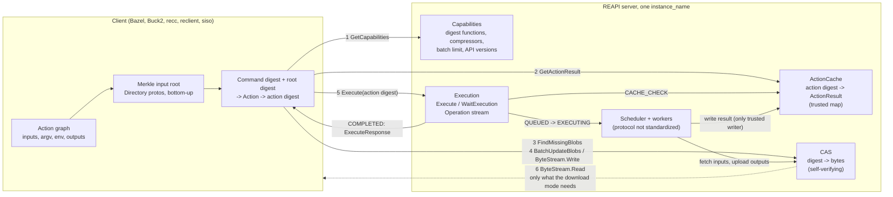

# Remote Execution API and Remote Caching Architecture

> [!summary] Claim:
> The Remote Execution API (REAPI) v2 turns a build step into a pure function keyed by content: an `Action` names a `Command` digest and an input root digest, and the SHA-256 of the canonically encoded `Action` is the key.
> Two stores do all the work: the content-addressable storage (CAS) holds blobs under their own digest and can verify every write, while the ActionCache (AC) maps action digests to `ActionResult` messages and must be trusted, because nothing in the bytes proves an entry honest.
> Inputs travel as a Merkle tree of `Directory` messages, so editing one file re-hashes only the directories on its path to the root, and `FindMissingBlobs` turns uploads into a set difference.
> Large blobs move over the ByteStream API with offset-checked, resumable writes; Build without the Bytes leaves intermediate outputs in the CAS, which trades bandwidth for a hard dependency on cache retention.
> Poisoning is an AC problem, not a CAS problem: the defence is undeclared-input hygiene plus an AC that only remote workers can write.



## The Mechanism

[[Hermetic-and-Reproducible-Builds]] owns why an action must be a deterministic function of its declared inputs, and [[Bazel-Skyframe-Bzlmod-and-Execution-Model]] owns how Bazel turns targets into actions.
This note owns what happens after an action exists: how it is named, how its inputs and outputs move, how results are shared, and how that sharing fails.
Every protocol fact below is from `remote_execution.proto` in `bazelbuild/remote-apis` at `main` commit `e0c0554bfc8a` (2026-11-10) unless another source is named.
The newest tag is `v2.12.0` (published 2026-02-12); the `main` branch already carries v2.13 text that marks several v2.0-era fields unsupported, which no tag contains yet (as of 2026-11, Both).
Bazel facts are from tag `9.3.2` (released 2026-11-05), the latest stable release (as of 2026-11, Both).

### 1. The model: actions are pure functions of content

REAPI defines four gRPC services, plus Google's ByteStream for large transfers:

| Service | RPCs | Role |
| :--- | :--- | :--- |
| `Execution` | `Execute`, `WaitExecution` | Run an action, stream `google.longrunning.Operation` updates |
| `ActionCache` | `GetActionResult`, `UpdateActionResult` | Map an action digest to its `ActionResult` |
| `ContentAddressableStorage` | `FindMissingBlobs`, `BatchUpdateBlobs`, `BatchReadBlobs`, `GetTree`, `GetChunkMapping`, `RegisterChunkMapping` (and `SplitBlob`, `SpliceBlob`, new in v2.12 and unsupported since v2.13) | Store and fetch blobs by digest |
| `Capabilities` | `GetCapabilities` | Advertise digest functions, compressors, limits, versions |
| `google.bytestream.ByteStream` | `Read`, `Write`, `QueryWriteStatus` | Stream blobs too large for one message |

The repository also publishes the Remote Asset API (map a URI or qualifier to a CAS digest, which Bazel uses through `--experimental_remote_downloader`) and the Remote Logstream API (stream stdout and stderr of a running action); neither is needed to cache or execute.

An `Action` is deliberately small:

| Field | Number | Notes |
| :--- | :--- | :--- |
| `command_digest` | 1 | Digest of a `Command` message stored in the CAS |
| `input_root_digest` | 2 | Digest of the root `Directory` of the input tree |
| (reserved) | 3 to 5 | Fields moved to `Command` |
| `timeout` | 6 | `google.protobuf.Duration`; part of the key on purpose |
| `do_not_cache` | 7 | Result must not be cached, and in-flight requests may not be merged |
| (reserved) | 8 | Moved to `Command` |
| `salt` | 9 | Opaque bytes that place the action in a separate cache namespace |
| `platform` | 10 | Worker requirements; preferred over `Command.platform` since v2.2 |

The design choice that matters is indirection.
The action key never contains file bytes, only digests of digests, so a key for a compile with 5,000 headers is still a few hundred bytes, and the same key is computed on every machine that sees the same content.
The proto explains why `timeout` is in the key: if it were not, an action run with a too-short timeout could hit a result produced under a longer one, hiding the misconfiguration until the entry was evicted.

The `Command` carries everything about how to run:

| Field | Number | Canonical rule |
| :--- | :--- | :--- |
| `arguments` | 1 | `argv[0]` may be absolute, relative, or resolved through `PATH` (changed in v2.3) |
| `environment_variables` | 2 | MUST be sorted by name, by code point |
| `output_files`, `output_directories` | 3, 4 | Deprecated since v2.1; marked unsupported in the v2.13 text on `main` |
| `platform` | 5 | Deprecated since v2.2 in favour of `Action.platform`; marked unsupported in the v2.13 text on `main` |
| `working_directory` | 6 | Relative to the input root; must exist in it |
| `output_paths` | 7 | Since v2.1; MUST be deduplicated and sorted; type (file or directory) decided after execution |
| `output_node_properties` | 8 | Sorted keys of node properties to return |
| `output_directory_format` | 9 | `TREE_ONLY` (0), `DIRECTORY_ONLY` (1), `TREE_AND_DIRECTORY` (2) |

Platform properties are server-defined strings; `platform.md` standardizes only `OSFamily` and `ISA`, and properties MUST be sorted by name, then value.
Any other key, such as a container image, is a convention of the server and client in use.

### 2. Digests and canonical encoding

A `Digest` is `{hash: lowercase hex string, size_bytes: int64}`, and the size is "an integral part of the digest": a server MUST reject a request whose hash is right but whose size is wrong.
The proto gives the reason: servers need the size before touching the data, to flatten Merkle trees, stream to workers, or pick a storage tier, and carrying it in every reference is simpler than a separate metadata store.

When a digest names a protobuf message, it is the digest of the message's binary encoding, and the proto requires a canonical encoding:

- Fields are serialized in tag order.
- There are no unknown fields and no duplicate fields.
- Fields use the default proto3 semantics, so a zero, false, or empty scalar is omitted.

It warns that merging two messages by concatenating their bytes produces duplicate fields and therefore a different digest.
Each repeated field adds its own ordering rule (sorted environment variables, sorted and deduplicated `output_paths`, sorted directory entries).
The `Execute` comment says a server MAY enforce these rules and reject non-canonical input, or MAY skip verification for speed, in which case two logically equal actions simply never share a cache entry.

The `DigestFunction` enum (as of 2026-11, Both):

| Value | Number | Notes |
| :--- | :--- | :--- |
| `SHA256` | 1 | Default of every mainstream client |
| `SHA1`, `MD5` | 2, 3 | Legacy |
| `VSO` | 4 | Microsoft "VSO-Hash" paged SHA-256 |
| `SHA384`, `SHA512` | 5, 6 | |
| `MURMUR3` | 7 | 128-bit x64 variant; the proto warns it is not cryptographic |
| `SHA256TREE` | 8 | SHA-256 over a binary Merkle tree of 1 KiB-or-larger power-of-two chunks |
| `BLAKE3` | 9 | Bazel added BLAKE3 support in 6.4.0 |
| `GITSHA1` | 10 | SHA-1 of `"blob <size>\0" + data`, so CAS digests equal Git blob names |

Resource names omit values 1 to 7, and the server SHOULD infer the function "using the length of the `hash` and the digest functions announced in the server's capabilities"; length alone is not enough, because `MD5` and 128-bit `MURMUR3` are both 32 hex digits.
Values 8 and above share lengths with older functions (`GITSHA1` and `SHA1` are both 40 hex digits; `BLAKE3`, `SHA256TREE`, and `SHA256` are all 64), so they MUST appear as a lowercase path segment, and Bazel's `DigestUtil.isOldStyleDigestFunction()` encodes exactly that rule as `getNumber() <= 7`.
Every CAS, ActionCache, and Execution request message carries a `digest_function` field; until v2.12 a client MAY leave it unset for the length-inferable functions, and the v2.13 text on `main` makes a value other than `UNKNOWN` mandatory.

`SHA256TREE` exists so that a large blob can be stored and verified as chunks.
Blobs of 1,024 bytes or fewer use plain SHA-256.
A larger blob is split into a left part of `m = 2^k` bytes and a right part of `n` bytes with `0 < n <= m`, each half is hashed recursively, and the two 32-byte results form one 64-byte block that goes through a single SHA-256 compression with a different initial state (the square-root fractions of the primes 23 to 53 instead of 2 to 19) and without the final feed-forward addition.
The different initial state prevents trivial collisions between a small blob and a two-child node, and the proto notes that the tree shape lets generic SIMD units hash faster than serial SHA-256 on CPUs without SHA extensions.
The lab implements it from the proto text alone and matches all 18 published test vectors.

In Bazel the hash function is the startup option `--digest_function` (it loses incremental state), and the server must list it: `RemoteServerCapabilities.checkClientServerCompatibility()` fails with "Cannot use hash function ... with remote cache" otherwise.
Buck2 selects it with `digest_algorithms` in the `[buck2]` section, accepting BLAKE3, SHA1, or SHA256 and defaulting to SHA256.

### 3. Merkle input roots

The input root is a tree of `Directory` messages:

```text
Directory      { repeated FileNode files = 1; repeated DirectoryNode directories = 2;
                 repeated SymlinkNode symlinks = 3; NodeProperties node_properties = 5; }
FileNode       { string name = 1; Digest digest = 2; bool is_executable = 4; NodeProperties node_properties = 6; }
DirectoryNode  { string name = 1; Digest digest = 2; }
SymlinkNode    { string name = 1; string target = 2; NodeProperties node_properties = 4; }
NodeProperties { repeated NodeProperty properties = 1; Timestamp mtime = 2; UInt32Value unix_mode = 3; }
```

A `Directory` is canonical when every child name is exactly one path segment, names are unique, and files, directories, and symlinks are each sorted by name in code-point order; node properties are sorted by name.
A `DirectoryNode` names its child by the child's digest, so a directory cannot be encoded until all of its children are, and construction is necessarily bottom-up.

Three consequences follow, and the lab measures each:

1. Editing one file changes the file's digest, then the digest of every `Directory` on the path to the root and nothing else: a tree 4 levels deep costs 1 new file blob and 4 new `Directory` blobs, whatever the total size of the tree.
2. Identical subtrees are one blob: two directories with the same contents have the same digest, so they are stored and uploaded once.
3. An empty `Directory` encodes to zero bytes, so its digest is the empty-blob digest (`e3b0c442...`, size 0), and the CAS rule "servers MUST behave as though empty blobs are always available" makes empty directories free.

`is_executable` and `node_properties` are part of the encoding and therefore of the key.
Bazel 9.3.2 sets `is_executable = true` on every input file; the comment in `MerkleTreeComputer.addFile()` explains that Bazel `chmod 555`s action outputs, so it cannot trust the real executable bit (Bazel issue 13262).
A third-party client that copies the real mode bit computes different input roots for the same files, so it never shares cache entries with Bazel.
With `--experimental_remote_mark_tool_inputs` (default false, intended for remote persistent workers), Bazel also adds the node property `bazel_tool_input` to tool inputs, again changing the key.

`MerkleTreeComputer` builds the tree in one pass over inputs sorted by path, keeping a stack of open `Directory` builders: when the next input leaves a directory, that directory is final, so it is encoded and hashed immediately and only its digest is retained.
That keeps memory proportional to tree depth rather than tree size, and `--experimental_remote_discard_merkle_trees` (default true in 9.3.2) also discards the per-action tree during `GetActionResult` and `Execute`, accepting a recomputation on a miss or retry.

Symlinks keep their target string; `..` is allowed anywhere, because logical canonicalization can change meaning when a directory component is itself a symlink.
Whether an absolute target is accepted is a capability, `symlink_absolute_path_strategy`: `DISALLOWED` returns `INVALID_ARGUMENT` for such inputs, and `ALLOWED` lets targets escape the input root, which the proto itself calls possibly non-hermetic.

Output directories come back as a `Tree` message: `root = 1` holds the top `Directory`, and `children = 2` holds every descendant.
`OutputDirectory.is_topologically_sorted` promises that each distinct directory appears once, every non-root directory is referenced, and parents precede children; such a `Tree` MUST then be a plain stream of records whose tag byte is `0x0a` for the root and `0x12` for each child, each followed by a varint length and the encoded `Directory`.
That lets a client materialize a large output tree in one sequential scan, and lets a server build the `Tree` by concatenating `Directory` encodings it already hashed instead of re-marshalling them.
`output_directory_format = DIRECTORY_ONLY` asks for the separately stored hierarchy (`root_directory_digest`) instead of one `Tree` blob, so that output trees are deduplicated per directory like input trees.

### 4. The CAS service

The CAS is a key-value store whose keys are proven by the values.
A server MUST verify that uploaded bytes hash to the named digest and return `INVALID_ARGUMENT` otherwise, so no client can plant bytes under a digest it did not earn.

- `FindMissingBlobs` returns the subset of digests the server does not hold and SHOULD extend their lifetime; it is how a client avoids uploading what is already there.
- `BatchUpdateBlobs` and `BatchReadBlobs` move many small blobs in one call; each blob has its own `google.rpc.Status`, and a request above `CacheCapabilities.max_batch_total_size_bytes` fails as a whole with `INVALID_ARGUMENT`.
- A `max_batch_total_size_bytes` of 0 means no server limit, "although in practice there will always be a message size limitation", which is 4 MiB by default in grpc-java (`DEFAULT_MAX_MESSAGE_SIZE`) and grpc-go (`defaultServerMaxReceiveMessageSize`).
- `max_cas_blob_size_bytes` (0 for unlimited) tells clients not to upload larger blobs at all.
- `GetTree` streams every `Directory` under a root with paging; order is unspecified and a partially missing tree returns only what exists.

Lifetimes are implementation-defined, but the CAS SHOULD keep "newly-added and recently looked-up entries" long enough for a following `Execute`, and `GetActionResult` SHOULD ensure that the blobs an `ActionResult` references are present and will remain so for some time.
Servers that check this are called completeness-checking, a term from Buildbarn (`CompletenessCheckingBlobAccess` in `bb-storage`), not from the proto; without it, a cache hit can point at evicted outputs.

Bazel 9.3.2 does not use the batch RPCs: `GrpcCacheClient` calls `FindMissingBlobs` and then sends every missing blob with `ByteStream.Write`, and reads every blob with `ByteStream.Read`.
It splits `FindMissingBlobs` so each request fits a 1 MiB outbound message (`maxOutboundMessageSize`, a field the source marks "not configurable by users, only tests"), dividing the space left after the request overhead by the encoded size of one SHA-256 digest plus its field tag (`computeMaxMissingBlobsDigestsPerMessage()`): 14,979 digests per request with an empty instance name, as the lab computes from the same formula.

### 5. ByteStream

ByteStream is a generic Google API with three RPCs and five interesting fields: `ReadRequest{resource_name, read_offset, read_limit}`, `ReadResponse{data}`, `WriteRequest{resource_name, write_offset, finish_write, data}`, `WriteResponse{committed_size}`, and `QueryWriteStatusResponse{committed_size, complete}`.
REAPI gives it meaning through resource names (as of 2026-11, Both):

```text
upload    {instance_name}/uploads/{uuid}/blobs/{digest_function/}{hash}/{size}{/optional_metadata}
upload    {instance_name}/uploads/{uuid}/compressed-blobs/{compressor}/{digest_function/}{uncompressed_hash}/{uncompressed_size}{/optional_metadata}
download  {instance_name}/blobs/{digest_function/}{hash}/{size}
download  {instance_name}/compressed-blobs/{compressor}/{digest_function/}{uncompressed_hash}/{uncompressed_size}
```

- An empty instance name drops the leading slash, and no segment of an instance name may be `blobs`, `uploads`, `actions`, `actionResults`, `operations`, `capabilities`, or `compressed-blobs`, so the server can find where the instance ends.
- The `uuid` is a version 4 UUID per upload, so two concurrent uploads of the same blob never share partial state; clients MAY reuse it across blobs.
- `digest_function/` is present only for functions numbered above 7, for the reason in section 2.
- A client MAY add the header `build.bazel.remote.execution.v2.resource-name` carrying the same name so a proxy can route without parsing the message; if present it MUST match.

Write rules come from `bytestream.proto`: the first `WriteRequest` must carry the resource name, the first `write_offset` must equal what `QueryWriteStatus` would return, and every later offset must equal the first offset plus all data sent so far; a wrong offset is an error, and so is any message after `finish_write`.
`QueryWriteStatus` makes an interrupted upload resumable from `committed_size`.
REAPI adds deduplication on the write path: if another client finishes the same blob first, even in the middle of this upload, the server ends the stream at once with no error and `committed_size` equal to the full size for an uncompressed upload or `-1` for a compressed one, and the client must not retry.

Compressed transfers use `Compressor.Value` (`IDENTITY` 0, `ZSTD` 1, `DEFLATE` 2, raw RFC 1951 with no gzip header, and `BROTLI` 3) and are named by the uncompressed digest, which the server MUST verify after decompressing.
The offset rules are, in the proto's own words, "nonsensical": the first `write_offset` is an offset into the uncompressed blob, but each later offset adds the compressed bytes already sent.
On reads, `read_offset` is uncompressed, a non-zero `read_limit` is `INVALID_ARGUMENT`, servers may pick any compression level, and clients SHOULD NOT also enable gRPC compression, which would compress compressed data.
Servers MUST be able to serve every recently advertised blob in every compressor they list as well as uncompressed.

Bazel's `ByteStreamUploader` builds exactly these names, with `zstd` as its only compressor, and its `Chunker` sends 16 KiB messages (`defaultChunkSize = 1024 * 16` at 9.3.2).
`--remote_cache_compression` (default false) compresses blobs of at least `--experimental_remote_cache_compression_threshold` bytes (default 100), and fails the capability check if the server does not list `ZSTD` in `supported_compressors`.

### 6. Chunked CAS: GetChunkMapping and RegisterChunkMapping

v2.12 added `SplitBlob` and `SpliceBlob`; the v2.13 text on `main` replaces them with streaming `GetChunkMapping` and `RegisterChunkMapping` and marks the unary pair "UNSUPPORTED since v2.13".
`GetChunkMapping` returns the ordered chunk digests of a stored blob, so a client that already holds most chunks of a similar blob downloads only the rest.
`RegisterChunkMapping` is the upload side: the client uploads the missing chunks, then streams the ordered list, and the server MUST verify that the concatenation hashes to the claimed blob digest before adding it, because "servers MUST NOT trust digests provided by the client".
Support is advertised with `split_blob_support` and `splice_blob_support`, and chunks may be evicted independently of the blob they compose.

Reuse needs content-defined chunking: with fixed-size chunks, inserting one byte at the front shifts every boundary.
`ChunkingFunction` names two algorithms with advertised parameters:

| Function | Parameters and rules (as of 2026-11, Both) |
| :--- | :--- |
| `FAST_CDC_2020` (1) | Gear table `GEAR[i] = high 64 bits of MD5(byte i)`; normalization level 2; `avg_chunk_size_bytes` between 1 KiB and 8 MiB, recommended 524,288; min = avg / 4, max = avg * 4; blobs below max SHOULD be uploaded whole; `seed` recommended 0 |
| `REP_MAX_CDC` (2) | Same gear table; chunks in `[min, 2 * min)`; `min_chunk_size_bytes` at least 64, recommended 262,144; `horizon_size_bytes` recommended `8 * min` |

Bazel 9.3.2 exposes the client as `--experimental_remote_cache_chunking` (default false) with `--experimental_remote_cache_chunking_function=auto|fast_cdc_2020|rep_max_cdc`; `auto` prefers FastCDC 2020 when the server advertises it.
Its help text still names the deprecated `SplitBlob`/`SpliceBlob` RPCs, so treat interoperability with a v2.13-only server as unverified until both sides ship it.

### 7. The ActionCache service

`GetActionResult(action_digest)` returns the `ActionResult` or `NOT_FOUND`.
`UpdateActionResult` stores one, and the client MUST first upload the `Action` and its `Command` to the CAS, "to allow the server to perform access control based on the type of action, and to assist with client debugging"; a server MAY rewrite the result it stores.
`CacheCapabilities.action_cache_update_capabilities.update_enabled` tells a client whether it may write at all, and Bazel warns when `--remote_upload_local_results` is set but the server says no.

`ActionResult` fields: `output_files` (2), `output_symlinks` (12, since v2.1), `output_directories` (3), `exit_code` (4), `stdout_raw` (5) and `stdout_digest` (6), `stderr_raw` (7) and `stderr_digest` (8), and `execution_metadata` (9).
The deprecated `output_file_symlinks` (10) and `output_directory_symlinks` (11) are marked unsupported in the v2.13 text.
Clients MUST NOT assume output lists are sorted, servers inline stdout, stderr, or file `contents` only when asked (`inline_stdout`, `inline_stderr`, `inline_output_files`) and never past message limits, and the proto advises setting at least one field such as the worker name so that a stored result is never an empty message.
`ExecutedActionMetadata` records queue, worker start and completion, input fetch, execution, and output upload timestamps, plus `virtual_execution_duration` (v2.3) and `auxiliary_metadata` such as `getrusage(2)` data.

The key is the digest of the `Action`, not of the value, so the AC cannot verify anything: whoever writes an entry decides what every later reader receives.
Bazel uploads a locally executed result only when the spawn succeeded with exit code 0 (`RemoteSpawnCache`, `RemoteExecutionService.commitResultAndDecideWhetherToUpload()`), and treats a remote result as a success only if the `ExecuteResponse.status` is OK and `exit_code` is 0.

### 8. The Execution service

`Execute(ExecuteRequest)` takes `instance_name`, `action_digest`, `skip_cache_lookup`, `execution_policy.priority`, `results_cache_policy.priority`, `digest_function`, and inlining hints, and returns a stream of `Operation` messages whose `metadata` is `ExecuteOperationMetadata` and whose final `response` is `ExecuteResponse{result, cached_result, status, server_logs, message}`.
The stages are `CACHE_CHECK` (1), `QUEUED` (2), `EXECUTING` (3), and `COMPLETED` (4); an operation may move backwards, for example from `EXECUTING` to `QUEUED` when a worker dies, and `done` is set if and only if the stage is `COMPLETED`.
`WaitExecution(name)` reattaches to an operation, and `NOT_FOUND` there means "call `Execute` again".

Errors are split in two places on purpose:

- Problems creating the operation are gRPC errors: `INVALID_ARGUMENT`, `FAILED_PRECONDITION` (missing inputs, no worker), `RESOURCE_EXHAUSTED`, `UNAVAILABLE` (retry), `INTERNAL`, `DEADLINE_EXCEEDED`, and `CANCELLED`.
- Problems while running are in `ExecuteResponse.status`; a server MUST NOT set `Operation.error`, and a non-OK status MUST NOT be cached.
- A missing input SHOULD come with a `google.rpc.PreconditionFailure` whose violations have `type: MISSING` and `subject: blobs/{digest_function/}{hash}/{size}`, which tells the client exactly what to re-upload.
- A non-zero `exit_code` with an OK status is a successful execution of a failing command; the spec does not forbid caching it, and both Bazel and the lab's server decline to.

`skip_cache_lookup` forces a fresh execution that may still merge with an in-flight identical one, and its completed result SHOULD overwrite the existing AC entry; the proto names this as the way to replace entries "that reference outputs no longer available or that are poisoned in any way".
A server need not run an action at most once: it MAY run it several times, in parallel, and let redundant runs continue after the operation completes, which is only safe because actions are expected to be deterministic.
`do_not_cache` both prevents caching and forbids merging, which is what a deliberately non-deterministic action such as a stamped release step needs.

How a server talks to its workers is not standardized: the README calls the Remote Worker API "too heavyweight for most use-cases"; Buildbarn and Buildfarm publish their own worker protocols, while BuildGrid Bots (the server side) and buildbox-worker implement the Remote Worker API.
`RequestMetadata`, sent as the binary header `build.bazel.remote.execution.v2.requestmetadata-bin`, carries `tool_details`, `action_id`, `tool_invocation_id`, `correlated_invocations_id`, `action_mnemonic`, `target_id`, and `configuration_id`, which is what server-side dashboards use to tie RPCs back to targets.

### 9. Capabilities and versioning

`GetCapabilities` returns `CacheCapabilities`, `ExecutionCapabilities`, and three `SemVer`s: `deprecated_api_version`, `low_api_version`, and `high_api_version`.
A cache-only endpoint returns only `CacheCapabilities`, an execution-only endpoint only `ExecutionCapabilities`.
Bazel 9.3.2 speaks versions 2.0 through 2.11 (`ApiVersion.low` and `ApiVersion.high`), fails when the ranges do not overlap, and warns when the overlap is deprecated.

Self-reported server ranges from the `remote-apis` README, selected rows; the README also lists Flare, Justbuild, Kajiya, and Namespace (as of 2026-11, Both):

| Server | License | Remote execution | Low | High |
| :--- | :--- | :--- | :--- | :--- |
| bazel-remote | Apache-2.0 | no | 2.0.0 | 2.3.0 |
| Buildbarn | Apache-2.0 | yes | 2.3.0 | 2.11.0 |
| BuildBuddy | Commercial and MIT | yes | 2.0.0 | 2.11.0 |
| Buildfarm | Apache-2.0 | yes | 2.3.0 | 2.11.0 |
| BuildGrid | Apache-2.0 | yes | 2.0.0 | 2.2.0 |
| EngFlow | Commercial | yes | 2.0.0 | 2.11.0 |
| NativeLink | Commercial and FSL-1.1-ALv2 | yes | 2.0.0 | 2.3.0 |

The same README lists Bazel, Buck2, BuildStream, Justbuild (with `--compatible`), Pants, Please, recc, reclient, and Siso as clients.

### 10. Clients: what Bazel actually sends

The lab replays a real Bazel 9.3.2 genrule from `--disk_cache`, whose layout is `ac/<2 hex>/<action hash>` for `ActionResult` messages and `cas/<2 hex>/<hash>` for everything else, and rebuilds every byte:

- The `Command` holds `arguments`, the sorted `environment_variables` (only `PATH=/bin:/usr/bin:/usr/local/bin` by default, because `--incompatible_strict_action_env` is true in Bazel 9.0.0 and later; it was false in 8.4.2), and `output_paths`; no deprecated fields are written.
- The input root has 6 `Directory` messages for 2 files, because `external/bazel_tools/tools/genrule/genrule-setup.sh` brings 4 levels of directories with it.
- The `Action` holds the two digests and a `salt` of `08 01`, which is Bazel's `CacheSalt{may_be_executed_remotely: true}`; `Utils.buildAction()` adds `timeout` only when non-zero, `do_not_cache` only when the spawn is not remotely cacheable, and `platform` when there is one.
- `CacheSalt` also has `workspace` (set from the internal `internal-differentiate-workspace-cache` requirement) and `scrub_salt`, so toggling `no-remote-exec` or a scrubbing configuration changes every key it touches.
- Adding `--action_env=REAPI_DEMO=on` changes only the `Command` and therefore the action digest; editing `pkg/in.txt` changes only the input root; after `bazel clean`, the same action digest is a `disk cache hit`.

Bazel's main remote flags at 9.3.2 (as of 2026-11, Both): `--remote_cache` (`http`, `https`, `grpc`, `grpcs`, and `unix` sockets, defaulting to `grpcs` with no scheme; `oldName` `remote_http_cache` in `RemoteOptions.java`), `--remote_executor`, `--remote_instance_name`, `--remote_header`, `--remote_cache_header`, `--remote_exec_header`, `--remote_default_exec_properties`, and the tags `no-remote`, `no-remote-cache`, `no-remote-cache-upload`, `no-remote-exec`, `no-cache`, and `no-local`.
Bazel can also cache over plain HTTP/1.1: `GET` and `PUT` under `/ac/<hash>` and `/cas/<hash>`, which is why nginx WebDAV or a cloud bucket works as a cache, but HTTP has no `FindMissingBlobs`, no execution, and no server-side verification of AC writes.
Buck2 reads `engine_address`, `action_cache_address`, `cas_address`, `instance_name`, `http_headers`, `tls_ca_certs`, and `tls_client_cert` from `[buck2_re_client]`, and an execution platform's `CommandExecutorConfig` chooses `remote_enabled`, `local_enabled`, and `use_limited_hybrid`; [[Buck2-DICE-Starlark-and-BXL]] owns the rest.

### 11. Build without the Bytes

Without it, a client downloads every output of every remote action, although most are intermediate files consumed only by other remote actions; the Bazel blog notes that the outputs of a large build "will often be in the tens or even hundreds of gigabytes".
`--remote_download_outputs` (as of 2026-11, Both, Bazel 9.3.2):

| Mode | Downloads | Typical use |
| :--- | :--- | :--- |
| `all` | Every output, the pre-7.0 behaviour | Tools that read `bazel-out` directly |
| `toplevel` (default since Bazel 7.0) | Outputs of requested top-level targets, plus inputs of local actions | Interactive builds |
| `minimal` | Only inputs of actions that run locally | CI and pure remote execution |

`--remote_download_regex` adds outputs whose paths match, and `--remote_download_minimal` and `--remote_download_toplevel` are now shorthands for the mode flag.
The client keeps only digests for outputs it skipped, so its correctness now depends on the server still holding those blobs when an action needs them.
When it does not, Bazel 7 raised a `CacheNotFoundException` and exited with code 39, and the blog's advice was to retry.
Bazel 9.3.2 recovers inside the build: `--rewind_lost_inputs` (default true) uses action rewinding to re-run the producer of a lost input, and `--experimental_remote_cache_eviction_retries` (default 5) retries the whole invocation, with a new invocation id, for evictions that rewinding cannot fix.
Two flags reduce the chance of loss: `--experimental_remote_cache_ttl` (default `3h`) tells Bazel how long a fixed-TTL server keeps a blob, and `--experimental_remote_cache_lease_extension` (default false) periodically sends `FindMissingBlobs` for referenced blobs, which LRU servers treat as a touch.
A completeness-checking AC complements this from the server side by returning `NOT_FOUND` rather than a result whose outputs are gone.

### 12. Cache poisoning and trust

The CAS is self-verifying, so it cannot be poisoned by a writer who lacks the bytes; at worst it fills with garbage nobody references.
The AC is a trusted map, so poisoning means an `ActionResult` whose outputs are not what the action's declared inputs produce.
There are two families, and the defences differ:

| Cause | Mechanism | Defence |
| :--- | :--- | :--- |
| Undeclared input | A host tool such as `/usr/bin/cc` is not in the input root, so different compilers share one key (Bazel issue 4558) | Hermetic toolchains as declared inputs; remote execution in pinned images |
| Environment leakage | `--action_env` or a non-strict `PATH` puts machine-specific values in the `Command`, or keeps them out when they matter | `--incompatible_strict_action_env` (default true in Bazel 9) and explicit `--action_env` |
| Concurrent source edit | A file changes while the action runs, and the result is uploaded under the old digest (Bazel issue 3360) | `--guard_against_concurrent_changes` (default `lite`: checks main-repository sources; `full` checks every input's ctime) |
| Network during the action | A download is tampered with once and the result is cached forever | Workers without network access; `requires-network` only where reviewed |
| Local fallback | An unsandboxed local run is uploaded with `--remote_upload_local_results` | No AC writes from clients at all |
| Malicious writer | Anyone with AC write access maps a real action digest to chosen outputs | AC writable only by the remote execution cluster |

Julio Merino's analysis states the rule plainly: "restrict writes to it to happen exclusively from the remote workers", because `--noremote_upload_local_results` is a client setting that any user can change, and a worker that runs the declared action in a controlled environment is the only party whose output is, by construction, the function of the key.
Execution strategy flags can also send work around remote execution, so organizations enforce these settings from CI with invocation policies rather than `.bazelrc`.

Recovery tools are in the protocol: `skip_cache_lookup` re-executes and overwrites a known-bad entry, `Action.salt` (or a new `instance_name`) disowns every entry written before the change, and `--remote_verify_downloads` (default true) makes Bazel hash every downloaded blob, which catches corrupt CAS bytes but not an honest-looking wrong AC entry.
`--experimental_remote_require_cached` fails a build when any remotable action misses, which checks determinism without writing new entries.
The Bazel docs' blunt fallback for a poisoned cache is to delete it: entries are names and hashes, so "there's no way to distinguish which output belongs to a specific build".

### 13. Boundary with compiler caches

[[Compiler-Caches-ccache-and-sccache]] owns ccache and sccache, which wrap one compiler invocation, hash a description of it (the preprocessed source, or the source plus its dependencies in ccache's direct mode), and store the object file locally or in a remote bucket.
They are opportunistic: they work under any build system, but they infer inputs instead of being told them, they cache only compile steps, and they cannot execute anything remotely.
REAPI caching sits one level up: the build system declares every input of every action, the key covers tools, environment, and platform, and the same key drives both cache lookup and remote execution.
The practical rule is to use a wrapper cache when the build system cannot declare inputs, and REAPI when it can, never both on the same action, because a wrapper hit inside a REAPI action is invisible to the outer key.

## Commands and Numbers to Know

| Item | Value | Platform and date | What it controls |
| :--- | :--- | :--- | :--- |
| Latest `remote-apis` tag | `v2.12.0` (2026-02-12); `main` carries unreleased v2.13 text | Both (as of 2026-11) | Which fields are deprecated versus unsupported |
| Bazel REAPI range | 2.0 to 2.11 | Both (as of 2026-11, Bazel 9.3.2) | Capability negotiation |
| Empty blob | `e3b0c44298fc1c149afbf4c8996fb92427ae41e4649b934ca495991b7852b855`, size 0 | Both (as of 2026-11) | Always present; equals the empty `Directory` |
| Inferred digest functions | numbers 1 to 7 | Both (as of 2026-11) | Omitted from resource names; 8 and up are named |
| `SHA256TREE` leaf threshold | 1,024 bytes | Both (as of 2026-11) | At or below it equals plain SHA-256 |
| gRPC default receive limit | 4 MiB | Both (as of 2026-11, grpc-java and grpc-go) | Practical cap when `max_batch_total_size_bytes` is 0 |
| Bazel outbound message size | 1 MiB, not user-configurable | Both (as of 2026-11, Bazel 9.3.2) | 14,979 SHA-256 digests per `FindMissingBlobs` |
| Bazel ByteStream chunk | 16 KiB | Both (as of 2026-11, Bazel 9.3.2) | `Chunker.defaultChunkSize` |
| `--remote_download_outputs` | `toplevel` (default since 7.0) | Both (as of 2026-11, Bazel 9.3.2) | Build without the Bytes |
| `--rewind_lost_inputs` | `true` | Both (as of 2026-11, Bazel 9.3.2) | Re-run producers of evicted inputs |
| `--experimental_remote_cache_eviction_retries` | `5` | Both (as of 2026-11, Bazel 9.3.2) | Whole-invocation retries after eviction |
| `--experimental_remote_cache_ttl` | `3h` | Both (as of 2026-11, Bazel 9.3.2) | Assumed blob lifetime |
| `--experimental_remote_cache_lease_extension` | `false` | Both (as of 2026-11, Bazel 9.3.2) | Periodic `FindMissingBlobs` touches |
| `--remote_cache_compression` | `false`; threshold `100` bytes | Both (as of 2026-11, Bazel 9.3.2) | zstd `compressed-blobs` |
| `--remote_max_connections` | `100`; about 100 concurrent calls per gRPC channel | Both (as of 2026-11, Bazel 9.3.2) | Client concurrency |
| `--remote_timeout` / `--remote_retries` | `60s` / `5` | Both (as of 2026-11, Bazel 9.3.2) | Per-call deadline and transient retries |
| `--remote_upload_local_results` | `true` | Both (as of 2026-11, Bazel 9.3.2) | Client AC writes; set false on laptops |
| `--remote_accept_cached` | `true` | Both (as of 2026-11, Bazel 9.3.2) | Read AC hits |
| `--remote_local_fallback` | `false` | Both (as of 2026-11, Bazel 9.3.2) | Local run when remote execution fails |
| `--remote_verify_downloads` | `true` | Both (as of 2026-11, Bazel 9.3.2) | Hash every downloaded blob |
| `--guard_against_concurrent_changes` | `lite` | Both (as of 2026-11, Bazel 9.3.2) | ctime checks before upload |
| `--incompatible_strict_action_env` | `true` (false in 8.4.2) | Both (as of 2026-11, Bazel 9.3.2) | Static `PATH` in every `Command` |
| `--disk_cache` GC | `--experimental_disk_cache_gc_max_size`, `_max_age` (since 7.4), idle delay `5m` | Both (as of 2026-11, Bazel 9.3.2) | Local AC and CAS directory |
| `--experimental_remote_cache_chunking` | `false` | Both (as of 2026-11, Bazel 9.3.2) | Content-defined chunked transfers |
| Bazel exit code for a lost blob | `39` (Bazel 7 blog) | Both (as of 2026-11) | Remote cache eviction, when rewinding does not apply |
| `--execution_log_compact_file` | zstd-compressed `ExecLogEntry` stream | Both (as of 2026-11, Bazel 9.3.2) | Diffing action keys between two builds |

## Multi-Language Comparison: C++ / Python / Rust

REAPI is language-neutral, so what differs between ecosystems is how much of an action's real input set the client can declare.
The client rows come from the remote-apis README and the Siso and Buck2 documentation; the input and gotcha rows rest on language semantics (GCC predefined macros, the rustc `--remap-path-prefix` flag) and are engineering judgment about where undeclared inputs hide, not measurements.

| Concern | C++ | Python | Rust |
| :--- | :--- | :--- | :--- |
| Typical REAPI client | Bazel C++ rules; recc and reclient wrap individual compiler invocations for non-Bazel builds, and Siso replaces Ninja for Chromium | Bazel `rules_python`, Pants, and this lab's pure-Python model | Bazel `rules_rust`, and Buck2, whose client is itself written in Rust |
| Hardest inputs to declare | Headers found by include search, and the host compiler and sysroot; a missing header is an undeclared input | The interpreter and installed wheels; `site-packages` outside the input root is an undeclared tool | `build.rs` scripts and proc macros that read the environment or the network |
| Wrapper-cache alternative | ccache, sccache | none common | sccache |
| Key-changing gotcha | `__DATE__` and `__TIME__` expand to the time the preprocessor runs, and `__FILE__` to the path the preprocessor opened (GCC docs), so outputs differ across runs or checkouts and downstream keys never repeat | `.pyc` timestamps and hash seeds inside outputs | Absolute source paths embedded in diagnostics, debug information, and macro expansions unless `--remap-path-prefix` rewrites them (rustc book) |

[[Hermetic-and-Reproducible-Builds]] owns the fixes for the last row; [[Cargo-Build-Graph-and-Rustc-Pipelining]] owns Cargo's unit graph.

## Worked Lab Example

The lab is `code/06-Build-Systems/reapi_client_demo/`; `run.sh` needs only `python3` and makes no network calls.

`reapi.py` is a dependency-free model of the data plane: a protobuf wire encoder and decoder with the canonical rules, every message the lab needs, a bottom-up Merkle tree builder, in-process CAS, ActionCache, Execution, and ByteStream servers that return the proto's status codes, and `SHA256TREE` written from the proto's description.
`fixtures/bazel/` holds the real Bazel 9.3.2 disk-cache entries for one genrule in four variants, recorded by `capture_bazel_fixture.sh` on Darwin-arm64; that script needs Bazel and network access to the Bazel Central Registry, so `run.sh` replays its files instead of running Bazel.
`fixtures/sha256tree_test_vectors.txt` is copied unmodified from `remote-apis` at `e0c0554bfc8a`.

`demo.py` runs eleven sections; most printed lines are guarded by an assertion that fails if the mechanism is absent, and the rest (download-mode byte counts, the per-request digest arithmetic, the chunk-reuse counts) are pinned only by the expected-output diff:

1. It checks that every `cas/` file is named by its SHA-256, then rebuilds Bazel's `Command`, input root, and `Action` from the execution log fields with its own encoder and requires byte equality, including the salt; it also proves the executable bit is in the key by flipping it.
2. It shows that canonical order, timeout, salt, and platform each produce a distinct action digest, and that the empty `Directory` is the empty blob.
3. It builds a 1,000-file tree, edits one file, and requires `FindMissingBlobs` to report exactly 1 file and 4 directories.
4. It enforces a 64 KiB `max_batch_total_size_bytes`, splits batches, streams the 2 larger blobs, and computes Bazel's per-request digest count.
5. It breaks a ByteStream upload after 48 KiB, resumes it from `QueryWriteStatus`, rejects a wrong offset and a wrong digest, and exercises `compressed-blobs/deflate`.
6. It drives `Execute` through cache miss, hit, `skip_cache_lookup`, `do_not_cache`, a failing exit code, and a `PreconditionFailure`.
7. It builds an output `Tree`, requires the manual record stream to equal the full encoding, and checks the `0x0a` and `0x12` tags.
8. It accounts bytes for each download mode, evicts an object file, and recovers by re-running its producer.
9. It poisons an open AC with a laptop compiler, then shows four defences.
10. It checks `SHA256TREE` against all published vectors and `GITSHA1` against Git's empty blob name.
11. It compares fixed and content-defined chunk reuse using the spec's gear table; the chunker is a plain gear-hash sketch, not a conformant FastCDC 2020, because the FastCDC vectors need an image file the lab does not ship.

```bash
cd code/06-Build-Systems/reapi_client_demo
bash run.sh
```

### Verified output

Recorded by `python3 -m _harness.verify --record` on darwin-arm64 on 2026-11-14; the file is `code/06-Build-Systems/reapi_client_demo/expected/darwin-arm64.txt`.

```text
== 1. Replaying Bazel 9.3.2 disk-cache entries (fixtures/bazel, captured on Darwin-arm64)
fixture tool: bazel 9.3.2; cas/ blobs: 7, all named by their SHA-256
Action, Command, and input root rebuilt byte-for-byte for 4/4 variants
variant  action             command            input root         runner          output
base     61e24119fb9c/146   b5f0ceab77ab/238   8f4e25b35800/159   darwin-sandbox  HELLO REAPI
env      2fafed256af4/146   fac3e58d9b60/256   8f4e25b35800/159   darwin-sandbox  HELLO REAPI
input    a8a70e770c2e/146   b5f0ceab77ab/238   c5ce90c66969/159   darwin-sandbox  HELLO REAPI V2
hit      61e24119fb9c/146   b5f0ceab77ab/238   8f4e25b35800/159   disk cache hit  HELLO REAPI
  env vs base: changed = command
  input vs base: changed = input root
  hit vs base: changed = nothing (same action key)
input root holds 6 Directory messages for 2 input files (root, external, external/bazel_tools, .../tools, .../genrule, pkg)
Action salt bytes: 0801 = CacheSalt{may_be_executed_remotely: true}
ActionResult execution_metadata fields set: [3, 4, 7, 8] (timestamps; no worker name)
ac/ entries: 3 (keyed by action digest, value is an ActionResult, not content-addressed)

== 2. Canonical encoding is part of the cache key
empty Directory encodes to 0 bytes; its digest is the empty blob e3b0c44298fc/0
env sorted   -> command 9a2bb00cc7fd/49
env unsorted -> command b26cc6e329a2/49 (environment_variables not sorted by name)
Directory [b.txt, a.txt]: files not sorted by name; digest differs: True
  action with timeout unset            -> 8dc6e50927d2/138
  action with timeout 60s              -> 652a2eb67ef2/142
  action with timeout 61s              -> 2ddfe7a88bdc/142
  action with salt b'v2'               -> 04b2409eeb2f/142
  action with platform OSFamily=linux  -> acc770e9ca24/159

== 3. Merkle input roots: one changed file re-hashes one path to the root
1000 files under src/m0..m9/s0..s9/: 112 Directory blobs (root, src, 10 mN, 100 sN)
first upload: 1112 digests checked, 1112 missing, 1 BatchUpdateBlobs call(s)
after editing src/m3/s7/f5.cc: FindMissingBlobs reports 5 missing = 1 file + 4 Directory blobs (s7, m3, src, root)
two identical subdirectories a/ and b/ share one Directory blob: 2 blobs incl. root

== 4. CAS uploads: FindMissingBlobs, BatchUpdateBlobs limit, ByteStream for large blobs
max_batch_total_size_bytes=65536: 5 small blobs in 3 batches, 2 blobs over the limit via ByteStream.Write
one batch of all 7 blobs (505,100 bytes) -> INVALID_ARGUMENT
second upload of the same blobs: 0 missing, 0 bytes sent
instance_name 'other-instance' sees 7/7 missing: instances are separate namespaces
BatchUpdateBlobs with data not matching its digest -> per-blob status INVALID_ARGUMENT
FindMissingBlobs digests per 1 MiB request: (1048576 - 2) // 70 = 14979
FindMissingBlobs digests per 4 MiB request: (4194304 - 2) // 70 = 59918

== 5. ByteStream Write/Read: resource names, offsets, resume, dedup, compression
upload resource: main/uploads/{uuid}/blobs/b00b31b3b158.../100000
stream broken after 3 x 16 KiB messages: committed_size=49152, QueryWriteStatus={committed_size: 49152, complete: False}
resume at write_offset 0 instead of 49152 -> INVALID_ARGUMENT
resume at write_offset 49152: committed_size=100000, messages so far=8, bytes sent=100000
second client uploads the same blob: committed_size=100000 at once, 0 bytes accepted
upload whose bytes do not hash to the named digest -> INVALID_ARGUMENT
compressed-blobs/deflate upload of 72000 bytes as 216 bytes: committed_size=-1
repeat compressed upload of an existing blob: committed_size=-1
Read blobs/... read_offset=99000 read_limit=500 -> 500 bytes, match
Read compressed-blobs/deflate -> 216 bytes, inflates to the 72000-byte blob
compressed read with read_limit=10 -> INVALID_ARGUMENT
instance name segment 'blobs' -> INVALID_ARGUMENT (reserved keyword)
blake3 upload names its function: function=blake3 instance=''

== 6. Execute: cache check, stages, skip_cache_lookup, do_not_cache, precondition failures
first Execute     : stages=CACHE_CHECK>QUEUED>EXECUTING>COMPLETED cached_result=False output='HELLO REAPI'
second Execute    : stages=CACHE_CHECK>COMPLETED cached_result=True output='HELLO REAPI'
skip_cache_lookup : stages=CACHE_CHECK>QUEUED>EXECUTING>COMPLETED cached_result=False output='HELLO REAPI'
do_not_cache=true: executed twice, AC entries for it: 0 (executions now 4)
exit_code=1: result returned but not cached (status OK, exit code is not)
input never uploaded -> FAILED_PRECONDITION, PreconditionFailure MISSING subject=blobs/26e8cfd3b09d21.../16

== 7. Output directories: Tree message and the is_topologically_sorted record stream
Tree for gen/: root + 3 unique child Directory records, 549 bytes, record tags 0x0a 0x12 0x12 0x12
tree_digest=f07cd42ff979/549  root_directory_digest=ef56e2abe97c/230

== 8. Build without the Bytes: what each --remote_download_outputs mode fetches
--remote_download_outputs=all     : downloads 1,400,000 of 1,400,000 output bytes
--remote_download_outputs=toplevel: downloads   600,000 of 1,400,000 output bytes
--remote_download_outputs=minimal : downloads         0 of 1,400,000 output bytes
minimal + one local action consuming bin/app: downloads 600,000 bytes (inputs of local actions)
evict obj/u2.o from CAS: completeness-checking GetActionResult -> NOT_FOUND
new link action over the evicted object -> FAILED_PRECONDITION with 1 MISSING violation
rewind: re-execute the compile of obj/u2.o (same digest regenerated), then the link succeeds: exit_code=0

== 9. Action cache poisoning: an undeclared host tool and an open AC
same action digest 5d2979ac40a9/140 on both machines: compiler is not an input
open AC: laptop wrote first; CI gets cached_result=True, object fb0cf1e18401/200000 != CI compiler's 115f4877aa25/200000
CAS cannot be poisoned the same way: storing laptop bytes under the honest digest -> INVALID_ARGUMENT
AC with writer ACL {ci-worker}: laptop UpdateActionResult -> PERMISSION_DENIED
compiler declared in the input root: 2 compilers -> 2 distinct action digests
salt rotated: new digest f5ac76b70542/158, cache miss, CI rebuilds the honest object
skip_cache_lookup on the old digest: entry overwritten, next lookup serves the honest object

== 10. Digest functions: SHA256TREE test vectors and GITSHA1
SHA256TREE: 18/18 spec test vectors match (1025..102400 bytes); <=1024 bytes equals plain SHA-256: True
2048-byte input: SHA256TREE b584996386f01793 vs SHA-256 b2a8170614e23194
GITSHA1 of the empty blob = e69de29bb2d1d6434b8b29ae775ad8c2e48c5391 (Git's empty blob name)

== 11. Chunked CAS (GetChunkMapping / RegisterChunkMapping): why content-defined cuts
fixed 64 KiB        : 17 chunks after a 10-byte prepend, 0 already in CAS, 1,048,586 bytes to upload
gear CDC avg 64 KiB : 15 chunks after a 10-byte prepend, 14 already in CAS, 50,676 bytes to upload

All checks passed.
```

### Reading the result

- Section 1 is the strongest evidence in the lab: an independent encoder reproduced Bazel's 238-byte `Command`, 159-byte root `Directory`, and 146-byte `Action` exactly, so every rule it encodes (tag order, omitted defaults, sorted children, `is_executable = true`, the `08 01` salt) is what Bazel 9.3.2 does.
- The `env` row keeps the input root and changes the `Command`, the `input` row keeps the `Command` and changes the root, and the `hit` row has the same action digest as `base`, which is why `bazel clean` followed by a build ran nothing.
- Bazel's own `ActionResult` sets only four `ExecutedActionMetadata` timestamps for a local run and no worker name, so the advice to set a worker name is not universal practice.
- Every `Action` digest in section 2 differs, including 60 versus 61 seconds of timeout: a fleet that randomizes timeouts per machine shares nothing.
- Section 3 is the Merkle property in numbers: 5 blobs out of 1,112 for a one-file edit.
- Section 5 shows the deduplicating write: the second uploader's 100,000 bytes were never accepted, and the compressed path reports `-1` both times.
- Section 8 sizes are synthetic (four 200,000-byte objects and a 600,000-byte binary); the ratio, not the numbers, is the lesson.
- Section 9 shows why poisoning is invisible: both machines compute `5d2979ac40a9` because the compiler is not an input, and the open AC returns a cached result whose object differs from what CI's own compiler produces.
- Section 11 is a sketch: plain gear-hash CDC reused 14 of 15 chunks after a 10-byte prepend, while fixed-size chunking reused none; the lab asserts zero reuse for fixed cuts and at least 10 reused chunks for CDC.

## Pitfalls

> [!warning] Pitfall: hand-built messages that are valid protobuf but not canonical
> Concatenating two encoded messages, writing fields out of tag order, emitting a default value, or leaving environment variables unsorted all decode fine and hash differently.
> Many servers do not reject such input, so the symptom is a silent 0% hit rate between two clients that "send the same action"; build messages with a protobuf library or byte-compare against a reference client, as the lab does with Bazel.

> [!warning] Pitfall: mirroring the real executable bit in a custom client
> Bazel 9.3.2 marks every input `is_executable = true`.
> A client that reads the file mode produces different input roots for the same files and never shares entries with Bazel, even though both are correct by the spec.

> [!warning] Pitfall: tools outside the input root
> An action that runs `/usr/bin/cc` or any host binary without declaring it has the same key on machines with different compilers (Bazel issue 4558).
> The first writer's output is served to everyone, which is poisoning without an attacker; declare toolchains as inputs or execute remotely in a pinned image.

> [!warning] Pitfall: treating `--noremote_upload_local_results` as a security control
> It is a client flag; any developer can flip it, and a leaked credential ignores it entirely.
> Authorization belongs on the server: only the remote execution cluster (and, if needed, trusted CI identities) may call `UpdateActionResult`.

> [!warning] Pitfall: assuming an AC hit means the outputs exist
> Under Build without the Bytes, a client holds only digests, and the server may evict blobs before a later action needs them.
> Use a completeness-checking AC, set `--experimental_remote_cache_ttl` to the server's real retention or enable lease extension, and keep `--rewind_lost_inputs` on; exit code 39 in old Bazel versions is this failure.

> [!warning] Pitfall: non-deterministic outputs that never break the build
> An output that embeds a timestamp or an absolute path changes on every run, so every downstream action gets a new input root and misses.
> The build still succeeds, so the cost shows up only as cache hit rate; diff two `--execution_log_compact_file` logs, as [[Diagnose-Bazel-and-Buck2-Cache-Misses]] describes.

> [!warning] Pitfall: compressed ByteStream offsets and double compression
> On `compressed-blobs` uploads, later `write_offset` values add compressed bytes to an uncompressed starting offset, success can be `committed_size = -1`, and a `read_limit` other than 0 is rejected.
> Enabling gRPC-level compression on top of `compressed-blobs` spends CPU compressing already-compressed data.

> [!warning] Pitfall: digest function by hash length
> `GITSHA1` and `SHA1` are both 40 hex digits; `BLAKE3`, `SHA256TREE`, and `SHA256` are all 64.
> A server that infers the function from length for values above 7 stores the blob under the wrong function; such functions must be named in the resource name and in every request's `digest_function`.

> [!warning] Pitfall: an unbounded `--disk_cache`
> The disk cache grows forever unless garbage collection is configured (`--experimental_disk_cache_gc_max_size` or `_max_age`, Bazel 7.4 and later), and a shared CI disk cache is an AC with no access control at all.

## At Scale

A single developer gets most of the benefit from `--disk_cache` with garbage collection; the remote protocol starts to matter when results are shared between machines.

- From a handful of engineers to a few hundred, a read-mostly remote cache populated by CI pays first: developers set `--remote_upload_local_results=false`, CI writes, and the hit rate is bounded by how hermetic the actions are.
- From about 1,000 engineers up, the trust model has to change from "CI writes the AC" to "only remote workers write the AC", because CI runs unreviewed pull request code and any machine that executes locally can upload a result that no one can verify.
- At 10,000 to 50,000 engineers the bottlenecks are retention and fan-in: CAS capacity must hold every blob still referenced by a live client's Build without the Bytes state, `FindMissingBlobs` and `GetActionResult` dominate request counts, and one hot blob, such as a toolchain archive, concentrates load on whichever storage shard owns its digest.

Decision rules:

- Use REAPI caching only for actions whose inputs the build system fully declares; for everything else, prefer a wrapper cache or no cache, because a wrong hit costs more than a miss.
- Grant AC write only to the execution cluster; give CI and humans CAS write and AC read, and enforce remote execution and download flags with invocation policies, not checked-in `.bazelrc` files.
- Split `instance_name` or `salt` by trust domain (release versus presubmit, internal versus forked contributions) so that a compromise or a bug can be disowned in one change; the cost is a lower hit rate across domains.
- Choose an eviction policy that matches the clients: LRU with completeness checking and lease extension for long-lived developer sessions, or a fixed TTL that is set identically in `--experimental_remote_cache_ttl`.
- Default interactive users to `toplevel` and CI to `minimal`; measure bytes downloaded per build before and after, and alert on rewinding and eviction retries, which are the leading indicators of an undersized CAS.
- Turn on `--remote_cache_compression` when network bandwidth, not server CPU, is the bottleneck, and measure; the 100-byte threshold keeps small blobs uncompressed.
- Evaluate chunked CAS only for large, frequently edited artifacts and only once client and server agree on the same RE API version and chunking function and parameters; as of 2026-11 the v2.13 chunk-mapping RPCs exist only on `main`.
- Track cache hit rate per action mnemonic and per platform, and treat a sudden drop as a hermeticity regression to bisect, not as capacity to buy.

[[Build-Performance-Economics-and-Decision-Record]] owns the cost model, and [[Migrate-a-Polyglot-Codebase-to-Hermetic-Builds]] owns the migration order.

## Practice Drill

> [!tip] Practice Drill:
> Run `bash capture_bazel_fixture.sh` (needs Bazel and network) and decode each blob with `protoc --decode_raw < fixtures/bazel/base/action.bin`, then predict which field numbers appear before looking.
> Then add `--action_env=TZ=UTC` to the capture and predict which of the three digests change; add a second source file in a new directory and predict how many `Directory` messages the input root gains.
> Extend `reapi.py` with `GetTree` paging (`page_size`, `next_page_token`) and a `WaitExecution` that reattaches to an operation, and make the server reject a non-canonical `Directory` with `INVALID_ARGUMENT` instead of accepting it.
> As a stretch, implement FastCDC 2020 from the paper with normalization level 2 and match `fastcdc2020_test_vectors.txt` from `remote-apis` (the vectors use the `SekienAkashita.jpg` fixture from `fastcdc-rs`, which must be downloaded).

```bash
cd code/06-Build-Systems/reapi_client_demo
python3 -c "
import reapi as r
cmd = r.enc_command(['tr', 'a-z', 'A-Z'], [('PATH', '/bin')], ['out.txt'])
root, blobs = r.merkle_root([('pkg/in.txt', r.sha256_digest(b'hello\n'), True)])
act = r.enc_action(r.sha256_digest(cmd), root, salt=r.enc_cache_salt())
print('command', r.sha256_digest(cmd).short(), 'root', root.short(), 'directories', len(blobs))
print('action ', r.sha256_digest(act).short())
"
protoc --decode_raw < fixtures/bazel/base/action.bin
```

## Interview Questions

> [!question] L5: What are the two stores of a remote cache, and why can one verify its writes while the other cannot?
>
> > [!success]- Answer
> > The CAS stores blobs under the digest of their own bytes, so the server hashes each upload and rejects a mismatch with `INVALID_ARGUMENT`; a writer cannot place wrong bytes under a digest.
> > The ActionCache stores an `ActionResult` under the digest of the `Action` that produced it, and nothing in the result's bytes proves that running the action yields those outputs.
> > So the CAS is self-verifying and the AC is a trusted map, which is why poisoning attacks and defences focus on who may call `UpdateActionResult`.

> [!question] L5 (predict the output): In the lab's Bazel fixture, the `env` variant adds `--action_env=REAPI_DEMO=on` and the `input` variant edits `pkg/in.txt`; which of the command, input root, and action digests change in each?
>
> > [!success]- Answer
> > `env` changes the `Command` (from `b5f0ceab77ab/238` to `fac3e58d9b60/256`, the new variable sorted after `PATH`) and therefore the action digest, while the input root stays `8f4e25b35800/159`.
> > `input` changes the file digest, then `pkg`'s `Directory`, then the root `Directory`, and therefore the action digest, while the `Command` is unchanged.
> > The action digest is 146 bytes in all variants because each `Action` holds two 64-hex digests and the 2-byte salt; only the hashes inside change.

> [!question] L6: Why does `Digest` carry `size_bytes`, and why is `timeout` part of the `Action`?
>
> > [!success]- Answer
> > The size lets a server plan before it reads: allocate, choose a storage tier, flatten a Merkle tree, or stream to a worker without a metadata lookup, and the proto calls it an integral part of the digest that a server must check.
> > It also catches many mismatches early and makes the empty blob recognizable by size alone.
> > The timeout is in the key so that a too-short timeout cannot be hidden by a result produced under a longer one; with it in the key, the short-timeout action misses and fails immediately instead of failing whenever the cached entry is evicted.

> [!question] L6 (debug this): A release binary built on CI crashes, a local rebuild with the remote cache disabled works, Bazel shows remote cache hits for the compile actions, and the toolchain is `/usr/bin/clang` on each machine; what happened and how do you fix it?
>
> > [!success]- Answer
> > The compiler is a host tool outside the input root, so machines with different compiler versions compute the same action digest (Bazel issue 4558), and whichever machine wrote the AC entry first decided the object file everyone receives.
> > If laptops upload results (`--remote_upload_local_results` defaults to true), a developer's compiler, or a locally modified header that changed during the build, can be the source.
> > Fix the cause by declaring a hermetic toolchain as an input or by executing remotely in pinned images, and restrict AC writes to the execution cluster.
> > Fix the damage by rotating `Action.salt` or the `instance_name` to disown old entries, or by re-executing the affected actions with `skip_cache_lookup`, which overwrites their entries; verify with `--experimental_remote_require_cached` on a clean CI run.

> [!question] L6: A CI job using Bazel 7 with `--remote_download_minimal` fails with exit code 39 and a `CacheNotFoundException` after a long queue wait; explain and fix it.
>
> > [!success]- Answer
> > Under Build without the Bytes the client keeps only digests of intermediate outputs; an action needed a blob that the server evicted after it was produced, so the client could neither fetch it nor feed it to a local action.
> > Retrying works because the next build re-executes the producer, and Bazel 9.3.2 automates that with `--rewind_lost_inputs` (default true) and `--experimental_remote_cache_eviction_retries` (default 5).
> > The structural fixes are server-side completeness checking, `--experimental_remote_cache_ttl` set to the server's real retention or `--experimental_remote_cache_lease_extension`, and enough CAS capacity that blobs referenced by running builds are not evicted.

> [!question] L7: Walk through a resumable ByteStream upload of a 100 MB blob, including what happens when another client uploads the same blob concurrently and when compression is on.
>
> > [!success]- Answer
> > The client picks a fresh v4 UUID and writes to `{instance}/uploads/{uuid}/blobs/{hash}/{size}`, putting the resource name on the first message and setting each `write_offset` to the bytes sent so far, with `finish_write` on the last.
> > If the stream breaks, `QueryWriteStatus` returns `committed_size`, and the next `Write` must start exactly there; any other offset is an error.
> > If another client completes the same blob, the server ends this stream early without error and reports the full size (or `-1` for a compressed upload), and the client must not retry.
> > With `compressed-blobs/zstd/...` the name still carries the uncompressed digest, the server must verify after decompressing, the first offset is uncompressed while later offsets add compressed bytes, and the client should not also enable gRPC compression.

> [!question] L7: Why is editing one header in a 50,000-file input root cheap for the client and the server, and where does the remaining cost go?
>
> > [!success]- Answer
> > The input root is a Merkle tree, so only the header's blob and the `Directory` messages on its path to the root change; with depth d the client uploads 1 file and d + 1 directories, and `FindMissingBlobs` confirms that everything else is present.
> > The client still has to know every input digest to rebuild the path, which Bazel keeps cheap by caching file digests and by building the tree in one sorted pass with a stack of open directories, encoding each as soon as it is complete.
> > The remaining cost is the `FindMissingBlobs` call itself, which Bazel splits into 1 MiB requests of 14,979 SHA-256 digests, and, on a cache miss, the worker's input fetch, which a server can reduce by caching unchanged subtrees on the worker by digest.

> [!question] L8+: You are designing remote caching and execution for 20,000 engineers who accept untrusted pull requests from forks; what trust boundaries do you draw?
>
> > [!success]- Answer
> > Make the execution cluster the only AC writer; clients may read the AC and write the CAS, because CAS writes are verified and AC writes are not.
> > Separate trust domains with `instance_name` or salts: post-submit and release in one namespace, presubmit for trusted authors in another that may read but not write the first, and forks in an isolated namespace with no write path into either.
> > Run workers without network access, in pinned images whose digests are part of the platform or the input root, and declare toolchains as inputs so that no worker-local tool can change outputs under the same key.
> > Enforce flags from CI with invocation policies, alert on hit-rate drops per mnemonic as hermeticity regressions, keep `skip_cache_lookup` and salt rotation as incident tools, and log `RequestMetadata` so every AC entry can be traced to the invocation and worker that wrote it.

> [!question] L8+: Your CAS is 80% full, eviction rewinds are rising, and finance asks whether to double storage or move developers to `--remote_download_outputs=minimal`; how do you decide?
>
> > [!success]- Answer
> > First separate the two effects: `minimal` reduces downloads, not storage, and it increases dependence on retention, so it makes rewinding worse, not better.
> > Measure the working set: blob bytes referenced by results read in the last day and by live Build without the Bytes sessions, versus total bytes; if the working set is near capacity, storage is undersized and doubling it is the fix.
> > If most bytes are cold, change eviction instead: completeness-checking AC lookups, LRU touches via lease extension or a TTL that matches `--experimental_remote_cache_ttl`, and lower retention priority for large, rarely reused outputs through `ResultsCachePolicy` where the server supports it.
> > Then look for waste: non-deterministic outputs create unshareable blobs that consume capacity without hits, and content-defined chunking can cut storage for large, similar artifacts once the server and clients support the same chunk-mapping API.

> [!question] L8+: A team wants to replace a Bazel HTTP cache on a cloud bucket with a gRPC REAPI server; what changes, and what risks do you call out?
>
> > [!success]- Answer
> > The HTTP protocol is `GET` and `PUT` under `/ac/` and `/cas/`, so the bucket cannot answer `FindMissingBlobs`, verify CAS writes, check completeness, compress, execute, or authorize AC writes per action; gRPC gains all of them.
> > Capability negotiation becomes a compatibility gate: the server's digest functions, compressors, and API range must overlap the client's (2.0 to 2.11 for Bazel 9.3.2), and `--remote_cache_compression` fails at startup without zstd.
> > Every existing AC entry becomes untrusted history, so start the new server empty or under a new salt rather than importing the bucket, and move AC writes to the execution cluster as part of the same change.
> > Plan connection limits (`--remote_max_connections`, about 100 concurrent calls per channel), message size limits, and retention for Build without the Bytes before switching the default download mode for developers.

## Further Reading

- `remote_execution.proto` at `e0c0554bfc8a` and at `v2.12.0`: the normative text for every service, message, canonical rule, and resource name, and the place to diff when v2.13 is tagged.
- `bytestream.proto` (googleapis): the offset, `finish_write`, and `QueryWriteStatus` rules that REAPI builds on.
- `platform.md` in `remote-apis`: the only two standardized platform properties, `OSFamily` and `ISA`.
- `remote-apis` README: the client list and the server compatibility table with low and high API versions.
- Bazel 9.3.2 "Remote Caching" documentation: the HTTP protocol, disk cache garbage collection, and the known issues 3360 and 4558.
- Bazel 9.3.2 command-line reference: the authoritative defaults for every `--remote_*` and `--experimental_remote_*` flag.
- Bazel 9.3.2 sources `MerkleTreeComputer.java`, `GrpcCacheClient.java`, `ByteStreamUploader.java`, `RemoteExecutionService.java`, and `cache_salt.proto`: what a production client actually puts in the key.
- "Build without the Bytes in Bazel 7" (Bazel Blog, 2023): why the default changed, the download modes, and eviction recovery.
- Julio Merino, "Trusting builds with Bazel remote execution" (2025): the argument that only remote workers may write the AC, with a real local-fallback poisoning case.
- Wen Xia et al., FastCDC (IEEE TPDS, 2020): the chunking algorithm that `FAST_CDC_2020` requires.
- Buck2 "Remote Execution" documentation: the same protocol from a second client's configuration surface.

## Related

- Prerequisites: [[Hermetic-and-Reproducible-Builds]], [[Bazel-Skyframe-Bzlmod-and-Execution-Model]]
- Next: [[Compiler-Caches-ccache-and-sccache]]
- See also: [[Sandboxing-and-Hermetic-Execution-Internals]], [[Diagnose-Bazel-and-Buck2-Cache-Misses]], [[Buck2-DICE-Starlark-and-BXL]], [[Build-Performance-Economics-and-Decision-Record]], [[Rebuild-Content-Hashed-Build-System-Lab]], [[Git-Object-Model-and-Content-Addressing]], [[SLSA-Framework-Build-and-Source-Tracks]]
- Lab: `code/06-Build-Systems/reapi_client_demo/`
