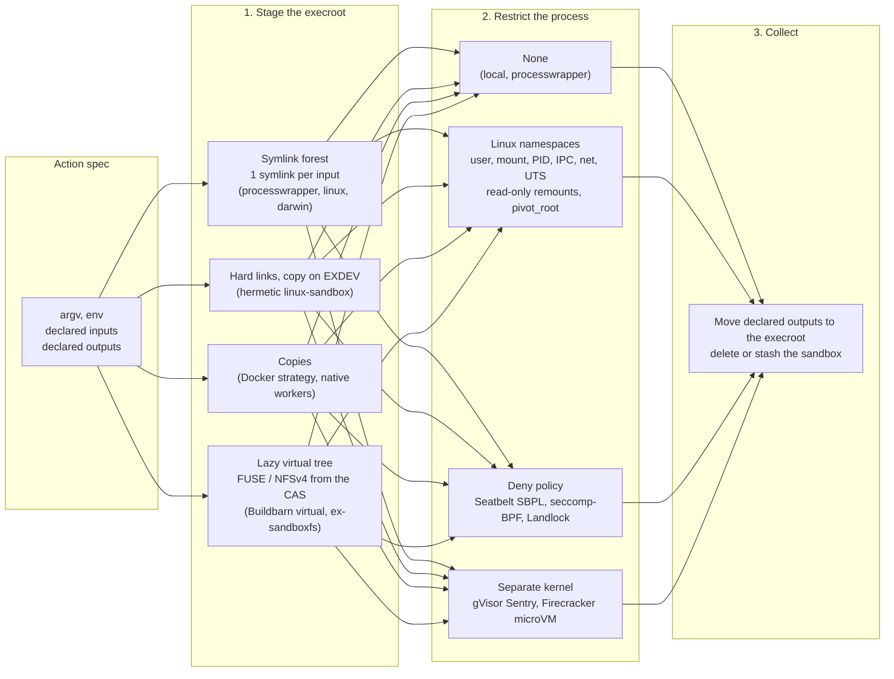

# Sandboxing and Hermetic Execution Internals

> [!summary] Claim:
> A build sandbox does two separate jobs: it stages a private execroot that contains only the action's declared inputs, and it restricts what the action can reach beyond that execroot.
> Staging is a per-input cost (one `symlink`, `link`, or copy per file, plus `mkdir` per directory), or a constant cost when a FUSE or NFSv4 server materializes the tree lazily; restriction is a namespace view (Linux), a policy that denies operations (Seatbelt, seccomp, Landlock), or a separate kernel (gVisor, a microVM).
> Bazel's default local sandboxes stage symlinks back into the source tree and leave the network open (`--sandbox_default_allow_network=true` in Bazel 9.3.2), so they catch undeclared inputs that are named by relative path and miss absolute paths, `realpath` escapes, and downloads; writes through staged symlinks are stopped by linux-sandbox's read-only remounts and darwin-sandbox's `(deny file-write*)`, but not by processwrapper-sandbox.
> Remote workers are stricter mainly because they build the input root from the CAS on a different machine, which is why "works locally, fails remotely" is the normal way an undeclared input is discovered.



## The Mechanism

[[Hermetic-and-Reproducible-Builds]] owns why a build must be a pure function of its declared inputs and how to make its outputs bit-identical.
This note owns the operating system machinery that enforces the "declared inputs only" half of that contract for each action, and the cost of that enforcement.
Every Bazel fact below is from the 9.3.2 source tree or `bazel help build --long` run locally with Bazel 9.3.2 on darwin-arm64, unless another source is named.

### 1. The contract and its leaks

An action is `argv`, an environment, a set of declared input files, and a set of declared output paths.
It is hermetic when nothing else can influence its outputs.
In practice an action can be influenced through six channels, and a sandbox design is judged by which of them it closes:

| Channel | Typical leak | What closes it |
| :--- | :--- | :--- |
| Undeclared file read, relative path | `#include "secret.h"` beside a declared `.c` file | Any execroot that omits the file |
| Undeclared file read, absolute path | `-I/home/me/src/include`, `/usr/include`, a tool that reads `~/.config` | A mount namespace that hides the path, a Seatbelt or Landlock deny rule, or a different machine |
| Escape through a staged symlink | `realpath(input)` then open a sibling | Hard links, copies, or a virtual tree, so the input has no path back to the source |
| Writes outside declared outputs | A tool that rewrites its input, writes `__pycache__` next to a source, or deletes `$HOME` | Read-only remounts (linux-sandbox), `(deny file-write*)` (Seatbelt), copies |
| Network | `pip install`, `curl` in a genrule, a license server | A network namespace, `(deny network*)`, seccomp or Landlock socket rules |
| Ambient environment | `PATH`, `LD_LIBRARY_PATH`, hostname, username, `/tmp` contents, time | `--incompatible_strict_action_env`, `--sandbox_fake_hostname`, hermetic `/tmp`, fixed `SOURCE_DATE_EPOCH` |

A second axis is how the leak is detected: hiding the file (the action sees `ENOENT` and fails), denying the operation (`EPERM` or `EACCES`), tracing it (tup records every file a command opens through FUSE and reports undeclared reads of generated files as errors, per the tup manual), or virtualizing it (the filesystem serves only what the manifest lists).
Hiding and denying make the build fail; tracing turns a leak into a dependency or a diagnostic.

### 2. Staging the execroot

Bazel gives every sandboxed spawn its own directory, `<sandbox_base>/<strategy>/<id>/execroot/<workspace>`, where `<sandbox_base>` is `<output_base>/sandbox` by default, or `<--sandbox_base>/bazel-sandbox.<hash of the output base>` when the flag is set, so several output bases can share one tmpfs (`SandboxModule.computeSandboxBase()`, `LinuxSandboxedSpawnRunner.prepareSpawn()`).
The execroot must end in the workspace name, "just like the normal execroot does" (comment `b/64689608` in the runner).
`AbstractContainerizingSandboxedSpawn.createFileSystem()` computes the set of directories and inputs to create without I/O, creates the directories, then calls `copyFile()` once per input; subclasses decide what "copy" means.

#### Symlink forest (default for processwrapper, linux, and darwin sandboxes)

`SymlinkedSandboxedSpawn.copyFile()` is `target.createSymbolicLink(source)`.
Each input costs one `symlink(2)` to create and one `unlink(2)` to delete, plus a `mkdir`/`rmdir` per directory, so setup is linear in the number of inputs (Julio Merino's sandboxfs retrospective makes the same accounting).
A symlink is cheap and carries no data, but it is a path back into the source tree:

- `open("src/secret.h")` fails because the execroot has no such entry.
- `open("/abs/source/src/secret.h")` succeeds unless something else hides the path.
- `realpath("src/main.c")` returns the source path, and the directory of that path is the real source directory, where every undeclared sibling is readable.
- Opening a staged input for writing follows the symlink and modifies the source file, unless the mount holding it is read-only.

Path resolution follows at most 40 symlinks per pathname on Linux (`path_resolution(7)`), which bounds how deep a chain of symlinked runfiles can be.

#### Hard links (hermetic linux-sandbox)

`--experimental_use_hermetic_linux_sandbox` (default false) switches to `HardlinkedSandboxedSpawn`, whose `copyFile()` calls `hardLinkRecursive()`: it resolves symlinks first, hard-links regular files, recurses into directories, and copies a file when `link(2)` fails.
`link(2)` fails with `EXDEV` across mounts, "even if the same filesystem is mounted on both," so inputs on a different mount than the sandbox base, such as a `/dev/shm` sandbox base with sources on disk, are copied.
A hard link has no path back to the source, so the `realpath` escape disappears, but it is the same inode: an action that opens an input for writing changes the source file's bytes through any name.
Mode bits live on the inode too, so a read-only source file does not save it: an action running as the file's owner can `chmod` the link and then write, which is the hole Bazel commit `3a1589c` closed by remounting the hermetic sandbox root read-only (in the 10.0.0 release candidates, not in 9.3.2).
The damage is detected, not silent: in hermetic mode `LinuxSandboxedSpawnRunner.verifyPostCondition()` calls `checkForConcurrentModifications()`, which compares each input with the metadata recorded when it was digested and fails the action with "input dependency <path> was modified during execution."
Each link also increments `st_nlink`, and `link(2)` returns `EMLINK` at the filesystem's limit (65,000 on ext4 without `dir_index`, 65,535 on btrfs, per the man page), which a busy worker cache that hard-links one hot header into thousands of sandboxes can reach.

#### Copies

A copy shares nothing with the source, so neither escapes nor writes reach it, and its cost is proportional to input bytes instead of input count.
Bazel's Docker strategy stages with `CopyingSandboxedSpawn`, whose `copyFile()` copies regular files and the targets of symlinks and copies directory trees below a directory input (`DockerSandboxedSpawnRunner.prepareSpawn()` returns one).
Buildbarn's native build directories also materialize real files, by hard-linking from a local cache of CAS files: `bb_worker.proto` describes `cache_directory_path` only as the "Directory where build input files are cached," and the linking is done by `pkg/cas/hardlinking_file_fetcher.go`.
One subtlety is inode identity: Buildbarn's configuration notes that Clang's `#pragma once` "requires that identical source files exposed under different paths have identical inode numbers," which its `LEAST_RECENTLY_USED` cache policy can guarantee and `RANDOM_REPLACEMENT` cannot.

#### Bind mounts and overlayfs

A bind mount exposes an existing directory at another path in O(1) per directory instead of O(files), which is how linux-sandbox exposes the host filesystem and how `--sandbox_add_mount_pair` adds a path.
`mount(2)` ignores every flag except `MS_REC` when it creates a bind mount, so a read-only bind needs a second call, `MS_REMOUNT | MS_BIND | MS_RDONLY` (Linux 2.6.26 and later).
Overlayfs stacks a writable upper directory over read-only lower layers, and "the file is first copied from the lower filesystem to the upper filesystem (copy_up)" when a lower file is opened for writing, so writes never reach the source; deletions are recorded as whiteouts, which are character devices with device number 0/0.
`user_namespaces(7)` lists overlayfs as mountable inside a user namespace since Linux 5.11, and the overlayfs documentation says `-o userxattr` "is useful for unprivileged mounting."
Bazel's local sandboxes do not use overlayfs (as of 2026-11, Bazel 9.3.2, Linux).

#### Lazy virtual trees: FUSE and NFSv4

A FUSE or NFSv4 server can expose an execroot from an in-memory manifest without creating any file, so setup is constant and every read pays a user-space round trip instead.
Buildbarn's `VirtualBuildDirectoryConfiguration` says the mount "instantiates build input roots lazily and loads input files on demand," so actions "can be started instantaneously," and warns that it "may impose a larger performance overhead for build actions that are I/O intensive."
Buildbarn supports FUSE on Linux and FreeBSD, and an in-process NFSv4 server on macOS "starting with Sequoia 15.0 (24A335)," because the macFUSE kernel extension "contains various bugs that cause system lockups under high load" (`virtual.proto`).
Bazel's own FUSE sandbox, sandboxfs (announced April 2018), was deleted in October 2023 (commit `217fafe`, "RELNOTES[INC]: The sandboxfs sandboxing strategy is removed"), and the Bazel 7.0.0 notes list the removal; only a no-op `--experimental_sandboxfs_map_symlink_targets` remains in 9.3.2.
Its author reports, for one iOS app, a 55% penalty with sandboxfs against 270% with symlink forests, and lists several reasons it stalled: wrong assumptions (forest creation "may not have been the biggest problem," the Objective-C and Swift compilers' on-disk caches were), performance problems in the Go FUSE library and the JSON RPC interface, OSXFUSE kernel bugs that blocked an optimization, the closed-sourcing of OSXFUSE in 2019, and Apple's kernel extension deprecation.

#### Reuse and teardown

`--reuse_sandbox_directories` (default true; on by default since Bazel 7.0.0, per its release notes) stashes a finished sandbox per mnemonic in `SandboxStash`, and the next action of that mnemonic takes the stash and edits it: entries it also needs are kept, the rest are deleted, and only missing ones are created (`SandboxHelpers.cleanExisting()`).
The edit cost is proportional to the difference between the two input sets, not to their size, and `--experimental_inmemory_sandbox_stashes` (default false in 9.3.2) keeps the stash contents in memory to avoid re-reading the directory tree; commit `4239764` (2026-10-23) turns it on by default on master because it "reduces filesystem I/O operations and stat calls during sandbox reuse."
Deletion is asynchronous by default: `--experimental_sandbox_async_tree_delete_idle_threads` defaults to 4, deletes on one thread while a command runs, and ramps up when the server is idle; `0` makes deletion block action completion.
Persistent workers break the one-sandbox-per-process model, because one long-lived process serves many actions.
`--worker_sandboxing` (default false) sandboxes singleplex workers, and `--experimental_worker_multiplex_sandboxing` (default false) gives a multiplex worker tagged `supports-multiplex-sandboxing` "a separate sandbox directory per work request"; both help texts say workers are always sandboxed under the dynamic strategy, and `--experimental_worker_sandbox_hardening` (default false) adds distinct tmp directories per worker (`WorkerOptions.java`, 9.3.2).
A per-request directory stages the inputs one request is allowed to name, but the worker is still one process that outlives the request, so anything it cached in memory from an earlier request, such as a parsed header or a loaded class, can influence a later one without any file being read.
`--sandbox_base` exists so the forest can live on tmpfs ("Specify a path on tmpfs (like /run/shm) to possibly improve performance a lot when your build / tests have many input files"), at the price of RAM and of the `EXDEV` copies described above when combined with hard links.

### 3. Linux isolation: from chroot to namespaces

#### chroot is not a sandbox

`chroot(2)` changes only the root used to resolve absolute paths; the man page says "it is not intended to be used for any kind of security purpose," that it does not change the current directory, that open file descriptors "may allow access to files outside the chroot tree," and that a privileged process escapes with `mkdir foo; chroot foo; cd ..`.
It needs `CAP_SYS_CHROOT` "in its user namespace," so an unprivileged tool can call it only after creating a user namespace, which is exactly how Bazel's hermetic mode uses it, as the second half of `pivot_root` plus `chroot(".")`.

#### pivot_root inside a mount namespace

`pivot_root(2)` moves the current root mount to `put_old` and makes `new_root` the root mount of the calling mount namespace, changing the root and current directory of every process in that namespace that pointed at the old root.
It requires `CAP_SYS_ADMIN` in the user namespace that owns the mount namespace, `new_root` must be a mount point (bind it onto itself if needed), and neither parent mount may have shared propagation.
After `umount2(put_old, MNT_DETACH)`, the old root is unreachable by path from inside, which is the property chroot lacks.

#### User namespaces make it unprivileged

Since Linux 3.8, an unprivileged process can create a user namespace, and the creator gets a full capability set inside it and none in the parent (`user_namespaces(7)`).
Inside, it can create mount, PID, network, IPC, and UTS namespaces, make bind mounts, and mount proc and sysfs (3.8), tmpfs and devpts (3.9), and overlayfs (5.11); it cannot create device nodes, load modules, or mount block filesystems.
An unprivileged writer may set `uid_map` and `gid_map` only once, to a single line that maps its own ID, and must first write `deny` to `/proc/self/setgroups` (Linux 3.19 and later); nesting stops at 32 levels with `EUSERS`.

Mounts copied from a more privileged namespace are locked: they cannot be unmounted individually to reveal what is underneath, and their `MS_RDONLY`, `MS_NOSUID`, `MS_NOEXEC`, and atime flags cannot be changed (`mount_namespaces(7)`).
That is why a sandbox can make a writable host mount read-only inside its namespace but can never make a read-only host mount writable.
A mount namespace created together with a user namespace is less privileged than its parent, and `mount_namespaces(7)` says that in that case "shared mounts are reduced to slave mounts," so the sandbox's mounts cannot propagate back to the host.
linux-sandbox still calls `mount(NULL, "/", NULL, MS_REC | MS_PRIVATE, NULL)` first, for the other direction: its comment says it is "so that mounts in the outside environment do not affect our sandbox" (`SetupMountNamespace()`); systemd makes `/` shared at boot, so without it a mount appearing on the host during an action would appear inside the sandbox too.

#### Bazel's linux-sandbox, step by step

`linux-sandbox.cc` creates PID 1 of the sandbox with `clone()` and the flags `CLONE_NEWUSER | CLONE_NEWNS | CLONE_NEWIPC | CLONE_NEWPID | SIGCHLD`, adding `CLONE_NEWNET` when a network namespace is wanted and `CLONE_NEWUTS` for `--sandbox_fake_hostname`.
It uses `clone()` rather than `unshare()` "because unshare sometimes fails with EINVAL due to a race condition in the Linux kernel" (the source cites lkml.org/lkml/2015/7/28/833).
The parent adds the child to any cgroup directories (`-C`), then signals it through a pipe.
`Pid1Main()` in `linux-sandbox-pid1.cc` then runs, in order:

1. Wait for the parent's pipe, so that the child it forks lands in the same cgroup, then clear the signal mask (`ClearSignalMask()`).
2. `prctl(PR_SET_PDEATHSIG, SIGKILL)` and `setpgid(0, 0)`, so the sandbox dies with Bazel and a stray `kill(0, sig)` cannot hit the outer process group.
3. `mount(NULL, "/", NULL, MS_REC | MS_PRIVATE, NULL)`.
4. Write `deny` to `setgroups`, then one-line `uid_map` and `gid_map`: the outer IDs by default, 0 for `requires-fakeroot` (`-R`), `nobody` for `--sandbox_fake_username` (`-U`); with `-H` (`--sandbox_fake_hostname`), `SetupUtsNamespace()` then sets the hostname to `localhost` and the domain name to `localdomain`.
5. In the default (non-hermetic) mode, bind-mount each `-M`/`-m` pair, mount a tmpfs with `MS_NOSUID | MS_NODEV | MS_NOATIME` for each `--sandbox_tmpfs_path`, bind each writable path onto itself, and bind the working directory onto itself.
6. Walk `/proc/self/mounts` and remount every entry `MS_BIND | MS_REMOUNT | MS_RDONLY` except the working directory, writable paths, and tmpfs paths, carrying over `nodev`, `noexec`, `nosuid`, and atime flags because a remount cannot drop locked flags; it makes up to five attempts on `EBUSY`, sleeping 100 ms between them (so at most four retries), and ignores `EACCES`, `EPERM`, `EINVAL`, `ENOENT`, `ESTALE`, and `ENODEV`.
7. Mount a fresh `/proc`, and a read-only sysfs only when it owns a network namespace.
8. With `-N`, bring up `lo` with `ioctl(SIOCSIFFLAGS, IFF_UP)`; `--sandbox_enable_loopback_device` (default true, added in Bazel 9.0) selects `-N` over `-n`.
9. `chdir` to the working directory, fork the action into its own process group, give it the terminal, set `umask(022)`, and `execvp`.
10. Reap every process that exits, return the action's status (128 plus the signal number on a signal), and exit; the kernel then sends `SIGKILL` to everything left in the PID namespace, which is how leftover daemons die.

So in the default mode the whole host filesystem stays visible read-only, and the only things hidden are the paths the execroot omits, the host `/tmp` (replaced by the hermetic `/tmp`), any `--sandbox_tmpfs_path` (replaced by an empty tmpfs), and any `--sandbox_block_path` entries, which are covered with bind mounts of an inaccessible helper file or directory whose permission bits are cleared (`LinuxSandboxUtil.java`).

The hermetic mode (`-h <sandbox-dir>`, from `--experimental_use_hermetic_linux_sandbox`) builds a root from nothing instead: it binds the sandbox directory onto itself, creates `tmp/empty_file`, binds `/dev/null`, `/dev/random`, `/dev/urandom`, `/dev/zero`, and `/dev/full` onto hard links of that file, mounts a mode-1777 tmpfs on `dev/shm`, creates `dev/fd` and `dev/std*` symlinks into `/proc/self/fd`, mounts a fresh proc, mounts a read-only sysfs only when it owns a network namespace and otherwise bind-mounts the host `/sys` (a fresh sysfs fails with `EPERM` in a user namespace that shares the host network), mounts the tmpfs paths, binds the working directory onto itself, binds each `--sandbox_add_mount_pair` source and each writable path, then calls `pivot_root(".", old-root-XXXXXX)`, `chroot(".")`, `umount2(old_root, MNT_DETACH)`, and `rmdir`.
Only paths given with `--sandbox_add_mount_pair` exist, so an absolute path to an undeclared file fails with `ENOENT`.
In 9.3.2 those binds are writable, which is a real bug fixed upstream after that release.
`MountAllMounts()` passes `MS_REC | MS_BIND | MS_RDONLY` in a single `mount()` call, and the kernel's `path_mount()` in `fs/namespace.c` tests `MS_REMOUNT | MS_BIND` first, then `MS_REMOUNT`, then dispatches a plain bind as `do_loopback(path, dev_name, flags & MS_REC)`, so the per-mount `MNT_READONLY` it computed from `MS_RDONLY` is never applied.
The hermetic branch of `Pid1Main()` at 9.3.2 runs `MountSandboxAndGoThere()`, `CreateEmptyFile()`, `MountDev()`, `MountProcAndSys()`, `MountAllMounts()`, and `ChangeRoot()`, and never calls the remount pass `MakeFilesystemMostlyReadOnly()` that the default branch runs.
Bazel commit `5cce779` (2026-07-22, "Fix read-only enforcement for hermetic sandbox mounts") states it directly: "bind mounts specified via -M/-m were writable because MS_RDONLY is ignored on the initial MS_BIND call, and hermetic mode missed the subsequent remount step," and it adds that call after `ChangeRoot()`.
A second commit, `3a1589c` (2026-08-03, "Remount sandbox_root read-only in hermetic sandbox mode"), says the sandbox root "was previously left read-write," which "allowed sandboxed actions to modify hardlinked inputs on the host if they could chmod them," and adds `RemountReadonly("/")` with only the output directories passed as writable.
Both fixes are in the `10.0.0rc3` tag and absent from `9.3.2` and `8.9.0rc2` (checked in each tag's `linux-sandbox-pid1.cc`, as of 2026-11, Linux).

#### Network: open by default

`createNetworkNamespace` in `LinuxSandboxedSpawnRunner` is `!(allowNetwork || Spawns.requiresNetwork(spawn, defaultSandboxAllowNetwork))`, and `requiresNetwork()` returns false for a `block-network` tag, true for `requires-network`, and otherwise the value of `--sandbox_default_allow_network`, which defaults to true.
So a plain `bazel build` on Linux gives actions the host network, and a network namespace appears only with the `block-network` tag or `--nosandbox_default_allow_network`.
`allowNetwork` is forced on when the test arguments contain `--wrapper_script_flag=--debug`, so a Java test can reach its debugger, and the source comment says this "intentionally overrides the 'block-network' execution tag."

#### /tmp, environment, and resources

Hermetic `/tmp` gives each Linux sandbox a private, initially empty `_hermetic_tmp` directory mounted on `/tmp`, with any Bazel-managed paths under `/tmp` (output base, sandbox base) mounted back in.
It became the default in Bazel 7.0.0 (`--incompatible_sandbox_hermetic_tmp`), and Bazel 9.0.0 removed the flag; the 9.0.0 notes say to use `--sandbox_add_mount_pair=/tmp` to see the host `/tmp` again.
`LinuxSandboxedSpawnRunner.useHermeticTmp()` still turns it off in four cases: the hermetic sandbox (which builds its own empty `/tmp`), an explicit mount pair for `/tmp`, `/tmp` being the output base or a package path entry, and `--sandbox_tmpfs_path=/tmp`.
`--incompatible_strict_action_env`, flipped to true in Bazel 9.0.0, gives actions a static `PATH` and drops `LD_LIBRARY_PATH`; `--action_env=NAME` lets one variable through, at the cost of cache sharing across users.
On every non-Windows host the static value is `/bin:/usr/bin:/usr/local/bin` (`BazelRuleClassProvider.pathOrDefault()`, 9.3.2), chosen so a macOS `python3` under `/usr/local/bin` is found; Homebrew on Apple silicon installs under `/opt/homebrew/bin`, so a genrule that calls a Homebrew tool by name fails on an arm64 Mac and works on an Intel one.
The source also notes that `--action_env` "does not propagate to the exec config," so it cannot fix a tool built for the exec configuration.
`--experimental_sandbox_memory_limit_mb` and `--experimental_sandbox_limits` put each spawn in a cgroup (v1 or v2, if the user may write the cgroups directory), and the C++ `linux-sandbox` binary writes resource usage from `wait4()` on its PID 1 (so it covers the whole process tree) to `stats.out`, replacing `ru_maxrss` with the cgroup's memory peak when one exists (`WaitForPid1()` in `linux-sandbox.cc`).

#### When namespaces are unavailable

Bazel probes support by running `/bin/true` under linux-sandbox once per sandbox binary and caching the answer; if it fails, `--spawn_strategy=linux-sandbox` stops the build with "no strategy with that identifier was registered", and `sandboxed` falls back to `processwrapper-sandbox`, which stages the same symlink forest with no isolation at all.
In 9.3.2 that fallback also silently drops `--experimental_use_hermetic_linux_sandbox`; Bazel commit `fd7af9e` (2026-10-28, after the 9.3.2 branch) makes the command fail instead, and its description gives the reason: "the hermetic flag is silently ignored."
Three common reasons a CI runner refuses user namespaces:

- Docker's default seccomp profile (moby/profiles `default.json`, default action `EPERM`) allows `unshare`, `mount`, `umount2`, `setns`, and `clone3` only to a container with `CAP_SYS_ADMIN`, returns `ENOSYS` (38) for `clone3` otherwise, allows `clone` without that capability only when none of the namespace flags in mask `0x7E020000` are set, and has no allow rule for `pivot_root` at all.
- Ubuntu 23.10 introduced AppArmor-based restriction of unprivileged user namespaces (`kernel.apparmor_restrict_unprivileged_userns`), allowing them only to processes whose profile has a `userns,` rule; Canonical cites a Google report that 44% of the exploits it observed needed unprivileged user namespaces.
- Some distribution kernels gate them with `kernel.unprivileged_userns_clone`, which the Bazel sandboxing page tells users to check.

The Bazel page's remedies are `--privileged`, or `--cap-add=SYS_ADMIN --security-opt seccomp=unconfined`, both of which give the build container far more power than the sandbox takes away.

### 4. Deny policies without namespaces: seccomp-BPF and Landlock

seccomp-BPF attaches a classic BPF program to a thread that runs on every system call and sees only `struct seccomp_data` (`int nr; __u32 arch; __u64 instruction_pointer; __u64 args[6];`), so it can filter on numbers and register values but cannot dereference a path pointer.
Installing one needs `no_new_privs` or `CAP_SYS_ADMIN`; filters are inherited across `fork` and `execve`, stack, and the most severe result wins (`KILL_PROCESS` over `KILL_THREAD`, `TRAP`, `ERRNO`, `USER_NOTIF`, `TRACE`, `LOG`, `ALLOW`).
The kernel documentation calls skipping the `arch` check "the biggest pitfall" and states that "System call filtering isn't a sandbox": it is good at denying a class of syscalls, such as IP sockets, and useless for path policy.

Landlock (Linux 5.13) is an unprivileged LSM for path and port policy: a process builds a ruleset with `landlock_create_ruleset()`, adds rules with `landlock_add_rule()`, and applies it to itself with `landlock_restrict_self()`, which needs `no_new_privs` or `CAP_SYS_ADMIN`; up to 16 layers stack and none can be removed.
Its ABI grows by version, and programs should probe the ABI rather than the kernel version (`landlock(7)`):

| Landlock ABI | Kernel | Adds |
| :--- | :--- | :--- |
| 1 | 5.13 | Filesystem access rights |
| 2 | 5.19 | `LANDLOCK_ACCESS_FS_REFER` (link and rename across directories) |
| 3 | 6.2 | `LANDLOCK_ACCESS_FS_TRUNCATE` |
| 4 | 6.7 | TCP bind and connect rights |
| 5 | 6.10 | `LANDLOCK_ACCESS_FS_IOCTL_DEV` |
| 6 | 6.12 | Scoping of abstract UNIX sockets and signals |
| 7 | 6.15 | Audit logging flags |
| 8 | 7.0 | `LANDLOCK_RESTRICT_SELF_TSYNC` |
| 9 | 7.1 | `LANDLOCK_ACCESS_FS_RESOLVE_UNIX` (pathname UNIX socket connects) |

Descriptors opened before enforcement keep their rights, and `stat`, `chdir`, `chmod`, `chown`, and `access` cannot be restricted, so Landlock bounds what an action opens, not what it can learn about the tree.
Docker's default seccomp profile allows the three Landlock syscalls and `seccomp` itself, which makes both usable inside an unprivileged container where namespaces are not (as of 2026-11, moby/profiles main, Linux).
[[19-Shell-and-Unix-Engineering/22-Shell-and-AI-Agents/Agent-Shell-Sandboxing-Seatbelt-and-Landlock|Agent Shell Sandboxing Seatbelt and Landlock]] applies the same primitives to agent shells.

### 5. macOS: Seatbelt and darwin-sandbox

macOS has no mount or user namespaces, so `darwin-sandbox` combines the symlink forest with a policy enforced by the Sandbox kernel extension through `sandbox-exec`, whose manual page reads "The sandbox-exec command is DEPRECATED" and points developers to the App Sandbox; it still runs on macOS 27.3 (build 26C5035r).
Bazel checks support by running `sandbox-exec -p "(version 1) (allow default)" /usr/bin/true`, then writes a profile per spawn to `<sandbox>/sandbox.sb` (`DarwinSandboxedSpawnRunner.writeConfig()`, where a source comment notes that "the *last* matching rule wins"):

```scheme
(version 1)
(debug deny)
(allow default)
(allow process-exec (with no-sandbox) (literal "/bin/ps"))
; only when the spawn has no network:
(deny network*)
(allow network-inbound (local ip "localhost:*"))
(allow network* (remote ip "localhost:*"))
(allow network* (remote unix-socket))
; always:
(deny file-write*)
(allow file-write* (subpath "<each writable dir>") (literal "<stats file>"))
; only with --sandbox_block_path:
(deny file-read* (subpath "<each blocked path>"))
```

The writable set always includes `/dev`, `/tmp`, `/private/tmp`, `/private/var/tmp`, `DARWIN_USER_TEMP_DIR`, `DARWIN_USER_CACHE_DIR`, `~/Library/Caches`, `~/Library/Logs`, and `~/Library/Developer` (for Xcode tools), plus the sandbox execroot and `$TMPDIR`.
The profile starts from `(allow default)`, so reads are allowed everywhere except blocked paths: Seatbelt in Bazel stops writes and network, not undeclared reads by absolute path.
On this Mac (macOS 27.3, darwin-arm64, 2026-11-12), a Python probe run under that rule shape read an undeclared file by absolute path successfully, wrote inside the writable subpath, got `EPERM` ("Operation not permitted") for a write outside it, got `EPERM` immediately for `connect()` to `192.0.2.1:9` (the same connect timed out after 2 s unsandboxed), and still connected to a loopback listener; a separate `(deny file-read* (subpath ...))` profile made `cat` fail with "Operation not permitted."
Those runs were by hand, not part of the lab's expected output.

APFS volumes are case-insensitive by default (this Mac's `/` resolves `foo.h` to `Foo.h`), so an `#include "Foo.h"` that matches a declared `foo.h` builds on a laptop and fails on a case-sensitive Linux worker.

### 6. Containers, microVMs, and other systems

- Bazel's Windows sandbox (`--experimental_use_windows_sandbox`, a tri-state that defaults to false, with `--experimental_windows_sandbox_path` defaulting to `BazelSandbox.exe` found on `PATH`) stages nothing: `WindowsSandboxedSpawnRunner.prepareSpawn()` runs the action in the real execroot and passes the external binary each declared input with `-r`, each writable directory and declared output with `-w`, and each `--sandbox_block_path` entry with `-b`, so isolation is entirely the helper's policy; it refuses spawns with unresolved symlinks ("Windows sandbox does not support unresolved symlinks yet"), and its help text still says the binary must "correspond to a supported version of sandboxfs," a copy-paste leftover in 9.3.2.
- Bazel's Docker strategy (`--experimental_enable_docker_sandbox`, default false) runs each spawn with `docker run` in `--experimental_docker_image` or the platform's `container-image` property, injects the user's uid and gid by default (`--experimental_docker_use_customized_images`), and passes `--privileged` only with `--experimental_docker_privileged`, which the help text warns "might also result in reduced hermeticity."
- bubblewrap creates "a new, completely empty, mount namespace where the root is on a tmpfs that is invisible from the host," uses user namespaces and `PR_SET_NO_NEW_PRIVS`, has dropped its setuid mode, and states that it "is not a complete, ready-made sandbox with a specific security policy": the caller's arguments are the policy.
- Nix 2.35.6 sandboxes builds by default on Linux (`sandbox = true`, false on other platforms) in private PID, mount, network, IPC, and UTS namespaces, exposing only the input closure, a private `/proc`, `/dev`, `/dev/shm`, and `/dev/pts`, and `sandbox-paths`; the build directory is `/build` (`sandbox-build-dir`), and fixed-output derivations are exempt from the network restriction "to ensure they can access the network"; the manual also says using the sandbox "requires that Nix is run as root," with builds run as build users, so it is a root-owned daemon design, not an unprivileged one; [[Nix-Store-Derivations-and-Flakes-Internals]] owns the store model.
- gVisor's Sentry implements the Linux system call interface in user space and "does not pass system calls through to the host kernel," with a Gofer mediating file access over 9P; its documentation warns of "poor performance for system call heavy workloads," which describes a compiler farm.
- Firecracker runs KVM microVMs with five emulated devices and advertises boot in under 125 ms, under 5 MiB overhead per VM, and up to 150 microVMs per second per host.
- Buck2 does not sandbox local-only build steps; its README says it becomes hermetic "when using Remote Execution," which enforces declared inputs by construction.

### 7. Local laptop versus remote worker

A Remote Execution API worker receives an `Action` whose `input_root_digest` names a Merkle tree in the CAS, and "the files in the directory tree are available in the correct location on the build machine before the command is executed"; [[Remote-Execution-API-and-Remote-Caching]] owns the protocol.
Nothing outside that tree exists on the worker unless its image provides it, so the remote worker is the strictest undeclared-input detector a Bazel or Buck2 user has.

| Dimension | Local sandbox (Bazel 9.3.2 defaults) | Remote worker (typical) |
| :--- | :--- | :--- |
| Undeclared relative input | `ENOENT` | `ENOENT` |
| Undeclared absolute input | Readable (Linux non-hermetic, macOS) | Absent unless the worker image has it |
| Host tools in `/usr` | The laptop's | The container image's, which may differ in version |
| Network | Allowed unless `block-network` | Worker policy; often none |
| Environment | Strict `PATH`, no `LD_LIBRARY_PATH` | Only `Command.environment_variables`, plus worker defaults that the REAPI says "can be overridden" |
| Filesystem semantics | APFS case-insensitive on macOS | Usually case-sensitive Linux |
| `/tmp` | Private and empty (Linux), shared (macOS writable set) | Worker-defined |
| Timeouts | Local `-T` with `SIGTERM` then `SIGKILL` | Part of the `Action` digest, so a different timeout is a different cache key |
| Inputs | Symlinks to the source tree | Real files from the CAS, hard-linked or lazily served |

The most common divergence is the second row: an absolute include path, a tool found through `PATH`, or a file under `/usr` that the local sandbox let through and the worker does not have.
[[Diagnose-Bazel-and-Buck2-Cache-Misses]] owns the runbook for the cache-key side of the same problem.

## Commands and Numbers to Know

| Item | Value | Platform and date | What it controls |
| :--- | :--- | :--- | :--- |
| `--spawn_strategy` | default `remote,worker,sandboxed,local` (help text) | Both (as of 2026-11, Bazel 9.3.2) | First strategy that can run the spawn wins |
| `--sandbox_default_allow_network` | `true` | Both (as of 2026-11, Bazel 9.3.2) | Network namespace or `(deny network*)` only when false or tagged `block-network` |
| `--sandbox_enable_loopback_device` | `true` | Linux (as of 2026-11, Bazel 9.3.2) | `-N` (netns with `lo` up) versus `-n` |
| `--experimental_use_hermetic_linux_sandbox` | `false` | Linux (as of 2026-11, Bazel 9.3.2) | Empty root, `pivot_root`, hard-linked inputs |
| `--reuse_sandbox_directories` | `true` | Both (as of 2026-11, Bazel 9.3.2) | Stash and edit sandboxes per mnemonic |
| `--experimental_inmemory_sandbox_stashes` | `false` | Both (as of 2026-11, Bazel 9.3.2) | Track stash contents in memory |
| `--experimental_sandbox_async_tree_delete_idle_threads` | `4` | Both (as of 2026-11, Bazel 9.3.2) | `0` makes deletion block the action |
| `--sandbox_base` | empty, meaning `<output_base>/sandbox` | Both (as of 2026-11, Bazel 9.3.2) | Put the forest on tmpfs |
| `--sandbox_debug` | `false` | Both (as of 2026-11, Bazel 9.3.2) | Keep sandbox trees, write `debug.out`, print the command |
| `--sandbox_add_mount_pair`, `--sandbox_writable_path`, `--sandbox_tmpfs_path`, `--sandbox_block_path` | repeatable | Linux; writable and block paths also macOS (as of 2026-11, Bazel 9.3.2) | Extra mounts, writable dirs, empty tmpfs, inaccessible paths |
| `--sandbox_fake_hostname`, `--sandbox_fake_username` | `false` | Linux (as of 2026-11, Bazel 9.3.2) | `localhost` and `nobody` inside the sandbox |
| `--incompatible_strict_action_env` | `true` (flipped in 9.0.0) | Both (as of 2026-11, Bazel 9.3.2) | Static `PATH`, no `LD_LIBRARY_PATH` |
| `--incompatible_sandbox_hermetic_tmp` | removed in 9.0.0 (default true since 7.0.0) | Linux (as of 2026-11) | Private `/tmp` unless hermetic mode, a `/tmp` mount pair, `/tmp` as output base, or a `/tmp` tmpfs path |
| Static strict `PATH` | `/bin:/usr/bin:/usr/local/bin` | Both, non-Windows (as of 2026-11, Bazel 9.3.2) | No `/opt/homebrew/bin` on arm64 macOS |
| `--local_termination_grace_seconds` | `15` (old name `--local_sigkill_grace_seconds`) | Both (as of 2026-11, Bazel 9.3.2) | Wait between terminating a timed-out local process and killing it |
| Hermetic mount pairs read-only | No in 9.3.2; yes from commit `5cce779` (10.0.0rc3) | Linux (as of 2026-11) | Whether `--sandbox_add_mount_pair` binds can be written |
| `--worker_sandboxing` | `false` | Both (as of 2026-11, Bazel 9.3.2) | Sandboxed singleplex persistent workers |
| `--experimental_worker_multiplex_sandboxing` | `false` | Both (as of 2026-11, Bazel 9.3.2) | One sandbox directory per work request for `supports-multiplex-sandboxing` workers |
| `--experimental_use_windows_sandbox` | `false` (tri-state), binary `BazelSandbox.exe` | Windows (as of 2026-11, Bazel 9.3.2) | External helper enforces `-r`, `-w`, `-b` path lists |
| Execution tags | `no-sandbox`, `requires-network`, `block-network`, `requires-fakeroot` | Both (as of 2026-11, Bazel 9.3.2) | Per-target overrides in `ExecutionRequirements.java` |
| linux-sandbox `clone()` flags | `NEWUSER, NEWNS, NEWIPC, NEWPID` (+`NEWNET`, +`NEWUTS`) | Linux (as of 2026-11, Bazel 9.3.2) | Namespaces of every sandboxed spawn |
| Unprivileged user namespaces | since Linux 3.8; nesting limit 32 | Linux (as of 2026-11) | Whether linux-sandbox and bubblewrap can run unprivileged (Nix's sandbox runs as root) |
| Overlayfs in a user namespace | since Linux 5.11 | Linux (as of 2026-11) | Unprivileged copy-on-write roots |
| Landlock | ABI 1 in 5.13, TCP rules ABI 4 in 6.7 | Linux (as of 2026-11) | Unprivileged path and port deny rules |
| Docker default seccomp | `EPERM` for `unshare` and `mount`, `ENOSYS` for `clone3` without `CAP_SYS_ADMIN` | Linux (as of 2026-11, moby/profiles main) | Why linux-sandbox fails inside containers |
| Symlink resolutions per path | 40 | Linux (as of 2026-11) | `ELOOP` bound on symlink chains |
| Hard-link limit | 65,000 (ext4 without `dir_index`), 65,535 (btrfs) | Linux (as of 2026-11) | `EMLINK` on hot cached inputs |
| `sandbox-exec` | present, documented as deprecated | macOS (as of 2026-11, macOS 27.3) | Seatbelt profiles from the command line |
| Nix `sandbox` | `true` on Linux, `false` elsewhere | Both (as of 2026-11, Nix 2.35.6) | Namespace sandbox for derivations |
| Firecracker | under 125 ms boot, under 5 MiB per VM | Linux (as of 2026-11, vendor figures) | microVM per action or per worker |

Debug commands, all real flags or tools:

```bash
# Keep the sandbox, print the exact linux-sandbox or sandbox-exec command line, then rerun it by hand.
bazel build //pkg:target --sandbox_debug --verbose_failures

# Run one target with the network cut off, or every action without it.
bazel build //pkg:target --nosandbox_default_allow_network

# Find what an action really opens (Linux): every file and network syscall, following children.
strace -f -e trace=%file,%network -o /tmp/action.trace <command>

# Is the sandbox even possible here? (Linux)
unshare --user --map-root-user --mount --net true && echo "user namespaces work"
```

## Multi-Language Comparison: C++ / Python / Rust

Each toolchain has its own way to read an undeclared input or write outside its outputs, which is what a sandbox surfaces first during a migration.

| Concern | C++ (GCC, Clang) | Python (CPython) | Rust (rustc, Cargo) |
| :--- | :--- | :--- | :--- |
| Typical undeclared read | Headers reached through `-I`, `-isystem`, or the default system include directories; quote includes look first in the including file's directory | Modules found through `sys.path`, including the user and system `site-packages` | `include_str!`, `include_bytes!`, and `env!`, and build scripts (`build.rs`) that read anything |
| Absolute paths that bypass a symlink forest | Absolute `-I` flags and the sysroot | `sys.prefix` and interpreter paths | `CARGO_HOME` registry sources, rustup toolchain paths |
| Writes outside outputs | Rare; depfiles and objects go where `-o` and `-MF` say | `__pycache__/*.pyc` beside each imported source, which fails on a read-only source mount unless bytecode writing is disabled | `build.rs` writing outside `OUT_DIR`; incremental caches under `target/` |
| Network at build time | Rare, except fetch scripts in custom rules | `pip install` inside an action | Cargo fetching crates when not vendored or offline |
| How a sandbox reports it | Missing header error naming the path | `ModuleNotFoundError`, or an `EROFS` warning on `.pyc` writes | Missing file in `build.rs`, or a fetch failure |
| Usual fix | Declare the header, or use a hermetic sysroot ([[Cross-Compilation-and-Sysroots]]) | Hermetic interpreter and pinned wheels; `PYTHONDONTWRITEBYTECODE=1` | Vendored crates, `--offline`, `build.rs` emitting `rerun-if-changed` |

The GCC manual ("Search Path") says quote includes are searched "first relative to the directory of the current file," and the question for a sandbox is which directory that is.
GCC and Clang do not take the realpath escape for quote includes: they search the directory of the including file as it was named, which in a symlink forest is the execroot directory, not the source directory behind the link.
On darwin-arm64 (2026-11-15), with `execroot/ws/src/main.c` a symlink to a source `main.c` whose real directory holds an undeclared `secret.h`, both Apple clang 21.0.0 (`'secret.h' file not found`) and Homebrew GCC 16.2.0 (`secret.h: No such file or directory`) failed to compile `src/main.c` from the execroot; that was a hand run, and the lab's `compile_quote_include` probe repeats it with the Linux container's `cc`.
So for compilers the leak is the absolute path (an absolute `-I`, a sysroot, a default system directory), while tools that call `realpath()` and then look for siblings, such as scripts and code generators, do escape.
[[Cargo-Build-Graph-and-Rustc-Pipelining]] owns build scripts, and [[Compiler-Caches-ccache-and-sccache]] owns how absolute paths break compiler-cache hits, which is the same leak seen from the cache side.

## Worked Lab Example

The lab is `code/06-Build-Systems/linux_sandbox/` and declares `# requires: linux`.
It needs only `python3` for Parts 1 to 4, uses no privileges, and is written to run inside the harness container (`--cap-drop ALL`, `no-new-privileges`, Docker's default seccomp profile, an unprivileged user), where user namespaces are refused.

```bash
cd code
python3 -m _harness.verify 06-Build-Systems/linux_sandbox/          # verify against expected/linux-<arch>.txt
LINUX_SANDBOX_LAB_USERNS=1 bash 06-Build-Systems/linux_sandbox/run.sh   # by hand, on a host with user namespaces
```

What each part does:

1. `stage.py` Part 1 builds a source tree with nine declared inputs and an undeclared `src/secret.h`, stages the declared inputs into a fresh `execroot/ws` three ways (symlink, hard link, copy), and runs `action.py` in each with a minimal environment.
   The action reads its declared input, reads `src/secret.h` relative and absolute, reads it via `realpath(src/main.c)`, runs `"${CC:-cc}" -fsyntax-only src/inc.c` on a declared file that quote-includes `secret.h`, and appends to `src/main.c`; the stager then hashes the source `src/main.c` to see whether the append reached it, and restores it.
2. Part 2 stages 2,000 inputs of 4,096 bytes in 40 directories each way and reports, from `lstat()`, how many entries are symlinks or regular files, how many share the source inode, how many input bytes were duplicated, and the source `st_nlink` while staged; it then hard-links a file from `/dev/shm` into the execroot to show `EXDEV` and the copy fallback that `HardlinkedSandboxedSpawn` uses.
   Timings go to stderr only, because they vary.
3. Part 3 stashes a 2,000-input symlink tree, edits it for a second action that drops two packages and adds two, counts kept, removed, and created entries, and compares the edited tree with a freshly staged one entry by entry.
4. `netfilter.py` Part 4 opens a loopback TCP connection, installs a seccomp-BPF filter through `ctypes` (`prctl(PR_SET_NO_NEW_PRIVS)`, then `prctl(PR_SET_SECCOMP, SECCOMP_MODE_FILTER)`) that returns `EACCES` for `socket(AF_INET or AF_INET6)`, checks the arch word and, on x86_64, rejects x32 syscall numbers, then probes sockets in the same process and in an exec'd child, and sends a byte over the connection opened before the filter.
5. `ns_sandbox.sh` (opt-in Part 5) repeats the action under `unshare --user --map-root-user --mount --pid --fork --mount-proc --net` with the source tree remounted read-only and a tmpfs over a blocked directory, mirroring steps 3 to 7 of linux-sandbox.

### Output status

No `expected/` file exists yet: this note was written on darwin-arm64, where a `linux` lab runs only in the harness container, and container runs were out of scope for this job, so the integrator records `expected/linux-<arch>.txt`.
No output block is shown for that reason.
Each check is built to fail if the mechanism were absent, and the source analysis predicts these results:

- Part 1: relative reads of the undeclared file fail with `ENOENT` in all three modes; the absolute read succeeds in all three, because staging alone hides nothing outside the execroot; the `realpath` read succeeds only for symlinks; the compiler reports `not-found` in all three, because it searches the execroot directory as named; and the append modifies the source file for symlinks and hard links but not for copies.
- A single logic check of Part 1 on darwin-arm64 (2026-11-15, Apple clang 21.0.0 as `cc`) printed exactly that table; it is not a recording, because the lab requires Linux, so no output block is shown here.
- Part 2: the symlink tree has 2,000 symlinks and duplicates 0 bytes; the hard-link tree has 2,000 regular entries that share the source inode, with source `st_nlink` 2; the copy tree duplicates 8,192,000 bytes; and the `/dev/shm` link fails with `EXDEV` and is copied.
- Part 3: 1,900 symlinks kept, 100 removed with 2 directories, 2 directories and 100 symlinks created, and the edited tree identical to the fresh one.
- Part 4: `socket(AF_INET)` and `socket(AF_INET6)` return `EACCES` after the filter in the process and in the exec'd child, `socket(AF_UNIX)` still works, `/proc/self/status` shows `NoNewPrivs` 1 and `Seccomp` 2, and the connection opened before the filter still carries data.

The BPF program was checked on darwin-arm64 with a small classic-BPF interpreter written for this job (not part of the lab): for both aarch64 and x86_64 it returns `EACCES` for `AF_INET` and `AF_INET6` sockets, allows `AF_UNIX` and other syscalls, and kills on a foreign arch word or an x32 number.
That check caught a real bug: the macOS Python's `socket.AF_INET6` is 30, not Linux's 10, so the lab now hard-codes the Linux values from `include/linux/socket.h`.

### Reading the result

- Part 1 is the argument for defense in depth: staging decides what is reachable by relative path, isolation decides what is reachable by absolute path, and only copies or a read-only mount stop an action from damaging the source.
- Part 2 is the cost model: symlinks and hard links cost one call per input and no data, copies cost bytes, and hard links trade the escape for shared mutable inodes and `EXDEV` across mounts.
- Part 3 is why `--reuse_sandbox_directories` pays off for mnemonics with large, stable input sets, such as C++ compiles that share a toolchain.
- Part 4 is the unprivileged fallback for network isolation, and its last line is the classic seccomp hole: the filter checks system calls, so a descriptor obtained earlier, or passed in, keeps working.

## Pitfalls

> [!warning] Pitfall: assuming "sandboxed" means "offline"
> Bazel 9.3.2 defaults `--sandbox_default_allow_network` to true, so linux-sandbox creates no network namespace and darwin-sandbox writes no `(deny network*)` unless the target is tagged `block-network` or the flag is turned off.
> A build that silently downloads during an action passes locally and fails on a worker without network.

> [!warning] Pitfall: trusting a symlink forest to hide the source tree
> The forest hides only names the execroot omits.
> An absolute path or a `realpath` of any input reaches the real source tree, and on macOS the Seatbelt profile allows every read by default.
> Under processwrapper-sandbox, which has no read-only mounts and no Seatbelt policy, a write through a staged symlink also lands in the source file.

> [!warning] Pitfall: hard-linked inputs are writable aliases
> The hermetic sandbox hard-links inputs, so an action that opens an input with `O_WRONLY` or `O_TRUNC` rewrites the source file under every name.
> Bazel's post-action check then fails with "input dependency ... was modified during execution," but the source file is already changed.
> Read-only mode bits are not enough, because the owner can `chmod` the shared inode; prefer copies, a copy-on-write layer, or a read-only mount of the sandbox root (Bazel commit `3a1589c`) when tools are known to rewrite inputs.

> [!warning] Pitfall: `MS_RDONLY` on a fresh bind mount
> `mount(2)` ignores every flag but `MS_REC` when it creates a bind mount, so `mount(src, dst, NULL, MS_BIND | MS_RDONLY, NULL)` yields a writable bind.
> A read-only bind is two calls: create the bind, then remount it with `MS_REMOUNT | MS_BIND | MS_RDONLY`.
> Bazel's own hermetic linux-sandbox shipped this bug through 9.3.2 (fixed by commit `5cce779`, in the 10.0.0 release candidates).

> [!warning] Pitfall: fixing a CI sandbox failure with `--privileged`
> When linux-sandbox fails inside Docker, `--privileged` or `CAP_SYS_ADMIN` with `seccomp=unconfined` makes it work by handing the build root on the host kernel's terms.
> Prefer `processwrapper-sandbox` plus remote execution, a runner that allows unprivileged user namespaces, or a microVM per job.

> [!warning] Pitfall: a seccomp filter without an arch check
> On x86_64 the same `AUDIT_ARCH_X86_64` covers x32 calls, whose numbers set bit 30, and a 32-bit `int 0x80` call uses a different number table.
> Check the arch word first and reject x32 numbers, or the filter is bypassed by the other ABI.

> [!warning] Pitfall: a hermetic flag that silently does nothing
> In Bazel 9.3.2, when linux-sandbox fails its support probe, `sandboxed` resolves to `processwrapper-sandbox` and `--experimental_use_hermetic_linux_sandbox` is ignored without an error (fixed on master by commit `fd7af9e`).
> Pin `--spawn_strategy=linux-sandbox` in CI so a missing sandbox fails the build instead of downgrading it.

> [!warning] Pitfall: `--sandbox_base=/dev/shm` with hard links
> Sources on disk cannot be hard-linked onto tmpfs, so every input is copied (`EXDEV`), and the copies consume RAM in proportion to input bytes.
> Measure before moving the base, and size tmpfs for the largest concurrent input set plus outputs.

> [!warning] Pitfall: case-insensitive laptops
> APFS resolves `foo.h` for `#include "Foo.h"`, so a mismatched case builds on macOS and fails on a case-sensitive Linux worker.
> Treat remote execution, or a case-sensitive volume, as the arbiter for include spelling.

## At Scale

For one developer, the sandbox mostly prevents incorrect incremental builds: an undeclared header that changes without a rebuild.
For 1,000 to 50,000 engineers sharing a remote cache, the sandbox prevents cache poisoning, because one non-hermetic action uploaded from one laptop is served to everyone with the same action key.

Decision rules:

- Under about 100 engineers with no shared cache, `--spawn_strategy=sandboxed` with default flags is enough; add `block-network` to targets that must never fetch.
- Once a shared remote cache exists, upload results only from CI or from remote execution, never from laptops, so local sandbox leaks cannot poison the cache; [[Remote-Execution-API-and-Remote-Caching]] covers write permissions.
- Use remote execution as the hermeticity arbiter: a target that builds remotely has declared its inputs, while the local sandbox is a fast pre-check that catches only relative-path leaks.
- Turn on `--nosandbox_default_allow_network` organization-wide once the fetching targets are tagged `requires-network`, and track that tag's count as a hermeticity debt metric.
- On Linux CI, pick runners where unprivileged user namespaces work (check `unshare --user true`), instead of giving build containers `CAP_SYS_ADMIN`; where that is impossible, layer seccomp and Landlock under `processwrapper-sandbox`.
- On macOS, budget for the symlink forest's cost on actions with tens of thousands of inputs, such as iOS compiles: measure with `--profile`, reuse sandboxes, and send those mnemonics to remote Mac workers or run them with `no-sandbox` deliberately, with remote execution as the check.
- On remote workers with large input roots, a lazy virtual filesystem (Buildbarn's FUSE on Linux, NFSv4 on macOS) removes setup time but adds per-read latency; enable it for actions that read a small fraction of their inputs, and keep native directories for I/O-heavy actions.
- For untrusted code, such as pull requests from forks or arbitrary user builds, a namespace sandbox is not a security boundary; use a microVM or gVisor per job and accept their syscall and boot overhead.

[[Build-Performance-Economics-and-Decision-Record]] owns the cost model behind these rules, and [[Migrate-a-Polyglot-Codebase-to-Hermetic-Builds]] owns the order in which an organization tightens them.

## Practice Drill

> [!tip] Practice Drill:
> In a scratch Bazel workspace on Linux, write a `genrule` whose command runs `cat` on an absolute path outside the workspace, and predict whether `--spawn_strategy=linux-sandbox` lets it through.
> Then add `--experimental_use_hermetic_linux_sandbox` and predict the error, and add `--sandbox_add_mount_pair` for that path to see it come back.
> Next, give the genrule a `curl` to an external host, run it with defaults, then with `tags = ["block-network"]`, and read the `--sandbox_debug` command line to find the `-N` flag.
> On macOS, run the same genrule under `darwin-sandbox`, open `<output_base>/sandbox/darwin-sandbox/<id>/sandbox.sb` with `--sandbox_debug`, and explain from its rules why the read succeeds and the write to `$HOME` fails.
> Finally, run the lab's `ns_sandbox.sh` on a host with user namespaces and compare its five probe lines with Part 1's symlink column.

## Interview Questions

> [!question] L5: What does Bazel's processwrapper-sandbox protect against, and what does it not?
>
> > [!success]- Answer
> > It stages a symlink to every declared input in a private execroot and moves only declared outputs back, so it catches undeclared inputs that are named by relative path and keeps stray outputs out of the execroot.
> > It adds no isolation: the action runs as the user, with the full filesystem, network, and process table.
> > An absolute path, a `realpath` of an input, or a write through a symlink reaches the source tree.
> > It exists because it works on any POSIX system, including Linux hosts where user namespaces are refused.

> [!question] L5: A genrule downloads a file and works under `--spawn_strategy=linux-sandbox`; a teammate says the sandbox blocks network; who is right?
>
> > [!success]- Answer
> > The genrule is right, as of Bazel 9.3.2.
> > linux-sandbox creates a network namespace only when `Spawns.requiresNetwork()` returns false, which needs the `block-network` tag or `--nosandbox_default_allow_network`; the flag defaults to true.
> > With the namespace, the action sees only a loopback interface (`-N`) and its download fails.

> [!question] L6: Predict the output: an action in a Bazel symlink-forest sandbox runs `cat "$(dirname "$(realpath src/main.c)")/secret.h"`, where `secret.h` is an undeclared sibling of the declared `src/main.c`.
>
> > [!success]- Answer
> > It prints the contents of `secret.h`.
> > `realpath` follows the staged symlink to the source tree, and the directory of the result is the real `src/`, where the undeclared file exists.
> > With linux-sandbox in the default mode the read still works, because the host filesystem is visible read-only.
> > It fails with `ENOENT` under hard links or copies, where `realpath` stays inside the execroot, and under the hermetic sandbox, where the source tree is not mounted at all.

> [!question] L6: Debug this: `bazel build` works on laptops and on a bare-metal CI host, but in a Docker-based CI job it fails at startup with "'linux-sandbox' was requested for default strategies but no strategy with that identifier was registered."
>
> > [!success]- Answer
> > Bazel probes linux-sandbox by running `/bin/true` in it, and the probe failed, so the strategy was never registered.
> > In a default Docker container the seccomp profile refuses `unshare`, `mount`, and namespace flags on `clone` without `CAP_SYS_ADMIN`, so the user namespace cannot be created; on an Ubuntu host, AppArmor's userns restriction is another candidate.
> > Confirm with `unshare --user --map-root-user true` inside the job.
> > Fixes, best first: a runner that permits unprivileged user namespaces, remote execution for hermeticity with `processwrapper-sandbox` locally, or a custom seccomp profile that allows only the needed calls; `--privileged` works but gives the job host-level power.

> [!question] L6: Why does linux-sandbox remount every entry of `/proc/self/mounts` instead of making `/` read-only once, and why does it carry over `nosuid`, `nodev`, and `noexec`?
>
> > [!success]- Answer
> > Read-only is a per-mount flag, and each mount under `/` has its own, so making `/` read-only says nothing about `/home` or `/tmp` if they are separate mounts.
> > The mounts were copied from a more privileged namespace, so their `MS_NOSUID`, `MS_NODEV`, `MS_NOEXEC`, and atime flags are locked, and a remount that omits them fails; the code reads them with `hasmntopt()` and passes them back.
> > It tolerates `EACCES`, `EPERM`, `EINVAL`, `ENOENT`, `ESTALE`, and `ENODEV` for mounts it cannot see or that are broken, and retries `EBUSY` (up to five attempts), which a concurrent path walk on the host can cause because `touch_atime()` briefly holds a writer count on the mount, per the source comment.

> [!question] L7: Compare symlink forests, hard links, copies, and a FUSE tree for staging a 50,000-input action, on cost and on isolation.
>
> > [!success]- Answer
> > Symlinks cost one `symlink` and one `unlink` per input plus directory calls, carry no data, and leave a path back to the source.
> > Hard links cost the same call count, remove the path back, but alias the source inode, so writes reach it, and they fail with `EXDEV` across mounts and `EMLINK` at the link limit.
> > Copies cost bytes and isolate fully.
> > A FUSE or NFSv4 tree costs a constant setup, materializes only what is read, and pays a user-space round trip on every access, which suits actions that read a small part of a large input set; Buildbarn uses it remotely, and Bazel's local sandboxfs was removed after mixed results.
> > With reuse, a symlink forest's cost falls to the difference between consecutive input sets, which is why it remains Bazel's default.

> [!question] L7: A team blocks network in CI with a seccomp filter that denies `socket(AF_INET)`; name three ways an action can still reach the network.
>
> > [!success]- Answer
> > A descriptor opened before the filter, or passed in over a UNIX socket with `SCM_RIGHTS`, still works, because seccomp filters system calls, not existing descriptors.
> > A UNIX socket to a local proxy, a Docker socket, or a D-Bus service gives indirect network access, since `AF_UNIX` was allowed.
> > On x86_64, a filter that does not check the arch word or the x32 bit can be bypassed through another syscall ABI.
> > A network namespace closes only the third: a descriptor opened before the namespace, or received with `SCM_RIGHTS`, stays bound to its original network namespace, and a pathname UNIX socket such as `/var/run/docker.sock` is found through the filesystem, which linux-sandbox leaves visible.
> > Closing all three takes a network namespace plus a filesystem view that hides the socket paths, or Landlock: TCP connect rules arrived in ABI 4, abstract UNIX socket scoping in ABI 6, and pathname UNIX connect control (`LANDLOCK_ACCESS_FS_RESOLVE_UNIX`) in ABI 9 (Linux 7.1).

> [!question] L7: Bazel's hermetic linux-sandbox passes `MS_REC | MS_BIND | MS_RDONLY` in one `mount()` call for each extra mount; what does the kernel do with `MS_RDONLY`, and how would you verify the outcome?
>
> > [!success]- Answer
> > `mount(2)` says that when `MS_BIND` creates a bind mount, the bits other than `MS_REC` are ignored, and making a bind read-only takes a second `MS_REMOUNT | MS_BIND | MS_RDONLY` call.
> > The kernel's `path_mount()` hands a plain bind to `do_loopback(path, dev_name, flags & MS_REC)`, so the bind inherits the source mount's flags: read-only only if the source mount already was.
> > In Bazel 9.3.2 the hermetic branch never runs the remount pass, so those mounts are writable; commit `5cce779` (2026-07-22) added `MakeFilesystemMostlyReadOnly()` after `ChangeRoot()`, and it ships in the 10.0.0 release candidates.
> > Verify by running an action that writes into a mounted path under `--experimental_use_hermetic_linux_sandbox --sandbox_add_mount_pair=<dir>`, and by reading `/proc/self/mountinfo` inside the sandbox for the `ro` flag; the general lesson is to assert the mount flags you rely on instead of trusting the call that was meant to set them.

> [!question] L8+: Design local and remote sandboxing for a 20,000-engineer monorepo with Linux and macOS developers and a shared cache.
>
> > [!success]- Answer
> > Make remote execution on Linux workers the source of truth: inputs come only from the CAS, workers have no network by default, and only workers and trusted CI may write to the action cache.
> > Locally, use `sandboxed` with `--nosandbox_default_allow_network`, tag the few fetching targets `requires-network`, and keep hermetic `/tmp` and the strict action environment.
> > On Linux laptops and CI, require hosts where unprivileged user namespaces work, and treat the hermetic sandbox as an opt-in check for teams that want absolute-path leaks caught locally.
> > On macOS, accept that Seatbelt allows reads, and either run expensive mnemonics remotely on Mac workers or reuse sandboxes, measuring the forest cost with profiles.
> > Run untrusted builds in microVMs, and publish hermeticity metrics: `no-sandbox` and `requires-network` tag counts, and the rate of local-pass, remote-fail actions.

> [!question] L8+: Why is a namespace sandbox not a security boundary for untrusted code, and what would you use instead?
>
> > [!success]- Answer
> > A namespace sandbox shares the host kernel and exposes more of it: an unprivileged user namespace grants capabilities over mount, network, and other kernel interfaces that are normally root-only, which is why Ubuntu restricts them and why Canonical cites a report that 44% of observed exploits needed them.
> > The build sandbox's goal is correctness, catching honest mistakes, and it is configured with holes such as the host network and a read-only view of `/`.
> > For untrusted code, use a separate kernel: gVisor's Sentry implements system calls in user space, or a KVM microVM such as Firecracker gives each job its own kernel, at the cost of syscall overhead or boot time and memory.

## Further Reading

- Bazel, "Sandboxing" (bazel.build/docs/sandboxing): the strategies, the failure messages, and the documented remedies for user-namespace failures.
- `linux-sandbox-pid1.cc` at Bazel 9.3.2: the complete mount and namespace sequence in about 800 lines, the best single file to read on this topic.
- `DarwinSandboxedSpawnRunner.java` at Bazel 9.3.2: the generated Seatbelt profile and the always-writable directories on macOS.
- `user_namespaces(7)`, `mount_namespaces(7)`, `mount(2)`, and `pivot_root(2)` (man-pages 6.19): the rules for unprivileged mounts, locked mounts, and the read-only bind remount.
- Kernel documentation, "Seccomp BPF" and "Landlock": what each can and cannot restrict, and the arch-check pitfall.
- moby/profiles `seccomp/default.json`: the exact reason linux-sandbox fails in default containers.
- Julio Merino, "Whatever happened to sandboxfs?" (2025): the measured cost of symlink forests and why the FUSE alternative was abandoned.
- Buildbarn `bb_worker.proto` and `virtual.proto`: native versus lazy build directories on remote workers, and FUSE versus NFSv4.
- Nix manual, `sandbox` and `sandbox-paths`: a second, independent namespace sandbox design with fixed-output derivations as the network escape hatch.
- Canonical, "Ubuntu 23.10 restricted unprivileged user namespaces": the security argument against the primitive build sandboxes depend on.

## See Also

- [[Bazel-Skyframe-Bzlmod-and-Execution-Model]]: spawn strategies in the execution phase.
- [[Buck2-DICE-Starlark-and-BXL]]: a build system that relies on remote execution for hermeticity.
- [[Remote-Execution-API-and-Remote-Caching]]: input roots, platforms, and cache write policy.
- [[Diagnose-Bazel-and-Buck2-Cache-Misses]]: the runbook when a leak shows up as a cache miss.
- [[Nix-Store-Derivations-and-Flakes-Internals]]: the store model behind Nix's sandbox.
- [[Containers-and-VMs-for-macOS-Development]]: running Linux sandboxes from a Mac.
- [[System-Inspection-and-Syscall-Tracing-From-the-Shell]]: `strace` for finding what an action opens.
- [[SLSA-Framework-Build-and-Source-Tracks]]: isolated builds as a supply-chain requirement.

## Related

- Prerequisites: [[Hermetic-and-Reproducible-Builds]]
- Next: [[Make-and-Ninja-Mechanics]]
- See also: [[19-Shell-and-Unix-Engineering/22-Shell-and-AI-Agents/Agent-Shell-Sandboxing-Seatbelt-and-Landlock|Agent Shell Sandboxing Seatbelt and Landlock]]
- Lab: `code/06-Build-Systems/linux_sandbox/` (requires: linux)
