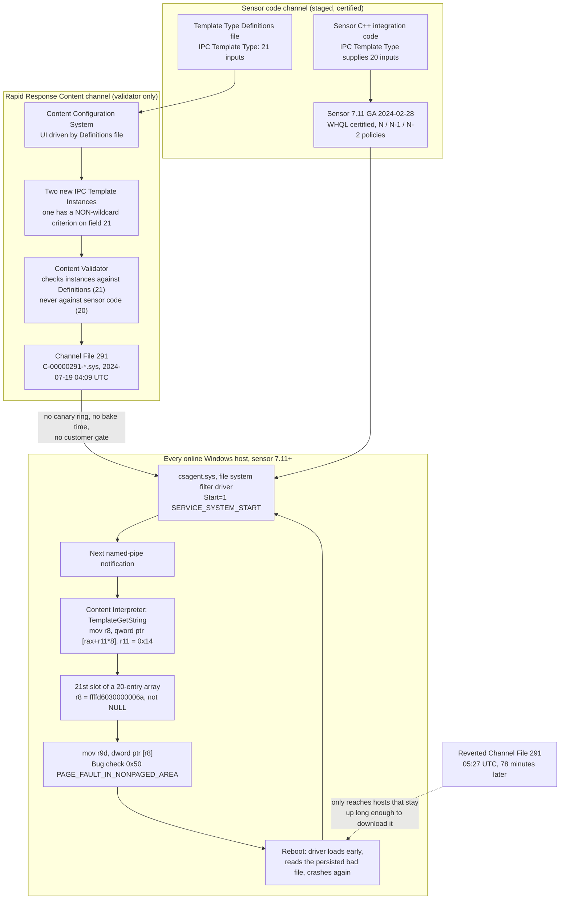

# Case Study: CrowdStrike Falcon Channel File 291 Release Architecture Failure

> [!summary] Scope
> Deep architectural analysis of the July 19, 2024 global IT outage caused by CrowdStrike deployment of Channel File 291.
> Details how Rapid Response Content that passed a flawed Content Validator triggered an out-of-bounds read in the Falcon sensor's Content Interpreter, and shipped to all hosts at once because that content type had no staged deployment rings or canary validation.
> Synthesizes critical release engineering lessons for decoupling dynamic configuration updates from kernel execution safety validation.
> Extracts formal release safety invariants for mission-critical enterprise systems.

The incident is the clearest public example of a failure class that release engineering usually ignores: a data artifact that is consumed by an interpreter running at the highest privilege level, shipped through a channel that was faster and less gated than the code channel.
The code (the Falcon sensor) had a release train, WHQL certification, and customer-selectable N, N-1, and N-2 version policies.
The data (Rapid Response Content) had a validator and nothing else between the author and every online Windows host running sensor 7.11 or later.
The note reconstructs the failure from CrowdStrike's 2024-08-06 Root Cause Analysis (RCA), its Preliminary Post Incident Review (PIR), and Microsoft's independent crash-dump analysis, then derives the invariants that would have stopped it.



## Incident Timeline

All times are UTC unless noted; sources are the CrowdStrike Remediation and Guidance Hub timeline, the PIR, and the RCA.

- 2024-02-28: Falcon sensor 7.11 becomes generally available.
  It introduces a new IPC Template Type that gives visibility into "novel attack techniques that abuse named pipes and other Windows interprocess communication ("IPC") mechanisms" (RCA, page 1).
  The Template Type Definitions file declares 21 input fields for it; the sensor integration code supplies 20 (RCA, Finding 1).
- 2024-03-05: A stress test of the IPC Template Type runs in CrowdStrike's staging environment and passes; the same day the first IPC Template Instance ships to production in Channel File 291 (PIR; RCA Finding 5).
- 2024-04-08 to 2024-04-24: Three more IPC Template Instances ship and "performed as expected in production" (Executive Summary).
  Every Template Instance used so far, and every test instance, has a regex wildcard in field 21 (RCA page 2 and Finding 3).
- 2024-07-19 04:09: Two new IPC Template Instances ship as a new version of Channel File 291.
  One introduces a non-wildcard matching criterion for field 21; "due to a bug in the Content Validator", it passed validation (PIR).
  The PIR lists the reasons it was deployed as "trust in the checks performed in the Content Validator, and previous successful IPC Template Instance deployments".
- 2024-07-19 04:09 onward: Windows hosts running sensor 7.11 or later that are online and receive the file crash with a blue screen at their next IPC notification (RCA, page 2).
  Hosts reboot, load the sensor early in boot, re-read the persisted channel file, and crash again.
  macOS and Linux sensors are not affected (Technical Details blog, 2024-07-20).
- 2024-07-19 05:27 (01:27 EDT): CrowdStrike reverts Channel File 291, 78 minutes after release.
  A file with timestamp 0527 UTC or later is "the reverted (good) version"; a file with timestamp 0409 UTC is "the problematic version" (Remediation Hub).
  The affected population is defined as Windows hosts on sensor 7.11+ "online between Friday, July 19, 2024 04:09 UTC and Friday, July 19, 2024 05:27 UTC" (Technical Details blog).
- 2024-07-19 to 2024-07-20: Manual remediation guidance: boot into Safe Mode or the Windows Recovery Environment, delete `%SystemRoot%\System32\drivers\CrowdStrike\C-00000291*.sys`, reboot; BitLocker-protected hosts may need a recovery key.
  Microsoft publishes a USB recovery tool (2024-07-20; version 3.1 dated 2024-07-22) with a WinPE path and a Safe Mode path.
  Azure documents three VM recovery paths: repeated restarts ("in some cases multiple reboots may be required"), restore from a backup taken before 04:09 UTC, and `az vm repair` with the `win-crowdstrike-fix-bootloop` run ID.
- 2024-07-20: Microsoft estimates that the update "affected 8.5 million Windows devices, or less than one percent of all Windows machines" (David Weston, Official Microsoft Blog).
- 2024-07-22: CrowdStrike introduces "automated techniques to accelerate remediation" (Remediation Hub; Meyers testimony).
- 2024-07-23: The bad version of Channel File 291 is added to Falcon's known-bad list in the US-1, US-2, and EU clouds, so a host that reaches the cloud before crashing is told to quarantine it (Remediation Hub).
- 2024-07-24: CrowdStrike publishes the Preliminary Post Incident Review.
- 2024-07-25: Bounds checking is added to the Content Interpreter function that retrieves input strings (RCA, Finding 2).
- 2024-07-27: The Sensor Content Compiler patch that validates the number of inputs a Template Type provides goes into production (developed 2024-07-19; RCA, Finding 1).
  Microsoft publishes its own crash-dump analysis and kernel-driver guidance (Weston, Microsoft Security Blog).
- 2024-07-29: About 99% of Windows sensors are online again on a week-over-week comparison, against a normal week-over-week variance of about 1% (RCA introduction).
- 2024-07-31: Delta Air Lines' CEO puts the airline's cost at as much as $500 million, with more than 5,000 flights canceled over five days (OPB/NPR).
  Parametrix estimates $5.4 billion of direct financial loss for US Fortune 500 companies, excluding Microsoft.
- 2024-08-06: CrowdStrike publishes the External Technical Root Cause Analysis and an executive summary.
- 2024-08-09: Target general availability of the sensor hotfix that backports the bounds check and the corrected 21-input IPC Template Type to every Windows sensor 7.11 and above (RCA, Finding 2).
- 2024-08-19: Target date for new Content Validator checks that reject matching criteria over more fields than the interpreter receives (RCA, Finding 4).
- 2024-09-24: Adam Meyers, CrowdStrike SVP Counter Adversary Operations, testifies before the House Homeland Security Subcommittee on Cybersecurity and Infrastructure Protection.
- 2024-11-19: Microsoft announces the Windows Resiliency Initiative, including Quick Machine Recovery and a plan to let security products run outside kernel mode, with a private preview for security partners promised for July 2025.
- 2025-06-26: Microsoft states that a private preview of the "Windows endpoint security platform" goes to a set of Microsoft Virus Initiative (MVI) partners the following month, and that MVI 3.0 requires that "Security product updates must be gradual, leverage deployment rings and leverage monitoring".
- 2025-07-14: CrowdStrike's one-year retrospective lists Sensor Self-Recovery (crash-loop detection that "automatically transitions systems into safe mode"), a ring-based Content Distribution System, host-group content policies, and content pinning.

## Mechanism Root Cause

### Two release channels with different gates

CrowdStrike ships detection logic to the sensor in two ways (RCA, "Technical Details").
The distinction is the whole incident: the code channel had every gate a mature release train has, and the data channel bypassed them.

| Property | Sensor Content | Rapid Response Content |
|---|---|---|
| What it is | Sensor code, on-sensor AI and ML models, and Template Types, compiled into a sensor release | Bundles of Template Instances (regex matching criteria) authored by detection engineers |
| Carrier | Sensor installer | Channel Files, `C-<channel>-*.sys` under `C:\Windows\System32\drivers\CrowdStrike\` |
| Cadence | Sensor releases, "updated less frequently" (Meyers testimony) | "Sent with rapid occurrence" to keep pace with threats (Meyers testimony) |
| Pre-release gate | Functional, longevity, stress-with-fault-injection, fuzzing, and performance tests, then WHQL certification (RCA page 8) | Content Validator against the Template Type Definitions file |
| Customer control in July 2024 | Sensor Update Policies: N, N-1, or N-2 (PIR) | None; the PIR's remediation is to "provide customers with greater control over the delivery of Rapid Response Content updates" |
| Rollout shape in July 2024 | Version policies per host group | Not staged; RCA Finding 6 states "Each Template Instance should be deployed in a staged rollout" as a corrective finding |
| Executes where | Kernel driver `csagent.sys` | Interpreted by the Content Interpreter inside the same kernel driver |

The files carry a `.sys` extension but "are not kernel drivers" (Technical Details blog).
CrowdStrike's RCA stresses that "Rapid Response Content is configuration data; it is not code or a kernel driver."
That statement is true about the file format and false about the risk: the content selects which input index the kernel code dereferences, so it steers kernel memory accesses exactly as code would.

### The component chain

The RCA names eight components; their relationships determine where the contract could drift.

- Template Type: a detection capability "expressed in code and compiled into the sensor at build time", with predefined input fields.
  The IPC Template Type gathers data from named-pipe notifications plus graph context.
- Template Type Definitions file: a separate artifact that says, per Template Type, which channel file carries its content, "how many inputs the Template Type is meant to use and what kind of data is required for each input."
- Content Configuration System: the authoring tool; Template Instances "are defined using a UI driven by the Template Type Definitions file."
- Template Instance: one set of regex matching criteria over the Template Type's fields.
- Rapid Response Content: several Template Instances bundled into one channel file.
- Content Validator: "Checks the validity of channel files against their definition in the Template Type Definitions file."
- Content Interpreter: "Part of the sensor C++ code, which can test input strings against regexes"; the RCA calls it "a regular-expression based engine" (regex engine internals are owned by [[Regex-Engines-Automata-Backtracking-and-ReDoS]]).
- Sensor Detection Engine: combines built-in Sensor Content with Rapid Response Content.

There were therefore three independent statements of the IPC Template Type's arity: the Definitions file (21), the sensor integration code (20), and whatever each Template Instance referenced (at most field 21).
Nothing mechanically tied the three together.
This is an interface-version problem of the same shape as an ABI break between two shared libraries built from different headers, which [[Diamond-Dependency-and-Incompatible-ABI-Mitigation]] and [[Versioning-SemVer-CalVer-and-ABI]] treat for code; here one side of the interface was data.

### The 20 versus 21 contract mismatch

RCA Finding 1 states the defect precisely: "the sensor code for the IPC Template Type described 20 different input sources", while "the definition of the IPC Template Type in the Template Type Definitions file stated that it expected 21 input fields."
Template Instances authored from the Definitions file could therefore reference field 21, and the Content Validator, which checked against the same Definitions file, accepted them.
CrowdStrike's executive summary phrases the same fact from the other side: "The sensor expected 20 input fields, while the update provided 21 input fields."
The Meyers testimony gives the plain-language version: one configuration "contained an extra input for which there was no defined action."

The fix touched both sides: the sensor code was "updated to provide the correct number of inputs (21)", and the Content Validator "was modified to only allow wildcard matching criteria in the 21st field" for sensors that still supply 20 (RCA Findings 2 and 4).

### Why a wildcard hid the defect for four and a half months

The defect was latent from 2024-02-28 to 2024-07-19 because every Template Instance that reached the field, and every test instance, used a regex wildcard for field 21.
The RCA says this directly: the mismatch evaded testing "in part" because of "the use of wildcard matching criteria for the 21st input during testing and in the initial IPC Template Instances."
The July 19 instance "would now require the sensor to inspect the 21st input parameter."

The RCA does not publish the interpreter's matching code, so the exact short-circuit is not public.
The behavior it describes is consistent with an evaluator that treats a wildcard criterion as matching without fetching the input string, which is a common optimization: a criterion that matches everything needs no data.
That optimization turned a total-looking function into a partial one whose undefined region was reachable only through content that nobody had yet written.

### Reading the crash dump

The RCA (pages 8 to 11) walks a representative kernel dump; Microsoft's 2024-07-27 analysis shows a second dump with the same faulting instruction.
The excerpts below are quoted from the RCA, which notes that its disassembly was annotated with "illustrative symbol names."

The triage header (abridged: multi-line parameter descriptions are cut to their first line and unrelated fields are omitted) identifies the bug check and the module:

```text
PAGE_FAULT_IN_NONPAGED_AREA (50)
Invalid system memory was referenced.      This cannot be protected by try-except.
Arg1: ffffd6030000006a, memory referenced.
Arg2: 0000000000000000, X64: bit 0 set if the fault was due to a not-present PTE.
Arg3: fffff8020ebc14ed, If non-zero, the instruction address which referenced the bad memory
Arg4: 0000000000000002, (reserved)
READ_ADDRESS:     ffffd6030000006a Paged pool
IMAGE_NAME:     csagent.sys
PROCESS_NAME:     System
```

Microsoft's bug check reference defines the parameters for x64 after Windows 1507: parameter 2 value 0 is a read, and parameter 4 value 0x2 is `NONPAGED_BUGCHECK_NOT_PRESENT_PAGE_TABLE`, "The address referenced does not have a valid active page table entry."
So the dump says: a kernel thread in the `System` process read (not wrote) an address with no page-table mapping, from inside `csagent.sys`.
The stack below the fault is entirely `csagent` frames above `nt!PspSystemThreadStartup` and `nt!KiStartSystemThread`, that is, a driver-owned system worker thread, not a user request.

The faulting function, as annotated by CrowdStrike:

```text
csagent!TemplateGetString+0xe:
fffff802`0ebc14d7 4e8b04d8   mov   r8,qword ptr [rax+r11*8]
fffff802`0ebc14db 750b       jne   csagent!TemplateGetString+0x1f (fffff802`0ebc14e8)
fffff802`0ebc14dd 4d85c0     test  r8,r8
fffff802`0ebc14e0 7412       je    csagent!TemplateGetString+0x2b (fffff802`0ebc14f4)
fffff802`0ebc14e2 450fb708   movzx r9d,word ptr [r8]
fffff802`0ebc14e6 eb08       jmp   csagent!TemplateGetString+0x27 (fffff802`0ebc14f0)
fffff802`0ebc14e8 4d85c0     test  r8,r8
fffff802`0ebc14eb 7407       je    csagent!TemplateGetString+0x2b (fffff802`0ebc14f4)
fffff802`0ebc14ed 458b08     mov   r9d,dword ptr [r8]
fffff802`0ebc14f0 4d8b5008   mov   r10,qword ptr [r8+8]
```

Step by step, using the trap-frame registers `rax=ffffae035f57f280` and `r11=0000000000000014`:

1. `mov r8, qword ptr [rax+r11*8]` indexes an array of 8-byte pointers.
   `rax` holds "the address of the 20-input pointer array" and `r11 = 0x14` is index 20, the 21st element (RCA page 11).
   The effective address is `0xffffae035f57f280 + 0x14 * 8 = 0xffffae035f57f320`.
2. The array has 20 entries, `0xa0` bytes, spanning `...f280` to `...f31f`, so `...f320` is one element past the end.
   `rsp` is `ffffae035f57ee30`, so the array lives on the kernel stack of the worker thread.
3. The `dp @rax l0n21` output shows the 20 valid pointers `ffffae035f57f320`, `...f330`, through `...f450`, each pointing to a string structure; the 21st slot holds `ffffd6030000006a`.
4. The `jne` (flags from an earlier comparison not shown in the excerpt) goes to `...14e8`, which is a NULL check: `test r8, r8` / `je`.
   `r8` is not zero, so the check passes, which is why the widely repeated "null pointer dereference" explanation is wrong for this dump.
5. `mov r9d, dword ptr [r8]` reads 4 bytes at `ffffd6030000006a`.
   `!pte` shows the PML4 entry (PXE) is valid but the PDPT entry (PPE) "contains 0000000000000000", so nothing is mapped in the surrounding 1 GiB region and the read faults.
6. The page fault on an unmapped kernel address is not an exception a driver can catch: Microsoft's bug check page states that such an access "cannot be protected by a try - except handler -- it can only be protected by a probe or similar programming techniques."
   The kernel calls `KeBugCheckEx(0x50, ...)`.

The note's own reading of the published bytes adds one detail that the RCA does not state, so treat it as an inference.
The 20 valid pointers target 16-byte structures starting at `...f320`, which is exactly where the 21st slot sits; the out-of-bounds slot is therefore the first 8 bytes of the first string structure, not a pointer at all.
The instructions that follow read a 32-bit (or 16-bit) value at offset 0 and a 64-bit value at offset 8, so offset 0 holds a length and offset 8 holds the buffer address.
The "pointer" `ffffd6030000006a` is then a small length (`0x6a`) in the low 32 bits and four bytes of whatever occupied the padding in the high 32 bits.
Microsoft's dump faults at the same instruction offset (`csagent+0xe14ed`) on `ffff840500000074`, which has the same shape: a small low dword and leftover kernel-address bits in the high dword.
This explains the RCA's note that "Variations of the dump exist, depending on the details of the machine state": the faulting address is a string length glued to stale padding bytes, so it differs per host, and in both published dumps it lands in unmapped kernel address space.

CrowdStrike and its third-party reviewer state that the bug "is not exploitable by a threat actor" and "is not an arbitrary memory write issue" (Executive Summary; RCA Finding 2).
The disassembly supports the narrower claim: the faulting path only reads.

### Why one crash became a boot loop

A single blue screen would have been an inconvenience; the boot loop made it an outage.
Three properties combined.

- Early load.
  Microsoft's dump shows `csagent` registered as Type 2 (`SERVICE_FILE_SYSTEM_DRIVER`), Start 1 (`SERVICE_SYSTEM_START`, "a driver started during operating system initialization"), group "FSFilter Activity Monitor"; `CSBoot` is Type 1, Start 0 (`SERVICE_BOOT_START`, "started by the operating system loader"), group "Early-Launch", and is signed as an Early Launch Antimalware (ELAM) driver.
  The RCA confirms the driver "is loaded from an early phase of system boot to allow the sensor to observe and defend against malware that launches prior to user mode processes starting."
- Persistence.
  The bad file sat on disk at `C:\Windows\System32\drivers\CrowdStrike\C-00000291*.sys`; Microsoft's dump shows the file object `\Windows\System32\drivers\CrowdStrike\C-00000291-00000000-00000032.sys`, evidence that the driver had read it.
  Each boot re-read it before any network update could replace it.
- A trigger that fires during boot.
  The crash happens "at the next IPC notification from the operating system" (RCA page 2).
  Named-pipe activity is ordinary on a running Windows system, and CrowdStrike's and Microsoft's guidance treats the crash as recurring on every boot, so in practice the fault usually fired before the sensor could fetch a replacement file (the published sources do not quantify the delay).

The only escape inside the loop was a race: if a host fetched the reverted 05:27 file before the next named-pipe evaluation, it recovered, which is why both CrowdStrike and Azure advised rebooting, possibly several times.
Windows' own driver-failure recovery did not apply.
`ErrorControl` values such as `SERVICE_ERROR_SEVERE` (2) or `SERVICE_ERROR_CRITICAL` (3) switch to the LastKnownGood control set "if the driver fails to load" (INF AddService Directive), and Microsoft's dump shows `csagent` at `ErrorControl 1` (`SERVICE_ERROR_NORMAL`: "system startup should proceed but display a warning").
More fundamentally, the driver loaded and initialized successfully every time; it crashed later while processing data, and LastKnownGood restores registry configuration, not a data file the driver reads.
The documented recovery paths therefore all delete the file from an environment that gets a shell before the crash fires (Safe Mode, WinRE, or WinPE), and BitLocker meant many machines needed a recovery key to reach the volume from those environments.

### Blast radius

The channel delivered content to every Windows sensor 7.11+ that was online and connected; the affected set is defined purely by "online between 04:09 and 05:27 UTC."
The PIR's fix list includes a "staggered deployment strategy for Rapid Response Content" starting with canary deployments, and RCA Finding 6 says each Template Instance "should be deployed in a staged rollout", which is how CrowdStrike itself describes the absence of rings for this content type.
Because the trigger was deterministic and fired within the first IPC notification, exposure was effectively the entire online population during the 78-minute window; the 8.5 million devices Microsoft estimated is that population.

An illustrative calculation shows why staging would have been decisive, using only the incident's own shape.
A deterministic, near-immediate crash is the easiest possible signal for a canary: a ring of 1% of the affected population (about 85,000 devices) would have shown crash-loop telemetry within minutes, and an internal dogfood ring of a few thousand machines would have shown it with essentially no customer exposure.
Rings need only a bake time longer than the time-to-symptom, and here time-to-symptom was the time to the next named-pipe event.
The numbers in this paragraph are arithmetic on the published 8.5 million figure, not measured data.

### Illustrative reconstruction of the accessor

The code below is an illustrative C++ reconstruction of the failure shape and of the two runtime fixes the RCA describes; it is not CrowdStrike source, and the names are invented.

```cpp
#include <cstddef>
#include <cstdint>
#include <span>

struct InputString {          // 16 bytes, as the dump suggests
    std::uint32_t length;     // offset 0: read by mov r9d, dword ptr [r8]
    std::uint32_t pad;        // offset 4: never written, keeps stale bytes
    const char*   buffer;     // offset 8: read by mov r10, qword ptr [r8+8]
};

// Before: the index comes from content; the array size comes from code.
const InputString* TemplateGetString_before(const InputString* const* inputs,
                                            std::size_t field_index) {
    const InputString* s = inputs[field_index];  // field_index 20 on a 20-entry array: out of bounds
    if (s == nullptr) return nullptr;            // NULL check passes on garbage
    return s;                                    // caller then reads s->length: fault
}

// After (RCA Finding 2): bounds-check every retrieval, and reject content whose
// declared arity does not match the array the template type actually built.
enum class Match { kNo, kYes, kRejectContent };

Match EvaluateCriterion(std::span<const InputString* const> inputs,
                        std::size_t content_expected_inputs,
                        std::size_t field_index) {
    if (content_expected_inputs != inputs.size()) return Match::kRejectContent;
    if (field_index >= inputs.size()) return Match::kRejectContent;
    const InputString* s = inputs[field_index];
    if (s == nullptr) return Match::kNo;
    // ... regex evaluation over {s->buffer, s->length} ...
    return Match::kNo;
}
```

The important design choice in the second function is the failure direction.
Bad content is rejected (the detection does not run), but the host keeps running and can report the rejection; the code is total over every input the content channel can deliver.

## Detection Gap

Each layer that could have caught the defect had a specific, explainable blind spot.

| Layer | What it actually checked | Why the July 19 instance passed |
|---|---|---|
| Sensor 7.11 release testing and WHQL | Sensor code with "the latest versions of channel files at the time of certification" (RCA page 8) | In February 2024 no channel file referenced field 21 with a non-wildcard |
| Template Type automated tests | "a static set of 12 test cases", with a hand-built channel file that "included a regex wildcard matching criterion in the 21st field for all Template Instances" (RCA Finding 3) | The faulting combination was never in the suite |
| Template Type stress test (2024-03-05) | A test Template Instance "matching against any possible value of the associated data fields" for resource use, performance, and detection volume (RCA Finding 5) | Matching any possible value behaves like a wildcard; the RCA says this instance "did not observe that the mismatched number of inputs would cause a system crash" |
| Content Validator | Template Instances against the Template Type Definitions file | The Definitions file said 21, so a criterion on field 21 was valid; the oracle itself was wrong (RCA Finding 4) |
| Prior production deployments | Four IPC Template Instances, March to April 2024 | All used wildcards on field 21; their success was evidence about fields 1 to 20 only, yet the PIR cites "previous successful IPC Template Instance deployments" as a reason for trust |
| Content Interpreter runtime | Designed "to gracefully handle exceptions from potentially problematic content" (PIR) | An access to an unmapped kernel address is not a catchable exception; no bounds check existed for this array (RCA Finding 2) |
| Canary or ring | None for Template Instances | RCA Finding 6 |
| Customer controls | N, N-1, N-2 sensor version policies | Applied to sensor code only; content flowed to every policy tier |

Four structural lessons sit underneath the table.

- The validator and the specification shared a single source of truth, and that source disagreed with the implementation.
  A validator that checks content against a spec cannot find a spec-versus-code bug; only a check against the consumer (the real interpreter, in the real sensor build) can.
- Coverage was measured per Template Type, not per field and criterion kind.
  RCA mitigation 3 is exactly the missing coverage rule: "automated tests have been created that test with non-wildcard matching criteria for each field."
  With 21 fields and two criterion kinds (wildcard, non-wildcard), a one-field-at-a-time sweep is 21 extra cases; the suite had 12 cases in total and none of them made field 21 non-wildcard.
- Production history was over-weighted.
  Four successful deployments sampled only the wildcard branch of field 21, so they carried no information about the branch that failed; treating them as evidence is survivorship reasoning.
- Content was tested against a Template Type, not against every sensor build that would consume it.
  Content shipped to every Windows sensor from 7.11 upward, so the consumer set was a version range; the hotfix had to be backported to "all Windows sensor versions 7.11 and above" for the same reason.

The PIR lists developer testing, update and rollback testing, stress, fuzzing, and fault-injection testing, stability testing, and content interface testing for Rapid Response Content among its improvements, and the RCA reports fuzz testing of the Channel 291 Template Type as completed after the incident; fuzzing the interpreter with arbitrary field indices is the general technique that finds this class of defect, covered in [[Cpp-Clang-Tidy-Static-Analyzer-and-Fuzzing-libFuzzer-AFLPlusPlus]].
An AddressSanitizer build of the interpreter (user-mode harness) would have reported a stack-buffer-overflow read on the first non-wildcard field-21 test, as [[Cpp-AddressSanitizer-and-LeakSanitizer-Internals]] explains; this is a statement about the technique, since no such harness is described in CrowdStrike's documents.

## Remediation and Fix

### Incident-time containment

- Revert at the source: Channel File 291 reverted at 05:27 UTC.
  This stopped new crashes but could not reach hosts already looping.
- Reboot race: "Reboot the host to give it an opportunity to download the reverted channel file" (Remediation Hub); Azure: "in some cases multiple reboots may be required."
- Manual deletion from Safe Mode, from Microsoft's recovery page:

```bat
del %SystemRoot%\System32\drivers\CrowdStrike\C-00000291*.sys
bcdedit /deletevalue {current} safeboot
shutdown -r -t 00
```

- Microsoft USB recovery tool: a WinPE path that needs no local administrator but may need the BitLocker recovery key, and a Safe Mode path that needs a local administrator; the creating machine needs 8 GB free and the USB drive must be 1 GB to 32 GB, formatted FAT32.
- Azure VMs: `az vm repair create`, `az vm repair run` with run ID `win-crowdstrike-fix-bootloop`, `az vm repair restore`, or attach the OS disk to a repair VM and delete the file.
- Cloud-side quarantine (2024-07-23): the bad file version was added to the known-bad list so that a host that reached the cloud before crashing would quarantine it.

The operational lesson is that the only automated recovery channel was the channel that had broken the host.
The response procedure for this class of incident is owned by [[Contain-and-Roll-Back-a-Bad-Production-Release]].

### Code and tooling fixes (RCA findings)

| RCA finding | Fix | Date |
|---|---|---|
| 1. Template Type arity not validated at sensor compile time | Sensor Content Compiler validates the number of inputs per Template Type; also verified no other Template Type on any platform was mismatched | Developed 2024-07-19, in production 2024-07-27 |
| 2. No runtime bounds check on interpreter inputs | Bounds check in the function that retrieves input strings, plus a check that the input array size matches the number of inputs the content expects | Added 2024-07-25; hotfix for all Windows 7.11+ GA by 2024-08-09 |
| 2. IPC Template Type supplied 20 inputs | Sensor code supplies 21 | Same hotfix |
| 3. Tests covered too few matching criteria | Non-wildcard tests for each field of every existing Template Type, required for future types | Completed by 2024-08-06 |
| 4. Content Validator logic error | Reject criteria over more fields than the interpreter receives; meanwhile only wildcards allowed in field 21 | Additional checks by 2024-08-19 |
| 5. Instances not tested inside the interpreter | Every new Template Instance tested, not just the first one per Template Type | Completed by 2024-08-06 |
| 6. No staged deployment | Canary, successive rings, bake-in time with telemetry, rollback on problems; customer control over where and when content deploys | Completed by 2024-08-06, with more granular control promised |

### Delivery controls after the incident

The customer-facing control surface is visible in CrowdStrike's Terraform provider (as of 2026-11; the resource has no platform field, so the settings are not documented per sensor platform).
The `crowdstrike_content_update_policy` resource has per-category settings for `sensor_operations`, `system_critical`, `vulnerability_management`, and `rapid_response`.
Each category takes a `ring_assignment` of `ga`, `ea`, or `pause` ("'pause' is not allowed for system_critical"), an optional `delay_hours` from {0, 1, 2, 4, 8, 12, 24, 48, 72} that applies only to `ga`, and an optional `pinned_content_version` under which "the content category will not automatically update to newer versions."
The provider documentation does not expand `ga` and `ea`; CrowdStrike's one-year retrospective describes release progress "across early access and general availability", which is the natural reading.

The 2025 retrospective adds the vendor-side controls: a ring-based Content Distribution System "guided by golden signals", host-group deployment schedules, content pinning, a content quality dashboard, and Sensor Self-Recovery, which detects crash loops and moves the host into safe mode without human intervention.

### Platform changes

Microsoft's response targets the same failure class at the OS level.
The Windows Resiliency Initiative (2024-11-19) announced Quick Machine Recovery, which lets administrators "execute targeted fixes from Windows Update on PCs, even when machines are unable to boot", and Windows capabilities that let "security product developers to build their products outside of kernel mode."
The 2025-06-26 update says QMR "supports all editions of Windows 11, version 24H2 devices", is on by default on Windows 11 Home, and that MVI 3.0 requires gradual, ring-based, monitored security product updates and tested incident response processes.
Whether a given vendor's product has moved detection logic to user mode is vendor-specific and not established by these posts (as of 2026-11).

## Architectural Lessons

### Configuration with an interpreter is code

Any artifact that changes which memory a privileged component reads, which branch it takes, or how much work it does is executable for release purposes, whatever its file format.
The test is not "does it contain machine code" but "can a bad value of it crash, hang, or corrupt the consumer."
Channel File 291 chose an array index for kernel code; the Cloudflare 2019 WAF rule chose how long a regex engine would backtrack; the Cloudflare 2025 Bot Management feature file chose how many features a proxy module would load.
All three were classified as data and all three bypassed the staging their organizations applied to code.

### Formal release safety invariants

The invariants below are stated so that a pipeline can check them mechanically.
Notation: `T` is an interface (here a Template Type), `v` a deployed consumer version, `D(T)` the set of consumer versions in the field that accept content for `T`, and `c` a content artifact.

| ID | Invariant | Violated on 2024-07-19 by |
|---|---|---|
| I1 Single arity source | `arity_spec(T) == arity_code(T, v)` for every `v` in `D(T)`, enforced at build time by generating one from the other | Definitions said 21, code supplied 20 |
| I2 Consumer-checked admissibility | Every field index referenced by `c` is `< arity_code(T, v)` for every `v` in `D(T)`; the check runs against the consumer, not the spec | Validator checked only the spec |
| I3 Total consumer | For every `c` that parses and every runtime input, the interpreter terminates without a fault; an out-of-range reference yields "reject content" plus telemetry | Unchecked array index in kernel code |
| I4 Bounded exposure | `exposed(c, t) <= size(ring k)` until ring `k` has shown healthy golden signals for `bake(k) > time_to_symptom` | One ring: everyone online |
| I5 Independent recovery | Recovery from a bad `c` must not require the code path that `c` can crash; the consumer keeps a last-known-good `c` and detects its own crash loop | Only the crashed sensor could fetch the fix |
| I6 Customer authority | Every artifact class honors customer delay, pin, and pause, with documented exceptions | N-1 and N-2 applied to code only |
| I7 Coverage per behavior, not per type | A new `c` that exercises a branch (field, criterion kind) never exercised before is treated as a new release, regardless of prior successes of `T` | Field 21 non-wildcard was a first-ever branch |
| I8 Version-skew matrix | `c` is tested against the oldest and newest `v` in `D(T)` and any `v` whose `T` implementation differs | Content targeted 7.11 and later as one population |

I1 and I2 are compile-time and pipeline-time checks; I3 is a coding rule; I4 and I6 are delivery-system properties; I5 is an architectural property of the agent; I7 and I8 define what counts as "new" for staging.
Urgency may shorten `bake(k)`; it may not remove rings, because the cost of a wrong fast update scales with fleet size while the benefit of the extra speed does not.
The Meyers testimony frames CrowdStrike around the OODA loop and "the critical importance of speed"; post-incident, the company kept rapid content but put it behind rings, which is the resolution of that tension.

### The same failure class elsewhere

| Incident | Artifact pushed outside the code pipeline | Consumer failure | Published fix |
|---|---|---|---|
| McAfee DAT 5958, 2010-04-21 (SANS ISC diary 8656) | Antivirus definition file | Flagged Windows `svchost.exe` as W32/Wecorl.a on mainly Windows XP SP3; reboot loops and lost networking | Suppression EXTRA.DAT and corrected DAT; restoring `svchost.exe` |
| Cloudflare WAF, 2019-07-02 | Managed WAF rule, pushed via Quicksilver "globally in seconds", skipping staging "because of the need to respond rapidly to threats" | Regex "backtracked enormously and exhausted CPU"; 27-minute global outage | Staged rollout of rules "in the same manner used for other software", re2 or Rust regex engine, CPU protection |
| Google Cloud Service Control, 2025-06-12 | Policy row replicated globally "within seconds" through Spanner | New quota-check code (2025-05-29) without error handling or a feature flag hit a null pointer on blank fields | Feature-flag every critical-binary change, fail open, audit consumers of globally replicated data, randomized backoff |
| Cloudflare Bot Management, 2025-11-18 | Feature file regenerated every few minutes and published network-wide | Duplicate rows doubled the file past a preallocated 200-feature limit; Rust `unwrap()` on an `Err` panicked the FL2 proxy worker | "Hardening ingestion of Cloudflare-generated configuration files in the same way we would for user-generated input", more global kill switches |
| CrowdStrike Channel File 291, 2024-07-19 | Rapid Response Content via channel file | Unbounded index into a 20-entry array in a kernel driver; bug check 0x50 and boot loop | Compile-time arity check, runtime bounds check, rings, customer control, self-recovery |

The CrowdStrike case is the most severe in the set for two reasons that are architectural rather than procedural: the consumer ran in kernel mode, where a fault is a machine crash, and the consumer ran at boot, where a crash removes the machine's ability to receive the fix.
Every other incident in the table was recoverable by pushing a corrected artifact to running processes.

### Kernel placement is a release decision

Microsoft's 2024-07-27 post lists why security vendors use kernel drivers: system-wide visibility, performance, and tamper resistance; the RCA adds inline prevention and pre-user-mode visibility.
Each of those benefits comes with a release-engineering cost: a consumer whose crash is a host crash, whose recovery requires booting something else, and whose test surface includes every Windows build in the fleet.
The defensible split is to keep the minimum in the kernel (event collection, enforcement hooks) and run the interpreter of fast-changing content in a restartable user-mode process, which is the direction of Microsoft's Windows endpoint security platform.
Where content must be evaluated in the kernel, I3 and I5 become non-negotiable, and the interpreter should be the most heavily fuzzed component in the product.

### Organizational lessons

- Release policy must be defined per artifact class, and the inventory of artifact classes must be complete; "content", "rules", "feature files", and "policy rows" are artifact classes.
  [[Release-Trains-Backports-and-Artifact-Registries]] covers how code artifacts are versioned and promoted; the same machinery applies to content.
- Staged delivery primitives (canaries, rings, automated abort, kill switches) are owned by [[Progressive-Delivery-Rollbacks-and-Feature-Flags]]; this incident is the argument that they apply to every artifact that can change runtime behavior.
- Decisions such as "this content type may skip rings" belong in a written, reviewable record, as [[Packaging-Decision-Records]] describes; an undocumented exception is how a fast path becomes a permanent bypass.
- Crash telemetry from a fleet is only useful if the crash can be attributed to an artifact version; the dump-to-artifact chain is covered in [[Core-Dumps-Minidumps-and-Crash-Reporting]] and [[Debug-a-Production-Crash-From-a-Core-Dump]].
- [[Case-Study-Knight-Capital-Deployment-Failure]] is the companion case: there, an inconsistent deployment let a repurposed flag reactivate dead code; here, a consistent deployment pushed one bad artifact to everyone at once.
  Both are failures to treat runtime configuration as part of the release.

## Commands and Numbers to Know

| Item | Value | Platform |
|---|---|---|
| Bad file | `C-00000291*.sys` with timestamp 2024-07-19 04:09 UTC | Windows |
| Good file | `C-00000291*.sys` with timestamp 05:27 UTC or later | Windows |
| Window of exposure | 04:09 to 05:27 UTC, 78 minutes | Windows |
| Affected sensors | Windows sensor 7.11 and later; macOS and Linux not affected | Windows |
| Devices affected (Microsoft estimate) | 8.5 million, "less than one percent of all Windows machines" | Windows |
| Bug check | 0x50 `PAGE_FAULT_IN_NONPAGED_AREA`, Arg2 0 = read, Arg4 0x2 = not-present page table | Windows x64 |
| Faulting instruction | `csagent+0xe14ed`, `mov r9d, dword ptr [r8]`, index `r11 = 0x14` | Windows x64 |
| IPC Template Type arity | Definitions file 21, sensor code 20 (pre-hotfix) | Windows |
| Automated tests for the IPC Template Type | 12 static cases, all with a wildcard in field 21 | Windows |
| Manual fix | `del %SystemRoot%\System32\drivers\CrowdStrike\C-00000291*.sys` from Safe Mode or WinRE | Windows |
| Driver start types | `CSBoot` Start 0 (boot, ELAM); `csagent` Start 1 (system), Type 2 | Windows |
| Recovery level | ~99% of Windows sensors online on 2024-07-29 vs ~1% normal weekly variance | Windows |
| Content policy rings | `ga`, `ea`, `pause` (no `pause` for `system_critical`) (as of 2026-11) | Falcon cloud |
| Content `ga` delay | `delay_hours` in {0, 1, 2, 4, 8, 12, 24, 48, 72} (as of 2026-11) | Falcon cloud |
| Quick Machine Recovery | Windows 11 version 24H2, all editions; default on for Home (as of 2026-11) | Windows |

## Pitfalls

> [!warning] Pitfalls:
> - Calling it a null pointer dereference: the faulting pointer was non-zero and the code had just checked for NULL; the defect was an out-of-bounds index.
> - Calling it "just a config file": the content chose a kernel memory access; release policy must follow blast radius, not file format.
> - Validating content against the spec instead of the consumer: a spec-versus-implementation mismatch passes every spec-based validator.
> - Counting prior successful deployments as evidence for a new branch: four wildcard deployments said nothing about a non-wildcard field 21.
> - Relying on `__try`/`__except` in kernel code for bad pointers: an unmapped kernel address bugchecks; only probing and bounds checks protect it.
> - Shipping the fix through the channel that crashed: a boot-time crash disables network-delivered recovery; build last-known-good and crash-loop detection into the agent.
> - Offering N-1 policies for code but not for content: customers who chose conservative sensor policies were exposed exactly like everyone else.
> - Treating urgency as a reason to skip rings: urgency justifies shorter bake times, not a single global ring.
> - Testing content against one sensor build: content consumed by a version range needs a version-skew matrix.

> [!tip] Practice Drill:
> Run a tabletop exercise with [[Production-Incident-Simulation-Drills]]: a content push crashes a boot-start agent on 30% of a fleet within 5 minutes.
> Write the containment plan for hosts that are crashed, hosts that are looping, and hosts not yet updated, and identify which of invariants I1 to I8 your own pipeline enforces today.

## Interview Questions

### L5: Foundations

> [!question] Question 1 (L5)
> CrowdStrike says Rapid Response Content "is configuration data; it is not code or a kernel driver."
> Why did a configuration file crash Windows hosts, and what is the right way to classify such artifacts for release purposes?

> [!success]- Answer:
> The content was interpreted by the Content Interpreter inside the kernel driver `csagent.sys`, and one Template Instance told the interpreter to read input field 21.
> The IPC Template Type supplied only 20 inputs, so the interpreter indexed one slot past a 20-entry pointer array and dereferenced garbage, which bugchecked the machine.
> The content therefore controlled a kernel memory access.
> For release purposes, classify an artifact by what a bad value can do to its consumer, not by its format: anything that can crash, hang, or corrupt a privileged consumer must go through staged rollout, consumer-side validation, and customer controls like code does.

> [!question] Question 2 (L5)
> Why did hosts keep crashing after CrowdStrike reverted Channel File 291 at 05:27 UTC, and why did Windows' LastKnownGood mechanism not help?

> [!success]- Answer:
> The bad file was persisted on disk and the sensor driver loads early in boot (`csagent` Start 1, `CSBoot` Start 0 as ELAM).
> On each boot the driver re-read the bad file and crashed at the next named-pipe notification, usually before it could download the reverted file; recovery was a race won only by some reboots.
> LastKnownGood is triggered by `ErrorControl` 2 or 3 when a driver fails to load and restores registry control sets.
> `csagent` loaded and initialized fine (and is `ErrorControl 1` anyway); it crashed later while processing a data file that LastKnownGood does not manage.
> Recovery therefore needed an environment where the processing path does not run (Safe Mode, WinRE, WinPE) to delete `C-00000291*.sys`, plus BitLocker recovery keys on many machines.

> [!question] Question 3 (L5)
> List the gates that existed for Falcon sensor code and for Rapid Response Content in July 2024, and explain which gap mattered most.

> [!success]- Answer:
> Sensor code: functional, longevity, stress with fault injection, fuzzing and performance tests, WHQL certification, and customer N, N-1, N-2 version policies.
> Rapid Response Content: the Content Validator, which checked instances against the Template Type Definitions file, and nothing staged after it.
> The most important gap was the absence of rings for content: the validator bug and the missing bounds check were both latent defects that a 1% or internal canary would have exposed within minutes, because the crash was deterministic on the first named-pipe event.
> A second-order gap is that the validator's oracle was the spec, so it could never find a spec-versus-code mismatch.

### L6: Mechanism and Debugging

> [!question] Question 4 (L6 - Predict the Output)
> In the RCA's dump, the trap frame has `rax = ffffae035f57f280` and `r11 = 0000000000000014`, and `dp @rax l0n21` shows twenty pointers `ffffae035f57f320` through `ffffae035f57f450` followed by `ffffd6030000006a`.
> The code is:
> ```text
> 14d7  mov   r8,qword ptr [rax+r11*8]
> 14db  jne   14e8
> 14e8  test  r8,r8
> 14eb  je    14f4
> 14ed  mov   r9d,dword ptr [r8]
> ```
> Assume the `jne` is taken.
> Predict the address read at `14d7`, the value in `r8`, whether `je` at `14eb` is taken, and the bug check code with parameters 1 and 2.

> [!success]- Answer:
> `14d7` reads `rax + 0x14 * 8 = 0xffffae035f57f280 + 0xa0 = 0xffffae035f57f320`, one element past the 20-entry array.
> `r8` receives `0xffffd6030000006a`, the 21st slot.
> `test r8, r8` sets ZF only for zero; `r8` is non-zero, so `je` at `14eb` is not taken.
> `14ed` reads 4 bytes at `0xffffd6030000006a`, whose page-table path is not present, so the kernel bugchecks with 0x50 `PAGE_FAULT_IN_NONPAGED_AREA`, parameter 1 `ffffd6030000006a` (address referenced) and parameter 2 `0` (read).
> These are exactly the values in the RCA's `!analyze -v` output.
> Note that `0x...f320` is also where the first string structure starts, so the out-of-bounds slot aliases the first 8 bytes of that structure; that reading is an inference from the published bytes.

> [!question] Question 5 (L6 - Debug This)
> A content pipeline has this validator and this consumer.
> Production instances have passed for months.
> A new instance crashes every consumer.
> Find the bug and fix both sides.
> ```python
> # validator.py: checks content against the spec file
> SPEC = {"ipc": {"inputs": 21}}
> def validate(instance):
>     n = SPEC[instance["type"]]["inputs"]
>     return all(0 <= c["field"] < n for c in instance["criteria"])
> ```
> ```cpp
> // consumer.cpp: built into the agent
> constexpr std::size_t kIpcInputs = 20;
> bool eval(const Criterion& c, const InputString* const* in) {
>     if (c.is_wildcard) return true;            // never touches in[]
>     return regex_match(in[c.field], c.regex);  // no bounds check
> }
> ```

> [!success]- Answer:
> The spec says 21 inputs and the consumer builds 20, so `validate` accepts `field == 20` and `eval` reads `in[20]` out of bounds.
> Earlier instances passed because they used wildcards on field 20 (zero-based), and the wildcard branch returns before touching `in[]`.
> Fix the source of truth: generate `kIpcInputs` and the spec from one definition, and fail the build if they differ (RCA Finding 1).
> Fix the validator: validate against the consumer, for example by loading the instance into the real interpreter of every supported agent version, or by publishing each build's arity and checking `field < arity(v)` for all `v` (I2).
> Fix the consumer: pass a `std::span` with its size, bounds-check every `c.field`, and reject the whole instance if the content's expected arity differs from the span's size (RCA Finding 2).
> Add tests that make each field non-wildcard in turn (RCA Finding 3).

> [!question] Question 6 (L6)
> The PIR says the Content Interpreter "is designed to gracefully handle exceptions from potentially problematic content."
> Why did that design not prevent the crash, and what mechanisms would have?

> [!success]- Answer:
> Windows kernel structured exception handling cannot recover from an access to an unmapped kernel-space address: the bug check page states it "cannot be protected by a try - except handler -- it can only be protected by a probe or similar programming techniques."
> So the "exception" never reached a handler; the page fault went straight to `KeBugCheckEx(0x50)`.
> What would have worked is preventing the access: a bounds check on the field index against the array size, a check that the content's expected input count equals the array size before evaluation, and a compile-time arity check.
> Defense in depth adds fuzzing of the interpreter with arbitrary field indices in a user-mode harness under AddressSanitizer, which turns this class of bug into a test failure.

### L7+: Architecture and Scale

> [!question] Question 7 (L7+)
> Design a release system for security detection content that must reach 10 million endpoints quickly when a new attack appears, without allowing a Channel File 291 repeat.
> Give ring sizes, bake times, and the abort signal.

> [!success]- Answer:
> Rings: internal dogfood fleet across every supported agent version and OS build; then roughly 0.1%, 1%, 10%, and 100% of customers, with customer early-access groups mapped into the early rings and mission-critical host groups last.
> Bake time per ring must exceed the content's time-to-symptom; for content evaluated on common events, 10 to 15 minutes in early rings catches deterministic crashes, while rarer triggers justify longer bakes in later rings; urgent content shortens bakes but never skips rings.
> Abort signals: agent heartbeat loss and crash-loop reports attributed to content version, CPU and memory regressions, and detection-volume spikes; any ring breaching thresholds halts promotion and triggers automatic rollback to last-known-good.
> Pre-ring gates: consumer-side validation against every agent version still in the field (I2, I8), interpreter fuzzing, and per-field non-wildcard tests (I7).
> Agent design: bounds-checked interpreter that rejects bad content (I3), last-known-good content and crash-loop detection that disables the newest content on the next boot (I5).
> Customer controls: per-category ring, delay, pin, and pause (I6), similar to CrowdStrike's later `ga`, `ea`, `pause`, `delay_hours`, and `pinned_content_version` settings.
> Arithmetic check: with 10 million endpoints, a 0.1% ring is 10,000 endpoints; a deterministic crash there costs 10,000 recoveries instead of millions.

> [!question] Question 8 (L7+)
> Compare Channel File 291 with Google Cloud's 2025-06-12 Service Control outage and Cloudflare's 2025-11-18 Bot Management outage.
> What is the common failure class, and what made CrowdStrike's recovery so much slower?

> [!success]- Answer:
> Common class: a data artifact (channel file, globally replicated policy row, generated feature file) propagated globally outside the staged code pipeline into a consumer that was not total over that data.
> Google: new code without error handling or a feature flag hit a null pointer on blank policy fields replicated "within seconds"; a red-button disabled the path within about 40 minutes, though a restart herd without randomized backoff prolonged us-central1.
> Cloudflare: duplicate rows doubled the feature file past a preallocated 200-feature limit, and `unwrap()` on an error panicked the proxy; fixing the file and restarting processes restored service the same day.
> CrowdStrike: the consumer ran in kernel mode, so a fault crashed the machine, and it ran at boot with the bad file persisted, so the machine could not stay up long enough to receive the fix; recovery required hands-on Safe Mode or WinPE work, often with BitLocker keys, per device.
> The architectural lesson is I5: the recovery path must not depend on the component the artifact can crash.

> [!question] Question 9 (L7+)
> Your company's endpoint agent runs a kernel driver.
> Argue for and against moving content evaluation to user mode, and state the release-engineering consequences of each choice.

> [!success]- Answer:
> For kernel evaluation: lowest latency inline decisions, visibility and enforcement before user mode starts, and resistance to tampering (Microsoft lists visibility, performance, and tamper resistance as the reasons vendors use kernel drivers).
> Against: any interpreter fault is a host crash, recovery from a boot-time crash needs out-of-band tooling, and the test surface includes every OS build.
> For user mode: a fault kills a restartable process, the service manager can restart it with last-known-good content, and fuzzing and sanitizers run natively; Microsoft's Windows endpoint security platform is built to let products run there.
> Against: added latency for inline blocking, a larger tamper surface, and dependence on OS-provided events.
> Release consequences: with kernel evaluation, invariants I3 and I5 and the slowest ring schedule are mandatory and the interpreter must be the most fuzzed code in the product; with user-mode evaluation, content can move faster because the worst case is a process restart, but the kernel-to-user event interface becomes a versioned contract that needs its own compatibility testing.

## References

- CrowdStrike (2024-08-06). External Technical Root Cause Analysis - Channel File 291. [https://www.crowdstrike.com/wp-content/uploads/2024/08/Channel-File-291-Incident-Root-Cause-Analysis-08.06.2024.pdf](https://www.crowdstrike.com/wp-content/uploads/2024/08/Channel-File-291-Incident-Root-Cause-Analysis-08.06.2024.pdf) - the primary source: six findings, mitigations with dates, and the annotated crash dump.
- CrowdStrike (2024-08-06). Executive Summary: Root Cause Analysis - Channel File 291. [https://crowdstrike.com/wp-content/uploads/2024/08/Executive-Summary_Root-Cause-Analysis_Channel-File-291.pdf](https://crowdstrike.com/wp-content/uploads/2024/08/Executive-Summary_Root-Cause-Analysis_Channel-File-291.pdf) - the non-exploitability statement and the remediation status list.
- CrowdStrike (2024-07-24). Falcon Content Update Preliminary Post Incident Report. [https://www.crowdstrike.com/en-us/blog/falcon-content-update-preliminary-post-incident-report/](https://www.crowdstrike.com/en-us/blog/falcon-content-update-preliminary-post-incident-report/) - the Sensor Content versus Rapid Response Content split, the March to July timeline, and the reasons the content was trusted.
- CrowdStrike (2024-07-20). Technical Details: Falcon Content Update for Windows Hosts. [https://www.crowdstrike.com/en-us/blog/falcon-update-for-windows-hosts-technical-details/](https://www.crowdstrike.com/en-us/blog/falcon-update-for-windows-hosts-technical-details/) - file location, naming, affected window, and the null-bytes clarification.
- CrowdStrike (2024). Remediation and Guidance Hub: Channel File 291 Incident. [https://www.crowdstrike.com/en-us/blog/statement-on-falcon-content-update-for-windows-hosts/](https://www.crowdstrike.com/en-us/blog/statement-on-falcon-content-update-for-windows-hosts/) - good and bad file timestamps and the consolidated timeline.
- Meyers, A. (2024-09-24). Testimony before the House Homeland Security Subcommittee on Cybersecurity and Infrastructure Protection. [https://homeland.house.gov/wp-content/uploads/2024/09/2024-09-24-HRG-CIP-Testimony-Meyers.pdf](https://homeland.house.gov/wp-content/uploads/2024/09/2024-09-24-HRG-CIP-Testimony-Meyers.pdf) - the company's sworn summary of cause and of the six post-incident enhancements.
- Weston, D. (2024-07-27). Windows Security best practices for integrating and managing security tools. Microsoft Security Blog. [https://www.microsoft.com/en-us/security/blog/2024/07/27/windows-security-best-practices-for-integrating-and-managing-security-tools/](https://www.microsoft.com/en-us/security/blog/2024/07/27/windows-security-best-practices-for-integrating-and-managing-security-tools/) - independent dump analysis, driver registry settings, and why vendors use kernel drivers.
- Weston, D. (2024-07-20). Helping our customers through the CrowdStrike outage. Official Microsoft Blog. [https://blogs.microsoft.com/blog/2024/07/20/helping-our-customers-through-the-crowdstrike-outage/](https://blogs.microsoft.com/blog/2024/07/20/helping-our-customers-through-the-crowdstrike-outage/) - the 8.5 million device estimate.
- Microsoft (2024). New Recovery Tool to help with CrowdStrike issue impacting Windows endpoints. [https://techcommunity.microsoft.com/blog/intunecustomersuccess/new-recovery-tool-to-help-with-crowdstrike-issue-impacting-windows-endpoints/4196959](https://techcommunity.microsoft.com/blog/intunecustomersuccess/new-recovery-tool-to-help-with-crowdstrike-issue-impacting-windows-endpoints/4196959) - manual and USB recovery paths and BitLocker requirements.
- Microsoft (2024). Recovery options for Azure Virtual Machines affected by CrowdStrike Falcon agent. [https://techcommunity.microsoft.com/blog/azurecomputeblog/recovery-options-for-azure-virtual-machines-vm-affected-by/4196798](https://techcommunity.microsoft.com/blog/azurecomputeblog/recovery-options-for-azure-virtual-machines-vm-affected-by/4196798) - cloud VM recovery including `az vm repair`.
- Microsoft Learn. Bug Check 0x50 PAGE_FAULT_IN_NONPAGED_AREA. [https://learn.microsoft.com/en-us/windows-hardware/drivers/debugger/bug-check-0x50--page-fault-in-nonpaged-area](https://learn.microsoft.com/en-us/windows-hardware/drivers/debugger/bug-check-0x50--page-fault-in-nonpaged-area) - parameter meanings and the try-except limitation.
- Microsoft Learn. INF AddService Directive. [https://learn.microsoft.com/en-us/windows-hardware/drivers/install/inf-addservice-directive](https://learn.microsoft.com/en-us/windows-hardware/drivers/install/inf-addservice-directive) - `StartType` and `ErrorControl` semantics, including LastKnownGood.
- Weston, D. (2024-11-19 and 2025-06-26). Windows Resiliency Initiative posts. [https://blogs.windows.com/windowsexperience/2024/11/19/windows-security-and-resiliency-protecting-your-business/](https://blogs.windows.com/windowsexperience/2024/11/19/windows-security-and-resiliency-protecting-your-business/) and [https://blogs.windows.com/windowsexperience/2025/06/26/the-windows-resiliency-initiative-building-resilience-for-a-future-ready-enterprise/](https://blogs.windows.com/windowsexperience/2025/06/26/the-windows-resiliency-initiative-building-resilience-for-a-future-ready-enterprise/) - the platform response: Quick Machine Recovery, user-mode security products, MVI 3.0 deployment requirements.
- Sentonas, M. (2025-07-14). One Year Later: Reflecting on Building Resilience by Design. [https://www.crowdstrike.com/en-us/blog/reflecting-on-building-resilience-by-design/](https://www.crowdstrike.com/en-us/blog/reflecting-on-building-resilience-by-design/) - the vendor's long-term changes: Content Distribution System, Self-Recovery, pinning.
- CrowdStrike Terraform Provider. crowdstrike_content_update_policy. [https://developer.crowdstrike.com/cac/terraform/provider/content-update-policy/resources/content-update-policy/](https://developer.crowdstrike.com/cac/terraform/provider/content-update-policy/resources/content-update-policy/) - the concrete customer control surface.
- Cloudflare (2019). Details of the Cloudflare outage on July 2, 2019. [https://blog.cloudflare.com/details-of-the-cloudflare-outage-on-july-2-2019/](https://blog.cloudflare.com/details-of-the-cloudflare-outage-on-july-2-2019/) - the earlier rule-push analog.
- Cloudflare (2025). Cloudflare outage on November 18, 2025. [https://blog.cloudflare.com/18-november-2025-outage/](https://blog.cloudflare.com/18-november-2025-outage/) - generated-config analog and hardening internally generated configuration "in the same way we would for user-generated input".
- Google Cloud (2025). Service Health incident ow5i3PPK96RduMcb1SsW. [https://status.cloud.google.com/incidents/ow5i3PPK96RduMcb1SsW](https://status.cloud.google.com/incidents/ow5i3PPK96RduMcb1SsW) - globally replicated policy data analog.
- SANS Internet Storm Center (2010-04-21). McAfee DAT 5958 Update Issues. [https://isc.sans.edu/diary/8656](https://isc.sans.edu/diary/8656) - the 2010 definition-file precedent.
- Parametrix (2024). CrowdStrike Outage Impact on the Fortune 500. [https://www.parametrixinsurance.com/crowdstrike-outage-impact-on-the-fortune-500](https://www.parametrixinsurance.com/crowdstrike-outage-impact-on-the-fortune-500) - the $5.4 billion direct-loss estimate.

## Related

- Prerequisites: [[Progressive-Delivery-Rollbacks-and-Feature-Flags]], [[Release-Trains-Backports-and-Artifact-Registries]]
- Next: [[Case-Study-Knight-Capital-Deployment-Failure]]
- See also: [[Contain-and-Roll-Back-a-Bad-Production-Release]], [[Diamond-Dependency-and-Incompatible-ABI-Mitigation]], [[Core-Dumps-Minidumps-and-Crash-Reporting]], [[Cpp-Clang-Tidy-Static-Analyzer-and-Fuzzing-libFuzzer-AFLPlusPlus]]
