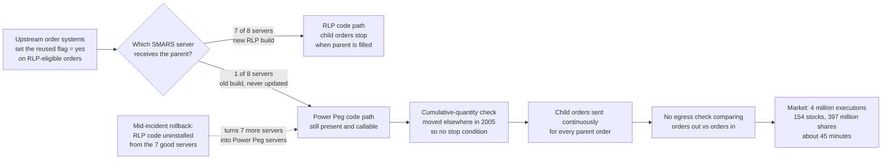

# Case Study: Knight Capital Deployment Failure and Reused Feature Flags

> [!summary] Scope
> Analysis of the August 1, 2012 Knight Capital $460 million trading disaster documented in SEC Release No. 34-70694.
> Details how manual server-by-server deployment left one server running legacy code where a repurposed feature flag inadvertently triggered defunct Power Peg order code in production.
> Extracts rigorous release engineering rules for automated atomic fleet deployment, configuration immutability, and dead-flag decommissioning.
> Links the operational breakdown to foundational exchange architecture and automated risk controls.

Almost every popular retelling of this incident adds details that are not in the public record.
This note treats the SEC order (Release No. 34-70694, October 16, 2013) as the authoritative source and cites it by paragraph number, written here as "Order para N" or "Order fn N" for a footnote.
Knight's own 8-K filings supply the financial figures, and anything sourced only from secondary retellings is labeled as such.
Knight's source code, flag encoding, and server topology were never published, so every code listing in this note is a labeled reconstruction that models the mechanism the SEC describes, not Knight's code.
The order is a settled administrative order: Knight consented to it "without admitting or denying the findings" (Order Section II), so its facts are the SEC's findings, not a court's.



## Incident Timeline

The table separates what the SEC order states from what only secondary sources claim.

| When | Event | Source |
|---|---|---|
| 2003 | Knight stops using the Power Peg functionality in SMARS, its automated equity order router, and elects to leave the code on the production servers. | Order para 14, para 41 |
| 2005 | Knight moves the "tracking of cumulative shares function in the Power Peg code to an earlier point in the SMARS code sequence", accessing that code to use the cumulative-quantity functionality in another application; Power Peg is not retested afterward. | Order para 14, para 41 |
| November 2010 | The SEC adopts Rule 15c3-5, the Market Access Rule. | Order para 5 |
| July 14, 2011 | Initial compliance date of Rule 15c3-5; on June 30, 2011 the SEC extended certain requirements to November 30, 2011. | Order para 9, fn 2 |
| Beginning before July 14, 2011 | Knight's compliance department starts assessing its controls; the assessment "largely focused on compiling an inventory" and "did not consider possible problems within SMARS". | Order para 28 |
| August 2011 | Knight adopts written supervisory procedures (WSPs) for Rule 15c3-5 reviews. | Order para 30 |
| October 2011 | Test data from a weekend disaster-recovery test stays in use; Knight's Lead Market Making (LMM) desk quotes from it on Monday morning and loses nearly \$7.5 million; the fix is narrow. | Order para 33 |
| March 2012 | Knight's CEO signs the annual 15c3-5 certification, which certifies "processes" rather than compliance. | Order para 34, para 45 |
| July 2012 | The LMM desk is finally added to the written description of risk controls, nearly a year after the compliance date. | Order para 29 |
| July 3, 2012 | The SEC approves the NYSE Retail Liquidity Program (RLP) as a 12-month pilot, with exemptions from Rule 612(c) of Regulation NMS. | Order fn 5 (Release No. 34-67347) |
| July 27, 2012 onward | Knight deploys the new RLP code to SMARS "in stages by placing it on a limited number of servers in SMARS on successive days"; one technician does not copy the new code to one of the eight servers, and no second technician reviews the deployment. | Order para 15 |
| July 31, 2012 | End of the staged deployment window. | Secondary only (Seven 2014); the order gives no end date |
| August 1, 2012, from about 8:01 a.m. ET | RLP-eligible orders designated for pre-market trading reach SMARS; an internal system emails "BNET reject" messages that reference SMARS and say "Power Peg disabled"; 97 arrive before the open; nobody acts on them. | Order para 19, fn 6 |
| 9:30 a.m. ET | Market opens; the seven updated servers handle RLP orders correctly; orders carrying the repurposed flag that reach the eighth server trigger Power Peg. | Order para 16; para 19 (9:30 a.m. open) |
| First 45 minutes after the open | For 212 incoming parent orders, SMARS sends millions of child orders; 4 million executions in 154 stocks, more than 397 million shares. | Order para 1, para 17; Press Release 2013-222 ("first 45 minutes after the market opened") |
| During the 45 minutes | Knight stays connected to the market while its technology staff diagnose; in one attempt it uninstalls the new RLP code from the seven correctly deployed servers, which makes incoming parent orders trigger Power Peg on those servers too. | Order para 10, para 27 |
| End of the window | Knight holds an approximately \$3.5 billion net long position in 80 stocks and an approximately \$3.15 billion net short position in 74 stocks. | Order para 1, para 17 |
| August 1 to 2, 2012 | A Knight statement quoted in the press attributes the problem to "the routing of shares of approximately 150 stocks to the NYSE" in its market-making unit and says it told clients to route listed orders away. NYSE cancels trades in six symbols (WZE, CO, UTG RT, EJ, 6ARC, KWK) beyond per-symbol price cutoffs. | Mondo Visione, August 2, 2012 (press report quoting Knight and the NYSE list) |
| August 2, 2012 | Knight reports it has traded out of the entire erroneous position at a realized pre-tax loss of approximately \$440 million, that "this software has been removed from the company's systems", that the issue "was limited to the routing of certain listed stocks to NYSE", and that clients were not negatively affected. | Knight 8-K Exhibit 99.1, August 2, 2012 |
| August 6, 2012 | Knight announces \$400 million of 2% convertible preferred stock (convertible at \$1.50 per share, about 267 million common shares) from Jefferies, Blackstone, GETCO, Stephens, Stifel, and TD Ameritrade. | Knight 8-K and Exhibit 99.1, August 6, 2012 |
| October 17, 2012 | Q3 results: consolidated net loss of \$389.9 million (\$602.9 million before income tax benefits), including pre-tax losses of \$461.1 million related to the August 1 issue and subsequent related costs. | Knight Q3 2012 release |
| December 19, 2012 | Knight and GETCO announce an Agreement and Plan of Merger. | Knight 8-K, December 19, 2012 |
| July 1, 2013 | Knight Capital Group and GETCO combine to form KCG Holdings, Inc. | Order para 11 |
| October 16, 2013 | SEC order: censure, cease-and-desist, \$12 million civil penalty, independent consultant; the SEC calls it its first enforcement action under the Market Access Rule. | Order Section IV, para 51; Press Release 2013-222 |

Three loss figures circulate, and all three are correct for what they measure.
\$440 million is the realized pre-tax trading loss Knight reported on August 2, 2012.
\$461.1 million is the Q3 2012 figure that includes "subsequent related costs".
"More than \$460 million" is the SEC's rounded figure (Order para 1, para 10); para 17 says Knight "realized a \$460 million loss on these positions".

One wording trap: the SEC press release says the router "rapidly sent more than 4 million orders into the market", while the order itself says "millions of orders" producing "over 4 million executions" (Order para 1).
The order is the operative document; 4 million is the execution count, and the order gives no exact order count.
Neither count can be derived from the other, because one child order can fill in several partial executions, so treat "4 million orders" (press release) and "4 million executions" (order) as two separate measures.

A second trap is the stock count.
Knight's initial statement, as quoted by Mondo Visione on August 2, 2012, said "approximately 150 stocks"; the SEC's final count of stocks with executions is 154 (Order para 17).

### The system and the market context

Knight was a broker-dealer whose aggregate trading "generally represented approximately ten percent of all trading in listed U.S. equity securities" in 2011 and 2012, and SMARS alone represented "approximately one percent or more" (Order para 11).
SMARS is described as "an automated, high speed, algorithmic router that sends orders into the market for execution" (Order para 12); the SEC order never expands the acronym.
Its core contract: receive a parent order from other components of Knight's trading platform and, "as needed based on the available liquidity", send one or more child orders to external venues (Order para 12).
The 212 parent orders were "small retail orders that Knight had received from its customers" (Order para 1), which is why the amplification ratio is so large.
The RLP was an NYSE pilot for retail order flow that needed sub-penny price improvement, which is why its approval carried exemptions from Regulation NMS Rule 612(c), the minimum pricing increment rule (Order fn 5).
To let its customers take part from launch day, August 1, 2012, Knight changed several order-handling systems, including new SMARS code (Order para 12).

## Mechanism Root Cause

No single fault caused the loss.
Five independent conditions had to line up, and each one was invisible on its own.

### Fault 1: dormant code whose termination invariant was cut in 2005

The SEC states the invariant precisely: "as child orders were executed, a cumulative quantity function counted the number of shares of the parent order that had been executed", and this "instructed the code to stop routing child orders after the parent order had been filled completely" (Order para 14).
That counter was the only stop condition the Power Peg loop had.
In 2005 Knight moved the cumulative-quantity tracking "to an earlier point in the SMARS code sequence" and used it in another application, but did not retest Power Peg "to determine whether Power Peg would still function correctly if called" (Order para 14, para 41).
From then on the Power Peg path was still present and callable (Order para 13), yet had no stop condition: it "continuously sent child orders, in rapid sequence, for each incoming parent order without regard to the number of share executions Knight had already received from trading centers" (Order para 16).
The SEC adds a detail that matters for architecture: "Although one part of Knight's order handling system recognized that the parent orders had been filled, this information was not communicated to SMARS" (Order para 16).
The fill knowledge existed in the firm, but not at the component that emitted orders.

This is a general hazard of retained-but-unused code: an invariant that a dead path depends on can be refactored away by a change that tests correctly for every live path.
Nothing exercises the dead path, so nothing fails.
The defect then sits latent for seven years, from 2005 to 2012, until something makes the path live again.
The SEC names this class of failure directly in its list of violations: Knight lacked controls "to prevent the activation of code no longer intended for use in Knight's current operations but left on its servers that were accessing the market" (Order para 9.D).

### Fault 2: a reused flag is a semantic collision in a message contract

The RLP code "repurposed a flag that was formerly used to activate the Power Peg code", and Knight "intended to delete the Power Peg code so that when this flag was set to 'yes,' the new RLP functionality, rather than Power Peg, would be engaged" (Order para 13).
The SEC also writes that "orders sent with the repurposed flag to the eighth server triggered the defective Power Peg code" (Order para 16).
So the flag traveled with each order: it was an attribute on the parent-order message set by upstream systems, not a fleet-wide runtime toggle that someone flipped in a configuration service.
The seed and many retellings call it a "feature flag"; that is right in effect, because it selected a code path, but its delivery mechanism was a field in a message.
The SEC does not say whether it was a FIX tag, a bit in an internal binary format, or a field in some other encoding, so this note does not guess.

Once the flag is understood as a message field, the failure is a familiar wire-protocol bug.
A message format is a contract between producers and consumers, and a field identifier has one meaning for the life of that contract.
Reusing the identifier gives one bit pattern two meanings, and which meaning applies depends on the consumer's build.
Protocol Buffers documents exactly this failure and forbids it: "Field numbers should never be reused", because "Reusing a field number makes decoding wire-format messages ambiguous" and the wire format does not "provide a way to detect fields encoded using one definition and decoded using another" (proto3 Language Guide, "Consequences of Reusing Field Numbers").
The guide lists the outcomes as lost debugging time, "A parse/merge error (best case scenario)", leaked PII, and data corruption, and names the two common causes: renumbering fields, and "deleting a field and not reserving the number to prevent future reuse".
Knight's case is worse than any item on that list: the old consumer did not misparse the data, it executed a different trading algorithm.

A new flag identifier would have made the mixed fleet safe.
The proto3 guide states what happens when "an old binary parses data sent by a new binary with new fields": those fields "become unknown fields in the old binary" (proto3 Language Guide, "Unknown Fields").
An old server receiving an unknown new flag would have ignored it or rejected the order, and either way it could not have run Power Peg.
Reuse is what turned "one server is stale" into "one server runs a different algorithm on the same input".

One subtlety of the safe path is worth knowing before relying on it.
Proto3 messages "preserve unknown fields and include them during parsing and in the serialized output", so an old intermediary forwards a new field it does not understand (proto3 Language Guide, "Unknown Fields").
That is what makes new identifiers safe through relays, and it also means a reused identifier propagates intact through every old hop until it reaches a consumer that assigns it the old meaning.

### Fault 3: a fleet that never converged

"One of Knight's technicians did not copy the new code to one of the eight SMARS computer servers", "Knight did not have a second technician review this deployment and no one at Knight realized that the Power Peg code had not been removed from the eighth server, nor the new RLP code added", and "Knight had no written procedures that required such a review" (Order para 15).
More broadly, Knight "did not have written code development and deployment procedures for SMARS (although other groups at Knight had written procedures)" (Order para 26).
The deployment was a file copy repeated per host, spread over successive days.
Nothing compared the fleet against the release: no inventory of which build each host was running, no digest check, and no gate between "binary copied" and "flag is now emitted by upstream systems".
The release also had two halves owned by different systems: the SMARS binary on eight hosts, and the upstream behavior of setting the flag on RLP-eligible orders.
The second half went live everywhere on August 1, whatever state the first half was in.

Staged rollouts make this structural, not accidental.
A deployment across 8 hosts over several days passes through a sequence of fleet states, each with some number k of hosts on the new build.
With a reused flag, every state with 0 < k < 8 is unsafe the moment the producer emits the flag, and so is k = 0 after the producer starts.
With a fresh flag identifier, every one of those states is safe, because the old build cannot assign the new identifier any meaning.

| Fleet state (hosts on new build) | Reused flag, producer on | Fresh flag, producer on |
|---|---|---|
| 8 of 8 (converged) | safe | safe |
| 1 to 7 of 8 (staged or partial) | unsafe on every stale host | safe, stale hosts ignore or reject |
| 0 of 8 (before deploy, or after full rollback) | unsafe on every host | safe, all hosts ignore or reject |

### Fault 4: a rollback that was incompatible with live inputs

During the incident, "Knight uninstalled the new RLP code from the seven servers where it had been deployed correctly", which "worsened the problem, causing additional incoming parent orders to activate the Power Peg code that was present on those servers, similar to what had already occurred on the eighth server" (Order para 27).
The rollback was mechanically correct: it restored the previous build.
It was semantically wrong because the upstream systems kept setting the reused flag, and the previous build interpreted that flag as Power Peg.
In the fleet-state table above, the rollback moved the fleet from the "7 of 8" row to the "0 of 8" row while the producer was still on.
A rollback is only safe if the old version is compatible with every input still flowing, including message fields, configuration, flags, and schema.
Rolling back the consumer while the producer keeps emitting the new meaning recreates Fault 2 on every host you roll back.
The safe order would have been the reverse: disconnect SMARS from the market, or stop the producer from setting the flag, and only then touch binaries.

### Fault 5: no invariant at the egress point

Knight had controls upstream of SMARS in its customer interface, order management system, and internal execution system (Order para 20).
It did not have "sufficient controls to monitor the output from SMARS, such as a control to compare orders leaving SMARS with those that entered it", nor "procedures in place to halt SMARS's operations in response to its own aberrant activity" (Order para 21).
The controls that did exist each had a gap that August 1 fell through:

- A price collar capped a parent's limit price, and therefore its child orders' prices, at 9.5 percent below the National Best Bid for sells or above the National Best Offer for buys, measured when SMARS received the parent.
  It could not catch erroneous orders while the NBBO moved less than 9.5 percent, and it did not apply at all to orders received before the open for the opening auction, which is what the 212 parent orders were (Order para 21).
- The "33 Account" temporarily held several kinds of positions, including executions Knight's systems could not match to an unfilled parent quantity; it had a \$2 million gross position limit that was not linked to any automated control, and because it mixed sources, staff "could not quickly determine the nature or source of the positions accumulating" (Order para 23, para 24).
- Position limits for some trading groups did not count exposure from outstanding orders, and there were no firm-wide pre-set capital thresholds linked to automated order-entry controls (Order para 22).
  Automatic shutdown existed only for "certain strategies of one of its trading groups when their P&L limits are exceeded" (Order fn 7).
- PMON, the primary risk monitor, was post-execution, relied entirely on humans, generated no automated alerts, did not display limits, and lagged during the high volume of August 1, "resulting in reports that were inaccurate"; senior staff saw the 33 Account position growing at the open, but PMON could not stop order entry (Order para 25).

The result: every unmatched execution landed in an account whose limit nothing enforced, while a human-watched screen fell behind.

### Mapping the SEC's violations to the five faults

The order's findings are legal conclusions under Rule 15c3-5, but each maps onto an engineering fault.

| Order para 9 finding | Rule | Engineering fault |
|---|---|---|
| A: no controls to prevent erroneous orders "at a point immediately prior to the submission of orders to the market" by SMARS | 15c3-5(c)(1)(ii) | Fault 5, no egress invariant |
| B: no controls to prevent orders exceeding firm-wide pre-set capital thresholds; reliance on controls "not capable of preventing the entry of orders" | 15c3-5(c)(1)(i) | Fault 5, post-trade monitoring only |
| C: inadequate written description of risk controls | 15c3-5(b) | Inventory gap behind every fault |
| D: no technology governance "sufficient to ensure the orderly deployment of new code or to prevent the activation of code no longer intended for use"; no incident-response procedures | 15c3-5(b) | Faults 1, 3, and 4 |
| E: inadequate review of business activity to assure control effectiveness | 15c3-5(e)(1) | Reviews that never imagined a SMARS malfunction |
| F: defective 2012 CEO certification | 15c3-5(e)(2) | Certification of "processes" rather than compliance |

Fault 2, the flag reuse itself, has no row: the order describes it as a fact (Order para 13) but frames the failure as missing deployment and code-governance controls, not as a message-design error.
The order also finds the violations willful, which in this context means only "that the person charged with the duty knows what he is doing", not awareness of breaking a rule (Order para 49, fn 12).

### A reconstruction of the mechanism

This model is a minimal Python reconstruction of the SEC's description, not Knight's code.
The `budget` parameter stands in for "until a human intervenes", because the real Power Peg path had no internal stop.

```python
FLAG_RLP = 1 << 3  # bit 3: meant "Power Peg" in the old build, "RLP" in the new one

def route(build, flags, parent_qty, fill_per_child=100, budget=50):
    """Return the number of child orders sent for one parent order."""
    if not flags & FLAG_RLP:
        return 0
    sent = filled = 0
    if build == "new":                 # RLP path: stops when the parent is filled
        while filled < parent_qty:
            sent += 1
            filled += fill_per_child
        return sent
    while sent < budget:               # old Power Peg path: fill check moved out in 2005
        sent += 1                      # 'budget' stands in for "until a human intervenes"
    return sent

def day(fleet, n_orders=16, qty=500):
    return sum(route(fleet[i % len(fleet)], FLAG_RLP, qty) for i in range(n_orders))

print("partial deploy :", day(["new"] * 7 + ["old"]))
print("after rollback :", day(["old"] * 8))
print("full deploy    :", day(["new"] * 8))
```

The model makes the three regimes easy to compare.
With a fully converged new fleet, every parent stops at its fill quantity.
With one stale host, the parents routed to that host run without bound.
After the "rollback", every host runs without bound, so the rollback multiplies the damage instead of containing it.
Interview Question 4 asks for this script's output.

### The blast radius, in derived numbers

Every input in this table comes from the SEC order; the ratios are arithmetic on those inputs, not additional facts.

| Quantity | Value | Derivation |
|---|---|---|
| Executions per parent order | about 18,900 | 4,000,000 / 212 |
| Shares per parent order | about 1.87 million | 397,000,000 / 212 |
| Execution rate | about 1,480 per second | 4,000,000 / 2,700 s |
| Share rate | about 8.8 million per minute | 397,000,000 / 45 |
| Gross unwanted position | about \$6.65 billion | \$3.5 billion long + \$3.15 billion short |
| Gross position accrual | about \$148 million per minute | \$6.65 billion / 45 |
| Gross position vs 33 Account limit | about 3,300 times | \$6.65 billion / \$2 million |
| Warning lead time before open | about 89 minutes, 97 emails | 8:01 to 9:30 a.m. (Order para 19) |
| Latency of the 2005 defect | about 7 years | 2005 to 2012 |
| Time from discontinuation to firing | about 9 years | 2003 to 2012 |
| SEC penalty vs loss | about 2.6 percent | \$12 million / \$460 million |

The market impact was not confined to Knight.
For 75 stocks Knight's executions were more than 20 percent of volume and contributed to price moves above 5 percent; for 37 of those the price moved more than 10 percent and Knight was more than 50 percent of volume (Order para 18).
Other participants received prices better or worse than they would have otherwise (Order para 18).
Many of the child orders were short sales that Knight marked "long" and for which it obtained no locate, which violated Regulation SHO Rules 200(g) and 203(b) (Order para 35, para 48).
The router had no knowledge that its runaway sells were short, because the position it was building was one nobody intended.

## Detection Gap

The question for a toolchain engineer is why the normal quality gates were blind.
Each layer in this section was looking somewhere other than where the defect lived.

### Unit and integration tests tested the new build, not the fleet

Testing a release proves properties of an artifact.
The defect that fired on August 1 was a property of the fleet, namely that one host ran a different artifact, together with the property of an old artifact that nobody was shipping.
A test environment built from the new release cannot contain a stale host unless someone deliberately creates one.
Seven-of-eight mixed-version states are exactly what staged rollouts produce, so they need to be tested as states in their own right.
The SEC order makes no finding about how the RLP code itself was tested; Doug Seven's widely read retelling asserts that it "was thoroughly tested", but cites no source for that, so this note treats the RLP code's test status as unknown.

### The dead path had no tests at all

Knight "did not retest the Power Peg code after moving the cumulative quantity function" in 2005 (Order para 14), and had no "written protocol concerning the accessing of unused code on its production servers, such as a protocol requiring the testing of any such code after it had been accessed" (Order para 26).
Code that is retained but unused is not covered by tests that run live paths, and nothing in a typical test report says "this reachable branch has no test".
The real choices are to delete the code or to keep it tested.
Keeping it untested means it still ships, still runs if reached, and is never checked.
Hodgson's description of release toggles states the same hazard from the other direction: they "allow incomplete and un-tested codepaths to be shipped to production as latent code which may never be turned on" (Hodgson 2017).
Power Peg was the mirror image: tested code that became untested latent code once its invariant was moved.

### Code review saw a diff, not a contract

A reviewer looking at the RLP diff would have seen a reasonable change: the flag's handler now calls RLP instead of Power Peg, and the Power Peg body is deleted.
Within the new build, that is correct.
The danger is only visible if the reviewer asks what every other consumer of this flag does when it sees the flag, including old builds that will still be running during and after the rollout.
That question concerns a contract across versions, and per-diff review cannot answer it unless the contract is written down somewhere: a schema, a flag registry, or a reserved-identifier list.
It is the same blind spot that ABI review has for shared libraries, where a change is safe or unsafe only relative to binaries already deployed; [[Versioning-SemVer-CalVer-and-ABI]] owns that framing.

### Deployment verification did not exist

No second technician and no written procedure (Order para 15, para 26).
The SEC's own counterfactual is that "a written procedure requiring a simple double-check of the deployment of the RLP code could have identified that a server had been missed and averted the events of August 1" (Order para 41).
A machine check is stronger than a human double-check, and it is the toolchain lesson: compare each host's running build identity against the release manifest and refuse to proceed until they match.

A subtle trap: checking the file on disk is not the same as checking the running process.
The usual way to replace a binary is to write the new file and rename it over the old path, because rename(2) replaces an existing target atomically ("If newpath already exists, it will be atomically replaced"), and because open(2) documents `ETXTBSY` when "path refers to an executable image which is currently being executed and write access was requested" (Linux man-pages 6.19, as of 2026-11).
After the rename, the old process keeps executing the old inode, which no longer has a name.
On Linux, `/proc/PID/exe` is a link to the running executable, "attempting to open it will open the executable", and "If the pathname has been unlinked, the symbolic link will contain the string ' (deleted)' appended to the original pathname" (proc_pid_exe(5)).
Hashing the path on disk proves what will run after the next restart; hashing `/proc/PID/exe`, or reading the build identity embedded in that image, proves what is running now.
Reading that link is itself gated: "Permission to dereference or read (readlink(2)) this symbolic link is governed by a ptrace access mode PTRACE_MODE_READ_FSCREDS check" (proc_pid_exe(5)), so the verifier needs the same user as the process or the matching privilege.

Two embedded identities are worth knowing.
GNU ld's `--build-id` writes a `.note.gnu.build-id` note whose md5, sha1, or xx styles are "always the same in an identical output file", and which survives later tools: "A linked file may be changed later by other tools, but the build ID bit string identifying the original linked file does not change"; the manual also warns it "is not intended to be compared as a checksum for the file's contents" (GNU ld Options).
GNU ld's `--package-metadata=JSON` writes a `.note.package` section carrying package metadata in JSON (GNU ld Options), which lets a binary report the release it came from.
Build IDs, stripping, and debug-symbol separation are owned by [[Cpp-Hardened-Release-Builds-and-Separate-Debug-Symbols]].

### The pre-open signal was an email, not an alert

The 97 "Power Peg disabled" BNET reject emails were sent to a group of Knight personnel in real time from about 8:01 a.m. and "were caused by the code deployment failure", but "Knight did not design these types of messages to be system alerts, and Knight personnel generally did not review them when they were received" (Order para 19).
They "were not acted upon before the market opened and were not used to diagnose the problem after the open" (Order para 19).
The pre-market orders that produced them "were distinct from the 212 incoming parent orders that led to the executions" (Order fn 6).
The string literally named the dead feature.
A rule as simple as "any log line naming a retired feature is a page" would have fired 89 minutes before the open, and the SEC says integrating these messages into monitoring "likewise could have prevented the events of August 1" (Order para 41).
Why pre-market RLP orders produced a "Power Peg disabled" reject rather than executions is not explained in the public record.

### Risk controls watched outcomes and could not stop orders

PMON was post-execution and human-read (Order para 25).
The 33 Account limit was not enforced (Order para 23).
The 9.5 percent collar did not apply to pre-open auction orders (Order para 21).
None of these controls sat at the egress point, and none could say "this component is sending more than it was asked to send".
The SEC's legal finding is exactly that: no controls "at a point immediately prior to the submission of orders to the market" by SMARS (Order para 9.A, para 38).

### Incident response had no stop rule

Knight "did not have supervisory procedures concerning incident response" and "relied primarily on its technology team to attempt to identify and address the SMARS problem in a live trading environment" while the system "continued to send millions of child orders" (Order para 27).
While staff worked the problem, "Knight remained connected to the markets and continued to send orders in certain listed securities" (Order para 10).
The SEC states the missing rule directly: Knight "needed clear guidance for its technology personnel as to when to disconnect a malfunctioning system from the market" (Order para 42).
Without a stop rule, the team diagnosed while still connected, and its diagnostic change, the rollback, widened the blast radius.

### Reviews inventoried controls instead of imagining failures

Knight's 15c3-5 assessment "largely focused on compiling an inventory of Knight's existing controls and confirming that they functioned as intended" and "did not consider possible problems within SMARS or the consequences of potential malfunctions in SMARS" (Order para 28).
Later periodic reviews "did not consider whether Knight needed controls to limit the risk that SMARS could malfunction, nor ... whether Knight needed controls concerning code deployment or unused code residing on servers" (Order para 32).
The WSP meant to evaluate control reasonableness did not require evaluating controls "to reject orders that exceed pre-set capital thresholds in the aggregate for the firm or that indicate duplicative orders" (Order para 31).
The inventory itself was incomplete: the September 2011 narrative omitted the proprietary Electronic Trading Group, and the LMM desk was not added until July 2012 (Order para 29).
After the October 2011 incident, Knight limited the system to market hours, made it stop quoting after an execution, and added a disaster-recovery checklist item; it "did not broadly consider whether it had sufficient controls to prevent the entry of erroneous orders, regardless of the specific system that sent the orders" and had no "mechanism to test whether their systems were relying on stale data" (Order para 33).
The SEC's summary: Knight "reacted to the events narrowly, limiting its responses to changes designed to prevent the exact problem at hand from recurring" (Order para 44).
An inventory confirms that each listed control works; it cannot find a control that was never listed.
Daniel M. Hawke, chief of the SEC Enforcement Division's Market Abuse Unit, put the alternative as a question every component owner should answer: "what would happen if the component malfunctions and what safety nets are in place to limit the harm it could cause" (Press Release 2013-222).

### A caveat on hindsight

John Allspaw's response to the SEC order argues that its "could have" statements are counterfactuals, a distraction because "it brings sharply into focus what didn't happen, when what is required for explanation is to understand why people did what they did", and warns about hindsight bias and outcome bias (Allspaw 2013).
He also asks what "sources of confidence" Knight drew on when it judged its controls adequate.
That critique is right about method: the SEC's job was to establish violations of Rule 15c3-5, not to reconstruct the operators' view of the system.
The engineering lessons in the Architectural Lessons section are therefore framed as mechanisms that hold regardless of who was at the keyboard, not as "the technician should have been careful".

## Remediation and Fix

### What Knight did, per the public record

On August 2, 2012 Knight reported that "this software has been removed from the company's systems" and that it had "traded out of its entire erroneous trade position" (Knight 8-K, August 2, 2012).
On August 6 it raised \$400 million to restore its capital base, committed to add three board members, and repeated that "the software that led to the August 1, 2012 trading issue was removed from the company's systems" (Knight 8-K Exhibit 99.1, August 6, 2012).
In accepting the settlement the SEC "considered remedial acts that Knight undertook and the cooperation that Knight afforded" (Order para 50), without listing those acts.
Knight never published the code-level fix, the flag redesign, or its deployment tooling changes.

### What the SEC required

The order's undertakings require an independent consultant to review Knight's "software development lifecycle processes for all of Knight's business critical systems and applications, including trading systems, finance, risk, and compliance" and its controls for "(a) deployment of new software and code; (b) order routers; (c) firm-wide capital thresholds and the linkage, on an automated, pre-trade basis, of such thresholds to the entry of orders; and (d) incident response protocols" (Order para 51.A).
Knight had to adopt the recommendations or negotiate an alternative the consultant accepted, the consultant had to certify implementation within 60 days of notice, and a final review followed within 180 days of that certification (Order para 51.F to 51.I).
The sanctions were a censure, a cease-and-desist order, and a \$12 million civil penalty payable within ten days (Order Section IV).
The four review areas in para 51.A read as a checklist of this note's faults: deployment (Fault 3), order routers (Faults 1 and 5), automated pre-trade capital linkage (Fault 5), and incident response (Fault 4).

### The engineering fixes, as code and configuration

The public record does not say how Knight implemented its fixes.
The six mechanisms in this section each close one or more of the five faults, and each is shown in a form a release engineer can adopt.

#### 1. Gate flag activation on fleet convergence (closes Fault 3)

A release is complete only when every host reports the target build identity, and the behavior change, here the upstream flag, is enabled only after that.

```bash
#!/usr/bin/env bash
# Illustrative gate: exit non-zero unless every host is RUNNING the expected binary.
# Usage: fleet-gate.sh <expected-sha256> <host>...
set -euo pipefail
expected="$1"
shift
drift=0
for host in "$@"; do
  # Hash the image of the running process, not the file on disk.
  got=$(ssh -o BatchMode=yes "$host" \
    'sha256sum "/proc/$(pgrep -o -x router)/exe" | cut -d" " -f1') || got="unreachable"
  if [[ "$got" != "$expected" ]]; then
    printf 'DRIFT host=%s running=%s\n' "$host" "$got"
    drift=$((drift + 1))
  fi
done
printf 'hosts=%d drift=%d\n' "$#" "$drift"
exit $((drift > 0))
```

The script is illustrative and was not run for this note; it assumes Linux hosts, a process named `router`, and SSH access as a user that passes the `PTRACE_MODE_READ_FSCREDS` check for that process.
An unreachable host, a missing process, and a stale process all count as drift, because "cannot prove convergence" must block the release exactly like "proved divergence".
If the release pipeline strips or signs binaries after linking, compare the build ID instead of a file hash, or hash the exact artifact that was shipped, not a pre-strip copy.
Production systems usually get the same guarantee from an orchestrator that deploys immutable artifacts by digest and reports per-host status.
Artifact immutability and digest addressing are covered in [[OCI-Images-Layers-Multi-Stage-and-Distroless]] and [[Release-Trains-Backports-and-Artifact-Registries]].

#### 2. Never reuse a flag identifier; tombstone it (closes Fault 2)

Retire an identifier by reserving it, so the toolchain rejects any reuse.
Protocol Buffers enforces this at compile time: "The protoc compiler will generate error messages if any future developers try to use these reserved field numbers" (proto3 Language Guide, "Reserved Field Numbers").
The guide's rule for deletion is explicit: when deleting a field "you must reserve the deleted field number", and "You should also reserve the field name to allow JSON and TextFormat encodings of your message to continue to parse" (proto3 Language Guide, "Deleting Fields").

```proto
message ParentOrder {
  reserved 7;              // was power_peg (retired 2003); never reuse the number
  reserved "power_peg";    // keep JSON and TextFormat parsing stable too
  bool rlp_eligible = 12;  // new behavior gets a new number and a new name
}
```

Three details of the proto rules matter in practice.
Field numbers and names cannot be mixed in one `reserved` statement, so the listing uses two.
Reserved names "affect only the protoc compiler behavior and not runtime behavior", apart from some TextProto implementations discarding fields with reserved names (proto3 Language Guide, "Reserved Field Names").
Enums need the same treatment: removing an enum entry without reserving its number lets a later edit reuse the numeric value, which the guide warns can cause "data corruption, privacy bugs, and so on" (proto3 Language Guide, "Reserved Values").
An order-type enum is a flag with more than two values, so it carries Knight's hazard too.

Hand-rolled binary formats and bit flags need the same discipline written into the code and enforced on decode.
Tombstone the bit, and make the decoder fail closed when a retired bit is set.

```cpp
enum class OrderFlag : std::uint32_t {
    kRetiredBit3 = 1u << 3,  // was kPowerPeg; tombstoned, never reassign
    kRlp = 1u << 9,
};
constexpr std::uint32_t kRetiredMask = static_cast<std::uint32_t>(OrderFlag::kRetiredBit3);
[[nodiscard]] constexpr bool has_retired_bit(std::uint32_t raw) { return (raw & kRetiredMask) != 0; }
static_assert(has_retired_bit(1u << 3));
static_assert(!has_retired_bit(static_cast<std::uint32_t>(OrderFlag::kRlp)));
// Decoder: if (has_retired_bit(raw_flags)) reject_order("retired flag bit set");
```

With this rule, old consumers of a new flag see an unknown identifier, and new consumers of an old flag see a retired one.
Both fail visibly, and neither can silently run the wrong algorithm.
The `static_assert` lines turn the tombstone into a compile-time test, so an edit that reassigns bit 3 to a live flag breaks the build.

#### 3. Make producers ask consumers before using a new meaning (closes Faults 2 and 3)

The upstream systems set the flag regardless of which SMARS build would read it.
A capability handshake makes the producer conditional on the consumer: each router advertises the capabilities of its build, such as `rlp-v1`, and the producer sets the RLP field only when the target router advertises it, or only when the whole pool does.
This is the same idea as version negotiation in network protocols, and it turns a mixed fleet from a hazard into a supported state.
It also gives the rollback a safe shape: a router rolled back to a build without `rlp-v1` stops advertising it, so the producer stops sending the field to that router automatically.

#### 4. Delete dead code and expire flags (closes Fault 1)

Hodgson's taxonomy calls release toggles "transitionary by nature", says they "should generally not stick around much longer than a week or two", and recommends treating toggles "as inventory which comes with a carrying cost"; teams add a toggle removal task when a release toggle is introduced, put "expiration dates" on toggles, create "time bombs" that "fail a test (or even refuse to start an application!)" once a toggle outlives its expiry, or cap the number of flags a system may have (Hodgson 2017).
Hodgson cites Knight's "\$460 million dollar mistake" as the cautionary tale for unmanaged flags in that same section.
Uber's Piranha shows the cleanup can be automated at scale: from December 2017 to May 2019 it generated cleanup diffs for 1,381 stale flags (17 percent of all flags), about 200 developers used it to delete 71 KLoC, 65 percent of those diffs landed without changes, and over 85 percent compiled and passed tests (Ramanathan et al. 2020).
Piranha's definition of a stale flag is precise and useful: one where "the execution path corresponding to the flag is the same across all app instances"; it also names orphaned flags, whose owners have left, and forgotten flags (Ramanathan et al. 2020).
Power Peg's flag was stale by that definition from 2003 to 2012, which is exactly why reusing it looked harmless.
The rule for Knight's situation is stricter than flag hygiene: when a feature is discontinued, delete its code in the same release train, because retained code keeps its old trigger and loses its tests.
Delete the code first, verify every host runs the deletion, and only then give the old behavior's trigger to anything new, under a new identifier.

#### 5. Put an independent invariant at the egress point (closes Fault 5)

The SEC's specific gap was the absence of a control that compares orders leaving SMARS with orders that entered it (Order para 21).
The check belongs at the last point before the venue session, owned by a component that does not trust the router's own fill accounting.
This sketch was checked once with Apple clang 21 using `c++ -std=c++20 -Wall -Wextra -Wpedantic -fsyntax-only` on macOS (darwin-arm64) on 2026-11-15, with no diagnostics; it is illustrative, not a certified risk system.

```cpp
#include <atomic>
#include <cstdint>
#include <unordered_map>

// Egress invariant owned by the gateway, not by the router that produced the order.
// Single writer: the gateway thread calls on_parent/allow_child/on_child_cancelled.
// Any thread (operator console, risk monitor) may call kill().
class EgressGuard {
public:
    struct Limits {
        std::int64_t max_gross_notional_cents;  // firm-wide, pre-trade, all accounts
        std::uint32_t max_children_per_parent;  // duplicative-order bound
        std::int64_t max_child_qty;             // per-order size parameter
    };

    explicit EgressGuard(Limits limits) : limits_(limits) {}

    // Registers a parent as it ENTERS the router; a reused parent id is itself a fault.
    [[nodiscard]] bool on_parent(std::uint64_t parent_id, std::int64_t parent_qty) {
        if (parent_qty <= 0) return trip();
        auto [it, inserted] = parents_.try_emplace(parent_id, Parent{parent_qty, 0, 0});
        (void)it;
        return inserted ? true : trip();
    }

    // Called for every child immediately before it is written to a venue session.
    [[nodiscard]] bool allow_child(std::uint64_t parent_id, std::int64_t qty,
                                   std::int64_t px_cents) {
        if (killed_.load(std::memory_order_acquire)) return false;
        if (qty <= 0 || qty > limits_.max_child_qty || px_cents <= 0) return trip();
        auto it = parents_.find(parent_id);
        if (it == parents_.end()) return trip();  // child with no known parent
        Parent& p = it->second;
        // Count quantity SENT (open + filled), not fills reported back:
        // the check must hold even when fill feedback never arrives.
        if (p.committed_qty + qty > p.parent_qty) return trip();
        if (p.children + 1 > limits_.max_children_per_parent) return trip();
        const std::int64_t notional = qty * px_cents;  // bounded by max_child_qty
        if (gross_cents_ + notional > limits_.max_gross_notional_cents) return trip();
        p.committed_qty += qty;
        p.children += 1;
        gross_cents_ += notional;  // never decremented: conservative by design
        return true;
    }

    // Cancel acknowledged by the venue: the unfilled remainder may be re-sent.
    void on_child_cancelled(std::uint64_t parent_id, std::int64_t unfilled_qty) {
        auto it = parents_.find(parent_id);
        if (it == parents_.end() || unfilled_qty < 0 ||
            unfilled_qty > it->second.committed_qty) {
            trip();
            return;
        }
        it->second.committed_qty -= unfilled_qty;
    }

    void kill() { killed_.store(true, std::memory_order_release); }
    [[nodiscard]] bool killed() const { return killed_.load(std::memory_order_acquire); }

private:
    struct Parent {
        std::int64_t parent_qty;
        std::int64_t committed_qty;
        std::uint32_t children;
    };

    bool trip() {
        kill();  // the caller must also cancel open orders and drop venue sessions
        return false;
    }

    Limits limits_;
    std::unordered_map<std::uint64_t, Parent> parents_;
    std::int64_t gross_cents_ = 0;
    std::atomic<bool> killed_{false};
};
```

The key design choice is the comment in `allow_child`: the guard counts quantity committed to the market, not fills reported back.
Knight's failure began when fill knowledge did not reach SMARS (Order para 16); a guard that relied on fill reports would have failed the same way.
Every anomaly trips the guard rather than returning a soft error, including inconsistent cancel reports, because a guard that tolerates impossible states is not an invariant.
The gross notional counter is never decremented, so it bounds the day's total order flow, not the net position; a production design would add a separate, reconciled position limit, at the cost of trusting fill and cancel feedback for that limit only.
The `max_child_qty` bound also keeps `qty * px_cents` far from signed overflow for any realistic price.

The limits map onto the rule text.
Rule 15c3-5(c)(1)(i) requires controls reasonably designed to "Prevent the entry of orders that exceed appropriate pre-set credit or capital thresholds in the aggregate for each customer and the broker or dealer", "by rejecting orders"; that is `max_gross_notional_cents`.
Rule 15c3-5(c)(1)(ii) requires controls to "Prevent the entry of erroneous orders, by rejecting orders that exceed appropriate price or size parameters, on an order-by-order basis or over a short period of time, or that indicate duplicative orders"; that is `max_child_qty`, `max_children_per_parent`, and the committed-quantity check (17 CFR 240.15c3-5, eCFR text as of 2026-10-01, checked 2026-11).
Rule 15c3-5(d) requires these controls to be "under the direct and exclusive control of the broker or dealer", which is a regulatory reason, beyond the engineering one, for the guard to be a component the firm owns and the router cannot bypass.
The only carve-out, (d)(1), lets the firm allocate control over specific (c)(2) regulatory controls, by written contract and after a thorough due diligence review, to a customer that is a registered broker-dealer; it does not reach the (c)(1) financial controls this guard implements (17 CFR 240.15c3-5(d)(1)).
Low-latency implementations of these checks are an exchange-architecture topic; see [[14-Low-Latency-Systems/02 - Exchange Architecture/War Story - The 2012 Knight Capital Disaster|War Story   The 2012 Knight Capital Disaster]] for the trading-systems view.

#### 6. Roll back in the right order: behavior first, binaries second (closes Fault 4)

For any change that has a producer half and a consumer half, the rollback runbook has three steps in a fixed order:

1. Stop the bleeding without changing code: disconnect from the market or trip the kill switch.
2. Revert the producer half: stop emitting the new flag value, or turn the flag off centrally.
3. Revert the consumer binaries, and only to a version proven compatible with every input still in flight.

Step 1 is the stop rule the SEC said Knight lacked (Order para 42).
Step 3's proof is the fleet-state table from Fault 3 evaluated for the rollback target: if the "0 of 8" row is unsafe while any producer still emits the field, the rollback is forbidden until step 2 completes.
The general runbook is [[Contain-and-Roll-Back-a-Bad-Production-Release]]; the compatibility windows that make rollback safe are owned by [[Progressive-Delivery-Rollbacks-and-Feature-Flags]].

## Architectural Lessons

### Rules that fall out of the mechanism

1. **A flag's identifier is a contract for its whole lifetime.**
   Retiring a meaning means reserving the identifier forever; a new meaning gets a new identifier.
2. **Discontinued means deleted.**
   Retained code keeps its trigger and loses its tests; Knight's dead path waited nine years from discontinuation (2003) to the day it fired (2012).
3. **A deployment is a fleet state, not a sequence of copies.**
   Define it as "every host reports identity D", verify it by machine against the running process, and do not enable behavior until it holds.
4. **Separate deploy from release, and order them.**
   Binaries first everywhere, verified; behavior second.
   Knight's upstream flag release did not depend on the SMARS deployment state.
5. **Mixed-version states are first-class.**
   Every staged rollout passes through N-1/N states; a change is unsafe if any reachable mixed state, including the rollback state, is unsafe.
6. **A rollback is a deployment and must pass the same compatibility check.**
   Old code meeting new inputs is exactly how Knight's rollback multiplied the damage.
7. **Put an invariant at every egress that can spend money.**
   It should be independent of the component it guards, count what was sent rather than what was confirmed, and stop the component rather than just alert.
8. **Treat any mention of a retired feature as a page.**
   "Power Peg disabled" was a 97-message warning that went to email.
9. **Write the stop rule before the incident.**
   When a system that can spend money is misbehaving, disconnect first and diagnose second.
10. **Review controls by imagining failures, not by listing controls.**
    The SEC's criticism of Knight's inventory-style reviews (Order para 28, para 44) applies to any production-readiness checklist.

### How the rules change with scale

For a single team with one service, rules 1 to 4 are a code-review checklist and a deploy script with a running-image identity check.
At 100 to 1,000 engineers, flags and message schemas need a registry with owners and expiry dates, CI that fails on reserved-identifier reuse (`protoc` already does this for Protocol Buffers), and a deploy system that reports per-host identities; [[Packaging-Decision-Records]] is where the organization records these rules.
At 10,000 to 50,000 engineers, mixed-version states are permanent, because no fleet is ever fully converged, so capability negotiation replaces "wait for convergence", and automated stale-flag deletion of the Piranha kind becomes the only practical way to keep flag inventory bounded.
The decision rule: if a component can create financial or safety exposure faster than a human can read a dashboard, the egress invariant and the kill switch must be automatic and independent of the component, whatever the organization's size.
Knight's numbers make "faster than a human" concrete: gross exposure grew at about \$148 million per minute, while the human-read monitor lagged (Order para 25).

### Where this incident sits among its siblings

Knight, [[Case-Study-CrowdStrike-Falcon-Channel-File-291]], and [[Case-Study-Left-Pad-and-Registry-Immutability]] are three failures of release identity.
At Knight, one name, the flag, had two meanings depending on the consumer's version.
At left-pad, one name, a package version, stopped resolving to any artifact.
The CrowdStrike note covers the case where data shipped outside the code release path activated code that had not been validated against it.
The common lesson is that anything that changes what production does, whether code, configuration, flags, content, or dependencies, needs the same identity, immutability, and staged-verification guarantees as the binary.

### Retelling drift, checked against the record

Because this incident is a standard teaching example, its folklore is worth auditing explicitly.
The left column is what a widely read retelling (Seven 2014) says; the right column is what the primary record says.

| Retelling claim | Primary record |
|---|---|
| Knight "went bankrupt in 45-minutes" | Knight was recapitalized with \$400 million on August 6, 2012 and merged with GETCO on July 1, 2013 (Knight 8-K, August 6, 2012; Order para 11) |
| Power Peg had been unused "in 8-years" | Discontinued in 2003, fired in 2012, about nine years (Order para 14) |
| Power Peg's function "was meant to count the shares bought/sold against a parent order" | The counting was the separate cumulative-quantity function inside the Power Peg code; Power Peg itself is described only as discontinued functionality (Order para 13, para 14) |
| Deployment "Between July 27, 2012 and July 31, 2012" | Order says only "Beginning on July 27, 2012 ... on successive days" (Order para 15) |
| The code "was thoroughly tested" | Order makes no finding on testing of the RLP code |
| "8 million shares were being traded every minute" | Consistent with the derived 8.8 million shares per minute from Order para 17, but not a figure in the order |

Seven's account is otherwise faithful on the core mechanism and quotes Order para 15 verbatim, which is why it remains a useful map.

### The regulatory consequence

Knight's was the SEC's first enforcement action under the Market Access Rule (Press Release 2013-222).
In November 2014 the SEC adopted Regulation SCI, which requires "self-regulatory organizations, certain alternative trading systems (ATSs), plan processors, and certain exempt clearing agencies" to maintain comprehensive policies and procedures for their technological systems, with compliance generally due nine months after the rules took effect (Press Release 2014-260).
As adopted, that scope names exchanges and similar market infrastructure, not a broker-dealer's order router as such (as of 2026-11, per the 2014 release; later amendments were not checked).
The release does not name Knight, so this note claims no causal link between the two.
For a broker-dealer router like SMARS, the operative rule remains 15c3-5 (as of 2026-11, eCFR text dated 2026-10-01).

## Numbers to Know

All figures are historical and come from the cited filings, so they do not change; the only dated statements are about current regulation, stamped (as of 2026-11).

| Fact | Value | Source |
|---|---|---|
| SMARS servers | 8, of which 1 was not updated | Order para 15 |
| Parent orders processed by Power Peg | 212 small retail orders | Order para 1, para 17 |
| Executions | more than 4 million | Order para 1, para 17 |
| Stocks | 154 (80 net long, 74 net short) | Order para 17 |
| Shares | more than 397 million | Order para 17 |
| Duration | approximately 45 minutes | Order para 1, para 17 |
| Net long / net short positions | approximately \$3.5 billion / \$3.15 billion | Order para 17 |
| Loss | about \$440 million (Aug 2, 2012); \$461.1 million incl. costs (Q3 2012); "more than \$460 million" (SEC) | Knight 8-Ks; Order para 10 |
| Q3 2012 consolidated net loss | \$389.9 million (\$602.9 million pre-tax) | Knight Q3 2012 release |
| Pre-open warnings | 97 "Power Peg disabled" emails from about 8:01 a.m. ET | Order para 19 |
| Price collar | 9.5 percent beyond NBB or NBO at receipt; not applied to pre-open auction orders | Order para 21 |
| 33 Account gross position limit | \$2 million, not linked to automated controls | Order para 23 |
| Power Peg discontinued / invariant moved | 2003 / 2005 | Order para 14 |
| Market impact | 75 stocks with Knight above 20 percent of volume and price moves above 5 percent; 37 of them above 10 percent with Knight above 50 percent | Order para 18 |
| Knight share of U.S. listed equity trading | approximately 10 percent (SMARS about 1 percent or more) | Order para 11 |
| Rescue financing | \$400 million, 2% convertible preferred at \$1.50 per share, about 267 million shares | Knight 8-K, Aug 6, 2012 |
| SEC penalty | \$12 million, censure, cease-and-desist, independent consultant | Order Section IV, para 51 |
| Prior narrow-fix incident | nearly \$7.5 million loss, October 2011 | Order para 33 |

> [!warning] Pitfalls
> - **Retelling drift.**
>   Popular accounts invent server numbers, source file names, the time of the rollback, a "Power Peg was test code" origin, and "Knight went bankrupt"; none of these is in the SEC order.
>   Knight was recapitalized on August 6, 2012 and merged with GETCO on July 1, 2013.
> - **Calling it only a deployment failure.**
>   The missed server was necessary but not sufficient; without flag reuse it would have been a harmless stale host, and without the 2005 change Power Peg would have stopped at each parent's quantity.
> - **Verifying the file instead of the process.**
>   A host can have the new binary on disk and the old one running; check `/proc/PID/exe` or the process's embedded build identity.
> - **Comparing a file hash after post-link tools ran.**
>   Stripping or signing changes the bytes; GNU ld documents that the build ID does not change and is not a content checksum, so pick one identity and compare like with like.
> - **Rolling back a consumer while the producer keeps the new semantics.**
>   That recreates the mixed-meaning state on every host rolled back.
> - **Flag systems without reserved identifiers.**
>   A flag registry that lets a deleted flag's name or number be recreated has the same hazard as Knight's reused flag, and so does an enum whose removed values are not reserved.
> - **"Dead" code that is merely unreferenced by configuration.**
>   If any input can still reach it, it is live code without tests.
> - **Alert channels that humans filter.**
>   A machine-generated message naming a retired feature is an incident, whatever channel it arrives on.
> - **Guards that trust the guarded component's accounting.**
>   An egress check that waits for fill reports fails exactly when fill reports are what is broken.
> - **Controls that do not apply in a special session.**
>   Knight's collar skipped pre-open auction orders, which were the 212 orders that ran away; every control needs an explicit list of the order types and sessions it does not cover.

> [!tip] Practice Drill
> Run the reconstruction model from the "A reconstruction of the mechanism" section, then extend it in three steps.
> First, give RLP a fresh bit in the new build and tombstone bit 3, then confirm that stale hosts now send zero children for RLP parents: the partial-deploy total falls to 70 and the rollback total to 0.
> Second, add the `EgressGuard` logic in Python and show that it trips on the first Power Peg parent once committed quantity exceeds 500.
> Third, write the rollback sequence as code, turning off the producer flag before reverting binaries, and show that the rollback state is now safe.

## Interview Questions

### L5: Mechanism and vocabulary

> [!question] Question 1 (L5)
> Knight's rollback restored the previous, known-good build on seven servers.
> Why did that make the incident worse instead of better?

> [!success]- Answer
> The previous build was "known good" only for the inputs it was tested against.
> On August 1 the upstream systems were setting the repurposed flag on RLP-eligible orders, and in the previous build that flag activated Power Peg (Order para 13, para 27).
> Uninstalling the RLP code therefore turned seven correct servers into seven more copies of the defective eighth server.
> Rollback safety is a compatibility property between the old consumer and the current producers and data; it is not a property of the old build alone.
> The safe order is to disconnect or stop the producer from setting the flag first, then revert binaries.

> [!question] Question 2 (L5)
> What is the difference between adding a new flag and repurposing an old one, if the code change in the new build looks the same?

> [!success]- Answer
> Within the new build, both look identical: a flag selects the new behavior.
> The difference is what every other build does with the same message.
> With a new identifier, an old build sees an unknown field and ignores or rejects it, so a stale host degrades to old behavior or a visible error.
> With a reused identifier, an old build sees a flag it knows, with its old meaning, and runs a different algorithm on the same input.
> Protocol Buffers forbids field-number reuse for exactly this reason: decoding becomes ambiguous and the wire format cannot detect it.

> [!question] Question 3 (L5)
> Name the five independent conditions that all had to hold for August 1 to happen, and say which single one, if absent, would have prevented the loss.

> [!success]- Answer
> Dormant Power Peg code with its stop condition removed in 2005; a flag reused from Power Peg for RLP; one of eight servers not updated; a mid-incident rollback that spread the old meaning; and no egress control or automatic stop.
> Removing any one of the first three would have prevented the runaway on the stale server: a fixed Power Peg would stop at each parent's quantity, a new flag would be ignored by the old build, and a converged fleet would have no Power Peg path.
> An egress invariant would not have prevented the bug, but it would have tripped on the first parent whose committed child quantity exceeded the parent quantity, bounding the exposure to roughly one parent order per stale host.
> The rollback only amplified an incident already in progress.

### L6: Debugging and prediction

> [!question] Question 4 (L6 - Predict the Output)
> Run the reconstruction script in the "A reconstruction of the mechanism" section.
> Predict the three printed totals.

> [!success]- Answer
> ```text
> partial deploy : 170
> after rollback : 800
> full deploy    : 80
> ```
> Each of the 16 parents has quantity 500 and each child fills 100, so a new-build parent sends 5 children.
> Full deploy: 16 x 5 = 80.
> Partial deploy: parents go to host `i % 8`, so 2 of 16 (i = 7 and i = 15) land on the stale host and send the budget of 50 each, and 14 land on new hosts: 14 x 5 + 2 x 50 = 170.
> After rollback all 16 run Power Peg: 16 x 50 = 800, ten times the healthy total.
> This output was produced by one run on macOS (darwin-arm64) with Python 3.15.2 on 2026-11-15, and an independent re-run of the listing on 2026-11-21 printed the same three lines; there is no lab file for it.

> [!question] Question 5 (L6 - Debug This)
> Your deploy tool reports success for all eight hosts, and this check also passes on all eight:
> ```bash
> ssh "$host" sha256sum /opt/router/bin/router
> ```
> Yet during the canary, host 8 produces child orders for a retired order type.
> On host 8 you run:
> ```bash
> ls -l /proc/"$(pgrep -o -x router)"/exe
> ```
> and the link target is `/opt/router/bin/router (deleted)`.
> What is wrong, and how do you fix both the host and the verification?

> [!success]- Answer
> The deploy renamed a new file over the old path, but the router process on host 8 was never restarted, so it is still executing the old image from an inode that no longer has a name.
> proc_pid_exe(5) documents that the link gains a " (deleted)" suffix when the pathname has been unlinked, and that opening the link opens the executable actually running.
> The disk check proves what will run after the next restart, not what runs now.
> Fix the host by draining and restarting the process, then re-verify.
> Fix the gate by hashing `/proc/PID/exe`, or by reading the build identity of the running image, and comparing with the release manifest before any behavior flag is enabled.
> This is Knight's Fault 3 in a different form: the fleet looked converged by one measure and was not converged by the one that mattered.

> [!question] Question 6 (L6)
> Knight had a price collar that capped child order prices at 9.5 percent beyond the NBBO.
> Give the two reasons, from the SEC order, why it did not limit the damage, and say what kind of control would have.

> [!success]- Answer
> The collar was set from the NBBO at the time SMARS received the parent order, so it could not catch erroneous orders while the NBBO moved less than 9.5 percent, and a stream of correctly priced but excessive orders is not a price error at all.
> It also did not apply to orders received before the open for the opening auction, which is what the 212 parent orders were (Order para 21).
> The missing controls were quantity-based and exposure-based: compare child quantity sent with parent quantity received at the egress point, bound children per parent, and enforce firm-wide pre-trade capital thresholds that block order entry (Order para 21, para 22, para 37).

> [!question] Question 7 (L6)
> Design a flag lifecycle policy for a codebase of 5,000 flags that would make Knight's flag reuse impossible and keep dead-code risk bounded.

> [!success]- Answer
> Every flag lives in a registry with a unique, never-reused identifier, an owner, a type (release, ops, experiment, permission, following Hodgson's taxonomy), and an expiry date.
> Deleting a flag moves its identifier to a reserved list, and CI fails any change that reuses a reserved name or number, the way `protoc` rejects reserved field numbers.
> Release flags carry time bombs: a test fails when the flag outlives its expiry, which forces a decision.
> Cleanup is automated: a Piranha-style tool generates the deletion diff for stale flags and assigns it to the owner; Uber reports 1,381 such diffs with 65 percent landing unchanged.
> Decoders fail closed on retired identifiers, so a stale producer or consumer causes a visible reject, not a different behavior.
> Long-lived ops flags such as kill switches are exempt from expiry but are tested on a schedule, because a kill switch that is never exercised is dead code too.

> [!question] Question 8 (L6 - Debug This)
> You adopt the running-image gate from this note.
> The next release, every host reports DRIFT, yet the release engineer swears the right build is deployed everywhere.
> The only pipeline change was a new packaging step that runs `strip` on binaries before they are installed.
> Explain the false alarm and fix the gate without weakening it.

> [!success]- Answer
> The expected hash was computed from the linker output, but the hosts run the stripped file, so every byte comparison differs even though the build is the same.
> The gate must compare like with like: either hash the exact artifact that is installed, computing the expected digest after every post-link step, or compare the GNU build ID.
> GNU ld documents that the build ID identifies the linked file and "does not change" when later tools modify it, and also that it is "not intended to be compared as a checksum", so it proves which link produced the image, not that the bytes are untampered.
> A strong gate uses both: the build ID answers "which release is running" and a digest of the shipped artifact, verified at install time, answers "are these the bytes we signed".
> Build ID mechanics are owned by [[Cpp-Hardened-Release-Builds-and-Separate-Debug-Symbols]].

### L7+: Architecture and organization

> [!question] Question 9 (L7)
> You own deployment for a fleet of 200 order-routing hosts where a mixed-version state can lose money.
> Atomic switchover across 200 hosts is not physically possible.
> Design the release protocol.

> [!success]- Answer
> Accept that mixed versions will exist and make every one of them safe instead of trying to avoid them.
> Use expand-and-contract: release N+1 must accept everything N produces and must not change the meaning of any existing identifier; new behavior uses new identifiers that N ignores or rejects.
> Separate deploy from release: roll binaries out in waves by digest, gated on per-host running-image verification, with the new behavior off.
> Enable behavior through capability negotiation: producers send the new field only to hosts that advertise the capability, or only once the pool reports 100 percent capability.
> Define the rollback state ahead of time, and test it: turning the behavior off must be possible without a binary change, and binary N must be proven compatible with any messages still in flight.
> Independent of all of this, put a firm-wide egress guard and an automatic stop in front of the fleet, so a protocol mistake has a bounded cost.
> Canary analysis and the dual-version compatibility windows are the subject of [[Progressive-Delivery-Rollbacks-and-Feature-Flags]].

> [!question] Question 10 (L7)
> Allspaw argues the SEC order is full of counterfactuals.
> How would you write Knight's internal postmortem differently, and what would you still keep from the SEC's analysis?

> [!success]- Answer
> The internal postmortem would reconstruct what operators could see at each point: what the deploy process reported, why a manual staged copy was considered normal (other groups had written procedures but SMARS did not, Order para 26), why BNET reject emails were background noise, and what the team believed the RLP code did when they chose to uninstall it.
> It would ask where confidence came from, Allspaw's "sources of confidence", for example why a seven-year-old refactor of the cumulative-quantity function was believed safe, instead of listing what was not done.
> It would still keep the SEC's structural findings, because they are mechanisms rather than blame: no egress comparison, no linkage from capital thresholds to order entry, no stop rule, and reviews that inventoried controls instead of imagining failures.
> Those are design properties that would have bounded the loss whatever any individual did, which is the test for a good corrective action.

> [!question] Question 11 (L7)
> Your firm's message bus uses Protocol Buffers, and a routing service in the middle of the path is two releases behind.
> A colleague argues that because proto3 "preserves unknown fields", it is safe to delete a field and later reuse its number for a new purpose, since the old middle service will just pass it through.
> Explain why that argument is backwards.

> [!success]- Answer
> Unknown-field preservation protects new identifiers: an old binary that does not know a new field number keeps it and forwards it, so end-to-end new behavior survives old relays.
> Reuse breaks that protection, because the reused number is not unknown to old binaries; any old consumer that still has the deleted definition decodes it with the old meaning, and the wire format cannot tell the two apart.
> Pass-through makes it worse, not better: the relay carries the reused field intact to every downstream consumer, including stale ones, which is the exact shape of Knight's eighth server.
> The guide's rule is to reserve deleted numbers and names, and `protoc` then refuses reuse at compile time.

> [!question] Question 12 (L8+)
> Knight's August 1 incident, CrowdStrike's Channel File 291, and left-pad are often filed under different categories: trading glitch, endpoint security bug, package registry outage.
> Make the case that they are one class of failure, and propose the organization-wide control that addresses the class.

> [!success]- Answer
> All three are failures of release identity: the thing that changed production behavior was not governed by the same identity and verification rules as the binary.
> At Knight, a flag identifier's meaning depended on which build consumed it, and the flag's activation was not gated on the binary rollout.
> At left-pad, a version name that builds depended on stopped resolving to an artifact.
> In the CrowdStrike case, as the sibling note details, content delivered outside the code release path activated code paths that had not been validated against that content.
> The class-level control is a single change-identity policy: every input that alters production behavior (code, configuration, flags, content, dependencies) has an immutable identifier, a staged rollout with per-target verification, a compatibility contract with what is already deployed, and a rollback that is itself a verified release.
> In tooling terms that means digest-addressed artifacts, reserved identifiers, lockfiles or pinned registries, and a deploy system that treats flag and content changes as deployments.

## References

- U.S. Securities and Exchange Commission. (2013). *In the Matter of Knight Capital Americas LLC*, Exchange Act Release No. 70694, Administrative Proceeding File No. 3-15570, October 16, 2013. [https://www.sec.gov/files/litigation/admin/2013/34-70694.pdf](https://www.sec.gov/files/litigation/admin/2013/34-70694.pdf). The authoritative account of the mechanism, controls, and sanctions; every "Order para" citation refers to it.
- U.S. Securities and Exchange Commission. (2013). *SEC Charges Knight Capital With Violations of Market Access Rule*, Press Release 2013-222. [https://www.sec.gov/news/press-release/2013-222](https://www.sec.gov/news/press-release/2013-222). The "first enforcement action under the market access rule" statement and the Hawke quote on asking what happens when each component malfunctions.
- Knight Capital Group Inc. (2012). Form 8-K Exhibit 99.1, August 2, 2012. [https://www.sec.gov/Archives/edgar/data/0001060749/000119312512332176/d391111dex991.htm](https://www.sec.gov/Archives/edgar/data/0001060749/000119312512332176/d391111dex991.htm). Knight's own first account: \$440 million realized pre-tax loss, software removed.
- Knight Capital Group Inc. (2012). Form 8-K and Exhibit 99.1, August 6, 2012. [https://www.sec.gov/Archives/edgar/data/0001060749/000119312512336167/d392288d8k.htm](https://www.sec.gov/Archives/edgar/data/0001060749/000119312512336167/d392288d8k.htm) and [https://www.sec.gov/Archives/edgar/data/0001060749/000119312512338098/d392396dex991.htm](https://www.sec.gov/Archives/edgar/data/0001060749/000119312512338098/d392396dex991.htm). The \$400 million recapitalization terms and investors.
- Knight Capital Group Inc. (2012). Third Quarter 2012 results, Form 8-K Exhibit 99.1, October 17, 2012. [https://www.sec.gov/Archives/edgar/data/0001060749/000119312512425350/d425406dex991.htm](https://www.sec.gov/Archives/edgar/data/0001060749/000119312512425350/d425406dex991.htm). The \$461.1 million figure including related costs.
- Knight Capital Group Inc. (2012). Form 8-K, December 19, 2012. [https://www.sec.gov/Archives/edgar/data/0001060749/000089882212000673/knight-8kgetcodealannounceme.htm](https://www.sec.gov/Archives/edgar/data/0001060749/000089882212000673/knight-8kgetcodealannounceme.htm). The GETCO merger agreement.
- U.S. Securities and Exchange Commission. 17 CFR 240.15c3-5, Risk management controls for brokers or dealers with market access. [https://www.ecfr.gov/current/title-17/chapter-II/part-240/section-240.15c3-5](https://www.ecfr.gov/current/title-17/chapter-II/part-240/section-240.15c3-5). The rule text behind the egress, capital-threshold, and direct-control requirements.
- U.S. Securities and Exchange Commission. (2014). *SEC Adopts Rules to Improve Systems Compliance and Integrity*, Press Release 2014-260. [https://www.sec.gov/news/press-release/2014-260](https://www.sec.gov/news/press-release/2014-260). Regulation SCI scope and timing.
- Mondo Visione. (2012). *Knight Capital Trading Malfunction Spooks Trading on New York Stock Exchange*. [https://mondovisione.com/news/knight-capital-trading-malfunction-spooks-trading-on-new-york-stock-exchange-201282](https://mondovisione.com/news/knight-capital-trading-malfunction-spooks-trading-on-new-york-stock-exchange-201282). Knight's initial statement and the NYSE list of six cancelled symbols.
- Allspaw, J. (2013). *Counterfactual Thinking, Rules, and The Knight Capital Accident*. Kitchen Soap. [https://www.kitchensoap.com/2013/10/29/counterfactuals-knight-capital/](https://www.kitchensoap.com/2013/10/29/counterfactuals-knight-capital/). The resilience-engineering critique of reading a regulatory order as a postmortem.
- Seven, D. (2014). *Knightmare: A DevOps Cautionary Tale*. [https://dougseven.com/2014/04/17/knightmare-a-devops-cautionary-tale/](https://dougseven.com/2014/04/17/knightmare-a-devops-cautionary-tale/). The most widely read retelling; useful as a map of which popular claims go beyond the SEC record.
- Hodgson, P. (2017). *Feature Toggles (aka Feature Flags)*. martinfowler.com. [https://martinfowler.com/articles/feature-toggles.html](https://martinfowler.com/articles/feature-toggles.html). Toggle categories, carrying cost, expiry dates, time bombs, and Knight as the cautionary tale.
- Ramanathan, M. K., Clapp, L., Barik, R., and Sridharan, M. (2020). *Piranha: Reducing Feature Flag Debt at Uber*. ICSE-SEIP 2020. [https://doi.org/10.1145/3377813.3381350](https://doi.org/10.1145/3377813.3381350). Measured, automated stale-flag deletion at scale, and a precise definition of a stale flag.
- Google LLC. *Language Guide (proto 3)*, Protocol Buffers Documentation. [https://protobuf.dev/programming-guides/proto3/](https://protobuf.dev/programming-guides/proto3/). The canonical statement of why identifiers must never be reused, how `reserved` enforces it, and how unknown fields behave.
- Linux man-pages project. *proc_pid_exe(5)*, *open(2)*, *rename(2)*, man-pages 6.19. [https://man7.org/linux/man-pages/man5/proc_pid_exe.5.html](https://man7.org/linux/man-pages/man5/proc_pid_exe.5.html), [https://man7.org/linux/man-pages/man2/open.2.html](https://man7.org/linux/man-pages/man2/open.2.html), [https://man7.org/linux/man-pages/man2/rename.2.html](https://man7.org/linux/man-pages/man2/rename.2.html). Why a replaced binary keeps running and how to see what is actually running.
- Free Software Foundation. *GNU ld Command-line Options*. [https://sourceware.org/binutils/docs/ld/Options.html](https://sourceware.org/binutils/docs/ld/Options.html). The `--build-id` and `--package-metadata` options that embed a release identity in the binary.

## Related

- Prerequisites: [[Progressive-Delivery-Rollbacks-and-Feature-Flags]]
- Next: [[Case-Study-Left-Pad-and-Registry-Immutability]]
- See also: [[14-Low-Latency-Systems/02 - Exchange Architecture/War Story - The 2012 Knight Capital Disaster|War Story   The 2012 Knight Capital Disaster]]
