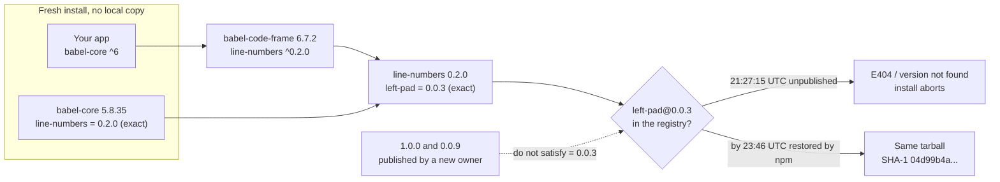

# Case Study: The left-pad Outage and Package Registry Immutability

> [!summary] Claim:
> On 2016-03-22 at 21:27:15 UTC the author of `left-pad`, a string padding function in a 209-byte `index.js`, unpublished it from npm together with 272 other packages after npm transferred his `kik` package name to Kik Interactive.
> Babel's code-frame printer reached `left-pad` through `line-numbers`, which pinned it to exactly `0.0.3`, so fresh installs of Babel and everything built on it failed for about two and a half hours.
> The registry already guaranteed that `left-pad@0.0.3` could never be republished with different bytes, which is why nobody but npm could fix it: identity was immutable, availability was not.
> The lasting lesson is that a registry must separate three properties - the bytes behind `name@version` never change, those bytes stay fetchable, and the name cannot silently change hands - and must let owners hide a version (yank, deprecate, retract, unlist) without deleting it.



## Incident Timeline

All times are UTC with Pacific Daylight Time (UTC-7) alongside.
Registry timestamps come from the `left-pad`, `line-numbers`, `babel-code-frame`, `babel-core`, and `kik` packuments fetched on 2026-11-15.
Comment timestamps come from the GitHub API for `left-pad/left-pad#4` and `babel/babel#4200`; the Babel issue was migrated from Babel's Phabricator tracker (T7237) with its original creation time, as its neighbors 4199 and 4201 show.

### Before the incident

| Date (UTC) | Event | Evidence |
| :--- | :--- | :--- |
| 2014-02-12 | npm's registry design removes `npm publish -f`: an unpublished `foo@1.2.3` can never again hold different bytes, "Not now, not never" | npm-registry-couchapp issue 148 |
| 2014-03-14 | `left-pad@0.0.0` is published | `time.created` in the packument |
| 2014-12-20 and 2015-02-21 | `line-numbers` 0.1.0 and 0.2.0 are published; 0.2.0 declares `"left-pad": "0.0.3"`, an exact pin | `line-numbers` packument |
| 2015-10-26 | A third-party Nix expression records `left-pad-0.0.3.tgz` with SHA-1 `04d99b4a1eaf9e5f79c05e5d745d53edd1aa8aa1` | `adnelson/nix-node-packages` commit `042edf7` |
| 2015-10-29 | `babel-code-frame@6.0.0` is published; 6.7.2 still declares `"line-numbers": "^0.2.0"`, which on a 0.x version admits only `>=0.2.0 <0.3.0` | `babel-code-frame` packument |
| 2015-11 | TC39 settles the names `padStart` and `padEnd` for a native string padding proposal | proposal-string-pad-start-end README |
| 2016-01-20 | `babel-core@5.8.35` declares `"line-numbers": "0.2.0"`, another exact pin | `babel-core` packument |
| 2016-02 | `left-pad` is downloaded 2,265,293 times in the month | npm downloads API |
| Before 2016-03-22 | Kik Interactive disputes the author's `kik` package name; npm applies its dispute policy and gives the name to Kik | npm blog, 2016-03-23 |

### 2016-03-22, the outage

| UTC | PDT | Event | Evidence |
| :--- | :--- | :--- | :--- |
| 21:27:15 | 14:27 | The author unpublishes `left-pad`; the packument gets an `unpublished` record naming user `azer` | Registry JSON quoted in `left-pad#4` at 21:39 |
| about 21:30 | about 14:30 | npm sees "hundreds of failures per minute" as dependent builds fail | npm blog, 2016-03-23 |
| 21:35:31 | 14:35 | First issue report: a Travis CI build on npm 2.14.7 fails with `npm ERR! 404 'left-pad' is not in the npm registry.` and `It was specified as a dependency of 'line-numbers'` | `left-pad#4` |
| 21:42:18 | 14:42 | Cameron Westland (`camwest`) forks the GitHub repository and publishes `left-pad@1.0.0` under the now-free name | Packument `time`, his comment at 21:50 |
| 21:47:25 | 14:47 | User `westlac` unpublishes 1.0.0: a packument quoted at 21:49 shows a new `unpublished` record naming `westlac` with `latest` 1.0.0 | `left-pad#4` at 21:49 |
| 21:51:19 | 14:51 | `left-pad@0.0.9` appears, published by the same account | Packument `time` and `_npmUser` |
| 21:53:50 | 14:53 | A commenter identifies the cause: `line-numbers` is "pinned to `0.0.3` specifically" | `left-pad#4` |
| 21:57:28 | 14:57 | `camwest`: "I can't publish 0.0.3 because it's already been published and removed. NPM forbids publishing a version of the same library twice." | `left-pad#4` |
| 22:07:41 | 15:07 | Babel ticket T7237: `npm ERR! version not found: left-pad@0.0.3` from npm 2.14.20 installing `babel@5.8.x` | `babel#4200` |
| 22:12:14 | 15:12 | `babel-code-frame@6.7.3` ships without `line-numbers`; `babel-core` 6.0.0 and 6.7.2 declare `babel-code-frame` with caret ranges (`^6.0.0` and `^6.7.2`), so a fresh install picks it up | Packuments; announced in `left-pad#4` at 22:13 |
| 22:34:09 | 15:34 | The author comments that he has unpublished all his packages and suggests depending on `azer/left-pad` on GitHub | `left-pad#4` |
| 22:40:05 | 15:40 | A Babel maintainer: there is "literally no way to fix this for older versions" because Babel relies on `line-numbers` with a fixed version | `left-pad#4` |
| 22:50:05 | 15:50 | `babel-core@5.8.38` ships without `line-numbers` | Packument |
| 22:51:04 | 15:51 | Automattic merges a shrinkwrap change pointing `left-pad@0.0.3` at a Git fork pinned by commit | `wp-calypso` commit `a6ab617` |
| 22:58:15 | 15:58 | The new owner says he has asked npm to restore 0.0.3 | `left-pad#4` |
| 23:05 | 16:05 | npm announces that it will restore 0.0.3; Laurie Voss of npm tweets that it is "un-un-publishing" the version, "an unprecedented action" | npm blog; tweets quoted in `left-pad#4` at 23:15 |
| 23:46:20 | 16:46 | A user reports `npm install left-pad@0.0.3` working again | `left-pad#4` |
| 23:52:43 | 16:52 | `kik@1.0.1` appears under the freed `kik` name, followed by 1.0.2 at 00:05:14 | `kik` packument |
| about 23:55 | 16:55 | npm completes the restore and puts the whole disruption at about 2.5 hours | npm blog |

### Aftermath

| Date (UTC) | Event | Evidence |
| :--- | :--- | :--- |
| 2016-03-23 | Daily `left-pad` downloads fall from 104,145 (Mar 21) and 100,765 (Mar 22) to 36,971, consistent with Babel's releases dropping the dependency | npm downloads API |
| 2016-03-23 18:33 | `line-numbers@0.2.1` changes its pin to `^1.0.1`; the package is later deprecated with "Copy its ~20 LOC directly into your code instead." | Packument |
| 2016-03-23 | npm's postmortem promises to make unpublishing harder when it breaks others, to stop malicious adoption of abandoned names with placeholder packages, and to update internal policies | npm blog |
| 2016-03-23 22:11 | `kik@0.0.1-security` is published by user `npm`, a placeholder whose description says npm is "hanging on to the package name"; the maintainer listed today is `kikinteractive` | `kik` packument |
| 2016-03-29 | npm limits self-service unpublish to versions under 24 hours old; older ones go to support, which will not remove a version whose removal would break other installs; fully removed packages become security placeholders | npm blog |
| 2016-03-30 | npm removes packages that depend on every package in the registry, saying "Having them alone wouldn't make it impossible to unpublish a package" | npm blog |
| 2016-05 | `String.prototype.padStart` reaches stage 4 at TC39 and ships in ES2017; its rationale cites FirefoxOS apps, not the npm incident | TC39 finished proposals |
| 2020-01-30 | npm, whose self-service window was by then 72 hours, extends self-service unpublish to older packages with no dependents, under 300 downloads in the past week, and a single owner | npm blog |
| 2022-01-08 to 2022-01-09 | `colors` 1.4.1, 1.4.2, and 1.4.44-liberty-2 are published with an intentional infinite loop (the advisory says "Between 07 and 09 January", a range that starts before the first UTC publish time); they are absent from `versions` today | GHSA-5rqg-jm4f-cqx7; `colors` packument `time` map |
| 2023-12-29 to 2024-01-04 | `everything` 2.0.0 and 3.0.0 are published (2023-12-29 and 2023-12-30), and the tree depends on over 2.5 million packages with `*` ranges, blocking their authors from unpublishing; GitHub reaches out on January 2 and then disables the npm and GitHub `everything-registry` organizations | `everything` packument; uncenter.dev postmortem by a contributor |
| 2024-05-15 | RubyGems.org restricts yanking of gems with over 100,000 downloads or older than 30 days, "to reduce the likelihood of disruption caused by a left-pad-like package removal" | RubyGems blog |
| 2025-02-05 | crates.io announces self-service crate deletion under RFC 3660 | Rust blog |
| 2025-09-22 | PEP 763, which would have limited PyPI deletions to 72 hours, is withdrawn | PEP 763 |

## Mechanism Root Cause

### 1. The artifact

`left-pad@0.0.3` is a tarball of four files: `package.json` (408 bytes), `.npmignore` (30), `README.md` (198), and `index.js` (209).
The tar headers date `index.js` and `package.json` to 2014-08-15, the day 0.0.2 was published.
The function, as served by the registry today:

```javascript
module.exports = leftpad;

function leftpad (str, len, ch) {
  str = String(str);

  var i = -1;

  ch || (ch = ' ');
  len = len - str.length;


  while (++i < len) {
    str = ch + str;
  }

  return str;
}
```

Three properties matter for the case study and for the interview questions:

- `ch || (ch = ' ')` treats the number `0` as missing, so `leftpad(5, 3, 0)` returns `"  5"`, not `"005"`; later releases use `if (!ch && ch !== 0) ch = ' ';`.
- The loop prepends one copy of `ch` per missing character, so a multi-character `ch` overshoots: `leftpad(17, 5, "ab")` returns `"ababab17"`.
  TC39 chose the opposite, "max length", semantics for `padStart`, truncating the filler so that `"17".padStart(5, "ab")` returns `"aba17"`.
- The loop is O(n) string concatenations; 1.3.0 replaced it with a lookup table for fewer than 10 spaces and a doubling loop that appends `ch` when the remaining length is odd and doubles `ch` each step, so it runs O(log n) iterations.

Run against the real tarballs with Node v26.13.1 on darwin-arm64 (as of 2026-11; re-run by the verifier on 2026-11-21, which corrected the order of the `padStart` row):

```text
0.0.3 ["  5","005","abc","ababab17","  null"]
1.3.0 ["005","005","abc","ababab17","  null"]
padStart ["005","abc","aba17","  null"]
```

The inputs are `(5, 3, 0)`, `("5", 3, "0")`, `("abc", 2)`, `(17, 5, "ab")`, and `(null, 6)`; the `padStart` row omits the second case.
The size of the code is the point: the outage had nothing to do with what the package did and everything to do with how it was named, resolved, and fetched.

### 2. The resolution path

npm resolves a dependency by name and version range against the registry, not by content.
For each `name@range` the client fetches the packument (the JSON document at `https://registry.npmjs.org/<name>`), picks the highest version in `versions` that satisfies the range, and downloads that version's `dist.tarball`.
The manifests that chained an exact version to every Babel 6 user, and the release that broke the chain, as the registry serves them:

```text
babel-code-frame 6.7.2 {"babel-runtime": "^5.0.0", "chalk": "^1.1.0", "esutils": "^2.0.2", "js-tokens": "^1.0.1", "line-numbers": "^0.2.0", "repeating": "^1.1.3"}
line-numbers 0.2.0 {"left-pad": "0.0.3"}
babel-code-frame 6.7.3 {"babel-runtime": "^5.0.0", "chalk": "^1.1.0", "esutils": "^2.0.2", "js-tokens": "^1.0.1", "repeating": "^1.1.3"}
```

That output is from the registry on 2026-11-15 (commands in the Practice Drill).
`line-numbers` used an exact version, so no other `left-pad` release could ever satisfy it.
`babel-code-frame` used `^0.2.0`, which for a 0.x major admits only `0.2.x`, so the fix had to come from a new `line-numbers` 0.2.x or from Babel dropping the dependency; Babel did the latter in 6.7.3, because it was "unclear when `line-numbers` will be updated".
Babel 5 users were worse off, because `babel-core@5.8.35` pinned `line-numbers` to exactly `0.2.0`, so the fix had to be a new `babel-core`, and Babel's announcement told users who pinned `babel-core` exactly to bump it by hand to 5.8.38.
[[Versioning-SemVer-CalVer-and-ABI]] owns caret semantics on 0.x versions, and [[Dependency-Resolution-SAT-PubGrub-and-MVS]] owns how resolvers search ranges.

### 3. What the registry guaranteed in 2016, and what it did not

It helps to split "immutability" into three separate properties, because the 2016 registry had one and lacked two:

| Property | Question it answers | npm on 2016-03-22 |
| :--- | :--- | :--- |
| Identity immutability | Can the bytes behind `left-pad@0.0.3` ever change? | Guaranteed since 2014: no overwrite, no republish after unpublish |
| Availability | Will `left-pad@0.0.3` still be downloadable tomorrow? | Not guaranteed: any owner could unpublish any version at any time |
| Name continuity | Can a stranger publish new versions under `left-pad`? | Not guaranteed: an unpublished name was free to anyone at once |

Identity immutability came from a 2014 change in npm's CouchDB registry design.
Isaac Z. Schlueter wrote that after it, unpublishing `foo@1.2.3` remains possible but "you will not be able to publish something _else_ to that same package identifier", because changed bits are far more hazardous than missing bits: "If the bits are gone, ok, it's an error, you notice and deal with it."
That rule is why the new owner could publish 1.0.0 and 0.0.9 but not 0.0.3.
Availability had no protection at all: unpublishing needed no dependency check, no waiting period, and no notice to dependents.
Name continuity had none either: the unpublish freed the name, and the npm 2 client's own 404 message said `You should bug the author to publish it (or use the name yourself!)`.
The same gap hit `kik`: versions 1.0.1 and 1.0.2 appeared at 23:52 and 00:05 UTC under the freed name, and a commenter linked the page as evidence that "npm packages aren't hard to steal", before npm put a security placeholder there the next day.

Identity immutability without availability is the worst of both: the version is gone, and the rule that makes it trustworthy also stops the community from restoring it.
Only the operator could break the rule, which npm did by "un-un-publishing".

### 4. Why the replacement did not help

The client errors show the two failure states:

- From 21:27 to 21:42 the name did not exist: `npm ERR! code E404` and `404 Registry returned 404 for GET on https://registry.npmjs.org/left-pad`.
- From 21:42 the name held 1.0.0, which its publisher unpublished at 21:47, and from 21:51 it held 0.0.9, so npm 2 reported `version not found: left-pad@0.0.3`, and one user reported at 22:04 that "the only valid install target is 0.0.9".

The second state is the subtle one: the registry was healthy, the package existed, and 0.0.9 did the same job, but an exact pin is a demand for one identity, and that identity was gone.
Local caches added a third state: users were told to run `npm cache clear` and to regenerate shrinkwraps before Babel's fixed releases or the restored version would install.

### 5. The restore: same bytes, rewritten metadata

npm restored 0.0.3.
The restored tarball is byte-identical to the original: the SHA-1 the registry serves today matches the SHA-1 the Nix expression recorded in October 2015 and the `_shasum` in a test fixture committed to `AtomBuild/atom-build-gulp` in November 2015.

```text
04d99b4a1eaf9e5f79c05e5d745d53edd1aa8aa1  -
```

The metadata around it was not preserved.
A packument quoted in `left-pad#4` at 21:49 UTC, between the unpublish and the restore, still listed 0.0.3's original publish time, 2014-08-15T07:14:44.360Z.
In the 2015 fixture, `0.0.3` names publisher `azer` with npm 1.4.3; today's packument names `westlac` with npm 3.7.5 and gives it the same publish time as 0.0.9, 2016-03-22T21:51:19.774Z.
The restored older versions 0.0.0 to 0.0.4 name publisher `npm` with `_npmVersion` `0.0.0-fake`, and so does 1.0.0, even though `camwest` said he published it.

```text
0.0.2 2014-08-15T07:13:09.056Z npm 0.0.0-fake 227f6741b9ff
0.0.3 2016-03-22T21:51:19.774Z westlac 3.7.5 04d99b4a1eaf
0.0.4 2015-05-20T04:04:04.473Z npm 0.0.0-fake c711852bdfbe
0.0.9 2016-03-22T21:51:19.774Z westlac 3.7.5 1a164117f1e7
1.0.0 2016-03-22T21:42:18.002Z npm 0.0.0-fake c84e2417581b
```

npm has not documented how it performed the restore, so this note relies only on the observable record.
That record is enough for the lesson: the registry's `time` and `_npmUser` fields are operator-editable metadata, not an audit log.
Only the content hash proves which bytes you have, which is why lockfiles and checksum databases pin hashes.

### 6. The trigger: a name dispute

The trigger was a naming dispute, not a technical fault.
Kik Interactive asked for the `kik` name, npm's dispute policy assigned it to Kik, and, in npm's words, the author then unpublished his `kik` package and 272 others "without warning to developers of dependent projects".
npm stood by the transfer, saying its policy's overarching goal is to "provide npm users with the package they expect".
The author's own account is a Medium post linked from his 22:34 UTC comment; it was not retrievable for this note (HTTP 403), so his reasons are not paraphrased here.

## Detection Gap

Nothing in a project's own test pyramid could have caught this, because the defect was in the environment the build assumed, not in the code it built.

- **Builds resolved live:** CI workers without a persistent dependency cache, such as the Travis builds whose logs appear in `left-pad#4`, fetched packages from the registry on every run, so they were exposed the instant the registry changed.
- **The lockfile pinned names, not bytes:** Automattic's 2016 `npm-shrinkwrap.json` entry for `left-pad` was just `"version": "0.0.3"`: no `resolved` URL and no hash, so it could not detect a substitution and could not fetch from anywhere but the registry.
  Today's `package-lock.json` records a `resolved` URL and an SRI `integrity` string per package (`lockfileVersion` 1 belongs to npm 5 and 6, 2 to npm 7 and 8, 3 to npm 9 and later).
- **No artifact store of record:** Organizations without a pull-through cache that retains everything it has served had no copy to fall back on, and one commenter noted that installing from GitHub "does not work behind most corporate firewalls".
- **Transitive exact pins were invisible:** A `babel-core` user declared one dependency; the exact pin sat two levels down in `line-numbers`, which appeared in no manifest the user wrote.
- **No upstream event feed:** Nobody downstream was notified of the unpublish; the first signal was a broken build, 8 minutes later in the first public report.
- **The registry had no blast-radius check:** The unpublish ran without counting dependents, without a delay, and without notifying anyone, which npm's postmortem listed as its own failure.

## Remediation and Fix

### Immediate, consumer side

| Fix | Who | Mechanism | Limit |
| :--- | :--- | :--- | :--- |
| `babel-code-frame@6.7.3` (22:12 UTC) | Babel | Dropped `line-numbers`; Babel 6's caret ranges picked it up on reinstall | Lockfiles and caches holding 6.7.2 still failed until refreshed |
| `babel-core@5.8.38` (22:50 UTC) | Babel | Dropped `line-numbers` | Users had to edit an exact `babel-core` pin |
| Git dependency `azer/left-pad#bff80e3...` | Individual users | Bypass the registry, pin by commit | Depends on GitHub, on the repository staying up, and on outbound Git access |
| Shrinkwrap to `Automattic/left-pad-0.0.3#0d758ec...` | Automattic | Fork under own control, pinned by commit in both `from` and `resolved` | Same transport limits, but the fork is owned by the consumer |
| `line-numbers@0.2.1` (Mar 23) | Maintainer | Pin `^1.0.1` instead of `0.0.3` | Next day; the package was later deprecated in favor of inlining |

### Registry side

- **Restore:** npm re-inserted the original 0.0.3 bytes; `npm owner ls left-pad` at 00:05 UTC listed `sebmck` and `westlac`, and `kik` went behind a `-security` placeholder the next day.
- **2016-03-29 policy:** Owners could unpublish only versions under 24 hours old; anything older went through support, which checked whether removal would break other installs and, "If so, we will not remove it"; a fully removed package became a security placeholder so nobody could squat the name.
- **2020-01-30 policy, current as of 2026-11 (Both):** Self-service unpublish is allowed under 72 hours if no package in the public registry depends on it, or later if it has no dependents, fewer than 300 downloads over the last week, and a single owner.
  "Once `package@version` has been used, you can never use it again", and after a full unpublish no new version of the name may be published for 24 hours.
- **Deprecation as the default:** `npm deprecate <pkg>@<range> "<msg>"` keeps every version installable and prints a warning; an empty message removes it.
  The npm policy tells owners who do not meet the unpublish criteria to deprecate instead.

### The policy's own failure mode

An automated rule keyed on "no other package depends on this" can be gamed.
In 2016 npm removed packages that depended on the whole registry and said they would not block unpublishing; under the 2016 policy every late unpublish went to npm support, which judged whether real dependents would break.
From 2023-12-29 to early January 2024, under the automated rule, the `everything` package with its 5 chunk packages and 3,246 sub-chunk packages depended on over 2.5 million public packages with `*` ranges, and its contributors report that this blocked every one of those authors from unpublishing until GitHub disabled the organizations and the scoped packages were deleted.
The contributors also report an undocumented limit of 800 dependencies per package, found by testing, which is why the tree needed chunks; treat that number as their observation, not a published npm limit.

## Architectural Lessons

### 1. Owners hide, operators delete, nobody overwrites

Every mature registry now converges on the same split, with different defaults:

| Registry (as of 2026-11, Both) | Owner can delete | Non-destructive hide | Version number reuse | Name after deletion |
| :--- | :--- | :--- | :--- | :--- |
| npm | Under 72 h with no dependents; later only with no dependents, under 300 downloads last week, one owner | `npm deprecate` (warning, still resolves) | Never | No new versions for 24 h |
| crates.io | Whole crates only: no reverse dependencies, and either under 72 h old or one owner with under 1,000 downloads per month of age; single versions are deleted only by admins | `cargo yank` (hidden from new resolution, still downloadable) | Rejected while the crate exists ("is already uploaded") | Reusable after 24 h |
| PyPI | Files, releases, and projects, permanently and irreversibly; no age or download limit documented | Yank per PEP 592 | Never: a filename cannot be reused "even once a project has been deleted and recreated" | Released "for use by any other PyPI user" |
| Go module proxy | No; deleting the origin repository does not remove cached versions | `retract` directive (Go 1.16+) | Not possible in effect: a hash that differs from the checksum database is reported as a security error | Path is tied to the origin |
| Maven Central | No; a released component "cannot be altered" | None in the FAQ; publish a new version | Not possible: components cannot be altered | Not applicable |
| nuget.org | No; NuGet team deletion only for exceptional cases such as copyright infringement or harmful content | Unlist (hidden from search, installable by exact version) and deprecate | No owner deletion, so the version stays occupied; reuse after a team deletion is not documented | Not documented |
| RubyGems.org | `gem yank` deletes permanently (since 2015-04-20); gems over 100,000 downloads or older than 30 days cannot be yanked without what the 2024 post calls "a public review" (a "provisional limit") | None separate from yank | "A gem version can not be published twice" | Another account may push only after 100 days without updates, or at once if the gem is under 30 days old |

The design argument for each column:

- **No overwrite** is universal because a changed artifact under an old name is undetectable without hashes and silently invalidates every cache, as Maven Central notes: build tools "download artifacts from a release repository once" and "don't come back" to check.
- **Hide instead of delete** keeps existing pins working while steering new resolution away; it is the direct answer to left-pad.
- **Owner deletion windows** (72 hours on npm and crates.io) exist because accidents are real: RFC 3660 cites accidental publishes, testing crates.io, unintended public content, and renames as its motivation.
- **Operator deletion** must remain for malware and legal takedowns; the January 2022 `colors` releases 1.4.1, 1.4.2, and 1.4.44-liberty-2 are absent from `versions` today, `latest` points back to 1.4.0, and the packument's `time` map still lists all three, so the registry keeps a tombstone even when it drops the bytes.
- **Name holds** slow takeover: 24 hours on npm and crates.io and 100 days on RubyGems.org, while PyPI frees a deleted project's name to any user immediately, so a deleted project's name is a dependency-confusion target there.

### 2. Yank semantics, precisely

Yank-style flags are metadata on an immutable artifact, and each ecosystem defines who still gets the artifact:

- **Cargo:** The index entry for each version carries `cksum` (SHA-256 of the `.crate`) and `yanked`; the Registry Index chapter says entries "should not be modified after they are added except for the `yanked` field".
  Cargo "will not use a yanked version for any new project or checkout without a pre-existing lockfile", but a `Cargo.lock` that already names it keeps building.
  `cargo update -p <crate> --precise <yanked-version>` can select a yanked version deliberately since Cargo 1.80 (2024-07-25, PR 13974); it was nightly-only in 1.78 (PR 13333).
  crates.io stores an optional yank message per version (the `yank_message` column, added in 2024-08).
- **Cargo's ordering rule:** The Cargo book's example: if `bar` requires `foo = "1.5"` and `foo` yanks 1.5.0 without first shipping a semver-compatible 1.5.1, no new checkout of `bar` can resolve at all.
  Publish the compatible fix first, then yank.
- **PEP 592:** The simple API marks a yanked file with `data-yanked`, optionally carrying a reason; installers MUST ignore yanked releases when a non-yanked version satisfies the request, and the suggested exception is a file that is the only match for a specifier pinning exactly with `==` (without `.*`) or `===`.
  The PEP yanks at the file level because of the shape of the simple API, while PyPI exposes it per release; the yank is reversible, so clients must cope with files being unyanked.
- **Go:** `retract` lives in the `go.mod` of a newer version; retracted versions are excluded from `@latest` and version queries, are not chosen by `go get` or `go mod tidy` upgrades, are hidden from `go list -m -versions` unless `-retracted` is given, and builds that already require them should keep working.
- **What yank does not do:** The Cargo book is explicit that yanking cannot stop the spread of leaked credentials: "the recommended course of action is to revoke them immediately."

### 3. Availability belongs to the consumer, not the registry

Even a perfect public registry is someone else's server.
The durable fix is a consumer-side store of record: a pull-through mirror that retains every artifact it has served, lockfiles that pin a content hash, and builds that fetch only from the mirror.
Go builds this into the toolchain: `GOPROXY` defaults to `https://proxy.golang.org,direct`, the mirror "aims to cache content in order to avoid breaking builds" even after the origin deletes a tag, and with `GOSUMDB=sum.golang.org` a hash that does not match the checksum database makes the `go` command report "a security error".
The mirror's FAQ also bounds the guarantee: for a module without a detectable license, only a temporarily cached copy is served, and it "may become unavailable if it is removed from the original source".
[[Lockfiles-Vendoring-and-Offline-Mirrors]] owns lockfile formats, hash pinning, vendoring, and mirror topologies, and [[Release-Trains-Backports-and-Artifact-Registries]] owns retention and promotion inside an organization's own artifact registry.

### 4. Maintainer autonomy versus downstream stability

The trade-off is real on both sides, and the policies above are a negotiated settlement rather than a solved problem:

- **Autonomy arguments:** An author may need to withdraw code for legal reasons (trademark, copyright, licensing), for safety (malware, an accidental secret), or because they no longer want to be associated with it; free maintainers owe nobody perpetual hosting, a view several commenters in `left-pad#4` defended on the day.
- **Stability arguments:** Publication is a promise that other people build on; a version that thousands of lockfiles reference is shared infrastructure; PEP 763 lists PyPI deletions that broke pinned users: `atomicwrites` (2022), `codecov` and `python-sonarqube-api` (2023), and `PySimpleGUI` (2024).
- **The settlement:** Authors keep full control of future versions, of deprecation messages, and of short-window deletion; operators keep deletion for abuse and law; old versions with dependents stay fetchable.
  The OpenSSF guidance for registry operators lands in the same place: a no-hassle window, a download cap used with other signals because counts "can be arbitrarily inflated", dependents as strong evidence of harm, and administrator deletion of abusive content "regardless of how widely the package is adopted".
- **What it does not solve:** Immutability of old versions does nothing about a hostile or careless new version, which ranges such as `^1.4.0` pull in automatically, as the `colors` releases showed; that is a supply-chain integrity problem owned by the 08-Software-Supply-Chain pillar.
- **Policy is still moving:** PEP 763 would have limited PyPI deletions to 72 hours but was withdrawn on 2025-09-22, and crates.io's deletion threshold went from 100 downloads per month in RFC 3660 to 500 in the February 2025 announcement and 1,000 in the source and policy page as of 2026-11.
  The crates.io source is also stricter than both texts: `delete.rs` refuses any crate with reverse dependencies, even inside the 72-hour window, "to avoid unexpected historical index changes".

### 5. At scale: decision rules

- **One developer:** commit the lockfile, keep its integrity hashes, and prefer standard-library functions over micro-packages when the code is shorter than the manifest entry.
- **A team of tens:** run CI through a caching proxy and fail the build if the proxy, not the public registry, cannot serve an artifact, so an upstream deletion becomes a ticket rather than an outage.
- **1,000 to 50,000 engineers:** treat the internal artifact registry as the store of record with no-overwrite and no-delete for any version referenced by a deployed lockfile; pull upstream artifacts once and keep them; alert on upstream unpublish, yank, and retract events for anything in your graph; let authors deprecate internal packages but route deletion through an owner with a blast-radius report.
- **Any size:** forbid exact pins in published libraries unless the reason is documented; applications pin through lockfiles, libraries declare ranges.

## Commands and Numbers to Know

| Item | Value or command | Notes |
| :--- | :--- | :--- |
| Inspect a packument | `curl -s https://registry.npmjs.org/<name>` | `versions`, `time`, `dist-tags` (as of 2026-11, Both); after a full unpublish the packument keeps only `time`, whose `unpublished` object holds the unpublish `time` and the removed `versions` list, with no `versions` or `dist-tags` keys (fetched 2026-11-22 for the fully unpublished `left-pad-test`; the 2016 packuments quoted in `left-pad#4` also named the unpublishing user) |
| npm self-service unpublish window | 72 h with no dependents | 24 h in the 2016-03-29 policy (as of 2026-11, Both) |
| npm late unpublish criteria | No dependents, under 300 downloads in the last week, single owner | Since 2020-01-30 (as of 2026-11, Both) |
| npm name hold after full unpublish | 24 h before any new version | `npm-unpublish` docs (as of 2026-11, Both) |
| npm deprecate | `npm deprecate <pkg>@<range> "<msg>"`; `""` to undo | Install still succeeds, with a warning (as of 2026-11, Both) |
| npm lock integrity | `integrity`: SRI string; `lockfileVersion` 1 (npm 5-6), 2 (7-8), 3 (9+) | (as of 2026-11, Both) |
| crates.io deletion | No reverse deps, and under 72 h or one owner with under 1,000 downloads per month of age | Cookie session only; team owners cannot delete; whole crate only (as of 2026-11, Both) |
| crates.io name hold | 24 h after deletion | `AVAILABLE_AFTER` in `delete.rs` (as of 2026-11, Both) |
| Cargo yank | `cargo yank --version <ver> <crate>`; `--undo` | (as of 2026-11, Both) |
| Cargo select yanked | `cargo update -p <crate> --precise <ver>` | Stable since Cargo 1.80 (as of 2026-11, Both) |
| PyPI yank | PEP 592 `data-yanked`; ignored unless the only `==` / `===` match | (as of 2026-11, Both) |
| PyPI filename reuse | Never, even after the project is deleted and recreated | (as of 2026-11, Both) |
| RubyGems name hold | 100 days after the last update of a fully yanked gem, none for gems under 30 days old | `not_protected?` in `rubygem.rb` (as of 2026-11, Both) |
| Go retract | `retract v1.0.0 // reason` in a newer `go.mod`; `go list -m -versions -retracted <mod>` | Go 1.16+ (as of 2026-11, Both) |
| Go defaults | `GOPROXY=https://proxy.golang.org,direct`, `GOSUMDB=sum.golang.org` | `GOPROXY=direct` opts out of the mirror (as of 2026-11, Both) |
| left-pad scale, Feb 2016 | 2,265,293 downloads in the month; about 100,000 per weekday | npm downloads API, measured 2026-11-15 |
| left-pad scale, Oct 2026 | 12,935,201 downloads in the month, while deprecated with `use String.prototype.padStart()` | npm downloads API, measured 2026-11-15 |

## Pitfalls

> [!warning] Pitfall: treating a lockfile as an availability guarantee
> A lockfile records what to fetch and, with an integrity hash, how to recognize it.
> It does not store the bytes; when the registry loses them the hash only tells you exactly what you lost.
> Pair the lockfile with a mirror or vendored copy that you control.

> [!warning] Pitfall: exact pins in published libraries
> `line-numbers` pinned `left-pad` to `0.0.3`, and `babel-core@5.8.35` pinned `line-numbers` to `0.2.0`.
> Exact pins in a library propagate to every consumer and make any upstream loss unrecoverable without a new release of each library in the chain.

> [!warning] Pitfall: yanking before publishing the fix
> If a compatible replacement does not exist yet, a yank leaves new consumers with no version that satisfies their range.
> Publish `1.5.1`, then yank `1.5.0`.

> [!warning] Pitfall: yanking or unpublishing to remove a leaked secret
> The artifact has already been mirrored, cached, and downloaded.
> Rotate the credential first; deletion is at best cleanup.

> [!warning] Pitfall: trusting registry metadata as history
> After the 2016 restore, `left-pad@0.0.3` shows a 2016 publish time and a publisher who did not write it.
> Use content hashes, transparency logs, or your own records for provenance.

> [!warning] Pitfall: assuming a freed name is safe
> PyPI releases a deleted project's name to any user, npm and crates.io free names after 24 hours, and RubyGems.org after 100 days.
> A range dependency on a deleted name will accept the next owner's code, so remove references to deleted packages rather than waiting for them to come back.

> [!warning] Pitfall: assuming "hidden" means "never selected"
> nuget.org documents that floating versions such as `1.0.0-*` can still restore an unlisted package if it is the latest match.
> Read each ecosystem's exact hide semantics before relying on one to steer consumers away from a bad version.

> [!warning] Pitfall: caches that are stale in both directions
> A proxy that caches 404s or old packuments keeps failing after upstream recovers, and one that refreshes aggressively forgets artifacts that upstream deleted.
> Retain artifacts forever, and expire metadata quickly.

## Practice Drill

> [!tip] Practice Drill:
> Reconstruct the incident from the registry alone.
> Predict before running: which `left-pad` versions show a publisher other than the original author, and whether today's 0.0.3 tarball has the SHA-1 that a 2015 Nix expression recorded (`04d99b4a1eaf9e5f79c05e5d745d53edd1aa8aa1`).
> Then explain why `1.0.0` could not satisfy `line-numbers@0.2.0`, and why `babel-code-frame@6.7.3` fixed Babel 6 without any change to `left-pad`.
> As a stretch, pick one crate in a Rust project you own, read its index entry from `https://index.crates.io/`, and find the `cksum` and `yanked` fields that correspond to your `Cargo.lock` line.

The commands need network access to `registry.npmjs.org`:

```bash
curl -s https://registry.npmjs.org/left-pad | python3 -c '
import json, sys
d = json.load(sys.stdin)
for v in ["0.0.2", "0.0.3", "0.0.4", "0.0.9", "1.0.0"]:
    m = d["versions"][v]
    print(v, d["time"][v], m["_npmUser"]["name"], m.get("_npmVersion"), m["dist"]["shasum"][:12])
'
curl -s https://registry.npmjs.org/left-pad/-/left-pad-0.0.3.tgz | shasum -a 1
for spec in babel-code-frame/6.7.2 line-numbers/0.2.0 babel-code-frame/6.7.3; do
  curl -s "https://registry.npmjs.org/$spec" | python3 -c 'import json,sys; d=json.load(sys.stdin); print(d["name"], d["version"], json.dumps(d.get("dependencies", {}), sort_keys=True))'
done
```

Output on darwin-arm64, fetched 2026-11-15 (the registry is live data, so later runs can differ):

```text
0.0.2 2014-08-15T07:13:09.056Z npm 0.0.0-fake 227f6741b9ff
0.0.3 2016-03-22T21:51:19.774Z westlac 3.7.5 04d99b4a1eaf
0.0.4 2015-05-20T04:04:04.473Z npm 0.0.0-fake c711852bdfbe
0.0.9 2016-03-22T21:51:19.774Z westlac 3.7.5 1a164117f1e7
1.0.0 2016-03-22T21:42:18.002Z npm 0.0.0-fake c84e2417581b
04d99b4a1eaf9e5f79c05e5d745d53edd1aa8aa1  -
babel-code-frame 6.7.2 {"babel-runtime": "^5.0.0", "chalk": "^1.1.0", "esutils": "^2.0.2", "js-tokens": "^1.0.1", "line-numbers": "^0.2.0", "repeating": "^1.1.3"}
line-numbers 0.2.0 {"left-pad": "0.0.3"}
babel-code-frame 6.7.3 {"babel-runtime": "^5.0.0", "chalk": "^1.1.0", "esutils": "^2.0.2", "js-tokens": "^1.0.1", "repeating": "^1.1.3"}
```

## Interview Questions

> [!question] L5: Compare npm unpublish, npm deprecate, Cargo yank, PyPI yank, Go retract, and NuGet unlist.
>
> > [!success]- Answer
> > Unpublish deletes the bytes; on npm it is limited to versions under 72 hours old with no dependents, or later to packages with no dependents, under 300 weekly downloads, and one owner, and the `name@version` can never be reused.
> > Deprecate keeps the version fully installable and prints a warning.
> > A Cargo yank hides a version from new resolution, but existing `Cargo.lock` files still build and the file stays downloadable.
> > A PyPI yank (PEP 592) makes installers ignore a release unless it is the only match for an exact `==` or `===` pin.
> > A Go retraction lives in a newer `go.mod`, hides versions from `@latest` and `go get` upgrades, and leaves builds that already require them working.
> > A NuGet unlist hides a version from search but still installs it by exact version, and a floating version can still select it.
> > All but unpublish keep the bytes, which is the whole point.

> [!question] L5 (predict the output): With `left-pad@0.0.3`, what do `leftpad(5, 3, 0)` and `leftpad(17, 5, "ab")` return, and what does 1.3.0 return for the first call?
>
> > [!success]- Answer
> > 0.0.3 returns `"  5"` for the first call, because `ch || (ch = ' ')` treats `0` as missing and pads with spaces.
> > It returns `"ababab17"` for the second, because the loop prepends the whole `ch` string once per missing character (3 times), overshooting the target length.
> > 1.3.0 returns `"005"` for the first call, because its guard is `if (!ch && ch !== 0)`.
> > `"17".padStart(5, "ab")` returns `"aba17"`, because TC39 chose "max length" semantics and truncates the filler.
> > All four values were checked against the real tarballs with Node on darwin-arm64.

> [!question] L5 (debug this): On 2016-03-22 at 15:30 PDT your CI fails with `npm ERR! version not found: left-pad@0.0.3`, yet `npm view left-pad versions` lists `0.0.9`; what is going on and what do you do?
>
> > [!success]- Answer
> > The name exists again because a new owner published new versions, but something in your tree demands exactly `0.0.3`, and npm forbids anyone from republishing a version number that once existed.
> > Run `npm ls left-pad` (or read the error's "specified as a dependency of" line) to find the pinning package: here `line-numbers@0.2.0`, reached through `babel-code-frame` or `babel-core`.
> > The fast fix is to upgrade to a parent release that dropped the dependency, `babel-code-frame@6.7.3` or `babel-core@5.8.38`, clearing local caches and regenerating any shrinkwrap that still holds the old tree.
> > If no such release exists, override the resolution to a Git URL or tarball pinned by commit or hash that you control, as Automattic did in its shrinkwrap.
> > Afterwards, put a retaining mirror in front of CI so the next upstream deletion cannot reach the build.

> [!question] L6: Why could the new owner publish `left-pad@1.0.0` but not `left-pad@0.0.3`, and why is that rule still right?
>
> > [!success]- Answer
> > Since a 2014 registry change, a `name@version` that has ever existed can never hold different bytes, even after it is unpublished.
> > The rule exists because changed bits are worse than missing bits: a missing version fails loudly, while different bytes under a trusted identifier are silently installed everywhere and invalidate every cache and lockfile.
> > In March 2016 the rule blocked the community fix, but only because availability was unprotected; the right repair was to stop deletions, not to allow overwrites.
> > npm restored the original bytes, whose SHA-1 still matches records from 2015, so the restore preserved identity.

> [!question] L6: Does an npm lockfile with integrity hashes prevent a left-pad style outage?
>
> > [!success]- Answer
> > No, it prevents substitution, not loss.
> > `package-lock.json` records `resolved` and an SRI `integrity` string, so `npm ci` refuses different bytes and installs the same tree everywhere.
> > It still downloads from the registry, so a deleted tarball fails the install exactly as before, now with a precise statement of what is missing.
> > Prevention needs a copy you control: a pull-through mirror that retains artifacts, an offline cache, or vendoring, with the lockfile hash used to verify that copy.

> [!question] L6: You maintain crate `foo` and discover a soundness bug in 1.5.0; `bar` depends on `foo = "1.5"`; walk through the release.
>
> > [!success]- Answer
> > Publish 1.5.1 with the fix first, so every `1.5` range has a non-yanked candidate.
> > Then run `cargo yank --version 1.5.0 foo`; new resolutions skip it, while existing lockfiles keep building and can be moved with `cargo update`.
> > If you yank first, any new checkout of `bar` without a lockfile fails to resolve, which is the Cargo book's own example.
> > For a security bug, also file a RustSec advisory so `cargo audit` flags lockfiles that still hold 1.5.0, because a yank alone does not change existing lockfiles.
> > You cannot delete 1.5.0 yourself: crates.io owner deletion removes whole crates only, and only crates with no reverse dependencies.
> > If the bug were a leaked token, revoke it first; yanking cannot unpublish what has already been downloaded.

> [!question] L7: npm said in 2016 that packages depending on everything would not block unpublishing, but at the turn of 2024 the `everything` package did; why, and what is the design lesson?
>
> > [!success]- Answer
> > The 2016 policy routed every late unpublish to npm support, where a human decided whether real dependents would break, so a fake dependent changed nothing.
> > The current policy automates self-service unpublish on the predicate "no dependents in the public registry", and the `everything` packages made that predicate false for over 2.5 million packages by depending on all of them with `*`.
> > The lesson is that an automated safety check keyed on a signal that anyone can create for free becomes a denial-of-service lever; weight dependents by evidence of real use (downloads, age, owner reputation), exclude wildcard or obviously synthetic dependents, and keep a human escalation path.

> [!question] L7: Could a left-pad outage happen to a Go project that depends on a GitHub-hosted module whose owner deletes the repository?
>
> > [!success]- Answer
> > Usually not with default settings: `GOPROXY` is `https://proxy.golang.org,direct`, and the module mirror caches versions so that a deleted release "may still be available in the mirror even if it is not available at the origin".
> > With `GOSUMDB=sum.golang.org`, a downloaded file whose hash does not match the checksum database is rejected with a security error, so even a re-tagged version with different bytes cannot slip in.
> > The risk returns when builds bypass the mirror (`GOPROXY=direct`, private modules under `GOPRIVATE`, or a corporate proxy that does not retain), or when the mirror only holds a temporary copy, which its FAQ says happens for modules without a detectable license.
> > The owner's sanctioned way to withdraw a version is a `retract` directive, which hides it without breaking builds.

> [!question] L8+: Design the deletion and retention policy for an internal package registry serving 5,000 engineers and their production deployments.
>
> > [!success]- Answer
> > Make identity immutable: reject any upload whose `name@version` exists or once existed, and store content-addressed blobs keyed by hash.
> > Make availability conditional on references: never delete a version that a deployed or released lockfile references; record those references from the deploy pipeline and garbage-collect only unreferenced artifacts after a retention period.
> > Give owners deprecate and yank with a required reason and an event feed that notifies dependents; allow owner deletion only within a short window (for example 72 hours, matching npm and crates.io) and only with zero references.
> > Reserve hard deletion for a security or legal process run by registry operators, which writes a tombstone so the version can never be reused, and alert every referencing team.
> > Mirror every upstream artifact the first time it is used and serve builds only from the mirror, so a public-registry deletion turns into a ticket.
> > Hold freed names for good, or at least for a long period, because an internal namespace is a dependency-confusion target.

> [!question] L8+: A maintainer asks you, as registry operator, to delete a version with 40,000 dependents because it leaked a personal address in a test fixture; what do you do?
>
> > [!success]- Answer
> > Separate the harm from the artifact: the data is already copied to mirrors and caches, so deletion is cleanup, not containment, and the maintainer should also treat the information as exposed.
> > Ask the maintainer to publish a clean version with the same API immediately and to deprecate or yank the leaking version, so new resolution moves away within minutes.
> > Because privacy is a legal and safety category that every registry reserves for operator action, an operator-run removal of the file can be justified even with dependents; if you remove it, keep a tombstone so the version number is never reused, publish the reason, and notify dependents with the replacement version.
> > Avoid the left-pad failure mode of removing first and communicating later: the replacement and the notice go out before the bytes disappear.

## References

- npm Inc., "kik, left-pad, and npm" (2016-03-23): the operator's postmortem with the 2:30 PM start, the 4:05 PM announcement, the 4:55 PM restore, and the three promised changes.
- npm Inc., "changes to npm's unpublish policy" (2016-03-29) and the January 2020 update: the 24-hour rule, the support review, and the 300-download, single-owner rule for packages older than 72 hours.
- npm Inc., "on dependency squatter packages" (2016-03-30): why depending on everything was removed, and npm's view that it would not block unpublishing.
- npm Unpublish Policy, `npm-unpublish`, `npm-deprecate`, and `package-lock.json` (npm CLI v11 docs): the current rules and the lockfile fields.
- Isaac Z. Schlueter, npm-registry-couchapp issue 148 (2014): the origin of npm's no-republish rule and its argument that changed bits are worse than missing bits.
- `left-pad/left-pad` issue 4 and `babel/babel` issue 4200 (2016-03-22): the real-time incident record, with client error output and fix announcements.
- Automattic `wp-calypso` commit `a6ab617`: a shrinkwrap entry with no hash and the Git-fork workaround.
- `adnelson/nix-node-packages` and `AtomBuild/atom-build-gulp`: independent 2015 records of the 0.0.3 SHA-1 and its original publisher.
- `https://registry.npmjs.org/left-pad` and the npm downloads API: the packument evidence and the traffic numbers in this note.
- TC39 `proposal-string-pad-start-end` and the finished-proposals list: `padStart` semantics, its rationale, and its ES2017 standardization.
- GitHub advisory GHSA-5rqg-jm4f-cqx7: the 2022 `colors` releases and their affected ranges.
- uncenter, "The package that broke npm (accidentally)" (2024): a contributor's account of the `everything` package.
- The Cargo Book, `cargo-yank` and "Registry Index", and the Cargo changelog: yank semantics, the rule that only `yanked` may change in an index entry, and the `--precise` history.
- RFC 3660, the February 2025 crates.io update, and the crates.io source (`delete.rs`, `publish.rs`, the policies page): crates.io's deletion rules and their evolution.
- PEP 592, PEP 763, and the PyPI troubleshooting docs: PyPI yank semantics, the withdrawn proposal to limit deletions with its list of breaking deletions, and permanent deletion with name release.
- Go Modules Reference and the proxy.golang.org FAQ: `retract`, the module mirror's caching and its license caveat, and the checksum database.
- Maven Central FAQ and the nuget.org deletion policy: the no-delete end of the spectrum, with unlist semantics.
- RubyGems 2015 and 2024 posts and `app/models/rubygem.rb`: permanent yank, the 2024 yank limits, and the 100-day namespace protection.
- OpenSSF, "Crafting a Package Deletion Policy" (2025): cross-registry guidance for registry operators.

## Related

- Prerequisites: [[Release-Trains-Backports-and-Artifact-Registries]], [[Lockfiles-Vendoring-and-Offline-Mirrors]]
- See also: [[Dependency-Resolution-SAT-PubGrub-and-MVS]], [[Versioning-SemVer-CalVer-and-ABI]], [[Rust-Publishing-Crates-io-Trusted-Publishing-and-Private-Registries]], [[Python-Dependency-Resolution-pip-uv-and-PEP-751-Lockfiles]], [[Rust-Dependency-Hygiene-cargo-deny-cargo-audit-and-cargo-vet]], [[Case-Study-CrowdStrike-Falcon-Channel-File-291]]
