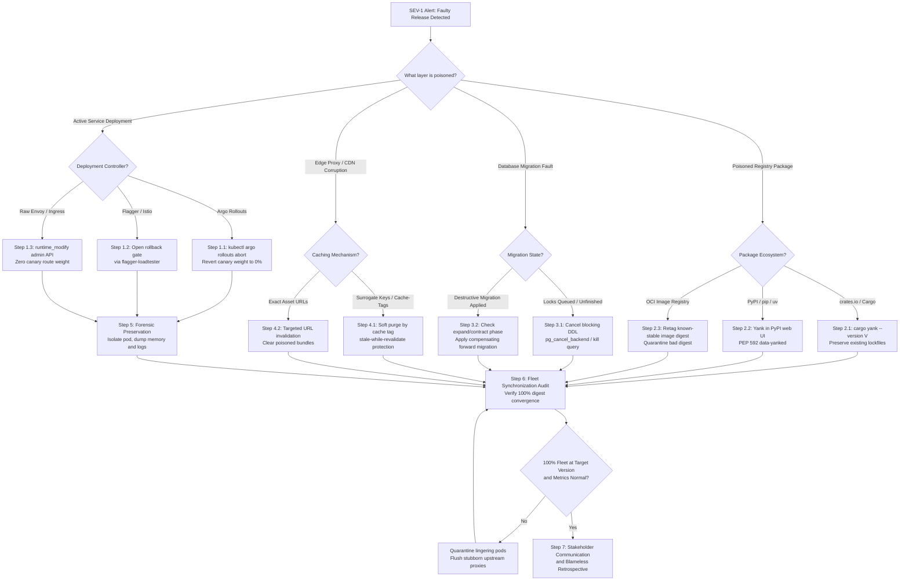
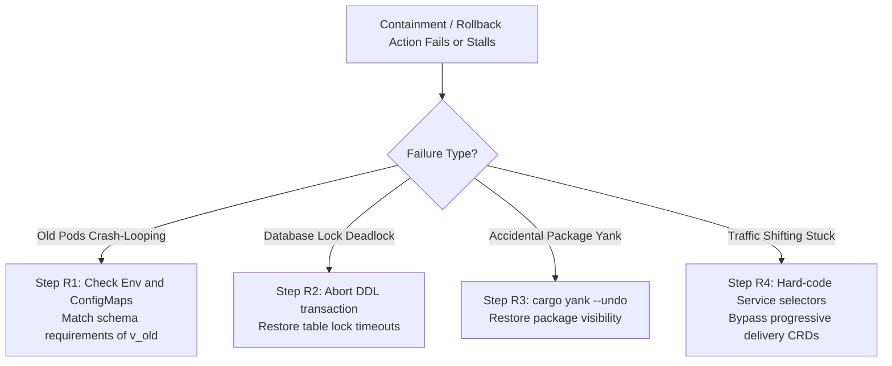
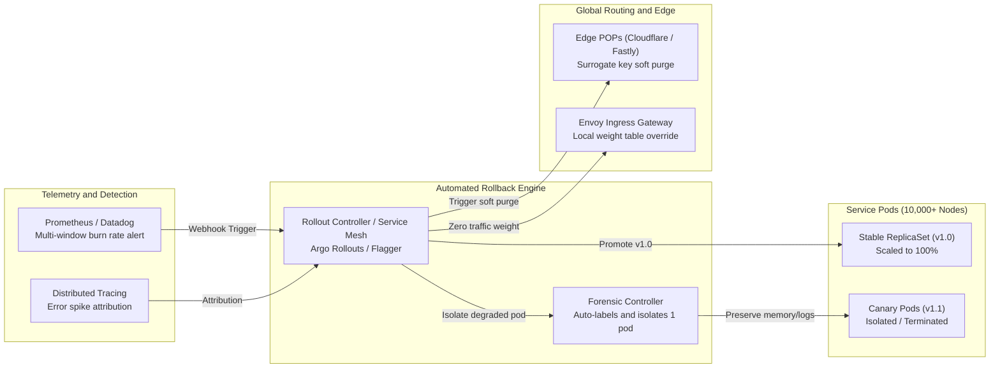

# Playbook: Contain and Roll Back a Faulty Production Release

> [!summary] Scope
> High-severity incident response playbook for arresting broken progressive delivery deployments and poisoned package releases.
> Details emergency stop commands for canary traffic shifting, registry yanking workflows across PyPI and crates.io, backward-compatible database migration reversal, and cache eviction across edge proxies.
> Establishes post-incident forensic capture procedures and fleet synchronization verification.
> Covers stakeholder communication protocols and post-mortem retrospective templates.

Progressive delivery pipelines and automated canary promotion mechanics are owned by [[Progressive-Delivery-Rollbacks-and-Feature-Flags]].
Artifact registries, branch cuts, and release train staging are owned by [[Release-Trains-Backports-and-Artifact-Registries]].
Zero-downtime shared library migrations and ABI transitions are owned by [[Execute-Zero-Downtime-Shared-Library-SONAME-Migration]].
This playbook owns the immediate, high-severity operational emergency procedure executed when a poisoned artifact or flawed progressive deployment bypasses automated gates and inflicts customer impact.

## Trigger and Symptoms

Activate this playbook immediately upon observing any of the following high-severity production triggers:

- An in-progress canary or progressive deployment triggers Service Level Objective (SLO) alert breaches, including HTTP 5xx error rates exceeding 1%, P99 latency degradation beyond 3x baseline, or unhandled process panics.
- A newly published package version on an external or internal package registry (such as PyPI or crates.io) contains a critical regression, broken ABI, corrupted metadata, or malicious dependency.
- A production database migration locks critical tables, causes thread pool exhaustion on application workers, or introduces schema changes that cause active application queries to fail.
- An edge proxy or Content Delivery Network (CDN) caches corrupt responses, broken JavaScript bundles, or malformed API responses, serving errors directly to end users despite backend health.
- A corrupted configuration payload or channel update causes cascading application crash loops across multiple pods or nodes (see [[Case-Study-CrowdStrike-Falcon-Channel-File-291]]).

```text
[ALERT] SEV-1: checkout-service canary error rate 14.2% (threshold: 0.5%)
[ALERT] Envoy cluster checkout_canary returning upstream_reset_before_response_started
[ERROR] Pod checkout-service-7f8d68965c-4k8xm crashing: SIGSEGV (signal 11) at 0x0000000000000028
[LOG]   postgres: process 41029 still waiting for AccessExclusiveLock on relation 16412 of database 16384 after 1000.072 ms
        STATEMENT: ALTER TABLE orders ADD COLUMN tax_code VARCHAR(32) NOT NULL;
```

The error log demonstrates simultaneous failure modes: canary traffic routing requests to crashing workloads, while an unsafe schema migration blocks transactions on the shared data store.
Halting user impact requires coordinated execution across routing fabrics, package indexes, data stores, and edge caches.

## Decision Tree



## Prerequisites

Execute operations from an authenticated triage station with network egress to orchestrator control planes, database bastions, and edge provider APIs.
Ensure the triage station has the required binaries installed:

```bash
command -v kubectl kubectl-argo-rollouts cargo curl jq aws psql dig
```

The tools listed must match verified versions in production toolchains (as of 2026-11, Linux and macOS):
- `kubectl` v1.30+ and `kubectl-argo-rollouts` v1.7+
- `cargo` 1.80+
- `curl` 8.5+ with OpenSSL/BoringSSL
- `jq` 1.7+
- `aws-cli` 2.17+
- `psql` (PostgreSQL client) 16+

### Required Permissions and Environment Variables

Set and export the target authentication variables before initiating containment:

```bash
export KUBECONFIG="${HOME}/.kube/config-production"
export CARGO_REGISTRY_TOKEN="cio_EXAMPLE-DO-NOT-USE-PROD-KEY"
export CLOUDFLARE_API_TOKEN="cf_EXAMPLE-DO-NOT-USE-PROD-KEY"
export CLOUDFLARE_ZONE_ID="8a9b0c1d2e3f4a5b6c7d8e9f0a1b2c3d"
export FASTLY_API_TOKEN="fsl_EXAMPLE-DO-NOT-USE-PROD-KEY"
export FASTLY_SERVICE_ID="abc123DEF456ghi789JKL0"
export AWS_REGION="us-east-1"
export PGHOST="db-primary.production.internal"
export PGPORT="5432"
export PGDATABASE="production_app"
export PGUSER="migration_admin"
```

Verify authentication and permissions prior to invoking write actions:

```bash
kubectl auth can-i update rollouts.argoproj.io -n production
kubectl auth can-i patch deployments -n production
psql -h "$PGHOST" -U "$PGUSER" -d "$PGDATABASE" -c "SHOW statement_timeout;"
curl -s -H "Authorization: Bearer $CLOUDFLARE_API_TOKEN" \
  "https://api.cloudflare.com/client/v4/zones/${CLOUDFLARE_ZONE_ID}" | jq -r '.success'
```

**Verification:** Each check must print `yes`, numeric database settings, and `true`.
If any command fails, escalate credentials through the active Incident Commander immediately.

## Commands and Numbers to Know

| Parameter or Action | Platform or System | Value `(as of 2026-11)` | Operational Consequence |
| :--- | :--- | :--- | :--- |
| `kubectl argo rollouts abort` execution time | Kubernetes / Argo Rollouts | One API call to set `status.abort`; Argo Rollouts publishes no latency figure | Stops the update and shifts traffic back to the stable ReplicaSet; with traffic routing, canary pods scale down after `abortScaleDownDelaySeconds` (default 30 s). |
| Flagger manual rollback | Kubernetes / Flagger | Next analysis tick (`spec.analysis.interval`) | A `rollback` webhook that returns success makes Flagger stop the analysis, shift traffic to the primary, and mark the canary `Failed`. |
| Envoy admin `/runtime_modify` API | Envoy Proxy | "Effectively immediately" (Envoy docs); no latency figure is published | Overrides a runtime key in the admin layer without a control plane round-trip; needs an admin layer in `layered_runtime` or the call returns 503. |
| `cargo yank` index propagation | crates.io sparse index | Index update on yank; crates.io publishes no propagation figure, so verify with the index check below | Sets `"yanked": true` in index; does not break existing `Cargo.lock` builds. |
| PyPI PEP 592 Simple API update | PyPI / Warehouse | PyPI publishes no propagation figure, so verify with the Simple API check below | Adds `data-yanked` attribute to HTML anchors; installers skip it unless it is the only match for `==` or `===`. |
| PostgreSQL `ACCESS EXCLUSIVE` lock acquisition | PostgreSQL | Blocks all reads/writes | Conflicts with `ACCESS SHARE` (simple `SELECT`); queues all incoming queries. |
| Recommended `lock_timeout` for migrations | PostgreSQL | `2s` | Prevents DDL queue from blocking read queries and exhausting connection pool. |
| Cloudflare Purge by Tag / Hostname / Prefix latency | Cloudflare Edge | Under 150 ms (P50, Cloudflare blog) | Decoupled invalidation across global edge POPs; does not clear client browser cache. |
| Fastly Surrogate Key Purge latency | Fastly Edge | ~150 ms (Mean) | Invalidation broadcast via soft purge (`Fastly-Soft-Purge: 1`) to preserve revalidation. |
| CloudFront Invalidation propagation | AWS CloudFront | Under 5 s (P95) | Batch propagation across edge network; CLI reports `Completed` under 25 s P95. |
| Kubernetes pod `terminationGracePeriodSeconds` | Kubernetes Core | `30s` (Default) | Time between `SIGTERM` and `SIGKILL`; controls window to capture memory and state. |
| Multi-window multi-burn-rate SEV-1 alert | SRE Monitoring | 14.4x burn rate (1h window, 5m short window) | Consumes 2% of 30-day error budget in 60 minutes; mandates immediate rollback. |

## Step-by-Step Execution

Follow these steps sequentially based on the affected subsystems.
Do not proceed past a failed verification step without consulting the Failure Modes table.

### Step 1: Emergency Stop and Canary Traffic Arrest

When an automated rollout controller (such as Argo Rollouts or Flagger) fails to self-abort, execute an imperative traffic arrest.

#### 1.1 Arrest Argo Rollouts Canary Progression

Arrest the in-progress rollout immediately, zeroing traffic routed to the degraded canary pods:

```bash
kubectl argo rollouts abort checkout-service -n production
kubectl argo rollouts status checkout-service -n production --timeout=30s
```

The `abort` command "stops progressing the current rollout and reverts all steps", making the previous (stable) ReplicaSet active again.
It does not pause the controller; it sets `status.abort: true`, and with a traffic router the controller sets the canary weight to 0% and scales the canary pods down after `abortScaleDownDelaySeconds` (default 30 seconds).
Isolate a pod for forensics (Step 5) inside that window, or set the delay higher in the Rollout spec ahead of time.
`kubectl argo rollouts get rollout` has no `-o json` flag, so read the status through plain `kubectl`.

**Verification:**

```bash
kubectl get rollout checkout-service -n production -o json | jq -r '.status.phase, .status.abort'
```

Expected output confirms the rollout is `Degraded` and the abort flag is set; the Argo Rollouts getting-started guide states that after an abort "the overall rollout is still considered `Degraded`" because the desired version is not the one running:

```text
Degraded
true
```

#### 1.2 Arrest Flagger Canary Rollout

Flagger has no `abort` CLI command; its manual rollback path is a `rollback` webhook in the Canary analysis, which must already be configured:

```yaml
analysis:
  webhooks:
    - name: rollback
      type: rollback
      url: http://flagger-loadtester.test/rollback/check
```

Open the rollback gate from inside the flagger-loadtester pod; when the gate is open, Flagger stops the analysis, shifts all traffic back to the primary, and fails the canary:

```bash
kubectl -n test exec deploy/flagger-loadtester -- \
  curl -s -d '{"name":"checkout-service","namespace":"production"}' http://localhost:8080/rollback/open
```

Close it afterwards by posting the same payload to `/rollback/close`.
Never patch `spec.skipAnalysis: true` during an incident: Flagger docs state that with it enabled Flagger "promotes it without analysing it", which pushes the bad release to 100%.

**Verification:**

```bash
kubectl -n production get canary checkout-service -o jsonpath='{.status.phase}{"\n"}'
```

Expected output confirms the transition back to stable:

```text
Failed
```

#### 1.3 Emergency Bypass via Envoy Proxy Admin API

If the Kubernetes control plane or service mesh control plane is slow to propagate route updates, bypass the orchestrator by hitting the local Envoy admin API on edge ingress gateways:

```bash
curl -s -X POST "http://127.0.0.1:15000/runtime_modify?routing.traffic_shift.checkout_service_v2=0"
```

This works only if the canary route carries a `runtime_fraction` keyed on that name and sits before the stable route, as in Envoy's traffic-shifting example: routes match first-wins, the value is the percentage of requests the guarded route matches, so `0` sends everything to the next (stable) route.
A mesh control plane's generated routes need not carry such a key.
The bootstrap must also declare an admin layer (`layered_runtime` with an `admin_layer` entry); without one, Envoy answers mutating runtime calls with HTTP 503.
Port 15000 is the Istio sidecar admin port; standalone Envoy uses whatever `admin.address` sets.

Verify that the runtime override applied instantly:

```bash
curl -s "http://127.0.0.1:15000/runtime" | jq '.entries["routing.traffic_shift.checkout_service_v2"]'
```

Expected output, with one `layer_values` entry per configured layer (here a disk layer and the admin layer):

```json
{
  "final_value": "0",
  "layer_values": [
    "",
    "0"
  ]
}
```

### Step 2: Poisoned Package Registry Containment and Yanking

When a corrupted, ABI-broken, or vulnerable library version is published to a package registry, yanking arrests the blast radius without breaking downstream projects that already pinned the version in a lockfile (see [[Case-Study-Left-Pad-and-Registry-Immutability]]).
Never attempt to delete or unpublish a release; registries restrict deletion to preserve immutable dependency graphs (crates.io, for example, allows an owner to delete a crate only within 72 hours of publication or under narrow download and dependency conditions, per RFC 3660) (see [[Lockfiles-Vendoring-and-Offline-Mirrors]]).

#### 2.1 Yanking a Crate from crates.io

Execute `cargo yank` specifying the exact poisoned SemVer version:

```bash
cargo yank --version 2.4.2 checkout-core --token "$CARGO_REGISTRY_TOKEN"
```

Under the hood, Cargo issues an authenticated HTTP `DELETE` to the registry web API, with the raw token (no `Bearer` prefix) as the `Authorization` value; `--undo` issues `PUT .../unyank`:

```bash
curl -s -X DELETE \
  -H "Authorization: $CARGO_REGISTRY_TOKEN" \
  "https://crates.io/api/v1/crates/checkout-core/2.4.2/yank" | jq .
```

Yanking modifies the index entry in the crates.io sparse index (`https://index.crates.io/ch/ec/checkout-core`), setting `"yanked": true`.
Cargo will no longer select 2.4.2 for `checkout-core = "2.4"` or `^2.4.1` in any new project or checkout without a lockfile, falling back to 2.4.1 (and erroring if no compatible version remains).
However, existing production services containing `checkout-core 2.4.2` in their committed `Cargo.lock` continue to build and download without disruption.

**Verification:**

```bash
curl -s "https://index.crates.io/ch/ec/checkout-core" | jq -s '.[] | select(.vers=="2.4.2") | {vers, yanked}'
```

Expected output:

```json
{
  "vers": "2.4.2",
  "yanked": true
}
```

#### 2.2 Yanking a Release from PyPI

PyPI implements PEP 592 ("Adding 'yank' support to the Simple API").
PyPI documents yanking only through the web UI; API tokens authenticate uploads, and there is no documented token-authenticated yank endpoint (as of 2026-11):

1. Sign in as an owner or maintainer and open `https://pypi.org/manage/project/checkout-sdk/releases/`.
2. Click **Options** next to release 1.9.0, then **Yank**.
3. Enter the reason (for example `Critical SEV-1 regression: memory leak in C extension`) and confirm in the modal.

In the Simple Repository HTML response (`https://pypi.org/simple/checkout-sdk/`), Warehouse appends the `data-yanked` attribute to all distribution links for that release:

```html
<a href="../../packages/.../checkout_sdk-1.9.0-py3-none-any.whl" data-yanked="Critical SEV-1 regression: memory leak in C extension">checkout_sdk-1.9.0-py3-none-any.whl</a>
```

Package installers adhering to PEP 592 (including `pip` >= 19.2, which added yank support, and `uv`, whose resolver tracks yanked versions as unavailable candidates and documents that an exact yanked-version pin opts a package back in) ignore `checkout-sdk==1.9.0` when resolving ranges like `checkout-sdk>=1.8.0`.
If an installer specifically pins `checkout-sdk==1.9.0` in `requirements.txt` or a lockfile, it installs the package but outputs a visible warning displaying the reason string.

**Verification:**

```bash
curl -s "https://pypi.org/pypi/checkout-sdk/json" | jq -r '.releases["1.9.0"][0] | {yanked, yanked_reason}'
```

Expected output:

```json
{
  "yanked": true,
  "yanked_reason": "Critical SEV-1 regression: memory leak in C extension"
}
```

#### 2.3 Purge Internal Registry Caches and Proxies

If your organization runs an internal caching proxy (such as JFrog Artifactory, Sonatype Nexus, or devpi), an already-cached poisoned artifact must be evicted from the local cache storage:

```bash
curl -s -X DELETE -u "admin:${ARTIFACTORY_API_KEY}" \
  "https://artifactory.internal/artifactory/pypi-remote-cache/checkout-sdk/1.9.0/"
```

**Verification:** Query the internal proxy metadata endpoint and verify the release is no longer served from cache.

### Step 3: Backward-Compatible Database Migration Reversal

A common failure mode during faulty releases is an unsafe database migration.
If a migration dropped a column, renamed a table, or locked a hot relation, rolling back application code alone causes cascading SQL errors.
Ensure all operations adhere to the expand/contract migration protocol (see [[17-Cloud-AI-Engineering/Volume_06_Infrastructure_as_Code_and_Delivery/Chapter_06_Progressive_Delivery_and_Deployment_Pipelines|Chapter_06_Progressive_Delivery_and_Deployment_Pipelines]]).

#### 3.1 Terminate Long-Running Blocking DDL

If an active migration is currently blocked and holding or awaiting exclusive table locks, kill the migration transaction immediately before rolling back code:

```sql
-- Connect via psql as migration administrator
SELECT pid, query_start, now() - query_start AS duration, query, state
FROM pg_stat_activity
WHERE query ILIKE 'ALTER TABLE%' AND state != 'idle';
```

Terminate the blocking process using its process identifier (`PID`):

```sql
SELECT pg_cancel_backend(41029);
-- If unresponsive to cancel signal after 5 seconds:
SELECT pg_terminate_backend(41029);
```

**Verification:**

```sql
SELECT count(*) FROM pg_stat_activity WHERE pid = 41029;
```

Expected output: `0`.

#### 3.2 Reverting Destructive Schema Changes Under Lock Timeouts

When rolling back to a previous application version that expects a dropped or renamed column, you must restore the column or alias before the old application code boots.
Always set strict lock and statement timeouts to prevent connection pool exhaustion:

```sql
BEGIN;
SET LOCAL lock_timeout = '2s';
SET LOCAL statement_timeout = '5s';

-- Restore missing column required by rolled-back code v1.0
ALTER TABLE orders ADD COLUMN IF NOT EXISTS tax_code VARCHAR(32) DEFAULT 'STANDARD';

-- Re-establish view abstraction if table was renamed
CREATE OR REPLACE VIEW orders_legacy AS SELECT * FROM orders;

COMMIT;
```

Setting `lock_timeout = '2s'` ensures that if the `ALTER TABLE` cannot acquire the required `ACCESS EXCLUSIVE` lock within 2,000 milliseconds, PostgreSQL aborts the transaction rather than queueing up and blocking incoming `SELECT` queries.

**Verification:**

```sql
SELECT column_name, data_type, is_nullable
FROM information_schema.columns
WHERE table_name = 'orders' AND column_name = 'tax_code';
```

Expected output: `tax_code | character varying | YES`.

### Step 4: Edge CDN and Reverse Proxy Cache Eviction

When an incident causes edge caches to store 5xx responses, corrupt assets, or unauthorized payloads, evicting the edge cache is required.
Never execute an unconstrained global purge ("Purge Everything") during an active incident: invalidating all cached content immediately causes a catastrophic thundering herd (cache stampede) on origin application servers.

#### 4.1 Execute Soft Purge via Fastly Surrogate Keys

Fastly supports soft purging via surrogate keys.
A soft purge marks the cached object as stale rather than deleting it.
When the object carries an RFC 5861 `stale-while-revalidate` (or `stale-if-error`) directive, Fastly can serve the stale copy while revalidating with the origin in the background; without one, the next request waits on the origin fetch:

```bash
curl -s -X POST \
  -H "Fastly-Key: $FASTLY_API_TOKEN" \
  -H "Fastly-Soft-Purge: 1" \
  -H "Accept: application/json" \
  "https://api.fastly.com/service/${FASTLY_SERVICE_ID}/purge/release-v2.4.2" | jq .
```

**Verification:**

```json
{
  "status": "ok"
}
```

Request collapsing applies to each origin request individually, so origin load stays near one revalidation per object rather than one per client request (Fastly docs).
Clustering focuses fetches for one object through a single cache node, and shielding focuses requests from many POPs into a single POP.
This protects backend databases while stale responses are updated to the rolled-back version.

#### 4.2 Targeted Purge by Cache-Tags and URLs on Cloudflare

Cloudflare enables immediate cache purging by specific URLs or by `Cache-Tag` response headers, on every plan since April 2025.
The API reference defines the request body as one purge type per request ("Send one of these fields"), so issue tags and files as separate calls:

```bash
CF_PURGE="https://api.cloudflare.com/client/v4/zones/${CLOUDFLARE_ZONE_ID}/purge_cache"
curl -s -X POST -H "Authorization: Bearer $CLOUDFLARE_API_TOKEN" -H "Content-Type: application/json" \
  --data '{"tags": ["bundle-checkout", "api-config-v2"]}' "$CF_PURGE" | jq '.success'
curl -s -X POST -H "Authorization: Bearer $CLOUDFLARE_API_TOKEN" -H "Content-Type: application/json" \
  --data '{"files": ["https://app.example.com/assets/checkout.js", "https://app.example.com/api/v1/bootstrap"]}' \
  "$CF_PURGE" | jq '.success'
```

Cloudflare reports purge by tag, hostname, or prefix completing across its global network in under 150 milliseconds (P50).
A `success: true` response means the purge was accepted, not that content is gone; confirm with the edge check below.

**Verification:**

```bash
curl -sI "https://app.example.com/assets/checkout.js" | grep -iE 'cf-cache-status|etag'
```

Expected output confirms the edge status is `MISS`, `EXPIRED`, or `REVALIDATED` (not `HIT` on the poisoned asset):

```text
cf-cache-status: MISS
```

#### 4.3 Batch Invalidation on AWS CloudFront

Execute targeted path invalidation via the AWS CLI:

```bash
aws cloudfront create-invalidation \
  --distribution-id "E1A2B3C4D5E6F7" \
  --paths "/assets/checkout.js" "/api/v1/bootstrap*"
```

**Verification:** Query the invalidation ID returned by the creation command:

```bash
aws cloudfront get-invalidation \
  --distribution-id "E1A2B3C4D5E6F7" \
  --id "I1234567890ABC" | jq -r '.Invalidation.Status'
```

Expected output: Transitions from `InProgress` to `Completed`; AWS states invalidations take effect in under 5 seconds and report completion in under 25 seconds at P95 (as of 2026-11).

### Step 5: Post-Incident Forensic Artifact Capture

Before terminating pods or purging container instances during a rollback, preserve volatile state for root-cause diagnosis.
Standard Kubernetes rollouts delete failing pods after `terminationGracePeriodSeconds` (default 30 seconds), destroying ephemeral logs, core dumps, and memory maps.

#### 5.1 Isolate Degraded Pod from Traffic Routing

Remove the pod from the Service selector by modifying its labels:

```bash
POD_NAME="checkout-service-7f8d68965c-4k8xm"
kubectl label pod "$POD_NAME" -n production app=isolated-forensics --overwrite
```

Because the Kubernetes Service selector routes only to `app=checkout-service`, the isolated pod immediately ceases receiving production traffic but keeps running in the same namespace.
Its labels no longer match the ReplicaSet selector either, so the ReplicaSet releases it and creates a replacement; the Kubernetes ReplicaSet docs describe exactly this technique for "debugging, data recovery, etc.", and a later scale-down or rollback no longer deletes the released pod.

#### 5.2 Extract Process Memory and Diagnostic State

Capture the core dump, process mappings, and thread state from the isolated container.
`gcore` ships with gdb and needs ptrace permission (`SYS_PTRACE` or an equivalent pod security setting), and `kubectl cp` needs `tar` in the image; minimal or distroless images lack both, so use an ephemeral debug container (`kubectl debug --target`) there:

```bash
# Capture full crash dump and thread state
kubectl exec "$POD_NAME" -n production -c checkout-service -- \
  gcore -o /tmp/forensic.core 1

# Copy the core dump and process metadata to triage station
kubectl cp "production/${POD_NAME}:/tmp/forensic.core.1" "./incident_forensic.core"
kubectl exec "$POD_NAME" -n production -c checkout-service -- \
  cat /proc/1/maps > "./incident_proc_maps.txt"
kubectl exec "$POD_NAME" -n production -c checkout-service -- \
  cat /proc/1/status > "./incident_proc_status.txt"
```

#### 5.3 Archive Container Logs and Packet Traces

Capture stdout/stderr streams from both the current container and any previously crashed container instance:

```bash
kubectl logs "$POD_NAME" -n production -c checkout-service --previous > "./incident_previous.log"
kubectl logs "$POD_NAME" -n production -c checkout-service > "./incident_current.log"
kubectl get pod "$POD_NAME" -n production -o yaml > "./incident_pod_spec.yaml"
```

**Verification:** Ensure captured artifacts are non-empty and have valid file formats:

```bash
file ./incident_forensic.core ./incident_pod_spec.yaml
wc -l ./incident_proc_maps.txt ./incident_current.log
```

Expected output:

```text
./incident_forensic.core: ELF 64-bit LSB core file, x86-64, version 1 (SYSV)
./incident_pod_spec.yaml: ASCII text
148 ./incident_proc_maps.txt
1240 ./incident_current.log
```

### Step 6: Fleet Synchronization and Convergence Verification

Never declare an incident contained until you prove that 100% of running workloads have converged to the known-stable target version.
Partial rollbacks create split-brain states where mixed protocol formats or data schemas cause cross-service corruption.

#### 6.1 Audit Container Image Digests Across All Pods

Verify that every running pod in the target workload runs the exact immutable OCI image digest of the stable release (see [[OCI-Images-Layers-Multi-Stage-and-Distroless]]):

```bash
kubectl get pods -n production -l app=checkout-service \
  -o jsonpath='{range .items[*]}{.status.containerStatuses[0].imageID}{"\n"}{end}' | \
  sort | uniq -c
```

**Verification:** The output must contain exactly one line matching the expected stable image digest, with a count equal to the desired replica count (printing pod names in the same line would make every line unique and defeat the count):

```text
     24 registry.example.com/checkout@sha256:7a8b9c0d1e2f3a4b5c6d7e8f9a0b1c2d3e4f5a6b7c8d9e0f1a2b3c4d5e6f7a8b
```

If multiple digests appear, list the offenders with `kubectl get pods -n production -l app=checkout-service -o jsonpath='{range .items[*]}{.metadata.name}{"\t"}{.status.containerStatuses[0].imageID}{"\n"}{end}'` and delete lingering pods manually:

```bash
kubectl delete pod checkout-service-7f8d68965c-4k8xm -n production --grace-period=0 --force
```

#### 6.2 Audit Kubernetes EndpointSlices

Verify that the active `EndpointSlice` resources reference only ready pods running the stable revision:

```bash
kubectl get endpointslices -n production -l kubernetes.io/service-name=checkout-service \
  -o jsonpath='{range .items[*].endpoints[*]}{.targetRef.name}{"\t"}{.conditions.ready}{"\n"}{end}'
```

**Verification:** Every endpoint must print `true`, and all pod names must match the stable ReplicaSet prefix (`checkout-service-5d6c8b9f4a-*`).

#### 6.3 Verify Ingress and Edge Proxy Convergence

Query edge routes across multiple geographic POPs to ensure no stale route weights persist.
`X-Debug-POP` is a placeholder: no standard header pins a request to a chosen POP, so substitute your CDN's mechanism or run the probe from vantage points in each region:

```bash
for pop in lhr iad nrt sin fra; do
  curl -s -o /dev/null -w "%{http_code} %{remote_ip} %{time_total}s\n" \
    --header "X-Debug-POP: $pop" \
    "https://api.example.com/checkout/health"
done
```

**Verification:** All edge POP requests return `200 OK` with consistent latencies and zero 5xx responses.

## Rollback Procedure

If executing any containment step above introduces secondary instability (for example, if rolling back the application code triggers a crash loop on the older binary due to missing environment variables), follow this rollback procedure to recover system stability.



1. **Restore Application Configuration for Previous Binary.**
   When rolling back to an older image tag, verify that the active Kubernetes `ConfigMap` and `Secret` objects match the schema expected by the old binary.
   If an environment variable was removed or renamed in the new release, restore it before restarting pods:
   ```bash
   kubectl set env deployment/checkout-service -n production CONFIG_VERSION="v1" LEGACY_AUTH_ENDPOINT="https://auth-v1.internal"
   ```
   **Check:** `kubectl rollout status deployment/checkout-service -n production` completes successfully.

2. **Abort Failed Database Schema Reversals.**
   If an `ALTER TABLE` statement hangs while attempting to reverse a migration, kill the statement and rollback the active transaction:
   ```sql
   ROLLBACK;
   SELECT pg_terminate_backend(pid) FROM pg_stat_activity
   WHERE query ILIKE '%ALTER TABLE orders%' AND pid != pg_backend_pid();
   ```
   **Check:** Verify `SELECT count(*) FROM pg_locks WHERE relation = 'orders'::regclass AND mode = 'AccessExclusiveLock';` returns `0` (the view is `pg_locks`; there is no `pg_stat_locks`).

3. **Unyank Accidentally Yanked Package Versions.**
   If an operator accidentally yanks the wrong version on crates.io, reverse the yanking immediately using the `--undo` flag:
   ```bash
   cargo yank --undo --version 2.4.0 checkout-core --token "$CARGO_REGISTRY_TOKEN"
   ```
   For PyPI, there is no documented API for this either: open `https://pypi.org/manage/project/checkout-sdk/release/1.8.9/` as an owner and use the same release management page in the web UI; the PyPI docs describe the yank control under the release's **Options** button but do not describe an un-yank control, so confirm the control in the UI during the incident.
   **Check:** Verify that `cargo search` or the PyPI Simple API serves the unyanked artifact without `data-yanked` attributes.

4. **Hard-Code Service Selectors to Bypass Progressive Delivery Controllers.**
   If Argo Rollouts or Flagger CRD controllers are crash-looping or unresponsive during an incident, disconnect the progressive delivery controller entirely and point standard Kubernetes Services directly to the stable ReplicaSet:
   ```bash
   kubectl patch service checkout-service -n production --type=merge \
     -p '{"spec":{"selector":{"app":"checkout-service","rollouts-pod-template-hash":"5d6c8b9f4a"}}}'
   ```
   **Check:** `kubectl get endpoints checkout-service -n production` lists the IPs of the stable pods immediately.

## Failure Modes of the Procedure

| Failure | How It Shows Up | Recovery |
| :--- | :--- | :--- |
| Old pods crash-loop on rollback | Rollback triggers `CrashLoopBackOff`; logs show missing config keys or connection failures | Check ConfigMaps and Secrets; old code often requires deprecated environment variables removed by the release. Re-inject legacy config keys via `kubectl set env`. |
| Database connection pool exhaustion during migration rollback | Application logs report `FATAL: remaining connection slots are reserved for non-replication superuser connections` (PostgreSQL 15 and earlier; 16+ reads `... reserved for roles with the SUPERUSER attribute`) | A DDL statement queued for an `ACCESS EXCLUSIVE` lock. Execute `SELECT pg_terminate_backend(pid)` on the DDL query, set `lock_timeout = '2s'`, and retry. |
| Hard cache purge causes backend collapse | Traffic spike at origin; backend CPU hits 100%; database connections saturate | You executed an unconstrained global cache purge. Immediately re-enable edge rate limiting, activate CDN origin shield, and apply soft purges with `stale-while-revalidate`. |
| Ephemeral forensic data lost | Pod disappears; `kubectl logs` reports `Error from server (NotFound)` | The deployment controller terminated the pod. Cordon the node immediately (`kubectl cordon`), locate the container ID via `crictl ps -a`, and extract logs from `/var/log/pods`. |
| Yanked package breaks clean CI builds | Downstream CI pipelines fail with `PackageNotFound` or `No matching distribution found` | Downstream projects did not commit a lockfile and used loose SemVer ranges. Instruct teams to restore `Cargo.lock` or pin the last non-yanked release explicitly. |
| Split-brain protocol mismatch across services | Internal RPCs fail with `deserialization error` or `unknown field` | Internal services are communicating across incompatible versions. Check EndpointSlices; drain lingering canary pods using `kubectl delete pod` with `--grace-period=0`. |
| Envoy admin API returns 403 or connection refused | `curl` to `http://127.0.0.1:15000/runtime_modify` fails with `Connection refused` | Envoy admin interface is bound to `127.0.0.1` inside the proxy container. Access the container network namespace using `kubectl exec -it <envoy-pod> -c envoy -- curl ...` or `nsenter`. |

## Pitfalls

> [!warning] Deleting a package version instead of yanking breaks the ecosystem
> Deleting an artifact completely wipes the file from the registry index.
> Any existing build pipeline, Dockerfile, or production machine that relies on a committed lockfile will immediately fail to resolve the package with a 404 Not Found error (see [[Case-Study-Left-Pad-and-Registry-Immutability]]).
> Yanking retains the physical package files while modifying registry metadata (`data-yanked` on PyPI, `"yanked": true` on crates.io).
> This preserves deterministic builds for existing lockfiles while preventing any new resolution from selecting the faulty artifact.

> [!warning] Global CDN cache purges trigger origin collapse
> Issuing a "Purge Everything" API call to Cloudflare, CloudFront, or Fastly invalidates every cached asset across hundreds of edge POPs simultaneously.
> The next surge of incoming user requests bypasses the cache entirely and floods the origin cluster (the "thundering herd" or "cache stampede" problem).
> Always use targeted invalidation by `Cache-Tag`, surrogate key, or specific file URLs.
> Whenever supported, use soft purges (`Fastly-Soft-Purge: 1`) so edge proxies continue serving stale assets while fetching fresh content in the background per RFC 5861.

> [!warning] Non-backward-compatible migrations cannot be rolled back safely
> If a release includes an `ALTER TABLE orders DROP COLUMN tax_code;` migration, rolling back the application code to v1.0 will cause instant, catastrophic failure.
> The old application code will execute `SELECT tax_code FROM orders;` and crash with `column "tax_code" does not exist`.
> Follow the expand/contract design: never drop or rename a column in the same release train as code changes (see [[Release-Trains-Backports-and-Artifact-Registries]]).
> If a column was dropped, you must execute a compensating migration to re-add the column with a default before rolling back application code.

> [!warning] Rolling back a deployment destroys ephemeral crash state
> By default, `kubectl rollout undo` or `kubectl delete pod` sends `SIGTERM` and terminates existing pods after the grace period expires.
> Once the container rootfs is destroyed, in-memory core dumps, uncommitted local scratch buffers, and kernel diagnostic traces are gone forever.
> Always isolate at least one failing pod by stripping its Service selector labels before initiating fleet-wide pod termination.

> [!warning] Missing lock timeouts turn minor DDL into full-site outages
> Acquiring an `ACCESS EXCLUSIVE` lock in PostgreSQL requires waiting for all concurrent `SELECT` transactions on that table to finish.
> While the DDL transaction waits in the lock queue, PostgreSQL blocks all subsequent read and write transactions from accessing that table.
> Without `SET LOCAL lock_timeout = '2s';`, a simple `ALTER TABLE` statement queues behind a slow query and blocks all incoming application traffic, causing connection pool exhaustion within seconds.

## At Scale

At 1,000 to 50,000 nodes across multi-region Kubernetes clusters and global edge proxies, manual CLI intervention cannot scale during a Sev-1 incident.
Automated containment architectures decouple detection, control plane signaling, and local proxy enforcement.



### Automated Multi-Window Burn Rate Triggers

Do not rely on human operators to detect canary degradation.
Configure multi-window multi-burn-rate alerts (per The Site Reliability Workbook, "Alerting on SLOs", whose recommended parameters assume a 99.9% SLO over 30 days) directly into the deployment controller:

- **14.4x Burn Rate Alert (1-hour window):** Consumes 2% of the monthly error budget in 60 minutes.
  Triggers automatic, unprompted canary abortion via orchestrator webhooks.
- **6x Burn Rate Alert (6-hour window):** Consumes 5% of the monthly error budget in 6 hours.
  Automatically pauses progression and pages the primary on-call engineer.

### Distributed Fleet Convergence Mechanics

In large-scale microservice environments, a release artifact does not reach every regional Kubernetes cluster at once, because each cluster pulls images from the registry independently and registry pull bandwidth bounds how fast a large rollout converges; measure your own fleet's convergence time rather than assuming one.
To guarantee fleet convergence during a rollback:

1. **Pre-warmed Base Images:**
   Deployment pipelines must retain the previous stable image layers in local node caches (configured via `imagePullPolicy: IfNotPresent` and dedicated node image garbage collection thresholds `imageMinimumGCAge: 48h`).
2. **Atomic Ingress Swapping:**
   Traffic shifting must occur at the ingress layer (Envoy weighted clusters or Cloudflare load balancer pools) before modifying container replica counts.
   This drops customer traffic on degraded pods to 0% in milliseconds, even if container shutdown takes minutes.
3. **Control Plane Decoupling:**
   In the event of a control plane outage (such as Kubernetes API server saturation), local edge Envoy proxies must maintain fallback static routing configurations that can be toggled via local file-based runtime systems (clusters with `type: STATIC` plus a disk runtime layer that watches a local directory).

### Decision Rules for Automated Versus Manual Rollback

- **Rule 1 (Zero-Tolerance Invariant):** If a canary deployment introduces process crashes (`SIGSEGV`, `SIGBUS`, `panic`), the automated pipeline MUST abort the rollout immediately without awaiting human approval.
- **Rule 2 (Data-Loss Precedence):** If an alert indicates database transaction rollbacks or database lock queue spikes, traffic shifting MUST occur before any code change is attempted.
- **Rule 3 (Human-in-the-Loop for Forward Fixes):** Never attempt a "roll-forward" (patching code directly in production) during an active Sev-1 incident unless rollback is mathematically impossible due to irreversible data schema corruption.
  Always roll back to the last known-good state.

## Stakeholder Communication and Retrospective Protocols

During a high-severity incident, structured communication prevents executive distraction and allows technical responders to focus entirely on containment.

### Tactical Communication Cadence: The CAN Protocol

The Incident Commander (IC) or Communications Lead must broadcast updates every 15 to 20 minutes using the CAN format:

- **Conditions:** What is the current operational state and customer impact?
  Example: "Checkout API error rate is currently 8.4% across US-East."
  "Approximately 1,200 checkout attempts failed over the last 15 minutes."
  "Latency is normal."
- **Actions:** What containment and rollback actions have been executed, and what is currently running?
  Example: "Canary traffic shifting was aborted via Argo Rollouts."
  "Stable release v2.4.1 has been restored across 100% of pods."
  "Targeted Cloudflare cache purge executed."
  "Verifying database connection pool health."
- **Needs:** What blockers or external authorizations are required?
  Example: "Need database administrator sign-off to terminate lingering background worker queries."
  "No executive escalations needed at this time."

### Customer Status Page Lifecycle States

Maintain transparency with external users via four standard status page states:

1. **Investigating (T+0 to T+15m):**
   "We are investigating elevated error rates affecting transaction processing."
   "Our engineering team is actively diagnosing the root cause."
2. **Identified (T+15m to T+30m):**
   "The issue has been identified as a regression in our latest release."
   "Rollback procedures are underway to restore the previous stable service version."
3. **Monitoring (T+30m to T+60m):**
   "Rollback to the previous stable release is complete."
   "Error rates have returned to baseline levels across all regions."
   "We are monitoring system health to ensure stability."
4. **Resolved (Post-Verification):**
   "All systems are fully operational."
   "Edge caches have been refreshed, and transaction processing has returned to normal performance."
   "A comprehensive post-mortem will be published."

### Blameless Post-Mortem Retrospective Template

Conduct a blameless post-mortem retrospective within 48 hours of incident mitigation.
Use the following structured markdown template:

```markdown
# Blameless Post-Mortem: Faulty Production Release Containment

## Incident Metadata
- **Date & Time (UTC):** 2026-11-15 14:22 UTC
- **Severity Level:** SEV-1
- **Incident Commander:** [Name/Role]
- **Technical Lead:** [Name/Role]
- **Total Duration (Downtime):** 28 minutes
- **Impacted Services:** checkout-service, api-gateway, edge-cache

## Executive Summary
On 2026-11-15 at 14:22 UTC, deployment of release v2.4.2 introduced an ABI mismatch in the C extension of checkout-core, causing pod crash loops (SIGSEGV) and elevating checkout transaction failure rates to 14.2%.
Automated canary gates failed to catch the regression due to synthetic health check masking.
The Incident Commander initiated manual canary arrest at 14:34 UTC, rolled back pods to v2.4.1, executed targeted edge cache invalidation, and completed fleet convergence by 14:50 UTC.
Customer impact ceased entirely at 14:48 UTC.

## Timeline of Events (All times UTC)
- **14:15:** Release v2.4.2 deployment initiated via Argo Rollouts (10% canary step).
- **14:22:** PagerDuty alert fires: `checkout-service 5xx Error Rate > 1%`.
- **14:25:** Incident declared SEV-1. IC and Tech Lead join war room.
- **14:28:** Diagnostic triage confirms SIGSEGV in worker threads; pod restarts begin.
- **14:32:** Isolated failing pod `checkout-service-7f8d68965c-4k8xm` for memory forensics.
- **14:34:** Executed `kubectl argo rollouts abort checkout-service`.
- **14:38:** Executed targeted Cloudflare and Fastly surrogate key soft purge.
- **14:42:** Executed `cargo yank --version 2.4.2 checkout-core` to protect downstream builds.
- **14:46:** All 24 production pods confirmed running v2.4.1 image digest.
- **14:48:** Customer checkout error rate returns to baseline (<0.02%).
- **14:50:** Incident marked Mitigated; entered 30-minute monitoring window.
- **15:20:** Incident marked Resolved.

## Root Cause Analysis
Release v2.4.2 incorporated an upgraded shared C library with an incompatible ABI memory layout.
When worker threads invoked `process_transaction()`, an uninitialized pointer in the struct padding triggered a null pointer dereference (`SIGSEGV` signal 11) under concurrent load.
Because synthetic canary health checks only pinged the `/healthz` HTTP endpoint (which did not exercise the transaction processing path), the automated canary analysis scored the deployment as healthy.

## The 5 Whys
1. **Why did checkouts fail?** Application worker pods crashed with SIGSEGV.
2. **Why did pods crash?** A memory layout mismatch in the C extension dereferenced an invalid address.
3. **Why was the memory layout mismatched?** A header update changed struct padding without incrementing the library SONAME.
4. **Why did canary analysis not detect the crash?** The canary analysis metrics monitored the `/healthz` endpoint error rate rather than real customer transaction error rates.
5. **Why was synthetic health checking used for canary evaluation?** The canary analysis template lacked metric binding to Prometheus business transaction metrics.

## Detection Gap Analysis
- **Unit & Integration Tests:** Ran against mock C library stubs that did not replicate production dynamic linking.
- **CI Build Gate:** Lacked ABI compliance checks (`abi-compliance-checker` or `cargo-semver-checks`).
- **Canary Gate:** Evaluated general pod CPU and `/healthz` HTTP status instead of transaction success rate.

## Action Items and Remediation Matrix

| Item | Description | Type | Owner | Target Date | Priority |
| :--- | :--- | :--- | :--- | :--- | :--- |
| ACT-01 | Reconfigure Argo Rollouts AnalysisTemplate to track `checkout_errors_total / checkout_requests_total` | Detective | SRE Team | 2026-11-20 | P0 |
| ACT-02 | Add `cargo-semver-checks` and ABI compatibility validation to CI release pipeline | Preventative | Toolchain Team | 2026-11-22 | P0 |
| ACT-03 | Add synthetic transaction execution to canary warm-up probes | Detective | Backend Team | 2026-11-25 | P1 |
| ACT-04 | Automate forensic pod isolation script in incident response CLI tooling | Corrective | Infrastructure | 2026-12-01 | P2 |
```

## Practice Drill

> [!tip] Practice Drill: Simulate Canary Arrest, Package Yanking, and Cache Soft Purging
> In a dedicated staging Kubernetes cluster, deploy a simulated faulty canary release with a 20% traffic split.
> 1. Trigger an intentional artificial error spike (10% HTTP 500s) on the canary pods.
> 2. Execute `kubectl argo rollouts abort <app>` and time how many milliseconds elapse before the ingress controller routes 100% of traffic back to the stable ReplicaSet.
> 3. Publish a dummy package `mock-util-v9.9.9` to a local private cargo/PyPI registry and execute the exact yanking commands.
>    Confirm with `cargo update` or `pip install` that new dependency resolutions skip the yanked version while an explicit pin still installs it.
> 4. Issue a surrogate key soft purge command to a test CDN service using `curl -H "Fastly-Soft-Purge: 1"` against objects served with `Cache-Control: stale-while-revalidate=60`, and confirm in the origin access log that clients kept receiving cached responses while the edge issued its revalidation fetch.
> 5. Cordon a node, isolate a degraded pod by modifying its labels, and extract a complete memory core dump using `gcore`.
> Target completion time: under 15 minutes end-to-end.

## Interview Questions

> [!question] L5
> What is the precise mechanical difference between yanking a package version (via `cargo yank` or PyPI PEP 592) and deleting the package release entirely?
> Why do modern public registries restrict deletion so tightly?
>
> > [!success]- Answer
> > Deleting a package completely removes the distribution archives (`.whl`, `.tar.gz`, `.crate`) from the registry storage and index.
> > Any downstream project that has pinned that exact version in its lockfile (`Cargo.lock`, `uv.lock`, `poetry.lock`) will fail to build immediately with HTTP 404 Not Found, causing broken builds across the ecosystem (as demonstrated in the left-pad incident; see [[Case-Study-Left-Pad-and-Registry-Immutability]]).
> > Yanking retains the physical files on the registry storage but updates the metadata in the registry index (`"yanked": true` in crates.io index, `data-yanked="reason"` in PyPI Simple API).
> > The package resolver ignores yanked versions when resolving version ranges or unpinned dependencies for new projects.
> > However, if a project already has a committed lockfile pinning that exact version, or if an engineer explicitly specifies `pkg==1.2.3`, the registry still permits downloading and building the package.
> > This contains the blast radius of a buggy release without breaking reproducible builds.

> [!question] L5
> How does `kubectl argo rollouts abort` differ from `kubectl argo rollouts undo`, and what happens to the underlying Kubernetes ReplicaSets and active traffic?
>
> > [!success]- Answer
> > `kubectl argo rollouts abort` immediately halts an in-progress progressive rollout.
> > It instantly adjusts traffic routing rules (such as Istio VirtualService weights or AWS ALB target group weights) to send 0% of traffic to the canary ReplicaSet and 100% to the stable ReplicaSet.
> > The rollout is marked aborted and shows as `Degraded`, but the desired specification still points to the new version.
> > The canary pods do not linger: with traffic routing they scale down after `abortScaleDownDelaySeconds` (default 30 seconds), so forensic isolation must happen inside that window or the delay must be raised ahead of time.
> > Conversely, `kubectl argo rollouts undo` is a declarative rollback that updates the Rollout resource specification back to a previous revision number.
> > It instructs the controller to deploy the previous revision as the new desired state, scaling down the canary ReplicaSet and establishing the previous revision as the active target.

> [!question] L6: Predict the Output
> An engineer publishes package `acme-auth` version `2.1.0` with a critical bug to PyPI and immediately yanks it with the reason `"Critical auth bypass"`.
> Predict the terminal output and resolution behavior of the following two commands executed in clean virtual environments without lockfiles:
> Command A: `pip install "acme-auth>=2.0.0"`
> Command B: `pip install "acme-auth==2.1.0"`
>
> > [!success]- Answer
> > Under pip 20.3+ (PEP 592 support dates from pip 19.2; the warning text below is the resolvelib resolver's, checked against pip 26.2.2 source):
> > For Command A (`pip install "acme-auth>=2.0.0"`), pip parses the Simple Repository index, sees the `data-yanked` attribute on `2.1.0`, and excludes it from the candidate set.
> > Pip resolves to the highest non-yanked version that satisfies the requirement (e.g., `acme-auth 2.0.9`):
> > ```text
> > Collecting acme-auth>=2.0.0
> >   Downloading acme_auth-2.0.9-py3-none-any.whl (12 kB)
> > Installing collected packages: acme-auth
> > Successfully installed acme-auth-2.0.9
> > ```
> > For Command B (`pip install "acme-auth==2.1.0"`), the user explicitly requested the exact yanked version.
> > Because `==2.1.0` explicitly matches only the yanked release and no other candidate exists, pip allows the installation but emits an explicit warning showing the yank reason:
> > ```text
> > Collecting acme-auth==2.1.0
> >   Downloading acme_auth-2.1.0-py3-none-any.whl (12 kB)
> > WARNING: The candidate selected for download or install is a yanked version: 'acme-auth' candidate (version 2.1.0 at https://files.pythonhosted.org/...)
> > Reason for being yanked: Critical auth bypass
> > Installing collected packages: acme-auth
> > Successfully installed acme-auth-2.1.0
> > ```

> [!question] L6: Debug This
> During a canary release rollback, an engineer rolls back the deployment using `kubectl rollout undo deployment/api-server`.
> Within 15 seconds, all database connections saturate, backend queries time out with 504 Gateway Timeout, and the PostgreSQL server log is flooded with:
> `FATAL: remaining connection slots are reserved for non-replication superuser connections`
> `LOG: process 18921 still waiting for AccessExclusiveLock on relation 16421 of database 16384 after 1000.031 ms`
> Explain the root cause of this failure and provide the exact database commands required to mitigate it.
>
> > [!success]- Answer
> > Root cause: The bad release included a database migration that attempted a destructive or locking DDL operation (such as `ALTER TABLE users DROP COLUMN phone_number;` or adding a column without lock timeouts).
> > The DDL statement requested an `ACCESS EXCLUSIVE` lock on the `users` table.
> > In PostgreSQL, an `ACCESS EXCLUSIVE` lock conflicts with all other lock types, including `ACCESS SHARE` (which is acquired by routine `SELECT` queries).
> > While the DDL statement waited for existing long-running read queries to complete, PostgreSQL queued all incoming read queries behind the DDL statement.
> > As incoming client requests arrived at the API servers, they opened new database connections that were immediately blocked in the lock queue, exhausting PostgreSQL's `max_connections` limit.
> >
> > Mitigation steps:
> > 1. Terminate the blocking DDL statement immediately:
> > ```sql
> > SELECT pg_cancel_backend(18921);
> > -- If still blocked:
> > SELECT pg_terminate_backend(18921);
> > ```
> > 2. Clear any lingering uncommitted transactions:
> > ```sql
> > SELECT pg_terminate_backend(pid) FROM pg_stat_activity
> > WHERE state = 'idle in transaction' AND now() - state_change > interval '10 seconds';
> > ```
> > 3. Re-run schema modifications only with strict lock timeouts:
> > ```sql
> > SET LOCAL lock_timeout = '2s';
> > SET LOCAL statement_timeout = '5s';
> > -- Execute required compensating DDL
> > ```

> [!question] L6
> Why does an unconstrained "Purge Everything" cache invalidation on edge CDNs (Cloudflare, Fastly, CloudFront) during an active incident frequently cause a secondary outage worse than the original bug?
> What mechanism should be used instead?
>
> > [!success]- Answer
> > A global cache purge evicts 100% of cached objects across all edge points of presence (POPs) worldwide simultaneously.
> > When subsequent end-user traffic hits the edge, every request results in a cache miss.
> > The entire volume of global client traffic collapses directly onto the origin application servers and databases (a thundering herd or cache stampede).
> > Origins typically run at a fraction of edge capacity and are quickly overwhelmed, leading to CPU saturation, database connection pool exhaustion, and widespread 502/504 errors.
> >
> > Instead of a global purge:
> > 1. Use targeted purging by surrogate key (`Cache-Tag` or `Surrogate-Key`) or exact asset URLs to evict only the corrupted assets.
> > 2. Use soft purging (`Fastly-Soft-Purge: 1` or RFC 5861 `stale-while-revalidate`).
> > Soft purging marks cached objects as stale.
> > When the object carries `stale-while-revalidate`, the edge continues serving the stale object to users while issuing background revalidation requests to the origin, collapsed per URL at each cache location, which sharply reduces origin load spikes rather than eliminating them.

> [!question] L7
> In Kubernetes, executing `kubectl rollout undo` immediately terminates failing pods after `terminationGracePeriodSeconds` (default 30 seconds), destroying ephemeral memory, logs, and process states.
> How do you design an automated incident containment mechanism that isolates degrading pods for forensic analysis while completing the fleet rollback?
>
> > [!success]- Answer
> > To reconcile the conflict between rapid customer recovery and forensic preservation:
> > 1. Automated Detection and Isolation: When an automated canary analyzer detects an SLO breach, a custom operator or admission controller catches the alert and modifies the labels of exactly one failing pod (e.g., changing `app: checkout` to `app: isolated-forensics`).
> > 2. Service Traffic Disconnection: Because Kubernetes Services route traffic based on label selectors (`app: checkout`), relabeling the pod immediately removes it from the `EndpointSlice`.
> > No user requests can reach the pod, eliminating customer impact.
> > 3. Protection from Garbage Collection: Because the new labels no longer match the ReplicaSet selector, the ReplicaSet controller releases the pod (dropping its controller `ownerReference`) and creates a replacement, so a later scale-down or rollback does not delete it; the operator then owns the pod's cleanup.
> > 4. Fleet Rollback Execution: The controller triggers `kubectl argo rollouts abort` or updates the Deployment revision across the remaining replicas.
> > 5. Out-of-Process Diagnostic Capture: An automated job attaches to the isolated pod, executes `gcore` to dump process memory, copies `/proc/<PID>/maps` and `/proc/<PID>/status`, extracts stdout/stderr logs via `kubectl logs`, and persists the artifacts into a secure S3/GCS bucket before terminating the pod.

> [!question] L7
> In a globally distributed microservice architecture spanning 10,000+ pods across multiple cloud regions and Envoy edge proxies, how do you verify mathematically and mechanically that 0% of production traffic is hitting a rolled-back release before declaring an incident mitigated?
>
> > [!success]- Answer
> > Complete fleet convergence verification requires checking five distinct layers:
> > 1. Ingress Layer Route Weights: Query the Envoy admin runtime and route configuration API (`/config_dump` and `/clusters`) across every ingress cluster.
> > Confirm that the route weight for the degraded cluster is strictly 0 and that the active cluster points exclusively to the stable cluster.
> > 2. Kubernetes EndpointSlices: Query `EndpointSlice` resources across all namespaces and clusters.
> > Map every active IP address to its underlying pod and verify that 0 endpoints belong to pods running the bad ReplicaSet hash (`rollouts-pod-template-hash`).
> > 3. Container Image Digest Audit: Inspect running container statuses via the Kubernetes API across all nodes:
> > ```bash
> > kubectl get pods -A -o jsonpath='{range .items[*].status.containerStatuses[*]}{.imageID}{"\n"}{end}' | sort | uniq -c
> > ```
> > Verify that the poisoned image digest count is exactly 0.
> > 4. Edge CDN and Dynamic Gateway Convergence: Issue synthetic canary probe requests with unique tracing headers across all edge POPs (e.g., London, Virginia, Tokyo, Frankfurt).
> > Inspect response headers (such as `X-Envoy-Upstream-Service-Time` and `X-Served-By-Build-ID`) to prove that 100% of edge gateways resolve to the stable binary version.
> > 5. Real-Time Distributed Tracing Attribution: Query OpenTelemetry / distributed trace spans over a 5-minute rolling window.
> > Confirm that span attributes matching `service.version: v2.4.2` drop to exactly 0 across all downstream RPCs.

> [!question] L8+
> A faulty release ran for 25 minutes at 10% canary traffic.
> During this window, it processed 50,000 transactions and wrote divergent data to a PostgreSQL database using a new schema format that the rolled-back code (v1.0) cannot deserialize.
> Explain how to contain and roll back this release without data loss, including write diversion, Change Data Capture (CDC), and compensating transaction reconciliation.
>
> > [!success]- Answer
> > This scenario represents a split-brain write divergence where code rollback alone causes data corruption.
> > The containment architecture requires three phases:
> >
> > 1. Immediate Write Diversion (T+0):
> > Do not immediately roll back the database or crash the canary pods.
> > Divert incoming traffic at the ingress gateway: route 100% of new traffic to the stable v1.0 pods.
> > For any active transaction streams that touch the divergent schema, engage an emergency feature flag that routes writes into a durable shadow buffer (such as an Apache Kafka topic or AWS SQS dead-letter queue) in an append-only JSON format.
> >
> > 2. Database Schema Virtualization (T+5m):
> > Apply a non-blocking backward-compatible view layer in PostgreSQL.
> > Create updatable database views or column triggers (`CREATE OR REPLACE TRIGGER`) on the modified tables.
> > When v1.0 code queries the table, the trigger or generated column computes the legacy field layout on the fly.
> > When writes occur, the trigger populates both the legacy columns and the new columns, preventing deserialization crashes on rolled-back code.
> >
> > 3. CDC and Compensating Transaction Reconciliation (T+15m to T+2h):
> > Deploy Debezium or PostgreSQL logical replication (`pgoutput`) to stream all WAL (Write-Ahead Log) records created during the 25-minute incident window.
> > Run an offline reconciliation reconciler service that reads the CDC stream, identifies the 50,000 modified records, and executes compensating transformations:
> > - Inverse transformations for corrupted state fields.
> > - Schema format translation to backfill legacy columns.
> > - Double-entry ledger reconciliation for financial transactions.
> > Run automated integrity verification queries to ensure invariant consistency before dropping the temporary shadow buffer.

> [!question] L8+
> Compare the systemic failure containment architectures of the CrowdStrike Falcon Channel File 291 incident, the Knight Capital deployment failure, and Cloudflare's 2019 regex parser outage.
> What foundational architectural invariant must an engineering organization enforce to guarantee containment before a rollback is even required?
>
> > [!success]- Answer
> > Comparative analysis:
> > - CrowdStrike Falcon Channel File 291 (2024): Rapid Response Content was not subject to the staged deployment used for sensor releases and was pushed fleet-wide at once; the RCA's own remediation is that Template Instances "should have staged deployment".
> > The IPC Template Type defined 21 input fields while the sensor supplied only 20, so the Content Interpreter performed an out-of-bounds read on the 21st entry and crashed Windows hosts, about 8.5 million Windows devices by Microsoft's estimate (Microsoft blog, 2024-07-20) (see [[Case-Study-CrowdStrike-Falcon-Channel-File-291]]).
> > There was no progressive delivery, no canary staging for configuration files, and no local fallback parser sandbox.
> > - Knight Capital (2012): During a manual deployment to the eight SMARS servers, a technician did not copy the new code to one of them, and no second technician reviewed the deployment (SEC Release 34-70694).
> > A repurposed flag that formerly activated the dead `Power Peg` code triggered it on that eighth server, producing 4 million executions in 154 stocks in about 45 minutes and a loss of more than $460 million (see [[Case-Study-Knight-Capital-Deployment-Failure]]).
> > There was no automated deployment verification, no automated circuit breaker on financial order rates, and no centralized rollback orchestrator.
> > - Cloudflare Regex Parser Outage (2019-07-02): A WAF rule whose critical part is `.*(?:.*=.*)` (Cloudflare simplifies it to `.*.*=.*`) was pushed globally at once, because the WAF rule-change procedure allowed global deployment without staging.
> > The regex caused catastrophic backtracking, driving CPUs serving HTTP/HTTPS traffic to nearly 100% across the network; Cloudflare reported losing about 80% of its traffic during the 27-minute outage.
> >
> > Foundational Architectural Invariant:
> > "Every change is software, and no change is global."
> > 1. Universal Progressive Delivery: Configuration files, WAF rules, data schemas, and binary code must all pass through the identical progressive delivery state machine (Canary 1% -> 5% -> 25% -> 100% with multi-hour soak times).
> > 2. Failure Domain Isolation: The blast radius of any deployment step must be strictly partitioned across failure domains (cells or availability zones).
> > A catastrophic crash in Canary Cell 1 cannot cross the cell boundary.
> > 3. Autonomous Local Circuit Breakers: Workloads must contain self-arresting circuit breakers.
> > If local crash rates or CPU consumption exceed threshold bounds within 30 seconds, the local proxy or agent must autonomously disconnect itself from upstream traffic without waiting for central control plane intervention.

## Further Reading

- Argo Rollouts Architecture and CLI Reference, https://argo-rollouts.readthedocs.io/en/stable/.
  Operational mechanics of progressive delivery rollouts, canary steps, analysis templates, and the `abort` command.
- Flagger Documentation, https://flagger.app/.
  Automated canary promotion and rollback loops for Kubernetes service meshes.
- Envoy Proxy Runtime Administration API, https://www.envoyproxy.io/docs/envoy/latest/operations/admin.
  Runtime variable overrides, dynamic route shifting, and administrative endpoints.
- PEP 592: Adding 'yank' support to the Simple API, https://peps.python.org/pep-0592/.
  Specification defining the `data-yanked` attribute and package installer resolution behavior.
- The Cargo Book: cargo yank, https://doc.rust-lang.org/cargo/commands/cargo-yank.html.
  Syntax, index modification mechanics, and undo procedures for crates.io releases.
- Cloudflare Cache Purge API, https://developers.cloudflare.com/api/operations/zone-purge.
  Targeted invalidation by cache-tags, prefixes, and hostnames across edge POPs.
- Fastly Purging Guide and Surrogate Keys, https://docs.fastly.com/en/guides/purging.
  Mechanisms of soft purging and stale-while-revalidate protection against cache stampedes.
- Amazon CloudFront Invalidation Guide, https://docs.aws.amazon.com/AmazonCloudFront/latest/DeveloperGuide/Invalidation.html.
  Batch invalidation syntax, wildcard rules, and completion latency metrics.
- PostgreSQL Documentation: Explicit Locking, https://www.postgresql.org/docs/current/explicit-locking.html.
  Table-level lock conflict matrices and the operational usage of `lock_timeout`.
- Site Reliability Engineering: How Google Runs Production Systems, https://sre.google/sre-book/table-of-contents/.
  Incident command hierarchy and blameless post-mortems; the multi-window burn rate table lives in The Site Reliability Workbook, "Alerting on SLOs", https://sre.google/workbook/alerting-on-slos/.
- SEC Administrative Proceeding Release No. 34-70694: Knight Capital Americas LLC, https://www.sec.gov/files/litigation/admin/2013/34-70694.pdf.
  Authoritative analysis of deployment failure, configuration drift, and catastrophic financial loss.
- CrowdStrike Channel File 291 Incident Root Cause Analysis, https://www.crowdstrike.com/wp-content/uploads/2024/08/Channel-File-291-Incident-Root-Cause-Analysis-08.06.2024.pdf.
  RCA detailing out-of-bounds memory reads and lack of progressive deployment for security content.
- RFC 5861: HTTP Cache-Control Extensions for Stale Content, https://www.rfc-editor.org/rfc/rfc5861.
  The `stale-while-revalidate` and `stale-if-error` directives for cache thundering herd prevention.

## Related

- Prerequisites: [[Progressive-Delivery-Rollbacks-and-Feature-Flags]], [[Release-Trains-Backports-and-Artifact-Registries]]
- Next: [[Drill-Packaging-Manylinux-GLIBC-Symbol-Leak]]
- See also: [[17-Cloud-AI-Engineering/Volume_06_Infrastructure_as_Code_and_Delivery/Chapter_06_Progressive_Delivery_and_Deployment_Pipelines|Chapter_06_Progressive_Delivery_and_Deployment_Pipelines]]
