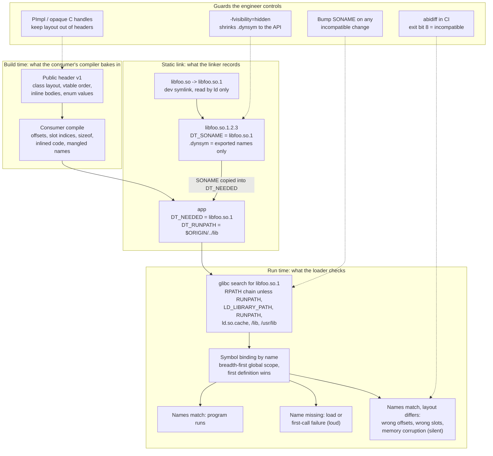

# C++ ABI Stability, Symbol Visibility, and SONAME Mechanics

> [!summary] Claim:
> A C++ shared library's ABI is much larger than its exported symbol list: it includes every type layout, vtable slot order, calling convention, and inline function body that the consumer's compiler copied into the consumer's binary.
> The loader checks only names: a removed or renamed symbol fails loudly, but a moved data member or a shifted vtable slot runs anyway and corrupts memory, as this note's lab shows with a guard word overwritten to `0x111111111111111d` and a virtual call that returns the pointer `0x3e8`.
> The SONAME (ELF `DT_SONAME`, copied into each consumer's `DT_NEEDED`) or the Mach-O install name is the only coarse switch that keeps old binaries off an incompatible library, so it must change exactly when the ABI does.
> Hidden-by-default visibility (`-fvisibility=hidden` plus an export macro) shrinks that ABI to what you meant to promise, and opaque designs (PImpl, C handles) keep the layout out of it.



## The Mechanism

### 1. Three ABIs stacked in one shared object

"ABI" names three contracts at once, and a C++ library can break any of them:
1. The platform psABI: register use, stack layout, and how scalars and aggregates are passed, fixed by the OS and architecture.
2. The C++ ABI: class layout, vtables, RTTI, name mangling, and exception handling.
   On Linux, macOS, and most non-Windows platforms this is the Itanium C++ ABI, despite the name; MSVC has its own.
3. The library's own ABI: its exported symbols, the layout of every type that crosses its boundary, and every inline body that its headers put into consumers.

The first two belong to compiler and OS vendors, who almost never break them on purpose.
GCC's manual says `-fabi-version=0`, the default, "will change in different versions of G++ as ABI bugs are fixed", and lists versions from 1 (G++ 3.2) to 21 (G++ 16) (as of 2026-11).
The third contract belongs to you, and it is the one this note teaches you to control.

A compiled consumer depends on your library in two ways that the loader treats very differently:
- By name: calls to out-of-line functions and references to exported data go through mangled names in the dynamic symbol table, and the loader resolves them.
- By value: offsets, sizes, vtable slot numbers, enumerator values, and inlined code are constants in the consumer's machine code, and no tool checks them at load time.

A change to something referenced by name is loud when it fails.
A change to something baked in by value is silent.

### 2. Class layout under the Itanium ABI

Section 2.4 of the Itanium ABI lays out a class in a fixed order.
If the class is dynamic (it has virtual functions or virtual bases) and has no primary base, "allocate the virtual table pointer for C at offset zero".
Non-static data members follow in declaration order, each at the next offset that satisfies its alignment.
Three sizes matter:
- `sizeof`: the full size, rounded up to the alignment.
- `dsize`: the data size, which is `sizeof` without tail padding.
- `nvsize`: the size without virtual bases.

clang 23.1.5 prints these with `-Xclang -fdump-record-layouts`; for the note's `Counter` class on `x86_64-linux-gnu` (the same numbers hold on the lab host's arm64 target), version 1 and version 2 are:

```text
== Counter v1, x86_64-linux-gnu: record layout ==

         0 | class Counter
         0 |   (Counter vtable pointer)
         8 |   int count_
           | [sizeof=16, dsize=12, align=8,
           |  nvsize=12, nvalign=8]
== Counter v2, x86_64-linux-gnu: record layout ==

         0 | class Counter
         0 |   (Counter vtable pointer)
         8 |   long long calls_
        16 |   int count_
           | [sizeof=24, dsize=20, align=8,
           |  nvsize=20, nvalign=8]
```

Inserting `calls_` moved `count_` from offset 8 to 16 and grew `sizeof` from 16 to 24.
Any consumer compiled against version 1 that allocates a `Counter` (on its stack, in a struct, or with `new`) reserves 16 bytes, and any inline accessor in that consumer reads offset 8.

#### Tail padding is part of the ABI

The Itanium ABI reuses a base class's tail padding for derived-class members unless the base is "POD for the purpose of layout" (section 1.1; section 2.2 ignores tail padding for PODs).
The same dump for two derived classes shows it:

```text
== tail padding reuse (Itanium 2.4): dsize vs sizeof ==
         0 | struct Derived
         0 |   class Counter (primary base)
         0 |     (Counter vtable pointer)
         8 |     int count_
        12 |   int extra
           | [sizeof=16, dsize=16, align=8,
           |  nvsize=16, nvalign=8]
         0 | struct DerivedPod
         0 |   struct Pod (base)
         0 |     long long a
         8 |     int b
        16 |   int extra
           | [sizeof=24, dsize=20, align=8,
           |  nvsize=20, nvalign=8]
```

`Derived::extra` lives at offset 12, inside the 16 bytes of `Counter`.
So adding a 4-byte member to `Counter` keeps `sizeof(Counter)` at 16, yet it lands on top of every existing subclass's first member.
An unchanged `sizeof` is not evidence of an unchanged ABI.

#### How a class is passed is part of the ABI

Itanium section 1.1 calls a type "non-trivial for the purposes of calls" if it has a non-trivial copy constructor, move constructor, or destructor, or if all its copy and move constructors are deleted.
Section 3.1.2.3 says the caller passes such a parameter by creating a temporary and passing its address, instead of passing the value in registers.
Adding a user-provided destructor to a small struct that crosses the boundary by value therefore changes the calling convention of every function that takes it, without changing any mangled name.
libstdc++'s ABI policy lists exactly this, "Adding an explicit copy constructor or destructor to a class that would otherwise have implicit versions", among its prohibited changes.
The same rule is why passing `std::unique_ptr` by value costs a memory round trip, which P1863 cites as performance that the committee cannot recover without an ABI break.

### 3. Vtables, slot numbers, and the key function

Itanium section 2.5.2 orders a vtable's components as vcall offsets, vbase offsets, offset-to-top, the RTTI pointer, and then the virtual function pointers.
The vptr points at the "address point", the first virtual function pointer, so offset-to-top sits at index -2 and the `type_info` pointer at index -1 relative to the vptr (section 2.5.2; section 2.9.4 defines the `type_info` object layout itself).
A virtual destructor takes two consecutive slots: the complete object destructor (mangled `D1`) and the deleting destructor (`D0`), which also calls `operator delete`.
The base object destructor (`D2`) is a separate non-virtual function.

clang's `-fdump-vtable-layouts` shows the version 1 and version 2 tables (entries numbered from the start of the table, so the vptr points at entry 2):

```text
== Counter v1, x86_64-linux-gnu: vtable layout ==
Vtable for 'Counter' (6 entries).
   0 | offset_to_top (0)
   1 | Counter RTTI
       -- (Counter, 0) vtable address --
   2 | Counter::~Counter() [complete]
   3 | Counter::~Counter() [deleting]
   4 | const char *Counter::name() const
   5 | int Counter::total() const

== Counter v2, x86_64-linux-gnu: vtable layout ==
Vtable for 'Counter' (7 entries).
   0 | offset_to_top (0)
   1 | Counter RTTI
       -- (Counter, 0) vtable address --
   2 | Counter::~Counter() [complete]
   3 | Counter::~Counter() [deleting]
   4 | int Counter::scale() const
   5 | const char *Counter::name() const
   6 | int Counter::total() const
```

A virtual call compiles to "load the vptr, load the pointer at `vptr + 8 * index`, call it".
Relative to the address point, a version 1 consumer calls `name()` as index 2 and `total()` as index 3.
Against the version 2 table, index 2 is `scale()` and index 3 is `name()`, and no symbol name is involved, so the loader cannot notice.

The consequences for evolving a polymorphic class:
- Inserting or reordering virtual functions shifts every later slot: always an ABI break.
- Appending a virtual function at the end is safe only if no consumer derives from the class, because a derived class's own new virtuals were assigned the slots right after the base's; KDE's policy forbids it otherwise: "Add new virtual functions to non-leaf classes as this will break subclasses", and it counts any class designed to be subclassed by applications as non-leaf.
- KDE also notes that on Windows, adding a virtual can reorder existing ones; treat any virtual addition as a break there.
- Overrides reached through a non-primary or virtual base are called through thunks (`_ZTh` and `_ZTv`, section 5.1.4.2), so changing a class's bases changes which thunks exist.

Where the vtable is emitted matters for packaging.
Section 5.2.3 defines the key function as "the first non-pure virtual function that is not inline at the point of class definition"; the vtable, and the `type_info` with it (5.2.4), are emitted only in the translation unit that defines the key function.
A class with no key function (all virtuals inline or pure) gets its vtable "emitted in every object that references any of them", in a COMDAT group.
For a library class, defining the first virtual function (usually the destructor) out of line keeps one authoritative vtable inside the library.
If every virtual is inline, each consumer carries its own copy of the vtable compiled from its own version of the header.

### 4. Mangled names: the part of the ABI that fails loudly

Section 5.1 prefixes every mangled name with `_Z` and encodes the scope, name, and parameter types, but not the return type of ordinary functions.
The special names a packager sees in `nm -D` output are `_ZTV` (virtual table), `_ZTT` (VTT), `_ZTI` (typeinfo object), and `_ZTS` (typeinfo name string), plus `C1`/`C2`/`C3` for constructors and `D0`/`D1`/`D2` for destructors.
That is why the experiment's library exports three `~Square()` symbols and two `Square(int)` symbols.
ABI tags mangle as `B <source-name>`: `struct __attribute__((abi_tag("foo", "bar"))) A` (or in C++11 attribute syntax, `[ [gnu::abi_tag("foo", "bar")] ]`) becomes `1AB3barB3foo`.

Changing a parameter type, adding a parameter, changing `const` on a member function, or moving a function to another namespace changes the mangled name.
The old name disappears, and old consumers fail with an undefined symbol, either at load time (data references, or `-z now` / `LD_BIND_NOW` binaries) or at the first call (lazy PLT binding).
Drepper's section 1.5.2 notes that setting `LD_BIND_NOW` (or linking with `-z now`, which sets `DF_BIND_NOW`) performs all relocations before the object is used; a side effect is that a latent missing-symbol failure becomes an immediate one.
Return types and data member types are not in a function's mangled name, so changing them is silent.

### 5. Inline code, templates, and header-only libraries

Every inline function, template, `constexpr` function, and macro in a public header is compiled into the consumer.
The consumer's copy is fixed at the consumer's build; upgrading the shared library does not update it.
In the experiment, `raw()` is an inline accessor in `counter.h`; the version 1 consumer reads offset 8 forever, which under version 2 is the low half of `calls_`.

These entities have vague linkage (Itanium section 1.1, detailed in 5.2.1 to 5.2.6): each translation unit that uses them emits a copy in a COMDAT group named by the mangled symbol, and the static linker keeps one.
On ELF they are emitted as `WEAK` symbols with default visibility unless told otherwise, so a shared library exports them.
The dynamic linker then binds every reference to the first definition it finds in the global lookup scope, which unifies copies across shared objects.
That unification is what the C++ One Definition Rule assumes, and it becomes a hazard when two shared objects were compiled from different versions of one header:
- Header-only libraries (and the template-heavy parts of others) are compiled into every consumer, so two plugins in one process can carry two versions.
- With default visibility, the loader picks one definition for both, and one plugin runs code from a header it was never compiled against.
- With `-fvisibility-inlines-hidden` or `-fvisibility=hidden`, each shared object keeps and calls its own copy.

The note's experiment built two macOS dylibs from `hdr::version()` returning 1 and 2, with the function's address taken so it stays a real exported weak definition (output from darwin-arm64, Apple clang 21.0.0, 2026-11-15):

```text
== default ==
  libA: (__TEXT,__text) weak external hdr::version()
libA (built with v1) sees version 1
libB (built with v2) sees version 1
== inlines-hidden ==
  libA: (__TEXT,__text) non-external (was a private external) hdr::version()
libA (built with v1) sees version 1
libB (built with v2) sees version 2
```

dyld coalesced the weak definitions across the two images, so libB silently ran libA's version.
On Mach-O, Apple clang emits an inline function whose address is never taken with `.weak_def_can_be_hidden`, and the linker auto-hides it; with the address taken, the same function is emitted as `.weak_definition` and stays exported (both read from `c++ -S` output on the lab host).
A first run of the same code without the address-taking line showed `non-external (was a private external) hdr::version()` even with default visibility, and both libraries returned their own version.
ELF has no such auto-hiding: the note's ELF build exports the template instantiation `int widget::clamp_add<int>(int, int)` as `W` even with `-fvisibility-inlines-hidden`, because that flag applies to functions declared `inline` (member functions defined in the class body, free `inline` functions, and `inline` templates), not to a function template that is not declared `inline`, whose instantiations have vague linkage without being inline functions (checked during verification with GCC 16.2.0 and clang 23.1.6: `inline` free functions and `inline` templates came out hidden, a plain template default).

libc++ handles this for its own internals with `_LIBCPP_HIDE_FROM_ABI`, which its `__config` header defines as hidden visibility plus `__attribute__((__abi_tag__(_LIBCPP_ODR_SIGNATURE)))`.
The signature concatenates the hardening mode, assertion semantic, exception setting, and `_LIBCPP_VERSION`.
A one-line `std::string` program compiled with Xcode's libc++ (`_LIBCPP_VERSION 220106`) defines `std::__1::__throw_length_error[abi:nqe220106](char const*)` as a `weak private external`: `n` for no hardening, `q` for quick-enforce assertions, `e` for exceptions enabled.
Two shared objects built against different libc++ releases or settings therefore never unify their internal helpers.
The header comment states the hazard directly: when two different definitions share a name, "the linker will pick one of the definitions at random and will discard the other one".

### 6. The C++ standard library is also a shared ABI

Your library's ABI includes the standard library types in its interface, so it inherits their ABI history.
libstdc++ changed its SONAME three times and then froze it:
- `libstdc++.so.3` in GCC 3.0, `.so.4` in 3.1, `.so.5` in 3.2, and `.so.6` from GCC 3.4.0 through 16.1.0, each earlier change marked "Incompatible with previous".
- Since then it adds symbol versions instead: GCC 14.1.0 is `GLIBCXX_3.4.33` and `CXXABI_1.3.15`; GCC 15.1.0 and 16.1.0 are both `GLIBCXX_3.4.34`, with `CXXABI_1.3.17` for 16.1.0 (as of 2026-11, Linux).
- [[Cpp-Glibc-Symbol-Versioning-and-Portable-Linux-Binaries]] owns how those version nodes work.

In GCC 5.1, libstdc++ replaced its `std::string` and `std::list` implementations with layout-incompatible ones.
The libstdc++ Dual ABI page says "the changes were made for C++11 conformance".
In C++11 (ISO/IEC 14882:2011; N3337 draft), 21.4.1 [string.require] allows references and iterators into a string to be invalidated only by non-const calls other than `operator[]`, `at`, `front`, `back`, `begin`, `rbegin`, `end`, and `rend`, which rules out copy-on-write (COW) strings that must unshare on those calls, and Table 96 in 23.2.1 [container.requirements.general] makes `size()` constant time for every container, including `std::list`.
GCC 4.x used a reference-counted COW `std::string` and a `std::list` with O(N) `size()`, so conforming required new layouts for both; the GCC 5 release notes describe the new `std::string` as "using the small string optimization instead of copy-on-write reference counting" and the new `std::list` as having "an O(1) size() function".
Instead of a SONAME bump it introduced a dual ABI: the new types live in the inline namespace `std::__cxx11`, functions returning them carry the `[abi:cxx11]` tag, and the macro `_GLIBCXX_USE_CXX11_ABI` (default 1, but some distributions default to 0) selects which one headers use.
Mixing objects compiled with different values produces undefined references to symbols mentioning `std::__cxx11` or `[abi:cxx11]`; GCC recommends `-Wabi-tag` to find them.
Because the old and new types have different mangled names, this break is loud at link time, which is the point of the design.

libc++ puts everything in an inline namespace too, `std::__1` (`_LIBCPP_ABI_NAMESPACE __1` and `_LIBCPP_ABI_VERSION 1` in the Xcode SDK's `__config_site`, as of 2026-11, macOS).
Its design document says `LIBCXX_ABI_VERSION` accepts `1` (the stable default) and `2` (the unstable next version), and that MSVC-only changes may be applied unconditionally because no MSVC users need a stable libc++ ABI.

MSVC took the opposite path from Itanium platforms in 2015.
Microsoft Learn says Visual Studio 2013 and earlier "don't guarantee binary compatibility across major versions", and that binaries from the v140, v141, v142, v143, and v145 toolsets (Visual Studio 2015 through 2026) can be mixed if the linker is at least as new as the newest input and the Redistributable is at least that new (as of 2026-11, Windows).
`/GL` and `/LTCG` objects are the exception: they must come from exactly the same toolset build.

The price of frozen standard-library ABIs is measurable.
Titus Winters' P1863 ("ABI - Now or Never", 2019) estimates that changes blocked solely by ABI add up to "perhaps 5-10% aggregate" overhead, including an `unordered_map` and `std::hash` redesign that could be "200-300%" faster and `std::string` SSO tuning worth about 1% of fleet performance.

### 7. Symbol visibility: deciding what the ABI is

ELF stores a symbol's visibility in the low bits of `st_other` (gABI chapter 4):

| Value | Name | Meaning (gABI) |
|---|---|---|
| 0 | `STV_DEFAULT` | Visibility follows the binding; global symbols are exported and preemptable. |
| 1 | `STV_INTERNAL` | Hidden, with extra processor-specific constraints. |
| 2 | `STV_HIDDEN` | "not visible to other components". |
| 3 | `STV_PROTECTED` | "visible in other components but not preemptable". |

When objects are linked, "the most constraining visibility attribute must be propagated" (protected, then hidden, then internal), and a hidden symbol must be removed or converted to `STB_LOCAL` in the output.
The experiment's hidden build shows the conversion in the static symbol table:

```text
== hidden build: what -fvisibility=hidden did to the internal symbols (.symtab) ==
  FUNC LOCAL HIDDEN widget::detail::helper(int)
  OBJECT LOCAL HIDDEN widget::detail::table
```

The compiler-side controls (GCC and Clang share them):
- `-fvisibility=hidden` makes every definition without an explicit attribute hidden; Drepper's section 2.2.2 dates the option to GCC 4.0.
- `__attribute__((visibility("default")))` on a declaration, usually via an export macro, re-exports the API.
- `#pragma GCC visibility push(hidden)` and `pop` bracket a region; a namespace-level attribute is equivalent to the pragma around that namespace.
- `-fvisibility-inlines-hidden` treats inline functions as hidden (the GCC manual says "inline methods" and the Clang reference "inline C++ member functions", but GCC 16.2.0 and clang 23.1.6 also hid free `inline` functions and `inline` templates in a verification run; non-inline function templates stay default); the manual warns it breaks pointer equality for inline functions whose addresses are taken in different shared objects, and that it "does not affect static variables local to the function".
- `-fvisibility-ms-compat` emulates MSVC: hidden by default, but types (not their members) stay visible, and same-named static data members in different shared objects become different objects.

The GCC manual's guidance is blunt: `-fvisibility` "can very substantially improve linking and load times", it "is strongly recommended that you use this in any shared objects you distribute", and visibility should be "viewed as part of the API interface contract".

Three C++ rules make class visibility subtle (GCC Common Attributes):
- Types have linkage, so the attribute applies to classes, and "the type visibility is applied to vague linkage entities associated with the class (vtable, typeinfo node, etc.)".
- "A class must not have greater visibility than its non-static data member types and bases", and a template instantiation inherits the most restrictive visibility of its arguments.
- "if a class is thrown as an exception in one shared object and caught in another, the class must have default visibility."

So an exported class needs the export macro on the class itself, not only on its member functions, or its vtable and `type_info` become hidden.
That breaks `dynamic_cast` and `catch` across the boundary whenever the runtime compares `type_info` by address.
libstdc++'s `<typeinfo>` sets `__GXX_MERGED_TYPEINFO_NAMES` to 0 by default, causing `std::type_info::operator==` to perform an initial pointer comparison and fall back to `__builtin_strcmp`, because "even with weak symbols sometimes names are not merged when objects are loaded with RTLD_LOCAL".

Linker-side export control works on the final symbol table and is the only option for code you cannot recompile:
- A version script with `local: *;` hides everything not listed (GNU ld `--version-script`); [[Cpp-Glibc-Symbol-Versioning-and-Portable-Linux-Binaries]] owns the version nodes the same script can attach.
- `--exclude-libs` stops symbols from listed static archives being exported, which is how a library keeps a statically linked dependency out of its ABI.
- `--dynamic-list` names the symbols to keep preemptable.
- macOS uses `-exported_symbols_list` or `-unexported_symbols_list` (names need the leading `_`), and Apple's guide calls `-fvisibility` plus the attribute "the most safe and convenient way".
- On Windows, names reach a DLL's export table through a `.def` file or `__declspec(dllexport)`, which "stores function names in the DLL's export table"; a class-level `dllexport` exports all of its public members.

CMake wraps the compiler flags in the `CXX_VISIBILITY_PRESET` and `VISIBILITY_INLINES_HIDDEN` target properties, honored for all target types under policy `CMP0063` (CMake 3.3+).
`generate_export_header()` writes `<MACRO>_EXPORT`, `<MACRO>_NO_EXPORT`, and `<MACRO>_DEPRECATED` macros that expand to the visibility attribute or to `dllexport`/`dllimport` (CMake 4.5.0 help, as of 2026-11).

### 8. Interposition: why default visibility is also slow

A default-visibility function in a shared object is preemptible: another object earlier in the lookup scope, including an `LD_PRELOAD` library, may define the same name, and the loader binds every reference to the first definition (Drepper section 1.5.4; Fangrui Song calls this semantic interposition).
To honor that, calls from inside the library to its own exported functions go through the PLT and GOT, and the compiler must not assume the body it sees is the body that runs.
The experiment counts the `R_AARCH64_JUMP_SLOT` (PLT) relocations in four `-O2` builds of the same library (clang 23.1.5 and lld 23.1.5 cross-linking for `aarch64-linux-gnu`, link-only, 2026-11-15):

```text
== -O2 builds: exported dynamic symbols and PLT relocations ==
O2-default                         exported=21  PLT slots: widget::detail::helper(int),widget::Square::~Square()
O2-fno-semantic-interposition      exported=21  PLT slots: widget::Square::~Square()
O2-Bsymbolic-functions             exported=21  PLT slots: (none)
O2-hidden                          exported=19  PLT slots: widget::Square::~Square()

-- symbols O2-default exports that O2-hidden does not
widget::detail::table
widget::detail::helper(int)
```

How to read the four builds:
- `O2-default`: the internal helper (marked `noinline`) is called through the PLT because it is exported and preemptible.
- `-fno-semantic-interposition`: the compiler calls a local alias of the helper; the symbol is still exported, so it is still part of the ABI.
- `-Wl,-Bsymbolic-functions`: the linker binds every intra-library call to the local definition, which also removes the remaining destructor slot, at the cost of breaking `LD_PRELOAD` interposition of those functions.
- `-fvisibility=hidden`: removes the helper from the ABI and from the PLT; the destructor of the exported `Square` stays preemptible and keeps its slot.

In an earlier run of the same build without `noinline` on the helper, `O2-default` had only the destructor slot, because clang inlined the preemptible helper anyway.
Fangrui Song's survey explains it: "Clang never suppresses interprocedural optimizations" on default-visibility definitions in `-fpic` code, while GCC does unless `-fno-semantic-interposition` (added in GCC 5) is given.
Clang 11 added local aliases for `-fno-semantic-interposition` on x86, and Clang 13 extended them to AArch64 and RISC-V; CPython 3.10 builds with the flag, and Red Hat reported up to 30% faster Python 3.8 in RHEL 8.2, which the post calls an upper bound.

Load-time cost scales with exported symbols.
Drepper (version 4.1.2, 2011) estimates that relocation processing is "around 50-70%" of the dynamic linker's startup time, and works an OpenOffice.org 1.0 example (144 DSOs, about 20,000 startup relocations) to roughly 1.7 million string comparisons with the old SysV hash table.
His estimate for the GNU-style hash table (`DT_GNU_HASH`, with a Bloom filter, introduced in Fedora Core 6) is a factor of 33 fewer comparisons for that example, assuming the filter rejects 80% of lookups and 15% of hash values collide.
Those are his 2011 estimates, not measurements made for this note.
Shrinking `.dynsym` still helps with GNU hash: fewer names to hash and store, fewer relocations, and less ABI surface to keep stable.

One more interposition trap: the library in the experiment defines `operator delete`, and both the default and hidden builds export it.
The ISO C++ standard ([replacement.functions]) gives replaceable global allocation and deallocation functions program-wide replacement semantics, but says nothing about visibility.
In practice both compilers keep global `operator new` and `operator delete` definitions at default visibility under `-fvisibility=hidden` (clang 23.1.6 and GCC 16.2.0, checked during verification), so custom allocators and sanitizers can interpose program-wide.
Clang controls this with `-fvisibility-global-new-delete=<force-default|force-protected|force-hidden|source>` (Clang Command Line Argument Reference); `source` lets `-fvisibility=hidden` apply, and clang 23.1.6 reports the older `-fvisibility-global-new-delete-hidden` spelling as deprecated in favor of `=force-hidden`.

### 9. SONAME: one name per incompatible ABI

An ELF shared library has three names, each read by a different program:

| Name | Example | Who reads it |
|---|---|---|
| Real name | `libwidget.so.1.2.3` | The file on disk; `ldconfig` and packagers. |
| SONAME | `libwidget.so.1` | Stored in the library's `DT_SONAME`; copied by the static linker into each consumer's `DT_NEEDED`; a symlink of that name is what the loader opens. |
| Linker name | `libwidget.so` | A symlink read only by `ld` for `-lwidget`; Debian ships it in the `-dev` package. |

`-Wl,-soname,libwidget.so.1` (GNU ld: "set the internal DT_SONAME field to the specified name") sets it.
At static link time the linker resolves `-lwidget` through `libwidget.so`, follows the symlink, reads `DT_SONAME`, and records that string, not the file name, in the consumer's `DT_NEEDED`.
The experiment's `readelf -d` output:

```text
== install layout and dynamic section ==
-- lib/libwidget.so.1.2.3
  0x000000000000000e (SONAME)   Library soname: [libwidget.so.1]
-- bin/app (lld default)
  0x000000000000001d (RUNPATH)  Library runpath: [$ORIGIN/../lib]
  0x0000000000000001 (NEEDED)   Shared library: [libwidget.so.1]
-- bin/app with -Wl,--disable-new-dtags
  0x000000000000000f (RPATH)    Library rpath: [$ORIGIN/../lib]
  0x0000000000000001 (NEEDED)   Shared library: [libwidget.so.1]
-- bin/app linked against a library built WITHOUT -soname
  0x0000000000000001 (NEEDED)   Shared library: [out/lib/libnosoname.so]
```

The last case is a classic defect: without a SONAME, lld recorded the path exactly as it appeared on the link command line.
The gABI says a `DT_NEEDED` string containing a `/` is used "directly as the path name", so that binary only finds its library when started from the build directory.

The SONAME is the coarse ABI switch:
- Every consumer linked against `libwidget.so.1` asks for `libwidget.so.1` forever.
- An incompatible release ships as `libwidget.so.2.0.0` with SONAME `libwidget.so.2`, and the two can be installed side by side; old binaries keep loading `.so.1`.
- A compatible release (new functions only) keeps the SONAME and replaces the file, and old binaries pick it up through the same symlink.
- glibc deduplicates by SONAME: `_dl_lookup_map` in `elf/dl-load.c` returns an already-loaded object whose name or SONAME matches the requested name, so two dependents that ask for `libwidget.so.1` share one copy even if their search paths would have found different files.
  A `dlopen` by full path is matched by path and file identity instead, so it can still bring in a second file with the same SONAME.

Debian Policy 4.7.4.1, chapter 8, turns this into packaging rules:
- The runtime library goes in a package named after the library and its soversion (the policy's example is `libgdbm3`), so two SONAMEs can be co-installed.
- "the SONAME should change any time an interface is removed", and adding interfaces alone does not require a change.
- The runtime package "should include the symbolic link for the SONAME that ldconfig would create"; the `-dev` package carries the unversioned link or a linker script.
- Packages installing into library directories must trigger `ldconfig` (`activate-noawait ldconfig`).

`ldconfig` builds `/etc/ld.so.cache` and the SONAME symlinks; its man page expects the layout `libfoo.so -> libfoo.so.1 -> libfoo.so.1.12` and only considers files matching `lib*.so*` or `ld-*.so*`.
[[Cpp-System-Packaging-Deb-RPM-and-Homebrew]] owns `shlibs` and `symbols` files, which turn the SONAME into package dependencies.

Build systems encode the policy differently:
- CMake: `set_target_properties(widget PROPERTIES VERSION 1.2.3 SOVERSION 1)` produces the real name, the SONAME, and the symlinks; the help text says "breaking changes to the ABI increment both the SOVERSION and the major VERSION number".
- libtool's `-version-info CURRENT:REVISION:AGE` describes interface numbers, and the library implements every interface "in the range from number CURRENT - AGE to CURRENT".
  Its update rules (GNU Libtool 2.6.2 manual, section 7.3.1) are: bump REVISION on any source change; bump CURRENT and reset REVISION when interfaces are added, removed, or changed; bump AGE if interfaces were added; reset AGE to 0 if interfaces were removed or changed.
  Its section 7.4 warns that `-release` changes the library name and should not be used "unless you want to break binary compatibility".
- Semantic versioning of the package and the SONAME are related but not the same number; [[Versioning-SemVer-CalVer-and-ABI]] owns that mapping.

#### Mach-O: install names and compatibility versions

macOS records the dependency by install name, not SONAME.
The library's `LC_ID_DYLIB` carries its install name (`@rpath/libcounter.1.dylib` in the experiment) plus a compatibility version and a current version, and each client copies all three into its `LC_LOAD_DYLIB`.
`otool -L` shows them, and CMake maps `SOVERSION` to the compatibility version and `VERSION` to the current version unless `MACHO_COMPATIBILITY_VERSION` and `MACHO_CURRENT_VERSION` override them.
Apple's archived design guide says a library's major version belongs in its file name (`libDraw.A.dylib`) and that, before loading, dyld aborts if the installed library's current version is lower than the compatibility version the client recorded.
The experiment's case 5 tested that check on macOS 27.3 and it did not fire: a client recording compatibility version 1.1.0 loaded a library whose current version was 1.0.0.
In dyld's sources (apple-oss-distributions/dyld, latest tag `dyld-1378`, as of 2026-11), `forEachLinkedDylib` hands the loader a `compatVersion`, but none of `Loader.cpp`, `JustInTimeLoader.cpp`, or `PrebuiltLoader.cpp` compares it.
Treat the archived guide as historical: on current macOS, only the install name keeps an incompatible library away from old clients.
[[Cpp-macOS-Universal-Binaries-Code-Signing-and-Notarization]] owns the rest of Mach-O packaging.

### 10. Finding the library at run time: DT_NEEDED, RPATH, RUNPATH

The loader processes `DT_NEEDED` entries breadth-first: the gABI says the dynamic linker "examines the symbol tables with a breadth-first search", starting with the executable, then its direct dependencies in order, then theirs.
For each needed name without a slash, glibc's `elf/dl-load.c` (version.h `2.42.9000` on the GitHub mirror, as of 2026-11) searches in this order; `_dl_map_object` does step 1 and hands the rest to `_dl_map_new_object`:
1. Already-loaded objects whose name or SONAME matches (`_dl_lookup_map`).
2. If the object that needs the library (the "loader") has no `DT_RUNPATH`: the loader's `DT_RPATH`, then the `DT_RPATH` of whatever loaded the loader, "and on up", then the executable's `DT_RPATH`.
3. `LD_LIBRARY_PATH`, unless the process runs in secure-execution mode (setuid or setgid, for example).
4. The loader's own `DT_RUNPATH`.
5. `/etc/ld.so.cache`, unless the loader has `DF_1_NODEFLIB`.
6. The default directories (`/lib`, then `/usr/lib`, or their `lib64` equivalents), unless `DF_1_NODEFLIB`.

The difference between the two path tags is the source of many deployment bugs:
- `DT_RPATH` is inherited down the dependency chain and searched before `LD_LIBRARY_PATH`, so users cannot override it.
- `DT_RUNPATH` is searched after `LD_LIBRARY_PATH` and applies only to the object's own `DT_NEEDED` entries; ld.so(8) says these directories "do not apply to those objects' children".
- If both exist, the loader uses only `DT_RUNPATH` (gABI and the `l_info[DT_RUNPATH] == NULL` test in `dl-load.c`).
- An executable with `RUNPATH=$ORIGIN/../lib` therefore finds `libwidget.so.1`, but if `libwidget.so.1` needs `libhelper.so.1` from the same directory, `libwidget` needs its own `RUNPATH`.

`--enable-new-dtags` makes GNU ld emit `DT_RUNPATH` for `-rpath`.
The upstream binutils manual says "By default, the new dynamic tags are not created" (defaulting to `DT_RPATH`), but `ld/configure.ac` offers a build-time `--enable-new-dtags` option ("set DT_RUNPATH instead of DT_RPATH by default"), so a distribution's `ld` can default either way; check the toolchain actually in use with `readelf -d` on a linked binary rather than assuming.
LLVM lld defaults to `--enable-new-dtags` (`ld.lld --help` marks it "(default)" in LLD 23.1.6, as of 2026-11).
In the experiment, lld 23.1.5 emitted `RUNPATH` by default, switching to `RPATH` only with `--disable-new-dtags`.

`$ORIGIN` expands to "the directory containing the program or shared object", which makes relocatable install trees possible; `$LIB` expands to `lib` or `lib64`, and `$PLATFORM` to the processor type.
For setuid and setgid programs, glibc ignores `$ORIGIN` in `RPATH` and `RUNPATH` except when it is the first element and the path is rooted in a trusted directory (comment in `dl-load.c`).
`LD_DEBUG=libs` prints the search (`find library=...; searching` comes from the same function); `ldd` runs the loader with `LD_TRACE_LOADED_OBJECTS=1`, and its man page warns "you should never employ ldd on an untrusted executable", suggesting `objdump -p prog | grep NEEDED` for direct dependencies.

The experiment's library also shows what it leaves for the loader to bind; every one of these must be satisfied by the C++ runtime at run time:

```text
== undefined references the library leaves for the loader to bind ==
  vtable for __cxxabiv1::__class_type_info
  vtable for __cxxabiv1::__si_class_type_info
  __cxa_pure_virtual
```

`-Wl,--no-undefined` (`-z defs`) makes the linker report unresolved references when building the library, which turns an unstated runtime dependency into a link error; `--as-needed` emits a `DT_NEEDED` only for libraries that resolve a reference.

### 11. Designing a library ABI that can evolve

The safe set of changes comes from two primary lists that agree.
libstdc++'s ABI policy allows adding exported data, functions, and non-virtual members, and prohibits changing an exported symbol's size, alignment, layout, or mangling, deleting it, changing a type's bases, and adding an explicit copy constructor or destructor.
KDE's policy adds, among others:
- Allowed: new non-virtual functions that do not overload existing non-overloaded ones, new classes, appended enumerators, new static data members, changed default arguments, removing private non-virtual functions that no inline function calls.
- Forbidden: removing or unexporting a class or function, making a function inline, changing a signature or CV-qualifier, adding or removing or reordering virtual functions in non-leaf classes, adding or removing or reordering non-static data members, changing template arguments of a class.

Two "allowed" items carry caveats:
- Changing a default argument is binary compatible because the old value is compiled into old callers, so they keep passing it until rebuilt; KDE says it "requires recompilation to use the actual new default argument values".
- Appending an enumerator can widen the enum's underlying type; KDE recommends an explicit underlying type or a large sentinel enumerator.

The design patterns that keep the list short:
1. PImpl (KDE calls it the d-pointer): the public class holds only a pointer to a privately defined `Impl`, so new state goes in `Impl` and `sizeof` and member offsets never change.
   The cost is one allocation per object and one indirection per access, and every accessor must be out of line, because an inline accessor would bake the `Impl` layout back into consumers.
2. Opaque handles behind a C interface (the hourglass): `extern "C"` functions that take `struct widget*`, with C++ on both sides.
   C has no mangling, vtables, or exceptions at the boundary, so only the platform psABI remains; [[Rust-FFI-Packaging-cdylib-staticlib-and-cbindgen]] uses the same boundary.
3. Abstract interfaces with factory functions (COM style): consumers call through a vtable they never derive from, so appending virtuals at the end is safe, and a new interface version is a new class.
4. Reserved space: spare bitfield bits for flags (KDE says to round up to 7 bits, or 15 if the field already exceeds 8) or a reserved pointer, used only when PImpl is too costly.
5. Inline namespaces for versioned implementations: `namespace widget { inline namespace v2 { ... } }` changes every mangled name when you bump it, which turns a silent layout break into a loud link error, the way `std::__cxx11` and `std::__1` do.
6. Out-of-line key functions and destructors for every exported polymorphic class, so its vtable and `type_info` live in the library.

### 12. Detecting breaks before users do

Symbol diffs (`nm -D --defined-only` before and after) catch removals and renames, and nothing else.
libabigail's `abidiff` reads DWARF (or CTF or BTF) from both builds and compares types, sizes, offsets, and vtables, not just names.
Its exit status is a bit field: 1 is `ABIDIFF_ERROR`, 2 is `ABIDIFF_USAGE_ERROR`, 4 is `ABIDIFF_ABI_CHANGE`, and 8 is `ABIDIFF_ABI_INCOMPATIBLE_CHANGE`, which is set together with 4.
`--headers-dir1` and `--headers-dir2` restrict the report to types declared in public headers, and `--drop-private-types` removes the rest from memory.
Without debug info it falls back to comparing ELF symbols, and `--fail-no-debug-info` makes that an error.
`-Wabi-tag` warns when a type with an ABI tag is used in a context without it, which catches dual-ABI leaks at compile time.
[[Drill-Packaging-Cpp-Silent-ABI-Break-Across-Shared-Libraries]] practices the diagnosis, and [[Execute-Zero-Downtime-Shared-Library-SONAME-Migration]] runs the bump.

## Commands and Numbers to Know

| Item | Value | Platform | Notes |
|---|---|---|---|
| `readelf -d lib.so \| grep -E 'SONAME\|NEEDED\|RUNPATH\|RPATH'` | prints the dynamic tags (as of 2026-11) | Linux | Use `llvm-readelf` to inspect ELF files from macOS. |
| `nm -D --defined-only lib.so` | the exported ABI, by name (as of 2026-11) | Linux | `W` and `V` are weak (vague linkage) definitions. |
| `-Wl,-soname,libfoo.so.1` | sets `DT_SONAME` (as of 2026-11) | Linux | Without it the consumer records the link-time path or file name. |
| `-Wl,-rpath,'$ORIGIN/../lib'` | relocatable search path (as of 2026-11) | Linux | Quote `$ORIGIN` against the shell; `RUNPATH` with new dtags, `RPATH` without. |
| GNU ld new dtags default | off per the binutils manual (as of 2026-11) | Linux | lld 23.1.5 emitted `RUNPATH` by default in this note's experiment. |
| glibc search order | RPATH chain (if no RUNPATH), `LD_LIBRARY_PATH`, RUNPATH, `ld.so.cache`, defaults (as of 2026-11) | Linux | `elf/dl-load.c`, `_dl_map_new_object`. |
| `LD_DEBUG=libs ./app` | traces each library search (as of 2026-11) | Linux | `LD_DEBUG=bindings` shows which object each symbol bound to. |
| `LD_BIND_NOW=1` / `-Wl,-z,now` | resolve all symbols at startup (as of 2026-11) | Linux | Turns a missing-function failure at first call into a startup failure. |
| `-Wl,--no-undefined` (`-z defs`) | report unresolved references in the library (as of 2026-11) | Linux | Makes undeclared runtime dependencies a link error. |
| `-fvisibility=hidden -fvisibility-inlines-hidden` | hide everything not marked `default` (as of 2026-11) | Both | In the experiment: 21 exported symbols down to 19, helper's PLT slot removed. |
| `-fno-semantic-interposition` | calls local aliases of exported functions (as of 2026-11) | Linux | GCC 5+; Clang 11+ on x86, Clang 13+ on AArch64 and RISC-V. |
| `-Wl,-Bsymbolic-functions` | binds intra-library function calls locally (as of 2026-11) | Linux | Removed every PLT slot in the experiment; disables `LD_PRELOAD` interposition of those functions. |
| `-Xclang -fdump-record-layouts` | prints offsets, `sizeof`, `dsize`, `nvsize` (as of 2026-11) | Both | clang 23.1.5; `-fdump-vtable-layouts` prints slots. |
| `otool -L` | install name, compatibility and current version (as of 2026-11) | macOS | The Mach-O equivalent of `NEEDED` plus `SONAME`. |
| dyld compatibility-version check | not enforced on macOS 27.3 in this note's experiment (as of 2026-11) | macOS | Apple's archived guide says it aborts the load; dyld-1378 sources do not compare it. |
| `CMAKE_CXX_VISIBILITY_PRESET hidden`, `CMAKE_VISIBILITY_INLINES_HIDDEN ON` | visibility for all targets (as of 2026-11) | Both | CMake 4.5.0; honored for static and object libraries under `CMP0063`. |
| `VERSION 1.2.3 SOVERSION 1` | real name, SONAME, symlinks (as of 2026-11) | Both | On Mach-O, compatibility and current version. |
| libtool `-version-info C:R:A` | implements interfaces `C - A` through `C` (as of 2026-11) | Linux | GNU Libtool 2.6.2, section 7.3.1 rules. |
| libstdc++ SONAME | `libstdc++.so.6` since GCC 3.4.0, through 16.1.0 (as of 2026-11) | Linux | GCC 16.1.0: `GLIBCXX_3.4.34`, `CXXABI_1.3.17`. |
| `_GLIBCXX_USE_CXX11_ABI` | default 1 since GCC 5.1, 0 on some distributions (as of 2026-11) | Linux | Mismatch shows `std::__cxx11` or `[abi:cxx11]` undefined references. |
| libc++ ABI namespace | `std::__1`, `_LIBCPP_ABI_VERSION 1`, `_LIBCPP_VERSION 220106` in Xcode (as of 2026-11) | macOS | Hidden helpers carry `[abi:nqe220106]`. |
| MSVC toolsets | v140 to v145 (VS 2015 to 2026) mutually compatible (as of 2026-11) | Windows | Link with the newest toolset; `/GL` and `/LTCG` need the exact same toolset. |
| `abidiff` exit status | bits 1 error, 2 usage, 4 change, 8 incompatible (as of 2026-11) | Linux | Needs DWARF, CTF, or BTF for type-level checks. |
| `-fabi-version` | default 0 (latest fixes); 21 first in G++ 16 (as of 2026-11) | Both | `-fabi-compat-version` defaults to 13 (GCC 8.2) for aliases. |

## Multi-Language Comparison

| Concern | C++ shared library | C shared library | Python extension module | Rust library |
|---|---|---|---|---|
| What the consumer bakes in | Layouts, vtable slots, inline and template bodies, enum values | Struct layouts and macros in headers | Version-specific C API layouts unless built against the Limited API | Everything, for `dylib` and rlib consumers; only the C declarations for a `cdylib` |
| Default export set on ELF | Every non-static definition, including weak inline and template copies | Every non-static definition | Every non-static definition; only `PyInit_<name>` is required | `cdylib`: only `#[no_mangle] extern "C"` items (1 symbol in the test below); `dylib`: compiler-internal Rust symbols (1780 in the test) |
| How to restrict it | `-fvisibility=hidden`, export macro, version script | Same as C++ | Same, plus the Limited API for a stable C ABI | Crate type `cdylib`, plus a version script for a `staticlib` linked into a shared library (Rust Reference) |
| Silent-break risk | High: layout, vtables, inline code | Medium: struct layout and macros | Handled by version-specific filenames or `abi3` | Low at a `cdylib` C boundary; Rust-to-Rust `dylib` linking requires the same compiler build in practice |
| Versioned name | SONAME / install name / DLL name | SONAME | Filename suffix such as `.cpython-315-darwin.so` or `.abi3.so`; no SONAME | SONAME only if the build sets it |
| Owning note | This note | This note | [[Python-Wheels-Platform-Tags-Manylinux-and-ABI3]] | [[Rust-FFI-Packaging-cdylib-staticlib-and-cbindgen]] |

The Rust counts come from `rustc 1.99.0` on macOS (as of 2026-11): a three-function crate built as `cdylib` exported only `_widget_area`, and the same crate built as `dylib` exported 1780 symbols, mostly v0-mangled standard-library code.
The Rust Reference's Linkage chapter describes a `dylib` only as "a dynamic Rust library" usable as a dependency of other Rust libraries and executables, and a `cdylib` as the type "used when compiling a dynamic library to be loaded from another language"; it promises no stable Rust-to-Rust ABI.
The compiler itself enforces the version rule: error E0514 is raised "when the version of `rustc` used to compile a crate, as stored in the binary's metadata, differs from the version of one of its dependencies", and the error index explains "the Rust ABI is not stable between compiler versions" and prescribes "recompiling the crates with a uniform `rustc` version".
For a library consumed by other languages or across compiler releases, the stable boundary is a `cdylib` exposing `extern "C"` functions with `#[no_mangle]`, and the Reference says a `staticlib` linked into a shared library needs "a linker or symbol version script" to limit its exports.
CPython 3.15.2 loads extension modules with `sys.getdlopenflags()` equal to 2 (`RTLD_NOW`, without `RTLD_GLOBAL`) on macOS (as of 2026-11), so one extension's exported symbols do not satisfy another's undefined references unless the program opts in.

## Worked Lab Example

Experiment 1 is the harness lab `code/07-Packaging-and-Release/cpp_abi_silent_break/` (`# requires: macos`), and its output block below is byte-identical to `expected/darwin-arm64.txt`, recorded on macOS 27.3 with Apple clang 21.0.0.
Experiments 2 and 3 have no lab: they were run by hand on the same host (Homebrew clang and lld 23.1.5) on 2026-11-15, and their blocks are that hand-run output, not re-checked by `make verify`.
The runnable reproduction with a hint ladder is [[Drill-Packaging-Cpp-Silent-ABI-Break-Across-Shared-Libraries]].

### Experiment 1: a silent break, then the install-name guard (macOS, lab)

Version 1 of the header, which the application is compiled against:

```cpp
#pragma once
#define API __attribute__((visibility("default")))

class API Counter {
public:
    Counter();
    virtual ~Counter();
    virtual const char* name() const;   // vtable slot 2 (after D1, D0)
    virtual int total() const;          // vtable slot 3
    void add(int n);
    int raw() const { return count_; }  // inline: offset of count_ is baked into the caller
private:
    int count_;
};
```

Version 2 inserts `virtual int scale() const;` before `name()` and `long long calls_;` before `count_`; its `add()` also increments `calls_`, and `scale()` returns 1000.
The application puts a `Counter` in a struct followed by a guard word, assigns the guard after construction, adds 5 and 7, and calls the virtuals through `noinline` functions so the compiler cannot devirtualize them:

```cpp
struct Frame {
    Counter c;                      // 16 bytes under v1: vptr at 0, count_ at 8
    volatile long long guard;       // the next 8 bytes, at offset 16
};
```

The libraries are built with `-fvisibility=hidden -fvisibility-inlines-hidden -dynamiclib -install_name @rpath/libcounter.N.dylib`, and the application links `-lcounter.1 -Wl,-rpath,@executable_path/lib`.
`otool -L` on the application prints the versions recorded at link time, so the first line of each case shows the install name and compatibility version the application demands, not what the library on disk carries.
The harness masks 8 to 16 digit `0x` values as `0xADDR`, so the lab prints the guard word without a `0x` prefix to keep its value visible; the pid, the application's UUID, and the temporary directory are scrubbed by the script itself.

```text
== 1. v1 library, app compiled and linked against v1 ==
@rpath/libcounter.1.dylib (compatibility version 1.0.0, current version 1.0.0)
sizeof(Counter) seen by app:   16
guard word after the object:   1111111111111111
raw()   inline load, offset 8: 12
total() via vtable slot 3:     12
name()  via vtable slot 2:     pointer 0xADDR
name()  string:                counter-v1
exit status: 0

== 2. v2 dropped in under the SAME install name (no major bump) ==
@rpath/libcounter.1.dylib (compatibility version 1.0.0, current version 1.0.0)
sizeof(Counter) seen by app:   16
guard word after the object:   111111111111111d
raw()   inline load, offset 8: 2
total() via vtable slot 3:     not 12 (wrong value)
name()  via vtable slot 2:     pointer 0x3e8
exit status: 139

== 3. v2 shipped honestly as a new major, libcounter.2.dylib, v1 removed ==
@rpath/libcounter.1.dylib (compatibility version 1.0.0, current version 1.0.0)
dyld[PID]: Library not loaded: @rpath/libcounter.1.dylib
  Referenced from: <uuid> <dir>/out/app
  Reason: tried: '<dir>/out/lib/libcounter.1.dylib' (no such file), '<dir>/out/lib/libcounter.1.dylib' (no such file)
exit status: 134

== 4. v1 reinstalled beside v2: the old app keeps binding to v1 ==
@rpath/libcounter.1.dylib (compatibility version 1.0.0, current version 1.0.0)
sizeof(Counter) seen by app:   16
guard word after the object:   1111111111111111
raw()   inline load, offset 8: 12
total() via vtable slot 3:     12
name()  via vtable slot 2:     pointer 0xADDR
name()  string:                counter-v1
exit status: 0

== 5. client linked against compat 1.1, run against an older 1.0 build ==
@rpath/libcounter.1.dylib (compatibility version 1.1.0, current version 1.1.0)
sizeof(Counter) seen by app:   16
guard word after the object:   1111111111111111
raw()   inline load, offset 8: 12
total() via vtable slot 3:     12
name()  via vtable slot 2:     pointer 0xADDR
name()  string:                counter-v1
exit status: 0
```

### Reading the output

Case 2 shows every silent mechanism at once, and the loader reported nothing:
- The application believes `Counter` ends at byte 16, but version 2's `count_` lives at offset 16, the first four bytes of the guard word.
  `add(5)` and `add(7)` each ran `count_ += n` at that offset, so they added 12 to the guard's low 32 bits: `0x11111111 + 12 = 0x1111111d`, and the guard reads `111111111111111d` instead of `1111111111111111`.
  That is a library writing past the end of an object the application allocated, the same corruption a heap-allocated or stack-allocated `Counter` would suffer.
  The version 2 constructor wrote its own `count_` there too, but the application assigns the guard after construction, so only `add()` is visible in the output.
- The inline `raw()` read offset 8, which version 2 uses for `calls_`, so it printed 2 (the number of `add` calls) instead of 12.
- The call to `total()` used index 3, which in the version 2 table is `name()`, so it returned the low 32 bits of a string pointer instead of 12 (the lab prints `not 12 (wrong value)`, because the pointer itself changes between runs).
- The call to `name()` used index 2, which is now `scale()`, so the application received the integer 1000 as a `const char*`, printed `pointer 0x3e8`, and crashed in `printf` dereferencing it.

The crash is the lucky outcome.
Had `scale()` returned a valid address, or had the application never printed the string, the corrupted guard word would have propagated silently.

Cases 3 and 4 show the guard that works: a new install name.
With version 2 published only as `libcounter.2.dylib`, the old application fails loudly at load time, and once version 1 is reinstalled next to it, the old application runs correctly while new applications link against version 2.
That is exactly what a SONAME bump does on ELF.

Case 5 shows the guard that did not work: the application recorded compatibility version 1.1.0, the library on disk was built with 1.0.0 under the same install name, and the application ran without any complaint on macOS 27.3, although Apple's archived guide describes a check that should refuse it.

### Experiment 2: visibility and the dynamic section (ELF, link-only)

The library `libwidget` exports `Shape` and `Square` through a `WIDGET_API` macro, uses a template `clamp_add<T>`, and has a `detail::helper` function and `detail::table` array that are internal but have external linkage.
It is built with `--target=aarch64-linux-gnu -fuse-ld=lld -ffreestanding -nostdlib -fno-exceptions -fPIC` so that it links without a Linux sysroot; nothing is executed.
The PLT table and the `readelf -d` output appear in sections 8 and 9; the `-O0` builds show vague-linkage exports:

```text
== -O0 builds: vague-linkage (weak) exports from inline functions and templates ==
-- O0-default: weak dynamic symbols
  W widget::Shape::Shape()
  W int widget::clamp_add<int>(int, int)
-- O0-inlines-hidden: weak dynamic symbols
  W int widget::clamp_add<int>(int, int)
-- O0-hidden: weak dynamic symbols
```

The implicitly defined `Shape()` constructor is an inline member, so `-fvisibility-inlines-hidden` hides it; the template instantiation is not an inline function and stays exported until `-fvisibility=hidden`.
The hidden build still exports 19 symbols, because `Shape` and `Square` are API: their vtables (`_ZTV`), `type_info` objects (`_ZTI`) and names (`_ZTS`), the three destructor variants each, the two constructor variants, `area()`, the two free functions, and the two `operator delete` definitions.

### Experiment 3: layout dumps (clang, compile-only)

The record, vtable, and tail-padding dumps in sections 2 and 3 come from `clang++ --target=x86_64-linux-gnu -std=c++17 -ffreestanding -Xclang -fdump-record-layouts` (with `-fsyntax-only`) and `-Xclang -fdump-vtable-layouts` (with `-S -o /dev/null`), run on the same version 1 and version 2 sources.
Running the dump on both versions of a public header and diffing the result is a cheap pre-commit check for any team without DWARF-based tooling.

## Pitfalls

> [!warning] Pitfall 1: Keeping the SONAME while changing a layout
> A version 2 that adds a data member or a virtual function to an exported class, shipped under the old SONAME or install name, loads cleanly into every old consumer.
> The experiment's consumer had its guard word overwritten to `0x111111111111111d` and crashed on a virtual call that returned `0x3e8`.
> Bump the SONAME for any change on the forbidden list, or keep the class layout out of the header with PImpl.

> [!warning] Pitfall 2: Trusting `sizeof` to prove layout compatibility
> A new 4-byte member that fits in tail padding leaves `sizeof` unchanged, yet the Itanium ABI already placed derived-class members there (`Derived::extra` at offset 12 inside a 16-byte `Counter`).
> Compare `dsize`, `nvsize`, and member offsets with `-fdump-record-layouts` or `abidiff`, not `sizeof`.

> [!warning] Pitfall 3: Exporting member functions but not the class
> Marking only the methods with the export macro under `-fvisibility=hidden` leaves the class's vtable and `type_info` hidden.
> `dynamic_cast`, `typeid`, and `catch` across the library boundary then depend on name-string fallbacks, and GCC's manual requires default visibility for any type thrown in one shared object and caught in another.
> Put the macro on the class.

> [!warning] Pitfall 4: Header-only libraries in a plugin process
> Two plugins built against different versions of a header-only library both export the inline and template definitions as weak symbols, and the loader binds both plugins to one of them.
> In the experiment, libB, built with version 2, printed `version 1`.
> Build every shared object with `-fvisibility=hidden -fvisibility-inlines-hidden`, and remember that function templates not declared `inline` stay exported under `-fvisibility-inlines-hidden` alone.

> [!warning] Pitfall 5: Mixing `_GLIBCXX_USE_CXX11_ABI` values
> A prebuilt library compiled with the old `std::string` ABI and an application compiled with the new one fail to link with undefined references naming `std::__cxx11` or `[abi:cxx11]`.
> Rebuild the dependency, or compile the application with the dependency's value before any standard header is included; never ship a public API that takes `std::string` or `std::list` without stating which ABI it uses.

> [!warning] Pitfall 6: RUNPATH that does not reach transitive dependencies
> An executable's `RUNPATH=$ORIGIN/../lib` finds its direct dependencies, but ld.so says those directories "do not apply to those objects' children".
> Give every shared object its own `RUNPATH`, and check with `LD_DEBUG=libs` which object's path found each library.

> [!warning] Pitfall 7: Building a shared library without `-soname`
> The consumer records the library as it appeared on the link line; in the experiment, `NEEDED` became `out/lib/libnosoname.so`, a relative path that resolves only from the build directory.
> Always set a SONAME, and fail CI when `readelf -d` shows a `NEEDED` entry containing a `/`.

> [!warning] Pitfall 8: Relying on the Mach-O compatibility version
> Apple's archived documentation says dyld refuses a library whose current version is older than the client's recorded compatibility version, but macOS 27.3 loaded a 1.0.0 library under a client recording 1.1.0.
> Encode incompatible changes in the install name (`libfoo.2.dylib`), and use weak linking or availability checks for symbols added in minor versions.

> [!warning] Pitfall 9: `-fvisibility=hidden` on a library that defines `operator new` or `operator delete`
> The experiment's library exported `operator delete` in both its default and hidden builds.
> A shared library that defines the replaceable allocation functions replaces them for the whole process, which can pair one allocator's `new` with another's `delete`.
> Do not define global allocation functions in a library; use class-specific allocators or an explicit allocator API.

## At Scale

For one developer, a shared library is a build artifact and the SONAME is a CMake property.
For a team shipping a library to other teams, the ABI is a product: every exported symbol and every type in a public header is a promise, and the cheapest promise to keep is the one never made.
For 1,000 to 50,000 engineers, the risk is a silent break shipped to thousands of hosts and plugins at once, and the cost is either frequent SONAME migrations or a design that rarely needs them.

The trade-offs to decide explicitly:
- Rebuild-the-world versus stable ABI.
  A monorepo that builds and deploys every consumer from one commit (static linking, or all shared objects released together) does not need a stable C++ ABI at all and can change layouts freely; P1863 notes that organizations needing every last percent "can (and do) go their own way".
  A platform that ships shared libraries to independently released consumers needs the full discipline in this note.
- PImpl versus speed.
  PImpl adds an allocation per object and an indirection per access; keep it off hot paths such as order books and market-data handlers, and put those behind a versioned C boundary or link them statically instead.
- SONAME bump versus symbol versioning.
  A SONAME bump is simple and loud, but every consumer must be rebuilt and packaged, and two majors may end up in one process through different dependencies.
  Symbol versioning ([[Cpp-Glibc-Symbol-Versioning-and-Portable-Linux-Binaries]]) keeps one SONAME for years, as libstdc++ has since GCC 3.4, at the cost of maintaining old implementations.
- Two majors in one process.
  Two SONAMEs of one library can load side by side, but if they export the same unversioned names, one shadows the other; hidden visibility, inline namespaces, or symbol versions keep them apart.
  [[Diamond-Dependency-and-Incompatible-ABI-Mitigation]] owns that case.

Decision rules:
1. Every shared library builds with `CMAKE_CXX_VISIBILITY_PRESET hidden` and `CMAKE_VISIBILITY_INLINES_HIDDEN ON`, exports through a generated export header, and links with `-Wl,--no-undefined`.
2. Every exported polymorphic class has an out-of-line key function, an exported class-level macro, and no public data members.
3. Public headers of libraries with independent consumers expose only PImpl classes, abstract interfaces with factories, or C handles; no standard-library types cross the boundary without a documented ABI.
4. CI runs `abidiff` with `--headers-dir1` and `--headers-dir2` against the last release, treats exit bit 8 as a failure unless the SONAME also changed, and treats `NEEDED` entries containing `/` as a failure.
5. A SONAME bump ships the old major side by side until telemetry shows no process loading it, using [[Execute-Zero-Downtime-Shared-Library-SONAME-Migration]].
6. Plugin hosts load plugins with `RTLD_LOCAL` and require plugins to build with hidden visibility, so plugin-private copies of header-only code cannot interpose on each other.

> [!tip] Practice Drill:
> Rebuild the experiment's `Counter` library as PImpl: move `count_` and `calls_` into `struct Counter::Impl` defined only in the `.cpp`, make `raw()` out of line, and keep only `scale()` appended at the end of an abstract interface.
> Show with `-fdump-record-layouts` that `sizeof(Counter)` stays 16 across the change, then swap the dylib under the old application and confirm the guard word stays `0x1111111111111111`.
> Repeat the ELF half with `llvm-readelf -d` and `llvm-nm -D` and write the `abidiff` command (with `--headers-dir1` and `--headers-dir2`) you would gate it with.
> Then work [[Drill-Packaging-Cpp-Silent-ABI-Break-Across-Shared-Libraries]].

## Interview Questions

> [!question] L5: A shared library has three names.
> What are they, and which program reads each?
> > [!success]- Answer
> > The real name (`libwidget.so.1.2.3`) is the file; the SONAME (`libwidget.so.1`) is stored in `DT_SONAME` and is the symlink name the loader opens; the linker name (`libwidget.so`) is a symlink read only by `ld` for `-lwidget`.
> > At static link time `ld` follows the linker name, reads `DT_SONAME`, and records it in the consumer's `DT_NEEDED`.
> > `ldconfig` creates the SONAME link and the cache, the runtime package ships the SONAME link, and the `-dev` package ships the linker name.

> [!question] L5: What does `-fvisibility=hidden` change in the object file, and what must you still mark?
> > [!success]- Answer
> > Every definition without an explicit attribute gets `STV_HIDDEN` in `st_other`, and the linker turns it into a `STB_LOCAL` symbol, so it leaves `.dynsym` and cannot be interposed.
> > The public API needs `__attribute__((visibility("default")))` through an export macro, on the class itself so that its vtable and `type_info` stay exported.
> > Types thrown across the boundary must be default-visible too, and `-fvisibility-inlines-hidden` adds functions declared `inline`, but not function templates that lack `inline`, to the hidden set.

> [!question] L6 (predict the output): Two dylibs, libA and libB, are built with default visibility from versions 1 and 2 of a header-only `inline int version()` whose address each takes.
> The application prints `a_version()` then `b_version()`.
> What prints, and what changes with `-fvisibility-inlines-hidden`?
> > [!success]- Answer
> > With default visibility both print 1 (when libA is earlier in the lookup order): each dylib exports `hdr::version()` as a weak definition, and the loader binds every reference to the first definition, so libB runs libA's version 1 code.
> > With `-fvisibility-inlines-hidden` the definitions become private to each image, and the output is 1 then 2.
> > On macOS, dropping the address-taking also gives 1 then 2, because a `linkonce_odr` function with an insignificant address is auto-hidden; on ELF it stays a weak export.

> [!question] L6 (debug this): After a minor upgrade of `libcounter.1.dylib` (or `libcounter.so.1`), an unchanged application crashes in `printf`.
> A debugger shows `name()` returned `0x3e8`, and a guard word after a `Counter` member changed from `0x1111111111111111` to `0x111111111111111d`.
> Diagnose it.
> > [!success]- Answer
> > The library changed the class layout without changing its SONAME or install name, so the loader bound the old application to it by name.
> > `0x3e8` is 1000: a virtual function was inserted before `name()`, so the old slot index now calls the new function, which returns an integer.
> > The guard changed by 12, the sum of the two `add` calls, because a new data member pushed `count_` from offset 8 to 16, past the 16 bytes the application allocated.
> > Confirm with `-fdump-record-layouts` and `-fdump-vtable-layouts` (or `abidiff`) on both header versions, then roll back, and reship the change under a new SONAME or as a PImpl class.

> [!question] L6: Why does an executable with `RUNPATH=$ORIGIN/../lib` find `libwidget.so.1` but not `libhelper.so.1`, which `libwidget` needs from the same directory?
> How did `DT_RPATH` behave differently?
> > [!success]- Answer
> > glibc searches `DT_RUNPATH` only for the `DT_NEEDED` entries of the object that carries it; ld.so says those directories "do not apply to those objects' children".
> > `DT_RPATH` was searched for the loader, then its loader, "and on up" to the executable, before `LD_LIBRARY_PATH`, so an executable's `RPATH` used to cover the whole tree, and users could not override it.
> > Fix it by giving `libwidget` its own `RUNPATH` of `$ORIGIN`, and verify with `LD_DEBUG=libs`.

> [!question] L7: Classify each change to an exported class as compatible or breaking: a new non-virtual method; a virtual appended at the end; a 4-byte member added where `sizeof` does not change; a user-provided destructor on a small struct passed by value; an appended enumerator; a changed default argument; making an existing function inline.
> > [!success]- Answer
> > A new non-virtual method is compatible as long as it does not overload an existing non-overloaded function.
> > An appended virtual is compatible only for leaf classes, because subclasses already use the next slots, and KDE treats any virtual addition as risky on Windows.
> > A member in tail padding breaks subclasses, whose members the Itanium ABI already placed there.
> > A user-provided destructor makes the type non-trivial for the purposes of calls, so it is passed through a hidden reference instead of registers: breaking, and listed as prohibited by libstdc++.
> > An appended enumerator is compatible unless it widens the underlying type.
> > A changed default argument is binary compatible but only reaches recompiled callers.
> > Making a function inline is breaking: the out-of-line symbol may disappear and old binaries can no longer receive fixes.

> [!question] L7: A Linux link fails with undefined references to `foo(std::__cxx11::basic_string<...>)`, but `nm` shows the library exports `foo(std::string)`.
> What happened, and how do you fix it without guessing?
> > [!success]- Answer
> > The library was built with `_GLIBCXX_USE_CXX11_ABI=0` (the pre-GCC 5 `std::string`), and the application with the default 1, so the two mangled names differ by the `__cxx11` inline namespace.
> > The loud failure is deliberate: the two `std::string` types have different layouts.
> > Check which ABI the library used from its exported symbols, then rebuild the library with the new ABI or define `_GLIBCXX_USE_CXX11_ABI=0` before any standard header in every application translation unit; `-Wabi-tag` flags leaks of tagged types.

> [!question] L7: Design a C++ library API that must keep one SONAME for ten years while gaining features.
> > [!success]- Answer
> > Export only through a generated export header with hidden-by-default visibility, so the ABI is the reviewed list and nothing more.
> > Give every class a PImpl or make it an abstract interface created by factory functions that consumers never derive from, and keep inline code in headers to trivial forwarding.
> > Add features as new functions or new interface versions, never by changing existing signatures, layouts, or virtual order, and put implementations in a versioned inline namespace so an accidental break fails at link time.
> > Gate releases with `abidiff` on public headers, and use symbol versioning when an existing function's behavior must change.

> [!question] L8+: You own the shared-library ABI policy for 400 C++ libraries consumed by 5,000 engineers and third-party plugins.
> What do you standardize?
> > [!success]- Answer
> > A paved road: CMake presets with hidden visibility, inline hiding, `--no-undefined`, a SONAME on every shared library, and a generated export header.
> > A boundary rule: libraries with independent consumers expose PImpl classes, abstract interfaces, or C handles, and no standard-library types without a declared ABI (for example, libstdc++ with `_GLIBCXX_USE_CXX11_ABI=1`).
> > A gate: `abidiff` against the last release on public headers, failing on bit 8 unless the SONAME changed, plus checks for `NEEDED` entries containing `/` and for exported symbols outside the library's namespace.
> > A migration process: side-by-side majors and telemetry on loaded SONAMEs before removal, and a decision record per library on whether its consumers rebuild from one commit (no ABI promise) or not (full promise).

> [!question] L8+: The C++ committee has kept the standard library ABI stable since C++11.
> Argue whether your organization should accept that trade-off or break with it internally.
> > [!success]- Answer
> > P1863 estimates the ABI-blocked costs at 5-10% aggregate, including hash containers that could be 200-300% faster, and notes that most users accept that while some organizations build their own.
> > If every binary is built from one commit, the organization can use its own containers, or a libc++ built with an unstable ABI version, because nothing crosses a stable boundary.
> > If it ships shared libraries or plugins to independently built consumers, it must keep the platform standard-library ABI at those boundaries and use its own types only inside them.
> > Either way the decision belongs in a recorded policy, because the failure mode of mixing the two is the silent corruption shown in this note.

## Further Reading

- Itanium C++ ABI, sections 1.1, 2.4, 2.5, 2.9, 3.1.2, 5.1, and 5.2: the layout, vtable, calling, mangling, and vague-linkage rules that every non-MSVC C++ binary follows.
- gABI chapters 4 and 5 (Symbol Table, Dynamic Section): the definitions of `STV_*` visibility, `DT_NEEDED`, `DT_SONAME`, `DT_RUNPATH`, and breadth-first lookup.
- Ulrich Drepper, How To Write Shared Libraries (4.1.2): still the deepest treatment of relocation cost, export control, and ABI versioning on ELF.
- GCC manual, Code Generation, C++ Dialect, and Common Attributes: the exact semantics of `-fvisibility`, `-fvisibility-inlines-hidden`, and the visibility attribute for C++ types.
- libstdc++ ABI Policy and Dual ABI pages: a real library's allowed and prohibited changes, SONAME history, and the `std::__cxx11` design.
- glibc `elf/dl-load.c`: the authoritative library search order, more precise than any man page.
- ld.so(8), ldconfig(8), and ldd(1): the user-facing contracts for search paths, link creation, and safe inspection.
- Debian Policy Manual chapter 8: how a distribution turns SONAMEs into package names and upgrade rules.
- KDE Binary Compatibility Issues With C++: the most complete practical list of compatible and incompatible C++ changes.
- libabigail abidiff manual: how to gate type-level ABI changes in CI.
- libc++ `__config` (`_LIBCPP_HIDE_FROM_ABI`) and the ABI Versioning design document: how a standard library keeps its internals out of your ABI.
- Fangrui Song, -fno-semantic-interposition: the GCC and Clang differences in interposition, with measured CPython results.
- Microsoft Learn, C++ binary compatibility 2015-2026: the MSVC model and its restrictions.
- P1863 (Titus Winters): the cost of freezing the standard library ABI, in numbers.
- GCC 5 Release Series Changes: the official release notes explaining the C++11 conformance rationale behind the `std::string` and `std::list` ABI break.
- Clang Command Line Argument Reference: documents `-fvisibility-global-new-delete=<arg>` (and the deprecated `-fvisibility-global-new-delete-hidden`), which controls the visibility of global allocation functions.
- The Rust Reference, Linkage and ABI chapters: the specification of `dylib` versus `cdylib` crate types and of `staticlib` export limiting; error index E0514 for the compiler-version check.

## Related

- Prerequisites: [[Versioning-SemVer-CalVer-and-ABI]]
- Next: [[Cpp-Glibc-Symbol-Versioning-and-Portable-Linux-Binaries]]
- See also: [[Execute-Zero-Downtime-Shared-Library-SONAME-Migration]], [[Drill-Packaging-Cpp-Silent-ABI-Break-Across-Shared-Libraries]], [[Diamond-Dependency-and-Incompatible-ABI-Mitigation]], [[Cpp-System-Packaging-Deb-RPM-and-Homebrew]], [[Cpp-CMake-Package-Configs-pkg-config-and-CPS]], [[Cpp-macOS-Universal-Binaries-Code-Signing-and-Notarization]], [[Rust-FFI-Packaging-cdylib-staticlib-and-cbindgen]], [[Python-Wheels-Platform-Tags-Manylinux-and-ABI3]], [[02-Programming-Languages/C++/CPP_Zero_to_Godhood/Volume_08_Advanced_Systems/Chapter_102_Linking_Loading_ABI/Chapter_102_Linking_Loading_ABI_and_WPO|Chapter_102_Linking_Loading_ABI_and_WPO]], [[02-Programming-Languages/C++/CPP_Zero_to_Godhood/Volume_09_Specialized_Mastery/Chapter_111_Interoperability/Chapter_111_Interoperability_and_the_Stable_C_ABI|Chapter_111_Interoperability_and_the_Stable_C_ABI]]
