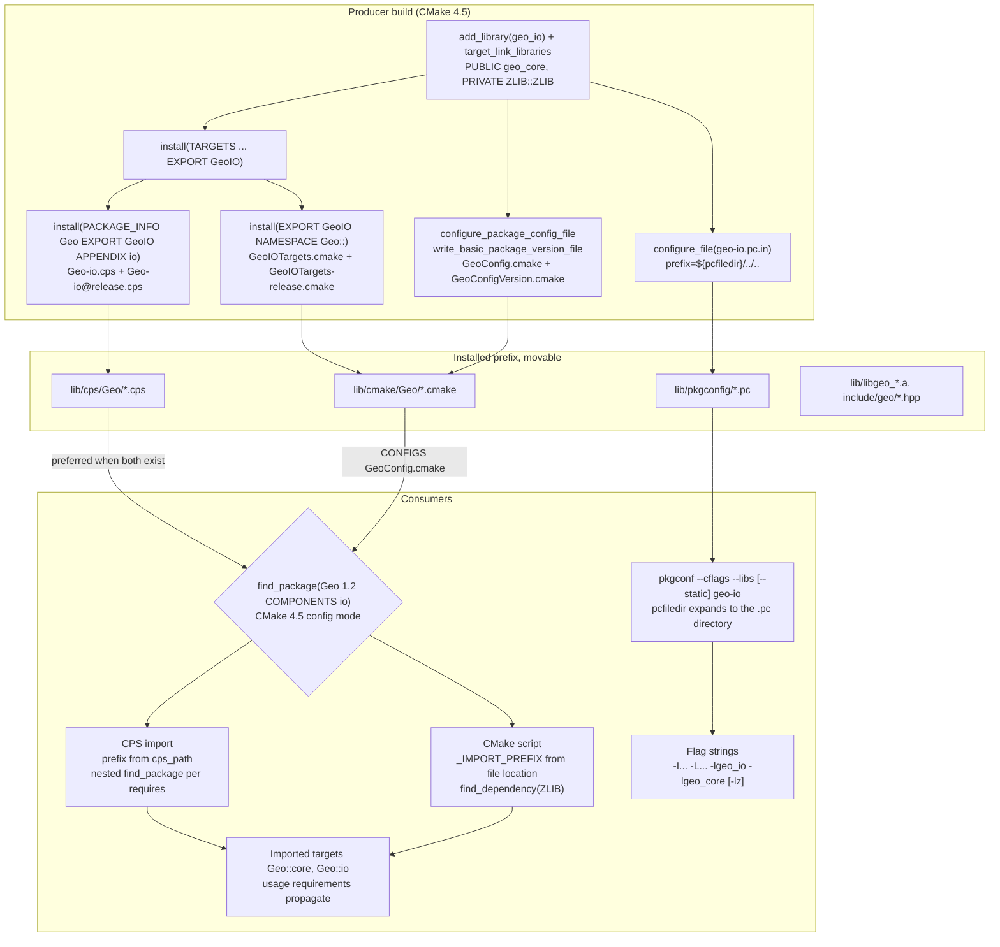

# C++ Package Discovery: CMake Configs, pkg-config, and Common Package Specification

> [!summary] Claim:
> A consumer of a prebuilt C++ library needs its include directories, compile definitions and features, artifact paths per configuration, transitive dependencies, version compatibility, and link language, and three formats carry that contract with very different fidelity.
> A pkg-config `.pc` file is a flat bag of precomputed compiler and linker flags with a version and a dependency list, where `Requires.private` and `Libs.private` exist only because static linking needs the whole transitive closure.
> A CMake config package is executable CMake code generated by `install(EXPORT)` that defines namespaced `IMPORTED` targets carrying usage requirements, computes its own prefix from its location, and resolves dependencies with nested `find_package` calls.
> The Common Package Specification (CPS v0.15.0) is a declarative JSON description of components, configurations, and requirements with an `@prefix@` placeholder, which CMake 4.3 and later read in `find_package` and write with `install(PACKAGE_INFO)`.
> An expert makes all three relocatable, splits optional components so their dependencies are only demanded when used, and tests by installing, moving the prefix, and consuming from a clean project.



## The Mechanism

### 1. What a package description must carry

Compiling and linking against a prebuilt library needs more than a header path and a `-l` flag.
The consumer needs:
- Include directories, compile definitions, and required language features such as C++17.
- The artifact for each build configuration, because a Debug consumer may need a Debug library on Windows.
- The transitive closure of link dependencies, which is larger for a static archive than for a shared library.
- The link language, because a static C++ archive linked by a C driver needs the C++ runtime added by hand.
- Version and compatibility information, so a consumer can reject an incompatible installation early.
- Paths that survive the package being installed under a different prefix than the one it was built for.

Each format below is a different answer to how much of this to precompute at build time and how much to leave to the consumer's build system.
The history chapter of the CPS specification describes the lineage: per-project `*-config` scripts, then GNOME's `gnome-config`, then pkg-config as one database of flags, then CMake's find modules for packages that described nothing, then CMake's exported targets, and finally CPS as a tool-neutral descendant of the exported-target model.
ABI questions that sit underneath these files, such as SONAME and symbol visibility, belong to [[Cpp-ABI-Stability-Symbol-Visibility-and-SONAME]].

### 2. pkg-config: precomputed flags and a dependency list

#### 2.1 File format

A `.pc` file has two kinds of lines (pkgconf 3.0.10 `pc(5)`):
- Variable definitions, `name=value`, referenced as `${name}`, with `$${` escaping a literal `${`.
- Properties, `Keyword: value`, in RFC822 style, with variable substitution always performed.

Properties have three types.
A literal property, such as `Name`, `Version`, or `Description`, is plain text.
A dependency list, such as `Requires`, follows the grammar `package-spec = package-key [ ver-op package-version ]` with operators `<`, `<=`, `=`, `!=`, `>=`, and `>`, separated by whitespace or commas.
A fragment list, such as `Cflags` or `Libs`, is tokenised with POSIX shell word-splitting rules, so quotes group words and a backslash escapes a metacharacter.

The keywords that matter for linking are:

| Keyword | Meaning (pkgconf 3.0.10 `pc(5)`) | Origin |
|---|---|---|
| `Name`, `Version`, `Description`, `URL` | Marked mandatory literals in `pc(5)` | pkg-config |
| `Cflags` | Compiler flags always used | pkg-config |
| `Libs` | Linker flags for this package | pkg-config |
| `Libs.private` | Linker flags needed only when linking statically | pkg-config |
| `Requires` | Dependencies that must be met for the package to be usable at all | pkg-config |
| `Requires.private` | Dependencies needed for header inclusion and static linking | pkg-config |
| `Conflicts` | Dependencies that must not be present | pkg-config |
| `Cflags.private` | Compiler flags for static compilation only | pkgconf 0.9.3 |
| `Provides` | Virtual packages this package can satisfy | pkgconf 1.1.0 |
| `Requires.internal` | Static-link dependencies whose `Cflags` are not included | pkgconf 1.5.0 |
| `Cflags.shared`, `Libs.shared`, `Requires.shared` | Flags or dependencies used only for shared linking | pkgconf 3.0.0 |
| `Link.ABI` | Comma-separated ABI tags such as `c++` that the final link must honor; absent means `c` | pkgconf 3.0.0 |
| `License`, `License.file`, `Source`, `Copyright`, `Maintainer` | SBOM-style metadata | pkgconf 1.9.0 to 3.0.0 |

`pc(5)` suggests that a file which absolutely depends on a pkgconf extension declare a requirement on the `pkgconf` virtual package at the version that introduced the extension, with `Requires: pkgconf >= 3.0.0` as its example, because the virtual package is versioned and other implementations may ignore the extension.

#### 2.2 Resolution and the static closure

pkgconf searches `PKG_CONFIG_PATH` first, then `PKG_CONFIG_LIBDIR` if set, else its compiled-in default list.
On the macOS 27.3 arm64 host used for this note, Homebrew pkgconf 3.0.10 reports `pc_path` as `/opt/homebrew/lib/pkgconfig:/opt/homebrew/share/pkgconfig:/usr/local/lib/pkgconfig:/usr/lib/pkgconfig:/opt/homebrew/Library/Homebrew/os/mac/pkgconfig/27` (as of 2026-11), and the last entry holds shim files such as `zlib.pc` for libraries in the macOS SDK.

`--libs` walks `Requires` and prints `Libs` for the package and every public requirement.
`--static` ("Compute a deeper dependency graph", `pkgconf(1)`) also walks `Requires.private` and appends every `Libs.private`.
The split exists because a shared library records its own dependencies in its dynamic section, so a consumer linking a `.so` does not need `-lz`, while a static archive records nothing and the final link must name every library in the closure.
`Requires.private` dependencies still contribute `Cflags`, because a header of the package may include a header of the private dependency; `Requires.internal` exists for the case where it does not.

Flags that name compiler default directories are filtered out unless `--keep-system-cflags` or `--keep-system-libs` is given; the lists come from `PKG_CONFIG_SYSTEM_INCLUDE_PATH` and `PKG_CONFIG_SYSTEM_LIBRARY_PATH` or compiled-in defaults (`/usr/lib` and the SDK's `usr/include` on the lab host).
`PKG_CONFIG_SYSROOT_DIR` prepends a sysroot to paths for cross compilation and sets the `pc_sysrootdir` variable.
A file named `foo-uninstalled.pc` describes a package straight from a build tree and is preferred over `foo.pc` unless `PKG_CONFIG_DISABLE_UNINSTALLED` or `--no-uninstalled` is set.

#### 2.3 Relocation: `${pcfiledir}` and define-prefix

A naive `.pc` file hardcodes `prefix=/usr/local`, so moving the tree breaks every path.
Two mechanisms avoid that:
1. `pcfiledir` is a built-in variable holding the directory of the `.pc` file being parsed (`pkgconf_tuple_add(..., "pcfiledir", ...)` in `libpkgconf/pkg.c`), so `prefix=${pcfiledir}/../..` makes every derived path relative to the file.
2. The define-prefix feature replaces the `prefix` variable with a guess: `determine_prefix()` in `libpkgconf/pkg.c` takes the file's path, requires the parent directory to be named `pkgconfig`, and strips two more components, so `.../lib/pkgconfig/foo.pc` yields `...`.
   It also rewrites any other variable that starts with the original prefix string, to rescue files that spell out absolute `libdir` values.

`cli/core.c` in pkgconf 3.0.10 enables define-prefix by default only on Windows; elsewhere it needs `--define-prefix` or `PKG_CONFIG_RELOCATE_PATHS`, and `--dont-define-prefix` or `PKG_CONFIG_DONT_DEFINE_PREFIX` disables it everywhere.
A portable package therefore uses `${pcfiledir}` rather than relying on define-prefix.
Meson's pkgconfig module writes "a hardcoded prefix path" by default and offers a `pkgconfig.relocatable` builtin option for the relocatable form.

#### 2.4 Implementations and consumers

The freedesktop.org reference implementation's newest tarball is `pkg-config-0.29.2` (as of 2026-11).
pkgconf is the actively released implementation: 3.0.10 shipped on 2026-10-19 and 3.0.11 on 2026-11-14 (as of 2026-11).
CMake consumes `.pc` files in two ways:
- `FindPkgConfig` runs the `pkg-config` executable; `pkg_check_modules(<prefix> IMPORTED_TARGET [GLOBAL] <module-spec>...)` creates `PkgConfig::<prefix>` (working since 3.7, `GLOBAL` since 3.13), and fills `<prefix>_*` and `<prefix>_STATIC_*` variables from the normal and `--static` queries.
- `cmake_pkg_config` parses `.pc` files natively without any pkg-config binary: `EXTRACT` arrived in 3.31, and `IMPORT` and `POPULATE` in 4.1; `IMPORT` creates `PkgConfig::<package>`, and `STRICTNESS` selects `STRICT` (fdo pkg-config rules), `PERMISSIVE` (pkgconf rules, the default), or `BEST_EFFORT`.

Meson's `dependency()` tries pkg-config first and CMake second for dependencies without custom logic, and the Rust `pkg-config` crate (0.3.34) runs pkg-config from `build.rs` with `FOO_STATIC` and `PKG_CONFIG_ALL_STATIC` selecting `--static`.

### 3. CMake config packages: exported targets as code

#### 3.1 From targets to an export set

A target's usage requirements are the `INTERFACE_*` properties that `target_include_directories`, `target_compile_definitions`, `target_compile_features`, and `target_link_libraries` populate with `PUBLIC` or `INTERFACE` scope.
`install(TARGETS geo_io EXPORT GeoIO ...)` adds the target to an export set, and `install(EXPORT GeoIO NAMESPACE Geo:: FILE GeoIOTargets.cmake DESTINATION lib/cmake/Geo)` writes code that recreates it as `IMPORTED` targets in another project.
The generated main file does the following, as read from the lab host's CMake 4.5.0 output:
1. It wraps itself in `cmake_policy(PUSH)` and `cmake_policy(VERSION 2.8.12...4.3)`, so a consumer's policies cannot change how it runs.
2. It checks whether the expected targets already exist: all defined means a repeated `find_package` and it returns early, while some defined is a fatal "Some (but not all) targets in this export set were already defined" error.
3. It computes `_IMPORT_PREFIX` by applying `get_filename_component(... PATH)` once per directory level between the file and the prefix, four times for `lib/cmake/Geo/GeoIOTargets.cmake`.
4. It creates `add_library(Geo::io STATIC IMPORTED)` and sets `INTERFACE_LINK_LIBRARIES "Geo::core;\$<LINK_ONLY:ZLIB::ZLIB>"`.
5. It globs `GeoIOTargets-*.cmake` and includes each, one per installed configuration, which set `IMPORTED_LOCATION_RELEASE "${_IMPORT_PREFIX}/lib/libgeo_io.a"` and `IMPORTED_LINK_INTERFACE_LANGUAGES_RELEASE "CXX"`.
6. It verifies every referenced file exists, failing with "The imported target ... references the file ... but this file does not exist".
7. It checks that targets referenced from other export sets, here `Geo::core`, are already defined, and otherwise sets `<Package>_FOUND` to false with a "referenced, but are missing" message.

`$<LINK_ONLY:ZLIB::ZLIB>` is CMake's equivalent of `Libs.private`: a `PRIVATE` dependency of a static library is still needed at the consumer's final link, but its include paths and definitions must not leak into the consumer's compilation.
For a shared `geo_io`, the same `PRIVATE` link would not appear in the export at all.

#### 3.2 Relocatability rules

`cmake-packages(7)` states that `install(EXPORT)` packages are "designed to be relocatable, using paths relative to the location of the package itself".
The producer keeps that property by writing install-time paths relative to the prefix:

```cmake
target_include_directories(geo_core PUBLIC
  $<BUILD_INTERFACE:${CMAKE_CURRENT_SOURCE_DIR}/include>
  $<INSTALL_INTERFACE:${CMAKE_INSTALL_INCLUDEDIR}>)
```

`$<INSTALL_INTERFACE:include>` is rewritten to `${_IMPORT_PREFIX}/include`, while `$<INSTALL_INTERFACE:${CMAKE_INSTALL_PREFIX}/include>` freezes the build machine's absolute path into the file.
`$<INSTALL_PREFIX>` is the escape hatch for complex expressions such as `$<INSTALL_INTERFACE:$<$<CONFIG:Debug>:$<INSTALL_PREFIX>/include/TgtName>>`.
The manual also warns against `target_link_libraries(Tgt INTERFACE ${Foo_LIBRARIES})` and `${Foo_INCLUDE_DIRS}`, which embed the dependency paths found on the build machine; the fix is to link the dependency's own imported target, such as `Foo::Foo`, and re-find it in the config file.
`GNUInstallDirs` supplies `CMAKE_INSTALL_LIBDIR`, which is `lib` or `lib64`, or `lib/<multiarch-tuple>` on Debian, so destinations should never be spelled literally.

#### 3.3 The config file, the version file, and components

`find_package` in config mode loads `<PackageName>Config.cmake` or `<lowercasePackageName>-config.cmake`; the export file alone is not a package.
`CMakePackageConfigHelpers` generates both halves:
- `configure_package_config_file(GeoConfig.cmake.in GeoConfig.cmake INSTALL_DESTINATION lib/cmake/Geo)` expands `@PACKAGE_INIT@` into `get_filename_component(PACKAGE_PREFIX_DIR "${CMAKE_CURRENT_LIST_DIR}/../../../" ABSOLUTE)` plus two macros.
- `set_and_check(var path)` sets a variable and fails fatally if the path does not exist, which catches a stale path at `find_package` time.
- `check_required_components(Geo)` sets `Geo_FOUND` to false when a requested non-optional component's `Geo_<comp>_FOUND` is false, and the documentation says to call it even in packages without components so that misspelled components are rejected.
- `PATH_VARS` turns listed variables into `PACKAGE_<var>` values relative to `PACKAGE_PREFIX_DIR`.
- `write_basic_package_version_file(GeoConfigVersion.cmake COMPATIBILITY SameMajorVersion)` writes the version check.

The version file sets `PACKAGE_VERSION_COMPATIBLE`, `PACKAGE_VERSION_EXACT`, and `PACKAGE_VERSION_UNSUITABLE`.
The available modes are `AnyNewerVersion`, `SameMajorVersion`, `SameMinorVersion` (3.11), `ExactVersion`, and since CMake 4.4 `SamePatchVersion`, `SameFullVersion`, and `SemanticVersion`, which acts like `SameMinorVersion` for `0.y.z` and `SameMajorVersion` from `1.0.0`; 4.4 documents `ExactVersion` as deprecated in favor of the two explicit modes.
Unless `ARCH_INDEPENDENT` (3.14) is given, the generated file also compares `CMAKE_SIZEOF_VOID_P` with the producer's value, 8 on the lab host, and marks a mismatch unsuitable with a `(64bit)` suffix on the version.
Version ranges such as `1.0...<1.3` are supported by these files since 3.19, and the upper end acts as a hard limit, so a range cannot widen what a package accepts.

Components in a CMake-script package are a convention, not a mechanism.
The config file decides what `find_package(Geo COMPONENTS io)` means, typically by including one targets file per component and setting `Geo_io_FOUND`.
`find_dependency()` from `CMakeFindDependencyMacro` forwards `QUIET` and `REQUIRED` from the outer call, and when the dependency is missing it sets a diagnostic message and calls `return()` from the config file, which `cmake-packages(7)` says leaves `<Package>_FOUND` false.
A `find_dependency` call with arguments identical to an earlier one in the same directory skips the underlying `find_package`, which keeps diamond-shaped graphs from re-searching the same dependency.
The `install(EXPORT)` documentation warns that the per-configuration files are found by globbing `<export-name>-*.cmake`, so an export named `geo` installed next to `geo-config.cmake` would glob and load the config file itself.

#### 3.4 How find_package searches (CMake 4.5)

`find_package(Geo)` with the basic signature tries module mode (`FindGeo.cmake` on `CMAKE_MODULE_PATH` and CMake's own modules) and falls back to config mode; `CMAKE_FIND_PACKAGE_PREFER_CONFIG` reverses that, and the full signature or `CONFIG` uses config mode only.
Every call first checks `CMAKE_FIND_PACKAGE_REDIRECTS_DIR` (3.24), where FetchContent or the project can place a config file that wins over everything else.
Config mode then builds a list of prefixes in this order, each step disabled by a `NO_*` option or a `CMAKE_FIND_USE_*` variable:
1. `<PackageName>_ROOT` and `<PACKAGENAME>_ROOT` as CMake variables, then as environment variables (policies CMP0074 and CMP0144).
2. The cache variables `CMAKE_PREFIX_PATH`, `CMAKE_FRAMEWORK_PATH`, and `CMAKE_APPBUNDLE_PATH`.
3. The environment variables `<PackageName>_DIR`, `CMAKE_PREFIX_PATH`, `CMAKE_FRAMEWORK_PATH`, and `CMAKE_APPBUNDLE_PATH`.
4. `HINTS`.
5. `PATH`, with trailing `/bin` and `/sbin` stripped.
6. The user package registry, filled by `export(PACKAGE)`.
7. `CMAKE_SYSTEM_PREFIX_PATH` and related platform variables, including `CMAKE_INSTALL_PREFIX`.
8. The system package registry.
9. `PATHS`.

Under each prefix it tries 19 directory patterns for Windows (W) and UNIX (U) layouts plus 9 Apple framework and app-bundle patterns, such as `<prefix>/(lib/<arch>|lib*|share)/cmake/<name>*/`; since 4.3, eight of the general patterns and three of the Apple patterns contain `cps`.
Two rules surprise people:
- The first viable config file wins, "even if a newer version of the package resides later in the list of search paths", so a stale `/usr/local` install can shadow a newer one that is only listed in `PATHS`.
- Glob matches such as `<prefix>/example-1.2/` and `<prefix>/example-1.10/` are tried in natural descending order, so `1.10` wins over `1.2`, controlled by `CMAKE_FIND_PACKAGE_SORT_ORDER` and `CMAKE_FIND_PACKAGE_SORT_DIRECTION`.

`<PackageName>_CONSIDERED_CONFIGS` and `<PackageName>_CONSIDERED_VERSIONS` list what was rejected, and `cmake --debug-find-pkg=Geo` traces the search; CMake 4.1 also records `find_package` events in `cmake-configure-log(7)`.

#### 3.5 Find modules and the export of dependencies

A find module is written by someone other than the package, and the `find_package` documentation calls such modules "heuristic in nature and ... susceptible to becoming out-of-date".
A config file is shipped by the package and knows its own layout, which is why CMake 4.0 deprecated `FindGDAL` in favor of GDAL's own config file.
Writing `find_dependency()` calls by hand is error-prone, so `install(EXPORT ... EXPORT_PACKAGE_DEPENDENCIES)` and `export(SETUP ... PACKAGE_DEPENDENCY)` can generate them from the `INTERFACE` link targets of the export set, but both are still experimental behind `CMAKE_EXPERIMENTAL_EXPORT_PACKAGE_DEPENDENCIES` in CMake 4.5 (as of 2026-11).

### 4. Common Package Specification v0.15.0

#### 4.1 The document model

The spec's `conf.py` on the `cps-org/cps` master branch sets `version_info = (0, 15, 0)` and publishes a JSON Schema as `https://cps-org.github.io/cps/cps.schema.json` with root object `package` (as of 2026-11).
A CPS file is JSON with six object types: `package`, `platform`, `requirement`, `component`, `configuration`, and `fileset`.
Attribute names are case-sensitive, and an optional attribute set to `null` is equivalent to omitting it.

A `package` requires:
- `name`, which must equal the file name without `.cps`, as-is or lower-cased.
- `cps_version`, read with SemVer rules, so a tool for `0.15` is expected to read `0.16` files and may miss non-critical information.
- `components`, a map from component name to `component`.
- Exactly one of `cps_path`, an `@prefix@`-rooted path to the file's own directory for relocatable packages, or `prefix`, an absolute prefix for non-relocatable ones.

Optional package attributes include `version`, `version_schema` (default `"simple"`), `compat_version`, `default_components`, `configurations` (the preferred order), `requires` (a map of package name to `requirement`), and `platform`.

A `component` requires `type`, one of `"executable"`, `"archive"`, `"dylib"`, `"module"`, `"jar"`, `"interface"`, or `"symbolic"`, and a parser ignores a component whose type it does not recognize.
`location` is required for every type except `"interface"`, and `link_location` gives the import library when a `"dylib"` has separate link-time and run-time files, such as a `.lib` and a `.dll` on Windows.
`"symbolic"` components carry no required attributes and exist so a package can advertise a feature that consumers test for.

Usage requirements live on the component or on one of its `configurations`:
- `includes`, `embeds`, `definitions`, `compile_flags`, `compile_features`, `link_flags`, `link_features`, and `link_libraries`.
- `definitions` is a map from language to a map of names, with `"c"`, `"cpp"`, `"fortran"`, and `"*"` recognized; a `null` value means `-Dkey` and an empty string means `-Dkey=`.
- `link_languages`, default `["c"]`, says whether a static archive needs the C++ runtime (`"cpp"`).
- `cpp_module_metadata` points to a P3286 module metadata file, which [[Cpp-Distributing-Cxx20-Modules]] covers.
- `file_sets` (`"includes"` or `"embeds"` with a `root` and `files`) enumerate headers and embed resources.

Dependencies come in four strengths:
- `requires` applies the required component's compile and link attributes transitively.
- `compile_requires` applies only compile attributes, for headers that use a dependency's types without its symbols.
- `link_requires` applies only link attributes, the CPS form of `$<LINK_ONLY:...>` and `Libs.private`.
- `dyld_requires` exists only so the runtime loader can find a private dependency, for example through an environment variable that a tool generates.

The spec discourages `compile_flags`, `link_flags`, and `link_libraries` as non-portable, which is the deliberate break from pkg-config's flag strings.
The `platform` object records `isa` (as `uname -m`), `kernel` (as `uname -s`), `kernel_version`, `c_runtime_vendor`, `cpp_runtime_vendor` (`"gnu"`, `"llvm"`, or `"microsoft"`), their versions, and JVM and CLR requirements, so a tool can skip a package built for another platform.

#### 4.2 Names, configurations, and file merging

Component references use a colon: `":core"` is a relative name in the same package and `"ZLIB:ZLIB"` is the `ZLIB` component of package `ZLIB`.
An `@` suffix names a configuration, and `@@` means "the same configuration as the one this name appears in".
Names may use ASCII letters, digits, `-`, and `_`; `:` is allowed in component and configuration names but not package names, and `/` and `@` are forbidden.

Configuration selection is a list walk: the consumer's preferred configurations first, then optionally one that matches the consumer's active configuration, then the package's `configurations` list.
A configuration attribute overrides the component attribute of the same name, and an explicit `null` suppresses the fallback.

When a tool finds `name.cps`, it must also load files in the same directory matching `name:*.cps`, `name-*.cps`, `name@*.cps`, `name:*@*.cps`, and `name-*@*.cps`, skipping colon patterns where the file system forbids `:`.
A file whose name contains `@` is configuration-specific: it may only contain `name`, `configuration`, and `components`, and its component attributes belong to that configuration.
This is how a distribution can split release libraries, debug libraries, and optional components into separately installable packages without rewriting one shared file.

#### 4.3 Searching and prefix determination

The spec searches `CPS_PATH` entries first (`<path>/<name-like>/cps/` and `<path>/<name-like>/`), then for each prefix in `CPS_PREFIX_PATH`, `/usr/local`, and `/usr`: Windows-style `<prefix>/<name-like>/cps/` and `<prefix>/cps/<name-like>/`, macOS framework and app `Resources/CPS/` directories, `<prefix>/<libdir>/cps/<name-like>/`, and `<prefix>/share/cps/<name-like>/`.
`<name-like>` is `name` or `name/*`, which lets several versions share one prefix.
A tool should skip a candidate whose `platform` or version does not match and keep searching.
Commit 5bc60a5767 ("Drop search paths that don't contain the name", 2026-10-16) removed name-less directories from the spec after CMake 4.5 had shipped `<prefix>/cps/` and `<prefix>/(lib/<arch>|lib*|share)/cps/` in its search table.

`@prefix@` resolution works backwards from the file: with `cps_path` set to `@prefix@/lib/cps/foo` and the file at `/usr/local/lib/cps/foo/foo.cps`, the matching tail `lib/cps/foo` is removed and the prefix is `/usr/local`.
Tools must try `dirname(fullpath)` and should also try the two `realpath` variants, so a symlinked package directory still resolves.

#### 4.4 Versions and compatibility

`version_schema` defines ordering only: `"simple"` matches `[0-9]+([.][0-9]+)*([-+].*)?` and compares the leading integers; `"custom"` allows equality checks only; `"rpm"` and `"dpkg"` are named but "may not be supported by all tools".
Compatibility is a separate attribute: `compat_version` is the oldest version the package remains compatible with, and when it is absent it equals `version`, so the package only satisfies a request for exactly its own version.
That default is the opposite of the common CMake habit of `AnyNewerVersion`, so a producer that wants SemVer-style acceptance must set `compat_version` explicitly; [[Versioning-SemVer-CalVer-and-ABI]] owns the policy for choosing it.

### 5. CPS in CMake 4.3 to 4.5

#### 5.1 Status and history

The CMake 4.3 release notes add CPS support as a headline feature: `find_package` searches for and imports `.cps` files, `install(PACKAGE_INFO)` and `export(PACKAGE_INFO)` generate them, and `project()` gains `COMPAT_VERSION` and `SPDX_LICENSE`.
Before 4.3 the work was gated: the 4.1 release notes list `project(COMPAT_VERSION)` as experimental behind `CMAKE_EXPERIMENTAL_EXPORT_PACKAGE_INFO`, and the `install(PACKAGE_INFO)` documentation marks `DESCRIPTION` and `HOMEPAGE_URL` as added in 4.1 and `LICENSE` and `DEFAULT_LICENSE` in 4.2.
CMake 4.3.3 moved `export(PACKAGE_INFO)` output from the build directory itself into `cps/<package-name>/`.
CMake 4.5 added import of CPS `"executable"` components and header file sets in both CPS import and export (as of 2026-11).

#### 5.2 Writing CPS

```cmake
install(PACKAGE_INFO Geo EXPORT GeoCore DEFAULT_TARGETS core)
install(PACKAGE_INFO Geo EXPORT GeoIO APPENDIX io)
```

Imported targets from a CPS package are always named `<package-name>::<component>`, where the component is the target's export name, so `set_target_properties(geo_io PROPERTIES EXPORT_NAME io)` plus `NAMESPACE Geo::` keeps the CMake-script and CPS spellings identical.
Package metadata is inherited from the `project()` whose name equals the package name, unless `PROJECT` or `NO_PROJECT_METADATA` says otherwise, and `VERSION`, `COMPAT_VERSION`, and `VERSION_SCHEMA` override it.
`APPENDIX` writes `<package>-<appendix>.cps`, which may not set `VERSION`, `COMPAT_VERSION`, `VERSION_SCHEMA`, `DEFAULT_TARGETS`, `DEFAULT_CONFIGURATIONS`, or `PROJECT`.
Generator expressions in exported interface properties are supported only when they depend on the configuration.
Without `DESTINATION`, CMake 4.5.0 installed the files to `lib/cps/Geo/` on the lab host (observed, macOS).
For projects whose build files cannot be edited, `CMAKE_INSTALL_EXPORTS_AS_PACKAGE_INFO` turns existing `install(EXPORT)` calls into CPS output with directives such as `required-targets:Example/l`, but the CMake 4.5.0 documentation still marks it as meaningful only behind an experimental gate whose name it prints as `CMAKE_EXPERIMENTAL_FIXME` (as of 2026-11).

#### 5.3 Reading CPS

Config mode looks for `<PackageName>.cps` and `<lowercasePackageName>.cps` alongside the CMake-script names, and the documentation says the search "will tend to prefer CPS files"; `CONFIGS` suppresses CPS entirely because CPS file names must match the package name.
`.cps` files are considered only under search paths containing `/cps/`, and `.cmake` files only elsewhere.
Version checks follow CPS rules for `simple` and `custom` schemas: without `compat_version` or with `EXACT` the version must match exactly; otherwise the package version must be at least the requested minimum, `compat_version` must be at most that minimum, and an upper bound, if given, must not be exceeded.

The root `.cps` is always loaded, and an appendix is loaded only if its dependencies are satisfiable and it provides a requested component, or no components were requested.
Each package-level requirement becomes a nested `find_package` call.
If the candidate is another CPS package, required components map directly; if it is a CMake-script package, CMake passes the components as `OPTIONAL_COMPONENTS` and then checks that targets named `<PackageName>::<ComponentName>` exist.
The lab host shows three consequences of that design that the documentation does not spell out:
1. The nested lookup is config-only: the error lists only `ZLIB.cps`, `zlib.cps`, `ZLIBConfig.cmake`, and `zlib-config.cmake`, so a dependency that is only reachable through a find module such as `FindZLIB` cannot satisfy a CPS requirement (observed, CMake 4.5.0, macOS).
2. An appendix whose dependency cannot be found is silently dropped when no components are requested, so `find_package(Geo)` succeeds with only `Geo::core` and `Geo::io` simply does not exist (observed).
3. CMake 4.5.0 did not find the package through the spec's `CPS_PATH` or `CPS_PREFIX_PATH` environment variables, while `CMAKE_PREFIX_PATH` worked, and its own documentation does not mention them (observed).

CMake's generated `.cps` files on the lab host contained no `platform` object, so CPS platform filtering does not protect consumers of CMake-generated packages from a wrong-architecture install (observed, CMake 4.5.0, macOS).

## Commands and Numbers to Know

| Item | Value | Platform | Notes |
|---|---|---|---|
| CPS spec version | 0.15.0, `cps_version` written as `"0.15.0"` by CMake 4.5.0 (as of 2026-11) | Both | `conf.py` on `cps-org/cps` master; observed in generated files. |
| CMake CPS support | stable from 4.3; experimental gates earlier (as of 2026-11) | Both | 4.3 release notes; 4.1 notes gate `COMPAT_VERSION` behind `CMAKE_EXPERIMENTAL_EXPORT_PACKAGE_INFO`. |
| `install(PACKAGE_INFO)` default destination | `lib/cps/<name>/` (as of 2026-11) | macOS | Observed with CMake 4.5.0; docs say "platform-specific default". |
| CPS per-configuration file | `<name>@release.cps` holding `"configuration" : "Release"` (as of 2026-11) | Both | Observed with CMake 4.5.0, single-config Release build. |
| `export(PACKAGE_INFO)` output | `<build>/cps/<package-name>/` (as of 2026-11) | Both | Changed in CMake 4.3.3. |
| `find_package` search table | 19 general patterns, 9 Apple patterns, CPS paths added in 4.3 (as of 2026-11) | Both | CMake 4.5.0 `find_package` docs. |
| `find_package` nesting limit | 500 (as of 2026-11) | Both | Observed error "find_package maximum nesting depth of 500 exceeded", CMake 4.5.0. |
| `CONFIGS <name>.cmake` | suppresses CPS lookup (as of 2026-11) | Both | CPS file names must match the package name. |
| `CMAKE_FIND_PACKAGE_PREFER_CONFIG` | config mode before module mode (as of 2026-11) | Both | Basic signature only. |
| `cmake --debug-find-pkg=<Pkg>` | traces the config search (as of 2026-11) | Both | 4.1 also logs `find_package` events to the configure log. |
| `write_basic_package_version_file` modes | 7 modes; `SamePatchVersion`, `SameFullVersion`, `SemanticVersion` added in 4.4 (as of 2026-11) | Both | `ExactVersion` documented as deprecated. |
| Version file architecture check | rejects a different `CMAKE_SIZEOF_VOID_P` unless `ARCH_INDEPENDENT` (as of 2026-11) | Both | Generated file compares with 8 on a 64-bit producer. |
| `cmake_pkg_config` | `EXTRACT` 3.31, `IMPORT` and `POPULATE` 4.1, default `STRICTNESS PERMISSIVE` (as of 2026-11) | Both | No pkg-config binary needed. |
| `pkg_check_modules(... IMPORTED_TARGET)` | `PkgConfig::<prefix>` (as of 2026-11) | Both | Requires a pkg-config executable. |
| pkgconf release | 3.0.10 (2026-10-19), 3.0.11 (2026-11-14) (as of 2026-11) | Both | Lab host ran Homebrew pkgconf 3.0.10. |
| fdo pkg-config release | 0.29.2 newest tarball (as of 2026-11) | Both | `pkgconfig.freedesktop.org/releases/`. |
| `pkgconf --variable pc_path pkg-config` | prints the default search path (as of 2026-11) | Both | Five entries on the Homebrew lab host. |
| `pkgconf --static --libs <pkg>` | adds `Requires.private` closure and `Libs.private` (as of 2026-11) | Both | Required for static archives. |
| `pkgconf --link-abi <pkg>` | prints ABI tags, `c` when no `Link.ABI` (as of 2026-11) | Both | pkgconf 3.0.0 extension. |
| `pkgconf --validate <pkg>` | checks `.pc` files for correctness, exit 0 on the worked example's `geo-io.pc` (as of 2026-11) | Both | Implies `--print-errors` and `--errors-to-stdout`. |
| define-prefix default | on for Windows builds of pkgconf, off elsewhere (as of 2026-11) | Both | `cli/core.c` in pkgconf 3.0.10; `PKG_CONFIG_RELOCATE_PATHS` enables it. |
| `PKG_CONFIG_SYSROOT_DIR` | prefixes `-I` and `-L` paths for cross builds (as of 2026-11) | Both | Also sets `pc_sysrootdir`. |
| `PKG_CONFIG_DISABLE_UNINSTALLED` | ignore `*-uninstalled.pc` (as of 2026-11) | Both | Same as `--no-uninstalled`. |

## Multi-Language Comparison

| Concern | C++ (CMake, pkg-config, CPS) | Python native builds | Rust native builds |
|---|---|---|---|
| How a native dependency is found | `find_package` config mode (CPS or CMake script), find modules, or `.pc` files | scikit-build-core runs CMake, so `find_package` rules apply; meson-python runs Meson, whose `dependency()` tries pkg-config, then CMake | The `pkg-config` crate runs pkg-config in `build.rs`; [[Rust-Build-Scripts-and-Sys-Crates]] owns the `-sys` crate pattern |
| What the description carries | Targets with usage requirements (CMake, CPS) or flag strings (pkg-config) | Whatever the underlying CMake or Meson lookup returns | Cargo metadata printed from pkg-config's flags when the probe succeeds |
| Static versus shared | `$<LINK_ONLY:>`, `link_requires`, or `Libs.private` with `--static` | Inherited from CMake or Meson | `FOO_STATIC` or `PKG_CONFIG_ALL_STATIC` selects `--static` |
| Relocation | `_IMPORT_PREFIX`, `@prefix@` with `cps_path`, `${pcfiledir}` | Wheels vendor shared libraries instead, owned by [[Python-Wheels-Platform-Tags-Manylinux-and-ABI3]] | Usually static linking into the final binary |
| Typical defect | Absolute build-machine paths in exported properties | A build backend finding a system library that end users lack | A cross build picking the host's `.pc` files; the crate enables cross probing only when `PKG_CONFIG_SYSROOT_DIR` or `PKG_CONFIG` is set, and `PKG_CONFIG_ALLOW_CROSS=1` skips that check |

## Worked Example

This note has no harness lab.
The example below was built and run once by hand on macOS 27.3 arm64 with CMake 4.5.0, AppleClang 21.0.0, and Homebrew pkgconf 3.0.10 on 2026-11-15, and absolute paths are replaced with `<scratch>`.
Its sources are a library `Geo` with two static components:
- `core`, target `geo_core`, export name `core`, with `cxx_std_17` as a public compile feature.
- `io`, target `geo_io`, export name `io`, linking `geo_core` publicly and `ZLIB::ZLIB` privately, built only when `GEO_WITH_IO` is on.

Each component has its own export set and its own CPS appendix, and the package installs `GeoConfig.cmake`, `GeoConfigVersion.cmake` with `SameMajorVersion`, `geo.pc`, and `geo-io.pc`.
`project(Geo VERSION 1.4.2 COMPAT_VERSION 1.0)` sets the CPS compatibility floor.
`GeoConfig.cmake.in` includes `GeoCoreTargets.cmake`, and includes `GeoIOTargets.cmake` only if that file exists, calling `find_dependency(ZLIB)` first when the build was static.

### Step 1: install and read the CPS output

`cmake --install` wrote `lib/cps/Geo/Geo.cps`, `Geo@release.cps`, `Geo-io.cps`, and `Geo-io@release.cps` next to the CMake-script files.
The root file and the `io` appendix:

```json
{
  "compat_version" : "1.0",
  "components" :
  {
    "core" :
    {
      "compile_features" : [ "c++17" ],
      "includes" : [ "@prefix@/include" ],
      "type" : "archive"
    }
  },
  "cps_path" : "@prefix@/lib/cps/Geo",
  "cps_version" : "0.15.0",
  "default_components" : [ "core" ],
  "name" : "Geo",
  "version" : "1.4.2"
}
```

```json
{
  "components" :
  {
    "io" :
    {
      "link_requires" : [ "ZLIB:ZLIB" ],
      "requires" : [ ":core" ],
      "type" : "archive"
    }
  },
  "cps_path" : "@prefix@/lib/cps/Geo",
  "cps_version" : "0.15.0",
  "name" : "Geo",
  "requires" :
  {
    "ZLIB" :
    {
      "components" : [ "ZLIB" ]
    }
  }
}
```

`Geo-io@release.cps` holds only `"location" : "@prefix@/lib/libgeo_io.a"` and `"link_languages" : [ "cpp" ]` under `"configuration" : "Release"`.
The `PRIVATE` link became `link_requires`, the same meaning as `$<LINK_ONLY:ZLIB::ZLIB>` in `GeoIOTargets.cmake`, and the imported target `ZLIB::ZLIB` was mapped to package `ZLIB`, component `ZLIB`.

### Step 2: move the prefix and consume it

The installed tree was renamed from `stage/` to `relocated/`, and a consumer ran `find_package(Geo 1.2 REQUIRED COMPONENTS io)` with `CMAKE_PREFIX_PATH` pointing at the new location.
With `CONFIGS GeoConfig.cmake`, which forces the CMake-script package:

```text
-- Found ZLIB: /Applications/Xcode.app/Contents/Developer/Platforms/MacOSX.platform/Developer/SDKs/MacOSX.sdk/usr/lib/libz.tbd (found version "1.2.12")
-- Geo_CONFIG=<scratch>/relocated/lib/cmake/Geo/GeoConfig.cmake
-- Geo_VERSION=1.4.2
-- Geo::core includes=<scratch>/relocated/include
-- Geo::io link=Geo::core;$<LINK_ONLY:ZLIB::ZLIB>
distance=5.0 compressed_size=17
```

Without `CONFIGS`, CMake chose `Geo.cps` and failed on the transitive requirement:

```text
CMake Error in <scratch>/relocated/lib/cps/Geo/Geo-io.cps:
  Could not find a package configuration file provided by "ZLIB" with any of
  the following names:

    ZLIB.cps
    zlib.cps
    ZLIBConfig.cmake
    zlib-config.cmake
...
CMake Error at CMakeLists.txt:11 (find_package):
  find_package could not find ZLIB, required by Geo.
```

`find_dependency(ZLIB)` in the CMake-script package used module mode and found `FindZLIB`; the CPS import's nested lookup did not.
A first consumer-side shim that wrote `zlib-config.cmake` containing `find_package(ZLIB MODULE REQUIRED)` into `CMAKE_FIND_PACKAGE_REDIRECTS_DIR` recursed until "find_package maximum nesting depth of 500 exceeded", because every `find_package` call checks that directory first, even in module mode.
A shim containing `include(FindZLIB)` worked, with a `FindZLIB` author warning ("ZLIB does not provide any COMPONENTS") and a `missing components: ZLIB` note, after which CMake's own target check accepted `ZLIB::ZLIB`:

```text
-- Geo_CONFIG=<scratch>/relocated/lib/cps/Geo/Geo.cps
-- Geo_VERSION=1.4.2
-- Geo::core includes=<scratch>/relocated/include
-- Geo::io link=Geo::core;$<LINK_ONLY:ZLIB::ZLIB>
distance=5.0 compressed_size=17
```

Both formats resolved the moved prefix and produced identical imported targets.

### Step 3: version and component matrix

A probe project called `find_package(Geo <req> [COMPONENTS ...] QUIET)` against the moved prefix:

```text
script=OFF req=           comps=- : -- RESULT found 1.4.2 via Geo.cps targets=Geo::core
script=OFF req=1.0        comps=- : -- RESULT found 1.4.2 via Geo.cps targets=Geo::core
script=OFF req=1.2        comps=- : -- RESULT found 1.4.2 via Geo.cps targets=Geo::core
script=OFF req=0.9        comps=- : -- RESULT not-found
script=OFF req=2.0        comps=- : -- RESULT not-found
script=OFF req=1.0...<1.3 comps=- : -- RESULT not-found
script=ON req=           comps=- : -- RESULT found 1.4.2 via GeoConfig.cmake targets=Geo::core;Geo::io
script=ON req=1.0        comps=- : -- RESULT found 1.4.2 via GeoConfig.cmake targets=Geo::core;Geo::io
script=ON req=1.2        comps=- : -- RESULT found 1.4.2 via GeoConfig.cmake targets=Geo::core;Geo::io
script=ON req=0.9        comps=- : -- RESULT not-found
script=ON req=2.0        comps=- : -- RESULT not-found
script=ON req=1.0...<1.3 comps=- : -- RESULT not-found
```

CPS rejected 0.9 because `compat_version` is 1.0, and the CMake script rejected it because `SameMajorVersion` needs major 1; both rejected 2.0 and the range whose upper end, 1.3, is below 1.4.2.
With no components requested, CPS dropped the `io` appendix silently because `ZLIB` was unsatisfiable, while the CMake-script package loaded both, since its config file found `ZLIB` through the find module.
With `COMPONENTS io` and `QUIET`, CPS still raised the hard error "find_package could not find ZLIB, required by Geo." and configuration failed.

### Step 4: the same package through pkg-config

```text
$ export PKG_CONFIG_PATH=<scratch>/relocated/lib/pkgconfig
$ pkgconf --modversion geo-io
1.4.2
$ pkgconf --cflags --libs geo-io
-I<scratch>/relocated/lib/pkgconfig/../../include -L<scratch>/relocated/lib/pkgconfig/../../lib -lgeo_io -lgeo_core
$ pkgconf --static --libs geo-io
-L<scratch>/relocated/lib/pkgconfig/../../lib -lgeo_io -lgeo_core -lz
$ pkgconf --print-requires-private geo-io
zlib
$ pkgconf --exists 'geo >= 2'; echo rc=$?
rc=1
$ pkgconf --link-abi geo-io
c
```

`${pcfiledir}/../..` kept the paths valid after the move without `--define-prefix`; the paths are correct but not normalized.
Linking `consumer/main.cpp` with the non-static flags against the static archives failed:

```text
Undefined symbols for architecture arm64:
  "_compress", referenced from:
      geo::compressed_size(std::__1::basic_string<char, std::__1::char_traits<char>, std::__1::allocator<char>> const&) in libgeo_io.a[2](io.cpp.o)
  "_compressBound", referenced from:
      geo::compressed_size(std::__1::basic_string<char, std::__1::char_traits<char>, std::__1::allocator<char>> const&) in libgeo_io.a[2](io.cpp.o)
ld: symbol(s) not found for architecture arm64
```

The same command with `--static` linked and printed `distance=5.0 compressed_size=17`.
`--link-abi` printed `c` because the hand-written `.pc` file has no `Link.ABI: c++`, while CMake's CPS output recorded `"link_languages" : [ "cpp" ]` for the same archive.

### Step 5: the non-relocatable variant

Changing only the include line to `$<INSTALL_INTERFACE:${CMAKE_INSTALL_PREFIX}/${CMAKE_INSTALL_INCLUDEDIR}>` wrote `INTERFACE_INCLUDE_DIRECTORIES "<scratch>/stage-bad/include"` into `GeoCoreTargets.cmake` and `['<scratch>/stage-bad/include']` into the CPS `includes`, with no `@prefix@`.
After moving the tree, `find_package` still succeeded, and the failure appeared only when a target linked `Geo::core` and CMake generated the build system:

```text
-- Configuring done (0.4s)
CMake Error in CMakeLists.txt:
  Imported target "Geo::core" includes non-existent path

    "<scratch>/stage-bad/include"

  in its INTERFACE_INCLUDE_DIRECTORIES.  Possible reasons include:
```

If the old path still existed on the machine, for example in a CI image that also built the package, this would compile silently against the wrong headers.

> [!warning] Pitfalls:
> 1. A CPS package that depends on something only reachable through a find module fails to import in CMake 4.5, because the nested lookup for CPS requirements is config-only, as the worked example's `FindZLIB` case shows; depend on packages that ship a config or CPS file, or ship the CMake-script package alongside the `.cps` file.
> 2. Optional appendices disappear silently: `find_package(Geo)` without components drops an appendix whose dependencies are missing, so code that tests `if(TARGET Geo::io)` gets false instead of a diagnostic; request the component explicitly when you need it.
> 3. Absolute install paths in `INSTALL_INTERFACE`, `${Foo_LIBRARIES}` in `INTERFACE_LINK_LIBRARIES`, or `prefix=/usr/local` in a `.pc` file make a package that works until the prefix moves, and fails or, worse, picks up stale files when it does.
> 4. `pkg-config --libs` without `--static` underlinks static archives, and the error names the missing symbols, not the missing `-lz`; for static builds use `--static`, or `pkg_check_modules` with the `_STATIC_` variables.
> 5. A static C++ archive described by a `.pc` file without `Link.ABI: c++` gives C link drivers no hint that the C++ runtime is needed; CPS records it in `link_languages`.
> 6. The first viable config file wins: an old copy under `/usr/local` or in the user package registry shadows a newer one listed in `PATHS`; check `Geo_DIR` or `Geo_CONFIG` and `Geo_CONSIDERED_CONFIGS`.
> 7. Naming an export set the same as the package and installing `<name>-config.cmake` next to it makes the export's `<name>-*.cmake` glob load the config file as if it were a per-configuration file.
> 8. A CPS package without `compat_version` matches only its exact version, so moving a package from `AnyNewerVersion` to CPS output without setting `COMPAT_VERSION` breaks every consumer that asks for an older minimum.
> 9. `CONFIGS GeoConfig.cmake` silently disables CPS lookup, which is useful for testing the script path and wrong in production consumers that expect CPS.
> 10. Calling `find_package(Dep MODULE)` inside a file placed in `CMAKE_FIND_PACKAGE_REDIRECTS_DIR` for the same name recurses, because the redirect directory is checked even in module mode.
> 11. A `.pc` file that lists a dependency's flags in `Libs` instead of naming it in `Requires` or `Requires.private` cannot be resolved against a different version of that dependency; pkg-config can only check versions of packages it knows by name.

## At Scale

For one developer, a hand-written `.pc` file and `FindFoo.cmake` work until the first static build or the first prefix move.
For a team, the paved road is CMake-generated packages: namespaced targets with `EXPORT_NAME`, an `ALIAS` with the same name for in-tree and FetchContent consumers, `configure_package_config_file`, a version file, and a relocatable `.pc` file per component for non-CMake consumers.
For 1,000 to 50,000 engineers, the cost moves to consistency and to graphs that cross build systems: Bazel, Meson, Make, and CMake consumers of the same internal library, plus distribution packages that [[Cpp-System-Packaging-Deb-RPM-and-Homebrew]] builds and package managers that [[Cpp-Conan-2-Architecture-and-Binary-Model]], [[Cpp-vcpkg-Manifests-Registries-and-Binary-Caching]], and [[Cpp-Spack-and-Nix-for-Native-Dependencies]] own.

CPS is aimed at that last case: one declarative file that any build tool can read without executing CMake code, with configurations, components, and transitive requirements kept structured.
Its maturity is the constraint: the spec is at 0.15.0 and changed its search paths in October 2026, CMake is the only producer and consumer examined here, and CMake 4.5 still marks the distributor bridge `CMAKE_INSTALL_EXPORTS_AS_PACKAGE_INFO` as experimental (as of 2026-11).
Diamond conflicts in which two packages require incompatible versions of one dependency are not solved by any of these formats; [[Diamond-Dependency-and-Incompatible-ABI-Mitigation]] owns them.

Decision rules:
1. Every library that is installed ships a CMake-script config package, because it is the format every current CMake can read.
2. Libraries with consumers outside CMake also ship `.pc` files with `prefix=${pcfiledir}/...`, `Requires.private` for static-only dependencies, and `Link.ABI: c++` where the consumers run pkgconf 3.0 or later.
3. Ship CPS from `install(PACKAGE_INFO)` when consumers can require CMake 4.3 or later, set `COMPAT_VERSION` deliberately, and keep the CMake-script package until every transitive dependency also ships a config or CPS file.
4. Put each optional component in its own export set and CPS appendix, so its dependencies are only demanded by consumers that use it.
5. Gate every release with three tests: install to a temporary prefix, move it, and build a consumer through each shipped format; link a static consumer with `pkgconf --static`; and run `find_package` with an incompatible version to prove rejection.
6. Ban absolute paths in exported files with a CI grep for the build prefix in `*.cmake`, `*.cps`, and `*.pc` under the staging prefix.

> [!tip] Practice Drill:
> Rebuild the worked example's `Geo` package with `BUILD_SHARED_LIBS=ON` and compare `GeoIOTargets.cmake`, `Geo-io.cps`, and `pkgconf --libs geo-io` with the static build; explain why `ZLIB` disappears from the CMake and CPS exports and why `Requires.private: zlib` is still correct in the `.pc` file.
> Then make the CPS import succeed without a consumer-side shim by giving the `ZLIB` dependency a config package, and add a CI step that installs, moves, and consumes the package through all three formats.
> Finish with [[Drill-Packaging-Cpp-Silent-ABI-Break-Across-Shared-Libraries]], which shows what none of these formats can detect.

## Interview Questions

> [!question] L5: Predict the output. `geo-io.pc` has `Requires: geo = 1.4.2`, `Requires.private: zlib`, and `Libs: -L${libdir} -lgeo_io`, and `geo.pc` has `Libs: -L${libdir} -lgeo_core`. What do `pkgconf --libs geo-io` and `pkgconf --static --libs geo-io` print, and which one is right for static archives?
> > [!success]- Answer
> > The first prints `-L.../lib -lgeo_io -lgeo_core`: it follows `Requires` and prints each package's `Libs`, and pkgconf collapses the repeated `-L`.
> > The second adds the `Requires.private` closure and prints `-L.../lib -lgeo_io -lgeo_core -lz`.
> > For static archives only the second links, because a `.a` file records no dependencies and the linker reports undefined `_compress` and `_compressBound` without `-lz`.
> > For shared libraries the first is right, because the `.so` or `.dylib` already records its dependency on zlib.

> [!question] L5: Why should a library's install tree contain `GeoConfig.cmake` instead of relying on a `FindGeo.cmake` module?
> > [!success]- Answer
> > A find module is written outside the package and guesses paths and names, which the `find_package` documentation calls heuristic and prone to going out of date.
> > A config file is generated from the library's own targets, so it carries the exact include directories, compile features, artifact per configuration, and transitive dependencies.
> > It also computes its location at load time, so the package can be moved, and its version file lets `find_package` reject incompatible installs.
> > CMake itself deprecated `FindGDAL` in 4.0 in favor of GDAL's upstream config file for these reasons.

> [!question] L6: What makes an installed CMake package relocatable, and name three ways to break it.
> > [!success]- Answer
> > The generated targets file computes `_IMPORT_PREFIX` by walking up from its own path, and every exported path is written relative to it; `@PACKAGE_INIT@` does the same for `PACKAGE_PREFIX_DIR`.
> > It breaks when `INSTALL_INTERFACE` contains `${CMAKE_INSTALL_PREFIX}`, when `INTERFACE_LINK_LIBRARIES` contains `${Foo_LIBRARIES}` with build-machine paths, or when the config file hardcodes a path instead of using `PACKAGE_PREFIX_DIR` or `PATH_VARS`.
> > The symptom appears late: `find_package` succeeds, and generation fails with "Imported target ... includes non-existent path", or compiles against stale files if the old path still exists.
> > The test is to install, move the prefix, and build a consumer.

> [!question] L6: Debug this. A consumer on CMake 4.5 calls `find_package(Geo 1.2 REQUIRED COMPONENTS io)` and gets "find_package could not find ZLIB, required by Geo", although `find_package(ZLIB)` works in the same project, and adding `CONFIGS GeoConfig.cmake` makes everything work. Explain.
> > [!success]- Answer
> > Without `CONFIGS`, config mode prefers `Geo.cps`, and the `io` appendix declares a package requirement on `ZLIB`.
> > CMake satisfies CPS requirements with a nested config-mode lookup, which searches only for `ZLIB.cps`, `zlib.cps`, `ZLIBConfig.cmake`, and `zlib-config.cmake` and never consults `FindZLIB.cmake`.
> > The CMake-script package calls `find_dependency(ZLIB)`, which uses the basic signature and finds the find module.
> > Fixes are a dependency that ships a config or CPS file, keeping consumers on the script package, or a consumer-side redirect file containing `include(FindZLIB)`, not `find_package(ZLIB MODULE)`, which recurses through the redirect directory.

> [!question] L6: `find_package(Foo)` keeps picking Foo 2.9 from `/usr/local` although 3.4 is installed under `/opt/foo`, which the project passes in `PATHS`. How does the search work and how do you fix it?
> > [!success]- Answer
> > Config mode walks prefixes in a fixed order: `Foo_ROOT`, `CMAKE_PREFIX_PATH` from the cache and the environment, `HINTS`, `PATH`, the user registry, system prefixes such as `/usr/local`, the system registry, and finally `PATHS`.
> > The first viable config file wins "even if a newer version of the package resides later in the list", and without a version request every candidate is viable.
> > Read `Foo_DIR`, or run `cmake --debug-find-pkg=Foo`; with a version request, `Foo_CONSIDERED_CONFIGS` and `Foo_CONSIDERED_VERSIONS` list what was rejected.
> > Request `find_package(Foo 3.2)` so the 2.9 version file rejects itself and the search continues, move `/opt/foo` into `HINTS`, `Foo_ROOT`, or `CMAKE_PREFIX_PATH`, and remove stale registry entries.

> [!question] L7: Compare how CMake-script packages and CPS decide version compatibility, and what changes for a producer migrating to `install(PACKAGE_INFO)`.
> > [!success]- Answer
> > A CMake-script package runs arbitrary code in `<Name>ConfigVersion.cmake`, usually generated with a mode such as `SameMajorVersion`, and an upper bound in a version range is a hard limit.
> > CPS is declarative: the package version must be at least the requested minimum, `compat_version` must be at most that minimum, and an upper bound must not be exceeded.
> > Without `compat_version`, a CPS package matches only its exact version, the opposite of a typical `AnyNewerVersion` package.
> > The producer must set `COMPAT_VERSION` in `project()` or `install(PACKAGE_INFO)` to the oldest API-compatible release, and choose `VERSION_SCHEMA` deliberately, since CMake supports only `simple` and `custom`.

> [!question] L7: Design the packaging for a library with a mandatory core and an optional component that needs zlib, consumable from CMake, Meson, and Make.
> > [!success]- Answer
> > Use two targets with export names `core` and `io`, a `Geo::` namespace, and one export set per component, so `GeoIOTargets.cmake` and `Geo-io.cps` exist only when the component was built.
> > The config file includes the core targets, and for `io` calls `find_dependency(ZLIB)` before including its targets and sets `Geo_io_FOUND`, then calls `check_required_components`.
> > CPS uses `install(PACKAGE_INFO ... APPENDIX io)`, so its zlib requirement is only demanded when `io` is requested.
> > Ship `geo.pc` and `geo-io.pc` with `prefix=${pcfiledir}/../..`, `Requires: geo`, `Requires.private: zlib`, and `Link.ABI: c++` for static archives, and test a moved prefix with each consumer.

> [!question] L7: What does `$<LINK_ONLY:...>` express, and what are its equivalents in pkg-config and CPS?
> > [!success]- Answer
> > It marks a dependency that the consumer's final link needs but whose compile requirements must not propagate, which is what a `PRIVATE` dependency of a static library becomes in an export.
> > pkg-config expresses it with `Libs.private` or `Requires.private`, applied only with `--static`, although `Requires.private` still contributes `Cflags`, and `Requires.internal` in pkgconf avoids that.
> > CPS expresses it with `link_requires`, which applies only the required component's link attributes; CMake 4.5 wrote `"link_requires" : [ "ZLIB:ZLIB" ]` for this case.
> > For a shared library the dependency vanishes from the CMake and CPS exports, because the dynamic linker resolves it from the library's own dependency list.

> [!question] L8+: You own native packaging for 300 internal C++ libraries consumed by CMake, Bazel, and Meson builds. Would you adopt CPS now, and how?
> > [!success]- Answer
> > Adopt it as an additional output, not a replacement: generate `.cps` with `install(PACKAGE_INFO)` where producers can require CMake 4.3, and keep the CMake-script and `.pc` outputs.
> > The blockers are maturity and coverage: the spec is at 0.15.0 and changed search paths in October 2026, CMake's nested lookup for CPS requirements cannot use find modules, and CMake 4.5 does not write a `platform` object.
> > Make every internal library ship a config or CPS file so CPS transitive requirements resolve, set `COMPAT_VERSION` per the versioning policy, and run install-move-consume tests in CI for each format.
> > Track the other build tools' CPS readers and remove a format only when telemetry shows no consumer uses it.

> [!question] L8+: A static release build of a trading binary links but crashes because two copies of a dependency ended up in the process. Which parts of package discovery could have prevented it?
> > [!success]- Answer
> > Precomputed flags hide identity: if a `.pc` file lists `-lfoo` in `Libs` instead of naming `foo` in `Requires`, nothing can unify it with another package's copy of `foo`.
> > Exported targets and CPS components name dependencies as packages and components, so one `find_package` resolves one `Foo::Foo` for the whole graph.
> > Link-only dependencies must be declared, through `$<LINK_ONLY:>`, `link_requires`, or `Requires.private`, so the final link sees each library once.
> > The rest is version and ABI policy, which [[Diamond-Dependency-and-Incompatible-ABI-Mitigation]] and [[Cpp-ABI-Stability-Symbol-Visibility-and-SONAME]] own.

## Further Reading

- CMake `find_package` documentation (4.5): the authoritative search procedure, version selection rules, and CPS transitive requirement handling.
- CMake `install` and `export` documentation (4.5): every option of `install(EXPORT)`, `install(PACKAGE_INFO)`, and `export(SETUP)`, including which are experimental.
- `cmake-packages(7)`: the relocatable-package rules and the package registry.
- `CMakePackageConfigHelpers`: what `@PACKAGE_INIT@` and each compatibility mode generate.
- Common Package Specification v0.15.0 (schema, searching, configurations, components): the format itself, including the `@prefix@` resolution algorithm.
- `cps-org/cps` commit history: the spec still changes between CMake releases, as the October 2026 search path change shows.
- pkgconf `pc(5)` and `pkgconf(1)` (3.0.10): the current `.pc` keyword set, including the 3.0 extensions, and every environment variable.
- Dan Nicholson, Guide to pkg-config (freedesktop.org): the classic tutorial on `Requires.private` and `Libs.private`; its server refused automated fetching for this note.
- CMake `cmake_pkg_config` and `FindPkgConfig`: the two ways CMake consumes `.pc` files and how their strictness and static handling differ.
- Meson Pkgconfig module and Dependencies pages: how a second build system generates and consumes the same formats.

## Related

- Prerequisites: [[Cpp-ABI-Stability-Symbol-Visibility-and-SONAME]]
- Next: [[Cpp-Distributing-Cxx20-Modules]]
- See also: [[02-Programming-Languages/C++/CPP_Zero_to_Godhood/Volume_09_Specialized_Mastery/Chapter_110_Build_Systems_and_Tooling/Chapter_110_Build_Systems_Dependency_Management_and_Tooling|Chapter_110_Build_Systems_Dependency_Management_and_Tooling]], [[Cpp-Conan-2-Architecture-and-Binary-Model]], [[Cpp-vcpkg-Manifests-Registries-and-Binary-Caching]], [[Cpp-System-Packaging-Deb-RPM-and-Homebrew]], [[Versioning-SemVer-CalVer-and-ABI]], [[Diamond-Dependency-and-Incompatible-ABI-Mitigation]], [[Rust-Build-Scripts-and-Sys-Crates]]
