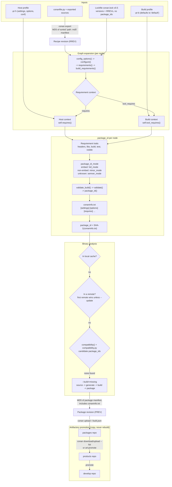

# Conan 2: Architecture, Recipes, and the Binary Model

> [!summary] Claim:
> Conan 2 names every binary by a reference `name/version@user/channel#rrev:package_id#prev`, and the client never inspects a binary to decide whether it fits.
> The `package_id` is the SHA-1 of a text file, `conaninfo.txt`, that the recipe's declared settings, options, and dependency modes produce, so two binaries are interchangeable exactly when that text is identical.
> Dependencies enter that text through requirement traits: a library that embeds a static dependency records its full reference and revision, while a library that only links a shared one records `1.2.Z`.
> The recipe revision and the package revision are MD5 digests of file manifests, lockfiles pin versions and recipe revisions but not binaries, and promotion copies those exact artifacts between repositories rather than rebuilding them.
> An expert reads `conaninfo.txt`, `conan graph explain`, and the requirement traits to answer one question: what would make this binary wrong for this consumer, and does the hash see it?



## The Mechanism

### What Conan 2 is, and what changed from Conan 1

Conan is a decentralized client-server package manager for C and C++ whose recipes are Python files named `conanfile.py`; the client needs Python 3.8 or newer and is MIT-licensed (Conan 2 introduction page, as of 2026-11).
Conan 2.0.0 shipped on 22 February 2023 after a 2.0.0-beta1 on 20 June 2022, and 2.34.0, released 28 October 2026, is the version this note was checked against (Conan changelog).
Since 2.0 the project commits to not breaking recipes, packages, or command-line flows inside the 2.x line, which is why behavior changes now ship behind opt-in policies rather than as silent defaults.

Conan 2 is not a refactor of Conan 1; it changed the binary model in four ways that matter to a release engineer:
1. Revisions are always on: every recipe and every binary has a revision, and references resolve to the latest one unless pinned.
2. Two profiles are always in play, one for the host context and one for the build context, so a tool used during the build never shares binaries or settings with the libraries being built.
3. Dependencies affect `package_id` by package type and requirement traits, instead of Conan 1's single default `semver_direct_mode`, which applied `semver_mode()` to direct dependencies and `unrelated_mode()` to transitive ones (Conan 1 documentation, "Defining package ABI compatibility").
4. The cache was redesigned: a SQLite database plus short hashed folder names, so many revisions of one reference can coexist.

### The client and the cache

The client is a Python package (`conan` and `conans` in site-packages) with three layers: the CLI in `conan/cli/commands/` (`create`, `install`, `graph`, `lock`, `list`, `upload`, `download`, `cache`, `pkglist`, `workspace`, `audit`, and others in 2.34.0), a public Python API in `conan/api/`, and the model and graph code in `conan/internal/`.
`CONAN_HOME` (default `~/.conan2`) holds `global.conf`, `settings.yml`, `profiles/`, `extensions/` (plugins such as `compatibility.py`, hooks, custom commands), `remotes.json`, and the package store `p/`.
The store is indexed by `p/cache.sqlite3`; folder names are the first five characters of the package name plus the first 13 hex characters of a SHA-256 of the full reference, as in `p/libabd41dc9be119e` (`PkgCache._short_hash_path` in `conan/internal/cache/cache.py`, 2.34.0).
The source comment derives the 13-character length as a 16-character budget minus 3 and links the Conan pull-request discussion that chose it; the effect is a fixed, short folder name whatever the length of the reference.
Each package folder holds `conaninfo.txt`, the files `package()` copied, and `conanmanifest.txt`, a timestamp followed by one `path: md5` line per file.

A remote is any server that speaks the Conan REST API: `conan_server` (a minimal server, distributed in Conan 2 as the separate `conan-server` PyPI package, that the docs describe as mainly for testing; the `conan` wheel ships only a launcher stub without `conans/server`), Artifactory Community Edition, which the Conan docs recommend for private hosting, or Artifactory Pro.
The client queries remotes in the order `conan remote list` prints them and stops at the first remote that has the requested binary unless `--update` is passed, in which case it checks all of them and takes the newest revision (`_get_package_from_remotes` in `conan/internal/graph/graph_binaries.py`).

### The reference model

A full package reference has five identities, and each answers a different question:

| Part | Example | Computed from | Question it answers |
|---|---|---|---|
| `name/version` | `liba/1.2.4` | recipe attributes or `set_version()` | Which library and release? |
| `@user/channel` | `@acme/stable` | optional, recipe or CLI | Which namespace? Conan discourages using it for maturity |
| `#rrev` | `#8525bcf152bf75133086b9c0626efe35` | MD5 of the recipe manifest | Which exact recipe and exported sources? |
| `:package_id` | `:b8da06845b8444be84fc8e71e7354dc6f23831c8` | SHA-1 of `conaninfo.txt` | Which binary configuration? |
| `#prev` | `#b368f05c0578afd38804ff27e27a4fd7` | MD5 of the package manifest | Which exact bytes of that configuration? |

The pattern syntax used by `conan list`, `conan upload`, and `conan remove` addresses each level: `liba/*` for references, `liba/1.2.4#*` for all recipe revisions, and `liba/1.2.4#*:*#*` for every binary and every package revision.

### The recipe lifecycle

A recipe is a class deriving from `conan.ConanFile`; Conan calls its methods in phases, and a method only sees what its phase has computed.
Reading `conan/internal/loader.py`, `conan/internal/methods.py`, `conan/internal/graph/compute_pid.py`, and `conan/internal/graph/installer.py` in 2.34.0 gives this order:

1. Load: `init()` (for recipes extending a `python_requires` base), then `set_name()` and `set_version()`.
2. Export (`conan export`, or the first step of `conan create`): `export()` and `export_sources()` copy files into the cache, the manifest is written, and the RREV is computed.
3. Graph expansion, per node: `config_options()`, then option values from the profile and from downstream consumers are applied, then `configure()`, then the package type is computed, then `requirements()` and `build_requirements()`.
   Adding requirements in `configure()` prints a deprecation warning, because the graph builder expects them only from the requirement methods.
4. Binary identity, per node: `validate_build()` marks a configuration that cannot be built, `validate()` marks one that cannot be used, and `package_id()` may erase or add information before the SHA-1 is taken; then `layout()` runs.
5. Binary analysis: look for the `package_id` in the cache, then the remotes, then the candidates from `compatibility()` and the `compatibility.py` plugin, and finally mark the node for building if `--build` allows it.
6. Install, per node in dependency order: `system_requirements()`, `source()` for packages being built, `generate()`, `build()`, `package()`, then `finalize()` and `package_info()` for every node, including downloaded ones.
7. Consumer side: `generate()` of the root conanfile writes toolchain and dependency files such as `conan_toolchain.cmake`.

`package_type` decides the traits each edge gets and the `package_id` mode Conan applies; a recipe that leaves it unset is deduced from its `header_only` and `shared` options, and only a recipe with neither option is graded `unknown` (`compute_package_type`, 2.34.0).
The valid values are `application`, `library`, `shared-library`, `static-library`, `header-library`, `build-scripts`, `python-require`, and `unknown` (Conan attributes reference); 2.34.0 also defines an internal `configuration` type for configuration packages.
`library` resolves from the `shared` option to `shared-library` or `static-library`, and a `header_only=True` option makes it `header-library` (`PackageType.compute_package_type` in `conan/internal/model/pkg_type.py`).
`implements = ["auto_shared_fpic", "auto_header_only"]` replaces the boilerplate that removes `fPIC` on Windows and for shared builds, and that calls `self.info.clear()` for header-only packages.

### How the package_id is computed

`compute_package_id()` in `conan/internal/graph/compute_pid.py` builds a `ConanInfo` object from five sources:
1. `settings` declared by the recipe, with the values the profile gave them.
2. `options` declared by the recipe, with their final values.
3. `requires`: one entry per dependency whose `package_id_mode` is not `None`, rendered by that mode.
4. `build_requires` and `python_requires`, each with their own modes.
5. `conf` items that the recipe or `tools.info.package_id:confs` explicitly add, plus `config_version` when `core.package_id:config_mode` is set, and `settings_target` when a tool's `package_id()` copies it in.

`ConanInfo.dumps()` (`conan/internal/model/info.py`) renders each non-empty section as an INI-like block, `[settings]`, `[settings_target]`, `[options]`, `[requires]`, `[python_requires]`, `[build_requires]`, `[conf]`, `[config_version]`, with sorted lines, and ends with a newline.
`ConanInfo.package_id()` returns `hashlib.sha1(dumps().encode()).hexdigest()`.
Conan writes the same text to the package's `conaninfo.txt`, which is why the documentation says the `package_id` is the SHA-1 of that file and why `shasum -a 1 conaninfo.txt` reproduces it.

Three consequences follow directly from the code:
- The package's own name and version are not in the text: in the worked example, `liba/1.2.3` and `liba/1.2.4` built with identical settings both have `package_id` `b8da0684...`, and an application and a static library with the same settings and the same `[requires]` line get the same `package_id`.
  A `package_id` is only meaningful under its recipe reference.
- A header-only package that clears everything hashes the empty string, so every header-only package in the world has `package_id` `da39a3ee5e6b4b0d3255bfef95601890afd80709`, the SHA-1 of zero bytes.
- Anything not in the text does not distinguish binaries: `tools.build:cxxflags`, environment variables, the compiler's exact build or path, and `-march` flags all leave the `package_id` unchanged unless a recipe or `tools.info.package_id:confs` puts them in.

SHA-1 and MD5 here are identifiers, not a trust boundary.
A matching `package_id` proves only that the declared configuration text matches; it says nothing about who built the bytes.
Integrity in transit comes from the server's per-file checksums, and provenance from `conan cache sign` and `conan cache verify`, which call the Package Signing Plugin, and from the supply-chain controls owned by [[SLSA-Framework-Build-and-Source-Tracks]].

### Requirement traits and package_id modes

Every `self.requires()` edge carries traits: `headers`, `libs`, `run`, `build`, `test`, `visible`, `transitive_headers`, `transitive_libs`, `package_id_mode`, `force`, `override`, and `options`.
`Requirement.deduce_package_id_mode()` in `conan/internal/model/requires.py` turns the consumer's type, the dependency's type, and the traits into a mode:

| Consumer type | Dependency type | Linkage | Default mode | Default `[requires]` line for `liba/1.2.4` |
|---|---|---|---|---|
| any | any, via `test_requires` | none | not included | none |
| any | any, via `tool_requires` | build tool | `core.package_id:default_build_mode`, default `None` | none |
| `header-library` | any | none | `unrelated_mode` | none |
| `shared-library` or `application` | anything not `shared-library` (static, header-only, unknown) | embed | `full_mode` | `liba/1.2.4#rrev:package_id` |
| `shared-library` or `application` | `shared-library` | non-embed | `minor_mode` | `liba/1.2.Z` |
| `static-library` | `header-library` | embed | `full_mode` | full reference |
| `static-library` | `static-library` or `shared-library`, with headers | non-embed | `minor_mode` | `liba/1.2.Z` |
| `static-library` | transitive dependency with `headers=False` | none | `minor_mode` before the 2.28 policy, `None` with it | `liba/1.2.Z`, or none with the policy |
| `unknown` or another unclassified type (for example `build-scripts`) | any, linked through headers or libs | unknown | `semver_mode` | `liba/1.Y.Z` |

The defaults come from `global.conf` keys read in `GraphBinariesAnalyzer.__init__`: `core.package_id:default_embed_mode` (`full_mode`), `core.package_id:default_non_embed_mode` (`minor_mode`), `core.package_id:default_unknown_mode` (`semver_mode`), `core.package_id:default_python_mode` (`minor_mode`), and `core.package_id:default_build_mode` (`None`).
A dependency's recipe can override them for its consumers with the attributes `package_id_embed_mode`, `package_id_non_embed_mode`, `package_id_unknown_mode`, and the experimental `build_mode`, and a single edge can override everything with `self.requires("liba/1.2.4", package_id_mode="patch_mode")`.

`RequirementInfo` in `conan/internal/model/info.py` defines what each mode writes:
- `unrelated_mode`: nothing.
- `semver_mode`: `1.Y.Z` for versions 1.0 and up, and the full version below 1.0, because SemVer treats any 0.x change as breaking.
- `major_mode`: `1.Y.Z`; `minor_mode`: `1.2.Z`; `patch_mode`: `1.2.4`; `micro_mode`: four components.
- `full_version_mode` (alias `full_recipe_mode`): the full version, including pre-release and build.
- `revision_mode`: the full version plus the recipe revision.
- `full_package_mode`: the full version plus the dependency's `package_id`.
- `full_mode` (alias `recipe_revision_mode`): version, recipe revision, and `package_id`, so any change upstream, including a new recipe revision with no code change, forces a new consumer binary.

The embed rule is the ABI argument made concrete.
When an application links a static `liba`, its executable contains `liba`'s object code and inlined templates, so any change to `liba`'s recipe or configuration produces a different application binary, and `full_mode` says so.
When it links a shared `liba`, the executable contains only references to `liba`'s exported symbols, so a patch release that keeps the ABI needs no relink, and `minor_mode` assumes the library follows that contract.
That assumption is a policy, not a check: a patch release that changes a struct layout in a public header is a silent ABI break that `minor_mode` will not see, which [[Drill-Packaging-Cpp-Silent-ABI-Break-Across-Shared-Libraries]] reproduces and [[Cpp-ABI-Stability-Symbol-Visibility-and-SONAME]] explains.

Conan 2.28.0 changed the static-library case (changelog: "Change computation of `package_id` for transitive static libraries").
Before it, a static library recorded every transitive static dependency in `minor_mode`, even ones it never sees headers from, so a minor bump three levels down rebuilt every static library above it.
With the policy, a transitive dependency reached with `headers=False` gets mode `None` and disappears from the static library's `package_id`; the final application, which does embed it, still records it in `full_mode`.
The new behavior is opt-in, activated when the recipe declares `required_conan_version = ">=2.28"` or when `global.conf` sets `core:policies=["required_conan_version>=2.28"]` (`required_conan_version_policy` in `conan/internal/model/version_range.py`); without it, 2.34.0 prints `WARN: risk: Transitive dependencies with 'headers=False' effect in 'package_id' is not necessary and suboptimal.`
Conan 2.30.0 added a similar version-gated policy for propagating the `transitive_headers` trait, keyed on 2.29.9 in `transform_downstream()`.

`vendor = True`, which the 2.4.0 changelog introduces as a "package creation and build isolation strategy", makes a package's `package_id` independent of its dependencies entirely (`compute_package_id` empties both requirement maps), for packages that build their dependencies into themselves and do not expose them to consumers; building such a package from source then requires `tools.graph:vendor=build`, otherwise the node is marked invalid.

### Shaping the package_id inside the recipe

`package_id()` runs after `validate()` with `self.info` holding a copy of the computed information, and `settings` and `options` attributes temporarily removed so the method cannot read the wrong object.
Common edits:
- `self.info.clear()`: header-only or data-only packages, giving the empty-text SHA-1.
- `del self.info.settings.compiler` or `self.info.settings.rm_safe("compiler.cppstd")`: a C library whose ABI does not depend on the C++ standard, or a tool whose output does not depend on the compiler.
- `self.info.settings.build_type = "Release"` style rewrites to collapse variants that produce the same binary.
- `self.info.requires["zlib"].full_version_mode()`: tighten one dependency.
- `self.info.settings_target = self.settings_target`: a compiler or code generator whose output depends on the target it generates for, as the extending-the-binary-model page shows.
- `self.info.conf.define("user.myconf:myitem", value)`: make a configuration value part of the identity.

`validate()` raising `ConanInvalidConfiguration` marks the binary invalid, so `conan install` fails with the reason instead of building something wrong; `validate_build()` only forbids building, which lets a recipe say "this binary can be consumed with C++14 but must be built with C++17".

### Revisions

The RREV is `FileTreeManifest.summary_hash`: the MD5 of the sorted lines `path: md5` for every exported file, one per line, with a trailing newline (`conan/internal/model/manifest.py`, called from `_calc_revision` in `conan/internal/api/export.py`).
The default `revision_mode = "hash"` therefore changes the revision on any byte change in `conanfile.py` or the exported sources, including a comment or a CRLF conversion; the revisions tutorial warns that Windows Git checkouts with CRLF line endings produce different revisions than Linux.
`revision_mode = "scm"` uses the Git commit of the repository and `"scm_folder"` the commit of the recipe's folder; both refuse to export from a dirty tree unless `revision_mode_excluded` or `core.scm:excluded` lists the dirty paths.

The PREV is computed the same way over the package folder after `package()` runs and after `conaninfo.txt` is written, so `conaninfo.txt` is one of the hashed files (`run_package_method` in `conan/internal/methods.py`).
If `package()` copies byte-identical files and the configuration is identical, the PREV is identical: in the worked example, `liba/1.2.3`, `liba/1.2.4`, and a second recipe revision of `liba/1.2.4` all produced PREV `b368f05c...`.
Real compilers rarely give that guarantee: embedded timestamps, absolute paths, and nondeterministic link order make a rebuild of unchanged code yield a new PREV, and the revisions tutorial calls several PREVs for one RREV and `package_id` a bad practice that wastes compute and storage.
[[Reproducible-Builds-as-a-Security-Control]] and [[Hermetic-and-Reproducible-Builds]] own the techniques that make rebuilds byte-identical.

Resolution always takes the latest revision unless the reference pins one.
On a server, "latest" means most recently uploaded, so uploading an old revision again makes it the latest (revisions tutorial).
A recipe can pin a recipe revision in a requirement but never a package revision, and pinning a revision together with a version range has no effect and prints a warning.

### Binary compatibility: compatibility() and compatibility.py

When the exact `package_id` is missing everywhere and the build mode does not force a build, Conan asks for compatible candidates (`_evaluate_node` in `graph_binaries.py`).
`BinaryCompatibility.compatibles()` collects candidate `ConanInfo` objects from the recipe's `compatibility()` method first and from `extensions/plugins/compatibility/compatibility.py` second, reruns `validate()` and `package_id()` on each, drops invalid and duplicate ones, and looks each up in the cache first and then in the remotes.
The default plugin in 2.34.0 generates every `compiler.cppstd` value that `supported_cppstd()` lists for the compiler and version, every other `compiler.cstd` value, and, for `msvc` 194, a fallback to `msvc` 193; `_factors_combinations()` then yields each value of the first factor alone plus its combinations with the later factors, and that list, minus the original id and duplicates, is the candidate list.
For apple-clang 21 that is 14 `cppstd` values, so a missing `gnu17` binary is checked against 13 candidates; for gcc 13 it is 12 values and 11 candidates, both visible in the worked example.
A recipe opts out with `extension_properties = {"compatibility_cppstd": False}`, which is the right setting for a library whose public ABI changes with the standard, for example one that exposes `std::string_view` or `std::optional` only under C++17.

Each candidate costs a remote lookup, so the client prints a hint about the experimental `core.graph:compatibility_mode=optimized`, which lists the remote's package ids once and only tries candidates that exist; Conan 2.23.0 moved compatibility checks to a single request per remote, and 2.24.0 fixed the optimized mode with multiple repositories (changelog).

### Host and build contexts

Every graph has two contexts.
The host context holds the root and everything reached through `self.requires()`, configured by the host profile; the build context holds every `self.tool_requires()` and its dependencies, configured by the build profile (cross-building tutorial).
`--profile` means `--profile:host`, and an omitted `--profile:build` defaults to the `default` profile, so `conan install . -pr:h ./profiles/raspberry` cross-compiles while CMake and code generators resolve for the machine running the build.
Inside a recipe, `self.settings` are the settings of the node's own context, `self.settings_build` are the build machine's settings, and `self.settings_target` exists for build-context packages and holds the settings of the context they generate code for.

Because a tool's binary is selected by the build profile, a single `protoc/x` tool binary for `Macos armv8` serves builds that target Linux, Android, and iOS alike, and the tool's `package_id` does not include the target unless the tool recipe copies `settings_target` into `self.info`.
Profiles carry `[settings]`, `[options]`, `[tool_requires]`, `[buildenv]`, `[runenv]`, and `[conf]` sections, plus the experimental `[platform_requires]`, `[platform_tool_requires]`, `[replace_requires]`, and `[replace_tool_requires]`, and `[conf]` values apply only to the context of the profile that defines them (profiles reference).
Profiles are Jinja templates with `os`, `platform`, `subprocess`, `profile_dir`, `profile_name`, `root_profile_name`, `conan_version`, `context`, and `detect_api` available, and they compose with `include(...)` at the top of the file.
`conan profile detect` writes a `default` profile from `detect_api` and warns that its output is not guaranteed stable; on the author's host it chose `compiler.cppstd=gnu17` for apple-clang 21.

[[Cross-Compilation-and-Sysroots]] owns sysroots and target triples; this note owns only how Conan keeps the two sets of binaries apart.

### Lockfiles

A lockfile is JSON with `version` `"0.5"` and the lists `requires`, `build_requires`, `python_requires`, and `config_requires` (the worked example's `libs.lock`; `LOCKFILE_VERSION` in `conan/internal/model/lockfile.py`).
Each entry is `name/version#rrev%timestamp`, so a lockfile pins versions and recipe revisions, never `package_id`s or PREVs.
The class keeps a slot for `package_id: prev` pairs, but the only switch that fills it, `--lockfile-packages`, is hidden in `--help` and prints `The --lockfile-packages arg is private and shouldn't be used` (`conan/cli/args.py` and `conan/cli/command.py`, 2.34.0).
The consequence is that a lockfile reproduces the dependency graph and the configuration text, hence the same `package_id`s, but a newer PREV uploaded for the same `package_id` will be installed.

Lockfiles are strict by default: a requirement with no matching entry fails with `ERROR: Requirement 'hdr/2.0.0' not in lockfile 'requires'`, and `--lockfile-partial` relaxes that; a locked version outside a requirement's range is ignored rather than forced.
If `conan.lock` exists next to the consumer, commands use it implicitly; CI should pass `--lockfile` explicitly.
`conan lock create`, `add`, `remove`, `update`, `merge`, `upgrade`, and `upgrade-config` maintain them, and `--lockfile-clean` drops unused entries.
Because one lockfile can hold entries for several configurations, the CI tutorial creates it with repeated `conan lock create ... --lockfile=conan.lock --lockfile-out=conan.lock` for Release and Debug and for each product, then reuses it in every build job.
[[Lockfiles-Vendoring-and-Offline-Mirrors]] owns lockfiles across ecosystems.

### Promotion across Artifactory repositories

The Conan CI tutorial uses three server repositories: `packages`, where the packages pipeline uploads binaries built when one package changes; `products`, where the products pipeline uploads the binaries rebuilt to integrate that change into the organization's top-level products; and `develop`, which developers configure as their remote.
A promotion is a copy of packages with all artifacts and metadata from one repository to the next, after the gate for that stage passes (package promotions page).
The products pipeline in the tutorial computes what to build with `conan graph build-order --requires=game/1.0 --lockfile=conan.lock --build=missing --order-by=recipe --format=json`, merges the per-configuration orders with `conan graph build-order-merge --reduce`, builds each item with `conan install --requires=engine/1.0 --build=engine/1.0 --lockfile=conan.lock --format=json > graph.json`, turns the graph into a package list with `conan list --graph=graph.json --format=json > built.json`, and uploads it with `conan upload -l=built.json -r=products -c`.
Promotion to `develop` is `conan download --list=promote.json -r=products` followed by `conan upload --list=promote.json -r=develop -c` on Artifactory Community Edition, or the `conan art:promote` command from the Conan extensions repository, which requires Artifactory Pro.

Artifactory stores files by checksum, so a promotion copies metadata, not bytes, and takes no extra storage (package promotions page).
That is why the Conan docs say packages should be immutable across stages, strongly discourage rebuilding from source to change `user/channel`, and strongly discourage using `user/channel` to mark maturity: a rebuilt binary is a different PREV that was never tested, and a different `user/channel` is a different reference that every consumer recipe would have to edit.
Artifactory exposes Conan as local, remote, and virtual repositories; remote repositories proxy another server and must be aggregated into a virtual repository to be installed from, and the client URL must contain `/api/conan/` before the repository name, as in `conan remote add develop https://<host>/artifactory/api/conan/develop` (JFrog Conan repositories documentation).
[[Release-Trains-Backports-and-Artifact-Registries]] owns registry topology and retention across ecosystems.

### CMakeToolchain and CMakeDeps

`CMakeToolchain` translates the host profile into CMake and writes `conan_toolchain.cmake`, `CMakePresets.json`, and, when the recipe has a `layout()` and `CMakeLists.txt` is in the source folder, `CMakeUserPresets.json` that includes it (CMakeToolchain reference).
The toolchain file is assembled from named blocks, including `user_toolchain`, `generic_system`, `compilers`, `apple_system`, `fpic`, `arch_flags`, `libcxx`, `vs_runtime`, `cppstd`, `extra_flags`, `find_paths`, `rpath`, `output_dirs`, and `variables`, and `tools.cmake.cmaketoolchain:enabled_blocks` selects them.
In the worked example's Linux armv8 host profile on a macOS build machine, the toolchain sets `CMAKE_SYSTEM_NAME Linux` and `CMAKE_SYSTEM_PROCESSOR aarch64`, each guarded by `if(NOT DEFINED ...)` so a user toolchain can win, plus `CMAKE_CXX_STANDARD 17`, `CMAKE_FIND_PACKAGE_PREFER_CONFIG ON`, and `list(PREPEND CMAKE_PREFIX_PATH ${CMAKE_CURRENT_LIST_DIR})` so `find_package()` finds the generated config files first.
It does not set `CMAKE_BUILD_TYPE`; for single-config generators the configure preset carries it, and the worked example's preset `conan-release` has `cacheVariables` `CMAKE_BUILD_TYPE=Release` and `CMAKE_POLICY_DEFAULT_CMP0091=NEW`, which makes CMake honor `CMAKE_MSVC_RUNTIME_LIBRARY` instead of putting the runtime flags into the default `CMAKE_<LANG>_FLAGS_<CONFIG>` values (CMake policy CMP0091, CMake 3.15 and later).
`CMakePresets.json` is schema version 3 and needs CMake 3.21 or newer; `CMakeUserPresets.json` is schema 4 and needs 3.23 (CMakeToolchain reference).

The `libcxx` block is where a profile setting becomes an ABI-visible flag.
`libcxx_flags()` in `conan/tools/build/flags.py` emits `-stdlib=libc++` or `-stdlib=libstdc++` for clang, apple-clang, emcc, and non-Windows intel-cc (gcc gets no `-stdlib` flag), and for gcc, clang, apple-clang, and emcc it defines `_GLIBCXX_USE_CXX11_ABI=0` when `compiler.libcxx=libstdc++`.
For `libstdc++11` it defines `_GLIBCXX_USE_CXX11_ABI=1` only when `tools.gnu:define_libcxx11_abi` is set, so it relies on the compiler's default being the new ABI.

`CMakeDeps` writes, per dependency, `<name>-config.cmake`, `<name>-config-version.cmake`, `<name>Targets.cmake`, `<name>-Target-<config>.cmake`, and `<name>-<config>-<arch>-data.cmake`, plus `cmakedeps_macros.cmake` and a `conandeps_legacy.cmake` the docs do not recommend; the file names and target names come from the `cmake_file_name` and `cmake_target_name` properties in `package_info()`.
It is multi-config, so Debug and Release data files can coexist for Visual Studio and Xcode, and `cmake_find_mode` (`config`, `module`, `both`, `none`) chooses whether it also writes `Find<name>.cmake`.
Build-context dependencies get no CMake files unless listed in `build_context_activated`, and `build_context_suffix` renames them when the same package is both a tool and a library.
`CMakeConfigDeps`, which began as the "new `CMakeDeps`" behind a conf in 2.9.0, became an incubating generator usable in recipes in 2.13.0, moved from incubating to experimental in 2.25.0, and still prints an experimental warning in 2.34.0 (changelog), writes `<name>-config.cmake`, `<name>-config-version.cmake`, `<name>Targets.cmake`, and `<name>-Targets-<config>.cmake`, expects `cpp_info` to describe libraries the way the Common Package Specification does, and supported a full CPS round trip from 2.25.0; `-c tools.cmake.cmakedeps:new=will_break_next` swaps it in for every `CMakeDeps` without editing recipes.
[[Cpp-CMake-Package-Configs-pkg-config-and-CPS]] owns config-file packages and CPS, and [[CMake-Presets-Toolchains-and-File-API]] owns presets and toolchain files.

## Commands and Numbers to Know

| Item | Value | Platform | Notes |
|---|---|---|---|
| `package_id` | SHA-1 of `conaninfo.txt` text (as of 2026-11) | Both | `ConanInfo.package_id()`, Conan 2.34.0; `shasum -a 1 conaninfo.txt` reproduces it. |
| Header-only `package_id` | `da39a3ee5e6b4b0d3255bfef95601890afd80709` (as of 2026-11) | Both | SHA-1 of the empty string, after `self.info.clear()`. |
| RREV and PREV | MD5 of sorted `path: md5` manifest lines (as of 2026-11) | Both | `FileTreeManifest.summary_hash`; PREV includes `conaninfo.txt`. |
| Embed mode default | `full_mode` (as of 2026-11) | Both | `core.package_id:default_embed_mode`. |
| Non-embed mode default | `minor_mode`, renders `1.2.Z` (as of 2026-11) | Both | `core.package_id:default_non_embed_mode`. |
| Unknown mode default | `semver_mode`, renders `1.Y.Z` (as of 2026-11) | Both | `core.package_id:default_unknown_mode`; full version below 1.0. |
| `python_requires` mode | `minor_mode` (as of 2026-11) | Both | `core.package_id:default_python_mode`. |
| Tool requires mode | `None` (as of 2026-11) | Both | `core.package_id:default_build_mode`; `test_requires` never affect the id. |
| Transitive static policy | `core:policies=["required_conan_version>=2.28"]` (as of 2026-11) | Both | Or `required_conan_version = ">=2.28"` in the recipe. |
| Extra conf in id | `tools.info.package_id:confs=["tools.build:cxxflags"]` (as of 2026-11) | Both | Flags are not in the id by default. |
| Lockfile format | `"version": "0.5"`, entries `name/ver#rrev%timestamp` (as of 2026-11) | Both | No `package_id` or PREV entries. |
| `--lockfile-partial` | allow requirements missing from the lockfile (as of 2026-11) | Both | Strict is the default. |
| Compatibility candidates | 13 for apple-clang 21, 11 for gcc 13 (as of 2026-11) | Both | Default `compatibility.py`, every other `cppstd`; observed on darwin-arm64. |
| `core.graph:compatibility_mode=optimized` | experimental (as of 2026-11) | Both | Lists remote package ids once before probing candidates. |
| Cache folder name | `name[:5]` + `sha256(ref)[:13]` (as of 2026-11) | Both | Index in `p/cache.sqlite3`. |
| `CMakePresets.json` | schema 3, CMake 3.21 or newer (as of 2026-11) | Both | `CMakeUserPresets.json` schema 4, CMake 3.23. |
| `_GLIBCXX_USE_CXX11_ABI=0` | defined for `compiler.libcxx=libstdc++` (as of 2026-11) | Linux | `libcxx_flags()`; `=1` only with `tools.gnu:define_libcxx11_abi`. |
| `conan graph explain --requires=x/1.0 ...` | prints closest binaries and the settings diff (as of 2026-11) | Both | First command after `Missing prebuilt package`. |
| `conan list 'liba/1.2.4#*:*#*'` | every RREV, package_id, and PREV (as of 2026-11) | Both | Add `-r=<remote>` to query a server. |
| `conan cache path liba/1.2.4:<pkgid>` | package folder for inspecting `conaninfo.txt` (as of 2026-11) | Both | |
| `conan upload -l=built.json -r=products -c` | upload exactly a package list (as of 2026-11) | Both | `-c` confirms without prompting. |
| `conan art:promote` | promotes a package list between repositories (as of 2026-11) | Both | Conan extensions command; needs Artifactory Pro. |
| Artifactory remote URL | `https://<host>/artifactory/api/conan/<repo>` (as of 2026-11) | Both | `/api/conan/` is mandatory. |

## Multi-Language Comparison: What Names a Binary

| Concern | C++ with Conan 2 | C++ with vcpkg | Python wheels | Rust with Cargo |
|---|---|---|---|---|
| Binary identity | SHA-1 of declared settings, options, and dependency modes in `conaninfo.txt` | An "ABI Hash" (64 hex digits in the reference's zlib example) over port files, triplet, compiler executable hashes, features, dependency ABI hashes, CMake version, and more (vcpkg binary caching reference) | Filename tag `{python}-{abi}-{platform}` written by the build backend | No binary registry; crates.io distributes source `.crate` files, and compiled artifacts stay in the local `target/` directory (Cargo Book, publishing and build cache) |
| What the identity trusts | The profile's description of the toolchain | The actual compiler binaries and helper scripts | The backend's promise; installers never inspect the binary | Nothing is shared; the local `rustc` and its flags decide the result at build time |
| Dependency effect | Per edge, by package type and traits, from `unrelated_mode` to `full_mode` | Every dependency's ABI hash, always | Not encoded; resolved at install time | Every dependency rebuilt from source in the same build |
| Revision of the same version | RREV and PREV, latest wins unless pinned | Port version and the ABI hash | A new upload needs a new version or build tag | A publish is permanent; yanking stops new resolutions but deletes nothing and leaves existing lockfiles working |
| Fallback when exact binary missing | `compatibility()` and `compatibility.py` candidates | None; build from source | Next-best tag in `sys_tags()` order, else sdist | Always builds |
| Owning note | this note | [[Cpp-vcpkg-Manifests-Registries-and-Binary-Caching]] | [[Python-Wheels-Platform-Tags-Manylinux-and-ABI3]] | [[Rust-Cargo-Model-Packages-Targets-Features-and-Workspaces]] |

The central design difference is model-based versus content-based identity.
Conan hashes what the profile says, so two machines with different compiler patch builds share binaries whenever their profiles match, which maximizes cache hits and makes the profile the place where lies enter.
vcpkg hashes the compiler executables themselves, so a minor toolchain update invalidates the cache, which minimizes lies and costs rebuilds.

## Worked Example: Reading the Binary Model From a Live Cache

This note has no harness lab.
The output in this section was captured by hand on 2026-11-15 with Conan 2.34.0 (Homebrew) on darwin-arm64, macOS 27.3, Apple clang 21.0.0, using a fresh `CONAN_HOME` and the `conancenter` remote disabled; it is a transcript, not a golden file checked by `make verify`.
The recipes compile nothing: `package()` writes one fixed header, so every number in this section is a property of Conan's model, not of a compiler.

The base library:

```python
from conan import ConanFile
from conan.tools.files import save
import os


class LibA(ConanFile):
    name = "liba"
    version = "1.2.3"
    package_type = "library"
    settings = "os", "arch", "compiler", "build_type"
    options = {"shared": [True, False], "fPIC": [True, False]}
    default_options = {"shared": False, "fPIC": True}

    def config_options(self):
        if self.settings.os == "Windows":
            del self.options.fPIC

    def configure(self):
        if self.options.shared:
            self.options.rm_safe("fPIC")

    def package(self):
        save(self, os.path.join(self.package_folder, "include", "liba.h"), "int liba(void);\n")
```

Three consumers declare `self.requires("liba/[>=1.0 <2]")`: `app/1.0.0` with `package_type = "application"`, `libs/0.1.0` with `package_type = "static-library"`, and `hdr/2.0.0`, a `header-library` with `implements = ["auto_header_only"]` and no requirements.

### Step 1: the package_id is the SHA-1 of conaninfo.txt

```sh
export CONAN_HOME="$PWD/home"
conan profile detect
conan remote disable conancenter
conan create liba
P=$(conan cache path liba/1.2.3:b8da06845b8444be84fc8e71e7354dc6f23831c8)
cat "$P/conaninfo.txt"
shasum -a 1 "$P/conaninfo.txt" | cut -d' ' -f1
cat "$P/conanmanifest.txt"
```

```text
Full package reference: liba/1.2.3#81032f894b1656c3112d741374b832d4:b8da06845b8444be84fc8e71e7354dc6f23831c8#b368f05c0578afd38804ff27e27a4fd7
[settings]
arch=armv8
build_type=Release
compiler=apple-clang
compiler.cppstd=gnu17
compiler.libcxx=libc++
compiler.version=21
os=Macos
[options]
fPIC=True
shared=False
b8da06845b8444be84fc8e71e7354dc6f23831c8
1794735508
conaninfo.txt: d56e4677a17842e05dfcf43d4523b0d4
include/liba.h: 59b4f4490325fce201a3818cbfc28560
```

The SHA-1 equals the `package_id`.
Recomputing MD5 over the two manifest lines plus a trailing newline gives `b368f05c0578afd38804ff27e27a4fd7`, the PREV, and MD5 over `conanfile.py: 6eedc045d01cbbbd86e9bf88aeb69a71` plus a newline gives `81032f894b1656c3112d741374b832d4`, the RREV.
`-o 'liba/*:shared=True'` gave `package_id` `63afc29c...` and `-s build_type=Debug` gave `7d205680...`: any change to the text is a new binary.

### Step 2: the consumer's package type decides what it records

`conan create` for the three consumers, then `cat conaninfo.txt` for each:

```text
== app/1.0.0 (application, static liba: embed, full_mode)
[requires]
liba/1.2.3#81032f894b1656c3112d741374b832d4:b8da06845b8444be84fc8e71e7354dc6f23831c8
== libs/0.1.0 (static library, static liba: non-embed, minor_mode)
[requires]
liba/1.2.Z
== hdr/2.0.0 (header-only, info.clear())
package_id da39a3ee5e6b4b0d3255bfef95601890afd80709, conaninfo.txt is empty
```

The `[settings]` blocks are identical to `liba`'s and are omitted.

### Step 3: predict which consumers need a rebuild

After creating `liba/1.2.4` with the same content, `conan graph info --requires=app/1.0.0 --requires=libs/0.1.0 --format=json` resolved the range to 1.2.4:

```text
app/1.0.0 95be580d5216341bb25bb91a3092376b85346b8c Missing ['liba/1.2.4#409e0d8fdd690966510f48edf7bc2f73:b8da06845b8444be84fc8e71e7354dc6f23831c8']
liba/1.2.4 b8da06845b8444be84fc8e71e7354dc6f23831c8 Cache None
libs/0.1.0 7f34974585772b896bbba8b61f056b397a353ea4 Cache ['liba/1.2.Z']
```

The application's id changed and its binary is `Missing`; the static library's id did not change and its binary is still `Cache`.
`liba/1.2.4` kept `package_id` `b8da0684...` and PREV `b368f05c...`, because neither its name nor its version is in its own `conaninfo.txt`.
Appending one comment line to `liba/1.2.4`'s recipe produced RREV `8525bcf1...` with the same `package_id` and PREV, and `app` again went `Missing` with id `3e2dc766...`, because `full_mode` records the recipe revision.
With `-o 'liba/*:shared=True'`, the application recorded `['liba/1.2.Z']` and its `package_id` became `7f349745...`, the same value as `libs`, because the two `conaninfo.txt` texts were byte-identical.

### Step 4: the 2.28 transitive static policy

A static `libt/0.3.0` requiring static `libs/0.1.0`, which requires `liba`, gave:

```text
default:  WARN: risk: Transitive dependencies with 'headers=False' effect in 'package_id' is not necessary and suboptimal. Use required_conan_version='>=2.28' to activate it
          b8a15d7fe9a82deaa140e9372452916318adbe14 ['libs/0.1.Z', 'liba/1.2.Z']
policy:   c582873318c0ff3bf5c584800cb39a9c40cdd52d ['libs/0.1.Z']
```

The second line used `-cc 'core:policies=["required_conan_version>=2.28"]'`; turning the policy on changes `libt`'s `package_id`, so enabling it fleet-wide is itself a one-time rebuild of every affected static library.

### Step 5: compatibility, lockfiles, contexts, and diagnosis

```text
$ conan install --requires=liba/1.2.4 -s compiler.cppstd=20
liba/1.2.4: Main binary package '23ab9aca68611a207a1da91d225cc91bac0bd902' missing
liba/1.2.4: Checking 13 compatible configurations
liba/1.2.4: Found compatible package 'b8da06845b8444be84fc8e71e7354dc6f23831c8': compiler.cppstd=gnu17

$ conan lock create --requires=libs/0.1.0 --lockfile-out=libs.lock && cat libs.lock
{
    "version": "0.5",
    "requires": [
        "libs/0.1.0#7eb8af512d3a8ed06dc6e02cda45d263%1794735521.314092",
        "liba/1.2.4#409e0d8fdd690966510f48edf7bc2f73%1794735539.0034492"
    ],
    "build_requires": [],
    "python_requires": [],
    "config_requires": []
}

$ conan install --requires=hdr/2.0.0 --lockfile=libs.lock
ERROR: Requirement 'hdr/2.0.0' not in lockfile 'requires'
```

This lockfile was captured before the comment-only revision `8525bcf1...` of Step 3 existed; an independent rerun on 2026-11-15, after that revision, locked `liba/1.2.4#8525bcf152bf75133086b9c0626efe35`, because resolution takes the latest recipe revision.

A consumer with `requires("liba/[>=1.0 <2]")` and `tool_requires("mytool/3.0.0")`, installed with `-pr:h profiles/linux-armv8 -pr:b default` where the host profile is `os=Linux`, `arch=armv8`, `compiler=gcc`, `compiler.version=13`, listed `liba` under `Requirements` with a new Linux `package_id` to build, after checking 11 `cppstd` candidates, and `mytool/3.0.0:617cae19...` under `Build requirements` from the cache, the same macOS binary `conan create mytool` had produced.
Its `conan_toolchain.cmake` contained `set(CMAKE_SYSTEM_NAME Linux)` and `set(CMAKE_SYSTEM_PROCESSOR aarch64)`.

The application, still missing after the recipe-only change, fails like this, and `conan graph explain` names the difference that blocks a match:

```text
ERROR: Missing prebuilt package for 'app/1.0.0'. You can try:
    - List all available packages using 'conan list "app/1.0.0:*" -r=remote'
    - Explain missing binaries: replace 'conan install ...' with 'conan graph explain ...'
    - Try to build locally from sources using the '--build=app/1.0.0' argument

$ conan graph explain --requires=liba/1.2.4 -s build_type=RelWithDebInfo
      diff
        settings
          expected: build_type=RelWithDebInfo
          existing: build_type=Release
        explanation: This binary was built with different settings.
```

## Pitfalls

> [!warning] Pitfall 1: The profile is the trust anchor, and it can lie
> Conan hashes `compiler=gcc` and `compiler.version=13` as text, not the compiler that runs.
> A CI image that upgrades the compiler while keeping the profile, or a `[buildenv]` that points `CXX` at a different toolchain, produces binaries under an existing `package_id`, and consumers download them as equivalent.
> Pin the toolchain inside the build image, generate profiles from the image, and add flags that change code generation to the id with `tools.info.package_id:confs`.

> [!warning] Pitfall 2: Flags and defines are invisible to the package_id
> `tools.build:cxxflags=["-fno-exceptions"]` or `-D_GLIBCXX_ASSERTIONS` in one pipeline and not another yields two different binaries with one `package_id`, and the second upload becomes the latest PREV for everyone.
> Model such variants as options or settings, or list the conf in `tools.info.package_id:confs` so it enters `[conf]`.

> [!warning] Pitfall 3: minor_mode assumes a SemVer discipline your libraries may not have
> A shared library that changes a public struct in a patch release keeps consumers at `liba/1.2.Z`, so nothing rebuilds and the process corrupts memory at run time.
> Either enforce ABI checks in the library's release pipeline, as [[Cpp-ABI-Stability-Symbol-Visibility-and-SONAME]] describes, or raise `core.package_id:default_non_embed_mode` to `patch_mode` or `full_version_mode` for libraries without that discipline.

> [!warning] Pitfall 4: Default cppstd compatibility can link mismatched ABIs
> The default `compatibility.py` treats every `cppstd` value as interchangeable, so a consumer at C++20 silently reuses a C++17 binary.
> That is safe for most libraries and wrong for one whose public types depend on the standard or on feature-test macros.
> Set `extension_properties = {"compatibility_cppstd": False}` in such recipes, and read `Found compatible package` lines in CI logs as decisions, not noise.

> [!warning] Pitfall 5: A lockfile does not pin binaries
> `conan.lock` pins versions and recipe revisions, so a re-uploaded binary with a new PREV under the same `package_id` installs under the same lockfile.
> Make PREVs immutable at the repository level (one PREV per `package_id`, enforced by promotion rather than rebuild), and archive the package list (`conan list --graph=graph.json --format=json`) of every release so the exact PREVs can be restored with `conan download --list`.

> [!warning] Pitfall 6: Recipe-only edits rebuild every embedding consumer
> Under `full_mode`, a comment or a CRLF conversion in a static library's recipe creates a new RREV, which changes the `package_id` of every application and shared library that embeds it, as Step 3 shows.
> Normalize line endings with `.gitattributes`, consider `revision_mode = "scm"` so the revision follows commits, and batch recipe-only changes.

> [!warning] Pitfall 7: Rebuilding to promote
> Rebuilding a package to give it a `@company/stable` channel produces a new reference and a new PREV that no test ever exercised, and every consumer recipe must change to use it.
> Promote by copying package lists between repositories, and express maturity with repositories, not `user/channel`.

> [!warning] Pitfall 8: Turning on the 2.28 policy is itself a rebuild event
> The policy removes transitive entries from static libraries' `[requires]`, which changes their `package_id`s, as Step 4 shows.
> Enable it once, rebuild the affected static libraries in one products-pipeline run, and do not mix policy-on and policy-off clients against one repository, because they compute different ids for the same configuration.

## At Scale

For one developer, `conan profile detect`, `conan install . --build=missing`, and a local cache are enough, and the binary model is invisible until a binary is missing.
For a team, the first paved road is shared profiles and a private remote: profiles in a `conan config install` repository, a `develop` virtual repository in Artifactory, and `--build=missing` disabled in CI so that a missing binary is a pipeline failure instead of a silent local build.
For 1,000 to 50,000 engineers, the binary matrix and the rebuild fan-out are the costs, and the profile is the security boundary.

Matrix arithmetic shows why the `package_id` design matters.
Three operating systems, two architectures, two build types, `shared` on and off, and three compiler versions are 3 x 2 x 2 x 2 x 3 = 72 binaries per recipe revision.
With 400 internal packages that is 28,800 binaries per full rebuild, before `cppstd` variants.
Under `full_mode`, a recipe-only change in a static base library used by 300 applications and shared libraries requires 300 x 72 = 21,600 new binaries, while under `minor_mode` a patch release of a shared base library requires none.
The default modes are a deliberate split: pay the rebuild where code is copied into the consumer, and trust SemVer where it is not.

Decision rules:
1. Keep the default modes unless a measured ABI incident justifies tightening; tighten per dependency with `package_id_mode=` on the edge or the dependency's `package_id_non_embed_mode` attribute rather than globally.
2. Generate profiles from pinned build images, one per supported toolchain, and treat a profile change as a release of the platform.
3. Run CI with `--build=missing` only in the products pipeline that computes `conan graph build-order`, and with `--build=never` everywhere else, so missing binaries surface as gate failures.
4. Lock every products-pipeline run with a multi-configuration lockfile and archive the package list it uploaded; use the package list, not the lockfile, to restore exact binaries.
5. Promote by copy between `packages`, `products`, and `develop` repositories, use `art:promote` where Artifactory Pro is available, and never rebuild during promotion.
6. Turn on `core:policies=["required_conan_version>=2.28"]` in one planned rebuild window, and pin `required_conan_version` in recipes so old clients cannot compute different ids.
7. Enable `core.graph:compatibility_mode=optimized` when compatibility probing shows up in install latency, and audit `compatibility_cppstd` for every library with standard-dependent ABI.
8. For tools, keep `default_build_mode=None` so one tool binary serves every target, and opt specific code generators into `settings_target` in `package_id()`.

> [!tip] Practice Drill: Predict and explain every binary decision
> In a fresh `CONAN_HOME`, create `liba` as a static library at 1.2.3, then `libs` (static), `app` (application), and `hdr` (header-only) requiring `liba/[>=1.0 <2]`.
> Before each step, write down which consumers will be `Missing` and why, then check with `conan graph info --format=json`: bump `liba` to 1.2.4, add a comment to its recipe, build it shared, and add `-s compiler.cppstd=20`.
> Reproduce `package_id`, RREV, and PREV by hand with `shasum -a 1` and an MD5 over the manifest lines.
> Then add a static `libt` above `libs`, compare its `[requires]` with and without `core:policies=["required_conan_version>=2.28"]`, and write a one-paragraph rollout plan for enabling the policy in a fleet.
> Finish with [[Drill-Packaging-Cpp-Silent-ABI-Break-Across-Shared-Libraries]] to see the failure `minor_mode` cannot catch.

## Interview Questions

> [!question] L5: What is a Conan 2 package_id, and how would you verify one by hand?
> > [!success]- Answer
> > It is the SHA-1 of the text Conan writes to the binary's `conaninfo.txt`: the recipe's declared settings and options with their values, plus one line per dependency rendered by its `package_id_mode`, plus any conf, `settings_target`, `python_requires`, or `config_version` entries.
> > `conan cache path ref:pkgid` gives the folder, and `shasum -a 1 conaninfo.txt` returns the `package_id`.
> > The package's own name and version are not in the text, so the id is only meaningful under its recipe reference.
> > Anything not in the text, such as extra compiler flags, cannot distinguish binaries.

> [!question] L5: What do the host and build profiles control, and which binary of `cmake` do you get when cross-compiling to Linux armv8 from a macOS laptop?
> > [!success]- Answer
> > The host profile configures the root and everything reached through `requires()`; the build profile configures everything reached through `tool_requires()` and their dependencies.
> > `--profile` means the host profile, and an omitted build profile defaults to `default`.
> > So `cmake` resolves to the macOS binary selected by the build profile, while the libraries resolve to Linux armv8 binaries, and `conan_toolchain.cmake` sets `CMAKE_SYSTEM_NAME Linux` and `CMAKE_SYSTEM_PROCESSOR aarch64`.
> > A tool's `package_id` ignores the target unless its recipe copies `settings_target` into `self.info`.

> [!question] L5: Predict the output. An application `app` and a static library `libs` both require a static `liba/[>=1.0 <2]`, and their binaries exist for `liba/1.2.3`. You publish `liba/1.2.4` and run `conan graph info --requires=app/1.0.0 --requires=libs/0.1.0`. Which binaries are Missing?
> > [!success]- Answer
> > `app` is `Missing` and `libs` is `Cache`.
> > An application embeds a static dependency, so the default `full_mode` records `liba/1.2.4#rrev:package_id`, and the new version changes `app`'s `package_id`.
> > A static library linking a static library is non-embed, so `minor_mode` records `liba/1.2.Z`, which is unchanged.
> > `liba/1.2.4` itself keeps the same `package_id` as 1.2.3 if its configuration is the same, because its own version is not in its `conaninfo.txt`.
> > A recipe-only change to `liba` would give the same answer for `app`, because `full_mode` includes the recipe revision.

> [!question] L6: Why does every header-only package in Conan have the package_id `da39a3ee5e6b4b0d3255bfef95601890afd80709`, and when is that wrong?
> > [!success]- Answer
> > `self.info.clear()`, which `implements = ["auto_header_only"]` calls, empties settings, options, requires, and conf, so `conaninfo.txt` is empty and the id is the SHA-1 of zero bytes.
> > That is correct when the package's files do not depend on configuration.
> > It is wrong when the headers are generated per configuration, such as a `config.h` with `HAVE_X` macros or a header that differs by platform; those packages must keep the relevant settings or options in the id.
> > It also means header-only packages never rebuild for dependency changes, which is safe only because their consumers record the header-only dependency in `full_mode`.

> [!question] L6: Debug this. After a patch release of an internal static library, CI fails with `ERROR: Missing prebuilt package for 'app/1.0.0'`, although nobody touched `app`. Walk through the diagnosis and the fix.
> > [!success]- Answer
> > Run `conan graph explain` with the same arguments; it lists the closest existing binaries and the diff between their `conaninfo.txt` and the expected one.
> > The diff will be in `[requires]`: `app` is an application embedding the static library, so `full_mode` records the library's exact version, recipe revision, and `package_id`, and the patch release changed that line.
> > The behavior is intended, because `app`'s binary contains the old library's code.
> > The fix is to let the products pipeline rebuild it: compute `conan graph build-order --build=missing --lockfile=conan.lock`, build `app` with `--build=app/1.0.0`, upload the package list to `products`, and promote, rather than adding `--build=missing` to every developer job or loosening the embed mode.

> [!question] L6: Your release is built from a committed lockfile, yet two installs a week apart produced different binaries for the same `package_id`. How?
> > [!success]- Answer
> > A Conan 2 lockfile pins `name/version#rrev` entries only; it holds no `package_id` or PREV, and the switch that would add them is private.
> > The `package_id`s are reproduced because the graph and profiles are, but resolution takes the latest PREV for each `package_id`, and someone uploaded a new PREV in between, for example by rebuilding with `--build` and uploading.
> > Prevent it by making PREVs immutable through promotion rather than rebuild, and archive each release's package list so `conan download --list` restores the exact PREVs.

> [!question] L7: Design the promotion flow for a C++ monorepo of 400 Conan packages and justify why binaries are copied, not rebuilt.
> > [!success]- Answer
> > Use three repositories: `packages` for the packages pipeline, which builds a changed package in every configuration; `products`, where the products pipeline rebuilds what the change invalidates using `conan graph build-order` and a multi-configuration lockfile; and `develop`, which developers consume.
> > Each stage uploads an explicit package list (`conan list --graph=graph.json --format=json`, then `conan upload -l`), and promotion copies that list with `conan download/upload --list` or `art:promote` on Artifactory Pro.
> > Copying preserves the tested PREVs; a rebuild would create a new PREV that no gate tested, and changing `user/channel` would change the reference every consumer recipe names.
> > Artifactory deduplicates by checksum, so a promotion copies metadata only.

> [!question] L7: Explain the Conan 2.28 change to transitive static libraries and how you would roll it out.
> > [!success]- Answer
> > Before 2.28, a static library recorded transitive static dependencies it only passes through (`headers=False`) in `minor_mode`, so a minor bump deep in the graph rebuilt every static library above it, although none of them contains that code.
> > With `required_conan_version = ">=2.28"` in a recipe or `core:policies=["required_conan_version>=2.28"]` in `global.conf`, those edges get mode `None`; the application that finally links everything still records them in `full_mode`.
> > Turning it on changes the `package_id` of every affected static library, so plan one rebuild window in the products pipeline, require a minimum client version so no machine computes old ids, and expect fewer rebuilds afterwards.

> [!question] L8+: You own C++ packaging for 50,000 engineers. Which parts of the Conan binary model do you standardize, and where do you accept risk?
> > [!success]- Answer
> > Standardize the profile as a platform artifact: generated from pinned build images, versioned, and installed with `conan config install`, with code-generation flags moved into options, settings, or `tools.info.package_id:confs` so they enter the id.
> > Keep the default embed and non-embed modes and tighten only for libraries without ABI checks, because tightening multiplies rebuilds across a 70-plus-configuration matrix.
> > Accept the SemVer risk of `minor_mode` only where release pipelines run ABI checks, and audit `compatibility_cppstd` for libraries with standard-dependent ABI.
> > Make binaries immutable through package-list promotion between repositories, archive package lists per release, and treat `--build=missing` outside the products pipeline as a policy violation.

> [!question] L8+: Compare Conan's package_id with vcpkg's ABI hash and tell a platform team which to prefer for a regulated trading system.
> > [!success]- Answer
> > Conan hashes the declared model, so cache hits are high and the risk is a profile that misdescribes the toolchain.
> > vcpkg hashes inputs, including the compiler executables and port files, so a binary cannot outlive a toolchain change, at the cost of rebuilds whenever the toolchain moves.
> > For a regulated system that must prove what produced a binary, either works if the build image is pinned and recorded with each artifact; with Conan, pin the image, generate profiles from it, and record the image digest alongside the PREV, which restores most of what content hashing would give.

## Further Reading

- Conan 2 reference, "How the package_id is computed": the documentation's statement that the id is the SHA-1 of `conaninfo.txt`.
- Conan 2 reference, "The effect of dependencies on package_id": the embed and non-embed rules and the 2.28 policy.
- Conan 2 reference, "Extending the binary model": `package_id()`, `settings_target`, custom settings, and `tools.info.package_id:confs`.
- Conan 2 tutorial, "Revisions" and "Lockfiles": how resolution picks the latest revision and what a lockfile does and does not pin.
- Conan 2 tutorial, cross-building: the host and build contexts with a complete profile pair.
- Conan 2 reference, CMakeToolchain and CMakeDeps: the generated files, blocks, presets, and properties.
- Conan 2 DevOps guide and CI tutorial: package promotions and the packages, products, and develop pipeline.
- Conan source at tag 2.34.0, especially `conan/internal/model/info.py`, `conan/internal/graph/compute_pid.py`, and `conan/internal/model/requires.py`: the exact algorithms this note quotes.
- Conan changelog: the version in which each behavior described here appeared.
- JFrog Artifactory Conan repositories documentation: local, remote, and virtual repositories and the `/api/conan/` URL rule.
- vcpkg binary caching reference: the content-hash alternative to Conan's model hash.

## Related

- Prerequisites: [[Cpp-CMake-Package-Configs-pkg-config-and-CPS]]
- Next: [[Cpp-vcpkg-Manifests-Registries-and-Binary-Caching]]
- See also: [[02-Programming-Languages/C++/CPP_Zero_to_Godhood/Volume_09_Specialized_Mastery/Chapter_110_Build_Systems_and_Tooling/Chapter_110_Build_Systems_Dependency_Management_and_Tooling|Chapter_110_Build_Systems_Dependency_Management_and_Tooling]], [[Cpp-ABI-Stability-Symbol-Visibility-and-SONAME]], [[Diamond-Dependency-and-Incompatible-ABI-Mitigation]], [[Versioning-SemVer-CalVer-and-ABI]], [[Lockfiles-Vendoring-and-Offline-Mirrors]], [[Release-Trains-Backports-and-Artifact-Registries]], [[Drill-Packaging-Cpp-Silent-ABI-Break-Across-Shared-Libraries]], [[CMake-Presets-Toolchains-and-File-API]], [[Cross-Compilation-and-Sysroots]], [[Reproducible-Builds-as-a-Security-Control]], [[Hermetic-and-Reproducible-Builds]], [[SLSA-Framework-Build-and-Source-Tracks]], [[Python-Wheels-Platform-Tags-Manylinux-and-ABI3]], [[Rust-Cargo-Model-Packages-Targets-Features-and-Workspaces]]
