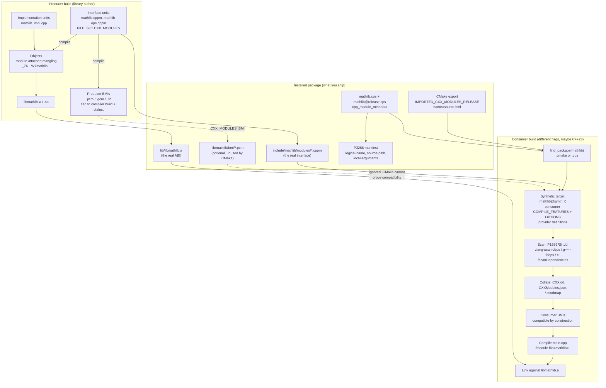

# Distributing C++20 Modules: BMI Portability and Package Metadata

> [!summary] Claim:
> A built module interface (BMI) is a serialized compiler AST, not an ABI artifact: Clang rejects one from a different AST format version, compiler repository revision, or language dialect, GCC calls its CMIs "a rebuildable cache artifact, not a distributable object", and MSVC calls `.ifc` files "a compile-time only artifact".
> A module library is therefore distributed as interface-unit sources plus metadata plus ordinary objects or archives, and every consumer rebuilds the BMIs with its own compiler and flags.
> CMake (3.28 and later) installs `FILE_SET CXX_MODULES` sources and an `IMPORTED_CXX_MODULES_<CONFIG>` map, and its consumers compile those sources in synthetic targets ordered by P1689R5 scan results; CMake ignores any installed BMI.
> The cross-tool metadata is a P3286 module manifest, which the standard libraries already ship (`libc++.modules.json`, `libstdc++.modules.json`) and which a CPS package references through `cpp_module_metadata`.
> The ABI of a module library is its objects and their module-attached mangled names, so renaming a module is an ABI break even when no declaration changes.



## The Mechanism

### Two products from one interface unit

Compiling a module interface unit produces two things with very different lifetimes.
The object file holds code and data with mangled symbol names, and it follows the platform ABI exactly as a header-based object does.
The BMI holds the compiler's own serialized representation of the exported declarations, so that an importer can skip re-parsing the interface.
CMake's glossary defines it as "A compiler-generated binary representation of a C++ module's interface that is required by consumers of the module", and adds "File extensions vary by compiler".
Clang writes `.pcm`, GCC writes `.gcm` (in a `gcm.cache/` directory by default), and MSVC writes `.ifc`.
CMake's manual also uses the name CMI (compiled module interface), which is GCC's term.

The object file is the distributable half.
The BMI is the build-cache half, and every vendor says so in its own documentation (as of 2026-11):
- Clang: "Modules can be viewed as a kind of cache to speed up compilation", "it is important to maintain cache consistency, which is why Clang does very strict checking for consistency", and "BMIs cannot be shipped in an archive to create a module library".
- GCC: "CMI contents are implementation-specific, and in GCC's case tied to the compiler version."
  It adds: "Consider them a rebuildable cache artifact, not a distributable object."
- MSVC: `std.ifc` "is a compile-time only artifact", which "doesn't ship with your application", and the tutorial tells you to "Compile the `std` named module using the same compiler settings that you intend to use with the code that imports the built module."
- CMake: "the compatibility of BMI files is extremely narrow and cannot be shared between arbitrary `import` instances."

### What pins a Clang BMI to one compiler build

A Clang BMI is an AST file in LLVM bitstream format, starting with the magic `CPCH`.
Its control block begins with a `METADATA` record that `ASTWriter.cpp` (llvmorg-23.1.5) writes as `{METADATA, VERSION_MAJOR, VERSION_MINOR, CLANG_VERSION_MAJOR, CLANG_VERSION_MINOR, !isysroot.empty(), isWritingStdCXXNamedModules(), IncludeTimestamps, ASTHasCompilerErrors}` with the blob `getClangFullRepositoryVersion()`.
`llvm-bcanalyzer -dump` on the worked example's `greet.pcm` shows `op0=39 op1=0 op2=23 op3=1 op4=0 op5=1 op6=0 op7=0` and an empty blob, which is AST format 39.0 from Clang 23.1, a standard C++ named module, and a Homebrew build with no repository string.
`ASTReader.cpp` refuses a file from another compiler at two version checks, unless validation is disabled (a third check, `err_ast_file_with_compiler_errors`, rejects a BMI written with errors):
1. `Record[0] != VERSION_MAJOR` gives `err_ast_file_version_too_old` or `err_ast_file_version_too_new`.
2. A blob that differs from the reading compiler's `getClangFullRepositoryVersion()` gives `err_ast_file_different_branch`.
The comment above `VERSION_MAJOR = 39` in `ASTBitCodes.h` says "Version 4 of AST files also requires that the version control branch and revision match exactly, since there is no backward compatibility of AST files at this time."
So for builds that embed repository information the compatibility unit is one source revision, not a release series: two Clang 23.1 builds with different repository strings reject each other's BMIs.
The gate is only as strong as that string, though: `getClangFullRepositoryVersion()` (`clang/lib/Basic/Version.cpp`) returns an empty string when the build recorded no repository path or revision, as Homebrew's does (`clang++ --version` prints only `Homebrew clang version 23.1.6`), so two such builds with the same `VERSION_MAJOR` pass both version checks and only the language-option checks remain (derived from the source; not tested across two Homebrew builds).

After the version gate, the reader compares the language options recorded in the BMI with the importer's.
The Clang manual states the rule as "Compiler options related to the language dialect for a module unit and its non-module-unit uses need to be consistent", accepts `-O3` and `-g` differences, and says Clang "currently doesn't reject inconsistent macro definitions".
The worked example's flag matrix shows exactly where that line falls on Clang 23.1.5.

### What pins a GCC CMI

GCC 16 wraps a CMI in ELF32 "as an architecture-neutral encapsulation mechanism", even on macOS, so the file starts with `\x7fELF`.
GCC calls the container format "Encapsulated Lazy Records of Named Declarations", which is the text of the error it prints when handed a Clang `.pcm`.
A `.gnu.c++.README` section records the compiler, version, module, source, dialect, working directory, repository, and build time, and `llvm-readelf -p .gnu.c++.README gcm.cache/greet.gcm` printed `compiler: 16.2.0` and `dialect: C++20` in the worked example.
The README "do[es] not affect CMI integrity", so the checks live in the binary sections.
On a dialect mismatch GCC 16.2.0 prints `language dialect differs 'C++20', expected 'C++23'` followed by `failed to read compiled module: Bad file data`.
GCC folds `-fno-exceptions` and `-fno-rtti` into the dialect string (`expected 'C++20/no-exceptions'`), but it does not treat `-std=gnu++20` versus `-std=c++20`, `-pthread`, `-ffast-math`, or `-funsigned-char` as a mismatch in the worked example.
GCC also documents that "A set of related CMIs may be copied, provided the relative pathnames are preserved."

### What pins an MSVC IFC

MSVC writes `.ifc` files whose format Microsoft publishes as the IFC specification (`microsoft/ifc-spec`, CC-BY-4.0), which lists "Compiler neutrality" as a design principle.
A published format is not a compatibility promise: the same vendor's tutorial ships `std.ixx` as source under `%VCToolsInstallDir%\modules\` so that "you can compile the module using the compiler settings that match your project".
CMake's Visual Studio generators cannot install or export BMIs at all, and cannot compile BMIs for `IMPORTED` targets (CMake 4.5.0 limitations list).
Microsoft does not publish a list of the options that invalidate an `.ifc`; it states the rule as a blanket requirement, "A module and the code that consumes it must be compiled with the same compiler options" (Microsoft Learn, "Overview of modules in C++").
Plan for MSVC as for the other two compilers: any consumer that differs in dialect, exception model, or runtime flags needs its own build of the interface.
Clang's `clang-cl` mode does not bridge the formats: the Clang manual says the `cl.exe` options to emit or consume IFC files are not supported and that the precompiled modules it produces "are also not compatible for use with cl.exe".

### Cross-vendor and cross-build consumption

No compiler reads another vendor's BMI.
In the worked example, Homebrew Clang 23.1.5 rejected GCC's `greet.gcm` with `is not a valid module file`, and GCC 16.2.0 rejected Clang's `greet.pcm` with `not Encapsulated Lazy Records of Named Declarations`.
Apple clang 21.0.0 (clang-2100.4.1.1, Xcode on macOS 27.3) rejected the interface unit's first line `module;` with `a type specifier is required for all declarations`, so on this host it compiles no named modules at all, and a module library cannot be consumed from the Xcode toolchain (observed, not documented by Apple).
Even within one vendor, a different target triple fails: `precompiled file 'greet.pcm' was compiled for the target 'arm64-apple-macosx27.2.0' but the current translation unit is being compiled for target 'x86_64-apple-macosx13.0.0'`.

### The configuration fingerprint is a superset of the ABI, and also a subset

A BMI is stricter than the ABI in some places and looser in others, and both directions bite.
It is stricter where the ABI does not care: `-std=c++20` and `-std=c++23` objects link together fine, yet Clang refuses the C++20 BMI in a C++23 importer.
It is looser where ODR does care: Clang and GCC both accept a BMI built without `-DNDEBUG` in an importer built with it, and accept a libc++ hardening-mode or `_GLIBCXX_ASSERTIONS` mismatch, so inline functions in the interface can be instantiated under one configuration and the library under another.
That is the classic header ODR hazard, and modules do not remove it; P2577R2 argues that metadata coupled to the library artifact is what lets a build system parse interfaces "to match the build of the library artifact being used".
[[Diamond-Dependency-and-Incompatible-ABI-Mitigation]] owns the general ODR-conflict playbook.

### Strong module ownership: where the ABI actually lives

All three implementations attach declarations in a module purview to the module, and CMake's glossary calls this "strong module ownership": "the module name is included into the symbol mangling of entities declared within it."
In the worked example, `greet::hello(const std::string&)` declared in `export module greet;` is emitted as `__ZN5greetW5greet5helloERKNSt3__112basic_stringIcNS1_11char_traitsIcEENS1_9allocatorIcEEEE`, which `llvm-cxxfilt` prints as `greet::hello@greet(...)`; the `W5greet` component is the module name.
Every importable module unit also emits an initializer, here `__ZGIW5greet` ("initializer for module greet"), and the Clang manual says "The importable module unit has to emit the initializer even if there is no dynamic initialization; otherwise, the importer may call a nonexistent function."
Consequences for a published library:
1. Renaming a module, or moving a declaration from module `a` to module `b`, changes mangled names and breaks every existing binary that links against the old ones.
2. Declarations inside `extern "C++"` keep their global-module mangling, which is the tool for a module that must stay link-compatible with an older header-based release.
3. Inline functions and templates in the interface are still instantiated in the consumer, so the usual ABI rules from [[Cpp-ABI-Stability-Symbol-Visibility-and-SONAME]] and [[Versioning-SemVer-CalVer-and-ABI]] apply unchanged.

### Adding modules to an existing header library without breaking its ABI

Because module names enter mangled names, the way a header library grows a module interface decides whether existing binaries keep working.
The Clang manual ("Transitioning to modules") names three styles, and its own caution is that an entity cannot be declared in a module unit and defined in a non-module unit, or the reverse, without link errors.
1. Export-using style: include the headers in the global module fragment, then `export namespace ns { using decl_1; ... }` in the module purview.
   The manual lists it first among the "ABI non-breaking styles"; it relies on the declarations still being the global-module ones that the headers declared, and the manual does not spell out the mangling beyond that.
2. Export `extern "C++"` style: define `IN_MODULE_INTERFACE`, wrap the header includes in `extern "C++" { ... }` inside the purview, and put an `EXPORT` macro on the declarations to export.
   The manual explains that "declarations with language linkage are attached to the global module", so "the ABI of the modular form of the library does not change", and it is the easier base for later refactoring.
3. ABI-breaking style: put the declarations in the module proper, so they get module-attached names.
   The manual argues this is deliberate, because it "forces consumers of the library use it in a consistent way", either always include the headers or always import the module, and it recommends shipping a separate `libyour_library_modules.so` when the header-built library must keep its old symbols.
   For the module build, source files become module implementation units, or go into a private module fragment when there are few of them, and the manual warns that compile time suffers with many sources in a private fragment.
Decision rule: choose style 1 or 2 when the same shared library must serve header and module consumers, and style 3 only when the library can be built twice, with a header ABI and a module ABI that never meet in one process.
Mixing the two costs compile time: "many redeclarations shared between translation units cause Clang to have slower compile-time performance" and larger BMIs, so the manual recommends not including headers after importing the corresponding module.
A library that offers both interfaces can ship a small guard header (the manual's `your_library_imported.h`, a set of controlling macros) that makes its own headers skip their contents after `import your_library;`.

### Reduced BMIs and what a BMI contains

Clang's Reduced BMI omits unreachable global-module entities and the bodies of non-inline functions and variables, and the manual says "As of Clang 22.x, the Reduced BMI is enabled by default", with `-fno-modules-reduced-bmi` to opt out and a warning that "This may not be a transparent change".
In the worked example the one-phase build (`-c greet.cppm -fmodule-output=...`) on Clang 23.1.5 wrote a 4,233,260-byte reduced BMI and a 5,066,052-byte full one; on Clang 23.1.6 the same commands wrote 4,231,100 and 5,063,892 bytes, so sizes move with the compiler build and install path.
Nearly all of both is the `<string>` global module fragment.
`--precompile -o` wrote the full BMI (5,066,052 bytes on 23.1.5, 5,063,892 on 23.1.6) with or without the flag, matching the manual's description that `--precompile` writes the full BMI to `-o`.
The BMI also records absolute input paths, including `/opt/homebrew/Cellar/llvm/23.1.5_1/bin/../include/c++/v1/string`, and the manual says "all the input files need to be present in the original path and with the original contents" unless `-fmodules-embed-all-files` is used.
A BMI built on one machine therefore names that machine's toolchain installation, which is another reason not to ship it.
In the worked example, deleting or editing `greet.cppm` after building `greet.pcm` produced no diagnostic when importing; the manual says Clang "may" open input files, so this is not a guarantee in either direction.

### How each compiler is told where the BMIs are

A build system hands BMI locations to the compiler by command line, never by convention alone, and the three vendors differ (as of 2026-11).
- Clang has three ways to name a BMI dependency (Clang manual, "Specifying BMI dependencies"): `-fprebuilt-module-path=<dir>`, `-fmodule-file=<path>` (marked deprecated), and `-fmodule-file=<name>=<path>`.
  With the directory form, importing `M` looks for `M.pcm` and importing the partition `M:P` looks for `M-P.pcm` in each directory.
  The path form loads the BMI eagerly and "is not suggested unless you know what you're doing"; the name form and the directory form load lazily.
  When several are given, the path form wins over the name form, which wins over the directory form.
  All BMI dependencies must be specified explicitly, directly or indirectly (the manual cites llvm-project issue 62707), and a module implementation unit needs the BMI of its primary interface because it implicitly imports it.
  CMake's modmaps use the name form, which is why the worked example's modmap lines read `-fmodule-file="mathlib:ops=..."`.
- GCC asks a module mapper, "a server or file that the compiler queries to determine the mapping between module names and CMI files", selected with `-fmodule-mapper=` or the `CXX_MODULE_MAPPER` environment variable.
  A mapper can be a TCP port, a local socket, a spawned program on stdin and stdout, named pipes, or a plain file of `module-name filename` pairs.
  The GCC manual calls mapper functionality "in its infancy" and "intended for experimentation with build system interactions", and the protocol is the one in P1184, implemented by libcody.
  With no mapper, the default one reads and writes `gcm.cache/<module>.gcm`, with header units under a relative path and a `,` directory prepended to relative header paths.
- MSVC finds `<module>.ifc` next to the importing source by default and takes other locations from the `/reference` switch (Microsoft Learn, import-std tutorial); `/ifcOutput` names the file a compile writes.

The distribution consequence is that "install the BMIs in `lib/` and add one search path" is a Clang-only recipe, and that a package which ships a GCC mapper file or a Clang modmap has encoded one toolchain's view of the layout.
CMake generates these per consumer build, which is the portable answer.
Clang 19 and later also try not to propagate changes in non-direct dependencies into a BMI unless they affect its results (the manual calls this "Experimental Non-Cascading Changes" and aims it at build-system authors), which matters for how often per-consumer BMI rebuilds cascade.

### Dependency scanning and P1689R5

Modules make compilation ordering a function of file contents: an importer cannot compile until the BMI of each module it imports exists.
P1689R5 (Boeckel and King, Kitware, 2022-06-03) defines a JSON format for a scanner to report, per compilation rule, which modules it provides and requires.
The top level has `version` (1 for R5), `revision` (0), and `rules`; each rule has `primary-output`, optional `outputs`, and `provides` and `requires` arrays of module descriptions.
A description has `logical-name`, optional `source-path` and `compiled-module-path`, `unique-on-source-path` (true for header units, keyed by path), `is-interface` on provides (default true), and `lookup-method` on requires (`by-name`, `include-angle`, `include-quote`).
The paper assumes the file is "only used within one build of a project" and "does not apply to different configurations of a build" (section 5), and R4 removed the `inputs`, `outputs`, and `depends` keys that had been meant to replace depfiles, so header dependencies still travel in ordinary depfiles.

Only the compiler can scan correctly, because an `import` can sit behind `#if __has_builtin(...)` or a macro from the command line; CMake's manual gives exactly this reason for making the compiler implement the scan.
The three producers (as of 2026-11):
- Clang: `clang-scan-deps -format=p1689 -- <compile command>`, which CMake invoked in the worked example; its output carries `"version": 1`.
- GCC: `-E -fdeps-format=p1689r5 -fdeps-file=<file> -fdeps-target=<obj>`, which fails with `to generate dependencies you must specify either '-M' or '-MM'` unless a dependency option such as `-MD` is also given; GCC 16.2.0 wrote `"version": 0` in the worked example, which differs from P1689R5's `"version": 1`.
- MSVC: `/scanDependencies <file|dir|->`, available since Visual Studio 2022 17.2, which lists only direct imports and scans without compiling.

### CMake's model: scan, collate, compile

CMake 3.28 added C++20 named module support for the Ninja generators and Visual Studio 2022 (MSVC 14.34, Clang 16, and GCC 14 "after the 2023-09-20 daily bump"), CMake 4.4 added `clang-cl` 19.1 and newer except with the Visual Studio generators' ClangCl toolset, and the 4.5.0 manual also lists the Visual Studio 18 2026 generator; Ninja must be 1.11 or newer.
A module-providing source must be in a `FILE_SET` of type `CXX_MODULES`, which "may not have an `INTERFACE` scope except on `IMPORTED` targets".
Policy CMP0155 (3.28) makes every C++20-or-newer source a scanning candidate when the toolchain supports it; `set(CMAKE_CXX_SCAN_FOR_MODULES 0)` near the top of a non-module project turns it off, and the manual warns not to put it in the cache because it leaks into `FetchContent` dependencies.
Scanned sources are excluded from unity builds.

The build graph is static, and dynamic edges come from Ninja `dyndep` files:
1. Scan: each source gets a `.ddi` file in P1689R5 format.
2. Collate: `cmake -E cmake_ninja_dyndep` reads `CXXDependInfo.json`, the target's `.ddi` files, and dependent targets' `CXXModules.json`, and writes `CXX.dd`, `CXXModules.json`, one `*.modmap` per compilation, the `install-cxx-module-bmi-$<CONFIG>.cmake` scripts, and the `target-*-$<CONFIG>.cmake` export fragments.
3. Compile: each compiler gets its modmap, which for Clang is a list of `-fmodule-file=<name>=<path>` lines.
The collator enforces that all importers agree on one BMI per module name and that `PRIVATE` modules are not imported by other targets or by `PUBLIC` interface units.
That visibility rule decides installation: "a `PRIVATE` module interface unit will not be installed", so a public interface that imports a private module produces an installed package that cannot compile.

### Installing and exporting modules with CMake

Three `install()` arguments carry a module library:
- `install(TARGETS ... FILE_SET CXX_MODULES DESTINATION <dir>)` installs the interface-unit sources, preserving paths under the file set's `BASE_DIRS`.
- `CXX_MODULES_BMI DESTINATION <dir>` (3.28) installs the BMIs of `PUBLIC` module sources flat into one directory, "as no directory structure is derived from the names of the modules"; an empty destination suppresses them.
- `install(EXPORT ... CXX_MODULES_DIRECTORY <dir>)` (3.28) writes the property files, and "without this information, none of the C++ modules which are part of the targets in the export set will support being imported in consuming targets."
The exported target carries `IMPORTED_CXX_MODULES_COMPILE_DEFINITIONS`, `..._COMPILE_FEATURES`, `..._COMPILE_OPTIONS`, `..._INCLUDE_DIRECTORIES`, `..._LINK_LIBRARIES`, and the per-configuration `IMPORTED_CXX_MODULES_<CONFIG>`, whose items have the form `<NAME>=<INTERFACE>[,<BMI>]*`.
The property documentation adds: "CMake currently does not use the `<BMI>` files as there is limited support for determining whether an existing `<BMI>` file is suitable for a given importer of the module it represents."
The BMI install scripts are generated at build time and included with `OPTIONAL`, so an incomplete build can produce an incomplete installation without an error.
CMake 4.5 also lets `install_prep/<component>` targets build the BMIs and module metadata a component installs.

When a consumer links an imported module target, CMake creates a synthetic target that compiles the installed interface units into BMIs for that consumer.
Its `COMPILE_FEATURES` and `COMPILE_OPTIONS` come from the consumer, and "all other relevant properties are inherited from the provider".
Before CMake 4.4 there was one set of BMIs per providing target, which "could cause build failures due to incompatible BMI usage"; since 4.4 CMake determines compatibility per consumer and creates as many synthetic targets as needed.
The 4.5.0 manual lists one limitation for all generators, that header units are unsupported, and separately, "as a design choice", `IMPORTED_CXX_MODULES_<CONFIG>` is always configuration-specific, which causes friction with configuration-unaware build systems.

### Package metadata beyond CMake: P2577, P3286, and CPS

The CMake export works only for CMake consumers, so SG15 worked on build-system-neutral metadata.
P2577R2 (Ruoso, 2022-05-17) proposes discovering module metadata from linker inputs, because "linker arguments" are the one thing every packaging system already communicates.
Its GNU/Linux illustration replaces a library's `.a` or `.so` extension with `.meta-ixx-info`, so `-lfoo` resolving to `/opt/foobar/lib64/libfoo.a` leads to `/opt/foobar/lib64/libfoo.meta-ixx-info`, and a missing file is not an error.
It recommends that "importable-unit-only module libraries" still ship a library artifact, "even if empty", so the link line stays the discovery point, and it states that consuming module libraries "will not be practical, beyond illustrative cases" without package management.

P3286R0 (Ruoso, 2024-06-15) specifies the file format, which libc++ already used for `std`:
- Top level: `version` (required), `revision` (default 0), and `modules`.
- Per module: `logical-name` and `source-path` (required), `is-interface` (default true; false for an internal partition), `is-std-library` (default false; permits reserved names), `local-arguments`, and `vendor`.
- `local-arguments` holds `include-directories` (`-I` semantics), `system-include-directories` (`-isystem` semantics), and `definitions`, each with `name`, optional `value`, and `undef`.
- Relative paths resolve against the path given by the toolchain or package manager, "used as-is, without any additional symbolic link resolution".
The standard library manifests on the worked-example host follow it exactly (as of 2026-11):
- Homebrew LLVM 23.1.5: `/opt/homebrew/opt/llvm/lib/c++/libc++.modules.json`, with `std` at `../../share/libc++/v1/std.cppm` and `system-include-directories: ["../../share/libc++/v1"]`.
- Homebrew GCC 16.2.0: `libstdc++.modules.json` from `g++-16 -print-file-name=libstdc++.modules.json`, with `std` at `../../../include/c++/16/bits/std.cc` and `std.compat` at `bits/std.compat.cc`.

Finding the manifest is itself fragile.
Clang's `Driver::GetStdModuleManifestPath` (llvmorg-23.1.5) returns `<NOT PRESENT>` under `-nostdlib`; otherwise, for libc++, it resolves `libc++.so` and then `libc++.a` through the toolchain's `GetFilePath` and looks for `libc++.modules.json` in that directory, and it does the same with `libstdc++.so` for libstdc++.
On macOS there is no `libc++.so` (the shared library is `libc++.dylib`), and Homebrew installs both `libc++.dylib` and `libc++.a` in `lib/c++/`, outside the driver's file search paths (`-print-search-dirs` lists only `lib/clang/23`), so `clang++ -print-library-module-manifest-path` prints `<NOT PRESENT>` even with `-L/opt/homebrew/opt/llvm/lib/c++`, because `GetFilePath` does not consult `-L`.
CMake 4.5.0 then fails `import std` with `CMake Error: Could not find 'libc++.modules.json' resource`, and the new `CMAKE_CXX_STDLIB_MODULES_JSON` variable (4.5) exists for exactly this case.

The Common Package Specification (CPS v0.15.0) reaches the same file through the component attribute `cpp_module_metadata`, "the path to a C++ module metadata file (also known as a "P3286" file)".
CPS's component `type: "module"` is a run-time `dlopen` plugin, not a C++ module, so a module library is an `archive`, `dylib`, or `interface` component with `cpp_module_metadata`.
CMake 4.3 added CPS import through `find_package` and export through `install(PACKAGE_INFO)` and `export(PACKAGE_INFO)`, and `install(PACKAGE_INFO)` accepts `CXX_MODULES_DIRECTORY`.
In the worked example CMake 4.5.0 wrote `"cpp_module_metadata"` into the configuration file `mathlib@release.cps`, put the library's `MATHLIB_FAST=1` into the component's `definitions` under `"*"` rather than into the P3286 `local-arguments`, and a consumer with no CMake config files found and built against the package from the `.cps` alone.
[[Cpp-CMake-Package-Configs-pkg-config-and-CPS]] owns CPS and config-file packages in general.

### `import std`: the reference distribution

The standard library is the first module library every toolchain ships, and all three ship it the same way: sources plus a manifest, never a BMI.
MSVC ships `std.ixx` and `std.compat.ixx` since Visual Studio 2022 17.5, libc++ ships `std.cppm` and `std.compat.cppm` (Clang 18.1.2 or later for installed modules, still documented as "an experimental feature"), and libstdc++ ships `bits/std.cc`.
CMake tracked this in stages:
1. CMake 3.30 added the `CXX_MODULE_STD` property behind the `CMAKE_EXPERIMENTAL_CXX_IMPORT_STD` gate (UUID `0e5b6991-d74f-4b3d-a41c-cf096e0b2508` in v3.30.0), for targets using C++23 or newer.
2. CMake 4.4.0 still documented the gate, with UUID `f35a9ac6-8463-4d38-8eec-5d6008153e7d`.
3. CMake 4.5.0 removed the property documentation (`prop_tgt/CXX_MODULE_STD.html` exists in the 4.4 docs and not in 4.5) and, per its release notes, made "`import std` ... now available for all C++ 20 and later code with `CXX_SCAN_FOR_MODULES` enabled", limited to Clang 18.1.2+ with libc++ or libstdc++, MSVC 14.36+, GCC 15+ (GCC 16+ on macOS), and Ninja generators only.
The manual also notes that "Ubuntu prior to 26.04 ships broken `libstdc++.modules.json` files" (Launchpad bug 2141579).

### Architectural rules for publishing a portable module library

1. Ship interface units as source, with a P3286 manifest and a CMake export or CPS file; treat installed BMIs as optional and expect consumers to ignore them.
2. Ship code in objects, archives, or shared libraries, because they carry the ABI; an "interface-only" module library should still provide an empty archive so link-line discovery works (P2577R2).
3. Make every interface unit compilable by a stranger: everything it needs comes from its global module fragment, its imports, or metadata-declared definitions and include directories.
4. Give each implementation unit its own global module fragment includes; in the worked example, `module greet;` without `#include <string>` failed with `missing '#include <__fwd/string.h>'; 'string' must be declared before it is used` on Clang 23.1.5.
5. Do not import a `PRIVATE` module from a `PUBLIC` interface unit, and avoid the MSVC-only `module M:part;` implementation-partition extension, which CMake rejects on other compilers.
6. Put configuration that changes the interface (feature macros, `extern "C++"` linkage choices) into exported metadata, never into instructions in a README.
7. Freeze module names as part of the ABI, because they are in every mangled symbol.
8. Keep a header interface in parallel during the transition if any consumer uses a compiler that cannot import modules, such as Apple clang 21 on the worked-example host.

## Commands and Numbers to Know

| Item | Value | Platform | Notes |
|---|---|---|---|
| BMI file names | Clang `.pcm`, GCC `.gcm` in `gcm.cache/`, MSVC `.ifc` (as of 2026-11) | Both | MSVC is Windows only; CMake names its own BMIs `<hash>.bmi` in synthetic targets. |
| Clang AST format | `VERSION_MAJOR = 39`, `VERSION_MINOR = 0` in Clang 23.1.5 (as of 2026-11) | Both | Plus an exact repository-version string match. |
| Clang magic | `CPCH` (as of 2026-11) | Both | `head -c 4 x.pcm`. |
| GCC CMI container | ELF32 with `.gnu.c++.README` (as of 2026-11) | Both | `llvm-readelf -p .gnu.c++.README gcm.cache/m.gcm`. |
| Reduced BMI default | Clang 22 and later (as of 2026-11) | Both | `-fno-modules-reduced-bmi` opts out; 4,233,260 vs 5,066,052 bytes on Clang 23.1.5 and 4,231,100 vs 5,063,892 on 23.1.6 in the worked example. |
| `clang++ -std=c++20 --precompile m.cppm -o m.pcm` | two-phase BMI build (as of 2026-11) | Both | Then `clang++ -c m.pcm -o m.o`. |
| `clang++ -c m.cppm -fmodule-output=m.pcm` | one-phase BMI plus object (as of 2026-11) | Both | What CMake uses for Clang. |
| `-fmodule-file=<name>=<path>` | lazy lookup of one module (as of 2026-11) | Both | Wins over `-fprebuilt-module-path`. |
| `-fprebuilt-module-path=<dir>` | Clang looks for `M.pcm` and `M-P.pcm` lazily; weakest of the three Clang forms (as of 2026-11) | Both | `-fmodule-file=<path>` is deprecated and eager. |
| `-fmodule-mapper=<spec>` or `CXX_MODULE_MAPPER` | GCC module-name to CMI mapper; default writes `gcm.cache/` (as of 2026-11) | Both | Documented as "in its infancy". |
| `g++ -fmodules` | required for modules in GCC; `-std=c++20` alone is not enough (as of 2026-11) | Both | GCC documents its support as "not complete". |
| `clang-scan-deps -format=p1689 -- <cmd>` | P1689 scan, `"version": 1` (as of 2026-11) | Both | Clang 23.1.5. |
| `g++ -E -MD -fdeps-format=p1689r5 -fdeps-file=f -fdeps-target=o` | P1689 scan, `"version": 0` (as of 2026-11) | Both | GCC 16.2.0; needs `-M`/`-MD`. |
| `cl /scanDependencies <dir>` | P1689 scan since VS 2022 17.2 (as of 2026-11) | Windows | Not covered by the Linux and macOS platform labels. |
| P1689R5 `version` | 1, `revision` 0 (as of 2026-11) | Both | P3286 manifests reuse the model. |
| CMake module support | 3.28; MSVC 14.34+, Clang 16+, GCC 14+; Ninja 1.11+ (as of 2026-11) | Both | `clang-cl` 19.1+ since 4.4. |
| `CXX_MODULES_BMI DESTINATION` | installs BMIs flat; empty suppresses (as of 2026-11) | Both | CMake 3.28. |
| `install(EXPORT ... CXX_MODULES_DIRECTORY d)` | writes `cxx-modules-<export>*.cmake`, `target-<t>-<CONFIG>.cmake` (as of 2026-11) | Both | Without it, importers cannot use the modules. |
| `IMPORTED_CXX_MODULES_<CONFIG>` | `<NAME>=<INTERFACE>[,<BMI>]*`; BMIs unused (as of 2026-11) | Both | Configuration-specific by design. |
| Per-consumer synthetic BMI targets | CMake 4.4 and later (as of 2026-11) | Both | Earlier: one BMI set per provider. |
| `CMAKE_CXX_SCAN_FOR_MODULES 0` | disables scanning for non-module C++20 projects (as of 2026-11) | Both | Not in the cache. |
| `import std` in CMake | general for C++20+ with scanning in 4.5; experimental gate 3.30 to 4.4 (as of 2026-11) | Both | Ninja generators only. |
| `CMAKE_CXX_STDLIB_MODULES_JSON` | manual path to `libc++.modules.json` or `libstdc++.modules.json` (as of 2026-11) | Both | CMake 4.5; needed with Homebrew LLVM on macOS. |
| `clang++ -print-library-module-manifest-path` | path or `<NOT PRESENT>` (as of 2026-11) | Both | `<NOT PRESENT>` for Homebrew LLVM 23.1.5 on macOS 27.3. |
| `g++ -print-file-name=libstdc++.modules.json` | manifest path (as of 2026-11) | Both | Homebrew GCC 16.2.0. |
| CPS module attribute | `cpp_module_metadata` (CPS 0.15.0, as of 2026-11) | Both | CPS `type: "module"` means a dlopen plugin. |
| CPS in CMake | `find_package` import and `install(PACKAGE_INFO)` export since 4.3 (as of 2026-11) | Both | Searches `.cps` only in paths containing `/cps/`. |

## Multi-Language Comparison: Compiled Interface Metadata and What Ships

| Concern | C++20 modules | Rust crates | Python packages |
|---|---|---|---|
| Compiled interface artifact | BMI (`.pcm`, `.gcm`, `.ifc`) | crate metadata in `.rlib` and `.rmeta` | `.pyc` bytecode in `__pycache__/` |
| Tied to | exact compiler build plus dialect flags (Clang), compiler version (GCC) | exact `rustc` build: error E0514, "Dependency compiled with different version of `rustc`" | interpreter version via magic number and cache tag (`cpython-315`, magic 3666 on CPython 3.15.2) |
| What the registry ships | interface sources, objects or archives, and metadata | source crates on crates.io | sdists and wheels with `.py` sources; `.pyc` is regenerated per interpreter |
| Who rebuilds the interface | every consumer build, in CMake synthetic targets | Cargo, per consumer, from source | the interpreter, lazily on import |
| Dependency ordering | P1689R5 scan before compile | Cargo resolves the crate graph from manifests | import at run time |
| Package metadata | CMake export, CPS `cpp_module_metadata`, P3286 manifest | `Cargo.toml`, `Cargo.lock` | `METADATA`, `pyproject.toml` |
| ABI carrier | objects with module-attached mangling | no stable Rust ABI; `extern "C"` for FFI | CPython C API or `abi3` |
| Owning note | this note | [[Rust-Cargo-Model-Packages-Targets-Features-and-Workspaces]] | [[Python-Wheels-Platform-Tags-Manylinux-and-ABI3]] |

The pattern is the same in all three ecosystems: the compiled interface is a private cache of one toolchain build, so the source of the interface is what gets distributed.
C++ is the only one of the three whose package managers historically shipped prebuilt binaries for consumers' compilers, which is why modules collide with [[Cpp-Conan-2-Architecture-and-Binary-Model]] and [[Cpp-vcpkg-Manifests-Registries-and-Binary-Caching]] binary caches.

## Worked Example

This note has no lab in `code/`.
The commands below were run once on the job host on 2026-11-15: macOS 27.3 arm64 (SDK 27.2), Homebrew LLVM 23.1.5 (`/opt/homebrew/opt/llvm/bin/clang++`), Homebrew GCC 16.2.0 (`g++-16`), Apple clang 21.0.0, CMake 4.5.0, and Ninja 1.13.2.
Outputs are copied from the terminal with the working directory scrubbed to `<wx>` or `<prefix>`; they are a record of one run, not a golden file.
A verification pass on 2026-11-22 with Homebrew Clang 23.1.6 and GCC 16.2.0 on the same host reproduced the `CPCH` and `\x7fELF` magics, the `-std=c++23`, `-funsigned-char`, and `-fno-rtti` rows of the Part 1 table, GCC acceptance of `-funsigned-char`, GCC's `not Encapsulated Lazy Records of Named Declarations` and `-M`/`-MM` errors, P1689 `"version"` 0 from GCC and 1 from `clang-scan-deps`, both standard-library manifests, and `<NOT PRESENT>`.
A second pass on 2026-11-22 (Homebrew Clang 23.1.6, CMake 4.5.1, Ninja 1.13.2, same host) also reproduced the Part 1 `-ffast-math`, `-march=native`, `-fno-char8_t`, and target rows, the Apple clang `module;` error, the `llvm-bcanalyzer` METADATA record, the Part 2 install tree, CPS files, P3286 manifest, synthetic-target build, modmap, installed-BMI rejection, CPS-only consumption, and the Part 3 `import std` failure and fix; only the BMI byte sizes differed, and both measurements are given where they appear.

### Part 1: one interface unit, two compilers, many flags

```cpp
// greet.cppm
module;
#include <string>
export module greet;
export namespace greet {
  std::string hello(const std::string& who);
  inline int answer() { return 42; }
}

// greet_impl.cpp
module;
#include <string>
module greet;
std::string greet::hello(const std::string& who) { return "hello, " + who; }

// main.cpp
#include <cstdio>
import greet;
int main() { std::printf("%s %d\n", greet::hello("modules").c_str(), greet::answer()); }
```

The BMI was built once with `clang++ -std=c++20 --precompile greet.cppm -o greet.pcm`, and `main.cpp` was then compiled against it with each consumer flag set, keeping the first diagnostic.
GCC's CMI was built with `g++-16 -std=c++20 -fmodules -x c++ -c greet.cppm` and probed the same way.

| Consumer flags (producer: `-std=c++20`) | Clang 23.1.5 | GCC 16.2.0 |
|---|---|---|
| `-O2`, `-g` | accepted | accepted (`-O2`) |
| `-std=c++23` | `C++23 was disabled in precompiled file 'greet.pcm' but is currently enabled` | `language dialect differs 'C++20', expected 'C++23'` |
| `-std=gnu++20` | `GNU extensions was disabled in precompiled file ...` | accepted |
| `-fno-exceptions` | `exception handling was enabled in precompiled file ... but is currently disabled` | `language dialect differs 'C++20', expected 'C++20/no-exceptions'` |
| `-fno-rtti` | `run-time type information was enabled ...` | `expected 'C++20/no-rtti'` |
| `-pthread` | `POSIX thread support was disabled ...` | accepted |
| `-ffast-math` | `Enable use of range reduction for complex arithmetics. differs in precompiled file` | accepted |
| `-funsigned-char` | `signed char was enabled ... but is currently disabled` | accepted |
| `-fno-char8_t` | `char8_t keyword was enabled ...` | not run |
| `-march=native` | `compiled with the target feature '+altnzcv' but the current translation unit is not` | not run |
| `-target x86_64-apple-macos13` | `compiled for the target 'arm64-apple-macosx27.2.0' ...` | not run |
| `-DNDEBUG`, libc++ hardening macro, `_GLIBCXX_ASSERTIONS` | accepted | accepted |
| `-fPIC`, `-fsanitize=address`, coverage flags | accepted | accepted (`-fsanitize=address`) |

Three lessons come out of the table.
The two compilers draw the compatibility line in different places, so no BMI policy can be written once for both.
Neither compiler protects you from macro-level ODR mismatches.
Clang's `-march=native` failure means a BMI built on one CPU can be rejected on another machine of the same architecture.

### Part 2: install a module library with CMake, consume it with different flags

The library has a primary interface `mathlib`, an exported partition `mathlib:ops`, an implementation unit, a `PUBLIC` definition `MATHLIB_FAST=1`, and `cxx_std_20`:

```cmake
cmake_minimum_required(VERSION 4.5)
project(mathlib VERSION 1.2.0 LANGUAGES CXX)
add_library(mathlib)
target_compile_features(mathlib PUBLIC cxx_std_20)
target_compile_definitions(mathlib PUBLIC MATHLIB_FAST=1)
target_sources(mathlib
  PUBLIC FILE_SET CXX_MODULES BASE_DIRS src FILES src/mathlib.cppm src/mathlib-ops.cppm
  PRIVATE src/mathlib_impl.cpp)
include(GNUInstallDirs)
install(TARGETS mathlib EXPORT mathlibTargets
  ARCHIVE
  FILE_SET CXX_MODULES DESTINATION ${CMAKE_INSTALL_INCLUDEDIR}/mathlib/modules
  CXX_MODULES_BMI DESTINATION ${CMAKE_INSTALL_LIBDIR}/mathlib/bmi)
install(EXPORT mathlibTargets NAMESPACE mathlib::
  DESTINATION ${CMAKE_INSTALL_LIBDIR}/cmake/mathlib
  FILE mathlib-config.cmake
  CXX_MODULES_DIRECTORY cxx-modules)
install(PACKAGE_INFO mathlib EXPORT mathlibTargets VERSION 1.2.0
  CXX_MODULES_DIRECTORY cxx-modules)
```

`cmake --install build` (Release, Clang 23.1.5, which compiled the library with `-O3 -DNDEBUG -std=gnu++20`) installed this tree, with prefixes shortened:

```text
-- Installing: <prefix>/lib/libmathlib.a
-- Installing: <prefix>/include/mathlib/modules/mathlib.cppm
-- Installing: <prefix>/include/mathlib/modules/mathlib-ops.cppm
-- Installing: <prefix>/lib/mathlib/bmi/mathlib.pcm
-- Installing: <prefix>/lib/mathlib/bmi/mathlib-ops.pcm
-- Installing: <prefix>/lib/cmake/mathlib/mathlib-config.cmake
-- Installing: <prefix>/lib/cmake/mathlib/mathlib-config-release.cmake
-- Installing: <prefix>/lib/cmake/mathlib/cxx-modules/cxx-modules-mathlibTargets.cmake
-- Installing: <prefix>/lib/cmake/mathlib/cxx-modules/cxx-modules-mathlibTargets-Release.cmake
-- Installing: <prefix>/lib/cmake/mathlib/cxx-modules/target-mathlib-Release.cmake
-- Installing: <prefix>/lib/cps/mathlib/mathlib.cps
-- Installing: <prefix>/lib/cps/mathlib/mathlib@release.cps
-- Installing: <prefix>/lib/cps/mathlib/cxx-modules/target-mathlib-Release.modules.json
```

The CMake export records the module map and the module-specific usage requirements:

```cmake
# target-mathlib-Release.cmake
set_property(TARGET "mathlib::mathlib"
  PROPERTY IMPORTED_CXX_MODULES_RELEASE
    "mathlib=${_IMPORT_PREFIX}/include/mathlib/modules/mathlib.cppm,${_IMPORT_PREFIX}/lib/mathlib/bmi/mathlib.pcm"
    "mathlib:ops=${_IMPORT_PREFIX}/include/mathlib/modules/mathlib-ops.cppm,${_IMPORT_PREFIX}/lib/mathlib/bmi/mathlib-ops.pcm"
)
# mathlib-config.cmake, excerpt
  IMPORTED_CXX_MODULES_COMPILE_DEFINITIONS "MATHLIB_FAST=1"
  IMPORTED_CXX_MODULES_COMPILE_FEATURES "cxx_std_20"
  IMPORTED_CXX_MODULES_LINK_LIBRARIES ""
```

The CPS configuration file points at a P3286 manifest that CMake generated:

```json
{
  "components" : {
    "mathlib" : {
      "cpp_module_metadata" : "@prefix@/lib/cps/mathlib/cxx-modules/target-mathlib-Release.modules.json",
      "link_languages" : [ "cpp" ],
      "location" : "@prefix@/lib/libmathlib.a"
    }
  },
  "configuration" : "Release",
  "name" : "mathlib"
}
```

```json
{
  "modules" : [
    { "is-interface" : true, "is-std-library" : false, "logical-name" : "mathlib",
      "source-path" : "../../../../include/mathlib/modules/mathlib.cppm" },
    { "is-interface" : true, "is-std-library" : false, "logical-name" : "mathlib:ops",
      "source-path" : "../../../../include/mathlib/modules/mathlib-ops.cppm" }
  ],
  "revision" : 1,
  "version" : 1
}
```

The consumer uses `cxx_std_23`, so CMake's default extensions make it `-std=gnu++23`:

```cmake
find_package(mathlib REQUIRED)
add_executable(app main.cpp)
target_compile_features(app PRIVATE cxx_std_23)
target_link_libraries(app PRIVATE mathlib::mathlib)
```

`cmake --build build -v` scanned, collated, and compiled the installed interface units into new BMIs inside a synthetic target, using the consumer's dialect and the provider's definition (lines truncated):

```text
[1/7] ".../clang-scan-deps" -format=p1689 -- .../clang++ -DMATHLIB_FAST=1  -O3 -DNDEBUG -std=gnu++23 -arch arm64 -x c++ -c -o CMakeFiles/mathlib__mathlib@synth_0.dir/bb016db19c0a.bmi ...
[3/7] /opt/homebrew/bin/cmake -E cmake_ninja_dyndep --tdi=CMakeFiles/mathlib__mathlib@synth_0.dir/CXXDependInfo.json --lang=CXX --modmapfmt=clang ...
[6/9] .../clang++ -DMATHLIB_FAST=1  -O3 -DNDEBUG -std=gnu++23 -arch arm64 ... -o 'CMakeFiles/mathlib__mathlib@synth_0.dir/bb016db19c0a.bmi' --precompile <wx>/prefix/include/mathlib/modul...
[8/9] .../clang++ -DMATHLIB_FAST=1  -O3 -DNDEBUG -std=gnu++23 -arch arm64 ... @CMakeFiles/app.dir/main.cpp.o.modmap -o CMakeFiles/app.dir/main.cpp.o -c <wx>/consumer/main.cpp
[9/9] : && .../clang++ -O3 -DNDEBUG -arch arm64 ... CMakeFiles/app.dir/main.cpp.o -o app  <wx>/prefix/lib/libmathlib.a && :
scaled(4)=48 square(5)=25 fast=1
```

The consumer's modmap names only the synthetic BMIs, never the installed `.pcm` files:

```text
-fmodule-file="mathlib=CMakeFiles/mathlib__mathlib@synth_0.dir/5078534f40b6.bmi"
-fmodule-file="mathlib:ops=CMakeFiles/mathlib__mathlib@synth_0.dir/bb016db19c0a.bmi"
```

The scan of `main.cpp` is a P1689R5 rule that requires one module:

```json
{
  "revision": 0,
  "rules": [
    { "primary-output": "CMakeFiles/app.dir/main.cpp.o",
      "requires": [ { "logical-name": "mathlib" } ] }
  ],
  "version": 1
}
```

Using the installed BMI directly shows why CMake does not:

```text
$ clang++ -std=gnu++23 -DMATHLIB_FAST=1 -fmodule-file=mathlib=<prefix>/lib/mathlib/bmi/mathlib.pcm \
    -fmodule-file=mathlib:ops=<prefix>/lib/mathlib/bmi/mathlib-ops.pcm -c main.cpp -o /dev/null
error: C++23 was disabled in precompiled file '<prefix>/lib/mathlib/bmi/mathlib.pcm' but is currently enabled
```

A copy of the prefix with `lib/cmake/` deleted, consumed by the same `find_package(mathlib REQUIRED)`, configured, built, and ran identically, so CMake imported the modules from the CPS file and its P3286 manifest alone (re-run on 2026-11-22 with CMake 4.5.1 and Homebrew Clang 23.1.6; the exact `found via` log line was not reproduced and is not quoted).

### Part 3: `import std` with Homebrew LLVM on macOS

A C++20 target containing only `import std;` failed at the collate step:

```text
FAILED: [code=1] CMakeFiles/hello.dir/CXX.dd CMakeFiles/hello.dir/CXXModules.json CMakeFiles/hello.dir/main.cpp.o.modmap
CMake Error: Could not find `libc++.modules.json` resource
```

Configuring again with `-DCMAKE_CXX_STDLIB_MODULES_JSON=/opt/homebrew/opt/llvm/lib/c++/libc++.modules.json` built a synthetic `@cmake_cxx_std@synth_0` target and the program printed `import std ok, __cplusplus=202002`.

## Pitfalls

> [!warning] Pitfall 1: Shipping BMIs as if they were headers
> A BMI is rejected for a Clang build with a different repository string (`err_ast_file_different_branch`), a different dialect, a different target, or even a different `-march`, as the worked example's flag table shows.
> Install BMIs only as an optional convenience for consumers who match the producer build exactly, and expect CMake to ignore them, as `IMPORTED_CXX_MODULES_<CONFIG>` documents.
> The real deliverable is the interface sources plus metadata.

> [!warning] Pitfall 2: Trusting the compiler to catch configuration drift
> Both Clang 23.1.5 and GCC 16.2.0 accepted a BMI built without `-DNDEBUG` in an importer built with it, and both accepted standard-library hardening macro mismatches.
> GCC also accepted `-funsigned-char` and `-ffast-math` differences that Clang refused.
> Put every interface-affecting definition in exported metadata (`INTERFACE_COMPILE_DEFINITIONS`, CPS `definitions`, P3286 `local-arguments`) and audit it like an ABI.

> [!warning] Pitfall 3: An interface that compiles only inside the producer's tree
> A consumer compiles your interface units with its own flags and only the include directories and definitions you exported.
> An interface unit that relies on a producer-only `-I`, a generated header that is not installed, or a `PRIVATE` module fails in the consumer's synthetic target, not in your CI.
> Test the installed package from a separate consumer project with a different standard level, as the worked example does.

> [!warning] Pitfall 4: Implementation units do not inherit the interface's global module fragment
> `module greet;` without its own `#include <string>` failed on Clang 23.1.5 with `missing '#include <__fwd/string.h>'; 'string' must be declared before it is used`, although the interface unit included `<string>` in its global module fragment.
> Give each implementation unit the includes it needs in its own `module;` fragment.

> [!warning] Pitfall 5: Assuming `import std` discovery works everywhere
> `clang++ -print-library-module-manifest-path` printed `<NOT PRESENT>` for Homebrew LLVM 23.1.5 on macOS because the driver only looks next to `libc++.so` or `libc++.a` on its own search paths, and CMake 4.5.0 then failed with `Could not find 'libc++.modules.json' resource`.
> Set `CMAKE_CXX_STDLIB_MODULES_JSON` in the toolchain file, and on Ubuntu before 26.04 expect broken `libstdc++.modules.json` files.

> [!warning] Pitfall 6: Renaming a module is an ABI break
> Module names are part of mangled names (`_ZN5greetW5greet5hello...`) and of the module initializer symbol (`_ZGIW5greet`).
> Renaming `mathlib` to `acme.math`, or moving `scaled` into another module, changes the symbols that existing binaries import, even though no signature changed.
> Treat module names as frozen ABI, and use `extern "C++"` for declarations that must keep their pre-module mangling.

> [!warning] Pitfall 7: Enabling C++20 in a non-module project and paying for scanning
> CMP0155 scans every C++20 source once the project requires CMake 3.28 or newer.
> A project that does not use modules should `set(CMAKE_CXX_SCAN_FOR_MODULES 0)` at the top of its own `CMakeLists.txt`, not in the cache, so vendored projects that do use modules are unaffected.

> [!warning] Pitfall 8: Mixing toolchains that cannot import at all
> Apple clang 21.0.0 on the worked-example host rejected `module;`, so an Xcode-built consumer cannot import a module library from the same machine.
> Keep a header-based interface in parallel until every supported consumer toolchain can import.

> [!warning] Pitfall 9: Header units in a portable package
> CMake 4.5.0 does not support header units for any generator, and Clang marks its header-unit support experimental.
> A package whose interface depends on `import <header>;` cannot be consumed through CMake today; use named modules or `#include`.

## At Scale

For one developer, modules are a build-speed feature and BMIs are local cache files; nothing about distribution matters.
For a team, the boundary appears at the first installed package: the producer and consumer stop sharing a build tree, and the consumer must rebuild the interface.
For 1,000 to 50,000 engineers, the question is whether the organization can guarantee one compiler build and one dialect across every repository, because only that guarantee makes prebuilt BMIs usable.

The cost model changes with the guarantee.
Without it, every consumer target recompiles each imported interface unit once per distinct set of compile features and options, which CMake 4.4 and later does through per-consumer synthetic targets.
That cost is bounded by the number of distinct flag sets, not by the number of importers, so a fleet that converges on a few flag profiles pays for a few BMI builds per package per profile.
With a guaranteed toolchain, a monorepo build system with a remote cache can reuse BMIs keyed by compiler build and flags, which is the same input-hashing model as any remote action cache; no measurement of that saving was made for this note.

Package managers inherit the problem.
A binary package manager such as [[Cpp-Conan-2-Architecture-and-Binary-Model]] or [[Cpp-vcpkg-Manifests-Registries-and-Binary-Caching]] can cache objects and archives by ABI-relevant settings, but a BMI would need a key that includes the exact compiler build and every dialect flag, which is finer than either tool's usual binary compatibility model.
This note makes no claim about either tool's current module support; the owning notes cover their binary models.

Decision rules:
1. Publish modules only after every supported consumer toolchain can import them; otherwise publish headers and optionally a module that wraps them.
2. Ship interface sources, objects, a CMake export with `CXX_MODULES_DIRECTORY`, and a CPS file with `cpp_module_metadata`; ship BMIs only for a pinned in-house toolchain, and never rely on them.
3. Freeze module names under the same review as exported symbols, and diff mangled names between releases.
4. Gate releases on a separate consumer project that imports the installed package with a different `-std` level and the strictest supported flags.
5. Standardize a small number of compile-flag profiles across the fleet, because the number of distinct profiles multiplies interface rebuilds.
6. Pin `CMAKE_CXX_STDLIB_MODULES_JSON` in toolchain files rather than trusting driver discovery.

> [!tip] Practice Drill: Make a module package survive a hostile consumer
> Build the worked example's `mathlib` with Clang, install it with `CXX_MODULES_BMI`, `CXX_MODULES_DIRECTORY`, and `install(PACKAGE_INFO)`, and list the installed tree.
> Consume it from a C++23 project and confirm in `*.modmap` that CMake used synthetic BMIs and not the installed `.pcm` files.
> Add `-fno-exceptions` to the consumer and predict whether the synthetic target or the installed BMI would fail, then check.
> Delete `lib/cmake/` from a copy of the prefix and consume it through the `.cps` file alone.
> Rename the module to `acme.mathlib`, rebuild only the library, and link an old consumer object against it to observe the undefined `W7mathlib` symbol.
> Finally build the same package with GCC 16 and compare which consumer flags each compiler rejects.

## Interview Questions

> [!question] L5: What files does compiling a C++20 module interface unit produce, and which of them is the library's ABI?
> > [!success]- Answer
> > It produces an object file and a BMI: `.pcm` for Clang, `.gcm` for GCC, `.ifc` for MSVC.
> > The object file carries code and mangled symbols and is the ABI, linked like any object.
> > The BMI is the compiler's serialized interface, a cache that lets importers skip parsing, and every vendor documents it as not distributable.
> > Code in modules is mangled with the module name, such as `W5greet`, so module names are part of the ABI.

> [!question] L5: Why does a build system need a scanning step for modules when it never needed one for headers?
> > [!success]- Answer
> > With headers every translation unit compiles independently, and depfiles only matter for rebuilds.
> > With modules an importer cannot compile until the BMI of each module it imports exists, so the build must know the import graph before compiling.
> > The graph depends on file contents and on preprocessing, such as an `import` behind `#if`, so the compiler itself scans and writes P1689R5 JSON listing `provides` and `requires` per rule.
> > CMake collates those files into Ninja `dyndep` edges and per-compilation module maps.

> [!question] L6: Predict the output.
> A BMI was built with `clang++ -std=c++20 --precompile m.cppm`.
> The importer is compiled with `-std=c++20 -O2 -DNDEBUG -funsigned-char`.
> What happens with Clang 23, and with GCC 16 for the equivalent CMI?
> > [!success]- Answer
> > Clang accepts `-O2` and `-DNDEBUG` but rejects `-funsigned-char`: `signed char was enabled in precompiled file 'm.pcm' but is currently disabled`.
> > GCC 16.2.0 accepts all three, because its CMI check compares the dialect string (standard plus exceptions and RTTI), and `-funsigned-char` is not part of it.
> > Neither compiler diagnoses the `-DNDEBUG` difference, so inline code in the interface can run with assertions configured differently from the library.
> > The lesson is that compatibility rules are vendor-specific and that macro drift is never caught.

> [!question] L6: What exactly does `install(TARGETS ... FILE_SET CXX_MODULES ... CXX_MODULES_BMI ...)` plus `install(EXPORT ... CXX_MODULES_DIRECTORY ...)` install, and which parts does a consumer use?
> > [!success]- Answer
> > The file set installs the interface-unit sources under the given destination, preserving paths under `BASE_DIRS`.
> > `CXX_MODULES_BMI` installs the producer's BMIs flat into one directory.
> > `CXX_MODULES_DIRECTORY` writes `cxx-modules-<export>*.cmake` and `target-<t>-<CONFIG>.cmake`, which set `IMPORTED_CXX_MODULES_<CONFIG>` to `name=source,bmi` entries, and the main export sets `IMPORTED_CXX_MODULES_COMPILE_DEFINITIONS` and related properties.
> > A consumer uses the sources and the properties, compiling the sources in a synthetic target with its own features and options; CMake documents that it does not use the `<BMI>` entries.

> [!question] L6: Debug this.
> A CMake 4.5 project on macOS with Homebrew LLVM adds `import std;` to a C++20 target and fails with `CMake Error: Could not find 'libc++.modules.json' resource`.
> The file exists at `/opt/homebrew/opt/llvm/lib/c++/libc++.modules.json`.
> Why, and what is the fix?
> > [!success]- Answer
> > CMake asks the compiler for the manifest, and Clang's `Driver::GetStdModuleManifestPath` looks for `libc++.modules.json` only next to `libc++.so` or `libc++.a` found through the toolchain's own file search paths.
> > On macOS there is no `libc++.so`, and Homebrew's `libc++.dylib` and `libc++.a` live in `lib/c++/`, which those paths do not include, so `clang++ -print-library-module-manifest-path` prints `<NOT PRESENT>`, even with `-L`.
> > Set `CMAKE_CXX_STDLIB_MODULES_JSON=/opt/homebrew/opt/llvm/lib/c++/libc++.modules.json`, added in CMake 4.5, preferably in the toolchain file.
> > Verify with `-print-library-module-manifest-path` and by checking that a `@cmake_cxx_std@synth_0` target appears in the build tree.

> [!question] L7: A team ships a module library as a shared library and every downstream build compiles fine, but one prebuilt plugin stops loading after the team renames the module from `mathlib` to `acme.math` in a patch release with no API changes.
> Explain.
> > [!success]- Answer
> > Under strong module ownership the module name is part of every mangled name of entities in the module purview, and of the initializer symbol `_ZGIW...`.
> > Downstream code that was rebuilt is fine, because it was compiled against the new names; the plugin was not rebuilt and still references the old `W7mathlib` symbols, which the new shared library no longer exports, so the dynamic loader fails with an undefined symbol.
> > The rename was an ABI break disguised as a patch release, and SemVer would require a major version or an `extern "C++"` compatibility layer.
> > The fix is a release gate that diffs exported mangled symbols between releases, the same as for any shared library.

> [!question] L7: Why did SG15 propose finding module metadata from linker inputs (P2577) rather than a module-name search path, and what did P3286 add?
> > [!success]- Answer
> > The earlier P2473 approach indexed discovery by module name on the filesystem, which did not reach consensus; the group wanted metadata aligned with libraries, not module names in file names.
> > Every packaging system already communicates linker arguments, so P2577R2 places metadata deterministically next to linker input files, such as `libfoo.a` to `libfoo.meta-ixx-info` in its GNU/Linux example, coupling interface parsing to the exact library artifact being linked.
> > P3286R0 defined the file format: `version`, `revision`, and `modules` with `logical-name`, `source-path`, `is-interface`, `is-std-library`, and `local-arguments` for include directories and definitions, with paths relative to the file.
> > libc++ and libstdc++ ship it as `libc++.modules.json` and `libstdc++.modules.json`, and CPS points to it with `cpp_module_metadata`.

> [!question] L7: Your monorepo uses one pinned Clang build and one flag profile everywhere.
> Should you cache and share BMIs across builds?
> What would the cache key be?
> > [!success]- Answer
> > Yes, inside that guarantee BMIs behave like any deterministic build output and can be cached.
> > The key must include the exact compiler build (Clang compares the AST major version and the full repository version string, not just 23.1, and that string is empty for builds such as Homebrew's, so key on the compiler binary's hash rather than trusting the BMI check), the target triple and CPU features, every dialect-affecting flag, the definitions and include paths used for the interface, and the contents of all input files, including headers in the global module fragment.
> > The BMI also embeds absolute input paths, so either use identical paths on every machine or `-fmodules-embed-all-files`.
> > Never let such a cache cross the monorepo boundary into an installed package, because outside consumers break the guarantee.

> [!question] L7: You own a header-only-API shared library with a stable SONAME and want to add a module interface.
> Which Clang-documented style keeps existing binaries working, and why?
> > [!success]- Answer
> > The export-using style or the export `extern "C++"` style.
> > Declarations inside a language-linkage specifier stay attached to the global module, so their mangled names do not gain the `W<module>` component and the same `.so` serves header and module consumers.
> > The ABI-breaking style puts declarations in the module proper, which changes mangled names, so it needs a second build of the library (the manual suggests a separate `libyour_library_modules.so`) and consumers who never mix `#include` and `import` of it.

> [!question] L8+: Design the C++ module distribution policy for an organization with 5,000 engineers, three compilers, and both internal and open-source consumers.
> > [!success]- Answer
> > Distribute interface sources, objects or archives, a CMake export with `CXX_MODULES_DIRECTORY`, and a CPS file with a P3286 manifest; prebuilt BMIs are optional and never relied on.
> > Keep headers alongside modules until every supported toolchain can import, which on macOS includes Apple clang.
> > Define a few compile-flag profiles so that per-consumer synthetic BMI builds stay bounded, and export every interface-affecting macro as metadata.
> > Gate each release on a separate consumer build per compiler at a different standard level, plus a mangled-symbol diff that treats module renames as ABI breaks.
> > Inside the monorepo with a pinned toolchain, allow a remote cache for BMIs keyed on the full compiler build and flags.

## Further Reading

- P1689R5, Format for describing dependencies of source files: the scan format every compiler and CMake speak.
- P2577R2, C++ Modules Discovery in Prebuilt Library Releases: why metadata lives next to linker inputs.
- P3286R0, Module Metadata Format for Distribution with Pre-Built Libraries: the manifest format used by libc++, libstdc++, and CPS.
- cmake-cxxmodules(7) in CMake 4.5: the scan, collate, and synthetic-target design, its limitations, and the rejected alternatives (implicit builds, static scanning, module mapping services).
- CMake `install()` and `IMPORTED_CXX_MODULES_<CONFIG>` documentation: the exact install and export contract.
- Clang Standard C++ Modules: BMI flags, consistency requirements, reduced BMIs, and the ABI effects of modules.
- GCC C++ Modules and Compiled Module Interface pages: `-fmodules`, CMI layout, and the statement that CMIs are not distributable.
- Microsoft Learn import-std tutorial and `/scanDependencies`: MSVC's source-shipped standard modules and its P1689 scanner.
- Common Package Specification schema: `cpp_module_metadata` and the component types.
- libc++ Modules documentation: the status and limits of `std` and `std.compat` in libc++.

## Related

- Prerequisites: [[Cpp-CMake-Package-Configs-pkg-config-and-CPS]]
- Next: [[Cpp-Conan-2-Architecture-and-Binary-Model]]
- See also: [[02-Programming-Languages/C++/CPP_Zero_to_Godhood/Volume_09_Specialized_Mastery/Chapter_110_Build_Systems_and_Tooling/Chapter_110_Build_Systems_Dependency_Management_and_Tooling|Chapter_110_Build_Systems_Dependency_Management_and_Tooling]], [[Cpp-ABI-Stability-Symbol-Visibility-and-SONAME]], [[Versioning-SemVer-CalVer-and-ABI]], [[Diamond-Dependency-and-Incompatible-ABI-Mitigation]], [[Cpp-vcpkg-Manifests-Registries-and-Binary-Caching]], [[Cpp-System-Packaging-Deb-RPM-and-Homebrew]], [[Rust-Cargo-Model-Packages-Targets-Features-and-Workspaces]], [[Python-Wheels-Platform-Tags-Manylinux-and-ABI3]]
