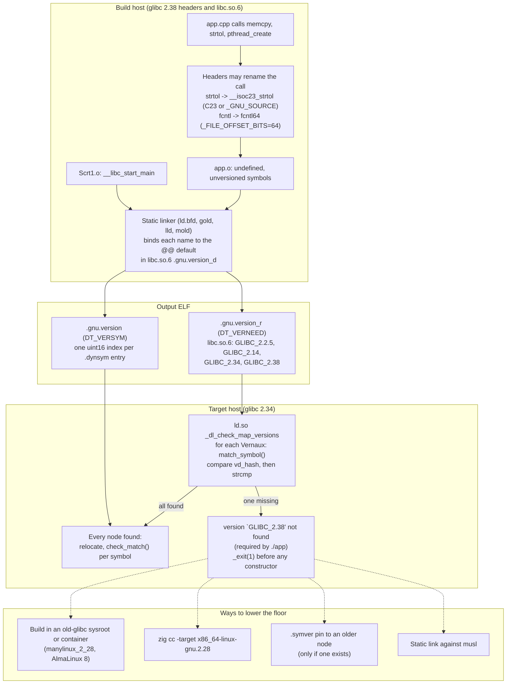

# glibc Symbol Versioning and Portable Linux Binaries

> [!summary] Claim:
> glibc never changes its SONAME; it keeps old binaries working by exporting several versions of one symbol, such as `memcpy@GLIBC_2.2.5` and the default `memcpy@@GLIBC_2.14`.
> The static linker binds every reference to the default version in the `libc.so.6` it links against, and records each version node it used in the binary's `.gnu.version_r` table.
> At startup `ld.so` checks every recorded node against the running libc's `.gnu.version_d` and refuses the whole program if one is missing, even when the function is never called.
> So the build machine's glibc, plus header redirects and `crt1.o`, sets a binary's minimum glibc version: build against the oldest glibc you support, and gate releases on `readelf -V`, not on `objdump -T`.



## The Mechanism

### 1. Why glibc versions symbols instead of changing its SONAME

A shared library can signal an incompatible change in two ways.
The coarse way is a new SONAME, `libfoo.so.1` to `libfoo.so.2`, which the static linker copies into each consumer's `DT_NEEDED` entry; [[Cpp-ABI-Stability-Symbol-Visibility-and-SONAME]] owns that mechanism.
Drepper's *How To Write Shared Libraries* (Version 4.1.2, Section 3.3) lists its costs: every incompatible change needs a new file, the old and new files can both end up in one process through different dependencies, and "the results can be catastrophic" because the two copies do not know about each other.

Sun's Solaris linker introduced per-symbol version names, organised as a graph in which each new version inherits the promises of its predecessor.
GNU symbol versioning extends that design in two ways that Drepper calls the main differences (Section 3.3): one library may contain more than one definition of a given symbol, each with a different version, and a binary records for every symbol which version it was linked against.
That lets glibc fix a behaviour or change a struct for new programs while old binaries keep the old code, all inside one file whose SONAME has been `libc.so.6` on x86_64 and aarch64 from their first glibc release.

The resulting guarantee is one-directional:
- Backward compatibility: a binary linked against glibc 2.17 runs on glibc 2.44, because 2.44 still defines every version node 2.17 defined, and still carries the old implementations as compatibility symbols.
- No forward compatibility: a binary linked against glibc 2.38 that used `strlcpy` records `GLIBC_2.38`, and glibc 2.34 has no such node, so it refuses to start it.
- Drepper states the rule plainly (Section 3.6): "Just like symbols, version names must never be removed."

### 2. The three ELF sections

Symbol versioning adds three sections, each found through a dynamic tag, all defined in glibc's `elf/elf.h`:

| Section | Section type | Dynamic tags | Content |
|---|---|---|---|
| `.gnu.version` | `SHT_GNU_versym` `0x6fffffff` | `DT_VERSYM` `0x6ffffff0` | One `uint16_t` per `.dynsym` entry, in the same order. |
| `.gnu.version_d` | `SHT_GNU_verdef` `0x6ffffffd` | `DT_VERDEF` `0x6ffffffc`, `DT_VERDEFNUM` `0x6ffffffd` | Versions this object defines (a library's exports). |
| `.gnu.version_r` | `SHT_GNU_verneed` `0x6ffffffe` | `DT_VERNEED` `0x6ffffffe`, `DT_VERNEEDNUM` `0x6fffffff` | Versions this object requires, grouped by needed file. |

`.gnu.version` is a parallel array, so an implementation that ignores it still sees a normal `.dynsym`.
musl's dynamic linker reads it only to skip hidden definitions (`!dso->versym || dso->versym[i] >= 0` in `ldso/dynlink.c`, where the hidden bit makes the `int16_t` negative) and never reads `.gnu.version_r`, which is why musl has no equivalent of this note's startup failure.
Its values are indices into the object's own version tables:
- `0` (`VER_NDX_LOCAL`): the symbol is local, or, for an undefined symbol, unversioned.
- `1` (`VER_NDX_GLOBAL`): a defined symbol with no specific version, bound to the base definition that names the file itself.
- `2` and up: user versions, the `vd_ndx` of a `Verdef` or the `vna_other` of a `Vernaux`.
- `elf.h` also defines `VER_NDX_LORESERVE` (`0xff00`) and `VER_NDX_ELIMINATE` (`0xff01`), inherited from Solaris; glibc's loader never tests them, and because it masks indices with `0x7fff`, real indices stay far below them.
- Bit `0x8000` is the hidden bit: a definition with it set is a non-default version, written `name@VER` rather than `name@@VER`.
  `check_match` in `elf/dl-lookup.c` tests `verstab[symidx] & 0x8000` and masks indices with `0x7fff`.

A version definition is a linked list of fixed-size records (`Elf64_Verdef`, 20 bytes, and `Elf64_Verdaux`, 8 bytes):

```c
typedef struct {
  Elf64_Half vd_version;  /* 1 (VER_DEF_CURRENT); ld.so rejects anything else */
  Elf64_Half vd_flags;    /* VER_FLG_BASE 0x1 for the file's own entry, VER_FLG_WEAK 0x2 */
  Elf64_Half vd_ndx;      /* the index that .gnu.version entries use */
  Elf64_Half vd_cnt;      /* number of Verdaux entries: name plus parents */
  Elf64_Word vd_hash;     /* SysV ELF hash of the version name */
  Elf64_Word vd_aux;      /* byte offset to the first Elf64_Verdaux */
  Elf64_Word vd_next;     /* byte offset to the next Elf64_Verdef, 0 at the end */
} Elf64_Verdef;

typedef struct {
  Elf64_Word vda_name;    /* .dynstr offset: first entry is this version, later ones its parents */
  Elf64_Word vda_next;
} Elf64_Verdaux;
```

A requirement is grouped by file (`Elf64_Verneed`, 16 bytes) with one `Elf64_Vernaux` (16 bytes) per required version:

```c
typedef struct {
  Elf64_Half vn_version;  /* 1 (VER_NEED_CURRENT) */
  Elf64_Half vn_cnt;      /* number of Vernaux entries */
  Elf64_Word vn_file;     /* .dynstr offset of the DT_NEEDED name, e.g. "libc.so.6" */
  Elf64_Word vn_aux;
  Elf64_Word vn_next;
} Elf64_Verneed;

typedef struct {
  Elf64_Word vna_hash;    /* SysV ELF hash of the version name */
  Elf64_Half vna_flags;   /* VER_FLG_WEAK 0x2 turns a missing version into a warning */
  Elf64_Half vna_other;   /* the .gnu.version index this requirement is given */
  Elf64_Word vna_name;    /* .dynstr offset of e.g. "GLIBC_2.34" */
  Elf64_Word vna_next;
} Elf64_Vernaux;
```

`elf.h` still comments `vna_other` as "Unused", but `_dl_check_map_versions` reads `aux->vna_other & 0x7fff` as the version index and builds the object's `l_versions[]` table from it, so a reference's `.gnu.version` entry points at its `Vernaux`.
`vd_hash` and `vna_hash` are the classic SysV ELF hash of the version string, so the loader compares 32-bit integers before it calls `strcmp`.
The Worked Lab Example section recomputes them: `GLIBC_2.14` hashes to `0x6969194`, and `GLIBC_ABI_DT_RELR` to `0xfd0e42`, the constant hard-coded in `elf/dl-version.c`.
The parent links in `Verdaux` are informational: glibc ignores `vd_cnt` and the parent entries, and lld writes `vd_cnt` as 1 (MaskRay).
The cost of the check is small and independent of the symbol count, because a binary needs a handful of version nodes, not one per symbol; Drepper (Section 3.3) makes the same point.

### 3. Producing versions: version scripts and `.symver`

A library defines its version nodes in a linker version script, passed with `-Wl,--version-script=libfoo.map`:

```text
FOO_1.0 {
  global: foo_open; foo_read;
  local:  *;
};
FOO_1.1 {
  global: foo_read_v;
} FOO_1.0;
```

The rules that matter, from the GNU ld manual (VERSION command):
- `global:` patterns export matching symbols and bind them to the node; `local:` patterns hide them, so `local: *` is the export allow-list the visibility note relies on.
- Patterns are shell globs; a quoted name matches literally; `extern "C++" { "ns::f(int)"; }` matches demangled names.
- `} FOO_1.0;` declares a predecessor; it is documentation for humans and for Solaris-style lookups, and has no effect on glibc's loader.
- A script with exactly one unnamed node, `{ global: ...; local: *; };`, versions nothing and only controls visibility.
- "A `.symver` directive takes precedence over a version script."
- GNU ld and lld resolve a symbol that matches patterns in several nodes differently, so a script that relies on overlapping wildcards is not portable between linkers (MaskRay gives `v1 { local: p*; }; v2 { global: pq*; }; v3 { local: pqr*; };`, where `pqrs` is global in GNU ld and local in gold and lld).
- lld 16 made `--no-undefined-version` the default, so a script naming a symbol that is not defined is an error; GNU ld accepts it unless asked.

A library with two implementations of one name needs `.symver`, the assembler directive that attaches a version to a symbol (GNU as manual, `.symver`; MaskRay):

| Form | When `name` is defined in this file | When `name` is undefined | Use |
|---|---|---|---|
| `.symver impl, name@VER` | creates `name@VER`, a hidden (non-default) version | rewrites references to `name@VER` | Keep an old implementation for old binaries, or reference an old version. |
| `.symver impl, name@@VER` | creates the default `name@@VER`; the linker binds new references to it | error | The current implementation. |
| `.symver impl, name@@@VER` | renames to `name@@VER` | treated as `name@VER` | Default version without a stray unversioned alias. |
| `.symver impl, name@VER, remove` | as `@`, and removes `impl` from the symbol table | n/a | Avoid exporting the internal name (binutils 2.35 and later, Clang 13 and later). |

Drepper's Section 3.5 states the binding rule the whole system depends on: "No symbol defined using @ are ever considered by the linker"; they "are considered only by the dynamic linker."
So once a library has `foo@@VER_2`, no new link can pick up `foo@VER_1` by accident; only a deliberate `.symver foo, foo@VER_1` reference can.

GCC 10 added a function attribute for the definition side, documented as "On ELF targets this attribute creates a symbol version":

```c
__attribute__((__symver__("foo@VERS_1"))) int foo_v1(void) { return 1; }
__attribute__((__symver__("foo@@VERS_2"))) int foo_v2(void) { return 2; }
```

Three limits follow from the GCC manual and the GCC 10 discussion:
- The versioned symbol "must be defined and exported with default visibility", so the attribute cannot pin a reference to an older glibc symbol; that still needs a top-level `__asm__(".symver ...")`.
- Several `symver` attributes on one function need binutils 2.35; older assemblers need a separate alias per version.
- The attribute exists because a `.symver` directive in inline assembly "is not compatible with link-time optimizations" (GCC 10 release notes): the compiler cannot see which function a top-level `asm` string refers to.
  Clang does not implement the attribute ("implemented by GCC but not by Clang", MaskRay, updated 2026-01; as of 2026-11).

### 4. How glibc builds its own versions

Every glibc subdirectory has a `Versions` file listing which symbols enter at which node, for example `string/Versions` adds `strlcat` and `strlcpy` under `GLIBC_2.38`.
`scripts/versions.awk` merges the fragments into one version script per library; its `closeversion` function writes `local: *;` into every node and chains a node to the previous one only when both share a prefix (`GLIBC_x.y` to `GLIBC_x.z`, not `GLIBC_x` to `FOO_y`).
The top-level `shlib-versions` and each architecture's copy set the baseline: an architecture's first release subsumes all older nodes, so x86_64's `DEFAULT GLIBC_2.2.5` turns every `GLIBC_2.0` to `GLIBC_2.2.4` entry into `GLIBC_2.2.5`, aarch64 starts at `GLIBC_2.17`, and 32-bit ARM at `GLIBC_2.4`.
The same symbol therefore has different old version names on different architectures, which matters for anyone who hard-codes a pin.

Inside the sources, two macros from `include/shlib-compat.h` attach versions:
- `versioned_symbol (libc, __new_memcpy, memcpy, GLIBC_2_14)` expands to `.symver __new_memcpy, memcpy@@GLIBC_2.14`, the default for new links (`sysdeps/x86_64/multiarch/memcpy.c`).
- `compat_symbol (lib, local, symbol, version)` emits `symbol@version` with a single `@`, a compatibility-only definition that old binaries can bind to and new links cannot.
- `SHLIB_COMPAT (libc, GLIBC_2_0, GLIBC_2_14)` guards compatibility code so it is compiled only on architectures whose baseline predates the obsoleting version.
  On aarch64, whose baseline is 2.17, the `memcpy@GLIBC_2.2.5` question never arises: `aarch64/libc.abilist` has exactly one `memcpy`, at `GLIBC_2.17`.

The ABI is pinned by checked-in lists, one per library and architecture, such as `sysdeps/unix/sysv/linux/x86_64/64/libc.abilist`, whose lines read `GLIBC_2.14 memcpy F`.
In the copy read for this note (glibc git `04e750e75b73`, 2.43 development, authored 2026-01-16), that file has 2,845 lines, 1,916 of them at `GLIBC_2.2.5`, and 229 symbol names appear under more than one version.
`GLIBC_PRIVATE` holds interfaces between glibc's own libraries, such as `__libc_early_init`; it carries no compatibility promise, so a binary that requires it is tied to one exact glibc build.

glibc also defines empty version nodes as feature flags.
`elf/Versions` declares `GLIBC_ABI_DT_RELR` with only a placeholder symbol that `versions.awk` removes, and `sysdeps/x86_64/Versions` declares `GLIBC_ABI_DT_X86_64_PLT` the same way.
A binary that requires such a node cannot load on a glibc that lacks the feature, which makes the version table a capability check as well as an ABI check.

### 5. Link time: what decides the version a binary records

The static linker resolves each undefined name in the object files against `libc.so.6`'s `.dynsym`, picks the `@@` default, and writes that node into `.gnu.version_r` and the index into `.gnu.version`.
Nothing in the source names a glibc version, so the floor comes from four inputs on the build machine:

1. The libc that the linker reads.
   `memcpy` on an x86_64 glibc 2.14 or later binds to `memcpy@@GLIBC_2.14`; the same call on glibc 2.13 bound to `GLIBC_2.2.5`.
2. Header redirects that rename the call before the compiler sees it.
   - With `__GLIBC_USE (C23_STRTOL)`, which `features.h` sets exactly when `__GLIBC_USE (ISOC23)` is on, `stdlib.h` declares `strtol` with `__REDIRECT_NTH (strtol, ..., __isoc23_strtol)`, which only exists at `GLIBC_2.38`.
     `features.h` turns that on for `-std=c23`, and also whenever `_GNU_SOURCE` is defined, because `_GNU_SOURCE` defines `_ISOC23_SOURCE`.
   - g++ on GNU/Linux always defines `_GNU_SOURCE` (`gcc/config/gnu-user.h`: `CPLUSPLUS_CPP_SPEC "-D_GNU_SOURCE %(cpp)"`, commented "The GNU C++ standard library requires that these macros be defined"), and clang++ does the same for Linux targets, as the worked example shows.
     So every C++ translation unit built against glibc 2.38 headers that calls `strtol`, `strtoul`, `sscanf` and their relatives requires `GLIBC_2.38`, with no change to the source.
   - Plain C reaches the same state through a compiler upgrade: "GCC 15 changes the default language version for C compilation from -std=gnu17 to -std=gnu23" (GCC 15 release notes), and `__STDC_VERSION__ > 201710L` is one of the conditions in `features.h` that enables `__GLIBC_USE (ISOC23)`.
   - `io/fcntl.h` redirects `fcntl` to `fcntl64` when `__USE_FILE_OFFSET64` is set, and `fcntl64` is a `GLIBC_2.28` symbol.
3. Startup objects.
   `Scrt1.o` and `crt1.o` call `__libc_start_main`, which has two versions on x86_64, `GLIBC_2.2.5` and `GLIBC_2.34`, so every executable linked against glibc 2.34 or later requires `GLIBC_2.34` even if it calls nothing else.
   A shared library is not linked with `crt1.o`, so the same code built as a `.so` can have a lower floor than the executable.
4. Linker features that emit a capability node.
   With `-z pack-relative-relocs`, lld 23.1.5 packed relative relocations into `DT_RELR` and added a `GLIBC_ABI_DT_RELR` requirement against a `libc.so.6` that defines that node (worked example, section 5); a linker that emitted `DT_RELR` without the requirement would be rejected by `ld.so` (section 6).

glibc 2.34 also moved `libpthread`, `libdl`, `libutil`, and `libanl` into `libc.so.6` (NEWS, 2.34).
The x86_64 `libc.abilist` therefore lists `pthread_create` and `dlopen` at both `GLIBC_2.2.5` and `GLIBC_2.34`, so a threaded program built on 2.34 needs 2.34, and an old program that names `libpthread.so.0` in `DT_NEEDED` still loads the now-empty library.

### 6. Load time: the version check in `ld.so`

After `ld.so` has mapped the program and its `DT_NEEDED` closure, `_dl_check_all_versions` calls `_dl_check_map_versions` on each object (`elf/dl-version.c`):
1. For each `Verneed`, it finds the loaded object whose name matches `vn_file`.
2. For each `Vernaux`, `match_symbol` walks that object's `Verdef` list, compares `vd_hash` with `vna_hash`, confirms with `strcmp`, and returns on the first match.
3. If the provider has no `DT_VERDEF` at all, it was built without versioning, and the check passes; with verbose output it prints ``no version information available (required by %s)``.
4. If the node is missing and `vna_flags` has `VER_FLG_WEAK`, it is a warning: ``weak version `%s' not found (required by %s)``.
5. Otherwise it is an error: ``version `%s' not found (required by %s)``, reported as a "version lookup error".
6. At program startup `rtld.c` calls the check with `verbose` set to 1, ORs the results over every object, and calls `_exit (1)` if any failed, so the user sees one line per missing node and no constructor or `main` runs.
7. `dlopen` runs the same check with `verbose` set to 0; a failure makes `dlopen` return `NULL` with the message in `dlerror()`.

The check is all-or-nothing by design: a binary that references `strlcpy` only on an error path still fails to start on glibc 2.37, because the requirement is recorded per node, not per call.
`LD_DEBUG=versions` prints each comparison as ``checking for version `%s' in file %s [%lu] required by file %s [%lu]``, and `ldd -v` prints the requirement table without running `main`.

The same function enforces the `DT_RELR` capability node.
If an object has `DT_RELR`, a `DT_NEEDED` entry starting with `libc.so.`, and no `GLIBC_ABI_DT_RELR` requirement, `ld.so` fails it with "DT_RELR without GLIBC_ABI_DT_RELR dependency", because `DT_RELR` support arrived in glibc 2.36 (NEWS).
GNU ld records a `GLIBC_ABI_DT_RELR` dependency on the shared C library whenever it emits `DT_RELR` for `-z pack-relative-relocs` (GNU ld manual), so a glibc older than 2.36 fails the version check at startup instead of running the program.
The `ld.so` test catches an object that has `DT_RELR` but lacks that recorded dependency.

### 7. Symbol binding: `check_match`

After the version check, each relocation looks up a name, and `check_match` in `elf/dl-lookup.c` filters candidates by version:
- A versioned reference (`.gnu.version` index 2 or higher in the referencing object) matches a definition whose version has the same hash and name, `foo@VER` or `foo@@VER`.
  A definition at the global index in an object that has version information but not that version is remembered as a fallback.
  An object with no version information at all is accepted outright (the source comment: "This can happen during symbol interposition"), which is how an interposer such as a sanitizer runtime that defines plain `memcpy` can satisfy `memcpy@GLIBC_2.14`.
- An unversioned reference from a binary that predates versioning accepts a definition at index 0 to 2 (local, global, or the first, oldest user version; the base `Verdef` names the file and is never matched), whether or not it is hidden.
  The source comment says why: "In the case of the old unversioned application the oldest (default) version should be used."
  A newer non-hidden version is accepted only as a fallback, and `do_lookup_x` uses the fallback only if it saw exactly one such candidate, "since there are no possible ambiguities."
- `dlsym` passes `DL_LOOKUP_RETURN_NEWEST`, which accepts index 0 or 1 directly and otherwise the single non-hidden default, so `dlsym(handle, "memcpy")` returns the 2.14 implementation; `dlvsym(handle, "memcpy", "GLIBC_2.2.5")` asks for a specific one.
  glibc's NEWS for 2.36 lists BZ 14932 as resolved, titled "dlsym(handle, "foo") and dlsym(RTLD_NEXT, "foo") return different result with versioned "foo""; MaskRay describes the `RTLD_NEXT` side as returning the oldest version before that.

Drepper's Section 3.8 describes the trap in the unversioned path: a library linked with undefined references to a versioned DSO that was absent at link time gets unversioned references, and at run time binds to the oldest definition, which "can be catastrophic" if the API changed; `-Wl,-z,defs` prevents it.

### 8. Symbols that raise the floor

These are the common reasons a binary built on a current distribution needs a newer glibc, read from the x86_64 and aarch64 `abilist` files and `NEWS` (glibc git `04e750e75b73`, as of 2026-01):

| Node | Symbol | What triggers it | Older node still exported |
|---|---|---|---|
| `GLIBC_2.14` | `memcpy` | Any `memcpy` call on x86_64 not inlined by the compiler | `memcpy@GLIBC_2.2.5`; aarch64 has only `GLIBC_2.17` |
| `GLIBC_2.27` | `expf`, `powf`, `logf`, `log2f`, `exp2f` (libm) | New single-precision implementations | `GLIBC_2.2.5` on x86_64, `GLIBC_2.4` on 32-bit ARM |
| `GLIBC_2.27` | `glob64` | Symlink handling change | `GLIBC_2.2.5` |
| `GLIBC_2.28` | `fcntl64` | `fcntl` with `_FILE_OFFSET_BITS=64` | none (new name) |
| `GLIBC_2.29` | `exp`, `log`, `pow`, `exp2`, `log2` (libm) | New double-precision implementations | `GLIBC_2.2.5` |
| `GLIBC_2.33` | `stat`, `lstat`, `fstat`, `stat64` | Any `stat` call; before 2.33 libc exported only `__xstat`, `__lxstat`, and `__fxstat` (all `GLIBC_2.2.5`) | none (new exports) |
| `GLIBC_2.34` | `__libc_start_main`, `pthread_create`, `dlopen` | Every executable; any threaded or `dlopen` code | `GLIBC_2.2.5` on x86_64, `GLIBC_2.17` on aarch64 |
| `GLIBC_2.36` | `arc4random` | Direct use | none (new) |
| `GLIBC_ABI_DT_RELR` | none | `-z pack-relative-relocs` | none (capability node, glibc 2.36) |
| `GLIBC_2.38` | `strlcpy`, `strlcat` | Direct use | none (new) |
| `GLIBC_2.38` | `__isoc23_strtol` and relatives | `strtol` family under C23 or `_GNU_SOURCE`, so all C++ | none (new name) |

Two of the old versions keep different behaviour, which is why pinning to them is not free.
`memcpy@GLIBC_2.2.5` exists because the 2.14 implementation may copy backwards and broke binaries that called `memcpy` on overlapping buffers (BZ 12518, the Flash player case, per MaskRay).
`realpath@GLIBC_2.2.5` returned `EINVAL` for a `NULL` second argument (the x86_64 name of the old node; the 2.3 replacement is `realpath@@GLIBC_2.3`), and `quick_exit@GLIBC_2.10` ran `thread_local` destructors before its 2.24 replacement (BZ 20198, "quick_exit incorrectly destroys C++11 thread objects"; MaskRay for the behaviour; the node names are from the x86_64 `libc.abilist`).

### 9. The other versioned runtimes: libstdc++ and libgcc_s

A C++ binary carries two more requirement lists, against `libstdc++.so.6` (`GLIBCXX_3.4.x`, `CXXABI_1.3.x`) and `libgcc_s.so.1` (`GCC_x`).
The libstdc++ ABI policy maps compiler releases to nodes, and states that within one SONAME the library is forward-compatible and "the reverse (backwards compatibility) is not true":

| GCC | `GLIBCXX_` | `CXXABI_` | Library file |
|---|---|---|---|
| 4.8.3 | 3.4.19 | 1.3.7 | `libstdc++.so.6.0.19` |
| 8.1.0 | 3.4.25 | 1.3.11 | `libstdc++.so.6.0.25` |
| 11.1.0 | 3.4.29 | 1.3.13 | `libstdc++.so.6.0.29` |
| 13.2.0 | 3.4.32 | 1.3.14 | `libstdc++.so.6.0.32` |
| 14.1.0 | 3.4.33 | 1.3.15 | `libstdc++.so.6.0.33` |
| 15.1.0 | 3.4.34 | 1.3.15 | `libstdc++.so.6.0.34` |
| 16.1.0 | 3.4.34 | 1.3.17 | `libstdc++.so.6.0.34` |

So building with GCC 14 and shipping to a host whose libstdc++ came from GCC 8 fails with ``version `GLIBCXX_3.4.29' not found`` or similar, independent of glibc.
Three fixes exist:
- Red Hat's Developer Toolset compilers link against `libstdc++_nonshared.a`, which provides the symbols that the base system's `libstdc++.so.6` lacks; those additions are linked statically and everything the system library already has is used from it (Jonathan Wakely, gcc-help, 2022-10-20).
  This is how the `manylinux_2_28` image builds with GCC 14 while staying loadable on AlmaLinux 8: its `build.sh` sets `DEVTOOLSET_ROOTPATH=/opt/rh/gcc-toolset-14/root` and prepends its `usr/bin` to `PATH`, and the CentOS 7 based `manylinux2014` image uses `devtoolset-10` the same way (pypa/manylinux `build.sh`, as of 2026-11).
- `-static-libstdc++ -static-libgcc` copies the runtime into the binary, which removes the requirement but gives every such shared library its own copy of the C++ runtime; exceptions, `typeinfo`, and allocations that cross library boundaries then need care ([[Diamond-Dependency-and-Incompatible-ABI-Mitigation]]).
- Ship the newer `libstdc++.so.6` next to the binary with an `$ORIGIN` run path, as `auditwheel` does for non-whitelisted libraries; this fails if another component in the process already loaded the system copy, since one process gets one `libstdc++.so.6`.

### 10. Strategies for a portable binary, in order of preference

1. Build against the oldest glibc you support.
   Build in a container or sysroot of that distribution with a modern compiler: `manylinux_2_28` (AlmaLinux 8, glibc 2.28, GCC 14) or `manylinux_2_34` (AlmaLinux 9, glibc 2.34, GCC 14, labelled ALPHA) on x86_64, i686, aarch64, ppc64le, and s390x (pypa/manylinux README, as of 2026-11).
   A crosstool-ng or distribution sysroot with `--sysroot` does the same for a cross compiler.
   This is the only approach that gets headers, `crt1.o`, `libc_nonshared.a`, and every symbol version right at once.
2. Let the toolchain synthesise an old libc.
   `zig cc -target x86_64-linux-gnu.2.28` links against stub libraries generated for that glibc version.
   `cargo zigbuild --target x86_64-unknown-linux-gnu.2.28` uses the same mechanism to target older glibc baselines for Rust.
   Zig's target parser accepts an explicit glibc version suffix appended to the GNU ABI component of the target triple (`lib/libc/glibc/README.md` and `lib/std/Target.zig`).
   Instead of requiring a local sysroot for each distribution, Zig bundles `lib/libc/glibc/abilist`, a single binary blob that "defines the supported glibc versions and the set of symbols each version must define", and builds version-specific stub shared libraries from it on demand (`src/glibc.zig`).
   Because the stub for a chosen version exports only what that glibc release defined, a reference to anything newer fails at link time instead of recording a newer node; Zig also ships one set of multi-version headers (`lib/libc/include/generic-glibc/`), so header redirects follow the chosen version too.
   `zig env` shows the default target and glibc version (README).
   `zig cc` supports targeting glibc versions down to 2.2.5, whereas Zig's own standard library requires at least glibc 2.17 (README, as of 2026-11).
3. Pin individual symbols with `.symver`, as Skia's `force_older_glibc_math.h` (2019) does with `__asm__(".symver expf,expf@GLIBC_2.4")`.
   This works only for symbols that have an older version, gives you the old behaviour, cannot help with new-only symbols such as `strlcpy` or with `__libc_start_main` in `crt1.o`, and is architecture-specific: `expf@GLIBC_2.4` exists on 32-bit ARM, while x86_64's old node is `expf@GLIBC_2.2.5`.
   It must be included in every translation unit before the first call, and top-level `asm` is fragile under LTO.
4. Link statically against musl (`x86_64-unknown-linux-musl`, Alpine, `musllinux_1_2`), which has no symbol versioning and no runtime libc dependency.
   A fully static glibc binary is a trap: `getaddrinfo`, `getpwnam`, `iconv`, and anything else that `dlopen`s NSS or gconv modules triggers glibc's own link warning, "Using 'getaddrinfo' in statically linked applications requires at runtime the shared libraries from the glibc version used for linking" (`static_link_warning`, `include/libc-symbols.h`).
5. Rewrite the finished binary: `polyfill-glibc --target-glibc=2.17 my-program` patches an ELF file to run on that glibc; the `--target-glibc` operation is implemented only for x86_64 and aarch64 (polyfill-glibc README, as of 2026-11).
   Treat it as a rescue tool for a binary you cannot rebuild.
6. Do not ship your own `libc.so.6` and `ld-linux-x86-64.so.2` with `patchelf --set-interpreter` unless every library in the process comes with them, because the host's NSS modules and any library loaded from the host expect the host's glibc.

### 11. Auditing a binary

The required glibc version is the highest node in `.gnu.version_r`, not the highest version printed next to a symbol:

```sh
readelf -V --wide app | sed -n '/version_r/,$p'     # every required node, including capability nodes
objdump -T app | grep -o 'GLIBC_[0-9.]*' | sort -u -V | tail -1   # symbol-only view: misses GLIBC_ABI_DT_RELR
ldd -v app                                           # requirements per needed library, without running main
LD_DEBUG=versions ./app                              # each match_symbol comparison at startup
getconf GNU_LIBC_VERSION                             # the running glibc, as confstr(_CS_GNU_LIBC_VERSION) reports it
```

Packaging systems read the same table:
- RPM's `elfdeps` turns each `Vernaux` into a dependency of the form `libc.so.6(GLIBC_2.34)(64bit)` (`processVerNeed` and `addSoDep` in `tools/elfdeps.cc`), and adds `rtld(GNU_HASH)` for objects with only a GNU hash table, so `dnf` refuses the package on an older glibc instead of failing at run time.
- Debian's `dpkg-shlibdeps` derives the minimum `libc6` version from symbols files ([[Cpp-System-Packaging-Deb-RPM-and-Homebrew]]).
- `auditwheel` compares the same versions against a manylinux policy ([[Python-Wheels-Platform-Tags-Manylinux-and-ABI3]]).

## Commands and Numbers to Know

| Item | Value | Platform | Notes |
|---|---|---|---|
| Latest glibc release | 2.44, released 2026-07-25; 2.43 released 2026-01-23 (as of 2026-11) | Linux | libc-announce release mails; the git mirror read for this note stops at 2.43 development. |
| Baseline node | x86_64 `GLIBC_2.2.5`, aarch64 `GLIBC_2.17`, 32-bit ARM `GLIBC_2.4` (as of 2026-11) | Linux | `DEFAULT` lines in per-architecture `shlib-versions`. |
| RHEL and clones | 7: 2.17, 8: 2.28, 9: 2.34, 10: 2.39 (as of 2026-11) | Linux | AlmaLinux 8, 9, 10 BaseOS package lists; Rust blog for RHEL 7; CentOS 7 reached EOL on 2024-06-30 (pypa/manylinux). |
| Debian | 11: 2.31, 12: 2.36, 13: 2.41 (as of 2026-11) | Linux | `+deb11u`, `+deb12u`, `+deb13u` builds in the Debian `pool/main/g/glibc` archive. |
| Ubuntu LTS | 20.04: 2.31, 22.04: 2.35, 24.04: 2.39, 26.04: 2.43 (as of 2026-11) | Linux | Launchpad published sources for focal; packages.ubuntu.com for jammy, noble, resolute. |
| Amazon Linux | 2: 2.26, 2023: 2.34 (as of 2026-11) | Linux | Amazon Linux Security Center advisories name `glibc-2.26-64.amzn2.0.1` (ALAS2-2024-2521, AL2) and `glibc-2.34-231.amzn2023.0.4` (ALAS2023-2026-1622, AL2023); AL2 reached end of support on 2026-06-30 (Amazon Linux 2 FAQ). |
| Rust `*-linux-gnu` host floor | glibc 2.17, kernel 3.2 (x86_64), 4.1 (aarch64) since Rust 1.64 (as of 2026-11) | Linux | rustc platform support page. |
| `readelf -V file` | Prints `.gnu.version`, `.gnu.version_d`, `.gnu.version_r` (as of 2026-11) | Linux | `llvm-readelf -V` works on macOS for Linux ELF files. |
| `objdump -T file` | Dynamic symbols with `(GLIBC_x.y)` per symbol (as of 2026-11) | Both | Does not show symbol-less nodes such as `GLIBC_ABI_DT_RELR`. |
| `LD_DEBUG=versions` | Traces each version check at startup (as of 2026-11) | Linux | Message format from `match_symbol`. |
| `.gnu.version` hidden bit | `0x8000`; index mask `0x7fff` (as of 2026-11) | Linux | `check_match` in `elf/dl-lookup.c`. |
| Reserved indices | `0` local, `1` global, `0xff00` LORESERVE, `0xff01` ELIMINATE (as of 2026-11) | Linux | `elf/elf.h`. |
| `vna_hash` of `GLIBC_ABI_DT_RELR` | `0xfd0e42` (as of 2026-11) | Linux | Hard-coded in `_dl_check_map_versions`, recomputed in the worked example. |
| x86_64 `libc.abilist` | 2,845 entries, 229 names with more than one version (as of 2026-01) | Linux | glibc git `04e750e75b73`. |
| GCC `symver` attribute | GCC 10 and later; several per function need binutils 2.35 (as of 2026-11) | Linux | Definition side only. |
| `.symver ..., remove` | binutils 2.35, Clang 13 (as of 2026-11) | Linux | MaskRay. |
| lld version scripts | `--no-undefined-version` default since lld 16 (as of 2026-11) | Both | `--undefined-version` restores the old behaviour. |
| `GLIBCXX_` per GCC | 8.1: 3.4.25, 11.1: 3.4.29, 14.1: 3.4.33, 15.1 and 16.1: 3.4.34 (as of 2026-11) | Linux | libstdc++ ABI policy. |
| `manylinux_2_28` image | AlmaLinux 8, GCC 14 (as of 2026-11) | Linux | pypa/manylinux README. |
| g++ on GNU/Linux | Always `-D_GNU_SOURCE` (as of 2026-11) | Linux | `gcc/config/gnu-user.h`; turns on C23 `strtol` redirects with glibc 2.38 headers. |
| GCC default C dialect | `gnu23` since GCC 15, `gnu17` before (as of 2026-11) | Both | Enables glibc's C23 `strtol` redirects in C code too. |
| Go `CGO_ENABLED` | On by default for native builds where a C compiler is found; off when cross-compiling or no compiler (as of 2026-11) | Both | A cgo binary inherits glibc requirements. |

## Multi-Language Comparison

| Concern | C++ (GCC or Clang, CMake) | Python (native wheels) | Rust (`*-linux-gnu`) |
|---|---|---|---|
| Where the glibc floor comes from | Build host libc, headers, `crt1.o`, plus libstdc++ and libgcc_s nodes | The extension's own ELF requirements, and the interpreter's | rustc's precompiled `std` (glibc 2.17 floor) plus the build host's libc for linking |
| Default floor if nothing is done | Whatever the build distribution ships | `linux_x86_64` tag, which PyPI rejects; must be repaired to `manylinux_*` | Build host's glibc for the final link, at least 2.17 |
| Standard way to lower it | Build in an old-glibc container or sysroot; `gcc-toolset` for a new compiler | cibuildwheel in `manylinux_2_28`; [[Python-Wheels-Platform-Tags-Manylinux-and-ABI3]] | `cargo zigbuild --target x86_64-unknown-linux-gnu.2.28`, or a `manylinux` container; [[Rust-Binary-Distribution-with-dist-and-Cross-Compilation]] |
| Static escape hatch | musl toolchain, `-static-libstdc++ -static-libgcc` | `musllinux_1_2` wheels | `x86_64-unknown-linux-musl` |
| Audit gate | `readelf -V` max-node check in CI | `auditwheel show` and `repair --plat` | `readelf -V` on the artifact; maturin's built-in audit for wheels |
| Typical surprise | `__isoc23_strtol@GLIBC_2.38` from `_GNU_SOURCE` | A vendored C++ library pulling a newer `GLIBCXX` | A `-sys` crate's C code compiled against host headers |

## Worked Lab Example

This note has no `code/` lab.
This example needs only Homebrew LLVM and lld on macOS (or any clang plus `ld.lld`), builds x86_64 Linux ELF files, and never runs them, so it shows the link-time half of the mechanism exactly and the load-time half only through the tables `ld.so` would read.

The stand-in `libc.so.6` defines two `memcpy` versions the way glibc does:

```c
/* stub_libc.c */
typedef unsigned long size_t;

void *memcpy_v2_2_5(void *d, const void *s, size_t n) { return d; }
void *memcpy_v2_14(void *d, const void *s, size_t n) { return d; }
size_t strlcpy(char *d, const char *s, size_t n) { return 0; }
int puts(const char *s) { return 0; }

__asm__(".symver memcpy_v2_2_5, memcpy@GLIBC_2.2.5");
__asm__(".symver memcpy_v2_14, memcpy@@GLIBC_2.14");
```

```text
/* stub_libc.map */
GLIBC_2.2.5 { global: puts; };
GLIBC_2.14  { } GLIBC_2.2.5;
GLIBC_2.38  { global: strlcpy; local: *; } GLIBC_2.14;
GLIBC_ABI_DT_RELR { };
```

Three programs link against it: `app.c` calls `memcpy`, `strlcpy`, and `puts`; `app_pinned.c` calls `memcpy` and `puts` after `__asm__(".symver memcpy, memcpy@GLIBC_2.2.5");`; and `app_relr.c` has a writable array of four string pointers, linked once normally and once with `-z pack-relative-relocs`.

```sh
CC=/opt/homebrew/opt/llvm/bin/clang LD=/opt/homebrew/bin/ld.lld
CFLAGS="--target=x86_64-unknown-linux-gnu -O2 -fPIC -fno-builtin -ffreestanding -nostdinc"
$CC $CFLAGS -c stub_libc.c -o stub_libc.o
$LD -shared -soname libc.so.6 --version-script stub_libc.map stub_libc.o -o stub/libc.so.6
$CC $CFLAGS -c app.c -o app.o
$LD -pie -e main --dynamic-linker /lib64/ld-linux-x86-64.so.2 app.o stub/libc.so.6 -o app
# app_pinned and app_relr_plain the same way; app_relr_packed adds -z pack-relative-relocs
```

Run the block with `bash` or `sh`: zsh does not word-split the unquoted `$CFLAGS`, so clang receives the whole string as the target triple and fails.

### Verified output

Run once on darwin-arm64 (macOS 27.3) with Homebrew clang 23.1.5 and LLD 23.1.5 on 2026-11-15; `llvm-readelf`, `llvm-objdump`, and `llvm-readobj` from the same LLVM.
An independent re-run with Homebrew clang and LLD 23.1.6 on 2026-11-22 reproduced every line and value in sections 1 to 7, and also reproduced the `local: *;` observation in the Reading the output section.

```text
### 1. Definitions exported by the stub libc.so.6
Version definition section '.gnu.version_d' contains 5 entries:
 Addr: 000000000000024c  Offset: 0x00024c  Link: 6 (.dynstr)
  0x0000: Rev: 1  Flags: BASE  Index: 1  Cnt: 1  Name: libc.so.6
  0x001c: Rev: 1  Flags: none  Index: 2  Cnt: 1  Name: GLIBC_2.2.5
  0x0038: Rev: 1  Flags: none  Index: 3  Cnt: 1  Name: GLIBC_2.14
  0x0054: Rev: 1  Flags: none  Index: 4  Cnt: 1  Name: GLIBC_2.38
  0x0070: Rev: 1  Flags: none  Index: 5  Cnt: 1  Name: GLIBC_ABI_DT_RELR

   Num:    Value          Size Type    Bind   Vis       Ndx Name
     0: 0000000000000000     0 NOTYPE  LOCAL  DEFAULT   UND 
     1: 0000000000001398     3 FUNC    GLOBAL DEFAULT     7 strlcpy@@GLIBC_2.38
     2: 000000000000139c     3 FUNC    GLOBAL DEFAULT     7 puts@@GLIBC_2.2.5
     3: 0000000000001390     4 FUNC    GLOBAL DEFAULT     7 memcpy@GLIBC_2.2.5
     4: 0000000000001394     4 FUNC    GLOBAL DEFAULT     7 memcpy@@GLIBC_2.14

### 2. app: plain references
Version needs section '.gnu.version_r' contains 1 entries:
 Addr: 00000000000002c0  Offset: 0x0002c0  Link: 7 (.dynstr)
  0x0000: Version: 1  File: libc.so.6  Cnt: 3
  0x0010:   Name: GLIBC_2.2.5  Flags: none  Version: 4
  0x0020:   Name: GLIBC_2.14  Flags: none  Version: 2
  0x0030:   Name: GLIBC_2.38  Flags: none  Version: 3

0000000000000000      DF *UND*	0000000000000000 (GLIBC_2.14) memcpy
0000000000000000      DF *UND*	0000000000000000 (GLIBC_2.38) strlcpy
0000000000000000      DF *UND*	0000000000000000 (GLIBC_2.2.5) puts

### 3. app_pinned: memcpy pinned with .symver
Version needs section '.gnu.version_r' contains 1 entries:
 Addr: 00000000000002a8  Offset: 0x0002a8  Link: 7 (.dynstr)
  0x0000: Version: 1  File: libc.so.6  Cnt: 1
  0x0010:   Name: GLIBC_2.2.5  Flags: none  Version: 2

0000000000000000      DF *UND*	0000000000000000 (GLIBC_2.2.5) puts
0000000000000000      DF *UND*	0000000000000000 (GLIBC_2.2.5) memcpy

### 4. vna_hash values stored in app, and the ELF hash recomputed
        Hash: 157882997	        Name: GLIBC_2.2.5
        Hash: 110530964	        Name: GLIBC_2.14
        Hash: 110531000	        Name: GLIBC_2.38
GLIBC_2.2.5         157882997  0x9691a75
GLIBC_2.14          110530964  0x6969194
GLIBC_2.38          110531000  0x69691b8
GLIBC_ABI_DT_RELR    16584258  0xfd0e42

### 5. Same PIE, RELA versus -z pack-relative-relocs
-- app_relr_plain
  0x0000000000000007 (RELA)       0x300
  0x0000000000000008 (RELASZ)     96 (bytes)
  0x0010:   Name: GLIBC_2.2.5  Flags: none  Version: 2
-- app_relr_packed
  0x0000000000000024 (RELR)       0x328
  0x0000000000000023 (RELRSZ)     16 (bytes)
  0x0010:   Name: GLIBC_2.2.5  Flags: none  Version: 2
  0x0020:   Name: GLIBC_ABI_DT_RELR  Flags: none  Version: 3

### 6. Highest GLIBC_ version each binary needs
app              GLIBC_2.38
app_pinned       GLIBC_2.2.5
app_relr_packed  GLIBC_2.2.5

### 7. Does the C++ driver predefine _GNU_SOURCE?
x86_64-unknown-linux-gnu   1
arm64-apple-macos          0
```

### Reading the output

Section 1 is the provider side.
The base entry (`Flags: BASE`, index 1) names the file, and indices 2 to 5 are the nodes from the version script.
`memcpy@GLIBC_2.2.5` has one `@`, so its `.gnu.version` entry carries the hidden bit; `memcpy@@GLIBC_2.14` is the default.

Section 2 shows the linker's choice: the source said `memcpy`, and the binary requires `GLIBC_2.14`, because that is the default the linker found.
`strlcpy` adds `GLIBC_2.38`, so on a real system this program would stop at startup on any glibc before 2.38 with ``version `GLIBC_2.38' not found``.
The `Version:` column is `vna_other`, the index the binary's own `.gnu.version` uses; lld numbered the nodes in first-use order, so `GLIBC_2.2.5` got 4.

Section 3 changes one thing, a `.symver` line, and the requirement drops to `GLIBC_2.2.5`; the call now binds to the hidden compatibility definition, which on real glibc is the overlap-tolerant old `memcpy`.

Section 4 proves the loader's fast path compares the SysV ELF hash: the stored `vna_hash` values equal a 12-line Python reimplementation, and the hash of `GLIBC_ABI_DT_RELR` is `0xfd0e42`, the constant in `_dl_check_map_versions`.

Section 5 shows a linker flag adding a requirement with no symbol behind it.
The four `R_X86_64_RELATIVE` relocations shrink from 96 bytes of `RELA` to 16 bytes of `RELR`, and lld adds `GLIBC_ABI_DT_RELR` to `.gnu.version_r`.

Section 6 is the pitfall that follows: an audit that takes the highest version printed by `objdump -T` reports `GLIBC_2.2.5` for `app_relr_packed`, yet that binary cannot load on any glibc before 2.36.
Gate on `.gnu.version_r`.

Section 7 shows that clang++ predefines `_GNU_SOURCE` for a Linux target and not for macOS, which is the switch that turns `strtol` into `__isoc23_strtol` with glibc 2.38 headers.

One more observation from building the stub: with `local: *;` in the first node, `GLIBC_2.2.5 { global: puts; local: *; };`, lld 23.1.5 dropped `memcpy@GLIBC_2.2.5` from `.dynsym` and `app_pinned` failed to link with `undefined symbol: memcpy@GLIBC_2.2.5`; moving `local: *;` to the last node kept it.
glibc's own generated scripts put `local: *` in every node, so wildcard handling for non-default versions evidently differs between linkers; this note did not test GNU ld, so check `.dynsym` after changing linkers.

## Pitfalls

> [!warning] Pitfall 1: Building release binaries on a current distribution
> A binary built on Ubuntu 24.04 records the defaults of glibc 2.39: at least `__libc_start_main@GLIBC_2.34`, and often `GLIBC_2.38` from `strtol` in C++ code.
> It then fails on RHEL 8 and 9, Debian 11, and Amazon Linux 2 with ``version `GLIBC_2.34' not found``, before `main`.
> Build release artifacts in the oldest supported userland (a `manylinux_2_28` or AlmaLinux 8 image for a 2.28 floor), with a modern compiler from `gcc-toolset`.

> [!warning] Pitfall 2: Auditing symbols instead of version requirements
> `objdump -T | grep GLIBC_` lists only nodes that have a symbol.
> `GLIBC_ABI_DT_RELR` has none, so a `-z pack-relative-relocs` binary looks like `GLIBC_2.2.5` to that audit and still fails on glibc 2.35, as the worked example's sections 5 and 6 show.
> Read `readelf -V` and take the maximum over `.gnu.version_r`, including non-numeric nodes, which a version sort cannot rank and a human must allow-list.

> [!warning] Pitfall 3: Expecting the source to decide the version
> Header redirects pick the symbol: `_GNU_SOURCE`, which g++ always defines on Linux, makes `strtol` call `__isoc23_strtol@GLIBC_2.38` with glibc 2.38 headers, and `_FILE_OFFSET_BITS=64` makes `fcntl` call `fcntl64@GLIBC_2.28`.
> GCC 15's switch of the default C dialect to `gnu23` does the same to plain C code, so a compiler upgrade alone can raise the floor.
> Reviewing the source for new APIs therefore finds nothing.
> Compile against the target's headers, not just link against its libc.

> [!warning] Pitfall 4: Copying a .symver pin from another architecture
> Old version names depend on each architecture's baseline: `expf@GLIBC_2.4` is the 32-bit ARM node, `expf@GLIBC_2.2.5` the x86_64 one, and aarch64 has no version older than `GLIBC_2.17`.
> A pin naming a node that does not exist fails at link time with `undefined symbol: expf@GLIBC_2.4`.
> Generate pins from the target's `abilist` or `objdump -T` of its `libc.so.6`, and prefer an old sysroot over pins.

> [!warning] Pitfall 5: Pinning to an old version changes behaviour
> `memcpy@GLIBC_2.2.5` is not the 2.14 `memcpy` with an old label; it is the compatibility implementation kept for programs that copied overlapping buffers.
> `realpath`, `quick_exit`, `glob64`, and the libm functions have similar semantic differences between versions.
> A pin trades correctness or speed for portability, so test the pinned binary, not the unpinned one.

> [!warning] Pitfall 6: Statically linking glibc for portability
> A static glibc binary still `dlopen`s NSS and gconv modules for name lookups and character conversion, and those must come from the same glibc version; the linker warns "Using 'getaddrinfo' in statically linked applications requires at runtime the shared libraries from the glibc version used for linking."
> Use musl for a static binary, or link glibc dynamically against an old baseline.

> [!warning] Pitfall 7: Fixing glibc and forgetting libstdc++
> A binary that clears the glibc floor can still fail with ``version `GLIBCXX_3.4.29' not found`` on a host whose libstdc++ came from an older GCC.
> Check every `Verneed` file in `readelf -V`, not only `libc.so.6`, and use `gcc-toolset`'s nonshared archive or `-static-libstdc++` deliberately.

> [!warning] Pitfall 8: Linking a library before its dependency exists
> A shared library linked without its versioned dependency on the command line gets unversioned references, because the linker has no `Verdef` to copy, and `ld.so` then binds them to the oldest definition, possibly the old ABI (Drepper, Section 3.8).
> Link every shared library with `-Wl,-z,defs` against the real dependencies.

> [!warning] Pitfall 9: Depending on GLIBC_PRIVATE
> Symbols in `GLIBC_PRIVATE`, such as `__libc_early_init`, are internal interfaces between glibc's own objects and can change in any release.
> A binary or LD_PRELOAD shim that requires `GLIBC_PRIVATE` breaks on a glibc security update; fail the build if `readelf -V` shows it.

## At Scale

For one developer, the build machine is the target, and the mechanism is invisible until the first binary is copied to an older server.
For a team, the first incident is usually a CI runner upgrade: the runner image moves to a newer Ubuntu, every artifact's floor rises silently, and the next deploy to an older fleet fails at startup on every host at once.
For 1,000 to 50,000 engineers, the floor is a fleet contract, and the cost of getting it wrong is a whole rollout that fails before `main`, which health checks see as a crash loop rather than a bad build.

What changes with scale:
- The build image becomes a versioned, pinned artifact, referenced by digest, because the image's glibc is part of the ABI of everything built in it ([[OCI-Images-Layers-Multi-Stage-and-Distroless]]).
- The floor is chosen from fleet telemetry: the lowest glibc among production hosts and base images, minus nothing; raising it is a migration with a deprecation window, like any other ABI break ([[Versioning-SemVer-CalVer-and-ABI]]).
- A single portable build replaces per-distribution builds: one `manylinux_2_28`-style artifact runs on RHEL 8 through 10, Debian 11 through 13, and Ubuntu 20.04 through 26.04, where per-distribution packages would need roughly ten builds per architecture per release.
- The audit moves from people to the artifact registry: reject uploads whose `.gnu.version_r` exceeds the floor, whose requirements include `GLIBC_PRIVATE`, or whose `GLIBCXX` exceeds the runtime policy ([[Release-Trains-Backports-and-Artifact-Registries]]).

Decision rules:
1. Set one glibc floor per architecture for the organisation, written down with the oldest distribution it serves, and build every Linux artifact in an image at that floor.
2. Gate on `readelf -V` maxima for every `Verneed` file, with an allow-list for capability nodes such as `GLIBC_ABI_DT_RELR`; never gate on `objdump -T` alone.
3. Prefer an old sysroot or container over `.symver` pins; allow pins only for a named symbol with a test that exercises the pinned behaviour.
4. Use musl static builds for small self-contained tools and agents that must run anywhere, and glibc dynamic builds for services that need NSS, `dlopen`, or vendor libraries.
5. Raise the floor only after the oldest production host and base image are above it, and keep the previous floor's artifacts available for rollback.
6. Treat a compiler upgrade as a runtime upgrade: check `GLIBCXX_` and `CXXABI_` maxima against the oldest `libstdc++.so.6` in the fleet, or ship the C++ runtime deliberately.

> [!tip] Practice Drill:
> Rebuild the worked example and extend it in three steps.
> First, add `long parse(const char *s) { return strtol(s, 0, 10); }` to `app.c`, define `_GNU_SOURCE`, and compile against real glibc 2.38 or newer headers (any current Linux container); confirm with `readelf -V` that the object now needs `__isoc23_strtol@GLIBC_2.38`, then rebuild with `-U_GNU_SOURCE -std=c17` and show the requirement drop.
> Second, on a Linux host, run the plain `app` against a glibc older than 2.38 and record the exact `ld.so` message and exit status; then run it with `LD_DEBUG=versions` and match each line to `match_symbol`.
> Third, write a CI check that fails when the maximum `.gnu.version_r` node of any ELF file in a directory exceeds a configured floor, and prove it catches `app_relr_packed`.
> Then work through [[Drill-Packaging-Manylinux-GLIBC-Symbol-Leak]] for the same failure inside a Python wheel.

## Interview Questions

> [!question] L5: What does ``version `GLIBC_2.34' not found (required by ./svc)`` mean, and why does it happen before `main`?
> > [!success]- Answer
> > The binary's `.gnu.version_r` table lists the version node `GLIBC_2.34` against `libc.so.6`, and the running glibc's `.gnu.version_d` does not define it, so the host's glibc is older than 2.34.
> > `ld.so` checks every recorded node in `_dl_check_map_versions` after mapping the libraries and before relocation, so no constructor or `main` runs; at startup it exits with status 1.
> > The check is per node, not per call, so it fails even if the symbol is on a path that never executes.
> > Check with `readelf -V ./svc` on the binary and `getconf GNU_LIBC_VERSION` on the host.

> [!question] L5: Why can an old binary run on new glibc but not the reverse?
> > [!success]- Answer
> > glibc never removes a version node and keeps old implementations as compatibility symbols, such as `memcpy@GLIBC_2.2.5` next to the default `memcpy@@GLIBC_2.14`.
> > A binary built on old glibc requires only old nodes, which every newer glibc still defines.
> > A binary built on new glibc requires the defaults it was linked against, which older glibc never had.
> > This is backward compatibility by design, and it is why the build machine, not the source, sets the minimum version.

> [!question] L6: Walk through what the static linker does with a call to `memcpy` on x86_64, and how you would make the binary require only `GLIBC_2.2.5`.
> > [!success]- Answer
> > The object file has an undefined, unversioned `memcpy`.
> > The linker finds `memcpy@@GLIBC_2.14` as the default in `libc.so.6`, records `GLIBC_2.14` in a `Vernaux` under the `libc.so.6` `Verneed`, and writes that `Vernaux`'s index into the symbol's `.gnu.version` entry.
> > Definitions with a single `@` are never chosen by the static linker, so `memcpy@GLIBC_2.2.5` is only reachable by asking for it.
> > The best fix is to link against a glibc older than 2.14; the targeted fix is `__asm__(".symver memcpy, memcpy@GLIBC_2.2.5")` in every translation unit, which binds to the compatibility implementation with its overlap-tolerant behaviour.
> > The GCC `symver` attribute cannot do this, because it only versions symbols the translation unit defines.

> [!question] L6 (predict the output): What does a symbol-only audit print for a PIE that calls only `puts` and was linked with `-z pack-relative-relocs`, and on which glibc versions does it load?
> The audit is `objdump -T app | grep -o 'GLIBC_[0-9.]*' | sort -u -V | tail -1`.
> > [!success]- Answer
> > It prints `GLIBC_2.2.5`, because `puts` is the only versioned symbol.
> > `readelf -V` shows a second requirement, `GLIBC_ABI_DT_RELR`, that the linker added for the `DT_RELR` table and that has no symbol, so `objdump -T` never prints it.
> > glibc added `DT_RELR` support and that node in 2.36, so the binary loads on 2.36 and later and fails on 2.35 and older with ``version `GLIBC_ABI_DT_RELR' not found``.
> > The worked example shows exactly this: sections 5 and 6 report `GLIBC_2.2.5` from symbols while `.gnu.version_r` lists `GLIBC_ABI_DT_RELR`.

> [!question] L6 (debug this): A C++ service built in CI on an Ubuntu 24.04 runner fails on RHEL 9 with ``version `GLIBC_2.38' not found``, although nobody used `strlcpy`; what is the cause?
> > [!success]- Answer
> > RHEL 9 has glibc 2.34, so something requires 2.38.
> > `objdump -T svc | grep GLIBC_2.38` shows the symbol; for C++ code the usual answer is `__isoc23_strtol`, `__isoc23_strtoul`, or `__isoc23_sscanf`.
> > g++ predefines `_GNU_SOURCE` on Linux, `_GNU_SOURCE` defines `_ISOC23_SOURCE`, and glibc 2.38 headers then redirect `strtol` and `sscanf` to the `__isoc23_` variants that only exist at `GLIBC_2.38`.
> > The source never changed; the runner image did.
> > Fix by building in a RHEL 8 or 9 based image (or a `manylinux_2_28` or `_2_34` image) with `gcc-toolset`, and add a CI gate on the maximum `.gnu.version_r` node.

> [!question] L7: How does `ld.so` decide which of several `memcpy` definitions a reference binds to, for a versioned reference, an unversioned reference from an old binary, and `dlsym`?
> > [!success]- Answer
> > A versioned reference compares the version hash and name of the reference's `Vernaux` with each candidate's version in `check_match`, so `memcpy@GLIBC_2.14` binds to that version; a definition in an object with no version information at all, as in an interposing library, is accepted outright, and a non-hidden global-index definition in a versioned object is kept as a fallback.
> > An unversioned reference, from a binary built before the library was versioned, accepts a definition at index 0 to 2 (local, global, or the first and oldest user version), and otherwise a non-hidden newer version only if exactly one exists.
> > `dlsym` sets `DL_LOOKUP_RETURN_NEWEST` and returns the default `@@` version; `dlvsym` names the version explicitly.
> > Before glibc 2.36, `dlsym(RTLD_NEXT, ...)` and `dlsym(handle, ...)` could return different versions of the same name (BZ 14932, listed as fixed in the 2.36 NEWS), which broke interposers that forwarded calls.

> [!question] L7: Design versioning for your own C library so that a struct-layout change does not need a new SONAME.
> > [!success]- Answer
> > Keep the SONAME and add a version node, `FOO_2.0 { global: foo_stat; } FOO_1.0;`, in a version script with `local: *` so only listed symbols export.
> > Implement both layouts: `foo_stat_v1` with `.symver foo_stat_v1, foo_stat@FOO_1.0, remove` (or `@` on older assemblers) and `foo_stat_v2` with `@@FOO_2.0`, the latter usually wrapping a common implementation.
> > Old binaries keep binding to `FOO_1.0`, new links bind to `FOO_2.0`, and a new binary on an old library fails cleanly at load with a version error instead of corrupting memory.
> > Never remove `FOO_1.0`; link with `-z defs`; keep an `abilist`-style file in the repository and diff it in CI; and remember versioning only protects functions, so exported variables and inline functions in headers still need care ([[Cpp-ABI-Stability-Symbol-Visibility-and-SONAME]]).

> [!question] L7: Compare four ways to ship one Linux binary that runs on RHEL 8 through Ubuntu 26.04.
> > [!success]- Answer
> > Building in a glibc 2.28 userland with a modern compiler (`manylinux_2_28` or AlmaLinux 8 plus `gcc-toolset`) gets headers, `crt1.o`, every symbol version, and libstdc++ handling right; its cost is maintaining the image.
> > `zig cc -target x86_64-linux-gnu.2.28` gives the same floor from any host without a container, but swaps in Zig's toolchain and stub libraries, which must be validated against your build flags.
> > `.symver` pins only fix symbols that have older versions, change behaviour, are architecture-specific, and cannot fix `crt1.o` or header redirects.
> > A static musl binary removes the dependency entirely, at the cost of musl's allocator and DNS behaviour and of anything that needs `dlopen` of glibc-linked plugins.

> [!question] L8+: How would you define and enforce a glibc policy for 40,000 Linux hosts across four distributions and 3,000 native artifacts?
> > [!success]- Answer
> > Inventory glibc and libstdc++ versions on every host and base image, and set one floor per architecture at the oldest supported environment, for example glibc 2.28 and the RHEL 8 libstdc++.
> > Publish a pinned build image at that floor with the approved compiler, referenced by digest, and make it the only image allowed to produce release artifacts.
> > Enforce at the registry: reject any ELF whose `.gnu.version_r` maximum exceeds the floor, any `GLIBC_PRIVATE` requirement, any unknown capability node, and any `GLIBCXX` above policy, and record the floor as artifact metadata.
> > Raise the floor as a planned migration after telemetry shows the old hosts are gone, keep old artifacts for rollback, and treat a compiler or linker flag change such as `-z pack-relative-relocs` as a floor change that goes through the same review.

## Further Reading

- glibc `elf/dl-version.c` and `elf/dl-lookup.c`: the load-time version check and the per-symbol matching rules, including every error string quoted here.
- glibc `include/shlib-compat.h`, `scripts/versions.awk`, `shlib-versions`, and the `*.abilist` files: how glibc itself declares, generates, and tests its versions.
- Ulrich Drepper, *How To Write Shared Libraries*, Sections 3.3 to 3.8: the design rationale from glibc's former maintainer, including the GNU and Solaris differences.
- GNU ld manual, VERSION command, and GNU as manual, `.symver`: the normative syntax for version scripts and versioned symbols.
- GCC manual, `symver` attribute: the compiler-level way to define versions, and its limits.
- Fangrui Song, "All about symbol versioning": the most complete modern account of GNU ld, gold, lld, and glibc behaviour, with corner cases and bug numbers.
- libstdc++ ABI Policy and Guidelines: the `GLIBCXX` and `CXXABI` history and the forward-compatibility rule.
- pypa/manylinux README: the maintained images that encode a glibc floor and a modern compiler.
- RPM `tools/elfdeps.cc`: how a package manager turns `.gnu.version_r` into installable dependencies.
- Zig compiler documentation and source, `lib/libc/glibc/README.md`: how compile-time stub libraries are synthesized from checked-in ABI lists to target older glibc baselines without a full distribution sysroot.

## Related

- Prerequisites: [[Cpp-ABI-Stability-Symbol-Visibility-and-SONAME]]
- Next: [[Cpp-CMake-Package-Configs-pkg-config-and-CPS]]
- See also: [[02-Programming-Languages/C++/CPP_Zero_to_Godhood/Volume_08_Advanced_Systems/Chapter_102_Linking_Loading_ABI/Chapter_102_Linking_Loading_ABI_and_WPO|Chapter_102_Linking_Loading_ABI_and_WPO]], [[Python-Wheels-Platform-Tags-Manylinux-and-ABI3]], [[Drill-Packaging-Manylinux-GLIBC-Symbol-Leak]], [[Rust-Binary-Distribution-with-dist-and-Cross-Compilation]], [[Cpp-System-Packaging-Deb-RPM-and-Homebrew]], [[Cpp-Hardened-Release-Builds-and-Separate-Debug-Symbols]], [[Diamond-Dependency-and-Incompatible-ABI-Mitigation]]
