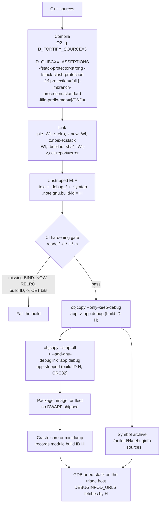

# C++ Hardened Release Builds and Separate Debug Symbols

> [!summary] Claim:
> A hardened release build is a stack of independent, cheap checks: glibc header wrappers that turn `memcpy` into `__memcpy_chk` with a compiler-computed object size (`_FORTIFY_SOURCE`), standard-library precondition checks (`_GLIBCXX_ASSERTIONS`, `_LIBCPP_HARDENING_MODE`), per-frame instrumentation (stack canaries, stack-clash probes, automatic variable initialization), hardware control-flow markers (CET on x86-64, PAC and BTI on AArch64), and loader policy recorded in the ELF file (PIE, `PT_GNU_RELRO`, `DF_BIND_NOW`, a non-executable `PT_GNU_STACK`).
> The same link that writes those markers also writes a `.note.gnu.build-id`, a hash over the output that survives stripping, so the full DWARF can be split off with `objcopy --only-keep-debug`, archived under that ID, and found again by GDB, `eu-unstrip`, or a debuginfod server when a core dump from a stripped binary arrives.
> Almost every check is cheap on 64-bit targets, and the exceptions are specific: frame instrumentation on functions with large or many local buffers, library bounds checks inside vectorizable loops, `-z now` at startup for binaries with thousands of PLT slots, and a PIE cost that the OpenSSF guide calls negligible on 64-bit while Fedora's `buildflags.md` still calls measurable against position-dependent code.
> The engineering job is to make hardening the default, prove it is present with `readelf` in CI, and grant per-function opt-outs only against a benchmark.



## The Mechanism

This note owns two halves of one release pipeline: which hardening options go into a production C++ binary and what each one does at the instruction and loader level, and how the debug information is split off, identified, and archived so that the shipped binary stays small.
Format internals are owned elsewhere: [[DWARF-Debug-Information-and-Symbol-Bundles]] owns DWARF and split DWARF, [[Symbol-Servers-and-debuginfod]] owns the debuginfod protocol and server federation, [[Dynamic-Linking-PLT-GOT-and-Loaders]] owns the GOT, PLT, and lazy binding, and [[Debug-a-Production-Crash-From-a-Core-Dump]] owns the incident procedure.
Sanitizers are test-time tools and live in [[Cpp-AddressSanitizer-and-LeakSanitizer-Internals]] and [[Cpp-UndefinedBehaviorSanitizer-and-UB-Field-Guide]]; the OpenSSF guide calls them unsuitable for production hardening, with the exception of the UBSan minimal runtime or trap mode.

### 1. The baseline and who sets it

The OpenSSF "Compiler Options Hardening Guide for C and C++" (last updated 2026-08-20) is the reference baseline, and its TL;DR is:

```text
-O2 -Wall -Wformat -Wformat=2 -Wconversion -Wimplicit-fallthrough \
-Werror=format-security \
-U_FORTIFY_SOURCE -D_FORTIFY_SOURCE=3 \
-D_GLIBCXX_ASSERTIONS \
-D_LIBCPP_HARDENING_MODE=_LIBCPP_HARDENING_MODE_FAST \
-fstrict-flex-arrays=3 \
-fstack-clash-protection -fstack-protector-strong \
-Wl,-z,nodlopen -Wl,-z,noexecstack \
-Wl,-z,relro -Wl,-z,now \
-Wl,--as-needed -Wl,--no-copy-dt-needed-entries
```

The same page then adds a second table of flags for specific situations (guide dated 2026-08-20):

| When | Additional flags |
| :--- | :--- |
| Using GCC | `-Wtrampolines -fzero-init-padding-bits=all` |
| Using GCC, and the source is left-to-right only | `-Wbidi-chars=any` |
| Executables | `-fPIE -pie` |
| Shared libraries | `-fPIC -shared` |
| x86-64 | `-fcf-protection=full -fzero-call-used-regs=used-gpr` |
| AArch64 | `-mbranch-protection=standard -fzero-call-used-regs=used-gpr` |
| Production code | `-fno-delete-null-pointer-checks -fno-strict-overflow -fno-strict-aliasing -ftrivial-auto-var-init=zero` |
| C code, treating obsolete constructs as errors | `-Werror=implicit -Werror=incompatible-pointer-types -Werror=int-conversion` |
| Multi-threaded C using glibc pthreads | `-fexceptions` |
| Development, not when distributing source | `-Werror` |

`-fzero-call-used-regs=used-gpr` belongs on the x86-64 and AArch64 rows, not in the production-code row.
The guide's later detailed table writes `-fzero-init-padding-bits=union`; GCC's spelling of that value is `unions`.

The options form five layers that fail independently, which is the point of stacking them:

| Layer | Options | Where the check runs | What a failure looks like |
| :--- | :--- | :--- | :--- |
| Diagnostics | `-Wformat=2`, `-Werror=format-security`, `-Wconversion`, `-Wimplicit-fallthrough`, `-Wtrampolines` | Compile time | Build error or warning |
| C library | `_FORTIFY_SOURCE` | Inline header wrappers plus `__*_chk` functions in libc | `*** buffer overflow detected ***: terminated`, then `SIGABRT` (glibc) |
| C++ library | `_GLIBCXX_ASSERTIONS`, `_LIBCPP_HARDENING_MODE` | Inline in templates | Assertion message and abort (libstdc++), trap (libc++ fast mode) |
| Code generation | Stack protector, stack-clash probes, `-ftrivial-auto-var-init`, CET, PAC and BTI | Every instrumented function | `*** stack smashing detected ***: terminated`, `SIGSEGV` on a guard page, control-protection fault |
| Linker and loader | PIE, RELRO, `BIND_NOW`, `noexecstack`, `--as-needed`, `nodlopen` | `ld.so` at load time | No runtime failure; the attack primitive (writable GOT, fixed addresses, executable stack) simply does not exist |

#### `-fhardened` (GCC 14)

GCC 14 added `-fhardened`, an umbrella option; its documented set, which the manual says "may change between major releases", is `-D_FORTIFY_SOURCE=3`, `-D_GLIBCXX_ASSERTIONS`, `-ftrivial-auto-var-init=zero`, `-fPIE -pie -Wl,-z,relro,-z,now`, `-fstack-protector-strong`, `-fstack-clash-protection`, and `-fcf-protection=full` on x86 GNU/Linux only.
It is supported only on GNU/Linux targets, it uses `-D_FORTIFY_SOURCE=2` when the system glibc is older than 2.35, and it enables an option only if that option was not already specified on the command line.
That last rule means `-fhardened -fstack-protector` yields the weaker `-fstack-protector`; `-Whardened` warns when an implied option is downgraded or skipped, and `gcc --help=hardened` prints the set for the installed version.
Clang has no `-fhardened` equivalent: Homebrew clang 23.1.6 rejects it with `unknown argument: '-fhardened'` (as of 2026-11, Both), so a portable build lists the options explicitly.

#### Distribution defaults

Distribution compilers and package build systems already inject much of this, which matters because a flag your build system adds may duplicate, override, or conflict with one the compiler driver adds.

| Distribution | Mechanism | Hardening it applies by default (as of 2026-11, Linux) |
| :--- | :--- | :--- |
| Fedora | `redhat-rpm-config` `%set_build_flags` and specs files | `-U_FORTIFY_SOURCE -Wp,-U_FORTIFY_SOURCE -Wp,-D_FORTIFY_SOURCE=3`, `-Wp,-D_GLIBCXX_ASSERTIONS`, `-fstack-protector-strong`, `-fstack-clash-protection`, `-fcf-protection` (x86-64), `-mbranch-protection=standard` (aarch64), `-fPIE`/`-pie`, `-z relro`, `-z now`, `-z pack-relative-relocs`, `--as-needed`, `-fno-omit-frame-pointer`, `-fasynchronous-unwind-tables`, `-grecord-gcc-switches`, annobin watermarks |
| Debian | `dpkg-buildflags` (dpkg-dev 1.23.12) | `-Wformat -Werror=format-security`, `-D_FORTIFY_SOURCE=2`, `-fstack-protector-strong`, `-fstack-clash-protection` (amd64, arm64, armhf, armel), `-z relro`, `-fcf-protection` (amd64), `-mbranch-protection=standard` (arm64); `bindnow` is off by default; PIE comes from GCC itself on most architectures |
| Ubuntu | Patched GCC driver | `_FORTIFY_SOURCE=3` when optimizing, since gcc-13 13.2.0-9ubuntu1 for Ubuntu 24.04 LTS (Launchpad bug 2012440); level 2 before that |
| macOS | SDK headers and Apple clang defaults | `_FORTIFY_SOURCE 2` defined by `<_types.h>` when unset, `-fstack-protector` (the driver predefines `__SSP__ 1`, not the strong variant), PIE; libc++ hardening mode `NONE` by default (verified below) |

Fedora's frame-pointer default is not uniform: `-fno-omit-frame-pointer` is added on every architecture except i686 and s390x, plus `-mno-omit-leaf-frame-pointer` on x86_64 and aarch64, and undefining `%_include_frame_pointers` can still leave a frame pointer where the ABI requires one (Fedora's example is aarch64).
`-z pack-relative-relocs` is in that same Fedora list except on s390x, where `buildflags.md` says the flag is disabled because of toolchain limitations.
Debian's `reproducible` area also enables `fixfilepath` by default (`-ffile-prefix-map=BUILDPATH=.`), which removes the build directory from generated files, including DWARF; `fixdebugpath` (`-fdebug-prefix-map`) is the narrower form, and `fixfilepath` takes precedence when both are set.

### 2. `_FORTIFY_SOURCE`: object sizes in libc headers

`_FORTIFY_SOURCE` is not a compiler feature; it is a glibc header feature that uses two compiler builtins.

#### Level selection in `features.h`

glibc's `include/features.h` maps the user macro to an internal level:

```c
#if defined _FORTIFY_SOURCE && _FORTIFY_SOURCE > 0
# if !defined __OPTIMIZE__ || __OPTIMIZE__ <= 0
#  warning _FORTIFY_SOURCE requires compiling with optimization (-O)
# elif !__GNUC_PREREQ (4, 1)
#  warning _FORTIFY_SOURCE requires GCC 4.1 or later
# elif _FORTIFY_SOURCE > 2 && (__glibc_clang_prereq (9, 0)
                               || __GNUC_PREREQ (12, 0))
#  if _FORTIFY_SOURCE > 3
#   warning _FORTIFY_SOURCE > 3 is treated like 3 on this platform
#  endif
#  define __USE_FORTIFY_LEVEL 3
# elif _FORTIFY_SOURCE > 1
#  if _FORTIFY_SOURCE > 2
#   warning _FORTIFY_SOURCE > 2 is treated like 2 on this platform
#  endif
#  define __USE_FORTIFY_LEVEL 2
# else
#  define __USE_FORTIFY_LEVEL 1
# endif
#endif
```

Three consequences follow directly from that code.
At `-O0` nothing is fortified and the only symptom is a `#warning`, which a debug build with warnings suppressed never shows.
Level 3 on GCC 11 or older, or on Clang older than 9, takes that next branch, sets `__USE_FORTIFY_LEVEL` to 2, and emits `#warning _FORTIFY_SOURCE > 2 is treated like 2 on this platform`, which a warning-suppressed build hides while still shipping the weaker check.
Fortification needs the compiler to inline the wrapper, so it applies only where glibc headers are included and the call is not through a function pointer.

#### The wrapper and the `__*_chk` function

`string/bits/string_fortified.h` replaces `memcpy` with an always-inline wrapper:

```c
__fortify_function void *
__NTH (memcpy (void *__restrict __dest, const void *__restrict __src,
	       size_t __len))
{
  return __builtin___memcpy_chk (__dest, __src, __len,
				 __glibc_objsize0 (__dest));
}
```

The compiler resolves `__builtin___memcpy_chk` in one of three ways.
If the object size is unknown (`(size_t) -1`), it emits a plain `memcpy`, so the check costs nothing and protects nothing.
If both the length and the object size are compile-time constants, it either emits a plain `memcpy` (the copy fits) or warns at compile time and emits a call to `__memcpy_chk` (the copy cannot fit).
Otherwise it emits `__memcpy_chk(dest, src, len, objsize)`, which compares `len` with `objsize` at run time and on overflow calls `__chk_fail()`.
`debug/chk_fail.c` calls `__fortify_fail ("buffer overflow detected")`, and `debug/fortify_fail.c` prints `*** %s ***: terminated` through `__libc_message`, which aborts the process.

#### Levels 1, 2, and 3

`misc/sys/cdefs.h` defines the size query:

```c
#define __bos(ptr) __builtin_object_size (ptr, __USE_FORTIFY_LEVEL > 1)
#define __bos0(ptr) __builtin_object_size (ptr, 0)

/* Use __builtin_dynamic_object_size at _FORTIFY_SOURCE=3 when available.  */
#if __USE_FORTIFY_LEVEL == 3 && (__glibc_clang_prereq (9, 0) ...
# define __glibc_objsize0(__o) __builtin_dynamic_object_size (__o, 0)
# define __glibc_objsize(__o) __builtin_dynamic_object_size (__o, 1)
#else
# define __glibc_objsize0(__o) __bos0 (__o)
# define __glibc_objsize(__o) __bos (__o)
#endif
```

- `memcpy`, `memmove`, `memset`, and the other memory wrappers always pass `__glibc_objsize0`, which is object-size type 0, the whole enclosing object, so a write that stays inside the struct but crosses a member is not caught.
- `strcpy` and the other string wrappers pass `__glibc_objsize`.
- At level 1 that query is also type 0.
- At level 2 and above it is type 1, the closest enclosing subobject, which catches member-to-member overflow.
- Level 2 also adds checks that `feature_test_macros(7)` warns "some conforming programs might fail", such as refusing `%n` in a writable format string, which Fedora's `buildflags.md` documents.
- Level 3 keeps those two types and replaces `__builtin_object_size` with `__builtin_dynamic_object_size`, which may return an expression evaluated at run time, so a buffer from `malloc(n)` or a variable-length array gets a real bound instead of "unknown".

The difference is visible in generated code; compiled here with Homebrew clang 23.1.5 (`-target x86_64-linux-gnu -O2 -S`, darwin-arm64 host), this function:

```c
size_t f2(char *dst, const char *src, size_t n) {
  char *p = __builtin_malloc(n);
  return __builtin_dynamic_object_size(p, 0) + __builtin_object_size(p, 0);
}
```

compiles to `leaq -1(%rdx), %rax`: the dynamic builtin returned `n` and the static builtin returned `(size_t) -1`, so their sum is `n - 1`.
At level 2 every `memcpy` into `p` would be unchecked; at level 3 it is checked against `n`.

Siddhesh Poyarekar's measurement over 96 packages from a Fedora test distribution found that level 3 improved fortification coverage "by nearly 4 times", for example from about 3.4% to nearly 47% of calls in bash and from 1.3% to 49.57% in sudo.
His follow-up (Red Hat Developer, 2023-02-06) reports "no slowdown at all" against level 2 on SPEC and "barely any impact on code size" across nearly 10 thousand Fedora rawhide packages; the article gives no percentages, so treat "negligible" as the published claim, not a bound for your hot path.
The OpenSSF guide gives about 0.1% for levels 1 and 2.

#### Versions

glibc's NEWS is the authority on availability, and it differs from some secondary sources:

- glibc 2.33 added level 3, noting it then worked only with LLVM 9 and later because GCC 10.2 lacked the builtin.
- glibc 2.35 announced level 3 "for applications compiling with glibc and gcc 12 and later", which is why `-fhardened` falls back to level 2 below glibc 2.35.
- GCC 12 (May 2022) added `__builtin_dynamic_object_size`.
- glibc 2.38 added `--enable-fortify-source` for building glibc itself fortified.
- glibc 2.40 "significantly enhanced" fortification for programs built with clang.

#### Failure modes specific to fortification

- `malloc_usable_size()` misuse: level 3 bounds a heap buffer by the size requested from `malloc`, so code that writes into the slack that `malloc_usable_size` reports now aborts; the Ubuntu bug names systemd and redis as fixed instances, and the OpenSSF guide lists it explicitly.
- Fake flexible arrays: a trailing `char data[1]` or `char data[0]` used as a variable-length tail has an object size of 1 or 0, so fortified copies into it abort; use C99 `char data[]` and `-fstrict-flex-arrays=3` (GCC 13, Clang 16), which treats only `[]` as flexible.
- AddressSanitizer: the OpenSSF guide says fortification and the sanitizers are incompatible, and that a fortified binary can make a sanitizer report a false negative or a false positive, so sanitizer builds should drop `_FORTIFY_SOURCE`.
- Redefinition: when a distribution driver already defines `_FORTIFY_SOURCE`, adding `-D_FORTIFY_SOURCE=3` produces a redefinition warning, which is why the baseline starts with `-U_FORTIFY_SOURCE`.

#### macOS

Apple's Libc uses the same builtin interface with a lower ceiling: `<secure/_common.h>` maps any `_FORTIFY_SOURCE > 1` to level 2 and only ever calls `__builtin_object_size`, and `<_types.h>` defines `_FORTIFY_SOURCE 2 /* on by default */` when the program has not defined it (Xcode SDK with Apple clang 21.0.0, as of 2026-11, macOS).
A fortified failure on macOS does not print anything: a 16-byte `strcpy` overflow compiled with `clang -O2` exits with status 133 (128 + `SIGTRAP`), stderr is empty, and the stack under LLDB is `__chk_fail_overflow` called from `__strcpy_chk` in `libsystem_c.dylib` (verified on macOS 27.3, arm64).

### 3. Standard library assertions

#### libstdc++: `_GLIBCXX_ASSERTIONS`

Defining `_GLIBCXX_ASSERTIONS` turns on precondition checks inside libstdc++ templates, "such as bounds checking in strings and null pointer checks when dereferencing smart pointers" (libstdc++ manual).
The checks are inline in headers, so they apply to the translation units compiled with the macro; they do not change object layout, so mixing checked and unchecked translation units is ABI-safe.
`_GLIBCXX_DEBUG` is a different thing: it enables the debug mode containers, implies `_GLIBCXX_ASSERTIONS`, and the OpenSSF guide restricts it to test builds because it changes the ABI.
Since GCC 15, `_GLIBCXX_ASSERTIONS` is defined by default when compiling without optimization; `-D_GLIBCXX_NO_ASSERTIONS` turns that off, and optimized builds still need the explicit define.
The OpenSSF guide reports slowdowns of up to 6% with some libstdc++ versions, and the mechanism is easy to reason about: every `operator[]` gains a compare and a branch to a cold abort path, which is free when branch prediction handles it and expensive when it blocks vectorization of a tight loop.

#### libc++: hardening modes (LLVM 18 and later)

libc++ replaced its old assertion macro with four modes selected by `_LIBCPP_HARDENING_MODE`:

| Mode | Macro value | Checks enabled | Default failure semantic |
| :--- | :--- | :--- | :--- |
| None | `_LIBCPP_HARDENING_MODE_NONE` | None | n/a |
| Fast | `_LIBCPP_HARDENING_MODE_FAST` | `valid-element-access`, `valid-input-range` | `quick-enforce` (trap) |
| Extensive | `_LIBCPP_HARDENING_MODE_EXTENSIVE` | Fast plus non-null, non-overlapping ranges, valid deallocation, valid external API calls, compatible allocators, argument domain, pedantic, uncategorized | `quick-enforce` (trap) |
| Debug | `_LIBCPP_HARDENING_MODE_DEBUG` | Extensive plus semantic requirements and internal assertions | `enforce` (message, then terminate) |

Fast mode is the production recommendation in both the libc++ documentation and the OpenSSF guide.
The macro must be defined before any standard header is included, and the documentation states that setting a hardening mode does not affect the ABI.
The checks that do need layout changes are separate vendor-time `LIBCXX_ABI_DEFINES`: bounded iterators for `span` and `string_view`, `basic_string`, `vector` (not `vector<bool>`), `std::array` (this one changes the array's size and layout, not only its iterator type), `optional`, and bounded `unique_ptr<T[]>` (which also changes the layout of unordered containers that store one).
For example, fast mode always checks element access through a `span` object, but whether dereferencing a `span` iterator is checked depends on that ABI flag.
The vendor default (`LIBCXX_HARDENING_MODE`) is `none`, and Apple ships it that way: the Xcode SDK's `__config_site` defines `_LIBCPP_HARDENING_MODE_DEFAULT 2`, and `__configuration/hardening.h` defines `_LIBCPP_HARDENING_MODE_NONE (1 << 1)`, which is 2 (libc++ `_LIBCPP_VERSION 220106`, Apple clang 21.0.0, as of 2026-11, macOS).
The documentation says those numeric values are unspecified and must not be relied on, so the Apple decode is one SDK's encoding, not a portable constant.
Assertion semantics (`_LIBCPP_ASSERTION_SEMANTIC`) are experimental and are unavailable in C++03; `observe` logs and continues into undefined behavior, which the documentation limits to the adoption period.
The same page's container table leaves `map`, `set`, and `function` unchecked and marks the unordered containers partial.

### 4. Frame-level instrumentation

#### Stack protector

The canary is one machine word chosen per process.
glibc's `_dl_setup_stack_chk_guard()` (`sysdeps/unix/sysv/linux/dl-osinfo.h`) copies one `uintptr_t` from the start of the 16-byte `AT_RANDOM` block and clears the lowest-addressed byte (the least significant byte on little-endian, the most significant byte on big-endian), so a string copy that reads or writes the canary stops at the NUL.
The next `uintptr_t` in that block is the pointer guard from `_dl_setup_pointer_guard`, not part of the canary.
On x86-64 the value lives in the thread control block: `tcbhead_t` in `sysdeps/x86_64/nptl/tls.h` places `stack_guard` after `tcb`, `dtv`, `self` (8 bytes each), two `int` fields, and `sysinfo`, which puts it at offset 0x28, the `%fs:40` in the generated code.
On AArch64 glibc uses a global `__stack_chk_guard` reached through the GOT.

Compiled here with Homebrew clang 23.1.5 for both targets (`-O2 -fstack-protector-strong`), a function with a 64-byte local buffer gets this prologue and epilogue on x86-64 with `-fcf-protection=full`:

```text
f:
	endbr64
	pushq	%rbx
	subq	$80, %rsp
	movl	%edi, %ebx
	movq	%fs:40, %rax
	movq	%rax, 72(%rsp)
	movq	%rsp, %rdi
	callq	sink@PLT
	movslq	%ebx, %rax
	movsbl	(%rsp,%rax), %eax
	movq	%fs:40, %rcx
	cmpq	72(%rsp), %rcx
	jne	.LBB0_2
	addq	$80, %rsp
	popq	%rbx
	retq
	callq	__stack_chk_fail@PLT
```

and this on AArch64 with `-mbranch-protection=standard`:

```text
f:
	hint	#25                  // paciasp
	sub	sp, sp, #112
	...
	adrp	x8, :got:__stack_chk_guard
	ldr	x8, [x8, :got_lo12:__stack_chk_guard]
	ldr	x8, [x8]
	stur	x8, [x29, #-8]
	bl	sink
	...
	ldur	x9, [x29, #-8]
	ldr	x8, [x8]
	cmp	x8, x9
	b.ne	.LBB0_2
	...
	hint	#29                  // autiasp
	ret
	bl	__stack_chk_fail
```

The cost per protected call is one load of the guard, one store, one reload, one compare, and a not-taken branch, plus one stack slot; on AArch64 the guard load goes through the GOT, which is one more dependent load than the x86-64 TLS access.
`__stack_chk_fail` calls `__fortify_fail ("stack smashing detected")`, so the message is `*** stack smashing detected ***: terminated`.

Which functions get a canary is the real policy choice:

| Option | Functions instrumented (GCC manual) | Linux kernel x86-64 defconfig, GCC 4.9 (Kees Cook, 2014) |
| :--- | :--- | :--- |
| `-fstack-protector` | Functions that call `alloca` and functions with buffers of at least 8 bytes (`--param=ssp-buffer-size`, default 8 in `params.opt`) | 1,015 of 36,110 functions (2.81%), kernel text +0.33% |
| `-fstack-protector-strong` (GCC 4.9) | Also any local array of any type or length, and locals whose address is taken | 7,401 functions (20.5%), kernel text +2.24% |
| `-fstack-protector-all` | Every function | Not measured in that post |
| `-fstack-protector-explicit` | Only functions with the `stack_protect` attribute | n/a |

The canary detects a contiguous overwrite of the saved return path, and only when the function returns; it does not stop an overwrite of an adjacent local that is used before return, a non-contiguous write through a corrupted index, or an attacker who has already leaked the canary.
Every child of `fork()` inherits the parent's canary because memory is copied, which is why a forking server that never calls `exec` exposes the same canary to repeated guessing.

#### Stack clash protection

The Stack Clash advisory (Qualys, 2017, CVE-2017-1000364 for the Linux kernel) showed that a guard page of a few kilobytes below the stack is insufficient when one function allocates a frame larger than the guard: the stack pointer moves past the guard without ever touching it, and the next write lands in whatever mapping is below.
`-fstack-clash-protection` (GCC 8, Clang 11) makes the compiler touch the stack at least once per probe interval while allocating a large or variable-size frame, so the guard page is always hit.
GCC's defaults are `stack-clash-protection-probe-interval=12` and `stack-clash-protection-guard-size=12`, both powers of two, so one probe per 4 KiB (`params.opt`, as of 2026-11, Both).
The GCC manual says most targets do not fully support the option: on those targets dynamic allocations are protected, and static frames get only limited protection, and only when the target supports `-fstack-check=specific`.
Functions with small fixed frames get no probes, so the cost is confined to functions with large arrays or `alloca`, which is also where Fedora's `buildflags.md` calls the overhead "very little".
It is a different option from the older `-fstack-check`, which the GCC manual documents separately as code "to verify that you do not go beyond the boundary of the stack"; do not substitute one for the other.

#### Automatic variable initialization

`-ftrivial-auto-var-init=zero|pattern` (GCC 12, Clang 8) initializes automatic variables that have no initializer.
GCC's `pattern` value is currently the repeated byte `0xFE`, chosen so that logic bugs crash recognizably; GCC still treats the variables as uninitialized for `-Wuninitialized` and for optimization, cannot initialize a variable whose initialization is bypassed by `switch` or `goto` (`-Wtrivial-auto-var-init` reports those), and zeroes structure padding.
GCC documents that for C++26 the default becomes zero initialization when no `-ftrivial-auto-var-init=` is given, without zeroing padding.
A separate GCC 15 flag, `-fzero-init-padding-bits`, covers padding bits in explicit initializers, which this option does not.
Its default, `standard`, adds no guarantee beyond the language; `unions` also zeroes padding outside a smaller initialized union member, which was GCC's behavior before 15; `all` also zeroes padding of other aggregates.
The OpenSSF guide recommends `-ftrivial-auto-var-init=zero` for production and puts `-fzero-init-padding-bits=all` on the GCC additional-options row.

The cost is a store, or a `memset`, per uninitialized local per call, which the compiler removes only when it can prove the store dead.
For large scratch buffers on a hot path this is not negligible; compiled here with clang 23.1.5 for x86-64:

```c
void hot(void)        { char big[4096]; consume(big); }
void hot_optout(void) { char big[4096] __attribute__((uninitialized)); consume(big); }
```

`hot` gains a `callq memset@PLT` for 4,096 bytes on every call and `hot_optout` does not; the `uninitialized` attribute is documented by GCC and accepted by Clang.
JF Bastien's RFC that introduced the Clang option (cfe-dev, 2018-11-15) cites prior publications reporting 2.7% to 4.5% average overhead and quotes the Visual Studio team that zero-initialization would have eliminated 49 MSRC cases of uninitialized struct data crossing a trust boundary between 2017 and mid-2018.

#### Register zeroing

`-fzero-call-used-regs=used-gpr` (GCC 11, Clang 16) zeroes the call-used general-purpose registers a function wrote before it returns.
Clang 15 accepted the flag, and `-fzero-call-used-regs=all` could emit a null dereference (LLVM issue 57692); the Linux kernel therefore required GCC or Clang newer than 15.0.6, and the fix shipped in Clang 16, which is the OpenSSF minimum.
The GCC manual also documents `leafy`, which behaves like `used` in a leaf function and like `all` in a nonleaf function (GCC manual, Common Attributes, `zero_call_used_regs`).
OpenSSH's hardened build selects `used` and skips the flag when the compiler is Clang 17, which hits an internal compiler error on some of its sources.
The OpenSSF guide cites, for the Linux kernel, under 1% performance impact on most workloads, image growth under 1% on x86-64 and about 5% on arm64, and about 20% fewer unique ROP gadgets, with an independent measurement reporting 36.5% fewer but about 13% more JOP and SYS gadgets.

### 5. Hardware control-flow integrity

#### x86-64 CET

`-fcf-protection=full` (GCC 8, Clang 7) emits `endbr64` (encoded `f3 0f 1e fa`, 4 bytes, a NOP on processors without CET) at every indirect branch target, which is the Indirect Branch Tracking (IBT) half, and marks the object compatible with shadow stacks (SHSTK).
A bare `-fcf-protection` is an alias for `-fcf-protection=full`.
The compiler defines `__CET__` with bit 0 set for `branch` and bit 1 set for `return`, so `full` is 3; the `nocf_check` attribute skips a function or a call.
The compiler records both features in a `.note.gnu.property` note as `GNU_PROPERTY_X86_FEATURE_1_IBT` and `_SHSTK`, and the linker ANDs these bits across every input object: one object without the property clears it for the whole output.
`-z cet-report=error` (GNU ld and lld) turns that silent downgrade into a link error, and the worked example below shows both behaviors.
GCC 14 refactored the option, so overriding a previous `-fcf-protection` now requires `-fcf-protection=none` followed by the value you want.

At run time the marker is advisory: the Linux kernel documentation states that "the kernel does not process these applications markers directly" and that the loader, in practice glibc, enables the feature with `arch_prctl(ARCH_SHSTK_ENABLE, ...)`.
The same document says that "today in the 64-bit kernel, only userspace shadow stack and kernel IBT are supported", so on Linux `endbr64` in user space is not enforced as of this writing, while user shadow stacks need `CONFIG_X86_USER_SHADOW_STACK`, CET hardware (`user_shstk` in `/proc/cpuinfo`), and a loader that enables them.
glibc 2.39 synced with the Linux 6.6 shadow stack interface and limits `--enable-cet` to x86-64.
The OpenSSF guide gives Linux 6.6 and glibc 2.39 as the minimum and says the feature must also be turned on at run time with `GLIBC_TUNABLES=glibc.cpu.hwcaps=SHSTK`.
The name `glibc.cpu.x86_shstk` appears in a glibc 2.32 bug title as a tunable that did not work; it is not the enable string the OpenSSF guide documents.

#### AArch64 PAC, BTI, and GCS

`-mbranch-protection=standard` (GCC 9, Clang 8) enables return-address signing and Branch Target Identification.
`paciasp` (hint #25, `d503233f`) signs the link register with the stack pointer as modifier at entry and `autiasp` (hint #29, `d50323bf`) authenticates it before `ret`, so a corrupted return address faults instead of returning; `bti c` (hint #34, `d503245f`) marks valid indirect-call targets.
All three are in the hint space, so they execute as NOPs on cores without the feature, which is what lets distributions ship one binary for every Armv8 core; PAC needs Armv8.3-A and BTI needs Armv8.5-A hardware to have an effect.
In the AArch64 listing in section 4 clang emitted `paciasp` without a separate `bti c` at the function entry, which is correct because `paciasp` and `pacibsp` act as an implicit `bti c`; LLVM's `AArch64BranchTargets.cpp` skips inserting `bti c` in front of them and still inserts a separate `bti` for `jc` targets, because depending on `SCTLR_EL1.BT0` and `BT1` they are not equivalent to `bti jc` (LLVM source, 2026-11-26).
GCC 15 extended `-mbranch-protection=standard` to include the Guarded Control Stack (GCS) extension, AArch64's shadow stack, and glibc 2.41 enables GCS support when built with binutils 2.44 and GCC 15 or later.

### 6. Linker and loader hardening

#### PIE

`-fPIE -pie` makes the executable itself relocatable so the kernel can randomize its base address; without it, ASLR randomizes libraries, stack, and heap but leaves the executable's code and GOT at fixed addresses.
The OpenSSF guide's headline for this cost is "Negligible on 64-bit architectures", against 5% to 10% for 32-bit x86 PIC, which it attributes to GOT register pressure; the same section says x86-64 RIP-relative addressing has a smaller impact than that 32-bit penalty.
Debian's `dpkg-buildflags(1)` is more specific: register-starved architectures (not i386 since GCC 5) can lose up to 15% on very text-heavy workloads, most workloads see less than 1%, and architectures with more registers, such as amd64, do not see as high a worst case.
Fedora's `buildflags.md` still calls the `-fPIE` impact "measurable" against position-dependent code.

#### RELRO and BIND_NOW

`-z relro` asks the linker for a `PT_GNU_RELRO` segment covering data that is written only during relocation (`.dynamic`, `.got`, `.init_array`, and similar); after relocation `ld.so` calls `mprotect` to make it read-only.
With lazy binding, `.got.plt` must stay writable because the resolver patches it on each first call, so partial RELRO still leaves the PLT GOT as an overwrite target.
`-z now` sets `DF_BIND_NOW` and `DF_1_NOW`, so `ld.so` resolves every `R_*_JUMP_SLOT` relocation at load time and the linker can place `.got.plt` inside the RELRO region; that combination is "full RELRO".
The worked example shows the segment map: with `-z relro -z now` lld places `.dynamic` and `.got.plt` in `GNU_RELRO`; with `-z norelro -z lazy` there is no `GNU_RELRO` segment at all.
The GNU ld manual adds a sharp edge: specifying a `common-page-size` smaller than the system page size "will render this protection ineffective", because `mprotect` works on whole pages.
The cost of `-z now` is startup time proportional to the number of symbol lookups it forces, which the OpenSSF guide states without a figure; count them with `readelf -r app | grep -c JUMP_SLOT` before deciding.
Relative relocations are a separate startup cost that `-z now` does not change; `-z pack-relative-relocs` emits the compact `DT_RELR` format that glibc 2.36 supports, and Fedora's flags enable it.

#### Stack executability and dependencies

`-z noexecstack` makes `PT_GNU_STACK` read-write without execute; the classic way to lose it is one assembly file without a `.note.GNU-stack` section or one GCC nested-function trampoline, which `-Wtrampolines` reports and GNU ld's `--warn-execstack` and `--error-execstack` catch at link time.
`--as-needed` records a `DT_NEEDED` entry only for libraries that resolve a symbol, which shrinks the load-time attack surface and startup work; `--no-copy-dt-needed-entries` has been GNU ld's default since binutils 2.22.
`-z nodlopen` marks a shared object as not loadable through `dlopen`, which is right for a library that should only ever be a link-time dependency and wrong for plugins.
GNU ld 2.47 documents `-z memory-seal`, which writes `GNU_PROPERTY_MEMORY_SEAL` asking the runtime to seal all `PT_LOAD` mappings against later `mprotect`, `munmap`, or remapping, and states that it "requires system support".
glibc 2.43's NEWS adds the Linux `mseal` function, described as sealing memory mappings against changes to protection, unmapping, relocation, or shrinking, but a search of glibc master (2026-11-26) found no occurrence of "seal" in `elf/elf.h`, `elf/dl-load.c`, `elf/dl-reloc.c`, or `elf/rtld.c`, so the glibc loader does not act on `GNU_PROPERTY_MEMORY_SEAL` as of 2026-11 (Linux).
Treat the linker option as a marker for a loader that implements it, and do not count it as an enforced protection on glibc today.
The OpenSSF guide discourages `-Wl,-rpath`, because a hard-coded search path, especially a relative one or `$ORIGIN` in a setuid program, can let an attacker supply a library.

### 7. Separating debug information from the shipped binary

#### What `-g` costs and what to keep

GCC's `-g` defaults to level 2 and DWARF version 5 on most targets (version 2 on VxWorks, TPF, and Darwin/macOS, version 4 on AIX), `-g1` keeps functions, external variables, and line tables but no locals, and `-g3` adds macro definitions.
For a release, build with `-g` and split, so the shipped stripped binary is the same machine code the archived debug file describes; the worked example's `.text` hash is identical whether or not the DWARF records different paths.
GCC ships a self-check for the same property: `-fcompare-debug` compiles a second time with `-gtoggle` (the default option set, which flips `-g`), dumps the final internal representation of both compilations, and "print[s] an error if they differ"; setting `GCC_COMPARE_DEBUG` to a non-empty, nonzero value enables it for a whole build (GCC manual, Developer Options).
That gives a release team a way to test, on the GCC they ship, that adding `-g` does not change generated code.
Two GCC defaults help release engineering: `-grecord-gcc-switches` is on, appending the compiler options to `DW_AT_producer`, which lets an audit read the hardening flags back out of the archived debug file, and `-fdebug-prefix-map=old=new` (or `-ffile-prefix-map`, which also covers `__FILE__`) rewrites recorded paths.

#### The GNU build ID

`--build-id` writes a `.note.gnu.build-id` note whose contents identify the linked file.
GNU ld 2.47 offers `sha1` (the default when no style is given, 160 bits), `md5` (128 bits), `xx` (128-bit XXHASH), `uuid` (128 random bits), `0x<hex>` (a chosen value), and `none`; lld offers `fast`, `md5`, `sha1`, `tree` (an alias for `sha1`), `uuid`, `0x<hex>`, and `none`, and documents that `fast` "is not intended to be cryptographically secure".
The hash styles are computed over the output contents, so an identical output has an identical ID, and the ld manual says the ID "is not intended to be compared as a checksum for the file's contents": later tools such as `strip` change the file but not the note.
Because the hash covers the debug sections too, anything recorded only in DWARF, such as the absolute build directory in `DW_AT_comp_dir`, changes the build ID even when the machine code is identical; the worked example shows two checkouts producing two IDs until `-ffile-prefix-map` is added.
`uuid` makes every link unique and therefore defeats reproducible builds, which [[Reproducible-Builds-as-a-Security-Control]] covers.
Build ID support and the separation fixes landed in binutils 2.18 (GDB manual).

#### The split recipe

The binutils manual's procedure is three commands on a fully linked file:

```bash
objcopy --only-keep-debug app app.debug       # debug sections, symbols, all notes
objcopy --strip-debug app                     # or --strip-all, or --strip-unneeded
objcopy --add-gnu-debuglink=app.debug app     # .gnu_debuglink: basename + CRC32
```

- `--only-keep-debug` keeps the debug sections and, for ELF, every note, and keeps the headers of all other sections with their sizes and addresses but changes their type to `NOBITS`, so the debug file maps onto the executable's address layout "even if that executable has been relocated" (objcopy manual).
- `--strip-debug` (`-g`) removes debug sections and debug symbols; `--strip-unneeded` additionally removes symbols not needed for relocation; `--strip-all` (`-S`) removes the static symbol table too, leaving only `.dynsym`, which the loader needs.
- `--add-gnu-debuglink` records the file name without directories, zero to three bytes of padding to a 4-byte boundary, and a 4-byte CRC32 of the whole debug file in the executable's byte order; the CRC is the IEEE 802.3 polynomial, reflected, with initial value and final XOR `0xffffffff`, which is exactly zlib's `crc32()`.
- The debug file must exist when the link is added, so add it in the build directory using the bare file name, not the future install path.
- elfutils' `eu-strip -f app.debug app` does all three steps in one command (GDB manual: elfutils 0.53 and later).

GDB looks for the debug file in this order for an executable `/usr/bin/ls` with build ID `abcdef1234` and debug link `ls.debug`, then falls back to debuginfod if enabled:

1. `/usr/lib/debug/.build-id/ab/cdef1234.debug` (the build ID method, first two hex digits as a directory).
2. `/usr/bin/ls.debug`.
3. `/usr/bin/.debug/ls.debug`.
4. `/usr/lib/debug/usr/bin/ls.debug`.

The build ID path wins because it is unambiguous; the debug link CRC catches a debug file from another build of the same name, which GDB reports as a warning ("the debug information found in ... does not match ... (CRC mismatch).") and refuses to use (GDB `symfile.c`, `separate_debug_file_exists`).

#### Making debug information smaller

| Technique | Mechanism | Where it applies |
| :--- | :--- | :--- |
| `-gz=zlib` or `-gz=zstd`; `--compress-debug-sections=zlib` or `=zstd` (ld, lld, objcopy) | Compresses each `.debug_*` section in place and sets `SHF_COMPRESSED` (ELF gABI); `zlib-gnu` is the obsolete `.zdebug` renaming form; a section that would grow is left uncompressed; lld's zlib default is level 1 | Debug file or unstripped binary; readers need zstd support for `zstd` |
| `dwz` (0.17 listed on sourceware.org, as of 2026-11) | Moves duplicated DWARF into `DW_TAG_partial_unit` units imported with `DW_TAG_imported_unit`; `-m` builds a multifile shared by several debug files | Distribution debug packages; Fedora runs it by default through `find-debuginfo` |
| Split DWARF (`-gsplit-dwarf`, `.dwo`, `.dwp`) | Most DWARF stays out of the object files and the link | Link time and memory at scale; owned by [[DWARF-Debug-Information-and-Symbol-Bundles]] |
| MiniDebugInfo (`.gnu_debugdata`) | An xz-compressed ELF holding a symbol table of the functions not already in `.dynsym`, embedded in the stripped binary | Function names in backtraces with no debug file installed; GDB needs LZMA support; Fedora default (`_include_minidebuginfo`) |

The GDB manual's MiniDebugInfo recipe is worth knowing exactly, because it is how a stripped binary keeps symbolizable function names for profilers and `systemd-coredump`:

```bash
nm -D binary --format=posix --defined-only | awk '{ print $1 }' | sort > dynsyms
nm binary --format=posix --defined-only \
  | awk '{ if ($2 == "T" || $2 == "t" || $2 == "D") print $1 }' | sort > funcsyms
comm -13 dynsyms funcsyms > keep_symbols
objcopy --only-keep-debug binary debug
objcopy -S --remove-section .gdb_index --remove-section .comment \
  --keep-symbols=keep_symbols debug mini_debuginfo
strip --strip-all -R .comment binary
xz mini_debuginfo
objcopy --add-section .gnu_debugdata=mini_debuginfo.xz binary
```

#### Distribution conventions

- Debian builds `foo-dbgsym` packages automatically with debhelper's `dh_strip` (first implemented in debhelper 9.20151219), uses the `.ddeb` extension, and publishes them in a separate `debug` archive component.
- Fedora's `find-debuginfo` (from `debugedit`) produces `-debuginfo` and `-debugsource` subpackages by default, fails the build on a missing build ID (`_missing_build_ids_terminate_build`), recomputes build IDs to match the final binary content unless `_no_recompute_build_ids` is defined as `1`, adds `.gdb_index`, runs `dwz`, and keeps MiniDebugInfo.
- `ld --package-metadata=JSON` writes a `.note.package` ELF note following the systemd ELF package metadata specification, so a core dump can name the package and version that owned the crashing binary.
- debuginfod, introduced in elfutils 0.178 (2019-11), serves debug files and sources by build ID over HTTP; clients read the space-separated `DEBUGINFOD_URLS`, and public servers include `debuginfod.elfutils.org`, which federates to distribution servers such as `debuginfod.debian.net`, `debuginfod.fedoraproject.org`, and `debuginfod.ubuntu.com`; IMA signature verification of downloads needs elfutils 0.192 or later.
  The protocol, caching, and federation are owned by [[Symbol-Servers-and-debuginfod]].

#### macOS

Mach-O inverts the Linux arrangement: the linker leaves DWARF in the object files and writes a debug map of `N_OSO` stab entries pointing at them, `dsymutil` collects the DWARF into an `app.dSYM` bundle, and the binary and the bundle are matched by the 128-bit `LC_UUID` load command, which `dwarfdump --uuid` prints for both.
The clang driver runs `dsymutil` itself when `-g` compiles and links in one command; running `dsymutil` again afterwards does not fail, but the temporary object files are already deleted, so it exits 0 and writes a dSYM with no debug information while printing only warnings (observed 2026-11-26 on macOS arm64: `unable to open object file: No such file or directory`, then `warning: no debug symbols in executable (-arch arm64)`).
Code signing, universal binaries, and their interaction with stripping belong to [[Cpp-macOS-Universal-Binaries-Code-Signing-and-Notarization]].

### 8. Symbolicating a crash without shipping debug information

A Linux core dump holds the ELF headers of every mapped file when bit 4 of `/proc/<pid>/coredump_filter` is set; `core(5)` documents the default as `0x33` (bits 0, 1, 4, and 5), with bit 4 depending on `CONFIG_CORE_DUMP_DEFAULT_ELF_HEADERS`.
Those first pages contain each module's build ID note, so `eu-unstrip -n --core=core` can list module, address range, and build ID from the core alone, and a debugger on the triage host can fetch the matching debug files from the archive or debuginfod by ID.
That is the whole reason to keep `.note.gnu.build-id` in an allocated, loaded segment: lld places it in the first `PT_LOAD` (worked example, segment 01) so it is always in the core.
The incident procedure, including how to prove the core and the debug file match, is [[Debug-a-Production-Crash-From-a-Core-Dump]], and minidump capture is [[Core-Dumps-Minidumps-and-Crash-Reporting]].

## Commands and Numbers to Know

| Item | Value | Platform and date | What it controls |
| :--- | :--- | :--- | :--- |
| `_FORTIFY_SOURCE` levels | 1, 2, 3; values above 3 treated as 3 | Linux (glibc), as of 2026-11 | Level 3 uses `__builtin_dynamic_object_size` |
| Level 3 prerequisites | GCC 12 or Clang 9, glibc 2.35 for GCC (2.33 for Clang), `-O1` or higher | Linux, as of 2026-11 | An older compiler warns and uses level 2 |
| Fortify failure text | `*** buffer overflow detected ***: terminated` | Linux (glibc), as of 2026-11 | `__chk_fail` then abort |
| Canary failure text | `*** stack smashing detected ***: terminated` | Linux (glibc), as of 2026-11 | `__stack_chk_fail` then abort |
| macOS fortify failure | Exit 133 (`SIGTRAP`), no stderr, `__chk_fail_overflow` | macOS 27.3 arm64, as of 2026-11 | Libc traps instead of printing |
| x86-64 canary location | `%fs:0x28` (`tcbhead_t.stack_guard`) | Linux x86-64, as of 2026-11 | Per-thread TCB copy of the process canary |
| `ssp-buffer-size` | 8 bytes | Both (GCC), as of 2026-11 | Smallest buffer `-fstack-protector` instruments |
| Stack-clash probe interval and guard | `2^12` = 4 KiB each (`params.opt` defaults) | Linux (GCC), as of 2026-11 | One probe per 4 KiB of large frames |
| `-fstack-protector-strong` coverage | 20.5% of kernel functions vs 2.81% for regular | Linux x86-64, GCC 4.9, 2014 | Kees Cook measurement, kernel text +2.24% |
| `-ftrivial-auto-var-init=pattern` byte | `0xFE` | Both (GCC), as of 2026-11 | Recognizable poison in crash dumps |
| `-fhardened` | GCC 14+, GNU/Linux only | Linux, as of 2026-11 | `gcc --help=hardened` lists the set |
| `_GLIBCXX_ASSERTIONS` default | On at `-O0` since GCC 15, off when optimizing | Both (libstdc++), as of 2026-11 | `-D_GLIBCXX_NO_ASSERTIONS` opts out |
| libc++ production mode | `_LIBCPP_HARDENING_MODE_FAST` (libc++ 18+) | Both, as of 2026-11 | Traps on out-of-bounds element access |
| Apple libc++ default | `NONE` (`_LIBCPP_HARDENING_MODE_DEFAULT 2`) | macOS (Xcode, Apple clang 21), as of 2026-11 | Opt in explicitly |
| `endbr64` | `f3 0f 1e fa`, 4 bytes | Linux x86-64, as of 2026-11 | NOP on non-CET CPUs |
| `paciasp`, `autiasp`, `bti c` | `hint #25`, `#29`, `#34` | Linux AArch64, as of 2026-11 | NOP on cores without PAC or BTI |
| User shadow stack | Linux 6.6+, glibc 2.39+, enabled at run time | Linux x86-64, as of 2026-11 | Kernel does not read ELF markers itself |
| GNU ld `--build-id` default style | `sha1` (160 bits, 40 hex digits) | Linux (binutils 2.47), as of 2026-11 | Also `md5`, `xx`, `uuid`, `0x...`, `none` |
| lld `--build-id` styles | `fast`, `md5`, `sha1`, `tree`, `uuid`, `0x...`, `none` | Both (lld 23), as of 2026-11 | `fast` is not cryptographic |
| Debug link CRC | IEEE 802.3 CRC-32, equals zlib `crc32()` | Both, as of 2026-11 | Stored in the file's byte order |
| Build ID debug path | `/usr/lib/debug/.build-id/xx/rest.debug` | Linux, as of 2026-11 | First place GDB looks |
| `coredump_filter` default | `0x33` (bits 0, 1, 4, 5) | Linux, as of 2026-11 | Bit 4 keeps ELF headers, hence build IDs, in cores |
| Cargo release `strip` | `"debuginfo"` implied when debuginfo is off, since Cargo 1.77; Windows MSVC excluded since 1.77.1 | Both, as of 2026-11 | Hello world on Linux x64 went from about 4.5 MiB to about 450 KiB; before rustc 1.79, `-C strip=debuginfo` also omitted `*.pdb` on MSVC |
| Inspect hardening | `readelf -d` (`FLAGS BIND_NOW`, `FLAGS_1 NOW PIE`), `readelf -lW` (`GNU_RELRO`, `GNU_STACK`), `readelf -n` (build ID, `x86 feature: IBT, SHSTK`) | Linux, as of 2026-11 | The CI gate |

## Multi-Language Comparison: C++ / Python / Rust

| Concern | C++ (GCC or Clang on glibc) | Python (CPython and native extensions) | Rust (rustc and Cargo) |
| :--- | :--- | :--- | :--- |
| Out-of-bounds access | Unchecked by default; `_GLIBCXX_ASSERTIONS` or libc++ fast mode adds checks in the library | Checked by the interpreter for Python objects; C extensions are C or C++ and need the C++ column | Slice and index bounds checks always on; `get_unchecked` is `unsafe` |
| libc call checks | `_FORTIFY_SOURCE` | The interpreter's own build flags; extensions built with setuptools take `CC`, `CFLAGS`, `CCSHARED`, and `LDSHARED` from the interpreter's `sysconfig` (`configure_system()` in `setuptools/_distutils/compilers/C/unix.py`), so a distribution Python passes its hardening flags and other builds may not | Calls into libc go through `libc` crate declarations, not glibc's inline wrappers, so fortification does not apply |
| Integer overflow | Undefined for signed types unless `-fwrapv` or `-fno-strict-overflow` | Arbitrary precision for `int` | `overflow-checks` follows `debug-assertions`, so off in release by default; wrapping is defined, not UB |
| Stack protector | `-fstack-protector-strong` | Inherited from the interpreter build | Nightly-only `-Z stack-protector` |
| CET and PAC | `-fcf-protection=full`, `-mbranch-protection=standard` | Inherited | Nightly-only `-Z cf-protection`; the standard library is not CET-enabled by default, so the AND rule drops the property unless the standard library is rebuilt with `-Z build-std` |
| RELRO and BIND_NOW | `-z relro -z now` explicit | Inherited | Full RELRO by default where supported (`-C relro-level`) |
| PIE | Distribution default or `-fPIE -pie` | Inherited | `relocation-model=pic` is the default for most targets |
| Debug info in release | Whatever the build passes | Interpreter and wheels vary by distributor | `debug = false` in the release profile, and Cargo 1.77+ implies `strip = "debuginfo"`, except Windows MSVC since 1.77.1 |
| Split debug info | `objcopy`, `-gsplit-dwarf`, `dsymutil` | Wheel repair tools may strip; [[Python-Wheels-Platform-Tags-Manylinux-and-ABI3]] covers the wheel side | `off` is the ELF and windows-gnu default; `packed` is the Windows MSVC and macOS default (`.pdb`, `.dSYM`; `.dwp` elsewhere); `unpacked` is `.dwo` or the original objects (as of 2026-11) |
| Stripping semantics | `strip` variants change only the file | Same tools | `-C strip=symbols` can break backtraces; the rustc book says stripping "cannot be relied on as a meaningful security or obfuscation measure" |

## Worked Lab Example

This note has no lab under `code/`; the outputs below were captured once on this machine (darwin-arm64, Homebrew LLVM and lld 23.1.5, Apple clang 21.0.0) by cross-compiling a freestanding x86-64 Linux ELF that is inspected, never executed, plus a native macOS binary.
Replace `/opt/homebrew/...` with your LLVM install path, or use GNU `gcc`, `ld`, `readelf`, and `objcopy` on Linux, whose output has the same fields.

### Step 1: build a hardened PIE and a soft one from the same objects

`app.c` has one function with a 64-byte local array, so `-fstack-protector-strong` instruments it, and one indirect call:

```c
/* Freestanding demo: no libc, so it links on any host; it is inspected, not run. */
typedef unsigned long size_t;
int dep_scale(int x);
void __stack_chk_fail(void) { for (;;) { } }
static void fill(char *p, size_t n) { for (size_t i = 0; i < n; ++i) p[i] = (char)i; }
int handler(int n) {
  char buf[64];
  fill(buf, sizeof buf);
  return dep_scale(buf[n & 63]);
}
static int (*volatile dispatch)(int) = handler;
void _start(void) {
  volatile int r = dispatch(7);
  (void)r;
  for (;;) { }
}
```

```bash
#!/usr/bin/env bash
set -euo pipefail
L=/opt/homebrew/opt/llvm/bin
LLD=/opt/homebrew/bin/ld.lld
CF=(-target x86_64-linux-gnu -O2 -g -fPIC -fstack-protector-strong -fcf-protection=full -ffreestanding -fno-builtin)
"$L/clang" "${CF[@]}" -c dep.c -o dep.o            # dep.c: int dep_scale(int x) { return x * 3; }
"$LLD" -shared -soname libdep.so -z noexecstack dep.o -o libdep.so
"$L/clang" "${CF[@]}" -fPIE -c app.c -o app.o
"$LLD" -pie --build-id=sha1 -z relro -z now -z noexecstack -z cet-report=error -e _start app.o libdep.so -o app.hardened
"$LLD" -pie --build-id=sha1 -z norelro -z lazy -e _start app.o libdep.so -o app.soft
```

```bash
for b in app.hardened app.soft; do
  echo "== $b"
  llvm-readelf -d $b | grep -E 'FLAGS|NEEDED|JMPREL|PLTREL'
  llvm-readelf -lW $b | grep -E 'GNU_RELRO|GNU_STACK|LOAD|GNU_PROPERTY'
  llvm-readelf -n $b | grep -E 'Build ID|feature'
done
```

Output (darwin-arm64 host, x86_64-linux-gnu target, lld 23.1.5):

```text
== app.hardened
  0x0000000000000001 (NEEDED)    Shared library: [libdep.so]
  0x000000000000001e (FLAGS)     BIND_NOW 
  0x000000006ffffffb (FLAGS_1)   NOW PIE 
  0x0000000000000017 (JMPREL)    0x388
  0x0000000000000002 (PLTRELSZ)  24 (bytes)
  0x0000000000000014 (PLTREL)    RELA
  LOAD           0x000000 0x0000000000000000 0x0000000000000000 0x0003e0 0x0003e0 R   0x1000
  LOAD           0x0003e0 0x00000000000013e0 0x00000000000013e0 0x0000f0 0x0000f0 R E 0x1000
  LOAD           0x0004d0 0x00000000000024d0 0x00000000000024d0 0x000150 0x000b30 RW  0x1000
  LOAD           0x000620 0x0000000000003620 0x0000000000003620 0x000008 0x000008 RW  0x1000
  GNU_RELRO      0x0004d0 0x00000000000024d0 0x00000000000024d0 0x000150 0x000b30 R   0x1
  GNU_STACK      0x000000 0x0000000000000000 0x0000000000000000 0x000000 0x000000 RW  0x0
  GNU_PROPERTY   0x0002d0 0x00000000000002d0 0x00000000000002d0 0x000020 0x000020 R   0x8
    Build ID: 4e0ac964460d4fda1871b4495735d17f4cdb369b
    Properties:    x86 feature: IBT, SHSTK
== app.soft
  0x0000000000000001 (NEEDED)    Shared library: [libdep.so]
  0x000000006ffffffb (FLAGS_1)   PIE 
  0x0000000000000017 (JMPREL)    0x318
  0x0000000000000002 (PLTRELSZ)  24 (bytes)
  0x0000000000000014 (PLTREL)    RELA
  LOAD           0x000000 0x0000000000000000 0x0000000000000000 0x000370 0x000370 R   0x1000
  LOAD           0x000370 0x0000000000001370 0x0000000000001370 0x0000f0 0x0000f0 R E 0x1000
  LOAD           0x000460 0x0000000000002460 0x0000000000002460 0x000148 0x000148 RW  0x1000
  GNU_STACK      0x000000 0x0000000000000000 0x0000000000000000 0x000000 0x000000 RW  0x0
  GNU_PROPERTY   0x000260 0x0000000000000260 0x0000000000000260 0x000020 0x000020 R   0x8
    Build ID: d338c13572cc8d526f75b16855a02a879c9a55e5
    Properties:    x86 feature: IBT, SHSTK
```

`llvm-readelf -lW app.hardened` also prints the section-to-segment map, in which segment 03 (the third `LOAD`) and segment 06 (`GNU_RELRO`) both hold `.dynamic .got.plt .relro_padding`: under `-z now` the PLT GOT is inside the read-only-after-relocation region, and the soft build has no such segment.
The two build IDs differ even though the code is identical, because the link options changed the output bytes.

### Step 2: one legacy object silently drops CET

```bash
clang -target x86_64-linux-gnu -O2 -fPIC -ffreestanding -fno-builtin -c legacy.c -o legacy.o   # no -fcf-protection
ld.lld -pie -z now -z cet-report=error -e _start app.o legacy.o libdep.so -o app.mixed
ld.lld -pie -z now -e _start app.o legacy.o libdep.so -o app.mixed && \
  { llvm-readelf -n app.mixed | grep -E 'feature' || echo "no x86 feature property"; }
```

```text
ld.lld: error: legacy.o: -z cet-report: file does not have GNU_PROPERTY_X86_FEATURE_1_IBT property
ld.lld: error: legacy.o: -z cet-report: file does not have GNU_PROPERTY_X86_FEATURE_1_SHSTK property
no x86 feature property
```

Without `-z cet-report=error` the link succeeds and the output simply has no CET property, so a loader will never enable shadow stacks for it; nothing in the build log says so.

### Step 3: split, strip, link, and check the identities

```bash
cp app.hardened app
llvm-objcopy --only-keep-debug app app.debug
llvm-objcopy --strip-all app app.stripped
llvm-objcopy --add-gnu-debuglink=app.debug app.stripped
ls -l app app.debug app.stripped | awk '{print $5, $9}'
for f in app app.debug app.stripped; do echo "== $f"; llvm-readelf -n $f | grep 'Build ID'; done
llvm-readelf -SW app.debug | grep -E '\.text|\.dynamic|\.got|\.debug_info|\.debug_line |\.symtab|\.note'
llvm-readelf -x .gnu_debuglink app.stripped
python3 -c "import zlib; print('zlib.crc32(app.debug) = 0x%08x' % zlib.crc32(open('app.debug','rb').read()))"
```

```text
5728 app
5704 app.debug
2984 app.stripped
== app
    Build ID: 4e0ac964460d4fda1871b4495735d17f4cdb369b
== app.debug
    Build ID: 4e0ac964460d4fda1871b4495735d17f4cdb369b
== app.stripped
    Build ID: 4e0ac964460d4fda1871b4495735d17f4cdb369b
  [ 1] .note.gnu.build-id NOTE           00000000000002a8 0002a8 000024 00   A  0   0  4
  [ 2] .note.gnu.property NOTE           00000000000002d0 0002d0 000020 00   A  0   0  8
  [10] .text             NOBITS          00000000000013e0 0003e0 0000b2 00  AX  0   0 16
  [13] .dynamic          NOBITS          00000000000024d0 0004d0 000130 10  WA  6   0  8
  [14] .got.plt          NOBITS          0000000000002600 0004d0 000020 00  WA  0   0  8
  [19] .debug_info       PROGBITS        0000000000000000 0007b4 00012b 00      0   0  1
  [25] .debug_line       PROGBITS        0000000000000000 000b60 000096 00      0   0  1
  [27] .symtab           SYMTAB          0000000000000000 000c90 0000c0 18     29   4  8

Hex dump of section '.gnu_debuglink':
0x00000000 6170702e 64656275 67000000 507f0efa app.debug...P...
zlib.crc32(app.debug) = 0xfa0e7f50
```

(`llvm-readelf` also warns `no valid dynamic table was found` for `app.debug`, which is expected: `.dynamic` is `NOBITS` there.)
The build ID is identical in all three files, `.text` and `.dynamic` in the debug file are `NOBITS` with their original addresses and sizes, and the debug link is `app.debug`, its terminating NUL, two bytes of padding to the 4-byte boundary at offset 12, then `50 7f 0e fa`, which is `0xfa0e7f50` little-endian and equals zlib's CRC32 of `app.debug`.
The program is tiny, so DWARF is only about half the file; in a real C++ service the debug file is usually many times larger than the stripped binary, which is the reason for the whole exercise.
A single rerun of Steps 1 to 3 on 2026-11-26 with Homebrew clang and lld 23.1.6 reproduced every flag, segment, section-to-segment map, `NOBITS` section, and both `cet-report` errors above, but gave different build IDs, 16-byte larger `app` and `app.debug` files (5744 and 5720 bytes), and a different debug-link CRC.
Two recorded inputs changed between the runs: the absolute build directory in `DW_AT_comp_dir` (Step 4) and the toolchain version, which clang writes into `DW_AT_producer` and `.comment` and lld appends to `.comment`; either one alone changes the build ID, which is why a matching rebuild needs both a prefix map and a pinned toolchain.

### Step 4: the build ID depends on the checkout path

`repro.sh` compiles the same `app.c` in two directories, with and without `-ffile-prefix-map`, and prints the build ID next to a hash of `.text`:

```bash
build() { # $1 = checkout dir, $2 = map|nomap
  local d=$1 mode=$2 extra=()
  rm -rf "$d"; mkdir -p "$d"; cp app.c "$d/"
  [ "$mode" = map ] && extra=(-ffile-prefix-map="$HERE/$d"=.)
  ( cd "$d" && "$L/clang" "${CF[@]}" "${extra[@]}" -c app.c -o app.o &&
    "$LLD" -pie --build-id=sha1 -z relro -z now -e _start app.o "$HERE/libdep.so" -o app &&
    "$L/llvm-objcopy" -O binary --only-section=.text app text.bin )
  printf '%-16s %-6s build-id %s  .text sha256 %s\n' "$d" "$mode" \
    "$("$L/llvm-readelf" -n "$d/app" | awk '/Build ID/{print $3}')" \
    "$(shasum -a 256 "$d/text.bin" | cut -c1-16)"
}
```

```text
ws-alice/src     nomap  build-id 9f353401490395964d4c8ca649759ecae4421a4e  .text sha256 60a6d5d6d7801f97
ws-bob/checkout  nomap  build-id 040e9cc919f97799cf2e6d95048e0d5d0b33dbf5  .text sha256 60a6d5d6d7801f97
ws-alice/src     map    build-id b493907362cb4cdd53375f119a8b8049bd8a4a06  .text sha256 60a6d5d6d7801f97
ws-bob/checkout  map    build-id b493907362cb4cdd53375f119a8b8049bd8a4a06  .text sha256 60a6d5d6d7801f97
```

The machine code is byte-identical in all four builds, yet the unmapped builds get different build IDs because `DW_AT_comp_dir` and the file names in `.debug_line` record the absolute checkout path.
With the prefix mapped, both checkouts produce the same ID, which is what lets a rebuild of a tagged release match the archived debug file.
This block is from the original capture (darwin-arm64, LLVM and lld 23.1.5, cross-compiled x86-64 ELF) and was not re-run on 23.1.6.
The unmapped IDs depend on the absolute path of this machine's job directory, so they will differ on yours; the mapped ID should not, given the same compiler and linker versions.

### Step 5: macOS, the same ideas with different names

```bash
clang -O2 -g -c mac.c -o mac.o && clang mac.o -o macapp
xcrun nm -u macapp
xcrun dsymutil macapp -o macapp.dSYM && xcrun strip -x macapp
xcrun dwarfdump --uuid macapp macapp.dSYM
./macapp AAAAAAAAAAAAAAAAAAAAAAAAAAAAAAAAAAAAAAA; echo "exit=$?"
```

where `mac.c` copies `argv[1]` into a 16-byte buffer with `strcpy`.

```text
___stack_chk_fail
___stack_chk_guard
___strcpy_chk
_puts
UUID: 732DF5AB-01DF-3826-AA73-79A5B96FEE3F (arm64) macapp
UUID: 732DF5AB-01DF-3826-AA73-79A5B96FEE3F (arm64) macapp.dSYM/Contents/Resources/DWARF/macapp
exit=133
```

With no flags at all, the SDK's default `_FORTIFY_SOURCE 2` turned `strcpy` into `__strcpy_chk` and Apple clang's default stack protector added the canary symbols; rebuilding with `-D_FORTIFY_SOURCE=0` leaves plain `_strcpy`.
The overflow ends in a silent `SIGTRAP`, and the stripped binary and its dSYM share one UUID.

## Pitfalls

> [!warning] Pitfall: fortification that is not there
> `_FORTIFY_SOURCE` at `-O0` emits `#warning _FORTIFY_SOURCE requires compiling with optimization (-O)` and defines no fortify level.
> Level 3 with GCC 11 or older, or Clang older than 9, emits `#warning _FORTIFY_SOURCE > 2 is treated like 2 on this platform` and sets level 2.
> A `-O0` "release" (common in debug-friendly builds of latency-critical code) ships no libc checks at all, and a warning-suppressed old compiler ships level 2 while the flag still says 3.
> Verify in the binary: `readelf --dyn-syms app | grep -c '_chk@'` should be non-zero for code that calls `memcpy` or `snprintf` on sized buffers.

> [!warning] Pitfall: one object downgrades the whole binary
> CET properties are ANDed across inputs, so a single assembly file, prebuilt static library, or Rust standard library object without `-fcf-protection` removes IBT and SHSTK from the output with no message.
> Link with `-z cet-report=error` (and on AArch64 `-z bti-report=error` and `-z gcs-report=error` with lld) so the build fails instead.

> [!warning] Pitfall: `-z relro` without `-z now`
> Partial RELRO leaves `.got.plt` writable for lazy binding, which is the classic GOT-overwrite target.
> Debian's `dpkg-buildflags` enables `relro` but not `bindnow` by default, so a package can look hardened and still have a writable PLT GOT; check `readelf -d` for `BIND_NOW`.

> [!warning] Pitfall: `-ftrivial-auto-var-init=zero` in a hot loop
> A 4 KiB or 64 KiB scratch buffer on the stack becomes a `memset` on every call.
> Mark that specific variable `__attribute__((uninitialized))` after a benchmark shows the cost, rather than dropping the option for the whole binary.

> [!warning] Pitfall: `[1]` flexible arrays under fortification
> Legacy structs ending in `char data[1]` abort under `_FORTIFY_SOURCE` the first time a larger tail is copied in, typically only in production traffic with long inputs.
> Convert to `char data[]` and build with `-fstrict-flex-arrays=3` so the compiler and fortification agree on the bound.

> [!warning] Pitfall: build IDs that cannot be reproduced
> Absolute paths in DWARF, `__FILE__`, timestamps, or `--build-id=uuid` make every rebuild a new ID, so a rebuilt release never matches its crash dumps' IDs.
> Use `-ffile-prefix-map`, a hash build ID style, and a pinned toolchain, and archive debug files from the build that produced the shipped bytes, never from a rebuild.

> [!warning] Pitfall: stripping after archiving the wrong file
> Archiving the debug file from one CI job and shipping the binary from another produces matching names and mismatched build IDs.
> Make the release job split, archive, and package in one step, and assert `readelf -n` build IDs are equal before publishing.

> [!warning] Pitfall: `--add-gnu-debuglink` with the install path
> The debug file must exist at the given path when the link is written, and only the basename is stored.
> Write the link from the build directory with the bare file name; the install location is found by GDB's search order or by build ID.

> [!warning] Pitfall: `_GLIBCXX_DEBUG` in production
> Unlike `_GLIBCXX_ASSERTIONS`, debug mode changes container layouts, so linking a debug-mode object with a normal-mode library corrupts memory across the boundary.
> Use `_GLIBCXX_ASSERTIONS` for production and keep `_GLIBCXX_DEBUG` in test builds; the ABI side is covered in [[Cpp-ABI-Stability-Symbol-Visibility-and-SONAME]].

> [!warning] Pitfall: mixing libc++ hardening modes inconsistently
> The mode must be set before the first standard header in every translation unit; setting it in one file after an include, or per target in a way that differs across a static library boundary, gives inconsistent checks that are hard to reason about.
> Set it once in the toolchain file or the global compile flags.

> [!warning] Pitfall: shipping debug files to customers
> The OpenSSF guide says debug info files should be "handled with care and not exposed in computing environments where they may be obtained by adversaries", and they contain source paths, type layouts, and sometimes inlined secrets in string literals.
> Keep them in an access-controlled symbol archive; stripping is not obfuscation: the OpenSSF guide says it does not make a binary "impervious against reverse engineering", only more costly to analyze, and the rustc book says it "cannot be relied on as a meaningful security or obfuscation measure".

## At Scale

For one developer, the decision is a compiler flag list and a `readelf` habit.
The problems at 1,000 to 50,000 engineers are consistency, proof, and storage.

- Consistency: hundreds of build configurations, vendored third-party code, prebuilt binaries from suppliers, and several compilers each drift; a flag in one `CMakeLists.txt` is not a policy.
- Proof: auditors and incident responders need to know, for any binary in production, which protections it has, and the answer must come from the binary, not from the build script.
- Storage: every release of every service produces a debug file several times the size of the binary, and crash triage needs the exact one for years.

Decision rules:

- Put the hardening flags in the toolchain definition (a CMake toolchain file, a Bazel C++ toolchain feature, or a Conan profile), not in project files, and make opting out a reviewed, per-target exception.
- Gate every release artifact in CI with the binary itself: `readelf -d` must show `BIND_NOW` and `FLAGS_1` with `PIE`, `readelf -lW` must show `GNU_RELRO` and a non-executable `GNU_STACK`, `readelf -n` must show a build ID and, on x86-64, `IBT, SHSTK`; link with `-z cet-report=error` so drift fails early.
- Read hardening coverage back out of the debug files: with `-grecord-gcc-switches` on (the GCC default), `DW_AT_producer` lists the flags each compilation unit was built with, and Fedora's annobin watermarks serve the same purpose with `annocheck`.
- For latency-critical services, start from the full baseline and remove protections only per function with evidence: a benchmark with p50, p99, and p99.9 before and after, and a written reason; the usual legitimate exceptions are `__attribute__((uninitialized))` on a large hot scratch buffer and an unchecked accessor in a vectorized kernel whose bounds are proven by construction, not dropping `-fstack-protector-strong` or RELRO process-wide.
- Treat `-z now` as the default and measure startup only for binaries with thousands of `JUMP_SLOT` relocations or strict cold-start budgets; `-z pack-relative-relocs` and `--as-needed` usually recover more startup time than lazy binding would.
- Make the release job produce four outputs atomically: the stripped binary, the debug file, the source snapshot, and a manifest of build IDs; upload the debug file to the symbol archive before the binary can be deployed, and fail the deploy if the build ID is absent from the archive.
- Index the archive by build ID only, serve it over debuginfod internally, and keep retention at least as long as the oldest supported release; compress with zstd and `dwz` to cut storage, and expire debug files of releases no longer running anywhere.
- Keep MiniDebugInfo or full `.symtab` decisions explicit: MiniDebugInfo gives profilers and `systemd-coredump` function names on hosts with no network access to the archive, at a small size cost.
- Restrict access to the symbol archive and its sources like source code; debuginfod servers exposed beyond the company leak the same information as publishing the debug files.

[[Release-Trains-Backports-and-Artifact-Registries]] owns artifact retention policy, [[OCI-Images-Layers-Multi-Stage-and-Distroless]] owns keeping debug files out of runtime images, and [[Cpp-System-Packaging-Deb-RPM-and-Homebrew]] owns the distribution packaging mechanics.

## Practice Drill

> [!tip] Practice Drill:
> On a Linux host with GCC 14 or newer, compile one small C++ program three ways: plain `-O2`, the OpenSSF baseline, and `-O2 -fhardened`.
> Before running anything, predict for each binary what `readelf -d`, `readelf -lW`, and `readelf -n` will show for `BIND_NOW`, `GNU_RELRO`, `GNU_STACK`, the build ID, and the x86 feature property, and how many `__*_chk` symbols `readelf --dyn-syms` will list.
> Then write a one-byte heap overflow through `memcpy` into `malloc(n)` with `n` read from `argv`, and predict which of the three binaries abort with `*** buffer overflow detected ***` (only level 3 can see a run-time size).
> Split each binary with `objcopy --only-keep-debug`, strip it, add a debug link, crash it with a null dereference, and get a symbolized backtrace from the core with `gdb` after placing the debug file under `/usr/lib/debug/.build-id/`.
> Finally, rebuild from a different directory and confirm the build ID changes, then add `-ffile-prefix-map` and confirm it stops changing.

## Interview Questions

> [!question] L5: What exactly does `-D_FORTIFY_SOURCE=3` do to a call to `memcpy`, and when does it do nothing?
>
> > [!success]- Answer
> > glibc's headers replace `memcpy` with an inline wrapper that calls `__builtin___memcpy_chk(dest, src, len, size)`, where `size` comes from `__builtin_dynamic_object_size(dest, 0)` at level 3.
> > If the size is unknown the compiler emits a plain `memcpy`; if both sizes are constants it emits a plain `memcpy` or warns at compile time; otherwise it calls `__memcpy_chk`, which aborts through `__chk_fail` with `*** buffer overflow detected ***: terminated`.
> > It does nothing at `-O0` beyond `#warning _FORTIFY_SOURCE requires compiling with optimization (-O)`.
> > On GCC older than 12 or Clang older than 9 it warns `#warning _FORTIFY_SOURCE > 2 is treated like 2 on this platform` and uses level 2, so `memcpy` gets `__builtin_object_size` type 0 instead of the dynamic builtin.
> > It also cannot see pointers whose provenance the compiler lost, such as a buffer passed in from another translation unit without size attributes.

> [!question] L5: What is the difference between partial and full RELRO, and how do you tell which one a binary has?
>
> > [!success]- Answer
> > Both create a `PT_GNU_RELRO` segment that `ld.so` makes read-only after relocation.
> > With lazy binding, `.got.plt` stays writable so the resolver can patch it, which leaves a function-pointer table an attacker can overwrite; that is partial RELRO.
> > With `-z now` the loader resolves every PLT slot at startup, so the linker places `.got.plt` inside the RELRO region as well; that is full RELRO.
> > `readelf -lW` shows `GNU_RELRO`, and `readelf -d` shows `FLAGS BIND_NOW` and `FLAGS_1 NOW` only for full RELRO; the section-to-segment map shows whether `.got.plt` sits in the RELRO segment.

> [!question] L5 (predict the output): You run `objcopy --only-keep-debug app app.debug`, then `strip --strip-all app`, then `readelf -n` on all three files (the original copy, the debug file, and the stripped one): what build IDs do you see, and what does `readelf -S app.debug` show for `.text`?
>
> > [!success]- Answer
> > All three print the same build ID, because the note is copied into the debug file (ELF notes are always kept by `--only-keep-debug`) and `strip` does not remove or recompute it; the ld manual states that the ID does not change when later tools modify the file.
> > In the debug file `.text` is listed with its original address and size but type `NOBITS`, because `--only-keep-debug` keeps section headers and drops contents so the debug file still lines up with the executable's address layout.
> > In the worked example the three files report `4e0ac964...369b`, and `.text` is `NOBITS` at `0x13e0`, size `0xb2`.

> [!question] L6: Why does `-fstack-protector-strong` protect about seven times as many functions as `-fstack-protector`, and what does each protected call cost?
>
> > [!success]- Answer
> > Plain `-fstack-protector` instruments functions that call `alloca` or have buffers of at least `ssp-buffer-size` (8) bytes; variables in registers or optimized away do not count.
> > `-strong` adds any local array and any local whose address is taken, which is how most C++ code passes objects by pointer or reference.
> > Kees Cook's kernel measurement with GCC 4.9 found 2.81% of functions instrumented by the regular option against 20.5% by `-strong`, with kernel text growing 0.33% and 2.24%.
> > Each protected call loads the canary (from `%fs:0x28` on x86-64, through the GOT on AArch64), stores it in the frame, reloads and compares it before return, and branches to `__stack_chk_fail` on mismatch: a handful of instructions and one stack slot, with a not-taken branch.
> > The canary is one `uintptr_t` copied from the start of the kernel's `AT_RANDOM` block, with the lowest-addressed byte cleared so string functions stop at it; the next word is the pointer guard.

> [!question] L6 (debug this): After moving a service to a new base image, a request with a long header aborts in production with `*** buffer overflow detected ***: terminated`, although the same code ran for years on the old image and passes all tests; what do you suspect and how do you confirm it?
>
> > [!success]- Answer
> > The new image's compiler or flags raised fortification to level 3, for example Ubuntu 24.04's GCC defaults or a toolchain file adopting the OpenSSF baseline, and level 3 now sees run-time sizes that level 2 treated as unknown.
> > The bug was always there; the usual shapes are a struct ending in `char data[1]` used as a variable-length tail, or code that writes into `malloc` slack after asking `malloc_usable_size`.
> > Confirm from the core: the backtrace shows `__chk_fail` under a `__memcpy_chk` or `__strcpy_chk` frame, and the caller identifies the buffer; `DW_AT_producer` in the archived debug file shows the new `-D_FORTIFY_SOURCE=3` if `-grecord-gcc-switches` was on.
> > Fix the code (C99 `[]` flexible array plus `-fstrict-flex-arrays=3`, or allocate the size you use) rather than lowering the level, and add a test with a long header.

> [!question] L6: A release binary from your CI has no `x86 feature: IBT, SHSTK` property even though every target sets `-fcf-protection=full`; why, and how do you stop it happening again?
>
> > [!success]- Answer
> > The linker ANDs `GNU_PROPERTY_X86_FEATURE_1_*` bits across all inputs, so one object without the property, typically hand-written assembly, a prebuilt vendor static library, or the Rust standard library, removes it from the output silently.
> > Find the culprit by linking with `-z cet-report=error` (or `warning`), which names each input missing the IBT or SHSTK property, as in the worked example.
> > Fix it by adding `endbr64` and a `.note.gnu.property` section to the assembly (the GCC manual defines `__CET__` with bit 0 for `branch` and bit 1 for `return`, so `full` is 3, and assembly can key the markers off that macro), rebuilding or replacing the vendor library, and keeping `-z cet-report=error` in the toolchain so regressions fail the link.

> [!question] L7: You own a market-data handler with a p99.9 latency budget of a few microseconds; which hardening do you keep, which do you tune, and how do you decide?
>
> > [!success]- Answer
> > Keep everything that costs nothing in steady state: PIE on x86-64 or AArch64, full RELRO with `-z now` (a startup cost, not a per-message cost), `noexecstack`, `--as-needed`, CET or PAC markers (`endbr64` and the PAC hints are single instructions), `_FORTIFY_SOURCE=3` (libc calls are rarely on the per-message path, and the published SPEC results show no slowdown), and `-fstack-protector-strong`.
> > Tune only with measurements: `-ftrivial-auto-var-init=zero` can add a `memset` of a large scratch buffer per message, so mark that variable `__attribute__((uninitialized))`; `_GLIBCXX_ASSERTIONS` or libc++ fast mode can add a compare and branch to `operator[]` in a vectorizable loop, so check the generated code and use iterators or a proven-bounds accessor in that one kernel.
> > The decision procedure is a benchmark that reports p50, p99, and p99.9 with the full baseline and with each candidate opt-out, a per-function exception list in code review, and a CI gate that still verifies the binary-level protections, so the latency exception never silently becomes a process-wide downgrade.

> [!question] L7: Design the debug-symbol pipeline for a company shipping C++ services and an on-premise C++ product to customers who send back core dumps.
>
> > [!success]- Answer
> > Build once with `-g`, `-ffile-prefix-map`, and `--build-id=sha1`, and in the same release job split with `objcopy --only-keep-debug`, strip with `--strip-all` plus a debug link (or keep MiniDebugInfo for function names), and verify all build IDs are equal.
> > Upload the debug file and a source snapshot to an internal archive keyed only by build ID, served by debuginfod, before the binary can be published, and fail the release if the upload or verification fails.
> > Customers get stripped binaries and no debug files; their cores carry module build IDs because the ELF headers are dumped by default (`coredump_filter` bit 4), so support can run `eu-unstrip -n --core` and fetch everything by ID.
> > Keep `.note.package` metadata so a core names the product version, retain debug files for the full support window of every on-premise release, compress with zstd and `dwz`, and restrict archive access like source code.

> [!question] L8+: Your organization must prove to a regulator that every production C++ binary is hardened; what do you build, and where does it break?
>
> > [!success]- Answer
> > Make the evidence come from the artifacts: a scanner that runs on every published binary and records `readelf` facts (PIE, `BIND_NOW`, `GNU_RELRO` covering `.got.plt`, non-executable stack, CET or BTI properties, count of `__*_chk` imports), keyed by build ID, plus the compile flags read back from `DW_AT_producer` or annobin notes in the archived debug files.
> > Enforce at the toolchain level with a central toolchain definition, `-z cet-report=error`, and a release gate, and keep a reviewed exception register for per-target or per-function opt-outs with benchmarks attached.
> > It breaks on third-party and vendor binaries you did not compile (scan them and make the result a procurement requirement), on statically linked code whose flags are invisible in the final link (require debug files or rebuilds), on properties the kernel does not enforce (Linux does not enforce user-space IBT today, so report it as "marked", not "enforced"), and on fallbacks that only warn, such as `_FORTIFY_SOURCE` at `-O0` or level 3 on an old compiler, which a warning-suppressed build hides and only a binary-level check catches.

## Further Reading

- OpenSSF, "Compiler Options Hardening Guide for C and C++" (2026-08-20): the baseline flag set, minimum versions, and the per-option performance notes this note quotes.
- GCC manual, "Program Instrumentation Options", "Options That Control Optimization", and "Options for Code Generation Conventions": `-fhardened`, the stack protector variants, stack-clash protection, `-fcf-protection` and `__CET__`, `-ftrivial-auto-var-init`, and `-fzero-init-padding-bits`.
- glibc `NEWS`, `include/features.h`, `misc/sys/cdefs.h`, and `string/bits/string_fortified.h`: how fortification levels are selected and what each wrapper checks.
- Siddhesh Poyarekar, "GCC's new fortification level: The gains and costs" (Red Hat Developer, 2022): the coverage study behind level 3.
- libc++ "Hardening Modes": modes, assertion categories, semantics, and which checks need ABI changes.
- Fedora `redhat-rpm-config` `buildflags.md`: a complete, documented production flag set and debuginfo pipeline in one place.
- `dpkg-buildflags(1)`: Debian's hardening feature areas and their defaults, useful for spotting what a distribution build does not enable.
- GNU ld manual, "Command-line Options": `-z relro`, `-z now`, `--build-id`, `-z cet-report`, `--compress-debug-sections`, and `--package-metadata`.
- objcopy manual and GDB "Debugging Information in Separate Files": the split recipe, the debug-link format and CRC, and the exact lookup order.
- Linux `Documentation/arch/x86/shstk.rst`: what the kernel does and does not enforce for CET.
- Qualys, "The Stack Clash" (2017): why stack-clash probing exists.

## See Also

- [[Symbol-Servers-and-debuginfod]]: build ID lookup, debuginfod protocol, federation, and caching.
- [[DWARF-Debug-Information-and-Symbol-Bundles]]: DWARF format, split DWARF, and dSYM internals.
- [[Debug-a-Production-Crash-From-a-Core-Dump]]: the incident procedure that consumes the symbol archive.
- [[Core-Dumps-Minidumps-and-Crash-Reporting]]: capture side of the crash pipeline.
- [[Drill-Program-Execution-Stripped-Binary-Crash-and-Split-DWARF]]: a hands-on stripped-binary drill.
- [[Dynamic-Linking-PLT-GOT-and-Loaders]]: GOT, PLT, lazy binding, and RELRO from the loader's side.
- [[ELF-Mach-O-and-PE-Object-Formats]]: sections, segments, and notes.
- [[Reproducible-Builds-as-a-Security-Control]]: why stable build IDs and prefix maps matter for verification.
- [[Cpp-Glibc-Symbol-Versioning-and-Portable-Linux-Binaries]]: the glibc version floor that decides whether level 3 fortification is available.
- [[Cpp-Debugging-Optimized-Code]]: reading the optimized release code these debug files describe.
- [[Cpp-UndefinedBehaviorSanitizer-and-UB-Field-Guide]]: the trap-mode UBSan that is the one sanitizer configuration suitable for production.
- [[Cpp-HWASan-and-Hardware-Memory-Tagging]]: memory tagging as the next step beyond these mitigations.
- [[Rust-Binary-Distribution-with-dist-and-Cross-Compilation]]: the Rust side of shipping stripped release binaries.

## Related

- Prerequisites: [[Cpp-ABI-Stability-Symbol-Visibility-and-SONAME]]
- Next: [[Cpp-macOS-Universal-Binaries-Code-Signing-and-Notarization]]
- See also: [[02-Programming-Languages/C++/CPP_Zero_to_Godhood/Volume_08_Advanced_Systems/Chapter_102_Linking_Loading_ABI/Chapter_102_Linking_Loading_ABI_and_WPO|Chapter_102_Linking_Loading_ABI_and_WPO]]
