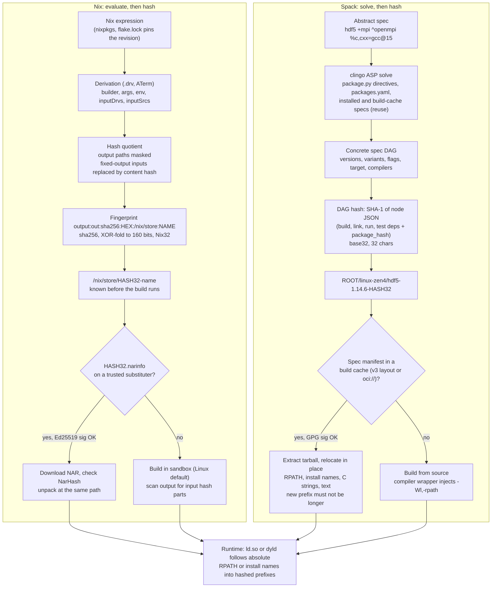

# Spack and Nix: Hash-Addressed Native Dependency Management

> [!summary] Claim:
> Spack and Nix both install every build of a native library into its own prefix whose name contains a hash of everything that went into the build, so any number of versions, compilers, and variants of the same library coexist on one host.
> Nix hashes the derivation (builder, arguments, environment, and the hashes of all input derivations) and makes the hash part of `/nix/store/<32 chars>-<name>`; Spack hashes the concretized spec DAG plus a canonicalized `package.py` into a 32-character SHA-1 that appears in `<root>/<platform>-<target>/<name>-<version>-<hash>`.
> Binaries find their dependencies through absolute RPATHs (Linux) or install names (macOS) that point into those hashed prefixes, so the hash is also a runtime address, not just a cache key.
> The two tools differ in where the graph comes from: Nix evaluates a fully specified expression, while Spack solves an under-specified spec with an Answer Set Programming solver that prefers reusing binaries already built.
> They also differ in relocation: a Nix binary only works under the store directory it was built for, while Spack rewrites prefixes in place when it installs from a build cache, which only works if the new prefix is not longer than the old one.



## The Mechanism

### The problem both tools solve: one name, many builds

A Filesystem Hierarchy Standard layout keys a library by name: `/usr/lib/x86_64-linux-gnu/libhdf5.so.310` can hold one build of HDF5 per SONAME, configured one way, compiled by one compiler.
Debian and RPM manage that namespace with one installed version per package name and a global solver that runs at install time; [[Cpp-System-Packaging-Deb-RPM-and-Homebrew]] owns that model.
SONAMEs let two incompatible major versions coexist, which is the mechanism [[Cpp-ABI-Stability-Symbol-Visibility-and-SONAME]] owns, but they cannot express "HDF5 1.14 built with MPI against OpenMPI 5 and with GCC 15 for Zen 4" next to "the same HDF5 built serial with Clang for Neoverse V2".
HPC sites and trading firms need exactly that matrix: one cluster serves codes that must link a vendor MPI, a specific CUDA, a tuned BLAS, and a pinned compiler runtime.
A Python virtual environment does not help, because it isolates only `site-packages`; the native libraries under an extension module still come from the system, a vendored copy inside the wheel, or a conda prefix.

Spack and Nix replace the name-keyed namespace with a hash-keyed one.
Every build goes into its own directory whose name contains a hash of its inputs, nothing is installed into `/usr`, and binaries carry absolute paths to their exact dependency builds.
Two builds that differ in any hashed input get different directories, so installation never overwrites anything and "upgrading" is installing a new prefix and pointing users at it.

### Nix: derivations and the ATerm serialization

A Nix expression evaluates to a derivation: a record of `outputs`, `inputDrvs` (other derivations and which of their outputs are needed), `inputSrcs` (store paths copied in as sources), `system`, `builder`, `args`, and an `env` map.
Nix writes it to the store as a `.drv` file in the ATerm format, `Derive([outputs],[inputDrvs],[inputSrcs],"system","builder",[args],[env])`.
The `args` list is not copied into `env`; the attributes `builder`, `name`, `system`, `out`, and any others become `env` entries.
The lab host (Determinate Nix 3.21.1, which reports Nix 2.34.7, macOS 27.3 arm64, as of 2026-11) produced this `.drv` for a two-line derivation that depends on another derivation `dep`:

```text
Derive([("out","/nix/store/8y9dk05v1zdnwimgns0f2fz1pgpdazs8-app","","")],[("/nix/store/ygdwma02r7qxas83ljydj63n3rvjlx2s-dep.drv",["out"])],[],"aarch64-darwin","/bin/sh",["-c","echo hello /nix/store/dmhr7kq0ppmflmldz3hcn898gr7ajkzz-dep > $out"],[("builder","/bin/sh"),("name","app"),("out","/nix/store/8y9dk05v1zdnwimgns0f2fz1pgpdazs8-app"),("system","aarch64-darwin")])
```

The output path `/nix/store/8y9d...-app` is written into the derivation before anything is built.
That is the defining property of input addressing: the address is a function of how the object will be made, so a client can ask a binary cache for it without building.

### Nix: computing a store path

The Nix manual's store path specification (Nix 2.35.6, as of 2026-11) defines the path as `<store dir>/<digest>-<name>`.
The digest is SHA-256 of a fingerprint string, compressed to 160 bits by the algorithm in section 5.1 of Dolstra's thesis, and rendered in Nix32.
The fingerprint is `<type>:sha256:<inner digest>:<store dir>:<name>`, with these types:
- `text:<ref1>:<ref2>...`: an object added as text, such as a `.drv` file, followed by the store paths it references; the inner digest is SHA-256 of the file contents.
- `source:<refs>[:self]`: an object added as a NAR with SHA-256, such as a source tree from `builtins.path`.
- `output:<id>`: a derivation output; for input addressing, the inner digest is SHA-256 of the derivation's ATerm "modulo fixed-output derivations".

The compression is an XOR fold: byte `i` of the 32-byte SHA-256 is XORed into byte `i mod 20` of the result.
Nix32 encodes those 20 bytes as 32 characters from the alphabet `0123456789abcdfghijklmnpqrsvwxyz`, which drops `e`, `o`, `t`, and `u`, and it emits characters starting from the most significant 5-bit group.
Because the store directory is inside the fingerprint, the same derivation has a different digest under `/opt/nix/store`; the manual says a store object cannot be copied to a store with a different store directory and must be rebuilt, and that rewriting the directory string inside files is "in general not enough".
That is why nearly every Nix installation uses `/nix/store`: it is the only directory that the public binary cache serves.

The output hash of a derivation is not SHA-256 of its `.drv` file.
Nix first replaces the derivation's own output paths and its `out` environment entry with empty strings, because the output path cannot depend on itself.
It then replaces each input derivation path in `inputDrvs` with that input's "modulo" hash, computed recursively on the input's ATerm with its output paths left in place.
The Nix 2.35.6 manual calls this function the hash quotient, `hashQuotientDerivation`; the 2.36.0 manual renames it `hashInputMaskedDerivation` and calls the result of both maskings the "fully masked derivation" (as of 2026-11).
The `.drv` file's own path, by contrast, is an ordinary `text:` store path over the full ATerm, with the input `.drv` paths as its references.
The Worked Lab Example section reimplements all of this in about 60 lines of Python and reproduces the four paths Nix computed on the lab host exactly.

### Nix: fixed-output derivations break the hash chain on purpose

A fixed-output derivation (FOD) declares `outputHash`, `outputHashAlgo`, and `outputHashMode` in advance; fetchers such as `fetchurl` are FODs.
For an FOD, the output path is content-addressed, so the URL, the fetch script, and the fetcher's own dependencies do not enter the output path.
For flat, Git, and non-SHA-256 NAR hashes, the path type is `output:out` and its inner digest is SHA-256 of `fixed:out:<r:|git:|empty><algo>:<hex hash>:`; a recursive (NAR) SHA-256 FOD, the common case for unpacked sources, instead gets a `source:` path whose inner digest is the NAR hash itself, which the manual says has been the rule since 2008 so a fetched source and a manually added one share a path.
When a dependent derivation's hash is computed, the FOD contributes only that content hash, so switching a tarball to a mirror URL changes the dependent `.drv` path but not its output path, and nothing downstream rebuilds.
On the lab host, changing only `url` from `mirror-a` to `mirror-b` gave two different `lib.drv` paths (`a1yaslcb...` and `pca4qyv9...`) and the same `lib` output path, `6gwjplvl76khsxs3fzj940i0p6lmbcxn-lib` (as of 2026-11, macOS).
The manual says the builder of a fixed-output derivation, unlike a regular one, has access to the network; that is safe because the declared hash is checked after the build and a mismatch fails it.

### Nix: building, reference scanning, and closures

The Nix manual says the chief design consideration of building is determinism, and that what matters is "what the build process can observe".
On Linux the build runs in a sandbox (`sandbox = true` by default) where the store contains only the closure of the declared inputs, with no network, a private build directory (`/build` by default), private `/proc` and `/dev`, and private PID, mount, network, IPC, and UTS namespaces; on every other platform the default is `false` (Nix 2.35.6 manual, as of 2026-11).
The lab host reports `sandbox = false` and `sandbox-fallback = true` (macOS, as of 2026-11), so a Darwin build can read `/usr/lib` and anything else on the machine.

After the build, Nix discovers runtime dependencies by scanning: it searches every output for the 32-character hash part of each input store path, ignoring the name part and the store directory.
A found hash becomes a reference, recorded in the store database; references between outputs of the same derivation are found the same way, and the result must be acyclic.
The closure of a path is the transitive set of its references, and it is the unit of copying: `nix copy`, a substitution, and a garbage collection all reason over closures.
Two consequences follow from scanning:
- A dependency whose path appears only in a compressed, encoded, or UTF-16 string is invisible, so the closure is too small and the program breaks on a machine that lacks that path.
- A path that leaks into the output by accident, such as the compiler's path in a debug string or a build log copied into `$out/share`, keeps that whole closure alive; `nix why-depends` shows the chain.

Garbage collection treats symlinks under `/nix/var/nix/gcroots` (scanned recursively) as roots, and a root protects its target and its entire closure.
`keep-derivations = true` and `keep-outputs = false` are the defaults (as of 2026-11, Both).
`nix-store --optimise` hard-links files whose NAR serializations are identical; the manual says this typically saves 25 to 35 percent of the store.

### Nix: how binaries find their dependencies

On Linux, nixpkgs compilers go through a wrapper, and its `ld-wrapper.sh` adds `-rpath <dir>` for every `-L` directory that is inside `$NIX_STORE` and contains a shared library the link actually uses, in `-L` order.
The same wrapper passes `-dynamic-linker` with the wrapper's configured loader (`$NIX_DYNAMIC_LINKER_<suffix>` in `ld-wrapper.sh`), so `PT_INTERP` points at the store's `ld-linux`, not `/lib64`.
With `NIX_ENFORCE_PURITY=1`, the wrapper's `badPath` check drops `-L`, `-rpath`, and `-dynamic-linker` arguments that are absolute and outside the store, the build directory, and the temporary directories.
In the fixup phase the patchelf setup hook runs `patchelf --shrink-rpath` on ELF files unless `dontPatchELF` is set, removing RPATH entries that no `DT_NEEDED` library needed.
The phase mechanics belong to [[19-Shell-and-Unix-Engineering/18-Build-Packaging-and-Bootstrap/Nix-Builders-and-stdenv-Phases|Nix Builders and stdenv Phases]].

On macOS the install name does the same job.
`otool -L` on the substituted `zlib-1.3.2` on the lab host shows the library's own install name as an absolute store path and its only other dependency as the system `libSystem` (as of 2026-11, macOS):

```text
/nix/store/7c0c2fbdxhn649hhd3y70rq3804s7jri-zlib-1.3.2/lib/libz.dylib:
	/nix/store/7c0c2fbdxhn649hhd3y70rq3804s7jri-zlib-1.3.2/lib/libz.dylib (compatibility version 1.0.0, current version 1.3.2)
	/usr/lib/libSystem.B.dylib (compatibility version 1.0.0, current version 1345.100.2)
```

Every macOS program must use the system `libSystem`, so Darwin closures are never fully self-contained; the store path still pins every non-system dependency.
Its `nix path-info --json` record lists one reference, itself, and a NAR size of 110256 bytes.

### Nix: binary caches and the trust model

A substituter is a binary cache that maps a hash part to a `<hash>.narinfo` file.
The real narinfo for that zlib from `cache.nixos.org` (fetched 2026-11-15) has these fields:

```text
StorePath: /nix/store/7c0c2fbdxhn649hhd3y70rq3804s7jri-zlib-1.3.2
URL: nar/04p5bws2s5zq8vxrrghskh2r78hb7sp7988hilhjxz9alqsflijx.nar.xz
Compression: xz
FileHash: sha256:04p5bws2s5zq8vxrrghskh2r78hb7sp7988hilhjxz9alqsflijx
FileSize: 37184
NarHash: sha256:1n4hkcv5scaccn3szxncfin8x4xg1djrfw1mh2hbc7gapj5p81yp
NarSize: 110256
References: 7c0c2fbdxhn649hhd3y70rq3804s7jri-zlib-1.3.2
Deriver: wz1sx3104siy887s8v88wwf75kpi8irn-zlib-1.3.2.drv
Sig: cache.nixos.org-1:hdtppqJoxOksZMbcSUjosErnIqgNgi/NVNNFpyBQaeiiP3MsyYL0Qy92NGmzmjbAXyHPxk7JUsIi0Mlok/GpDw==
```

The NAR (Nix Archive) is a deterministic serialization of a file tree: it records only file contents, the executable bit, and symlink targets, with no timestamps, owners, or ordering freedom, which is why it can be hashed.
The `Sig` line is an Ed25519 signature by the key named before the colon over the string `1;<StorePath>;<NarHash>;<NarSize>;<comma-separated full reference paths>`.
The lab host verified that signature with the public key `cache.nixos.org-1:6NCHdD59X431o0gWypbMrAURkbJ16ZPMQFGspcDShjY=`, and changing `NarSize` from 110256 to 110257 made verification fail.
With `require-sigs = true` (the default), Nix refuses any non-content-addressed path from a substituter unless one signature verifies against `trusted-public-keys`.

This is the security boundary of input addressing.
The store path names the recipe, not the bytes, so nothing about the path proves that the bytes came from that recipe; the signature says only that the key holder vouches for "this recipe produced this NAR".
A compromised signing key or a malicious cache operator can serve any bytes under any input-addressed path, which is why caches are trusted by key and why [[Reproducible-Builds-as-a-Security-Control]] matters: independent rebuilds that produce the same `NarHash` are the only check on the cache.
Malka, Zacchiroli, and Zimmermann rebuilt 709,816 packages from nixpkgs snapshots between 2017 and 2023 and found bitwise reproducibility between 69 and 91 percent, trending up, and rebuildability above 99 percent (MSR 2025).

Content-addressed derivations (the `ca-derivations` experimental feature, still experimental in Nix 2.35.6 as of 2026-11) put the output at a path derived from its content, so a change that produces identical bytes stops the rebuild cascade one level down ("early cutoff").
They replace "trust the signer of each path" with "trust the signer of each mapping from a derivation output to a content address", which is a smaller statement but still a trust statement.
Flakes and the `nix` command are also still listed as experimental features in upstream Nix 2.35.6, while Determinate Nix documents them as stable with "no experimental features to enable" (as of 2026-11).

### Spack: from abstract spec to concrete spec

Spack's input is an abstract spec, a partial description that the solver completes.
The spec syntax (Spack v1.2.2 docs, as of 2026-11) uses sigils:
- `@1.0:1.5` is a version range, `@=3.2` an exact version, `@3` means `@3:3`, and `@git.<ref>` a git reference.
- `+debug` and `~debug` set boolean variants, `name=value` sets a value, `fabrics:=verbs,ofi` sets exactly those values, and `++`, `--`, or `~~` (boolean) and `==` (valued) propagate a variant to dependencies.
- `cflags="-O3"` and friends set compiler flags, and `cflags=="-g"` propagates them.
- `^dep` constrains a direct or transitive dependency, `%dep` a direct dependency, and `^mpi=openmpi` or `%c,cxx=gcc` bind a virtual to a provider.
- `platform=linux os=ubuntu24.04 target=zen4` set the architecture, where targets are named microarchitectures from archspec, listed by `spack arch --known-targets`.
- `/abc123` refers to an installed spec by any unique prefix of its hash.

Spack v1.0 (2025-07-20) made compilers ordinary packages, "a foundational change that has been in development for almost seven years", per the release notes.
Packages now declare `depends_on("c", type="build")`, `cxx`, or `fortran`, and those languages are virtual packages that `gcc`, `llvm`, and `intel-oneapi-compilers` provide.
The meaning of `%` changed from "compiler" to "direct dependency", which is why `foo ^hdf5 %cmake@3.1.2 ^zlib-ng %cmake@3.2.4` can build two dependencies with two CMake versions in one graph.
A side effect is an ordering change: in v1.0, `pkg %gcc +foo` applies `+foo` to `gcc`, not to `pkg`.
`toolchains.yaml` defines named bundles of such dependencies and flags, so `spack install foo %clang_gfortran` expands to a C/C++ compiler, a Fortran compiler, and flags in one token.
Packages compiled with GCC depend on a `gcc-runtime` package holding copies of GCC's shared runtime libraries (the changelog names `libgfortran` and `libgomp`), so a binary from a build cache carries its compiler runtime instead of assuming the host has a compatible one; that change landed in v0.22.

### Spack: concretization as Answer Set Programming

The concretizer turns the abstract spec, every reachable `package.py` (its `version`, `variant`, `depends_on`, `provides`, `conflicts`, `requires`, and `can_splice` directives), `packages.yaml`, and the specs already installed or in configured build caches into a logic program, and solves it with clingo.
Gamblin, Culpo, Becker, and Shudler describe the design in "Using Answer Set Programming for HPC Dependency Solving" (SC22); dependency solving is NP-complete even with only packages and versions, which is the subject of [[Dependency-Resolution-SAT-PubGrub-and-MVS]].
Unlike PubGrub or a SAT solver that stops at the first satisfying assignment, Spack asks clingo for an optimal model under lexicographic criteria.
In `solver/concretize.lp` (v1.2.2), errors are minimized at priority 1000 so the solver can explain a failure instead of returning "unsatisfiable", and the valid-solution criteria run from priority 310 down to 0:
1. 310: requirement weight, so an earlier alternative in a `require:` list wins.
2. 120: number of packages to build rather than reuse.
3. 110: number of nodes from the same package, to avoid duplicates.
4. 73 and below: deprecated versions, version "badness" of roots, variant defaults, preferred compilers and providers, OS and target preferences, and so on down to 0.

Criteria for nodes that will be built are shifted up by 200, into the 200 to 299 band, above "packages to build" at 120.
The comment in `concretize.lp` states the policy: Spack's first priority is to reuse what it can, but if it builds something, the built specs respect defaults and preferences.
That is why `reuse: true` (the default) can pick an older installed `zlib` over the newest version, while a package that must be built still gets its preferred version and variants.
`spack solve` prints the criteria values of the chosen model, which is how you prove why the solver chose a build over a reuse.

The concretizer has several more inputs that bound the search:
- `concretizer:unify` is `true` by default, so an environment has one configuration of each package; `when_possible` relaxes that, and `false` concretizes each root separately.
- `duplicates:strategy: minimal` allows at most one node per package except listed build tools: the v1.2.2 `max_dupes` lets `c`, `cxx`, `cmake`, `gmake`, `python`, `gcc`, `llvm`, and several Python build packages such as `py-setuptools` and `py-pip` appear twice (a build tool can be built with an older copy of itself).
- `targets:granularity: microarchitectures` and `host_compatible: true` keep the target to microarchitectures the host can run.
- Externals in `packages.yaml` (`spec:` plus `prefix:`, found by `spack external find`) are concrete nodes the solver can pick, and `buildable: false` forbids building that package at all.
- Virtual preferences come from `packages:all:providers`; the v1.2.2 defaults include `mpi: [openmpi, mpich]`, `blas: [openblas]`, and `libc: [glibc, musl]`.
- `require`, `prefer`, and `conflict` in `packages.yaml` are hard constraints, soft preferences, and forbidden specs respectively.

### Spack: what the DAG hash covers

The DAG hash is defined in `hash_types.py` as covering "all inputs that can affect how a package is built": dependency types build, link, run, and test, plus the package hash.
`Spec.spec_hash` serializes the node with `to_node_dict` into compact JSON with `sort_keys=False`, and `util/hash.py` `b32_hash` returns lowercase base32 of the SHA-1 digest, 32 characters for 160 bits.
The node dictionary contains the name, version, architecture (platform, OS, target), namespace, variants and compiler flags as `parameters`, `patches`, an `external` block (path, module, extra attributes) for externals, the `package_hash`, and for each dependency its name, its DAG hash, its deptypes, and the virtuals it provides on that edge.
Because each dependency contributes its own hash, the DAG hash is a Merkle hash: any change anywhere below a node changes that node's hash.
Build dependencies entered the hash in v0.18 and test dependencies in v1.0, per the docstring on `Spec.dag_hash`, so a new CMake or a new compiler changes the hash of everything built with it.

The `package_hash` is `content_hash()` in `package_base.py`: SHA-256 over the sorted list of the source ID (the archive checksum or git commit), the SHA-256 and strip level of each patch, and a canonicalized `package.py`, encoded in base32 with `=` padding (56 characters).
Canonicalization in `util/package_hash.py` parses the recipe's AST, removes docstrings and unassigned strings, removes directives (their effects are already in the spec), and resolves `@when` multimethods for this spec, so editing a comment or a docstring does not change any hash while editing a build method does.

Externals hash differently from built packages in one important way: the `external` block records the declared prefix and attributes, not the files.
Two hosts that both declare `openmpi@5.0.5` at `/opt/vendor/openmpi` get the same hash for that node and every dependent, even if the vendor libraries under that path differ.

### Spack: install layout and RPATH

The v1.2.2 default `config.yaml` puts installs under `$spack/opt/spack` with the projection `{architecture.platform}-{architecture.target}/{name}-{version}-{hash}`, and the docs warn that changing the projection is "strongly discouraged".
Packages are compiled through `compiler-wrapper`, a shell script that Spack v1.0 made a package of its own.
`build_environment.py` hands it `SPACK_STORE_RPATH_DIRS`, `SPACK_STORE_LINK_DIRS`, and `SPACK_STORE_INCLUDE_DIRS` for dependency prefixes inside Spack-managed trees, separate `SPACK_RPATH_DIRS` and friends for system locations, and prepends the package's own `lib64` and `lib` to the RPATH list.
The wrapper injects the corresponding `-I`, `-L`, and `-Wl,-rpath` flags into every compile and link, so the package's own build system does not need to know where dependencies live.
`shared_linking:type` is `rpath` by default, which forces `--disable-new-dtags` so the linker writes `DT_RPATH`; `runpath` forces `DT_RUNPATH`, and the docs say not to mix the two within one install tree.
`DT_RPATH` is searched before `LD_LIBRARY_PATH` and also applies to libraries loaded on behalf of the object's dependencies, while `DT_RUNPATH` is searched after `LD_LIBRARY_PATH` and only for the object's own `DT_NEEDED` entries; the v1.2.2 default `config.yaml` states the same for glibc ("rpath is inherited and has precedence over LD_LIBRARY_PATH; runpath is not inherited and of lower precedence"), and that is why Spack defaults to the variant users cannot accidentally override.
`shared_linking:missing_library_policy` (`ignore` by default, or `warn` or `error`) and `spack verify libraries` check after installation that every `DT_NEEDED` entry resolves.

### Spack: build caches and in-place relocation

A Spack build cache is a mirror of install-prefix tarballs plus signed metadata.
Since v1.0 the layout is content-addressed (layout version 3): `v3/layout.json`, `v3/manifests/spec/.../<name>-<version>-<hash>.spec.manifest.json`, and blobs under `blobs/<algorithm>/<first two hex chars>/<checksum>`, each verified by checksum on download.
v1.0 reads the older layout but does not write it, and `spack buildcache migrate` converts nondestructively, writing the new layout alongside the old one in the same mirror.
`spack buildcache push <mirror> <specs>` uploads installed specs and their dependencies, `spack buildcache update-index` makes them discoverable, and `oci://` mirrors store the same content in a container registry, where `--base-image` produces runnable images.
Packages are signed with GPG by default; `--unsigned` on push and `--no-check-signature` on install turn that off, and since v1.2 the GPG commands prompt before trusting a key unless given `--yes-to-all`.

Installing from a cache must move every absolute path from the build machine's prefixes to the local ones, and `binary_distribution.relocate_package` does it in this order:
1. It builds a map from each old dependency prefix to the new one, keyed by DAG hash, plus a fallback map from the old install root to the new root.
2. On Linux, `relocate_elf_binaries` rewrites the RPATH string in `.dynstr` and the `PT_INTERP` string in place with Spack's own ELF parser (`util/elf.py`); if any new string is longer than the old one, it raises `ElfCStringUpdatesFailed` before writing anything and falls back to `patchelf --force-rpath --set-rpath` (plus `--set-interpreter` when `PT_INTERP` changes).
3. On macOS, `relocate_macho_binaries` reads `LC_RPATH`, `LC_LOAD_DYLIB`, and `LC_ID_DYLIB` with macholib, rewrites them with `install_name_tool`, and then ad-hoc re-signs the patched files with `codesign`, because modifying a Mach-O invalidates its signature.
4. It rewrites absolute symlinks and then text files, using one regex over all old prefixes.
5. It runs `relocate_text_bin` over binaries, which finds every occurrence of an old prefix inside a NUL-terminated C string and overwrites it in place.

The C-string rewrite cannot change the file's length, so `BinaryFilePrefixReplacer` pads a shorter replacement with leading slashes, turning `/opt/spack/__spack_path_placeholder__/linux-zen4/zlib-...` into `//////.../home/u/spack/linux-zen4/zlib-...`, which POSIX path resolution treats as the same path.
A longer replacement raises `CannotGrowString` with "Cannot replace ... because the new prefix is longer", and the hint suggests `config:install_tree:padded_length` or a shorter prefix.
That is why build farms set `install_tree: {root: /opt/spack, padded_length: 128}` (the docs' example): `store.py` appends directories named `__spack_path_placeholder__` until the root is exactly 128 characters, and every consumer's shorter root fits.
`padded_length: true` pads to `getconf PATH_MAX` minus `SPACK_MAX_INSTALL_PATH_LENGTH` (300).
Shebangs have the same problem with a stricter limit: `hooks/sbang.py` assumes 127 characters on Linux (or `BINPRM_BUF_SIZE` minus one from the kernel headers) and 511 on macOS, and rewrites long shebangs to run through Spack's `sbang` script.

Splicing (v0.23 and later) installs a binary with a different dependency than the one it was built against, such as a cloud-built application on a site's own MPI.
`concretizer:splice:explicit` names a target and a replacement by hash, and `splice:automatic` (default `false`, experimental) lets the solver choose splices that packages allow with `can_splice`.
The spliced spec keeps its `build_spec` for provenance, and its hash is a "frankenhash": `spec_hash` keeps the last 7 characters of the original build's hash so relocation can still match strings, per the comment in `spec.py`.
Splicing is safe only when the two libraries are ABI compatible, which is the user's or package author's claim, not something Spack checks; [[Diamond-Dependency-and-Incompatible-ABI-Mitigation]] covers the failure modes.

### Environments and reproducible toolchains

A Spack environment pairs `spack.yaml` (the manifest: abstract root specs, configuration, and `view:` settings) with `spack.lock` (every concrete spec as JSON, lockfile version 7 in v1.2.2).
`spack env create myenv spack.lock` reproduces the exact concrete specs on the same or a compatible machine, while recreating from `spack.yaml` may concretize differently under different configuration, a distinction [[Lockfiles-Vendoring-and-Offline-Mirrors]] generalizes.
A view (by default `.spack-env/view`, made of symlinks) merges the environment's prefixes into one FHS-like tree so `PATH`, `CMAKE_PREFIX_PATH`, and `pkg-config` work without per-package paths.
v1.2 added spec groups (called concretization groups in the changelog) in one `spack.yaml`, each concretized independently with its own `needs:` and overrides, which lets a site bootstrap a compiler group before the application group.

The Nix analogues are a profile or a `nix develop` shell, where the closure is fixed by a pinned nixpkgs revision, normally recorded in `flake.lock` with its NAR hash.
The difference is in what the lock pins.
A Nix lock pins the source of every expression, and the hashes then follow mechanically; a Spack lock pins the solver's output, and the next `spack concretize -f` can choose differently if packages or configuration changed.

Cluster deployment with either tool follows from the hash being an address:
- Nix needs `/nix/store` on every node, usually through a shared or locally populated store and the `nix-daemon`, and the binaries run unmodified.
- Spack can install into any prefix, including a shared filesystem path or a per-user home directory, as long as the build farm's padded root is at least as long, and the binaries are rewritten on installation.
- Both produce environment modules or container images; `spack containerize` and `spack buildcache push --base-image` cover the Spack side, and [[OCI-Images-Layers-Multi-Stage-and-Distroless]] owns the image format.

## Commands and Numbers to Know

| Item | Value | Platform | Notes |
|---|---|---|---|
| Nix store path digest | 160 bits, 32 Nix32 characters (as of 2026-11) | Both | SHA-256 XOR-folded to 20 bytes; alphabet omits `e`, `o`, `t`, `u`. |
| Store path fingerprint | `<type>:sha256:<inner hex>:<store dir>:<name>` (as of 2026-11) | Both | Types `text`, `source`, `output:<id>`, from the Nix 2.35.6 manual. |
| FOD inner digest | SHA-256 of `fixed:out:<r:, git:, or empty><algo>:<hex>:` (as of 2026-11) | Both | Recomputed on the lab host for a flat sha256 FOD; a recursive (NAR) SHA-256 FOD uses a `source:` path instead. |
| `sandbox` default | `true` on Linux, `false` elsewhere (as of 2026-11) | Both | Nix 2.35.6 manual; the lab host reports `false` on macOS. |
| `require-sigs` | `true` (as of 2026-11) | Both | Non-content-addressed substitutions need a trusted Ed25519 signature. |
| Default substituter | `https://cache.nixos.org`, priority 40 (as of 2026-11) | Both | `nix-cache-info` also reports `WantMassQuery: 1`. |
| `keep-derivations` / `keep-outputs` | `true` / `false` (as of 2026-11) | Both | Set `keep-outputs = true` on CI builders that should keep build-only closures. |
| narinfo signature input | `1;<path>;<NarHash>;<NarSize>;<refs>` (as of 2026-11) | Both | Verified against `cache.nixos.org-1` on the lab host. |
| `nix path-info -rS <path>` | prints each path and its closure size (as of 2026-11) | Both | `-S` is `--closure-size`, `-r` is `--recursive`; first tool for closure bloat. |
| `nix why-depends <a> <b>` | shows the reference chain from `a` to `b` (as of 2026-11) | Both | Finds the file that leaked a store path. |
| `nix-store -q --references` / `--requisites` / `--referrers` | direct deps, closure, reverse deps (as of 2026-11) | Both | Read from the store database, not recomputed. |
| `nix derivation show <installable>` | prints the derivation as JSON (as of 2026-11) | Both | Diff two of these to explain a rebuild. |
| Experimental in upstream Nix 2.35.6 | `flakes`, `nix-command`, `ca-derivations`, `impure-derivations`, `dynamic-derivations` (as of 2026-11) | Both | Determinate Nix documents flakes and the `nix` CLI as stable. |
| Spack release | v1.2.2, 2026-07-20 (as of 2026-11) | Both | v1.0.0 was 2025-07-20; builtin packages live in `spack-packages`. |
| Spack DAG hash | SHA-1, lowercase base32, 32 characters (as of 2026-11) | Both | Covers build, link, run, test deps and `package_hash`. |
| Spack `package_hash` | SHA-256, base32 with padding, 56 characters (as of 2026-11) | Both | Source ID, patch hashes, canonicalized `package.py`. |
| Default install projection | `{architecture.platform}-{architecture.target}/{name}-{version}-{hash}` (as of 2026-11) | Both | Under `$spack/opt/spack`. |
| `padded_length` | `false` by default; docs example 128; `true` means `PATH_MAX` minus 300 (as of 2026-11) | Both | Padding directories are named `__spack_path_placeholder__`. |
| Shebang limit used by `sbang` | 127 Linux (or `BINPRM_BUF_SIZE` minus 1), 511 macOS (as of 2026-11) | Both | `hooks/sbang.py` in v1.2.2. |
| `shared_linking:type` | `rpath` (`DT_RPATH`, `--disable-new-dtags`) (as of 2026-11) | Linux | `runpath` is the alternative; do not mix in one tree. |
| Concretizer defaults | `reuse: true`, `unify: true`, `splice:automatic: false`, `duplicates:strategy: minimal` (as of 2026-11) | Both | `etc/spack/defaults/base/concretizer.yaml`, v1.2.2. |
| `build_jobs` default | 16 (as of 2026-11) | Both | v1.2 schedules package builds concurrently through a shared jobserver. |
| Build cache layout | version 3, content-addressed blobs, signed manifests (as of 2026-11) | Both | `spack buildcache migrate` converts older caches in place. |
| `spack.lock` format | `lockfile-version` 7 (as of 2026-11) | Both | `CURRENT_LOCKFILE_VERSION` in v1.2.2. |
| `spack spec -lI <spec>` | concrete DAG with hash prefixes and install status (as of 2026-11) | Both | `[+]` installed, `[^]` upstream, `[e]` external, `[b]` in a build cache, `-` to build. |
| `spack solve <spec>` | prints the optimization criteria of the chosen model (as of 2026-11) | Both | Explains reuse versus build decisions. |
| `spack buildcache push --update-index <mirror> <specs>` | uploads and indexes in one step (as of 2026-11) | Both | `--unsigned` skips GPG signing. |

## Multi-Language Comparison

How each ecosystem gets native libraries under compiled code, and where Spack and Nix fit.

| Concern | C++ with Spack or Nix (this note) | Python | Rust |
|---|---|---|---|
| Unit of identity | Hash of the full build graph: Nix derivation hash, Spack DAG hash | Wheel filename tags plus version, see [[Python-Wheels-Platform-Tags-Manylinux-and-ABI3]] | Crate version plus feature set, resolved by Cargo |
| Where native libraries come from | Their own hashed prefixes, found by absolute RPATH or install name | Vendored into the wheel by auditwheel or delocate, or a conda prefix, see [[Python-Conda-and-Pixi-for-Polyglot-Environments]] | Built by a `-sys` crate's `build.rs`, or found with pkg-config, see [[Rust-Build-Scripts-and-Sys-Crates]] |
| Many versions side by side | Yes, any number per host, distinguished by hash | One per environment | One per semver-incompatible major per build |
| Compiler as a pinned input | Yes: a Nix input derivation, or a Spack `c`/`cxx` virtual with its own hash | No; the build machine's compiler and manylinux image | `rustc` via `rust-toolchain.toml`, but C compilers come from the host |
| Relocation | Nix: none, fixed `/nix/store`; Spack: in-place rewrite, padded prefix | conda rewrites a placeholder prefix; wheels use `$ORIGIN` and `@loader_path` | Static linking by default avoids it |
| Binary cache key | Nix: input hash to narinfo; Spack: DAG hash to spec manifest | Index URL plus filename | None built in; `sccache` caches compile steps |
| Lock artifact | `flake.lock`, `spack.lock` | `uv.lock`, `pylock.toml` | `Cargo.lock` |

Spack and Nix also differ from the other C++ package managers in this pillar.
Conan keys a binary by a `package_id` computed from settings, options, and a configurable dependency mode ([[Cpp-Conan-2-Architecture-and-Binary-Model]]), and vcpkg keys its binary cache by an ABI hash of the triplet, port files, and dependencies ([[Cpp-vcpkg-Manifests-Registries-and-Binary-Caching]]).
Both install into a per-project tree and produce static or relocatable artifacts, while Spack and Nix install into a shared hashed store and embed absolute paths.

## Worked Lab Example

This note has no harness lab.
The commands below were run by hand on the lab host (macOS 27.3 arm64, Determinate Nix 3.21.1 reporting Nix 2.34.7, Python 3.15) on 2026-11-15; they are not part of any `expected/` file.
Spack was not installed on that host, so the Spack half of this section is a read of the v1.2.2 source, not a run.

### Step 1: recompute Nix store paths from first principles

`d.nix` defines two derivations with `/bin/sh` as the builder and no nixpkgs:

```nix
{ greeting ? "hello" }:
let
  dep = derivation { name = "dep"; system = "aarch64-darwin"; builder = "/bin/sh"; args = [ "-c" "echo dep > $out" ]; };
in derivation {
  name = "app";
  system = "aarch64-darwin";
  builder = "/bin/sh";
  args = [ "-c" "echo ${greeting} ${dep} > $out" ];
}
```

`--readonly-mode` evaluates without writing anything to the store, so this prints the paths Nix would use:

```sh
nix-instantiate --eval --readonly-mode --strict -E 'let d = import ./d.nix {}; in [ d.drvPath d.outPath ]'
# [ "/nix/store/ykq0y8vqrli3sjk9kb9ilmf6kib23lbz-app.drv" "/nix/store/8y9dk05v1zdnwimgns0f2fz1pgpdazs8-app" ]
nix-instantiate --eval --readonly-mode --strict -E 'let d = import ./d.nix { greeting = "hellp"; }; in [ d.drvPath d.outPath ]'
# [ "/nix/store/sz5484b57x3mnz2w1s0sa0lgj8hq80gp-app.drv" "/nix/store/1hvjbhxa1qzargcmhd835vgz2zar5z7a-app" ]
```

`nixpath.py` implements the store path algorithm for single-output derivations without `inputSrcs`:

```python
"""Recompute Nix input-addressed .drv and output store paths from first principles."""
import hashlib

STORE = "/nix/store"
ALPHABET = "0123456789abcdfghijklmnpqrsvwxyz"  # Nix32: no e, o, u, t


def nix32(digest: bytes) -> str:
    n_chars = (len(digest) * 8 - 1) // 5 + 1
    out = []
    for n in range(n_chars - 1, -1, -1):
        b = n * 5
        i, j = b // 8, b % 8
        c = digest[i] >> j
        if i + 1 < len(digest):
            c |= digest[i + 1] << (8 - j)
        out.append(ALPHABET[c & 0x1F])
    return "".join(out)


def compress(digest: bytes, size: int = 20) -> bytes:
    acc = bytearray(size)
    for i, byte in enumerate(digest):
        acc[i % size] ^= byte
    return bytes(acc)


def store_path(kind: str, inner_hex: str, name: str) -> str:
    fingerprint = f"{kind}:sha256:{inner_hex}:{STORE}:{name}"
    return f"{STORE}/{nix32(compress(hashlib.sha256(fingerprint.encode()).digest()))}-{name}"


def q(s: str) -> str:
    return '"' + s.replace("\\", "\\\\").replace('"', '\\"').replace("\n", "\\n") + '"'


def aterm(outputs, input_drvs, input_srcs, system, builder, args, env) -> str:
    outs = ",".join(f"({q(k)},{q(p)},{q('')},{q('')})" for k, p in sorted(outputs.items()))
    drvs = ",".join(f"({q(k)},[{','.join(q(o) for o in v)}])" for k, v in sorted(input_drvs.items()))
    srcs = ",".join(q(s) for s in sorted(input_srcs))
    a = ",".join(q(x) for x in args)
    e = ",".join(f"({q(k)},{q(v)})" for k, v in sorted(env.items()))
    return f"Derive([{outs}],[{drvs}],[{srcs}],{q(system)},{q(builder)},[{a}],[{e}])"


def build(name, system, builder, args, input_drvs_modulo, input_drv_paths):
    env = {"name": name, "system": system, "builder": builder, "out": ""}
    # 1. Mask the output path, replace input .drv paths by their modulo hashes, hash the ATerm.
    masked = aterm({"out": ""}, {h: ["out"] for h in input_drvs_modulo}, [], system, builder, args, env)
    modulo_hex = hashlib.sha256(masked.encode()).hexdigest()
    out = store_path("output:out", modulo_hex, name)
    # 2. Fill in the output path; the .drv file itself is a text store object.
    env["out"] = out
    real = aterm({"out": out}, {p: ["out"] for p in input_drv_paths}, [], system, builder, args, env)
    refs = ":".join(sorted(input_drv_paths))
    kind = "text" + (":" + refs if refs else "")
    drv = store_path(kind, hashlib.sha256(real.encode()).hexdigest(), name + ".drv")
    # 3. What dependents embed: the unmasked ATerm, inputs still replaced by modulo hashes.
    unmasked = aterm({"out": out}, {h: ["out"] for h in input_drvs_modulo}, [], system, builder, args, env)
    return hashlib.sha256(unmasked.encode()).hexdigest(), out, drv


if __name__ == "__main__":
    import sys

    greeting = sys.argv[1] if len(sys.argv) > 1 else "hello"
    sysname = "aarch64-darwin"
    dep_mod, dep_out, dep_drv = build("dep", sysname, "/bin/sh", ["-c", "echo dep > $out"], [], [])
    print("dep.drv ", dep_drv)
    print("dep out ", dep_out)
    app_args = ["-c", f"echo {greeting} {dep_out} > $out"]
    _, app_out, app_drv = build("app", sysname, "/bin/sh", app_args, [dep_mod], [dep_drv])
    print("app.drv ", app_drv)
    print("app out ", app_out)
```

Output of `python3 -I nixpath.py` and `python3 -I nixpath.py hellp` on the lab host (2026-11-15, macOS):

```text
dep.drv  /nix/store/ygdwma02r7qxas83ljydj63n3rvjlx2s-dep.drv
dep out  /nix/store/dmhr7kq0ppmflmldz3hcn898gr7ajkzz-dep
app.drv  /nix/store/ykq0y8vqrli3sjk9kb9ilmf6kib23lbz-app.drv
app out  /nix/store/8y9dk05v1zdnwimgns0f2fz1pgpdazs8-app
dep.drv  /nix/store/ygdwma02r7qxas83ljydj63n3rvjlx2s-dep.drv
dep out  /nix/store/dmhr7kq0ppmflmldz3hcn898gr7ajkzz-dep
app.drv  /nix/store/sz5484b57x3mnz2w1s0sa0lgj8hq80gp-app.drv
app out  /nix/store/1hvjbhxa1qzargcmhd835vgz2zar5z7a-app
```

All four `app` paths equal what `nix-instantiate` printed, and the `dep` paths equal the ones in the `.drv` that `nix-instantiate --store <scratch dir>` wrote.
Two earlier versions of the script disagreed with Nix, and each mismatch taught one rule:
- Putting `args` into `env` gave a wrong `dep` path, because `args` is not an environment entry.
- Using the masked hash of `dep` as its contribution to `app` gave a wrong `app` path, because input derivations contribute their hash with their own output paths filled in; only the derivation being hashed has its outputs masked.

One changed character in `greeting` changed both `app` paths and left `dep` alone, which is the Merkle property: a change propagates to dependents, never to dependencies.

### Step 2: watch a fixed-output derivation stop the cascade

`fod.nix` makes `lib` depend on an FOD `src.tar` whose only varying attribute is `url`:

```sh
for u in https://mirror-a.example/src.tar https://mirror-b.example/src.tar; do
  nix-instantiate --eval --readonly-mode --strict -E "let d = import ./fod.nix { url = \"$u\"; }; in [ d.drvPath d.outPath ]"
done
# [ "/nix/store/a1yaslcbxicz2adhdkm2d3vv7mpknk05-lib.drv" "/nix/store/6gwjplvl76khsxs3fzj940i0p6lmbcxn-lib" ]
# [ "/nix/store/pca4qyv9jj4y295r2bvq2my3xni4r7z8-lib.drv" "/nix/store/6gwjplvl76khsxs3fzj940i0p6lmbcxn-lib" ]
```

Both FODs had the output path `/nix/store/dfva10slcws8bl39xj4qvsgn23ranhyi-src.tar`, and `store_path("output:out", sha256("fixed:out:sha256:" + 64 zeros + ":"), "src.tar")` in `nixpath.py` reproduced it.

### Step 3: verify a binary cache signature

With `cryptography` in a throwaway `uv run --with cryptography` environment, the Ed25519 check over the zlib narinfo succeeded and failed after one changed digit:

```text
signature OK over: 1;/nix/store/7c0c2fbdxhn649hhd3y70rq3804s7jri-zlib-1.3.2;sha256:1n4hkcv5scaccn3szxncfin8x4xg1djrfw1mh2hbc7gapj5p81yp;110256;/nix/store/7c0c2fbdxhn649hhd3y70rq3804s7jri-zlib-1.3.2
tampered NarSize -> InvalidSignature
```

### Step 4: the Spack equivalent, read from source

These commands show the same ideas on a Spack v1.2 install; they were not run for this note (Spack was not installed on the lab host), and their flags (`-l`, `-I`, `--update-index`, `padded_length`, `--use-buildcache`) were checked against the v1.2.2 source and the Build Caches documentation (as of 2026-11):

```sh
spack spec -lI hdf5 +mpi ^openmpi %c,cxx=gcc@15   # concrete DAG, hash prefixes, [+]/[e]/- status
spack solve hdf5 +mpi                              # criteria: packages to build, version badness, ...
spack config add config:install_tree:padded_length:128
spack install hdf5 +mpi
spack buildcache push --update-index my-mirror hdf5
spack find -L hdf5                                 # full 32-character DAG hashes
readelf -d "$(spack location -i hdf5)/lib/libhdf5.so" | grep -E 'RPATH|RUNPATH'
```

On the consumer side, `spack mirror add my-mirror <url>`, `spack buildcache keys --install --trust`, and `spack install --use-buildcache only hdf5` install the same hashes, relocated to the local root.

## Pitfalls

> [!warning] Pitfall 1: Building a Spack cache into a short prefix
> A build farm that installs into `/opt/spack` produces binaries whose RPATHs and C strings hold that 10-character root.
> Every consumer whose root is longer, such as `/home/alice/spack/opt/spack`, hits `CannotGrowString` or `ElfCStringUpdatesFailed` and either falls back to `patchelf` for RPATHs or cannot relocate embedded strings at all, which means a source build.
> Set `install_tree:padded_length` on the producer before the first push; padding cannot be added to binaries already in the cache.

> [!warning] Pitfall 2: Treating a Nix store path as a content hash
> An input-addressed path names the recipe, so two builds of the same `.drv` on different machines get the same path even if their bytes differ.
> Whichever substituter answers first wins, and nothing in the path detects a non-reproducible or malicious build.
> Trust substituters by key, keep `require-sigs = true`, and compare `NarHash` across independent builders (`nix build --rebuild` checks a local rebuild against the existing output) for anything security-critical.

> [!warning] Pitfall 3: Hiding a dependency from Nix reference scanning
> A program that stores its plugin directory compressed, base64-encoded, or in UTF-16 has no visible 32-character hash part, so the reference is not recorded.
> It works on the build machine, where the path happens to exist, and fails after `nix copy` to a fresh machine or after garbage collection.
> Keep runtime paths as plain ASCII strings, or record the dependency explicitly, and test closures on a machine with an empty store.

> [!warning] Pitfall 4: Closure bloat from leaked build paths
> A single `-I/nix/store/...-gcc-.../include` string in a debug section or a copied `config.log` makes the compiler a runtime reference, adding hundreds of megabytes to every container image.
> `nix path-info -rS` shows the size and `nix why-depends ./result <gcc path>` shows the file that leaked it.
> Split debug info into a separate output and strip build logs from `$out`.

> [!warning] Pitfall 5: Externals poison Spack hashes across hosts
> An external's hash covers its declared spec and prefix, not its files, so two clusters that both declare `openmpi@5.0.5` at `/opt/vendor/openmpi` produce identical hashes for every dependent.
> A binary built against one vendor's MPI can then be installed on the other cluster from a shared cache, and fail at run time with symbol or ABI errors.
> Give site-specific externals distinguishing versions or variants, keep separate caches per site ABI, or make the MPI interface explicit with splicing and `can_splice`.

> [!warning] Pitfall 6: Re-concretizing a pinned Spack environment
> `spack concretize -f` re-solves from `spack.yaml`, and with `reuse: true` the answer depends on what happens to be installed or in the caches that day.
> Two developers can produce different `spack.lock` files from the same manifest, and a CI job that re-concretizes is not testing what production runs.
> Commit `spack.lock`, recreate environments with `spack env create name spack.lock`, and only re-concretize deliberately in a reviewed change.

> [!warning] Pitfall 7: Mixing RPATH and RUNPATH in one Spack tree
> `DT_RPATH` applies to the whole load chain and beats `LD_LIBRARY_PATH`, while `DT_RUNPATH` applies only to the object's own `DT_NEEDED` and loses to `LD_LIBRARY_PATH`.
> A tree that mixes them resolves a shared dependency differently depending on which object asked for it, so two copies of `libstdc++` or MPI can load into one process.
> Pick one `shared_linking:type` per install tree, as the Spack docs require.

> [!warning] Pitfall 8: Expecting macOS Nix builds to be hermetic
> The Nix sandbox is off by default outside Linux, and every Darwin binary links the host's `/usr/lib/libSystem.B.dylib`.
> A build script that finds a tool, library, or configuration file under `/opt/homebrew` by absolute path still succeeds, producing a result that only works where Homebrew is installed.
> Build release artifacts on Linux builders with the sandbox on, and on macOS check `otool -L` for paths outside `/nix/store` and `/usr/lib` and `/System`.

## At Scale

For one developer, either tool is a way to get a working, isolated toolchain without root: a `nix develop` shell with a pinned nixpkgs, or a Spack environment with a committed `spack.lock`.
For a team, the value is the shared binary cache, because both tools rebuild everything downstream of any change and a cold build of a GCC, LLVM, MPI, and Boost stack takes hours.
For 1,000 to 50,000 engineers or a multi-site HPC program, the hash becomes the unit of policy: what is cached, what is trusted, what is promoted, and what is garbage-collected.

The cost model is the rebuild cascade.
In both tools a new compiler, a new `glibc`, or a new CMake changes the hash of every package built with it, because build dependencies are hashed.
Nix limits the blast radius only for fetchers (FODs) and, experimentally, through content-addressed derivations; Spack limits it through `reuse`, which keeps old builds in the solution until something forces a rebuild, and through splicing.
Plan cache capacity and CI time for full-stack rebuilds after every toolchain bump, and stage them like releases.

Decision rules:
1. Choose Nix when you control the hosts and want hermetic, reproducible builds and a full-system description; accept the fixed `/nix/store` and the daemon.
2. Choose Spack when users install without root into arbitrary prefixes, when sites must use vendor MPI, CUDA, or compilers as externals, or when one stack must be built for many microarchitectures and compilers.
3. With Spack, set `padded_length` on every producer from day one, sign every cache, keep one cache per site ABI, and commit `spack.lock` for every deployed environment.
4. With Nix, run your own signing key and substituter in front of `cache.nixos.org`, keep the sandbox on, and gate releases on a second, independent rebuild that matches `NarHash`.
5. In either tool, treat a toolchain change as a fleet-wide rebuild, and record each artifact's hash in the deployment record so a rollback is a pointer change, as [[Release-Trains-Backports-and-Artifact-Registries]] describes.
6. Write the choice and its exit cost down in a [[Packaging-Decision-Records|packaging decision record]]; migrating thousands of users between hashed stores is a multi-quarter project.

> [!tip] Practice Drill: Predict and then measure the cascade
> On a machine with Nix, extend `d.nix` with a third derivation that depends on `app`, and predict which of the three `.drv` and output paths change when you edit `dep`'s script, then `app`'s, then the FOD URL; check each prediction with `nix-instantiate --eval --readonly-mode`.
> Extend `nixpath.py` to handle `inputSrcs` and multiple outputs, and match Nix on a derivation with two outputs.
> On a Linux machine with Spack, build `zlib` into an unpadded `/tmp/s` root, push it to a filesystem mirror, and install it into a longer root to reproduce `CannotGrowString`; repeat with `padded_length: 128` and compare `readelf -d` and `strings` output before and after relocation.

## Interview Questions

> [!question] L5: What is in a Nix store path, and why does editing a build script rebuild everything that depends on it?
> > [!success]- Answer
> > The path is `/nix/store/<32 Nix32 chars>-<name>`, where the 32 characters are SHA-256 of a fingerprint, XOR-folded to 160 bits.
> > For a derivation output, the fingerprint includes SHA-256 of the derivation's ATerm with its own outputs masked and each input derivation replaced by that input's hash.
> > The build script is in `args` or `env`, so editing it changes this derivation's hash, which is embedded in every dependent's derivation, so every dependent's hash changes too.
> > The only built-in cutoff is a fixed-output derivation, which contributes its declared content hash instead.

> [!question] L5: Read this Spack spec aloud and say what each part constrains: `hdf5@1.14: +mpi ~fortran ^openmpi@5 %c,cxx=gcc@15 target=zen4`.
> > [!success]- Answer
> > `hdf5` version 1.14 or newer, with the `mpi` variant on and `fortran` off.
> > `^openmpi@5` requires OpenMPI 5 somewhere in the graph, which here satisfies the `mpi` virtual.
> > `%c,cxx=gcc@15` makes GCC 15 the direct provider of the `c` and `cxx` virtuals for `hdf5`; since Spack v1.0, `%` means direct dependency.
> > `target=zen4` fixes the microarchitecture, and the solver fills in everything else, preferring installed or cached builds.

> [!question] L6 (predict the output): Two Nix expressions differ only in the `url` of a fixed-output `fetchurl` source with the same `sha256`; which of these change: the source's output path, the dependent library's `.drv` path, the library's output path?
> > [!success]- Answer
> > The source's output path does not change, because an FOD's path is computed from its declared content hash and the name (`fixed:out:<mode><algo>:<hash>:` for a flat hash, a `source:` path for a recursive SHA-256 hash), never from the URL.
> > The library's `.drv` path changes, because the `.drv` file lists the FOD's `.drv` path in `inputDrvs`, and that `.drv` contains the new URL.
> > The library's output path does not change, because its hash uses the FOD's content hash, not its `.drv`.
> > On the lab host this gave two `lib.drv` paths and one `lib` output path, `6gwjplvl...-lib`.

> [!question] L6: You edit only a docstring in a Spack `package.py`, then separately bump the CMake used to build the package; which change alters the DAG hash, and why?
> > [!success]- Answer
> > The docstring does not, because `package_hash` canonicalizes the recipe's AST and removes docstrings, unassigned strings, and directives before hashing.
> > The CMake bump does, because CMake is a build dependency, build dependencies have been part of the DAG hash since v0.18, and each dependency contributes its own hash to the node JSON.
> > Every package built with that CMake gets a new hash and a new prefix, and with `reuse: true` the solver may still prefer the old installed build unless something forces the new one.

> [!question] L6 (debug this): `spack install --use-buildcache only` on a user's workstation fails with "Cannot replace b'/opt/spack/linux-zen4/zlib-1.3.1-...' with b'/home/jdoe/spack/opt/spack/linux-zen4/zlib-1.3.1-...' because the new prefix is longer"; what happened and how do you fix it?
> > [!success]- Answer
> > The cache was built into a short, unpadded root, and relocation rewrites C strings in binaries in place, which cannot make them longer.
> > Spack's ELF RPATH rewrite has a `patchelf` fallback, but `relocate_text_bin` has none, so the install fails.
> > The fix is on the producer: set `config:install_tree:padded_length` (128 is the documented example), rebuild, and repush.
> > Shorter consumer roots then fit, and the replacement is padded with leading slashes, which path resolution ignores.

> [!question] L6: A container built from a Nix closure is 1.4 GB, and most of it is GCC; how do you find and fix the cause?
> > [!success]- Answer
> > Run `nix path-info -rS` on the result to confirm that GCC is in the runtime closure, then `nix why-depends ./result <gcc path>` to find the file that references it.
> > The cause is a leaked store path string, such as an include path in debug info, a `config.log`, or a `.pc` or CMake file shipped in the runtime output.
> > Nix records a reference wherever the 32-character hash part appears, so the fix is to remove the string: split headers and debug info into separate outputs, delete build logs, or strip.
> > Rebuild and check the closure size again.

> [!question] L7: Explain the trust model of a Nix binary cache, and what content-addressed derivations change and do not change.
> > [!success]- Answer
> > The client computes the input-addressed path locally and asks the cache for its narinfo, which gives the NAR's hash, size, and references, signed with Ed25519 over `1;path;NarHash;NarSize;refs`.
> > The signature says the key holder vouches that this recipe produced this NAR, and with `require-sigs` the client accepts it only if a key in `trusted-public-keys` verifies.
> > Nothing in the path itself proves the bytes match the recipe, so a stolen key or a malicious operator can serve arbitrary binaries; independent reproducible rebuilds are the check.
> > Content-addressed derivations make the output path a hash of the bytes, which gives early cutoff and makes the stored object self-verifying, but the mapping from a derivation to its output still has to be trusted, so signing moves rather than disappears.

> [!question] L7: Design a Spack binary distribution for three HPC centers with different vendor MPIs and a shared cloud build farm.
> > [!success]- Answer
> > Build in the cloud with `padded_length` set, for each center's microarchitecture targets, and push to signed caches, with OCI mirrors where registries are available.
> > Build MPI-dependent applications against one reference MPI and use splicing (`concretizer:splice:explicit`, or `can_splice` with automatic splicing) to bind each center's vendor MPI at install time, only where the ABI is actually compatible, such as MPICH-ABI families.
> > Keep center-specific externals distinguishable, because external hashes cover only the declared spec and prefix, and keep a separate cache or view per center ABI.
> > Ship environments as committed `spack.lock` files and test every center's install path in CI, including `spack verify libraries`.

> [!question] L8+: A 2,000-engineer quantitative firm has C++ pricing libraries, Python research, and latency-critical Linux trading hosts; would you standardize on Nix, Spack, or neither, and how?
> > [!success]- Answer
> > For production trading hosts the firm controls, Nix gives hermetic sandboxed builds, an exact closure per deployment, and atomic rollback by switching a profile, at the cost of a fixed `/nix/store`, a daemon, and a steep learning curve.
> > Spack fits research clusters where users install without root, link vendor MPI and CUDA as externals, and need many compiler and microarchitecture variants, at the cost of solver nondeterminism unless `spack.lock` is committed.
> > Neither replaces wheels for Python distribution, so Python research consumes the same native libraries through a Nix shell or a Spack view, not through `pip` building against system headers.
> > The fleet policy is one internal signed cache per tool, toolchain changes staged as fleet-wide rebuild releases, artifact hashes in every deployment record, and a decision record that names the exit cost.

## Further Reading

- Eelco Dolstra, The Purely Functional Software Deployment Model (2006): the thesis that defines the store, input addressing, and the hash compression the manual cites.
- Dolstra, de Jonge, and Visser, Nix: A Safe and Policy-Free System for Software Deployment (LISA 2004): the original argument for hash-addressed component stores.
- Nix Reference Manual, Store Path and Input-addressing pages: the exact fingerprint grammar and the hash quotient for fixed-output derivations.
- Nix Reference Manual, Building and nix.conf pages: reference scanning, determinism, the sandbox, and the trust settings with their defaults.
- Malka, Zacchiroli, and Zimmermann, Does Functional Package Management Enable Reproducible Builds at Scale? Yes (MSR 2025): measured reproducibility of nixpkgs over six years.
- Gamblin et al., The Spack Package Manager (SC15): the spec syntax and the hashed install layout as first designed.
- Gamblin, Culpo, Becker, and Shudler, Using Answer Set Programming for HPC Dependency Solving (SC22): why Spack's solver optimizes instead of satisfying, and how reuse is encoded.
- Spack v1.2.2 source, `solver/concretize.lp`, `hash_types.py`, `relocate_text.py`, and `util/elf.py`: the authoritative definitions of criteria, hashes, and relocation limits.
- Spack documentation, Build Caches and Environments: the v3 cache layout, signing, OCI mirrors, padding, and `spack.lock` semantics.
- Spack CHANGELOG for v1.0.0: compilers as dependencies, the new meaning of `%`, toolchains, and the content-addressed cache format.

## Related

- Prerequisites: [[Cpp-ABI-Stability-Symbol-Visibility-and-SONAME]]
- Next: [[Cpp-System-Packaging-Deb-RPM-and-Homebrew]]
- See also: [[19-Shell-and-Unix-Engineering/18-Build-Packaging-and-Bootstrap/Nix-Builders-and-stdenv-Phases|Nix Builders and stdenv Phases]], [[Dependency-Resolution-SAT-PubGrub-and-MVS]], [[Lockfiles-Vendoring-and-Offline-Mirrors]], [[Diamond-Dependency-and-Incompatible-ABI-Mitigation]], [[Cpp-Conan-2-Architecture-and-Binary-Model]], [[Cpp-vcpkg-Manifests-Registries-and-Binary-Caching]], [[Cpp-Glibc-Symbol-Versioning-and-Portable-Linux-Binaries]], [[Python-Conda-and-Pixi-for-Polyglot-Environments]], [[OCI-Images-Layers-Multi-Stage-and-Distroless]], [[Reproducible-Builds-as-a-Security-Control]], [[Hermetic-and-Reproducible-Builds]], [[Sandboxing-and-Hermetic-Execution-Internals]], [[Packaging-Decision-Records]]
