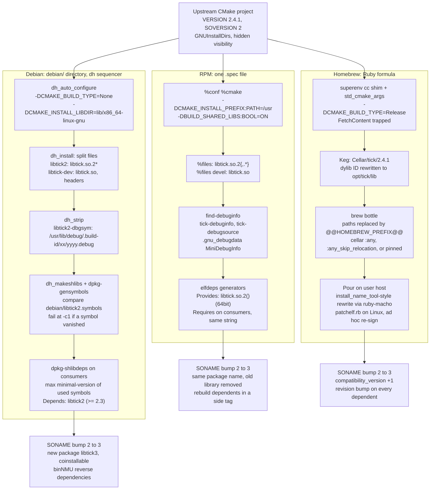

# C++ System Packaging: Debian Policies, RPM Specs, and Homebrew Formulas

> [!summary] Claim:
> A distribution package turns one ELF or Mach-O fact, the library's SONAME or install name, into three things: a package name, a dependency edge, and an upgrade rule.
> Debian names the runtime package after the SONAME (`libfoo.so.2` ships in `libfoo2`) and computes each consumer's minimum version per symbol from a `symbols` file that `dpkg-gensymbols` checks on every build.
> RPM keeps the project name, lets `elfdeps` emit `libfoo.so.2()(64bit)` provides and requires automatically, and relies on rebuilding every dependent in one side tag when the SONAME moves.
> Homebrew installs exactly one version per formula, so a SONAME bump forces a `revision` bump of every dependent in the same pull request, and its bottles carry `@@HOMEBREW_PREFIX@@` placeholders that are rewritten at pour time.
> An expert ships a CMake project that all three can package without patches: a real `SOVERSION`, `GNUInstallDirs`, hidden visibility, separate runtime and development install components, and no network fetches during the build.



## The Mechanism

### One loader fact, three dependency systems

The dynamic loader resolves a library by the name recorded in the consumer, not by any package metadata.
On Linux the consumer's `DT_NEEDED` entry holds the producer's `DT_SONAME`, such as `libtick.so.2`, and on macOS the consumer's `LC_LOAD_DYLIB` holds the producer's install name, such as `/opt/homebrew/opt/tick/lib/libtick.2.dylib`.
[[Cpp-ABI-Stability-Symbol-Visibility-and-SONAME]] owns what a SONAME promises and when it must change; this note owns how package managers turn that promise into package names, dependency edges, debug packages, and transitions.

Every system packager answers the same four questions differently:
1. Which package owns the runtime file `libtick.so.2.4.1`, and can two SONAMEs be installed side by side?
2. Which package owns the unversioned development symlink `libtick.so`, the headers, and the CMake config files?
3. What dependency does a consumer get, and how strict is its minimum version?
4. What happens to every consumer when the SONAME changes?

Debian answers with policy and per-symbol metadata, RPM with automatic ELF-derived capabilities, and Homebrew with mandatory rebuilds.

### Debian: package names follow the SONAME

Debian Policy 4.7.4.1 (released 2026-03-31) section 8.1 requires the runtime library to be "placed in a package named librarynamesoversion, where soversion is the version number in the SONAME".
If the library name ends in a digit, a hyphen separates the two, so `libfoo2.so.1` would ship in `libfoo2-1`.
The Policy example is `libgdbm3`, which installs `libgdbm.so.3.0.0`.

The naming rule exists so that two SONAMEs can coexist.
Policy says this "allows several versions of the shared library to be installed at the same time", and its footnote says a needed `Conflicts` "is never desirable, since it causes significant disruption during upgrades".
That forces three further rules:
- One library per runtime package, unless "all of their SONAMEs will always change together"; "When in doubt, always split shared library packages so that each binary package installs a single shared library."
- Files whose names do not carry the SONAME, such as translations, plugins, or configuration, must not live in the runtime package (Policy 8.2), because `libtick2` and `libtick3` would both ship them and could not be coinstalled.
- The development package is named `libraryname-dev` without a SONAME (Policy 8.4) and holds the unversioned `libtick.so` symlink, headers, and static archives, so only one `-dev` is installed at a time, and a link with `-ltick` picks one SONAME.

The runtime package ships the SONAME symlink `libtick.so.2 -> libtick.so.2.4.1`, and `ldconfig` keeps it current.
Policy 8.1.1 says a package that ships a shared library "must have the line activate-noawait ldconfig in its triggers control file".
`dh_makeshlibs` has written that trigger instead of `ldconfig` calls in maintainer scripts since debhelper 9.20151004, a debhelper version and not a compat level; `-n` or `--no-scripts` suppresses it.
The `noawait` trigger runs `ldconfig` once per `dpkg` run instead of once per package, which matters when a transaction installs hundreds of libraries.
The maintainer script protocol itself (`preinst`, `postinst`, `prerm`, `postrm`, and their arguments) belongs to [[19-Shell-and-Unix-Engineering/18-Build-Packaging-and-Bootstrap/Debian-Maintainer-Scripts|Debian Maintainer Scripts]].

Multiarch extends coinstallability across architectures.
`libtick2:amd64` and `libtick2:i386` can both be installed only if each sets `Multi-Arch: same` and every shared file is byte-identical or in an architecture-qualified path.
deb-control(5) defines `same` as "co-installable with itself, but it must not be used to satisfy the dependency of any package" of a different architecture.
That is why debhelper installs libraries into `/usr/lib/<multiarch-tuple>/`, such as `/usr/lib/x86_64-linux-gnu/`, and why a pkg-config file containing an architecture-specific path must also live under that directory.

### Debian: shlibs files, the coarse dependency

A `shlibs` file maps a SONAME to a dependency for the whole library.
Policy 8.6.4.2 gives the format `[type: ]library-name soname-version dependencies`, and deb-shlibs(5) gives the example `libcrunch 1 libcrunch1 (>= 1.2-1)`.
The `type` field exists only for `udeb:` lines, because "udebs, which do not support symbols" need a shlibs entry for the installer.
`dh_makeshlibs` writes the dependency from `-V`, which in debhelper compat 12 and later defaults to `-VUpstream-Version`, so a library built from upstream 2.4.1 tells every consumer `libtick2 (>= 2.4.1)`.
In compat 11 and earlier the default behaved like `-VNone`, an unversioned dependency that dh_makeshlibs(1) calls generally unsafe.

The shlibs model is correct but pessimistic.
A consumer that uses only functions present since 2.0 still gets `>= 2.4.1`, so it cannot migrate to a release or backport whose library is older than 2.4.1.
Across an archive of thousands of consumers, that over-tightening blocks testing migration and partial upgrades, which is the problem symbols files solve.

### Debian: symbols files, the per-symbol dependency

A symbols file records the minimal package version that provides each exported symbol.
Policy 8.6.3.2 gives the format:

```text
libtick.so.2 libtick2 #MINVER#
* Build-Depends-Package: libtick-dev
 tick_decode@Base 2.0
 tick_encode@Base 2.0
 tick_encode_batch@Base 2.3
 (c++)"tick::version()@Base" 2.3
```

- The first line is `library-soname main-dependency-template`; `#MINVER#` "is replaced by a version restriction like (>= version) or by nothing".
- `| alternative-dependency-template` lines add alternatives, and a symbol line can end in a template id to select one.
- `* Build-Depends-Package: libtick-dev` names the `-dev` package; `dpkg-shlibdeps` then makes the generated dependency at least as strict as the consumer's build dependency on it (dpkg 1.14.13 and later).
- Each symbol line is indented by one space, the symbol carries its version node (`@Base` for an unversioned symbol, or a node such as `@TICK_2.3` with a version script), and the version is "the most recent version of the shared library that changed the behavior of that symbol".

`dpkg-shlibdeps` reads every `DT_NEEDED` and undefined symbol of every ELF file in a consumer package, looks each symbol up in the provider's symbols file, and "remembers the (biggest) minimal version needed for each library".
A consumer that calls only `tick_encode` gets `libtick2 (>= 2.0)`; one that also calls `tick_encode_batch` gets `libtick2 (>= 2.3)`.
The lookup order for symbols files is the package's own `debian/*/DEBIAN/symbols`, then `/etc/dpkg/symbols/package.symbols.arch` and `package.symbols`, then installed packages.
For shlibs it is `debian/shlibs.local`, `/etc/dpkg/shlibs.override`, `debian/*/DEBIAN/shlibs`, installed packages, and `/etc/dpkg/shlibs.default`.
A symbols file wins over a shlibs file, except that `shlibs.local` overrides both.

The minimal version is the one thing no tool checks.
dpkg-gensymbols(1) says "There is no way dpkg-gensymbols can warn about" a symbol whose behavior changed compatibly; Policy 8.6.3.3 requires the maintainer to raise `minimal-version` when "a symbol changes behavior or signature in a backward-compatible way".
Policy 8.6.2 gives the example of a function that starts accepting a new enum constant: the ABI is compatible, but a consumer passing the new constant needs the new library, so the symbol's version must be bumped.

### Debian: dpkg-gensymbols, the ABI tripwire in every build

`dh_makeshlibs` calls `dpkg-gensymbols`, which dumps the library's dynamic symbol table, merges it with the maintainer's `debian/libtick2.symbols`, writes `DEBIAN/symbols` into the binary package, and compares the two.
The `-c` check level decides what fails the build ("By default the level is 1", and each level includes the lower ones):

| Level | Fails when |
|---|---|
| 0 | Never fails |
| 1 | Some symbols have disappeared |
| 2 | Some new symbols have been introduced |
| 3 | Some libraries have disappeared |
| 4 | Some libraries have been introduced |

`DPKG_GENSYMBOLS_CHECK_LEVEL` overrides the command line, "even if the -c command-line argument was given", which deliberately inverts the usual precedence so a CI service can raise every package to level 4.
In `scripts/dpkg-gensymbols.pl`, each comparison calls `compare_problem(level, message)`, which prints an error when the check level is at least that high and only a warning otherwise.
On an error the subroutine assigns `$exitcode = $level`, overwriting any earlier value, and the script calls it for level 4, then 3, then 2, then 1.
A single error therefore exits with that problem's level.
When several problems all meet the check level, the exit code is the lowest of them, because level 1 is assigned last.
After the comparison it runs `diff -u` between the template-mode renderings of the old and new symbol sets.
A vanished symbol stays in the output as `#MISSING: <version># tick_legacy@Base 2.0`, from `get_symbolspec` in `Dpkg/Shlibs/Symbol.pm`, so the diff documents the break instead of silently dropping the line.

Symbol tags make the file usable for C++, where the exported set depends on the compiler and architecture.
deb-src-symbols(5) defines tags written as `(tag1|tag2=value)symbol`:
- `optional`: the symbol "can disappear from the library at any time and that will never cause dpkg-gensymbols to fail"; "most of C++ template instantiations fall into this category."
- `arch=`, `arch-bits=32|64`, and `arch-endian=little|big`: limit a symbol to some architectures, for example a mangled name containing `unsigned long` that differs on 32-bit targets.
- `c++`: match "by their demangled symbol name (as emitted by c++filt(1) utility)", which solves thunk offsets such as `_ZThn8_` on 32-bit versus `_ZThn16_` on 64-bit for the same "non-virtual thunk to" entry.
- `symver`: match a whole version node, such as `(symver)TICK_2.3 2.3`.
- `regex`: match a pattern, such as `(regex)"^tick_internal_.*@Base$" 2.0`.
- `allow-internal`: allow toolchain-internal symbol groups, together with the `Allow-Internal-Symbol-Groups` field (dpkg 1.20.1 and later); the older `ignore-blacklist` tag and `Ignore-Blacklist-Groups` field are not parsed by current dpkg.

The Debian wiki page UsingSymbolsFiles still says "For C++ libraries it is often better not to ship symbols files", and recommends `-fvisibility=hidden` upstream.
The Qt and KDE team instead maintain C++ symbols files with `pkgkde-symbolshelper`, which can read a build log and patch the file, and which debhelper 12 or later enables through `dh-sequence-pkgkde-symbolshelper` in `Build-Depends`.
Their documentation also states the limit of the whole mechanism: symbols checks detect added and removed names, not a changed struct size or a reordered vtable.
Those breaks need an ABI checker such as libabigail, covered by [[Drill-Packaging-Cpp-Silent-ABI-Break-Across-Shared-Libraries]].

`dpkg-shlibdeps` also lints linking.
With default warnings it reports "symbol sym used by binary found in none of the libraries", which usually means a missing `-l` at link time, and "package could avoid a useless dependency if binary was not linked against library (it uses none of the library's symbols)", which means overlinking, fixed with `-Wl,--as-needed`.
`-l<dir>` adds a directory for private libraries, `-x<package>` excludes a package to avoid self-dependencies, and the error "no dependency information found for library-file" usually means the providing package in the same build has no shlibs or symbols file yet.

### Debian: debhelper and CMake

`dh` detects `CMakeLists.txt` and runs the `cmake` build system, whose `@STANDARD_CMAKE_FLAGS` in debhelper 14.5 are:

```text
-DCMAKE_INSTALL_PREFIX=/usr -DCMAKE_BUILD_TYPE=None
-DCMAKE_INSTALL_SYSCONFDIR=/etc -DCMAKE_INSTALL_LOCALSTATEDIR=/var
-DCMAKE_EXPORT_NO_PACKAGE_REGISTRY=ON -DCMAKE_FIND_USE_PACKAGE_REGISTRY=OFF
-DCMAKE_FIND_PACKAGE_NO_PACKAGE_REGISTRY=ON -DFETCHCONTENT_FULLY_DISCONNECTED=ON
```

It always adds `-DCMAKE_INSTALL_LIBDIR=lib/$(DEB_HOST_MULTIARCH)`.
Newer compat levels add `-DCMAKE_INSTALL_RUNSTATEDIR=/run` (compat 11 and later), `-DCMAKE_SKIP_INSTALL_ALL_DEPENDENCY=ON` (13 and later), and `-DCMAKE_BUILD_RPATH_USE_ORIGIN=ON` (14 and later), and compat 14 installs with `cmake --install` instead of `make install`.
`CMAKE_BUILD_TYPE=None` is the important one: CMake's `Release` would append `-O3 -DNDEBUG`, overriding the `-O2 -g` and hardening flags that `dpkg-buildflags` exports, so Debian asks for no build-type flags at all.
`FETCHCONTENT_FULLY_DISCONNECTED=ON` means a project that downloads dependencies at configure time fails to configure on a buildd, which has no network.
Compat 14 is "the recommended mode of operation" in debhelper 14.5, and compat 15 is "still open for development" (as of 2026-11, Linux).

A project that uses `GNUInstallDirs` gets the multiarch path even without debhelper.
In CMake 4.5 (read in the 4.5.1 `GNUInstallDirs.cmake`, as of 2026-11) the module detects Debian by `/etc/debian_version`, and uses `lib/${CMAKE_LIBRARY_ARCHITECTURE}` when the prefix matches `^/usr/?$`; it also recognizes conda, Alpine (`/etc/alpine-release`), and Arch Linux (`/etc/arch-release`), which keep `lib`, and only on a 64-bit Linux host that matches none of those does it use `lib64`; when cross-compiling it uses `lib`.
A hard-coded `DESTINATION lib` therefore installs into the wrong directory on both Debian and Fedora, which is the most common upstream patch packagers carry.

### Debian: debug symbols as dbgsym packages

`dh_strip` splits debug information out of every ELF file into `usr/lib/debug/.build-id/<first 2 hex digits>/<remaining hex digits>.debug` and puts it in an automatic `<package>-dbgsym` package, enabled by default since debhelper 9.20151219.
Its source notes that "For dbgsyms, we need build-id (else it will not be co-installable)": the build ID, not the file path, names the debug file, so `libtick2-dbgsym` and `libtick3-dbgsym` never collide.
dbgsym packages are published in a separate `debian-debug` archive (`deb http://deb.debian.org/debian-debug/ $RELEASE-debug main`), and `https://debuginfod.debian.net` serves the same files on demand to GDB and elfutils, which have debuginfod support since Debian 12.
`DEB_BUILD_OPTIONS=noautodbgsym` disables the packages, and `nostrip` disables stripping.
[[Cpp-Hardened-Release-Builds-and-Separate-Debug-Symbols]] owns `.gnu_debuglink`, build IDs, and DWARF compression; this note only records how each packager names and ships the result.

### Debian: SONAME transitions and the t64 rename

A SONAME bump from `libtick.so.2` to `libtick.so.3` produces a new binary package `libtick3`, built from the same source package `tick`.
Because `libtick2` and `libtick3` are coinstallable, the upload breaks nothing: old consumers keep `Depends: libtick2`, and the release team schedules binary-only rebuilds (binNMUs) of every reverse dependency, which then depend on `libtick3`.
Once no source package in the archive builds `libtick2`, the old binary is removed from the archive as cruft, and on user systems `apt autoremove` can remove it once no installed package depends on it.
The cost is coordination: the release team tracks such a library transition until the reverse dependencies are rebuilt, and the new source package migrates to testing together with them rather than alone.
[[Execute-Zero-Downtime-Shared-Library-SONAME-Migration]] is the playbook for doing this for a fleet.

The 64-bit `time_t` transition shows what happens when the ABI changes without a SONAME change.
On 32-bit architectures other than i386, glibc's switch to `-D_FILE_OFFSET_BITS=64 -D_TIME_BITS=64` changed the size of `time_t` and `off_t` inside many library ABIs while upstream SONAMEs stayed the same.
The Debian wiki recorded "About 495 library packages change ABI", and the transition "began on February 27th, 2024", the day dpkg 1.22.5 was uploaded; it describes the transition as settled by June 2024, with `DEB_BUILD_MAINT_OPTIONS="abi=+time64"` as the build option that selects the new ABI.
Because Policy ties the package name to the ABI, the affected runtime packages were renamed with a `t64` suffix, such as `libssl3` to `libssl3t64`, with `Provides`, `Replaces`, and `Breaks` on the old name on architectures whose ABI did not change.
The trixie release notes summarize the result: "All architectures other than i386 now use a 64-bit time_t ABI", and "the ABI of many libraries changed without changing the library 'soname'".
The general lesson is that the package name, not the SONAME, is the unit of coinstallability, and a distribution can version an ABI that upstream never versioned.

### Debian: statically linked languages and header-only libraries

A shared-library dependency is invisible when code is copied into the binary.
deb-control(5) defines `Static-Built-Using` (dpkg 1.21.3 and later) for source packages used "for static building purposes", naming "builds for source-centered languages such as Go or Rust, usage of header-only C/C++ libraries" explicitly, so the archive can find binaries to rebuild after a fix.
`Built-Using` is the older field, which Policy 7 restricts to "license or DFSG requirements to retain the referenced source packages".
A C++ library that exports templates is partly statically linked into every consumer even when packaged as a shared library, so a security fix in an inline function needs consumer rebuilds too, which no `symbols` file can express.

### RPM: one spec file, many binary packages

An RPM spec file is a single text file that holds the preamble, the build script sections, the file lists, and the scriptlets for the source package and every subpackage.
rpm-spec(5) in RPM 6.1.90 defines the tags `Name`, `Version` ("typically the (upstream) software version"), `Release` ("The downstream packaging revision"), `Epoch` ("Artificial versioning override"), `Source`, `Patch`, `BuildRequires`, and the newer `BuildSystem`.
The build sections run in order: `%prep` unpacks and patches, `%conf` (added in RPM 4.18.0) configures, `%build` compiles, `%install` installs into `%{buildroot}`, and `%check` runs tests.
`%package devel` creates `<name>-devel`, and `%package -n libtick2` creates a subpackage with the literal name `libtick2`.

The `%files` lists decide ownership, and Fedora's guidelines make three rules for libraries:
- List libraries by SONAME, not by a broad glob: shared libraries "SHOULD NOT be listed ... by using a glob ... that conceals important parts of the file name (e.g. `libfoo.so*`)", and "using something like `libfoo.so.X{,.*}` is recommended", so an unexpected SONAME bump fails the build with unpackaged files instead of silently shipping.
- The unversioned `libfoo.so` "belongs in a -devel package", and the devel package "MUST" use `Requires: %{name}%{?_isa} = %{version}-%{release}`, where `%{?_isa}` expands to an architecture marker such as `(x86-64)` so that `tick-devel.x86_64` cannot be satisfied by `tick.i686`.
- Static libraries "SHOULD NOT" be shipped; when they are, they "MUST be placed in a *-static subpackage", and libtool `.la` files "SHOULD NOT be included".

Fedora does not rename the runtime package after the SONAME: the runtime package is `tick`, and the SONAME appears only in the file list and in automatic provides.
openSUSE follows the Debian model instead: its Shared Library Packaging Policy names `libblkid.so.1` as `libblkid1` and `libbz2.so.1` as `libbz2-1`, replaces dots with underscores, and allows "only lib*.so.* files" in the runtime package, so that "two or more (incompatible) versions" can be "independently selectively installable".
rpmlint's `shlib-policy-name-error` check ("The package contains shared library but is not named after its SONAME") encodes that openSUSE rule; Fedora's rpmlint configuration filters it out.

### RPM: automatic dependencies from elfdeps

RPM computes most library dependencies without any spec lines.
At the end of `%install`, rpmbuild classifies every packaged file with the `%{_fileattrsdir}/*.attr` rules, and `elf.attr` routes ELF files to `%{_rpmconfigdir}/elfdeps --provides --multifile` and `elfdeps --requires --multifile`.
In `tools/elfdeps.cc` a shared object with a `DT_SONAME` provides that SONAME, formatted as `{soname}({version}){marker}`, where the marker is `(64bit)` for ELFCLASS64:
- `libtick.so.2()(64bit)` for the library itself.
- `libtick.so.2(TICK_2.3)(64bit)` for each version node in a version script, just as glibc provides `libc.so.6(GLIBC_2.34)(64bit)`.
A consumer requires the same strings, derived from its `DT_NEEDED` entries and the version nodes in its `.gnu.version_r` section, so RPM's resolver matches a consumer to a provider by SONAME and version node, not by package name.
`elfdeps` adds provides for a DSO regardless of the executable bit, filters SONAMEs to those containing `.so` and starting with `lib`, `ld.`, `ld-`, `ld64.`, or `ld64-`, and fakes a SONAME from the file name when `DT_SONAME` is missing; `--no-fake-soname` turns that off.
`rpm -qp --provides tick-2.4.1-1.fc45.x86_64.rpm` and `rpm -qp --requires` print the result, and `rpm -q --scripts` and `rpm -q --filetriggers` print the scriptlets.

The automatic model is precise about SONAMEs and blind to minimum versions.
An unversioned library export gives `libtick.so.2()(64bit)` whether the consumer needs 2.0 or 2.4 functionality, so RPM-based distributions rely on the `Requires: %{name}%{?_isa} = %{version}-%{release}` pattern within a source package and on rebuilding dependents, not on per-symbol minimums.
A library that ships a version script with one node per release, as glibc does, gets per-release requires for free: a consumer of `tick_encode_batch@TICK_2.3` requires `libtick.so.2(TICK_2.3)(64bit)`, which only 2.3 and later provide.
[[Cpp-Glibc-Symbol-Versioning-and-Portable-Linux-Binaries]] owns version scripts and `.symver`.

### RPM: scriptlets, file triggers, and ldconfig

RPM runs scriptlets with `$1` set to "the number of installed instances of the package ... when the operation on the package containing the executing script completes".
On an upgrade from 2.4.0 to 2.4.1, the order from rpm-scriptlets(7) is, abridged: `%pretrans` of the new package, `%pre` of the new package, unpack new files, `%post` of the new package (with `$1 = 2`), `%preun` of the old package (with `$1 = 1`), erase old files that the new package does not own, `%postun` of the old package (with `$1 = 1`), and `%posttrans` of the new package.
`%preuntrans` and `%postuntrans` were added in RPM 4.19.0 (2023-09-19).
Because the old package's `%postun` runs after the new package's `%post`, a scriptlet that does cleanup on `$1 == 0` only must test `$1`, or it will undo the new install.

Fedora stopped calling `ldconfig` from library packages in Fedora 28.
The guidelines say "It is not necessary to call `ldconfig` when installing shared libraries", because a transaction file trigger (`%transfiletriggerin`, "Executed once at the end of a transaction, for all matching installed files") runs `ldconfig` for the standard library directories.
Fedora rawhide's glibc spec (fetched 2026-11-21) puts both triggers on the `glibc-common` subpackage, named `common` in the spec: `%transfiletriggerin common -P 2000000 -p <lua>` and the matching `%transfiletriggerpostun`, each with paths `/lib /usr/lib /lib64 /usr/lib64`.
Both scriptlets call `call_ldconfig()`, which Lua-forks `ldconfig`.
The spec comment cites rhbz#1380878.
The same spec runs `%undefine __brp_ldconfig`, so the build-root policy script does not assume glibc is installed at the sysroot root.
A package that installs libraries outside those four directories still needs its own file trigger.
The guidelines also say the `%ldconfig_scriptlets` macro does "not have any effect on Fedora", and only a package that adds a directory through `/etc/ld.so.conf.d` must call `ldconfig` in `%post` and `%postun` itself.

### RPM: the CMake macros

Fedora's `%cmake` macro, from `macros.cmake.in` in the `cmake` package, passes `-S "%{_vpath_srcdir}" -B "%{__cmake_builddir}"`, and sets, among others, `-DCMAKE_INSTALL_DO_STRIP:BOOL=OFF`, `-DCMAKE_INSTALL_PREFIX:PATH=%{_prefix}`, `-DLIB_INSTALL_DIR:PATH=%{_libdir}`, `-DLIB_SUFFIX=64` when `%{_lib}` is `lib64`, and `-DBUILD_SHARED_LIBS:BOOL=ON`.
It resets the release-type flags to `-DNDEBUG` alone, which removes CMake's `-O3` for the same reason Debian passes `CMAKE_BUILD_TYPE=None`: the distribution's `%{optflags}` must win.
`%cmake_build` runs `%__cmake --build`, `%cmake_install` runs `%__cmake --install`, and `%ctest` runs the tests with `--output-on-failure`.
The build directory comes from `%_vpath_builddir`, which redhat-rpm-config defines as `%{_vendor}-%{_target_os}-build`, giving `redhat-linux-build`, while the guideline page vpath.adoc still documents `%{_target_platform}`.
RPM 4.20.0 (2024-10-07) added declarative build systems: `BuildSystem: cmake` with `BuildOption(conf): -DTICK_TESTS=ON` replaces the four sections, and `%install -a` appends to a generated section.
CMakeLists.txt that hard-codes `lib` instead of using `GNUInstallDirs` puts `libtick.so.2` in `/usr/lib` on x86_64, and rpmbuild then fails with installed but unpackaged files, because the spec lists `%{_libdir}`, which is `/usr/lib64`.

### RPM: debuginfo, debugsource, and MiniDebugInfo

RPM 4.20.0's release notes say "Debuginfo generation is now handled automatically and properly, and is enabled on Linux by default."
After `%install`, `find-debuginfo` from the debugedit project (5.4, published 2026-10-29) processes executable ELF files only, runs `eu-strip -f` to write a `.debug` file with a `.gnu_debuglink`, rewrites source paths with `debugedit`, compresses DWARF with `dwz`, and fixes the debuglink CRC that `dwz` invalidates with `sepdebugcrcfix`.
Fedora's `redhat-rpm-config` sets `%_debuginfo_subpackages 1`, so each binary package gets its own `-debuginfo`, and `%_debugsource_packages 1`, so sources go into one `<name>-debugsource`.
`%_build_id_links compat` creates `/usr/lib/debug/.build-id/xx/yyyy.debug` links in the debuginfo package and `/usr/lib/.build-id/xx/yyyy` links in the main package.
`%_include_minidebuginfo 1` runs find-debuginfo with `-m`, which adds an xz-compressed mini symbol table as a `.gnu_debugdata` section to the stripped binary, so a crash backtrace has function names even without the debuginfo package.
Fedora requires a reason in the spec to disable debuginfo with `%global debug_package %{nil}`, and `https://debuginfod.fedoraproject.org/` serves the files; `DEBUGINFOD_URLS` has been set by `/etc/profile.d` since Fedora 35.
Because find-debuginfo skips non-executable files, a library installed with mode 0644 ships unstripped and produces an empty debuginfo package, and Fedora's Debuginfo guideline says to "Make sure that all ELF binaries ... are executable at end of `%install`."
Debian Policy 8.1 says the opposite: "Shared libraries should not be installed executable, since the dynamic linker does not require this and trying to execute a shared library usually results in a core dump."
`dh_fixperms` in debhelper 14.5 then "removes execute permissions from any libraries, headers, Perl modules, or desktop files that have it set", and `dh_strip` does not need the executable bit.
A mode 0755 install rule is the Fedora debuginfo fix, not a rule every distribution keeps in the finished package.

### RPM: SONAME transitions without coinstallation

Because the runtime package keeps its name, an update from `tick-2.4.1` with `libtick.so.2` to `tick-3.0.0` with `libtick.so.3` replaces the old library.
Every consumer that requires `libtick.so.2()(64bit)` becomes uninstallable until it is rebuilt, so the package manager either holds the update back or reports a dependency problem.
Fedora therefore requires coordination by release state, in its Updates Policy:
- Rawhide: notify dependents "a week in advance" and "Use a side-tag when dealing with mass builds", so the library and all rebuilt consumers land together.
- Branched: "Avoid ABI/API changes where possible. If unavoidable, use a side-tag".
- Stable releases: "ABI changes in general are very strongly discouraged".

When old consumers must keep working, the packager ships a compatibility package with a version suffix, which Fedora's Naming guideline spells with the periods kept and an underscore after a trailing digit, as in `python-sqlalchemy0.5` or `v8_3.13`.
A compatibility package usually carries only the runtime library and no unversioned `.so` link, so existing binaries keep loading it while new builds link against the current version.

### Homebrew: formulas, kegs, and the opt link

A Homebrew formula is a Ruby class whose `install` method builds into a keg, the versioned directory `$(brew --cellar)/tick/2.4.1`.
After installation, Homebrew symlinks the keg's contents into the prefix and points `$(brew --prefix)/opt/tick` at the current keg, so a stable path survives upgrades.
Homebrew links and tracks one version of each formula, and older kegs stay on disk only until `brew cleanup` and are never dependency targets; parallel versions exist only as separate versioned formulae such as `openssl@3`, named `foo@1.2.rb` with class `FooAT12` and usually declared `keg_only :versioned_formula` so they are not linked into the prefix.
Default prefixes are `/opt/homebrew` on Apple Silicon, `/usr/local` on Intel macOS, and `/home/linuxbrew/.linuxbrew` on Linux (`Library/Homebrew/utils/os.sh`, Homebrew 7.0.13).
Intel macOS is Tier 3 regardless of prefix, as the bottles section records.

A minimal CMake formula looks like this:

```ruby
class Tick < Formula
  desc "Tick data codec library"
  homepage "https://example.org/tick"
  url "https://example.org/tick/releases/tick-2.4.1.tar.gz"
  sha256 "0000000000000000000000000000000000000000000000000000000000000000"
  license "Apache-2.0"

  depends_on "cmake" => :build

  def install
    system "cmake", "-S", ".", "-B", "build", "-DBUILD_SHARED_LIBS=ON", *std_cmake_args
    system "cmake", "--build", "build"
    system "cmake", "--install", "build"
  end

  test do
    (testpath/"t.c").write <<~C
      #include <tick/codec.h>
      int main(void) { return tick_selftest(); }
    C
    system ENV.cc, "t.c", "-I#{include}", "-L#{lib}", "-ltick", "-o", "t"
    system "./t"
  end
end
```

In Homebrew 7.0.13, `std_cmake_args` expands to `-DCMAKE_INSTALL_PREFIX=<keg>`, `-DCMAKE_INSTALL_LIBDIR=lib`, `-DCMAKE_BUILD_TYPE=Release`, `-DCMAKE_FIND_FRAMEWORK=LAST`, `-DCMAKE_VERBOSE_MAKEFILE=ON`, `-DCMAKE_PROJECT_TOP_LEVEL_INCLUDES=.../trap_fetchcontent_provider.cmake`, `-Wno-author`, `-DBUILD_TESTING=OFF`, and `-DCCACHE_FOUND=OFF`.
The FetchContent trap raises a fatal error, "Refusing to populate dependency '${depName}' with FetchContent while building in Homebrew", unless `HOMEBREW_ALLOW_FETCHCONTENT` is set, which is the Homebrew counterpart of Debian's `FETCHCONTENT_FULLY_DISCONNECTED=ON`.
The `test do` block is mandatory in homebrew-core; RuboCop reports "A `test do` test block should be added", and `brew test` runs it with `HOME` set to a temporary `testpath`.
`uses_from_macos "zlib"` acts like `depends_on` on Linux and is ignored on macOS, because the system already provides it.

Homebrew does not hand the compiler the build's own flags: superenv puts shims first in `PATH`, and the `cc` shim rewrites every command line.
In `shims/super/cc`, `refurbish_arg` strips `-g*`, `-O*`, `-mtune`, `-mcpu`, and `-pedantic`, then adds Homebrew's optimization level, `-isystem` paths for declared dependencies only, and `-ffile-prefix-map=<buildpath>=.` unless debug symbols were requested.
`keep?` drops include and library paths from undeclared kegs and from `/opt/local`, `/opt/boxen/homebrew`, `/opt/X11`, `/sw`, and `/usr/X11`, so a build cannot silently link a library from MacPorts or an undeclared formula.
On macOS the shim adds `-Wl,-headerpad_max_install_names` to every link, for the reason given in the bottle section.
Because the shim strips `-g`, a bottle carries no DWARF and Homebrew has no debug package; `brew install --build-from-source --debug-symbols` (the flag requires `--build-from-source`) builds locally with `-g` and keeps the source "in a cache directory".

### Homebrew: install names and the keg fixup

After `install`, Homebrew rewrites the Mach-O linkage of the keg (`fix_dynamic_linkage` in `extend/os/mac/keg_relocate.rb`).
It sets each dylib's ID to the opt path with the same basename, `opt_record/relative_dirname/basename`, so `libtick.2.dylib` gets the ID `/opt/homebrew/opt/tick/lib/libtick.2.dylib`, and it rewrites references into other kegs' Cellar paths to their `opt` paths.
An `@rpath` dylib ID is kept only when the formula declares `preserve_rpath`, and names beginning with `@loader_path`, `@executable_path`, or `@rpath` are otherwise left alone.
On the recording host (macOS 27.3, Homebrew 7.0.13, as of 2026-11), the installed zstd 1.5.7_1 keg shows both patterns: the library's ID is an opt path, while the `zstd` executable refers to `@rpath/libzstd.1.dylib` with `LC_RPATH @loader_path/../lib`.
A consumer linked against the opt path keeps working across a patch upgrade of the dependency, because `opt/tick` moves to the new keg, and stops working across a SONAME bump, because `libtick.2.dylib` no longer exists in the new keg.

### Homebrew: bottles and relocation

A bottle is a gzipped tarball of a keg, built by BrewTestBot and hosted in GitHub Packages under `https://ghcr.io/v2/homebrew/core` (`HOMEBREW_BOTTLE_DEFAULT_DOMAIN` in `brew.sh`).
Before packing, `brew bottle` calls `keg.replace_locations_with_placeholders`, which replaces the real prefix, Cellar, repository, and library paths with `@@HOMEBREW_PREFIX@@`, `@@HOMEBREW_CELLAR@@`, `@@HOMEBREW_REPOSITORY@@`, and `@@HOMEBREW_LIBRARY@@` (`keg_relocate.rb`, lines 10 to 15, along with `@@HOMEBREW_PERL@@` and `@@HOMEBREW_JAVA@@`).
Mach-O load commands are rewritten through the ruby-macho gem, ELF RPATHs and interpreters through the patchelf.rb gem, and text files through an in-place string replacement, where "text" means `file --no-dereference` output containing the word `text`, plus libtool `.la` files.

It then decides the bottle's `cellar` value in `dev-cmd/bottle.rb`:
1. If the repository path is still present anywhere, it stops: "Bottle contains non-relocatable reference to ...".
2. If `keg_contain?` still finds the prefix, the Cellar, or the library path in any file, using `fgrep` plus `strings -t x`, the bottle is not relocatable.
3. A relocatable bottle whose binaries needed no load-command edits gets `cellar: :any_skip_relocation`; one that needed edits gets `cellar: :any`.
4. A non-relocatable bottle built at the tag's padded prefix, where `HOMEBREW_PREFIX` equals `bottle_tag.padded_prefix`, records that tag's default Cellar and sets `tab.padded_prefix`.
5. The formula cellar string in that padded case is the platform default, such as `/opt/homebrew/Cellar`, and the 64-byte build prefix lives only in the tab, because the comment in `bottle.rb` says padded-prefix eligibility belongs in the tab, not in the formula.
6. Any other non-relocatable bottle records the literal Cellar it was built in, such as `cellar: "/opt/homebrew/Cellar"` for a default Apple Silicon prefix.

`bottle_specification.rb` documents the two relocatable values: `:any` "Requires relocating text files and binaries", and `:any_skip_relocation` "Does not need to relocate binaries but still relocates text files".
At pour time, `relocate_dynamic_linkage` replaces the placeholders in each dylib ID, each dependent library name, and each `LC_RPATH`, saves the file, and re-signs it ad hoc, because editing load commands invalidates the code signature that arm64 macOS requires.
On Linux, `change_rpath!` keeps only RPATH entries under the new prefix or `$ORIGIN`, appends `<prefix>/lib`, and points the interpreter at Homebrew's `lib/ld.so`; glibc itself is never patched, because "Patching the dynamic linker of glibc breaks it."

Rewriting a load command can grow it, because a real path can be longer than its placeholder: `@@HOMEBREW_CELLAR@@` is 19 bytes, `/opt/homebrew/Cellar` is 20, and `/home/linuxbrew/.linuxbrew/Cellar` is 33.
ruby-macho raises `HeaderPadError`, "Updated load commands do not fit in the header of ... needs to be relinked, possibly with -headerpad or -headerpad_max_install_names", when the new commands overrun the first section's file offset.
That is why the superenv shim links everything with `-headerpad_max_install_names`, which reserves room for every install name to grow to `MAXPATHLEN`.
A project that builds outside superenv, or a vendored prebuilt dylib, can produce a keg that Homebrew cannot relocate.

The common reason a bottle is pinned is a compiled-in C string, not a load command.
Homebrew's design document `plans/relocatable-bottles.md` found, from 17 pinned bottles inspected, that "12/17" were pinned by "compiled-in own-keg or prefix C strings (sysconfdir, datadir, localedir, plugin directories)".
Its count for `arm64_tahoe` on 21 August 2026 was 8,369 bottles: 4,598 `:any_skip_relocation` (54.9%), 2,745 `:any` (32.8%), and 1,026 pinned (12.3%).
`global.rb` defines 64-byte padded prefixes, including `"/opt/homebrew/.brew-padded-arm64".ljust(64, "_")`, and its comment says a pinned bottle built at one of those prefixes can be patched for any shorter prefix.
`relocate_build_prefix` rewrites compiled-in prefix bytes in place and raises `ArgumentError`, "Cannot relocate build prefix ... to longer prefix", when the new prefix is longer.
`compatible_locations?` treats `:any` and `:any_skip_relocation` as always pourable.
For a pinned bottle it allows the pour when build-prefix relocation is enabled, the default, and both the bottled prefix and Cellar are at least as long in bytes as the local ones.
A shorter custom prefix can therefore pour a bottle pinned to `/opt/homebrew/Cellar`.
A longer prefix cannot, and `HOMEBREW_NO_RELOCATE_BUILD_PREFIX` disables the rewrite.
Catalogue-wide padded builds are still future work in `plans/relocatable-bottles.md`: the 21 August 2026 census still counted 1,026 pinned `arm64_tahoe` bottles, so a pinned bottle in that catalogue is not, by itself, a padded build.
The Support Tiers page (as of 2026-11) says a custom prefix must be "equal to or shorter in bytes than the platform's default": 13 bytes for Apple Silicon `/opt/homebrew`, and 26 bytes for Linux `/home/linuxbrew/.linuxbrew`.
The Cellar must also be no longer than that default plus `/Cellar`, build-prefix relocation must stay enabled, and the page says "Support for custom prefixes is new and may not yet be fully stable."
Intel macOS is Tier 3 "regardless of prefix".
The default `/usr/local` is 10 bytes, and that length is not a supported custom-prefix ceiling.
The 7.0.0 release post still says "non-default prefixes remain unsupported for now", so the blog and the Support Tiers page disagree.

### Homebrew: SONAME bumps, revision, and compatibility_version

Because a formula has one installed version, Homebrew cannot leave old consumers on the old library.
The Formula Cookbook says "When a dependent of a formula fails to build against a new version of that dependency it must receive a `revision`", and a revision bump (`revision 1` turns version `1.5.7` into `1.5.7_1`) rebuilds the bottle against the new dependency.
Homebrew 7 added `compatibility_version`: "Bump `compatibility_version` by `1` when a formula update requires any recursive dependent formula to receive a `revision` bump in the same pull request", and `brew audit` checks the relationship in both directions.
The value is recorded in each installed receipt, so later upgrades can skip rebuilding dependents that are still compatible.
The homebrew-core Maintainer Guide shows the mechanical form: `brew bump-compatibility-version --write-only libuv`, then `brew bump-revision --message 'for libuv' urbit`, with "one commit per revision bump".
CI catches what the maintainer misses: test-bot runs `brew linkage --test` on every built formula, which fails on broken dependencies and missing dylibs, and an informational `brew linkage --cached --test --strict` that also reports undeclared dependencies.
`INSTALL_RECEIPT.json` in the keg records the pour, `"poured_from_bottle": true`, the `"changed_files"` that relocation edited, and the runtime dependencies; bottles no longer contain the receipt, which travels instead in the GHCR manifest annotation `sh.brew.tab`.

### CPack: a package file is not a distribution package

CMake's CPack can emit `.deb` and `.rpm` files directly from the install rules.
`CPackDeb.cmake` in CMake 4.5.0 never looks for `dpkg-deb`, because CPack writes the BSD-style `ar` archive itself through `cmArchiveWrite` in `Source/CPack/cmCPackDebGenerator.cxx`, and looks for `dpkg-shlibdeps` only when `CPACK_DEBIAN_PACKAGE_SHLIBDEPS` is `ON`, which defaults to `OFF`.
`CPACK_DEBIAN_PACKAGE_GENERATE_SHLIBS` (default `OFF`) writes a shlibs file with policy `=` by default or `>=`, and never a symbols file.
`CPACK_DEBIAN_FILE_NAME` defaults to `<CPACK_PACKAGE_FILE_NAME>[-<component>].deb`; `DEB-DEFAULT` produces the policy name `<PackageName>_<VersionNumber>-<DebianRevisionNumber>_<DebianArchitecture>.deb` and is "recommended" but "not the default".
`CPACK_DEBIAN_DEBUGINFO_PACKAGE` and `CPACK_RPM_DEBUGINFO_PACKAGE` (default `OFF`) produce a dbgsym `.ddeb` or debuginfo RPM, and do nothing if `CPACK_STRIP_FILES` already stripped the binaries.
CPack RPM runs `rpmbuild` on a generated spec, so it inherits RPM's automatic dependencies, but its default `CPACK_RPM_EXCLUDE_FROM_AUTO_FILELIST` exists to stop it from claiming system directories such as `/usr/lib64`.
CPack packages are fine for an internal artifact repository; they are not idiomatic distribution packages, because they lack a source package, symbols files, policy-conformant names, and a reproducible build environment.

### Rules for an upstream CMake project that packagers can ship unpatched

1. Set `VERSION` and `SOVERSION` on every shared library, and bump `SOVERSION` only on ABI breaks; [[Versioning-SemVer-CalVer-and-ABI]] owns the policy.
2. Use `include(GNUInstallDirs)` and `${CMAKE_INSTALL_LIBDIR}`, `${CMAKE_INSTALL_INCLUDEDIR}`, and `${CMAKE_INSTALL_DATADIR}` in every `install()` rule; never write `DESTINATION lib`.
3. Split install components: `LIBRARY ... COMPONENT runtime NAMELINK_COMPONENT dev` sends `libtick.so` to the development package and `libtick.so.2*` to the runtime package.
4. Do not set `CMAKE_BUILD_TYPE` or add `-O3`, `-g`, or `-march` in `CMakeLists.txt`; distributions inject their own flags and expect the project's flags to be empty.
5. Do not download at configure time; make every `FetchContent` dependency overridable with `find_package` via `FETCHCONTENT_TRY_FIND_PACKAGE_MODE` or a project option.
6. Use `-fvisibility=hidden` (`CXX_VISIBILITY_PRESET hidden`, `VISIBILITY_INLINES_HIDDEN ON`) and an export macro, so the symbols file lists the API and not every inline function.
7. Install CMake package config files and a `.pc` file whose paths are relative to the prefix; [[Cpp-CMake-Package-Configs-pkg-config-and-CPS]] owns their format.
8. Make `BUILD_TESTING` and `ctest` work from an install tree without network access, so `%check`, `dh_auto_test`, and `brew test` can run.
9. Never compile absolute install paths into the binary unless they are configuration paths that packagers set; compute data paths relative to the executable or library, which is what keeps a Homebrew bottle relocatable.

## Commands and Numbers to Know

| Item | Value | Platform | Notes |
|---|---|---|---|
| Debian runtime package name | `lib<name><soversion>`, or `lib<name>-<soversion>` if the name ends in a digit (as of 2026-11) | Linux | Policy 4.7.4.1 section 8.1. |
| Debian ldconfig | `activate-noawait ldconfig` in `DEBIAN/triggers` (as of 2026-11) | Linux | Written by `dh_makeshlibs` since debhelper 9.20151004. |
| `dpkg-gensymbols -c` | default 1; 0 to 4 fail on nothing, lost symbols, new symbols, lost libraries, new libraries (as of 2026-11) | Linux | dpkg-dev 1.23.12; one failing problem exits with its own level, and several leave the lowest level the check includes. |
| `DPKG_GENSYMBOLS_CHECK_LEVEL` | overrides `-c` (as of 2026-11) | Linux | Inverts the usual flag-over-environment precedence. |
| `dh_makeshlibs -V` default | `-VUpstream-Version` at compat 12 and later (as of 2026-11) | Linux | debhelper 14.5; compat 14 recommended, 15 open. |
| debhelper CMake flags | `-DCMAKE_BUILD_TYPE=None`, `-DFETCHCONTENT_FULLY_DISCONNECTED=ON`, `-DCMAKE_INSTALL_LIBDIR=lib/<multiarch>` (as of 2026-11) | Linux | `Buildsystem/cmake.pm` in debhelper main. |
| Debian debug files | `/usr/lib/debug/.build-id/xx/yyyy.debug` in `<pkg>-dbgsym` (as of 2026-11) | Linux | Default since debhelper 9.20151219; `DEB_BUILD_OPTIONS=noautodbgsym` disables. |
| t64 transition | about 495 library packages, began 2024-02-27 (as of 2026-11) | Linux | Wiki: dpkg 1.22.5 that day; settled by June 2024, no official announcement. |
| `Static-Built-Using` | source packages statically linked or header-only, strict `=` versions (as of 2026-11) | Linux | dpkg 1.21.3 and later. |
| RPM ELF provides | `libtick.so.2()(64bit)`, `libtick.so.2(TICK_2.3)(64bit)` (as of 2026-11) | Linux | `tools/elfdeps.cc` format `{soname}({version}){marker}`. |
| Fedora file list | `%{_libdir}/libtick.so.2{,.*}` in the main package, `libtick.so` in `-devel` (as of 2026-11) | Linux | Avoid `libtick.so*`. |
| Fedora devel requires | `Requires: %{name}%{?_isa} = %{version}-%{release}` (as of 2026-11) | Linux | `%{?_isa}` gives `(x86-64)`. |
| Fedora ldconfig | glibc-common Lua file triggers, not per-library scriptlets (as of 2026-11) | Linux | Priority 2000000 on `/lib`, `/usr/lib`, `/lib64`, and `/usr/lib64`. `%ldconfig_scriptlets` has no effect. |
| `%cmake` | `-DBUILD_SHARED_LIBS:BOOL=ON`, release flags reset to `-DNDEBUG`, build dir `redhat-linux-build` (as of 2026-11) | Linux | `macros.cmake.in` in Fedora rawhide. |
| RPM releases | 4.19.0 2023-09-19, 4.20.0 2024-10-07, 6.0.0 2025-09-22, 6.1.0 2026-08-20 (as of 2026-11) | Linux | 6.0 enforces signature checking by default. |
| RPM upgrade `$1` | new `%pre`/`%post` get 2, old `%preun`/`%postun` get 1 (as of 2026-11) | Linux | 1 on first install, 0 on final erase. |
| MiniDebugInfo | `.gnu_debugdata`, xz symtab, `%_include_minidebuginfo 1` (as of 2026-11) | Linux | find-debuginfo `-m`. |
| Homebrew prefixes | `/opt/homebrew` (13 bytes), `/home/linuxbrew/.linuxbrew` (26 bytes) (as of 2026-11) | Both | Custom prefixes must be no longer than the platform default. Intel `/usr/local` (10 bytes) is Tier 3 regardless of length. |
| Bottle `cellar` values | `:any_skip_relocation`, `:any`, or a literal Cellar path (as of 2026-11) | Both | 54.9%, 32.8%, 12.3% of 8,369 `arm64_tahoe` bottles on 2026-08-21. |
| Bottle placeholders | `@@HOMEBREW_PREFIX@@`, `@@HOMEBREW_CELLAR@@`, `@@HOMEBREW_REPOSITORY@@`, `@@HOMEBREW_LIBRARY@@`, `@@HOMEBREW_PERL@@`, `@@HOMEBREW_JAVA@@` (as of 2026-11) | Both | `keg_relocate.rb`. |
| `std_cmake_args` | Release, `LIBDIR=lib`, `FIND_FRAMEWORK=LAST`, FetchContent trap, `BUILD_TESTING=OFF` (as of 2026-11) | Both | `formula.rb`, Homebrew 7.0.13. |
| Header padding | `-Wl,-headerpad_max_install_names` on every superenv link (as of 2026-11) | macOS | Else ruby-macho `HeaderPadError` at pour time. |
| Newest bottle tag | `arm64_golden_gate` (macOS 27) (as of 2026-11) | macOS | `macos_version.rb`. |
| `brew linkage --test` | fails on broken dependencies and missing dylibs (as of 2026-11) | Both | `--strict` adds undeclared dependencies. |
| CPack DEB defaults | `SHLIBDEPS OFF`, `GENERATE_SHLIBS OFF`, file name not `DEB-DEFAULT` (as of 2026-11) | Linux | CMake 4.5.0 `cpack_gen/deb.rst`. |

## Multi-Language Comparison: How Each Packager Treats C++, Python, and Rust

| Concern | C++ shared library | Python extension module | Rust crate or binary |
|---|---|---|---|
| Debian package name | `libtick2` from SONAME, `libtick-dev` for headers | `python3-<name>` built with dh-python | `librust-<crate>-dev` holding source, `librust-<crate>+<feature>-dev` per feature |
| Debian dependency source | `dpkg-shlibdeps` reading `symbols` or `shlibs` | `${python3:Depends}` from `dh_python3` plus `${shlibs:Depends}` for native code | Source-level; binaries record crates in `Static-Built-Using` or `Built-Using` |
| Why that model | A stable C ABI and SONAME | CPython ABI tags in the extension filename, which `dh_python3` adds unless `--no-ext-rename` | "we can't reasonably ship compiled versions of Rust libraries" (Debian Rust policy) |
| Fedora package name | `tick` and `tick-devel` | `python3-<name>`, which "MUST provide `python3dist(DISTNAME)`" | `rust-<crate>-devel` providing `crate(<crate>) = version`, and `rust-<crate>+<feature>-devel` |
| Fedora build macros | `%cmake`, `%cmake_build`, `%cmake_install`, `%ctest` | `%pyproject_buildrequires`, `%pyproject_wheel`, `%pyproject_install`, `%pyproject_save_files` | `%cargo_prep`, `%cargo_build`, `%cargo_test`, `%cargo_license_summary`, generated by `rust2rpm` |
| Fedora license handling | One `License` tag | One `License` tag | Binaries need a separate `License` tag covering statically linked crates; bundled crates need `Provides: bundled(crate(...)) = version` |
| Homebrew build args | `std_cmake_args` | `virtualenv_install_with_resources`, or `std_pip_args` with `--no-deps --no-binary=:all:` and a one-day `--uploaded-prior-to` cooldown | `std_cargo_args`: `--locked --root=<prefix> --path=.` |
| Effect of a dependency ABI bump | Debian new package and binNMUs; Fedora side tag; Homebrew revision bumps | Rebuild for each new CPython minor version in all three | Rebuild every binary that statically linked the crate; no SONAME to track |

## Worked Lab Example

This note has no lab: building `.deb` and `.rpm` files needs `dpkg-dev` and `rpmbuild`, which the macOS recording host does not have, and the brief for this note runs no containers.
The worked example therefore carries one upstream project through all three packagers as listings, and shows real Homebrew output captured once on the host.
The Debian and RPM listings in this section were not built here.
Treat them as reviewed templates, not tested artifacts.

### Step 1: the upstream CMake rules

```cmake
cmake_minimum_required(VERSION 3.23)
project(tick VERSION 2.4.1 LANGUAGES CXX)
include(GNUInstallDirs)

add_library(tick src/codec.cpp)
set_target_properties(tick PROPERTIES
  VERSION ${PROJECT_VERSION}             # libtick.so.2.4.1
  SOVERSION ${PROJECT_VERSION_MAJOR}     # DT_SONAME libtick.so.2
  CXX_VISIBILITY_PRESET hidden
  VISIBILITY_INLINES_HIDDEN ON)
target_sources(tick PUBLIC FILE_SET HEADERS BASE_DIRS include
  FILES include/tick/codec.h)

install(TARGETS tick EXPORT tickTargets
  LIBRARY DESTINATION ${CMAKE_INSTALL_LIBDIR}
    COMPONENT runtime NAMELINK_COMPONENT dev
  FILE_SET HEADERS COMPONENT dev)
install(EXPORT tickTargets NAMESPACE tick::
  DESTINATION ${CMAKE_INSTALL_LIBDIR}/cmake/tick COMPONENT dev)
```

On Debian amd64 this installs `/usr/lib/x86_64-linux-gnu/libtick.so.2.4.1`, the `libtick.so.2` SONAME link, and the `libtick.so` name link; on Fedora x86_64 the same files land in `/usr/lib64`; on macOS CMake names the library `libtick.2.4.1.dylib` with a `libtick.2.dylib` link.

### Step 2: the Debian packaging

`debian/control` declares one runtime and one development package:

```text
Source: tick
Section: libs
Priority: optional
Maintainer: Example Maintainer <maint@example.org>
Build-Depends: debhelper-compat (= 14), cmake (>= 3.23)
Standards-Version: 4.7.4

Package: libtick2
Architecture: any
Multi-Arch: same
Depends: ${shlibs:Depends}, ${misc:Depends}
Description: tick data codec - runtime library

Package: libtick-dev
Section: libdevel
Architecture: any
Multi-Arch: same
Depends: libtick2 (= ${binary:Version}), ${misc:Depends}
Description: tick data codec - development files
```

`debian/rules` is the three-line `dh $@` file, `debian/libtick2.install` lists `usr/lib/*/libtick.so.2*`, and `debian/libtick-dev.install` lists `usr/include`, `usr/lib/*/libtick.so`, and `usr/lib/*/cmake`.
`debian/libtick2.symbols` is the file shown in the symbols section, and the build produces `libtick2`, `libtick-dev`, and `libtick2-dbgsym`.
`dh_makeshlibs` adds the `ldconfig` trigger to `libtick2`, and a consumer that calls `tick_encode_batch` gets `Depends: libtick2 (>= 2.3)`.

### Step 3: the RPM spec

```text
Name:           tick
Version:        2.4.1
Release:        1%{?dist}
Summary:        Tick data codec library
License:        Apache-2.0
URL:            https://example.org/tick
Source0:        %{url}/releases/tick-%{version}.tar.gz
BuildRequires:  cmake >= 3.23
BuildRequires:  gcc-c++

%description
Tick data codec library.

%package devel
Summary:        Development files for %{name}
Requires:       %{name}%{?_isa} = %{version}-%{release}

%description devel
Headers and CMake package files for %{name}.

%prep
%autosetup -p1

%conf
%cmake

%build
%cmake_build

%install
%cmake_install

%check
%ctest

%files
%license LICENSE
%{_libdir}/libtick.so.2{,.*}

%files devel
%{_includedir}/tick/
%{_libdir}/libtick.so
%{_libdir}/cmake/tick/
```

The build produces `tick`, `tick-devel`, `tick-debuginfo`, and `tick-debugsource`.
elfdeps gives `tick` the provide `libtick.so.2()(64bit)` without any `Provides:` line, and every consumer the matching requirement.
If upstream 3.0 bumps `SOVERSION` to 3, the `%files` line `libtick.so.2{,.*}` matches nothing, rpmbuild fails on unpackaged `libtick.so.3*` files, and the packager is forced to notice the transition before it reaches users.

### Step 4: the Homebrew bottle, observed

The formula is the one in the Homebrew formulas section.
To see what relocation does, the host's cached bottles for two installed formulae were unpacked into a scratch directory and compared with the installed kegs.
The capture was run once on darwin-arm64, macOS 27.3, Homebrew 7.0.13-140-g1cd7b3e, on 2026-11-15.
It is not a lab, and the same commands are repeated in the Practice Drill.

```text
$ brew info --json=v2 libcbor krb5   # cellar per bottle tag, summarized
libcbor 0.14.1 0 {'arm64_golden_gate': ':any'}
krb5 1.22.3 0 {'arm64_golden_gate': '/opt/homebrew/Cellar'}

## libcbor bottle (cellar :any), before pouring
$ otool -D lib/libcbor.0.14.1.dylib
@@HOMEBREW_PREFIX@@/opt/libcbor/lib/libcbor.0.14.dylib
$ otool -L lib/libcbor.0.14.1.dylib
	@@HOMEBREW_PREFIX@@/opt/libcbor/lib/libcbor.0.14.dylib (compatibility version 0.14.0, current version 0.14.1)
	/usr/lib/libSystem.B.dylib (compatibility version 1.0.0, current version 1359.40.3)
$ grep '^prefix' lib/pkgconfig/libcbor.pc
prefix=@@HOMEBREW_CELLAR@@/libcbor/0.14.1

## libcbor installed keg, after pouring
$ otool -D /opt/homebrew/opt/libcbor/lib/libcbor.0.14.1.dylib
/opt/homebrew/opt/libcbor/lib/libcbor.0.14.dylib
$ grep '^prefix' /opt/homebrew/opt/libcbor/lib/pkgconfig/libcbor.pc
prefix=/opt/homebrew/Cellar/libcbor/0.14.1

## krb5 bottle (cellar pinned to /opt/homebrew/Cellar)
$ otool -L lib/libkrb5.3.3.dylib   # compatibility columns trimmed
	@@HOMEBREW_PREFIX@@/opt/krb5/lib/libkrb5.3.3.dylib
	@@HOMEBREW_CELLAR@@/krb5/1.22.3/lib/libk5crypto.3.1.dylib
	@@HOMEBREW_CELLAR@@/krb5/1.22.3/lib/libcom_err.3.0.dylib
	@@HOMEBREW_CELLAR@@/krb5/1.22.3/lib/libkrb5support.1.1.dylib
	/System/Library/Frameworks/Kerberos.framework/Versions/A/Kerberos
	/usr/lib/libresolv.9.dylib
	/usr/lib/libSystem.B.dylib
$ strings lib/libkrb5.3.3.dylib | grep -c /opt/homebrew
10
$ strings lib/libkrb5.3.3.dylib | grep /opt/homebrew | head -3
/opt/homebrew/Cellar/krb5/1.22.3/lib/krb5/plugins/authdata
/opt/homebrew/Cellar/krb5/1.22.3/lib/krb5/plugins
/opt/homebrew/Cellar/krb5/1.22.3/lib
```

### Reading the output

The libcbor bottle is relocatable: every path is a placeholder, and pouring rewrote the dylib ID to `/opt/homebrew/opt/...` and the `.pc` prefix to the real Cellar.
The dylib ID ends in `libcbor.0.14.dylib`, not the file name `libcbor.0.14.1.dylib`, because Homebrew keeps the basename of the original ID, which is the Mach-O counterpart of a SONAME.
The krb5 bottle has placeholders in every load command, so its load commands are relocatable, but `strings` still finds ten absolute `/opt/homebrew/Cellar/krb5/1.22.3/...` paths, plugin and configuration directories compiled in by krb5's build.
`keg_contain?` finds them, so `brew bottle` records `cellar: "/opt/homebrew/Cellar"` when the build prefix is not the 64-byte padded prefix.
A pour into that same Cellar still works.
A shorter custom prefix can pour it too: `compatible_locations?` allows a bottled prefix that is at least as long as the install prefix, and `relocate_build_prefix` rewrites the C strings in place.
A longer prefix cannot pour it, and the user builds krb5 from source.
That is the "12/17 compiled-in own-keg or prefix C strings" class from Homebrew's relocatable-bottles plan, observed in one bottle, and it is upstream rule 9 in practice: the C strings, not the linker, decide relocatability.

## Pitfalls

> [!warning] Pitfall 1: Two SONAMEs or unversioned files in one runtime package
> A runtime package that ships `libtick.so.2` and also `/usr/share/tick/schema.json` cannot coexist with `libtick3`, which ships the same JSON file, so the SONAME bump turns into a `Conflicts` that forces every consumer to upgrade at once.
> Move SONAME-independent files into a `libtick-common` or `-data` package, as Policy 8.2 requires, and use `Breaks` plus `Replaces` with a version bound when a file moves between packages.

> [!warning] Pitfall 2: Blindly applying the dpkg-gensymbols diff
> The diff adds new symbols with the current Debian version, such as `2.5.0-1`, and removes nothing, so applying it silently makes every new symbol require the exact Debian revision and turns a removal into a `#MISSING` line that some maintainers delete.
> dpkg-gensymbols(1) warns that "Blindly applying the diff ... can lead to packages with loose dependencies"; strip the Debian revision, review every `#MISSING` line, and treat any vanished non-optional symbol as an ABI break that needs a SONAME bump.

> [!warning] Pitfall 3: A C++ symbols file that fails on half the architectures
> Template instantiations, inline functions, and `size_t`-dependent mangled names differ between architectures and compiler versions, so a C++ symbols file generated on amd64 fails at level 1 on armhf or after a GCC upgrade.
> Export a narrow API with hidden visibility, tag compiler-generated symbols `optional`, use `(c++)` and `arch-bits=` for the rest, and use `pkgkde-symbolshelper` to batch-patch from buildd logs; or follow the wiki and ship no symbols file for a C++ library that is not ABI-managed.

> [!warning] Pitfall 4: Fedora `%files` globs that hide a SONAME bump
> `%{_libdir}/libtick.so.*` happily packages `libtick.so.3` after an upstream bump, and the update replaces the library that every installed consumer requires as `libtick.so.2()(64bit)`.
> Write `%{_libdir}/libtick.so.2{,.*}` so the bump fails the build, then coordinate the rebuild in a side tag, or ship a compatibility package.

> [!warning] Pitfall 5: The project's flags override the distribution's
> A `CMakeLists.txt` that does `set(CMAKE_BUILD_TYPE Release)` or appends `-O3 -march=native` to `CMAKE_CXX_FLAGS` defeats `CMAKE_BUILD_TYPE=None` on Debian and the `-DNDEBUG`-only reset in Fedora's `%cmake`, because the project's own flags are applied after the distribution's.
> Homebrew's shim strips `-O*` and, outside runtime-CPU-detection builds, `-march`, so the same project behaves differently there, which hides the problem from macOS developers.
> The result is a Linux package built with flags that differ from every other package, possibly without the distribution's hardening, and possibly with instructions that some users' CPUs lack.
> Leave flags to the caller and test the project with `-DCMAKE_BUILD_TYPE=None`.

> [!warning] Pitfall 6: Non-executable libraries and missing debug packages
> On Fedora, `install(FILES libtick.so.2.4.1 ...)` installs with mode 0644, so find-debuginfo, which only processes executable files, ships the library unstripped and an empty debuginfo package.
> Fedora's fix is `install(TARGETS ...)`, which sets mode 0755, or `chmod 0755` in `%install`, then a check that the `-debuginfo` package contains the expected `.build-id` files.
> Debian does the reverse: Policy 8.1 says shared libraries should not be installed executable, and `dh_fixperms` strips the execute bit from libraries before the package is built.
> A 0755 install rule is not a permission the Debian package keeps.

> [!warning] Pitfall 7: A Homebrew bottle pinned by one compiled-in path
> A library that bakes `CMAKE_INSTALL_FULL_DATADIR` into a C string makes `keg_contain?` find the prefix and, unless the formula was built at the padded prefix, pins the bottle to one Cellar, as the krb5 bottle shows.
> A shorter custom prefix can still pour that bottle, because Homebrew 7 rewrites the compiled-in prefix in place when the new prefix is not longer.
> A longer prefix cannot pour it, and the user builds from source.
> Resolve data paths relative to the library at run time, or read them from an environment variable with a compiled-in default that packagers can override.

> [!warning] Pitfall 8: A SONAME bump merged without dependent revisions
> In Homebrew, upgrading `tick` from SONAME 2 to 3 without `revision` bumps leaves every poured consumer bottle linked to `/opt/homebrew/opt/tick/lib/libtick.2.dylib`, which the new keg no longer has, so consumers fail with `Library not loaded` after `brew upgrade`.
> Bump `compatibility_version` on the dependency, run `brew bump-revision` on every dependent that links it, and let `brew linkage --test` in CI prove that nothing references a missing dylib.

## At Scale

For one developer, a CPack `.deb` or a tap with an unbottled formula is enough, because the only consumer is the developer's own machine.
For a team shipping to a few hundred hosts, the cost appears at the first SONAME bump: CPack packages have no symbols files and no coinstallable names, so an upgrade replaces the library under running consumers.
For 1,000 to 50,000 engineers, the package manager is the ABI enforcement point, and the work moves from writing package files to running transitions.

Debian's numbers show the cost of coordinated rebuilds.
The t64 transition touched about 495 library packages, and the wiki estimated 5,063 to 5,975 reverse dependencies to rebuild.
The same page says the transition began on 27 February 2024, the day dpkg 1.22.5 was uploaded, and was settled by June 2024, with no official announcement.
Fedora's side tags trade the coinstallation Debian has for atomicity: the library and its rebuilt consumers land together or not at all.
Homebrew pays on every SONAME bump with revision bumps and bottle rebuilds of all dependents in one pull request, and `compatibility_version` exists to stop paying for updates that do not need them.

Decision rules:
1. Ship to distributions through their own packaging (a Debian source package, a Fedora spec, a homebrew-core formula), not through CPack, unless the artifact never leaves an internal repository.
2. For an internal Debian or RPM repository at scale, name runtime packages after the SONAME (the Debian and openSUSE model) so that two ABIs can be installed during a migration.
3. Generate a symbols file only for libraries with a C API or a disciplined C++ ABI, and run `DPKG_GENSYMBOLS_CHECK_LEVEL=4` in CI so every ABI change is a reviewed diff.
4. Add an ABI checker such as libabigail beside the symbols check, because symbols checks cannot see layout changes.
5. Treat a SONAME bump as a release-train event with a tracked list of reverse dependencies, as described in [[Release-Trains-Backports-and-Artifact-Registries]], and never as a routine version bump.
6. Make upstream projects follow the nine rules in this note, because every rule broken becomes a patch that each of three ecosystems carries separately.
7. Publish debug packages and run a debuginfod server for internal packages, because a crash on a stripped production library is otherwise undebuggable.

## Practice Drill

> [!tip] Practice Drill: Package one library three ways and break it on purpose
> Write the `tick` project with a C API of three functions, `SOVERSION 2`, and the CMake rules in the worked example.
> In a Debian container, build it with `dpkg-buildpackage -us -uc` and the symbols file shown in this note, then delete one function, rebuild, and read the `#MISSING` diff and the exit status.
> Then add a function and rebuild with `DPKG_GENSYMBOLS_CHECK_LEVEL=2`.
> Build a consumer and read its `Depends:` line with `dpkg-deb -f consumer.deb Depends`, before and after the consumer starts calling the newer function.
> In a Fedora container, build the spec with `rpmbuild -ba`, run `rpm -qp --provides` and `rpm -qp --requires`, then bump `SOVERSION` to 3 and observe the unpackaged-files failure.
> On macOS, unpack a cached bottle with `tar -xzf "$(brew --cache)"/downloads/*--<formula>--*.bottle.tar.gz -C /tmp/b`, run `otool -L` and `strings ... | grep "$(brew --prefix)"` on its libraries, and predict its `cellar` value before checking `brew info --json=v2 <formula>`.
> Then follow [[Execute-Zero-Downtime-Shared-Library-SONAME-Migration]] to plan the 2 to 3 transition for each packager.

## Interview Questions

> [!question] L5: Why does Debian put `libtick.so.2.4.1` in a package called `libtick2` and `libtick.so` in `libtick-dev`?
> > [!success]- Answer
> > The runtime package name carries the SONAME so that `libtick2` and a later `libtick3` can be installed together while consumers migrate (Policy 8.1).
> > `libtick.so` is only used by the link editor for `-ltick`, so it belongs with the headers in an unversioned `-dev` package, and only one `-dev` is installed at a time.
> > The runtime package must not contain files without the SONAME in their path, or two runtime packages would conflict.

> [!question] L5: What does `dpkg-shlibdeps` put in a consumer's `Depends`, and where does the version come from?
> > [!success]- Answer
> > It reads the consumer's `DT_NEEDED` entries and undefined symbols, finds the symbols file (or shlibs file) for each library, and emits the runtime package name with the largest minimal version among the symbols the consumer actually uses.
> > With a symbols file, a consumer of only old symbols gets an old minimum and can install alongside older libraries; with a shlibs file, it gets the single version written by `dh_makeshlibs -V`.
> > `Build-Depends-Package` raises the result to at least the consumer's build dependency on the `-dev` package.

> [!question] L6: Predict the output.
> `debian/libtick2.symbols` lists `tick_decode`, `tick_encode`, and `tick_legacy` at 2.0.
> Upstream 2.5.0 removes `tick_legacy` and adds `tick_encode_v2`.
> What does the default build print, and does it fail?
> > [!success]- Answer
> > `dh_makeshlibs` runs `dpkg-gensymbols` at the default check level 1.
> > The new symbol is a level 2 problem, so it is only a warning: "some new symbols appeared in the symbols file: see diff output below".
> > The lost symbol is a level 1 problem, so it is an error: "some symbols or patterns disappeared in the symbols file: see diff output below".
> > At the default check level only that level 1 problem assigns an exit code, so the process exits 1 and the build fails.
> > The `diff -u` shows ` tick_legacy@Base 2.0` replaced by `#MISSING: 2.5.0-1# tick_legacy@Base 2.0`, and a new line ` tick_encode_v2@Base 2.5.0-1`, whose Debian revision should be stripped to `2.5.0`.
> > The real fix is not editing the file: a removed public symbol is an ABI break, so upstream must bump the SONAME or restore the function.

> [!question] L6: How does an RPM consumer end up requiring `libtick.so.2()(64bit)`, and what can that requirement not express?
> > [!success]- Answer
> > At the end of `%install`, rpmbuild's file classifier sends ELF files to `elfdeps`, which emits a provide for each library's `DT_SONAME` and a require for each consumer's `DT_NEEDED`, with `(64bit)` for ELFCLASS64 objects.
> > Version nodes from a version script produce extra capabilities such as `libtick.so.2(TICK_2.3)(64bit)`.
> > Without version nodes the requirement cannot say that the consumer needs functions added in 2.3, so a minimum version needs either a version script or an explicit `Requires`.

> [!question] L6: Debug this.
> A Fedora library package builds, but `tick-debuginfo` contains no `.debug` files, and the installed `libtick.so.2.4.1` is ten times larger than the same library on Debian.
> What happened?
> > [!success]- Answer
> > find-debuginfo only processes files with an executable bit, and the project installed `libtick.so.2.4.1` with `install(FILES ...)`, which gives mode 0644.
> > The library was therefore neither stripped nor split: it ships its full DWARF in the runtime package, the debuginfo package has nothing, and the library also lacks the `.gnu_debugdata` MiniDebugInfo section.
> > `readelf -S` on the installed file shows `.debug_info` sections and no `.gnu_debuglink`, which confirms it.
> > Fix the Fedora package with `install(TARGETS ...)`, which installs with mode 0755, or `chmod 0755` in `%install`, rebuild, and check with `rpm -qlp tick-debuginfo-*.rpm | grep build-id`.
> > The same `install(TARGETS)` rule is still right for Debian: Policy 8.1 forbids an executable shared library, and `dh_fixperms` removes that bit before the `.deb` is built.

> [!question] L6: What does `cellar: :any_skip_relocation` mean in a Homebrew bottle, and how does `brew bottle` decide it?
> > [!success]- Answer
> > `brew bottle` first replaces prefix, Cellar, repository, and library paths with placeholders, editing Mach-O or ELF load commands where needed.
> > If no absolute path remains anywhere in the keg, the bottle is relocatable: `:any_skip_relocation` when no binary needed load-command edits, so only text files must be relocated at pour, and `:any` when binaries needed edits and must be rewritten and re-signed at pour.
> > If `keg_contain?` still finds the prefix, for example in a compiled-in C string, the bottle is not relocatable.
> > A padded-prefix build records the tag's default Cellar and `tab.padded_prefix`.
> > Any other build records the literal Cellar.
> > An equal or shorter prefix still pours that bottle when build-prefix relocation is on.
> > A longer prefix does not, and Homebrew builds the formula from source.

> [!question] L7: A Homebrew pour fails with "Updated load commands do not fit in the header".
> Explain the cause and the fix.
> > [!success]- Answer
> > Pouring replaces `@@HOMEBREW_PREFIX@@` and `@@HOMEBREW_CELLAR@@` in install names and RPATHs with real paths, which can be longer (`/opt/homebrew/Cellar` is one byte longer than its 19-byte placeholder), so the load commands grow.
> > Mach-O load commands must fit between the header and the first section, and if the link left no padding, ruby-macho raises `HeaderPadError`.
> > Superenv links with `-Wl,-headerpad_max_install_names` for exactly this reason, so the failing binary was linked outside the shim, by a build system that called the linker directly or by a vendored prebuilt dylib.
> > Relink with `-headerpad_max_install_names`, or build that component from source inside the formula.

> [!question] L7: Compare what happens to installed consumers when a library's SONAME goes from 2 to 3 on Debian, Fedora, and Homebrew.
> > [!success]- Answer
> > Debian ships `libtick3` as a new package; `libtick2` stays installed for old consumers, binNMUs move them to `libtick3`, and `libtick2` is removed as cruft when nothing depends on it.
> > Fedora replaces the library inside the same `tick` package, so every consumer requiring `libtick.so.2()(64bit)` must be rebuilt in the same side tag or the update is uninstallable; a version-suffixed compatibility package is the escape hatch.
> > Homebrew keeps one version, so the dependency gets a `compatibility_version` bump and every linking dependent gets a `revision` bump in the same pull request, verified by `brew linkage --test`.

> [!question] L7: Debian's t64 transition renamed about 495 library packages although no SONAME changed.
> Why was that the right call?
> > [!success]- Answer
> > On 32-bit architectures other than i386, building with 64-bit `time_t` and `off_t` changed struct layouts and function signatures inside many library ABIs, while upstream SONAMEs stayed the same.
> > Debian names packages after the ABI, so a binary built against the new ABI must not be satisfied by the old library package; the `t64` suffix gave the new ABI a new dependency target.
> > `Provides`, `Replaces`, and `Breaks` on the old name kept unaffected architectures working, and rebuilding reverse dependencies moved them to the new names.
> > The lesson is that a distribution can version an ABI that upstream never versioned, at the cost of an archive-wide rebuild.

> [!question] L8+: You run an internal package repository for 20,000 engineers with 400 C++ libraries.
> What do you standardize?
> > [!success]- Answer
> > Package naming after the SONAME, so two ABIs coexist during migrations, and a `-dev` package for headers and the development link.
> > Upstream CMake rules for every library: `SOVERSION`, `GNUInstallDirs`, install components, hidden visibility, no compiled-in absolute paths, no configure-time downloads.
> > A CI gate with symbols files at check level 4 for C APIs, an ABI checker such as libabigail for C++, and a consumer rebuild-and-test job for every SONAME bump.
> > Automatic debug packages served by debuginfod, and a transition tracker that lists every reverse dependency still on an old SONAME, so the old runtime package can be retired.

> [!question] L8+: An upstream asks whether they should publish their own `.deb` and `.rpm` files with CPack or leave packaging to distributions.
> What do you advise?
> > [!success]- Answer
> > CPack packages are useful for users who need the latest version on an LTS distribution, but by default they have no shlibs dependency computation, no symbols file, no SONAME-based name, and they overwrite distribution files if installed into `/usr`.
> > Publishing them under `/usr` competes with the distribution's own package of the same library and breaks its consumers on a SONAME mismatch.
> > Advise making the project trivially packageable by following the upstream rules, letting distributions package it, and shipping CPack artifacts only into a separate prefix such as `/opt/<vendor>` or as a container image.

## Further Reading

- Debian Policy Manual, chapter 8: the authoritative rules for runtime and development package names, ldconfig, and the symbols and shlibs formats.
- dpkg-gensymbols(1), deb-src-symbols(5), and dpkg-shlibdeps(1): the check levels, tag syntax, and dependency computation as implemented.
- debhelper `Buildsystem/cmake.pm`: the exact flags every Debian CMake package is configured with.
- Debian wiki ReleaseGoals/64bit-time: a documented archive-wide ABI transition without a SONAME change.
- rpm-spec(5), rpm-scriptlets(7), and rpm-dependency-generators(7): the RPM 6 reference for spec syntax, scriptlet order, and automatic dependencies.
- Fedora Packaging Guidelines (index, Scriptlets, Debuginfo, CMake, Naming) and the Updates Policy: how one major RPM distribution applies those mechanisms.
- openSUSE Shared Library Packaging Policy: the RPM-world version of Debian's SONAME naming.
- Homebrew Formula Cookbook, Bottles, and Support Tiers: the formula DSL, cellar values, and prefix rules.
- Homebrew `keg_relocate.rb`, `dev-cmd/bottle.rb`, and `plans/relocatable-bottles.md`: the relocation implementation and its measured coverage.
- CMake CPack DEB and RPM generator documentation: what CPack does and does not do compared with distribution tooling.

## Related

- Prerequisites: [[Cpp-ABI-Stability-Symbol-Visibility-and-SONAME]]
- Next: [[Cpp-Hardened-Release-Builds-and-Separate-Debug-Symbols]]
- See also: [[19-Shell-and-Unix-Engineering/18-Build-Packaging-and-Bootstrap/Debian-Maintainer-Scripts|Debian Maintainer Scripts]], [[19-Shell-and-Unix-Engineering/18-Build-Packaging-and-Bootstrap/Homebrew-Formulas|Homebrew Formulas]], [[Cpp-Glibc-Symbol-Versioning-and-Portable-Linux-Binaries]], [[Cpp-CMake-Package-Configs-pkg-config-and-CPS]], [[Execute-Zero-Downtime-Shared-Library-SONAME-Migration]], [[Drill-Packaging-Cpp-Silent-ABI-Break-Across-Shared-Libraries]], [[Versioning-SemVer-CalVer-and-ABI]], [[Release-Trains-Backports-and-Artifact-Registries]], [[Cpp-Spack-and-Nix-for-Native-Dependencies]], [[Cpp-macOS-Universal-Binaries-Code-Signing-and-Notarization]], [[Python-Wheels-Platform-Tags-Manylinux-and-ABI3]], [[Rust-FFI-Packaging-cdylib-staticlib-and-cbindgen]]
