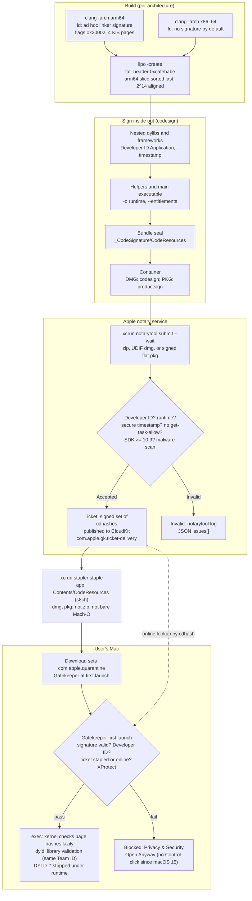

# macOS Packaging: Universal Binaries, Code Signing, and Notarization

> [!summary] Claim:
> A universal binary is a big-endian `fat_header` followed by independent Mach-O slices, and every slice carries its own code signature, its own CodeDirectory, and its own cdhash.
> A code signature is a SuperBlob at `LC_CODE_SIGNATURE` whose CodeDirectory hashes every page before the signature plus the Info.plist, resources, requirements, and entitlements; the CMS blob signs only the CodeDirectory.
> Notarization is Apple scanning a Developer ID signed, hardened-runtime, timestamped upload and publishing a ticket, which is a signed set of cdhashes that Gatekeeper finds online or stapled to an app, disk image, or package.
> Gatekeeper evaluates quarantined code at first launch; the hardened runtime then enforces library validation and strips `DYLD_*` variables for the life of the process.
> Any byte that changes after signing, from `install_name_tool`, `strip`, a re-`lipo`, or an in-place update, breaks a page hash or the cdhash and therefore the ticket.



## The Mechanism

Shipping native code for macOS outside the Mac App Store is three independent mechanisms stacked on one file.
Lipo decides what bytes exist, codesign decides which of those bytes are sealed and by whom, and notarization plus Gatekeeper decide whether a user's Mac will execute the sealed bytes.
Each layer is keyed on the one below it: a notarization ticket names cdhashes, a cdhash names a CodeDirectory, and a CodeDirectory names page hashes of one slice.
The worked example later in this note dumps every one of these structures from a real binary on macOS 27.3 arm64.

### 1. Universal binaries: the fat header and lipo

A universal ("fat") file is a container, not a Mach-O.
`cctools` `include/mach-o/fat.h` defines it: a `struct fat_header` of two big-endian `uint32_t` fields, `magic` (`FAT_MAGIC`, `0xcafebabe`) and `nfat_arch`, followed by `nfat_arch` records of `struct fat_arch`.
Each `fat_arch` is 20 bytes: `cputype`, `cpusubtype`, `offset`, `size`, and `align`.
`align` stores the exponent, not the byte count: the slice starts on a multiple of `1 << align`, and `lipo -detailed_info` prints that as `align 2^14 (16384)`.
`FAT_MAGIC_64` (`0xcafebabf`) selects `struct fat_arch_64`, which widens `offset` and `size` to 64 bits and adds a `reserved` word, for 32 bytes per record.
Everything in the fat header is big-endian on every Mac, while the Mach-O slices it points to are little-endian on both arm64 and x86_64; [[ELF-Mach-O-and-PE-Object-Formats]] owns the Mach-O header itself and the history of that byte order.

`lipo -create` makes no decisions about code; it copies slices and lays them out.
The layout rules come straight from `misc/lipo.c`:
- `cmp_qsort` sorts slices of the same CPU type by subtype, forces "arm64-family to follow after all other slices", and sorts everything else by alignment "to save space in the output file".
- lipo writes `FAT_MAGIC_64` when `-fat64` is passed, including for an `MH_EXECUTE` input.
  `argv` handling sets `fat64_flag` and does not consult the file type.
- On `-create`, if no input is `MH_EXECUTE` and the sum of every slice size except the last exceeds `0xFFFFFFFF`, lipo sets the same flag.
  That sum has no alignment padding.
  The check does not clear a flag that is already set.
  The comment above the executable test is "kernel does not support fat64".
- An archive larger than `UINT32_MAX` sets the flag, with the comment "auto enable -fat64 since input file is > 4GB".
  A Mach-O input larger than `UINT32_MAX` is fatal unless the flag is already set.
  It does not auto-switch.
- While the flag is off, `create_fat` fatals when an aligned offset exceeds `UINT32_MAX`, because the 32-bit `offset` field cannot hold it.

A universal executable therefore stays in the 32-bit fat format unless someone passes `-fat64`.
lipo will then emit `FAT_MAGIC_64` for that executable.
The comment on the auto-switch says the kernel does not support fat64.
This note did not try to exec such a file.
`fat.h` says the 64-bit format is used when a slice or an offset is greater than 4mb.
That comment disagrees with the 4 GiB tests in `lipo.c`.
Trust `lipo.c`.
On the lab host, `lipo -create hello.arm64 hello.x86_64` put `x86_64` first at offset 4096 (`align 2^12`) and `arm64` second at offset 32768 (`align 2^14`), whatever order the inputs were given in.
The arm64 slice is 16 KiB aligned because Apple silicon uses 16 KiB pages, and the slice must be mappable at a page boundary.

At `execve`, the kernel picks one slice and ignores the rest.
Apple's "Building a universal macOS binary" states the policy: an Intel Mac always runs `x86_64`; Apple silicon prefers `arm64` when present; the Finder "Open using Rosetta" option, `LSRequiresNativeExecution`, and `LSArchitecturePriority` in `Info.plist` change that preference for apps.
From a shell, `arch -x86_64 ./tool` runs the x86_64 slice under Rosetta 2.
Because each slice is a complete Mach-O, each has its own `LC_BUILD_VERSION` `minos`; the Apple sample makefile builds `x86_64-apple-macos10.12` and `arm64-apple-macos11`, since arm64 cannot target anything older than macOS 11.
[[Python-Wheels-Platform-Tags-Manylinux-and-ABI3]] shows how that per-slice `minos` becomes a `universal2` wheel tag.

The other lipo verbs are `-thin`, `-extract`, `-extract_family`, `-remove`, `-replace`, `-verify_arch`, `-archs`, `-info`, and `-detailed_info`.
None of them re-signs anything; the next section explains why `-thin` and `-extract` still leave valid signatures while any edit inside a slice does not.

### 2. Where a signature lives: LC_CODE_SIGNATURE and the SuperBlob

TN3126 lists four storage locations for a code signature: inside a Mach-O via `LC_CODE_SIGNATURE`; in `Contents/_CodeSignature/` for a bundle without a Mach-O; covered by the enclosing bundle's seal for a resource; and, for any other loose file, in extended attributes named `com.apple.cs.CodeDirectory`, `com.apple.cs.CodeRequirements`, and `com.apple.cs.CodeSignature`.
The extended-attribute form is brittle because many transfer tools drop xattrs, which is one reason Apple insists that code live in a bundle.

For a Mach-O, `LC_CODE_SIGNATURE` is a `linkedit_data_command` whose `dataoff` and `datasize` point, relative to the start of the slice, at the last bytes of `__LINKEDIT`.
That region holds a SuperBlob, whose layouts are in `xnu` `osfmk/kern/cs_blobs.h`; every field in it is big-endian.
The SuperBlob header is `magic` (`CSMAGIC_EMBEDDED_SIGNATURE`, `0xfade0cc0`), `length`, and `count`, followed by `count` `CS_BlobIndex` entries of `{type, offset}`.
The `type` is a slot number, and each offset points at a blob that starts with its own `magic` and `length`:

| Slot (`CSSLOT_*`) | Blob magic | Contents |
|---|---|---|
| `0` CODEDIRECTORY | `0xfade0c02` | The CodeDirectory: identifier, flags, page hashes, special slot hashes |
| `1` INFOSLOT | none in the header | Special hash index -1. TN3126: a hash of `Info.plist`, not an embedded blob |
| `2` REQUIREMENTS | `0xfade0c01` | Internal requirements vector, including an explicit designated requirement. Special hash index -2 |
| `3` RESOURCEDIR | none in the header | Special hash index -3. TN3126: a hash of `_CodeSignature/CodeResources` |
| `4` APPLICATION | none in the header | Named in `cs_blobs.h`. Special hash index -4. No blob magic in that header |
| `5` ENTITLEMENTS | `0xfade7171` | XML property list entitlements. Special hash index -5 |
| `6` | none | No `CSSLOT_*` name. Special hash index -6 has no named blob |
| `7` DER_ENTITLEMENTS | `0xfade7172` | DER-encoded entitlements. Special hash index -7. Slot numbers skip 6 |
| `8` to `11` | `0xfade8181` | Launch constraints (self, parent, responsible) and the library constraint |
| `0x1000` to `0x1004` | `0xfade0c02` | Alternate CodeDirectories. `CSSLOT_ALTERNATE_CODEDIRECTORY_MAX` is 5, so the range stops at `0x1004` |
| `0x10000` SIGNATURESLOT | `0xfade0b01` | CMS (RFC 5652) signature over the CodeDirectory, wrapped in a BLOBWRAPPER |
| `0x10001` IDENTIFICATIONSLOT | none in the header | Named in `cs_blobs.h`. That header does not document the blob |
| `0x10002` TICKETSLOT | none in the header | Named as the ticket slot. Whether stapler writes this slot was not confirmed |

### 3. The CodeDirectory, page hashes, and the cdhash

The CodeDirectory (`CS_CodeDirectory` in `cs_blobs.h`) is the object that is actually signed; TN3126 calls it "the central concept in a code signature".
Its fixed header is `magic`, `length`, `version`, `flags`, `hashOffset`, `identOffset`, `nSpecialSlots`, `nCodeSlots`, `codeLimit`, `hashSize`, `hashType`, `platform`, `pageSize` (stored as log2), and `spare2`, after which fields are appended per version:
- `0x20100` adds `scatterOffset`, and `0x20200` adds `teamOffset` (the Team ID string).
- `0x20300` adds `spare3`, which must be zero, and the `uint64_t` `codeLimit64`.
  It does not add `codeLimit64` alone.
- `0x20400` adds `execSegBase`, `execSegLimit`, and `execSegFlags`.
- `0x20500` adds `runtime`, the hardened runtime version, and `preEncryptOffset`.
- `0x20600` adds the linkage hash fields.

`hashOffset` points at slot 0 of an array of `hashSize`-byte hashes.
Non-negative indices are code pages: slot `i` is the hash of bytes `[i * pageSize, min((i + 1) * pageSize, codeLimit))` of the slice.
`codeLimit` equals `LC_CODE_SIGNATURE` `dataoff`, so the Mach-O header, every load command (including `LC_CODE_SIGNATURE` itself), every segment, and the start of `__LINKEDIT` are sealed, and only the signature region is outside the seal.
Negative indices are special slots, counted down from `hashOffset`.
TN3126 names -1 as the `Info.plist`, -3 as the resources (`_CodeSignature/CodeResources`), -5 as XML entitlements, and -7 as DER entitlements, and the SuperBlob slot numbers give -2 as requirements and -4 as the application slot.
An absent item has a zero hash.
`nSpecialSlots` is the count of those slots (`cs_blobs.h`: "number of special hash slots"), and the indices in use are `-1` through `-nSpecialSlots`.
Adding entitlements to the lab binary raised that count from 2 to 7, so the most negative index went from -2 to -7, because DER entitlements are slot 7 and slot -6 is still allocated even though it has no name.
`pageSize` is log2 of the page size, and the header comment says 0 means infinite, one hash of the whole range.

The cdhash is the hash of the CodeDirectory blob itself, truncated to `CS_CDHASH_LEN`.
That length is always 20 bytes.
The comment in `cs_blobs.h` is "always - larger hashes are truncated".
Hash types are SHA-1 (1), SHA-256 (2), SHA-256 truncated (3), and SHA-384 (4).
The lab's CodeDirectory uses type 2, so its cdhash is SHA-256 truncated to 20 bytes, and a SHA-384 CodeDirectory is truncated the same way.
Because the CodeDirectory contains every page hash and every special slot hash, the cdhash transitively names the code, the Info.plist, the resources, and the entitlements, but not the CMS signature.
The CMS signature and its secure timestamp sit outside the CodeDirectory and do not feed the cdhash, while the identifier, flags, Team ID, runtime version, and entitlement hashes sit inside it and do.
`codesign -dvvv` prints `CDHash` (the strongest hash this macOS understands) and `CandidateCDHash` per algorithm; code that targets macOS 10.11 or earlier also gets a SHA-1 CodeDirectory, while Apple silicon code never does (TN3126).

Verification is lazy.
TN3126 explains that the kernel may check a page's hash when it satisfies a page fault on a signed mapping, and that the hardened runtime opts the process into that checking by default.
The lab shows the consequence on arm64: flipping one byte inside the arm64 slice of a signed binary makes `codesign -v` report `invalid signature (code or signature have been modified)` and makes the process die with exit status 137, which is `SIGKILL`.

### 4. Linker signatures versus codesign signatures

Since macOS 11 on Apple silicon, the kernel refuses to run native arm64 code that has no signature, and "a simple ad-hoc signature is sufficient" (Big Sur 11.0.1 Universal Apps release notes).
Starting with Xcode 12 beta 4, `ld` writes that signature at link time; the Xcode 27.2 `ld(1)` says "The default for Apple Silicon binaries is to be ad-hoc codesigned", with `-no_adhoc_codesign` to opt out.
The requirement and the default apply to arm64 only: on the lab host, `ld-27106.1` signed the arm64 slice and left the x86_64 slice with no `LC_CODE_SIGNATURE`, both for separate `-arch` links and for one `clang -arch arm64 -arch x86_64` invocation, and the unsigned x86_64 slice still ran under Rosetta.
A one-file check on 2026-11-21, `clang -arch arm64 -arch x86_64 main.c -o tool`, printed `Identifier=tool` and `flags=0x20002(adhoc,linker-signed)` from `codesign -dvvv`.
`codesign -v` printed `code object is not signed at all` and exited 1, and `codesign -dv -a x86_64` printed the same unsigned message.
The single driver invocation therefore uses the `-o` name.
A thin link that is later passed to `lipo` keeps the thin output name, which is why the lab's arm64 slice is `hello.arm64`.
rustc links through the same `ld`, so a plain `rustc hi.rs` on arm64 also produced `flags=0x20002(adhoc,linker-signed)`.

The two signature kinds differ in ways that matter for packaging (lab host, macOS 27.3, as of 2026-11):

| Property | Linker signature (`ld`) | `codesign -s -` (ad hoc) | `codesign -s "Developer ID Application: ..."` |
|---|---|---|---|
| CodeDirectory version | `0x20400` | `0x20500` | `0x20500` |
| Flags | `0x20002` (`adhoc`, `linker-signed`) | `0x2` plus any `-o` flags | `0x0` plus any `-o` flags, typically `0x10000` (`runtime`) |
| Identifier | The file `ld` wrote (`hello.arm64` for a thin link; `tool` for one `clang -arch arm64 -arch x86_64 -o tool`, measured 2026-11-21) | `-i` value, Info.plist, or filename | Same |
| Page size on arm64 | 4096 | 16384 (observed) | Not measured here |
| Requirements blob | None | Empty vector; DR is implicit `cdhash H"..."` | `anchor apple generic` plus Developer ID OIDs and Team ID |
| CMS blob | None | Empty 8-byte BLOBWRAPPER | Full chain and secure timestamp (Firefox: `Signature size=8988`) |
| Team ID | None | None | Leaf certificate `OU` |
| Replaced by codesign without `-f` | Yes | No | No |
| Survives `--preserve-metadata` | Never | Yes | Yes |

The `codesign(1)` man page documents the last two rows and adds that linker signatures "will usually not contain any embedded code requirements including a designated requirement".
An ad hoc signature therefore identifies "exactly one instance of code"; the designated requirement that `codesign -d -r-` prints for the lab's universal ad hoc binary is `cdhash H"2ca6..." or cdhash H"cab5..."`, one cdhash per slice.

Signing a universal file signs every slice, and the man page says "codesign will always sign all architectures contained in a universal Mach-O file"; verification defaults to `--all-architectures`, while display defaults to the host's architecture.
Signing also re-lays out the fat file.
On the lab host the x86_64 slice moved from offset 4096 (`align 2^12`) to offset 16384 (`align 2^14`) and the file shrank from 82792 to 82624 bytes.
`codesign` allocates that signature space through `codesign_allocate`, and `CODESIGN_ALLOCATE` can name a substitute tool.
Do not attribute the observed move to `codesign_allocate -p`.
That option page-aligns the signature by padding the string table, and the man page says it is not the default because `codesign(1)` currently cannot use `-p`.
The size passed to `codesign_allocate` must be a multiple of 16.
The policy that moved this particular slice from `2^12` to `2^14` is observed, not stated by either man page.
Because each slice's seal is slice-relative, `lipo -thin` and `lipo -extract` copy a slice with its signature intact, and the lab's thinned x86_64 file still verified.
Anything that edits inside a slice breaks it: `install_name_tool -add_rpath` on the signed lab binary printed `warning: changes being made to the file will invalidate the code signature` for each architecture, and `codesign -v` then failed for arm64.
[[Diagnose-Dynamic-Linker-and-ABI-Failures]] owns the `install_name_tool` and rpath repair workflow; the rule here is to finish every Mach-O edit before the final signing pass.

The macOS 27.3 tools add one more volatile wrinkle (as of 2026-11, macOS).
`codesign(1)` documents `--signature-slot` ("1 for the first slot, 2 for the second slot") and `--output-detached-certificates` "when signing with hybrid PQC signatures", `codesign -dvvv` now prints `Total signatures=1` and `Chosen signature=1`, and `syspolicy_check` prints `Only one signature found ... skipping dual signature check`.
The man page states only that `--output-detached-certificates` moves the certificate chain out of the CMS signature "when signing with hybrid PQC signatures" to reduce signature size, that the option has no effect for RSA signatures, which always embed certificates, and that the default slot for display and verification is "the signature slot preferred by the OS".
This note does not describe the dual-signature wire format and does not recommend it for distribution; verify a release with `codesign -dvvv` and read `Total signatures=` before relying on any of it.

### 5. Bundles, nested code, and signing order

A bundle's signature lives on its main executable, with special slot -3 sealing `Contents/_CodeSignature/CodeResources`.
That property list has four dictionaries, and TN3126 says only `files2` still matters: resource entries carry a SHA-256 `hash2`, and nested code entries carry the nested code's `cdhash` and designated requirement.
The installed Firefox (signed 2025-09-29) shows the scale: `Sealed Resources version=2 rules=13 files=73` and `hashes=22+7` on the main executable.

Nested code must be signed before the code that contains it, because the outer seal records the inner cdhash.
Apple's "Creating distribution-signed code for macOS" states the rule as "Sign code from the inside out", gives the per-item command `codesign -s "Developer ID Application" -f --timestamp [-o runtime] [--entitlements X] [-i id] path`, and says to add `-o runtime` to main executables, `--entitlements` only to main executables, and `-i` to non-bundled code.
It also says "Don't pass the `--deep` option to `codesign` when you sign code", and `codesign(1)` marks `--deep` "DEPRECATED for signing as of macOS 13.0", because it applies one set of options and entitlements to every nested item and only finds code in a fixed list of directories (`Contents/Frameworks`, `Contents/PlugIns`, `Contents/XPCServices`, `Contents/Helpers`, `Contents/MacOS`, and a few more).
For verification, `--deep` remains the right flag: "Resolving common notarization issues" recommends `codesign -vvv --deep --strict`.

Copy bundles with `ditto`, never `cp`, because `ditto` preserves the symlinks that make up a versioned framework.
Do not run `codesign` under `sudo`.
The distribution guide says `codesign` relies on information in the calling user's account, and `codesign(1)` looks the identity up in that user's keychain search list.

### 6. Entitlements, the hardened runtime, and library validation

Entitlements are key-value claims embedded in the signature and granted to the process at exec.
They belong on main executables only: Apple's distribution guide says "Don't apply entitlements to library code", and `codesign(1)` says that not embedding entitlements in library signatures "is default behavior as of macOS 15.0" unless `--force-library-entitlements` is given.
Since macOS 12, `codesign` embeds both XML (slot 5) and DER (slot 7) entitlements by default; the lab's single-key entitlements file produced a 272-byte XML blob and a 70-byte DER blob.
The file must be a well-formed XML property list, ASCII-encoded, with no Unicode byte order mark and no extra characters, and Apple recommends validating a hand-edited file with `plutil` before signing; a binary plist is rejected by the notary service, and since macOS 10.15.4 a process with malformed embedded entitlements does not run (Apple, "Resolving common notarization issues").

The hardened runtime is CodeDirectory flag `CS_RUNTIME` (`0x10000`), requested with `-o runtime` and recorded with a runtime version derived from the SDK, `27.2.0` in the lab.
`codesign(1)` defines it as opting the process into "runtime code signing enforcement, library validation, hard, kill, and debugging restrictions" on macOS 10.14 and later.
The Hardened Runtime overview does not list the individual keys.
It says entitlements go only on executables, that these Boolean entitlements default to false and must be omitted rather than set false, and that system extensions generally may not use exception entitlements except Allow JIT in a non-DEXT.
The keys below are the ones named by the Disable Library Validation entitlement page, by TN3126, by the notarizing document, or by the lab's entitlements files:
- `com.apple.security.cs.allow-jit` allows writable and executable memory through the `MAP_JIT` flag.
  The flattened overview names JIT compilation and the Allow execution of JIT-compiled code entitlement for non-DEXT system extensions.
  It does not print this key string.
- `com.apple.security.cs.allow-unsigned-executable-memory` allows writable and executable memory without `MAP_JIT`.
  TN3126 calls the related entitlement Allow Unsigned Executable Memory.
- `com.apple.security.cs.allow-dyld-environment-variables` honors `DYLD_*` variables.
  The lab sets this key in `dyld.entitlements`.
- `com.apple.security.cs.disable-library-validation` loads code signed by other teams or ad hoc.
  This key has its own entitlement page, and the lab sets it.
- `com.apple.security.cs.disable-executable-page-protection` is the Intel opt-out.
  TN3126 says that on Apple silicon page protection stays on, so the entitlement is equivalent to Allow Unsigned Executable Memory.
- `com.apple.security.cs.debugger` is the attach-to-other-processes exception used by Xcode.
  The flattened overview does not print this key, so do not treat the string as a quote from that page.
- The notarizing document names resource-access entitlements such as Address Book and Location, plus the matching purpose strings.
  As of 2026-11 that document does not list audio input, camera, calendars, photos, or Apple Events.

Library validation means a process can map only code signed by Apple or with the same Team ID as its main executable.
dyld reports the refusal inside a `Library not loaded` error, which is the "library path validation failure" engineers usually misread as an rpath bug.
The lab produced both variants on macOS 27.3 (re-run 2026-11-26, build 26C5047e, with an absolute `dlopen` path because a hardened program refuses a relative one):
- An ad hoc, hardened main executable loading an ad hoc dylib: `code signature in <UUID> '.../libplugin.dylib' not valid for use in process: mapping process and mapped file (non-platform) have different Team IDs`.
- The same executable under Rosetta loading the unsigned x86_64 slice of that dylib: `not valid for use in process: mapped file has no cdhash, completely unsigned? Code has to be at least ad-hoc signed.`

The file was found; it was refused.
The fixes are to sign every shipped dylib with the same Developer ID as the executable, or, for a genuine plug-in host, add `disable-library-validation`, which Apple warns makes Gatekeeper run "extra security checks".
The same binary signed without `-o runtime` loaded both dylibs, which is why the failure first appears when a team turns on the runtime for notarization.
Plug-ins inherit the host's entitlements, so a host must claim every exception its plug-ins need (Apple, "Notarizing macOS software before distribution").

The runtime also strips `DYLD_*` variables.
In the lab, `DYLD_INSERT_LIBRARIES=inject.dylib` ran the injected constructor in the non-runtime binary, was silently ignored in the runtime binary that only had `disable-library-validation`, and ran again once `allow-dyld-environment-variables` was added.
[[macOS-vs-Linux-Toolchain-Mechanics]] covers how AMFI and the kernel enforce these flags, and [[How-Debuggers-Work-ptrace-Mach-and-Breakpoints]] covers `get-task-allow` and debugger attachment.

### 7. Identities, requirements, and secure timestamps

A Developer ID signature chains leaf, Developer ID Certification Authority, and Apple Root CA.
TN3127 separates the designated requirement `codesign` writes by default from the one Xcode writes.
`codesign`'s default Developer ID requirement is the identifier, `anchor apple generic`, certificate 1 OID `1.2.840.113635.100.6.2.6` (Developer ID Certification Authority), leaf OID `1.2.840.113635.100.6.1.13` (Developer ID Application), and `certificate leaf[subject.OU]` equal to the Team ID.
Firefox, signed 2025-09-29, shows that codesign-default shape verbatim:

```text
designated => identifier "org.mozilla.firefox" and anchor apple generic and certificate 1[field.1.2.840.113635.100.6.2.6] /* exists */ and certificate leaf[field.1.2.840.113635.100.6.1.13] /* exists */ and certificate leaf[subject.OU] = "43AQ936H96"
```

- `anchor apple generic` requires an Apple-issued chain, and TN3127 says the OID checks only make sense inside that anchor.
- OID `1.2.840.113635.100.6.2.6` marks the Developer ID Certification Authority intermediate.
- OID `1.2.840.113635.100.6.1.13` marks a Developer ID Application leaf.
- Developer ID Installer leaves carry `1.2.840.113635.100.6.1.14` instead, which is why one cannot sign the other's artifacts.
- `subject.OU` is the Team ID, the same value library validation compares.
- Those `codesign` defaults are not mutually compatible between a Mac App Store build and a Developer ID build, so a privacy grant earned on one does not carry to the other.
- Xcode avoids that by signing a custom requirement that ORs Mac App Store leaf OID `1.2.840.113635.100.6.1.9` with the Developer ID terms.
- TN3127 shows that the Numbers Mac App Store requirement factors to the same shape, and that those Xcode requirements do share grants.
  Its example is microphone access.
- A `codesign` pipeline that wants the same sharing passes `-r` with a requirement dumped from an Xcode-signed build and edited only for the identifier and Team ID.
- Do not hand-write the requirement text.
- An Apple Development requirement uses the leaf common name plus certificate 1 OID `1.2.840.113635.100.6.2.1` (Apple Worldwide Developer Relations) and shares grants with neither distribution channel.

The DR is how macOS recognizes "the same app" across updates for keychain access and privacy (TCC) grants, so changing Team ID or identifier between releases resets those grants.

Certificates expire, "typically a year from the date of issue, although the exact duration varies" (TN3161), while shipped software must keep running.
Developer ID solves this with a secure timestamp from a timestamp authority, requested with `--timestamp` (without a value `codesign(1)` uses "a default server provided by Apple", and warns that this server "may not support signatures made with identities not furnished by Apple"); macOS then checks that the certificate was valid at signing time.
`codesign -dvv` shows `Timestamp=` for a secure timestamp and `Signed Time=` for an unsecured local clock value, and Developer ID signing therefore needs network access to Apple's timestamp service.

### 8. Notarization

Notarization is not App Review: "The Apple notary service is an automated system that scans your software for malicious content, checks for code-signing issues", then issues a ticket and publishes it online (Apple, "Notarizing macOS software before distribution").
It has been mandatory for new Developer ID certificates and kernel extensions since macOS 10.14.5, and for all Developer ID software built after June 1, 2019 since macOS 10.15.
The list below is what the notarizing document requires of new software.
It is not absolute for preexisting software.
Apple recommends notarizing all previously distributed software, including older releases, software that does not meet every requirement, and even unsigned software.
The service uses telemetry to decide which of those rules to relax for preexisting software.
Some preexisting software might not run properly after a successful notarization, because Gatekeeper can still reject a problem the relaxed check did not enforce.
For new software, every executable must:
1. Carry a Developer ID application, kernel extension, system extension, or installer certificate.
   The notarizing document says not to use a Mac Distribution, ad hoc, Apple Developer, or local development certificate.
   Those are that document's words.
   They are not TN3161's current identity names.
2. Have the hardened runtime enabled.
3. Have a secure timestamp.
4. Not set `com.apple.security.get-task-allow` to any variation of true.
   A host that also sets `disable-library-validation` may keep the entitlement in order to debug a plug-in.
   The log line is still `The executable requests the com.apple.security.get-task-allow entitlement.`
5. Link against the macOS 10.9 SDK or later.
6. Have well-formed XML, ASCII entitlements.

TN3161's current names are a different list, and they should not be silently substituted for the notarizing document's rejection words.
Development is Apple Development.
Before the App Store re-signs, the distribution identity is `Apple Distribution: <Team>` or `3rd Party Mac Developer Application: TTT <Team>`.
After that re-sign, the leaf is `Apple Mac OS Application Signing`.
TN3161's audit stops on this wording: "The leaf certificate is `Apple Mac OS Application Signing`."
The following sentence is "This doesn't match the certificate from the code-signing identity you used to sign your app prior to submission, which is named either `Apple Distribution: <Team>` or `3rd Party Mac Developer Application: TTT <Team>`."

Each failure has a fixed log message, such as `The executable does not have the hardened runtime enabled.` and `The signature does not include a secure timestamp.`; "Resolving common notarization issues" lists them all.

`notarytool` is not the only client.
The customizing document says the easiest way to notarize is the Xcode user interface, and the notarizing document says a build script can use `notarytool` and `stapler` or talk to the Notary API directly.
`notarytool` first shipped in Xcode 13.
The lab host has 1.1.4 build 43.
The service stopped accepting `altool` and Xcode 13 or earlier uploads on November 1, 2023.
`altool` remains the tool TN3161 cites for App Store validation.
`notarytool`'s interface (notarytool(1) and `notarytool submit --help`, as of 2026-11, macOS):
- Authentication is an App Store Connect API key (`-k key.p8 -d KEYID [-i ISSUER]`, issuer only for team keys), an Apple ID with app-specific password (`--apple-id --team-id [--password]`), or a keychain profile created by `store-credentials` and passed as `-p`.
- `submit file --wait [--timeout 1h] [--webhook URL] [--no-s3-acceleration] [--force]` accepts only a zip, a UDIF disk image, or a signed flat installer package.
- `info`, `wait`, and `log ID [out.json]` act on a submission ID, a UUID that only the submitting team can query; `history` takes no ID and lists the team's previous submissions.
- `-f json` or `-f plist` gives machine-readable output for CI.

The log is JSON with `archiveFilename`, `issues[]` (`message`, `path`, `severity`), `jobId`, `logFormatVersion`, `status`, `statusSummary`, `ticketContents`, and `uploadDate`; Apple says to read it even on success, because warnings appear there.
Apple's numbers: "Notarization completes for most software within 5 minutes, and for 98 percent of software within 15 minutes", and the service asks teams to "Limit notarizations to 75 per day".
Uploads go to `notary-submissions-prod.s3-accelerate.amazonaws.com` by default, or to `notary-submissions-prod.s3.us-west-2.amazonaws.com` with `--no-s3-acceleration`.

The service processes nested containers inside the upload.
TN3126 defines a ticket as "a set of cdhash values, signed by the notary service".
"Customizing the notarization workflow" says the service "generates a ticket for the top-level file that you specify, as well as for each nested file", so a disk image containing a signed installer package containing an app yields three tickets: one each for the disk image, the package, and the app.
Apple's packaging guide says to sign every nested container and to notarize only the outermost one.
A custom third-party installer needs two rounds: notarize and staple the payload, then build and notarize the installer.

### 9. Stapling and the online ticket lookup

`xcrun stapler staple` downloads the ticket and attaches it so Gatekeeper can verify offline.
stapler(1) and Apple's workflow guide set the limits:
- Supported targets are UDIF disk images, signed flat packages, and code-signed bundles such as `.app`.
- A zip cannot be stapled; staple each item inside and re-zip.
- "Although tickets are created for standalone binaries, it's not currently possible to staple tickets to them", so a bare command-line tool in a zip always needs an online lookup on first run.
- Re-signing invalidates a stapled ticket, so staple strictly after the last `codesign`.
- stapler processes one path per invocation and needs the containing folder writable.

For an app, the stapled ticket is the file `Contents/CodeResources`; on Firefox it is 2557 bytes beginning with the ASCII magic `s8ch`, version 1, followed by DER certificate data.
This note states only the observed app location and the magic bytes; it does not describe the ticket's internal layout or where stapler writes it inside a disk image or package.
`cs_blobs.h` (xnu `main`) defines `CSSLOT_TICKETSLOT = 0x10002` next to `CSSLOT_SIGNATURESLOT = 0x10000` and `CSSLOT_IDENTIFICATIONSLOT = 0x10001`, with no comment on any of the three, so the header alone does not say that stapler uses it.
`stapler validate -v` shows the online half: it computes `cdhash`, `digestAlgorithm = 2`, `flags`, `secureTimestamp`, `signingId`, and `teamId`, and queries the CloudKit container `com.apple.gk.ticket-delivery` with record name `2/2/317674486d649d8894174f4492bb0f62d697cbe8`, which ends in the app's cdhash.
Apple's workflow guide lists the CloudKit IPv4 and IPv6 ranges a build server needs on port 443 for stapling.

Tickets can be revoked.
Apple can "issue a revocation ticket for apps known to be malicious - even if they've been previously notarized", and "macOS regularly checks for new revocation tickets" (Apple Platform Security); stapler exits `EX_NOPERM` for a revoked ticket.
Notarization also creates an audit trail per signing key, which lets a developer whose Developer ID key leaks ask Apple to revoke tickets for unauthorized builds.

### 10. Quarantine and Gatekeeper

A downloading app that opts in, such as a browser, sets the `com.apple.quarantine` extended attribute on what it writes.
The supported interface is the Launch Services keys in `LSQuarantine.h` (`kLSQuarantineAgentNameKey`, `kLSQuarantineAgentBundleIdentifierKey`, `kLSQuarantineTimeStampKey`, `kLSQuarantineTypeKey` with values such as `kLSQuarantineTypeWebDownload`, `kLSQuarantineDataURLKey`, `kLSQuarantineOriginURLKey`) and `NSURLQuarantinePropertiesKey`.
The raw value the lab wrote and read back was `0081;6af98414;Safari;`: a hexadecimal flags field, a hexadecimal Unix timestamp, the agent name, and an empty event identifier.
None of the Apple pages cited in this note defines that string or its flag bits, so treat the value as opaque, read it only through the Launch Services and `NSURL` keys above, and never write a parser for it.
Every file the lab created also carried an empty `com.apple.provenance` attribute.
None of the cited pages mentions that attribute, so this note makes no claim about what it does or when it appeared, and it does not appear in any check below.

Gatekeeper evaluates code at first launch, and its checks include:
1. The signature must be valid, and for direct distribution it must be Developer ID.
2. A ticket must be stapled or found online.
3. XProtect scans with YARA signatures when an app is first launched, when it changes on disk, and when signatures update (Apple Platform Security, macOS 10.15 and later).
4. The user approves the first open of downloaded software.
5. An app opened in place from a disk image or zip is translocated: Gatekeeper "randomizes its path" so relative references cannot reach unsealed files beside it, and moving the app first avoids this (Apple, "Packaging Mac software for distribution").

Since macOS 15, users "will no longer be able to Control-click to override Gatekeeper" and must use System Settings, Privacy & Security (Apple Developer News, 2024-08-06).

`spctl --assess --type execute -vv` and `syspolicy_check distribution` simulate the decision.
On the lab host the ad hoc binary was `rejected` with exit 3, Firefox was `accepted` with `source=Notarized Developer ID`, and a Mac App Store app reported `source=Mac App Store`.
`syspolicy_check distribution` on the quarantined ad hoc binary exited 70 and reported `Adhoc Signed App` (severity Warning) and `Notary Ticket Missing` (severity Fatal).
`syspolicy_check(1)` does not document exit codes, so 70 is an observation on that binary, not a contract.
spctl(8) on macOS 27.3 says rule-database operations (`--add`, `--enable`, `--disable`, `--remove`) are no longer supported as of macOS 15 and must be replaced by configuration profiles.

Running a quarantined, ad hoc signed copy of a small test program from a shell did not fail fast on 2026-11-26 (macOS 27.3, build 26C5047e): after about 13 seconds the shell reported exit 137 (SIGKILL) and the file was gone from disk.
The same binary without the quarantine attribute ran normally.
An earlier run of the same experiment ended in a `timeout` kill (exit 124) instead, so the exact failure mode, its delay, and the file removal are observations of one machine and one day, not a contract, and no cited Apple page documents them.
Apple's "Updating Mac Software" is the documented source for kernel signature caching: it explains that "macOS caches information about the code's signature in the kernel" per file and that an in-place overwrite produces `Code Signature Invalid` crashes that "go away when you restart the Mac".
The rule for installers and auto-updaters is to write a new file and `rename(2)` it over the old one, or use `ditto`, so the inode changes.

### 11. Containers, installers, and the CI keychain

The signed bundle is not what users download.
Three container formats carry it, and each has its own signing and stapling rule (as of 2026-11, macOS).

| Container | Build | Sign | Notarize and staple |
|---|---|---|---|
| zip | `ditto -c -k --keepParent App.app App.zip` | Sign the app inside, never the zip | Submit the zip; cannot be stapled, so staple the app first and then zip it |
| disk image | `hdiutil create -srcfolder dir -format UDZO out.dmg` | `codesign -s "Developer ID Application: ..." --timestamp out.dmg` | Submit and staple the image |
| flat package | `pkgbuild --root ... --identifier ID --install-location /Applications`, then `productbuild` | `--sign "Developer ID Installer: ..."` on either tool, or `productsign` afterwards | Submit and staple the package |

- `hdiutil(1)` lists `UDZO` among the image formats and documents `-format` for `create -srcfolder`; the UDIF requirement for notarization comes from Apple's packaging guide, not from `hdiutil`.
- `pkgbuild(1)` takes `--root`, `--component-plist`, `--identifier`, `--install-location`, `--sign`, `--keychain`, and `--timestamp`.
  Its man page says the Installer recognizes a package as an upgrade of an installed one "only if the package identifiers match", compares same-identifier packages by `--version` (default zero, which "may prevent proper upgrade/downgrade checking"), and fails without `--identifier` unless it is building from a single component.
  Set both explicitly.
- `productbuild(1)` accepts `--sign`, `--keychain`, `--timestamp`, and `--timestamp=none`.
- `productsign(1)` re-signs a finished archive and replaces an existing signature.
  Its man page says a trusted timestamp is "enabled by default when signing with a Developer ID identity", `--cert` embeds extra intermediate certificates, and `--timestamp=none` exists for offline use.
- Developer ID Application signs code, disk images, and bundles; Developer ID Installer signs packages.
  The two are different certificates, so a CI job needs both identities and must pick the right one per artifact.

A CI runner has no login session, so the signing identity lives in a keychain file that the job creates.
The subcommands below are listed in `security(1)` on macOS 27.3; the surrounding recipe is this note's composition, not an Apple-published script.
1. `security create-keychain`, `security set-keychain-settings -t <seconds>`, and `security unlock-keychain` create the file, set its lock timeout, and unlock it.
2. `security list-keychains -d user -s <keychain> ...` puts it on the search list, which `codesign(1)` requires: "a digital identity must be stored in a keychain that is on the calling user's keychain search list".
3. `security import file.p12 -k <keychain> -f pkcs12 [-P passphrase]` loads the certificate and private key.
4. `security set-key-partition-list -S <partition-list> -s <keychain>` lets a tool use the key without a prompt.
   The man page says the partition list "limits access to the key based on an application's code signature" and that "if you'd like to run /usr/bin/codesign with the key, `apple:` must be an element of the partition list".
   This note did not run a headless job without this step, so it does not state the failure symptom.
5. `codesign --keychain <file>` and `productsign --keychain <file>` restrict identity lookup to that file.
   For `codesign` the standard search path is still consulted to build the certificate chain.
6. `notarytool store-credentials PROFILE` saves notary credentials into a keychain item, with `--keychain` for a specific file or `--sync` for iCloud Keychain, and validates them against the service first (`--validate` is the default; `--no-validate` skips it).
   The other flags are the same authentication options that `submit` takes: the App Store Connect API key options (`--key`, `--key-id`, `--issuer`) and the Apple ID options (`--apple-id`, `--password`, `--team-id`).

Identity selection is the quiet failure in this recipe.
`codesign(1)` first treats the identity argument as a keychain identity preference, then searches every keychain for a certificate whose subject common name "(only) contains the identity string given", fails without signing when several match (an exact match beats a partial one, and comparisons are case sensitive), and reads exactly forty hexadecimal digits as the certificate's SHA-1 hash.
`--prefix` only affects an implicit identifier that has no dot, which is how command-line tools without an `Info.plist` get `com.example.` in front of their file name; `-i` sets the identifier directly, and the man page calls signing different programs with one identifier "a very bad idea".
`codesign --strict` adds checks beyond the defaults: `symlinks` rejects broken links and links that leave the bundle or point at unsealed files, and `sideband` rejects resource forks and Finder attributes; plain `--strict` means all of them.

## Commands and Numbers to Know

| Item | Value | Platform | Notes |
|---|---|---|---|
| Fat header magic | `0xcafebabe` (32-bit records), `0xcafebabf` (64-bit) (as of 2026-11) | macOS | Big-endian; 8-byte header, 20-byte `fat_arch`, 32-byte `fat_arch_64`. |
| lipo slice order | arm64 family last, others by alignment (as of 2026-11) | macOS | `cmp_qsort` in cctools `misc/lipo.c`. |
| fat64 | `-fat64` forces it, including for `MH_EXECUTE`. Auto only when no slice is `MH_EXECUTE` and the unpadded sum of every size but the last exceeds 4 GiB, or when an archive exceeds 4 GiB (as of 2026-11) | macOS | `lipo.c`. Kernel comment: fat64 is not supported. `fat.h` says 4mb; the code tests 4 GiB. |
| Slice alignment | arm64 `2^14`, x86_64 `2^12` from lipo, `2^14` after codesign (as of 2026-11) | macOS | `lipo -detailed_info`, lab host. |
| Linker signing default | arm64 ad hoc, x86_64 none (as of 2026-11) | macOS | ld-27106.1; `-no_adhoc_codesign` disables. |
| Linker signature flags | `0x20002` `adhoc,linker-signed`, CD `0x20400`, 4 KiB pages (as of 2026-11) | macOS | `codesign -dvvv`. |
| `codesign -s -` page size on arm64 | 16384 bytes; x86_64 slice 4096 (as of 2026-11) | macOS | From the CodeDirectory `pageSize` field, lab host. |
| cdhash length | Always 20 bytes. SHA-256 and SHA-384 are truncated (as of 2026-11) | macOS | `CS_CDHASH_LEN`. Hash types: SHA-1=1, SHA-256=2, SHA-256 truncated=3, SHA-384=4. |
| `CS_RUNTIME` / `CS_ADHOC` / `CS_LINKER_SIGNED` | `0x10000` / `0x2` / `0x20000` (as of 2026-11) | macOS | `cs_blobs.h`; `CS_REQUIRE_LV` is `0x2000`. |
| Special slots | -1 Info.plist, -2 requirements, -3 resources, -5 entitlements, -7 DER entitlements (as of 2026-11) | macOS | TN3126 and `CSSLOT_*`. |
| Sign for distribution | `codesign -s "Developer ID Application: NAME (TEAMID)" -f --timestamp -o runtime [--entitlements e.plist] path` (as of 2026-11) | macOS | Inside out; no `--deep`. |
| Verify | `codesign -vvv --deep --strict path` (as of 2026-11) | macOS | Exit 0 success, 1 sign or verify failure, 2 invalid arguments, 3 requirement mismatch via `-R`. |
| Inspect | `codesign -dvvv`, `codesign -d -r-`, `codesign -d --entitlements - --xml` (as of 2026-11) | macOS | Display defaults to the host architecture; add `-a x86_64`. |
| Notarize | `xcrun notarytool submit app.zip -p PROFILE --wait` (as of 2026-11) | macOS | notarytool 1.1.4; zip, UDIF dmg, or signed flat pkg only. |
| Notary log | `xcrun notarytool log UUID -p PROFILE log.json` (as of 2026-11) | macOS | Read it even when `status: Accepted`. |
| Notary latency | most within 5 min, 98% within 15 min; limit 75 per day (as of 2026-11) | macOS | Apple, "Customizing the notarization workflow". |
| Staple | `xcrun stapler staple App.app` or `.dmg` or `.pkg` (as of 2026-11) | macOS | Not zip, not a bare Mach-O; re-signing invalidates. |
| Zip for upload | `ditto -c -k --keepParent App.app App.zip` (as of 2026-11) | macOS | Preserves symlinks and bundle structure. |
| Sign a disk image | `codesign -s "Developer ID Application: ..." --timestamp -i ID App.dmg` (as of 2026-11) | macOS | Use an Application identity; image type `UDZO`. |
| Sign a package | `productbuild --sign "Developer ID Installer: ..." --component App.app /Applications out.pkg` (as of 2026-11) | macOS | Check with `pkgutil --check-signature`. |
| Gatekeeper simulation | `spctl -a -t exec -vv`, `syspolicy_check distribution` (as of 2026-11) | macOS | spctl exit 3 was the observed rejection of the ad hoc binary. Exit 70 was observed from `syspolicy_check distribution` on that same binary and reproduced 2026-11-26. The man page does not document it. |
| Pre-notary check | `syspolicy_check notary-submission App.app` (as of 2026-11) | macOS | Runs the notary service's checks locally. |
| Signing identity lookup | keychain identity preference, then common-name substring (several matches fail), or 40 hex digits as certificate SHA-1 (as of 2026-11) | macOS | `codesign(1)`, SIGNING IDENTITIES. |
| Strict verification | `codesign --strict[=symlinks,sideband]`; plain `--strict` is all checks (as of 2026-11) | macOS | `codesign(1)`; the set of checks may grow over time. |
| CI keychain | `security create-keychain`, `unlock-keychain`, `set-keychain-settings -t`, `list-keychains -d user -s`, `import -f pkcs12`, `set-key-partition-list -S` including `apple:` (as of 2026-11) | macOS | `security(1)`; `apple:` is required to run `/usr/bin/codesign` with the key. |
| Notary credentials | `notarytool store-credentials PROFILE [--keychain FILE \| --sync]`, validated unless `--no-validate` (as of 2026-11) | macOS | notarytool 1.1.4 `--help`. |
| Package upgrade identity | `pkgbuild --identifier ID --version V` (as of 2026-11) | macOS | `pkgbuild(1)`: upgrade only when identifiers match; version defaults to zero. |
| Online ticket lookup | CloudKit `com.apple.gk.ticket-delivery`, record `2/2/<cdhash>` (as of 2026-11) | macOS | Observed in `stapler validate -v` on Firefox, reproduced 2026-11-26 (HTTP 200 from `api.apple-cloudkit.com`, record name ends in the cdhash). |
| Secure timestamp | `codesign --timestamp` with no value uses Apple's default server; `--timestamp=URL` names another; `--timestamp=none` disables it (as of 2026-11) | macOS | `codesign(1)`: if the authority cannot be reached, the signing operation fails. |
| Universal build in CMake | `-DCMAKE_OSX_ARCHITECTURES="arm64;x86_64"` before `project()` (as of 2026-11) | macOS | CMake 4.5.0; must be a cache entry unless `CMP0126` is `NEW`. |

## Multi-Language Comparison: Producing and Shipping Universal Signed Code

| Concern | C++ (clang, CMake, Xcode) | Python (wheels) | Rust (cargo, rustc) |
|---|---|---|---|
| Build both architectures | `-arch arm64 -arch x86_64` in one clang call, `CMAKE_OSX_ARCHITECTURES="arm64;x86_64"`, or Xcode Standard Architectures in Release | `ARCHFLAGS="-arch arm64 -arch x86_64"` read by `_osx_support`; cibuildwheel 4.3.4 sets it for `universal2` identifiers | Two builds, `--target aarch64-apple-darwin` and `--target x86_64-apple-darwin`; rustc 1.99 has no universal target triple |
| Merge slices | Driver runs `ld` per arch, then `lipo` | Compiler driver merges per extension module | `lipo -create` by hand. maturin PR 1457 (merged 2023-02-03) deprecates `--universal2` in favor of the `universal2-apple-darwin` target. The maturin 1.15.0 `src/macos.rs` URL returned HTTP 404 on 2026-11-21, so that version pin is dropped |
| Linker signature | arm64 slice only | arm64 slice of each `.so` only | arm64 only (`rustc` links through `ld`) |
| Who signs for distribution | The app's own release pipeline, inside out | Nobody by default: the wheel format has no notarization step, and the extension is loaded by whichever interpreter imports it | The release pipeline; [[Rust-Binary-Distribution-with-dist-and-Cross-Compilation]] owns Rust release tooling |
| Library validation exposure | Third-party plug-ins and vendored dylibs need the same Team ID or `disable-library-validation` | If the importing interpreter runs with the hardened runtime and lacks `disable-library-validation`, an ad hoc or other-team `.so` is refused like any dylib | Same as C++ for `cdylib` plug-ins |
| Vendoring dylibs | Copy into `Contents/Frameworks`, set `@rpath`, then sign | `delocate-wheel` copies into `.dylibs` with `@loader_path`; cibuildwheel passes `delocate_archs=x86_64,arm64`. maturin PR 3114 (merged 2026-04-04) says repair verifies each architecture and errors when a thin dylib is required by more than one. The error text in `src/auditwheel/macos.rs` begins `Library '<name>' is a thin (single-architecture) binary, but the universal2 wheel requires architectures: <list>.` and ends with advice to install a universal library or build one wheel per architecture (read from maturin `main` 2026-11-26) | Copy and `install_name_tool`, then sign |
| Typical defect | Re-running `install_name_tool` after signing | A thin vendored dylib inside a `universal2` wheel | Forgetting to sign the lipo output, so the x86_64 slice has no signature |

## Worked Lab Example

This note has no harness lab under `code/`; every output below was captured once by hand on macOS 27.3 (build 26C5035r), arm64, Apple clang 21.0.0, ld-27106.1, Xcode 27.2, on 2026-11-15.
Absolute paths are shortened to `.../`, and the timestamps in quarantine values differ per run.
Steps 1, 2, 4, and 5 were re-run once on 2026-11-26 (macOS 27.3 build 26C5047e, same compiler, linker, and Xcode) and printed the same offsets, sizes, flags, cdhashes, dyld UUIDs, and Firefox values; the Step 3 `LC_CODE_SIGNATURE` offsets and sizes and the x86_64 cdhash were cross-checked with `otool -l` and `codesign -dvvv -a x86_64`, but `csdump.py` itself was not re-run.
The steps reproduce on any Apple silicon Mac with Xcode or the Command Line Tools and Rosetta 2; no Apple Developer account is needed, so notarization itself is shown from a third-party notarized app instead of a submission.

### Step 1: build two thin slices and merge them

```sh
cat > plugin.cpp <<'EOF'
extern "C" int plugin_value() { return 42; }
EOF
cat > hello.cpp <<'EOF'
#include <cstdio>
extern "C" int plugin_value();
int main() {
#if defined(__aarch64__)
  const char* arch = "arm64";
#elif defined(__x86_64__)
  const char* arch = "x86_64";
#else
  const char* arch = "other";
#endif
  std::printf("hello from %s slice, plugin_value=%d\n", arch, plugin_value());
  return 0;
}
EOF
for a in arm64 x86_64; do
  c++ -arch $a -mmacosx-version-min=11.0 -O2 -dynamiclib -install_name @rpath/libplugin.dylib plugin.cpp -o libplugin.$a.dylib
  c++ -arch $a -mmacosx-version-min=11.0 -O2 hello.cpp -L. -lplugin.$a -Wl,-rpath,@executable_path -o hello.$a
done
lipo -create hello.arm64 hello.x86_64 -output hello
lipo -create libplugin.arm64.dylib libplugin.x86_64.dylib -output libplugin.dylib
lipo -detailed_info hello
./hello; arch -x86_64 ./hello
codesign -v hello
```

```text
Fat header in: hello
fat_magic 0xcafebabe
nfat_arch 2
architecture x86_64
    cputype CPU_TYPE_X86_64
    cpusubtype CPU_SUBTYPE_X86_ALL
    capabilities
    offset 4096
    size 12624
    align 2^12 (4096)
architecture arm64
    cputype CPU_TYPE_ARM64
    cpusubtype CPU_SUBTYPE_ARM64_ALL
    capabilities
    offset 32768
    size 50024
    align 2^14 (16384)
hello from arm64 slice, plugin_value=42
hello from x86_64 slice, plugin_value=42
hello: code object is not signed at all
```

The universal file runs in both modes, yet `codesign -v` says it is "not signed at all", because verification covers all architectures and `ld` did not sign the x86_64 slice.
`codesign -dvvv hello` still prints a signature, because display defaults to the host architecture: `Identifier=hello.arm64`, `CodeDirectory v=20400 size=516 flags=0x20002(adhoc,linker-signed) hashes=13+0`.

### Step 2: sign ad hoc with the hardened runtime and read the result

```sh
cp hello hello.signed
codesign -s - -i com.example.hello -o runtime --timestamp=none hello.signed
codesign -dvvv hello.signed
codesign -v --verbose=4 hello.signed
codesign -d -r- hello.signed
```

The `Executable=`, `CandidateCDHashFull`, `Hash choices`, `CMSDigest`, and `CMSDigestType` lines are omitted below.

```text
Identifier=com.example.hello
Format=Mach-O universal (x86_64 arm64)
CodeDirectory v=20500 size=306 flags=0x10002(adhoc,runtime) hashes=4+2 location=embedded
Hash type=sha256 size=32
CandidateCDHash sha256=2ca64f801c8a7d9ac69a03d99a20135c99d2baf5
CDHash=2ca64f801c8a7d9ac69a03d99a20135c99d2baf5
Signature=adhoc
Info.plist=not bound
TeamIdentifier=not set
Runtime Version=27.2.0
Sealed Resources=none
Internal requirements count=0 size=12
Total signatures=1
Chosen signature=1
hello.signed: valid on disk
hello.signed: satisfies its Designated Requirement
# designated => cdhash H"2ca64f801c8a7d9ac69a03d99a20135c99d2baf5" or cdhash H"cab519556f40648e5109730856232154e0918330"
```

### Step 3: rebuild the SuperBlob parser and check every page hash

`csdump.py` (a scratch script from the drafting run; it is not shipped with this note, and only its core is reproduced below) reads the fat header, finds `LC_CODE_SIGNATURE` in each slice, walks the SuperBlob, decodes the CodeDirectory, recomputes every page hash, and computes the cdhash.
Its core is twenty lines of `struct.unpack_from` with `>` for the signature and fat header and `<` for load commands:

```python
magic, length, count = struct.unpack_from(">III", data, sb)          # 0xfade0cc0 SuperBlob
for i in range(count):
    typ, off = struct.unpack_from(">II", data, sb + 12 + 8 * i)      # CS_BlobIndex
(_m, _l, ver, flags, hashoff, identoff, nspecial, ncode, codelimit,
 hsize, htype, _plat, pageshift, _sp2) = struct.unpack_from(">IIIIIIIIIBBBBI", data, cd)
page = 1 << pageshift
for i in range(ncode):                                               # slot i covers one page
    chunk = data[base + i * page: base + min((i + 1) * page, codelimit)]
    ok = hashlib.sha256(chunk).digest() == data[cd + hashoff + i * hsize: cd + hashoff + (i + 1) * hsize]
cdhash = hashlib.sha256(data[cd:cd + cd_length]).hexdigest()[:40]   # 20 bytes
```

```text
== hello (82792 bytes)
slice x86_64: offset 4096 size 12624 align 2^12
  LC_CODE_SIGNATURE: absent (unsigned slice)
slice arm64: offset 32768 size 50024 align 2^14
  LC_CODE_SIGNATURE: dataoff 49488 datasize 536 (slice-relative)
  EMBEDDED_SIGNATURE (SuperBlob): length 536, 1 blobs
    slot 0x0 CodeDirectory: CODEDIRECTORY, 516 bytes
      version 0x20400 flags 0x20002 (adhoc,linker-signed) identifier hello.arm64
      hashType 2 hashSize 32 pageSize 4096 codeLimit 49488 nCodeSlots 13 nSpecialSlots 0
      page hashes recomputed: 13/13 match (codeLimit == LC_CODE_SIGNATURE dataoff: True)
      cdhash (first 20 bytes of sha256 over this CodeDirectory) 22a8019ffd0a557f32d3c61a26c761a9743fc0ce
== hello.signed (82624 bytes)
slice x86_64: offset 16384 size 12992 align 2^14
  LC_CODE_SIGNATURE: dataoff 12624 datasize 368 (slice-relative)
  EMBEDDED_SIGNATURE (SuperBlob): length 362, 3 blobs
    slot 0x0 CodeDirectory: CODEDIRECTORY, 306 bytes
      version 0x20500 flags 0x10002 (adhoc,runtime) identifier com.example.hello
      hashType 2 hashSize 32 pageSize 4096 codeLimit 12624 nCodeSlots 4 nSpecialSlots 2
      runtime version 27.2.0
      page hashes recomputed: 4/4 match (codeLimit == LC_CODE_SIGNATURE dataoff: True)
      cdhash (first 20 bytes of sha256 over this CodeDirectory) cab519556f40648e5109730856232154e0918330
    slot 0x2 Requirements: REQUIREMENTS, 12 bytes
    slot 0x10000 CMS signature: BLOBWRAPPER (CMS), 8 bytes
slice arm64: offset 32768 size 49856 align 2^14
  LC_CODE_SIGNATURE: dataoff 49488 datasize 368 (slice-relative)
  EMBEDDED_SIGNATURE (SuperBlob): length 362, 3 blobs
    slot 0x0 CodeDirectory: CODEDIRECTORY, 306 bytes
      version 0x20500 flags 0x10002 (adhoc,runtime) identifier com.example.hello
      hashType 2 hashSize 32 pageSize 16384 codeLimit 49488 nCodeSlots 4 nSpecialSlots 2
      runtime version 27.2.0
      page hashes recomputed: 4/4 match (codeLimit == LC_CODE_SIGNATURE dataoff: True)
      cdhash (first 20 bytes of sha256 over this CodeDirectory) 2ca64f801c8a7d9ac69a03d99a20135c99d2baf5
    slot 0x2 Requirements: REQUIREMENTS, 12 bytes
    slot 0x10000 CMS signature: BLOBWRAPPER (CMS), 8 bytes
```

The recomputed cdhashes equal `codesign`'s `CDHash` for arm64 and the second term of the ad hoc DR for x86_64, which proves the cdhash is a plain hash of the CodeDirectory bytes.
The linker's arm64 signature used 13 hashes of 4 KiB pages; `codesign` re-hashed the same 49488 bytes as 4 pages of 16 KiB, and hashed the x86_64 slice in 4 KiB pages.
The ad hoc signature has an 8-byte empty CMS blob, which is what "ad hoc" means: hashes without any signer.
Re-signing with an entitlements file grew the arm64 SuperBlob to 5 blobs (adding 272-byte XML and 70-byte DER entitlements) and `nSpecialSlots` to 7.

### Step 4: break it four ways

```sh
# 1. Tamper with one byte inside the arm64 slice's first code page.
cp hello.signed hello.tampered
python3 -c "p='hello.tampered'; d=bytearray(open(p,'rb').read()); d[32768+0x3f00]^=0xff; open(p,'wb').write(d)"
codesign -v hello.tampered; ./hello.tampered; echo "rc=$?"
# 2. Library validation: sign both slices of the dylib ad hoc, run the hardened executable.
codesign -s - -f libplugin.dylib
./hello.signed
# 3. Edit after signing.
cp hello.signed hello.int; install_name_tool -add_rpath @executable_path/../Frameworks hello.int; codesign -v hello.int
# 4. DYLD_INSERT_LIBRARIES against a runtime binary that only disables library validation.
printf '%s\n' '#include <cstdio>' \
  '__attribute__((constructor)) static void hi() { std::fprintf(stderr, "[injected constructor ran]\n"); }' > inject.cpp
c++ -arch arm64 -dynamiclib inject.cpp -o inject.dylib && codesign -s - -f inject.dylib
cp hello hello.lv
codesign -s - -f -i com.example.hello -o runtime --entitlements lv.entitlements hello.lv   # lv.entitlements: disable-library-validation = true
DYLD_INSERT_LIBRARIES=$PWD/inject.dylib ./hello.lv
```

```text
hello.tampered: invalid signature (code or signature have been modified)
In architecture: arm64
rc=137
dyld[35807]: Library not loaded: @rpath/libplugin.dylib
  Referenced from: <DCC9D781-AF7E-36F8-B48E-644234C22BB7> .../hello.signed
  Reason: tried: '.../libplugin.dylib' (code signature in <19D430E5-7ECD-33F3-8AD6-4C49A74731BE> '.../libplugin.dylib' not valid for use in process: mapping process and mapped file (non-platform) have different Team IDs), ...
install_name_tool: warning: changes being made to the file will invalidate the code signature in: hello.int (for architecture x86_64)
install_name_tool: warning: changes being made to the file will invalidate the code signature in: hello.int (for architecture arm64)
hello.int: invalid signature (code or signature have been modified)
In architecture: arm64
hello from arm64 slice, plugin_value=42
```

The tampered arm64 slice is killed with `SIGKILL` (137) while its x86_64 slice still verifies with `codesign -v -a x86_64`.
`hello.lv` is the same binary re-signed with `com.apple.security.cs.disable-library-validation`; it loads the ad hoc dylib on both architectures, but the injected constructor does not run, because the runtime strips `DYLD_INSERT_LIBRARIES` without `allow-dyld-environment-variables`.

### Step 5: what Gatekeeper says about it, and about a notarized app

```sh
spctl --assess --type execute -vv hello.signed; echo "rc=$?"
spctl --assess --type execute -vv /Applications/Firefox.app
codesign -dvvv /Applications/Firefox.app
xxd /Applications/Firefox.app/Contents/CodeResources | head -1
```

The `codesign -dvvv` block is abridged to the lines discussed in this note.

```text
hello.signed: rejected
rc=3
/Applications/Firefox.app: accepted
source=Notarized Developer ID
origin=Developer ID Application: Mozilla Corporation (43AQ936H96)
Identifier=org.mozilla.firefox
Format=app bundle with Mach-O universal (x86_64 arm64)
CodeDirectory v=20500 size=1055 flags=0x10000(runtime) hashes=22+7 location=embedded
CDHash=317674486d649d8894174f4492bb0f62d697cbe8
Signature size=8988
Authority=Developer ID Application: Mozilla Corporation (43AQ936H96)
Authority=Developer ID Certification Authority
Authority=Apple Root CA
Timestamp=Sep 29, 2025 at 1:42:48 PM
Notarization Ticket=stapled
Info.plist entries=26
TeamIdentifier=43AQ936H96
Runtime Version=15.5.0
Sealed Resources version=2 rules=13 files=73
Internal requirements count=1 size=180
00000000: 7338 6368 0100 0000 f105 0000 b403 0000  s8ch............
```

Firefox's entitlements include `allow-jit` and `disable-library-validation`, which a browser with a JIT and third-party plug-ins needs, and its `Runtime Version=15.5.0` records the SDK it was built against.
`xcrun stapler validate -v` then looked the same cdhash up in CloudKit as `2/2/317674486d649d8894174f4492bb0f62d697cbe8` and printed `The validate action worked!`.

## Pitfalls

> [!warning] Pitfall 1: The x86_64 slice ships unsigned
> `ld` signs only arm64, so a universal file built by `clang -arch arm64 -arch x86_64` or by `lipo` of linker output has an unsigned x86_64 slice.
> It runs on Intel Macs and under Rosetta, so local testing passes, while `codesign -v` reports `code object is not signed at all` and a hardened host refuses the slice with `mapped file has no cdhash`.
> Always run a real `codesign` over the final universal file and verify with `codesign -vvv --deep --strict`, which checks every architecture.

> [!warning] Pitfall 2: Editing after signing
> `install_name_tool`, `strip`, `vtool -set-build-version`, `lipo -replace`, a post-build `sed`, or delocate rewriting install names all change sealed bytes.
> On arm64 the result is `SIGKILL` at launch, and for a notarized app the cdhash no longer matches the ticket.
> Make the signing step the last mutation, sign inside out, and staple after the final `codesign`.

> [!warning] Pitfall 3: Reading a library validation refusal as an rpath bug
> `Library not loaded: @rpath/libX.dylib` with a `Reason:` that says `not valid for use in process: ... different Team IDs` means dyld found the file and refused it.
> Adding rpaths or setting `DYLD_LIBRARY_PATH` cannot help, and the hardened runtime ignores `DYLD_*` anyway.
> Sign the dylib with the same Developer ID, or claim `disable-library-validation` only in a real plug-in host.

> [!warning] Pitfall 4: `--deep` for signing
> `codesign --deep -s ...` applies one set of options and entitlements to every nested item and skips code outside a fixed directory list.
> Helpers end up with the app's entitlements, and code in `Contents/Resources` stays unsigned until the notary log reports it.
> Sign each item explicitly from the inside out; keep `--deep` for verification.

> [!warning] Pitfall 5: Debug entitlements and missing timestamps in a custom pipeline
> Xcode injects `com.apple.security.get-task-allow` into builds and strips it only on archive and export, and only archive and export add a secure timestamp.
> A CI pipeline that signs Debug-style products fails notarization with `The executable requests the com.apple.security.get-task-allow entitlement.` or `The signature does not include a secure timestamp.`.
> Pass `--timestamp` and a release entitlements file explicitly, and run `syspolicy_check notary-submission` before upload.

> [!warning] Pitfall 6: Expecting to staple a command-line tool
> Tickets are created for standalone binaries but cannot be stapled to them, and a zip cannot be stapled at all.
> A CLI shipped as a bare Mach-O in a zip needs an online ticket lookup on first run, so offline or firewalled users are blocked.
> Ship tools inside a signed, notarized, stapled package or disk image, or inside an app-like bundle.

> [!warning] Pitfall 7: Updating signed code in place
> `cp new old` or `open(O_TRUNC)` keeps the inode, and the kernel's cached signature for that inode no longer matches the bytes.
> The symptom is a random `Code Signature Invalid` crash that disappears after a reboot; Apple's "Updating Mac Software" is the source for the caching.
> Write to a temporary file and `rename(2)` it into place, or use `ditto`, and check with `ls -i` that the inode changed.

> [!warning] Pitfall 8: Trusting codesign option order, in either direction
> `codesign(1)` on macOS 27.3 warns that `--options` placed before `--sign` "is ignored silently", yet on the lab host `codesign -o runtime -s - -f` and `codesign -s - -o runtime -f` both produced `flags=0x10002(adhoc,runtime)`.
> Do not rely on the warning or on its absence; always verify the resulting flags with `codesign -dvvv` in CI.

> [!warning] Pitfall 9: A signing identity that matches twice
> `codesign -s "Developer ID Application"` matches every certificate whose common name contains that string.
> With several matches `codesign` fails and signs nothing, and a runner whose keychain holds an expired and a renewed certificate hits this after every renewal.
> Pass the full common name with `--keychain`, or the 40-hex-digit SHA-1 hash, and log which certificate signed each artifact.

> [!warning] Pitfall 10: Packages that never upgrade
> The Installer treats a package as an upgrade only when the package identifier matches, and compares versions only within one identifier.
> A pipeline that lets `pkgbuild` infer an identifier from a changing component name, or leaves `--version` at its default of zero, produces packages that install side by side or fail the upgrade check.
> Fix `--identifier` and increase `--version` on every release.

## At Scale

For one developer, the cost of this pipeline is learning it once: Xcode's Archive and Distribute flow signs, notarizes, and staples an app in one action.
For a team, the paved road is a release job on a dedicated macOS runner that holds the Developer ID private key in a keychain, an App Store Connect API key for `notarytool`, and a script that signs inside out, notarizes the outermost container, staples, and runs `spctl` and `syspolicy_check`.
For 1,000 to 50,000 engineers, the signing key becomes the most valuable credential in the company, because anything signed with it runs on every customer Mac without a warning once notarized.

The economics at scale:
- A universal build compiles every source file once per architecture (Apple, "Building a universal macOS binary"), which is why Xcode builds only the active architecture for Debug and both for Release; build single-architecture for inner loops and CI tests, and universal only in the release job.
- Notarization latency is usually minutes, but Apple asks for at most 75 submissions per day; a monorepo that notarizes every merge needs batching, or notarization only for release candidates.
- Apple says to minimize the total number of files, even when each file is small, and not to store non-executable files where a signature is required.
  The workflow guide's example path is the typo `MyApp.app/Content/MacOS/`.
  The real directory is `Contents/MacOS`, and non-code belongs in `Contents/Resources`.
- Each artifact's cdhash is a natural release identifier: record it beside the version, because ticket revocation, launch constraints, and incident response all speak in cdhashes.

Decision rules:
1. One Team ID for everything a product loads, so library validation stays on; grant `disable-library-validation` only to hosts that load third-party plug-ins, with a written justification.
2. Keep the Developer ID Application and Installer keys in an HSM-backed or tightly scoped signing service, never on developer laptops; sign from CI with an identity selected by its 40-hex-digit SHA-1 hash, which `codesign(1)` interprets as the certificate hash, so a similarly named duplicate cannot be chosen (a common-name string that matches several identities makes `codesign` fail without signing).
3. Use App Store Connect API team keys for `notarytool`, not personal Apple IDs, so notarization survives staff changes.
4. Gate release on four checks: `codesign -vvv --deep --strict`, `syspolicy_check distribution` on the stapled artifact, an offline launch test on a clean Mac or VM with the quarantine attribute set, and both architectures executed (the second under `arch -x86_64`).
5. Notarize every previously shipped release as well.
   Apple's stated reason is to protect users who still run older versions, and so the notary service can distinguish legitimate software from tampered variants.
   The audit trail is the separate mechanism that lets a developer ask Apple to revoke tickets for unauthorized builds after a key leak.
6. Ship auto-updates by atomic rename, and test the upgrade path, the duplicate-copy path, and the run-from-disk-image path that triggers translocation.

[[Release-Trains-Backports-and-Artifact-Registries]] covers how signed artifacts flow through registries, and [[Sigstore-Keyless-Signing-Cosign-Fulcio-and-Rekor]] covers the transparency-log alternative that Apple's model does not use.

> [!tip] Practice Drill: Make a universal tool distributable without an Apple account
> Rebuild the worked example and show that `codesign -v` fails on the `lipo` output while `codesign -dvvv` looks fine, then explain the difference from the man page's `--all-architectures` default.
> Sign it ad hoc with `-o runtime`, reproduce the `different Team IDs` refusal, and fix it once with an entitlement and once by removing `-o runtime`, then state which fix a notarized product may use.
> Run `csdump.py` and confirm that the cdhash equals `codesign`'s `CDHash`; then flip one byte in `__LINKEDIT` before the signature and one byte inside the signature region, and predict which one breaks verification.
> Finally write the release script you would run with a Developer ID: signing order, `ditto` zip, `notarytool submit --wait -f json`, `notarytool log`, `stapler staple` on a disk image, and the `spctl` and `syspolicy_check` gates.

## Interview Questions

> [!question] L5: What is a universal binary, and how does the system choose which code to run?
> > [!success]- Answer
> > It is a container: a big-endian `fat_header` with magic `0xcafebabe` and an array of `fat_arch` records, each pointing at a complete Mach-O slice with its own load commands, `minos`, and signature.
> > `lipo -create` builds it and places arm64 slices last at 16 KiB alignment.
> > At exec the kernel maps only one slice: x86_64 on Intel, arm64 on Apple silicon when present, unless `arch -x86_64`, the Rosetta checkbox, or `LSArchitecturePriority` says otherwise.

> [!question] L5: Predict the output.
> On an Apple silicon Mac you run `clang -arch arm64 -arch x86_64 main.c -o tool`, then `codesign -v tool`, then `codesign -dv tool`.
> > [!success]- Answer
> > `codesign -v tool` prints `tool: code object is not signed at all` and exits 1, because verification checks every architecture and `ld` ad hoc signs only the arm64 slice.
> > `codesign -dv tool` prints a signature with `flags=0x20002(adhoc,linker-signed)` and `Identifier=tool` (the output name), because display reports only the host's architecture.
> > `./tool` still runs on both architectures, since Rosetta does not require a signature on x86_64 code; run `codesign -s -` (or a real identity) on the merged file to sign both slices.

> [!question] L6: What exactly does a code signature seal, and what is a cdhash?
> > [!success]- Answer
> > The CodeDirectory holds a hash of every page of the slice up to `codeLimit`, which equals the `LC_CODE_SIGNATURE` offset, so headers, load commands, and all segments are sealed.
> > Negative special slots hold hashes of the Info.plist, requirements, `CodeResources` (and through it every resource and nested cdhash), and XML and DER entitlements.
> > The cdhash is the hash of the CodeDirectory blob truncated to `CS_CDHASH_LEN`, which is always 20 bytes, so it transitively names all of that.
> > The lab hash type is SHA-256.
> > SHA-384 is truncated the same way.
> > The CMS signature signs the CodeDirectory and is not part of the cdhash.
> > Notarization tickets, ad hoc designated requirements, and launch constraints all identify code by cdhash.

> [!question] L6: Debug this.
> A notarized app crashes at launch on a customer's Mac with `Library not loaded: @rpath/libfoo.dylib ... not valid for use in process: mapping process and mapped file (non-platform) have different Team IDs`.
> It worked in the developer's Debug build.
> > [!success]- Answer
> > dyld found `libfoo.dylib` and library validation rejected it, so this is not an rpath problem.
> > The release build has the hardened runtime, which notarization requires, and enables library validation; the Debug build either lacked `-o runtime` or loaded a dylib that Xcode had signed with the same development identity.
> > `codesign -dvvv` on both files will show different `TeamIdentifier` values, typically a vendored dylib signed by its vendor or ad hoc.
> > Re-sign the dylib with the app's Developer ID inside out before signing the app, then re-notarize; use `disable-library-validation` only if the app is a plug-in host.

> [!question] L6: Walk through what notarization checks and what it produces.
> > [!success]- Answer
> > The upload must be a zip, UDIF disk image, or signed flat package.
> > For new software the service checks every executable for a Developer ID signature (not Mac Distribution, ad hoc, Apple Developer, or local development), the hardened runtime, a secure timestamp, no `get-task-allow` set to any variation of true, an SDK of 10.9 or later, and well-formed entitlements, and it scans for malware.
> > Preexisting software can be notarized even when it misses those checks.
> > The service uses telemetry to decide which rules to relax, and a successful notarization of old software can still fail at Gatekeeper.
> > On success it publishes a ticket.
> > TN3126 defines a ticket as a set of cdhashes signed by the notary service.
> > The service issues one ticket for the submitted file and one for each nested container or bundle inside it ("Customizing the notarization workflow").
> > Publish is through CloudKit, and only the outermost container is submitted.
> > `notarytool log` returns JSON with `issues[]` even on success, and Apple says most submissions complete within 5 minutes and 98 percent within 15 minutes.
> > It is not App Review and makes no judgment about functionality.

> [!question] L6: Why is a secure timestamp required, and what happens when the Developer ID certificate expires?
> > [!success]- Answer
> > Apple code signing certificates are typically valid for about a year, while users keep software for many years.
> > A secure timestamp from a timestamp authority proves when the signature was made, and macOS checks that the certificate was valid at that time, so already-shipped software keeps running after expiry.
> > Without it, `codesign -dvv` shows `Signed Time` from the local clock, which proves nothing, and the notary service rejects the upload.
> > New releases must be signed with a currently valid certificate.

> [!question] L6: A release job that signed fine for a year now fails with no signature written after the Developer ID certificate was renewed.
> Why, and what do you change?
> > [!success]- Answer
> > The identity argument is matched as a substring of certificate common names across the keychain search list, and `codesign` fails without signing when more than one certificate matches.
> > After a renewal the keychain holds the old and the new certificate under the same name.
> > Select the identity by its 40-hex-digit SHA-1 hash, or pass the full common name with `--keychain`, remove the expired certificate from the runner image, and record the certificate hash with each artifact.

> [!question] L7: Your updater replaces `Tool` with `cp Tool.new Tool`, and some users report random `Code Signature Invalid` crashes that vanish after a reboot.
> Explain and fix.
> > [!success]- Answer
> > The kernel caches code signature state per file (vnode) and validates pages lazily as they fault in.
> > `cp` overwrites the existing inode, so new pages are checked against the cached old signature and fail, killing the process with a code signing crash; a reboot drops the cache.
> > Write the new file to a temporary path on the same volume and `rename(2)` it over the old one, or use `ditto`, so the inode changes and the kernel builds a fresh cache.
> > Verify with `ls -i` before and after, and test the upgrade path in release CI.

> [!question] L7: Design the signing and notarization pipeline for an app that bundles a helper tool, three vendored C++ dylibs, a Python interpreter with extension modules, and ships as a disk image.
> > [!success]- Answer
> > Build each architecture, `lipo` every Mach-O into universal files, and finish all `install_name_tool` and `delocate` edits first.
> > Sign inside out with the Developer ID Application identity and `--timestamp`: every dylib and `.so` without entitlements, then the interpreter and helper with `-o runtime`, `-i` identifiers, and their own entitlements, then the app with its entitlements.
> > Library validation then passes because every item shares one Team ID, so no `disable-library-validation` is needed unless users load their own extensions.
> > Create a `UDZO` disk image with `hdiutil`, sign it with `-i`, notarize only the disk image with `notarytool submit --wait`, read the log, staple the disk image, and gate on `spctl`, `syspolicy_check distribution`, and an offline launch on a clean Mac of both slices.

> [!question] L7: Gatekeeper accepts an app on your Mac but blocks it on customers' Macs.
> List the causes you would check, in order.
> > [!success]- Answer
> > Your copy is not quarantined, so test a downloaded copy: `xattr -p com.apple.quarantine` and `syspolicy_check distribution`.
> > The ticket may not be stapled and the customers may be offline or firewalled from CloudKit; `stapler validate`.
> > Something modified the bundle after notarization, such as a post-processing step or an in-place update, so the cdhash no longer matches the ticket; `codesign -vvv --deep --strict`.
> > The ticket may have been revoked, or the app relies on translocation-sensitive relative paths when run from the disk image.

> [!question] L8+: You own macOS release engineering for 5,000 engineers and 40 shipped products.
> What do you standardize?
> > [!success]- Answer
> > One signing service that holds the Developer ID Application and Installer keys in hardware, signs on request from authenticated release jobs, and logs every cdhash it signs.
> > One release library that enforces build-per-arch then `lipo`, edits before signing, inside-out signing, the hardened runtime, explicit entitlements files reviewed like code, and no `--deep`.
> > One notarization path using team API keys, outermost-container submissions within Apple's daily limit, mandatory log review, and stapling.
> > One gate: `codesign --strict`, `syspolicy_check`, an offline quarantined launch of both slices on clean VMs, and a cdhash inventory per release so revocation and incident response can name exact artifacts.

## Further Reading

- codesign(1) on macOS 27.3: the authoritative list of flags, option flags, the `--deep` deprecation, and the linker-signed semantics.
- xnu `osfmk/kern/cs_blobs.h`: the exact CodeDirectory, SuperBlob, slot, and flag definitions that the kernel enforces.
- cctools `misc/lipo.c` and `include/mach-o/fat.h`: the fat format and the slice ordering and fat64 rules.
- TN3126, TN3127, TN3161, and TN3125 (Inside Code Signing): hashes, requirements, certificates, and provisioning profiles, written by Apple DTS.
- Notarizing macOS software before distribution, Customizing the notarization workflow, and Resolving common notarization issues: the requirements, commands, limits, and every rejection message.
- Creating distribution-signed code for macOS and Packaging Mac software for distribution: the inside-out signing procedure and the zip, disk image, and package recipes.
- `security(1)`, `productsign(1)`, `pkgbuild(1)`, `productbuild(1)`, and `hdiutil(1)` on macOS 27.3: the keychain, installer-signing, and disk-image flags used by a headless release job.
- Hardened Runtime and the Disable Library Validation Entitlement pages: the exception list and the library validation rule.
- Updating Mac Software: why in-place updates crash and how to replace files safely.
- macOS Big Sur 11.0.1 Universal Apps release notes: the origin of mandatory arm64 signing and linker signatures.
- Apple Platform Security, Protecting against malware in macOS: XProtect triggers and ticket revocation.

## Related

- Prerequisites: [[Cpp-ABI-Stability-Symbol-Visibility-and-SONAME]]
- See also: [[ELF-Mach-O-and-PE-Object-Formats]], [[macOS-vs-Linux-Toolchain-Mechanics]], [[Diagnose-Dynamic-Linker-and-ABI-Failures]], [[Dynamic-Linking-PLT-GOT-and-Loaders]], [[How-Debuggers-Work-ptrace-Mach-and-Breakpoints]], [[Python-Wheels-Platform-Tags-Manylinux-and-ABI3]], [[Python-Cross-Platform-Wheel-Pipelines-with-cibuildwheel]], [[Rust-Binary-Distribution-with-dist-and-Cross-Compilation]], [[Cpp-Hardened-Release-Builds-and-Separate-Debug-Symbols]], [[Cpp-System-Packaging-Deb-RPM-and-Homebrew]], [[Release-Trains-Backports-and-Artifact-Registries]], [[Sigstore-Keyless-Signing-Cosign-Fulcio-and-Rekor]]
