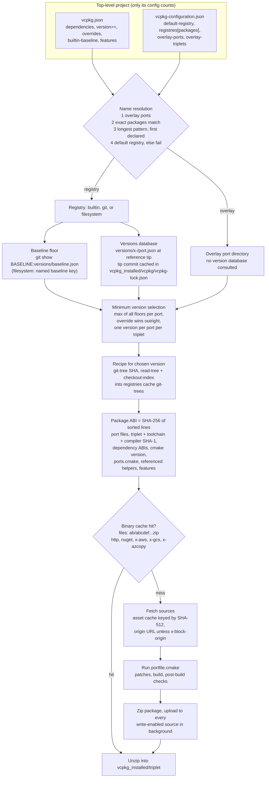

# vcpkg: Manifest Mode, Git Registries, and Binary Caching

> [!summary] Claim:
> vcpkg is a source-based package manager whose reproducibility comes from two content addresses, not from a lockfile of resolved versions.
> The first is the registry baseline, a git commit SHA whose `versions/baseline.json` fixes a version floor for every port, and each version maps to an immutable `git-tree` SHA of the port's recipe directory.
> Resolution is minimum-version selection over `version>=` floors, baselines, and top-level `overrides`, with exactly one version of each port per triplet and no upper bounds, so there is no SAT solve and no diamond.
> The second is the package ABI hash, a SHA-256 over every input that can change the binary (port files, triplet, compiler file hash, dependency ABIs, CMake version, helper scripts, features), and it is the key under which binary caches store and restore zipped packages.
> An expert pins the baseline, owns the triplet and toolchain image, and reads `vcpkg_abi_info.txt` when a cache misses.



## The Mechanism

### Two operating modes

vcpkg has a classic mode and a manifest mode, and the Microsoft documentation recommends manifest mode for most users.
Classic mode keeps one central installed tree inside the vcpkg instance (`$VCPKG_ROOT/installed`), built up by `vcpkg install zlib:x64-linux` and `vcpkg remove` commands, much like `apt` or `brew`.
That tree holds one version of each port per triplet for every project that shares the instance, and a feature change that requires rebuilding an installed package needs `--recurse` to approve the plan.
Manifest mode is engaged when `vcpkg install` runs with no package arguments in a directory that contains `vcpkg.json` (or with `--x-manifest-root=<path>`).
Each manifest gets its own `vcpkg_installed/` tree next to the manifest, so two projects on one machine can use different versions of the same port.
Versioning, custom registries, and per-project configuration exist only in manifest mode; in classic mode vcpkg reads `vcpkg-configuration.json` from the vcpkg root instead.
The CMake toolchain file `scripts/buildsystems/vcpkg.cmake` turns manifest mode on automatically when it finds a manifest (`VCPKG_MANIFEST_MODE` defaults to whether a manifest directory exists) and runs the install during the first `project()` call when `VCPKG_MANIFEST_INSTALL` is on (vcpkg 2026.10.16 `vcpkg.cmake`).
`VCPKG_MANIFEST_FEATURES`, `VCPKG_MANIFEST_NO_DEFAULT_FEATURES`, `VCPKG_TARGET_TRIPLET`, `VCPKG_HOST_TRIPLET`, `VCPKG_OVERLAY_PORTS`, `VCPKG_OVERLAY_TRIPLETS`, and `VCPKG_INSTALL_OPTIONS` are the CMake-side knobs; they must be set before the first `project()`.

Microsoft announced versioning, binary caching, manifests, and registries as generally available on 2021-05-19, stating that versioning and registries were "no longer experimental" and no longer required feature flags; manifests and binary caching had shipped in an earlier release (C++ Team Blog, 2021-05-19).
The executable (`vcpkg-tool`, date-versioned such as `2026-10-29`) and the curated registry (`microsoft/vcpkg`, date-versioned such as `2026.10.16`) are separate repositories with separate releases.
The registry pins the tool it expects in `scripts/vcpkg-tool-metadata.txt`: tag `2026.10.16` names `VCPKG_TOOL_RELEASE_TAG=2026-09-26`, while Homebrew shipped tool `2026-10-29` on the lab host (as of 2026-11, macOS).
The Homebrew formula installs only the executable; the caveat it prints says to clone `microsoft/vcpkg` and set `VCPKG_ROOT`, and without it the tool exits with `Could not detect vcpkg-root`.

### The two manifest files and the top-level rule

`vcpkg.json` declares the project or port: a name, one version field, `dependencies`, `features`, `default-features`, `supports`, and, for top-level use, `builtin-baseline` and `overrides`.
`vcpkg-configuration.json` sits beside it and declares `default-registry`, `registries`, `overlay-ports`, and `overlay-triplets`; it can instead be embedded in `vcpkg.json` under `"configuration"`, but having both is a hard error.
Every registry setting, baseline, override, and configuration file is honored only from the top-level project.
The `vcpkg-configuration.json` files and `overrides` of dependencies are ignored, and a port that needs a minimum version of its own dependency must say so with `version>=`.
This rule is what makes the graph predictable: a library cannot redirect where its consumer's packages come from, which is also why name resolution is immune to dependency confusion.

A dependency object carries `name`, optional `version>=`, `features`, `default-features` (default `true`), `host`, and `platform`.
`"host": true` builds the dependency for the host triplet, which is how build tools such as `vcpkg-cmake` or a code generator are consumed when cross-compiling, and inside the consumer's portfile the host tree is `CURRENT_HOST_INSTALLED_DIR`.
`platform` and `supports` take a platform expression over triplet-derived identifiers (`windows`, `linux`, `osx`, `arm64`, `static`, `native`, and others) with `!`, `&`, `|`, and parentheses.
Features are additive by contract: the documentation says a feature must add functionality without disabling any, because vcpkg unions every feature that any consumer requests into one build of the port.
`default-features` exist so that transitive consumers get a reasonable configuration; library ports should depend with `"default-features": false` and list what they need.

### Version schemes and port versions

A port declares exactly one of four schemes, and vcpkg never compares versions across schemes:
- `version`: dot-separated non-negative integers without leading zeros, compared numerically section by section, so `0 < 0.1 < 0.1.0 < 1 < 1.0.0 < 1.0.1 < 1.1 < 2.0.0`.
- `version-semver`: SemVer 2.0.0 ordering, where pre-releases sort before the release (`1.0.0-alpha < 1.0.0`).
- `version-date`: `YYYY-MM-DD` with optional numeric disambiguators, recommended for libraries that live at head.
- `version-string`: arbitrary strings that are only equal or not equal, so the only ordering is by port version.

`port-version` counts recipe-only revisions: it starts at 0, increments for every packaging change with the same upstream version, and resets to 0 when the upstream version changes.
The text form is `<version>#<port-version>`, so `1.2.11#9` is upstream 1.2.11 recipe revision 9, and `#0` is omitted.
A `version>=` constraint written in a scheme that differs from the registry's entry fails with `cannot be compared with the baseline version`, and the troubleshooting guide's two fixes are a `version>=` in the registry's scheme or an override.

### The versions database

Every registry has `ports/` and `versions/`.
`versions/baseline.json` maps named baselines to `{ "baseline": "<version>", "port-version": N }` per port, and a git registry must have a baseline named `default`.
`versions/<first letter>-/<port>.json` lists every published version of the port and how to retrieve it.
In a git registry each entry carries a `git-tree`: the SHA-1 of the git tree object for `ports/<port>/` at the commit that published that version.
Because a tree SHA is a content address, vcpkg can extract any historical recipe from the repository's object store without checking out the historical commit.
In a filesystem registry each entry carries a `path` instead, where `$` stands for the registry root, so every version lives in its own directory.

The curated registry at tag `2026.10.16` has 2877 ports in `versions/baseline.json` (225,862 bytes), 3,096 per-port versions files, and 41,111 `git-tree` entries; `fmt` alone has 60 (counted from the release tarball on the lab host, as of 2026-11).
There are more versions files than ports because a removed port keeps its versions file, which the documentation requires so that old versions stay installable through `overrides`.
`vcpkg x-add-version <port>` computes the port directory's tree and appends the entry; it refuses to change an existing version unless `--overwrite-version` is given, and its documentation warns that untracked files in the port directory change the hash.
For a private git registry, pass `--x-builtin-ports-root=./ports --x-builtin-registry-versions-dir=./versions` so the command edits that repository instead of the vcpkg root.
`git -C <ports> ls-tree --format='%(objectname)' <commit> -- <port>` prints the same SHA by hand.

### Resolution: minimum version selection with baselines

The algorithm is documented as minimal selection "inspired by the one used by Go", modified to start from a fresh install every time and to supply floors for unconstrained dependencies through baselines.
Constraints come in four kinds: declared `version>=` in the top-level manifest, baseline constraints from each registry's baseline, transitive `version>=` from dependencies' manifests, and top-level `overrides`.
The documented loop is:
1. Add the top-level constraints, then recursively add each dependency's constraints.
2. Whenever a port enters the plan, add its baseline version as one more floor.
3. If an override exists for the port, select the override's version and ignore every other constraint.
4. Otherwise select the minimum version satisfying the first constraint; on later constraints, raise the selection to the higher version, and record a conflict if the schemes differ or the versions are incomparable.
5. If no conflicts remain, install; otherwise report them.

Because only lower bounds exist, the selected version of each port is simply the maximum of its floors, which is computed in one pass without backtracking, and the documentation lists "avoids using a SAT solver" as a design goal.
The price is expressiveness: a port cannot say "below 2.0", so an incompatible new major version reaches consumers as soon as any floor or baseline rises to it, and the fix is an override at the top level.
The plan never contains two versions of one port for one triplet, which keeps C++'s one-definition rule intact by construction; [[Dependency-Resolution-SAT-PubGrub-and-MVS]] compares this with PubGrub and SAT resolvers, and [[Diamond-Dependency-and-Incompatible-ABI-Mitigation]] covers what to do when that single version breaks someone.
A manifest that configures no registries and has no `builtin-baseline` falls back to the classic algorithm and silently ignores every `version>=` and override, which is the most common versioning surprise.
`vcpkg x-update-baseline` rewrites every configured baseline to its registry's current tip, and `--add-initial-baseline` inserts a `builtin-baseline` into a manifest that lacks one; both are marked experimental in the documentation.

Reproducibility therefore lives in the baseline SHA, the `version>=` floors, and the overrides, all of which are in source control, plus the immutability of published `git-tree` entries.
There is no file that records the resolved version set, which is the main contrast with `Cargo.lock`, `uv.lock`, and `conan.lock` in [[Lockfiles-Vendoring-and-Offline-Mirrors]].

### Name resolution, overlays, and registries

Before any network access, vcpkg decides which source owns each name, which the documentation presents as its defense against dependency confusion:
1. Overlay ports win first: `--overlay-ports` in command-line order, then `overlay-ports` in `vcpkg-configuration.json`, then `VCPKG_OVERLAY_PORTS`.
2. Otherwise a registry whose `packages` list matches the name, preferring an exact name over a pattern, a longer pattern over a shorter one, and the first registry that declared the best pattern.
3. Otherwise the default registry, unless `"default-registry": null`, in which case resolution fails.

Patterns are lowercase letters, digits, and `-` with an optional trailing `*`, such as `boost-*`; prefix patterns were added in tool version 2022-12-14.
Omitting `default-registry` makes it the builtin registry at `builtin-baseline`, which is exactly `{"kind": "builtin", "baseline": "<sha>"}`.
Setting `"default-registry": null` and listing the curated registry with `"packages": ["*", "qt-advanced-docking-system"]` lets exact names pin specific ports to it even when another registry claims `qt*`.

Overlay ports are consulted "before any registry lookups, or versioning considerations": an overlay replaces the port of the same name at whatever version its own `vcpkg.json` declares, and `version>=`, baselines, and overrides do not apply to it.
An overlay path either is a port directory itself (has `portfile.cmake` and `vcpkg.json` or `CONTROL`), in which case its subdirectories are ignored, or is a directory of port directories whose names must match their manifests.
Overlay triplets follow the same three-level order and replace built-in triplets of the same name.

There are three registry kinds:
- `builtin`: the curated registry in the local `$VCPKG_ROOT` clone; the baseline is a commit in that clone, and versions are read from its `.git` (the tool prints a note when it detects a shallow clone, and the CI documentation asks for complete history).
- `git`: any repository with the registry layout, configured with `repository`, a 40-character `baseline` commit, an optional `reference` (default `HEAD`), and `packages`.
- `filesystem`: a directory with the same layout, a `path` relative to the configuration file, and a baseline that is a key in `baseline.json` (default `"default"`); the documentation positions it for testing and non-git version control.

### How a git registry is fetched (vcpkg-tool 2026-10-29)

The tool keeps one shared bare object store for all git registries under the registries cache, which is `X_VCPKG_REGISTRIES_CACHE` (or the experimental `--x-registries-cache`; either must name an existing absolute directory) and otherwise `$XDG_CACHE_HOME/vcpkg/registries` or `$HOME/.cache/vcpkg/registries` on Linux and macOS.
`VcpkgPaths::git_fetch_from_remote_registry` in `vcpkgpaths.cpp` takes an exclusive file lock on `registries/git/.vcpkg-lock`, runs `git init`, then `git fetch --update-shallow -- <repository> <reference>`, and reads the commit with `git rev-parse FETCH_HEAD`.
That reference-to-commit result is stored in `vcpkg_installed/vcpkg/vcpkg-lock.json` (`installedpaths.h`, `lockfile_path`), keyed by repository and reference.
Entries loaded from that file start out stale: `GitRegistry::get_port_entry` first looks for the port in the versions database at the cached commit and refetches the reference only when the port or version is missing.
So `vcpkg-lock.json` is a fetch cache that avoids hitting the server on every configure, not a pin of resolved versions, and deleting `vcpkg_installed/` only costs one fetch.
The baseline is read separately with `git show <baseline>:versions/baseline.json` from the shared store; if the commit is absent, vcpkg first refreshes the reference and, failing that, runs `git fetch --update-shallow -- <repository> <baseline-sha>` directly (`GitRegistry::get_baseline_version` in `registries.cpp`, `VcpkgPaths::git_fetch` in `vcpkgpaths.cpp`).
A recipe is materialized by `git_extract_tree` in `base/git.cpp`: `git read-tree` of the `git-tree` SHA into a temporary index, `git checkout-index` into a temporary directory, then an atomic rename into `registries/git-trees/<sha>`.
Builtin-registry recipes go to `$VCPKG_ROOT/buildtrees/versioning_/versions/<port>/<git-tree>` the same way.

These consequences follow from the code:
- If the baseline commit is not an ancestor of the fetched `reference` branch, vcpkg's direct `git fetch --update-shallow -- <repository> <baseline-sha>` fallback asks the server for a commit that no fetched ref advertises.
- Under wire protocol v2, which Git clients use by default (`protocol.version` defaults to `2` in `git-config(1)`), `gitprotocol-v2(5)` says fetch wants "can be anything and are not limited to advertised objects", so a stock `git upload-pack` serves such a request; only a server limited to protocol v0 or v1 applies `uploadpack.allowReachableSHA1InWant` (default `false`) and `uploadpack.allowAnySHA1InWant` (unset by default) and rejects it.
- Keeping every published baseline commit reachable from the configured `reference` removes the dependency on server protocol and settings, and also keeps the commit from being pruned as unreachable by `git gc` on the server.
- Because the versions database is read from the tip of `reference`, deleting a port's versions file or rewriting a published `git-tree` at the tip changes or breaks resolution for every consumer, even those pinned to an old baseline; the documentation's two registry rules are "don't rewrite version history" and "don't delete versions files".
- `git config url.<mirror>.insteadOf https://github.com/microsoft/vcpkg` redirects every one of these fetches, which is the documented offline pattern together with asset caching.

### Triplets

A triplet is a CMake script that names the target configuration, such as `arm64-osx`:

```cmake
set(VCPKG_TARGET_ARCHITECTURE arm64)
set(VCPKG_CRT_LINKAGE dynamic)
set(VCPKG_LIBRARY_LINKAGE static)

set(VCPKG_CMAKE_SYSTEM_NAME Darwin)
set(VCPKG_OSX_ARCHITECTURES arm64)
```

That is the whole of `triplets/arm64-osx.cmake` at tag 2026.10.16, and `x64-linux.cmake` differs in architecture and system name and has no `VCPKG_OSX_ARCHITECTURES` line; the Linux and macOS triplets in `triplets/` (`arm64-linux`, `x64-linux`, `arm64-osx`) all build static libraries, and `x64-osx` is a community triplet at that tag.
Other variables cover flags (`VCPKG_C_FLAGS` and `VCPKG_CXX_FLAGS`, which must be set together), `VCPKG_BUILD_TYPE release` for release-only builds, `VCPKG_CHAINLOAD_TOOLCHAIN_FILE` to replace compiler detection, `VCPKG_OSX_DEPLOYMENT_TARGET`, `VCPKG_FIXUP_ELF_RPATH` for `$ORIGIN` run paths on Linux, and `VCPKG_FIXUP_MACHO_RPATH`, which is on by default for macOS targets.
The `PORT` variable is defined while the triplet is evaluated, so `if(PORT MATCHES "qt5-") set(VCPKG_LIBRARY_LINKAGE dynamic) endif()` gives per-port settings inside one triplet; vcpkg has no other way to vary settings per port.
A build uses at most two triplets, target and host; `VCPKG_DEFAULT_TRIPLET` and `VCPKG_DEFAULT_HOST_TRIPLET` override the defaults.
The triplets documentation lists `x64-osx` as the macOS default, but tool 2026-10-29 falls back from the target default to the host default, which is the triplet of the running system (`default_triplet` and `default_host_triplet` in `triplet.cpp`), so an arm64 Mac gets `arm64-osx` for both, as the worked example shows (as of 2026-11).
Triplets under `triplets/community/` are not covered by the curated registry's CI.

### Port authoring and patch layering

A port is a directory with `vcpkg.json` and `portfile.cmake`, and every file in that directory, including patches, is an input to both the registry's `git-tree` and the package ABI.
A typical portfile fetches pinned sources, patches them, and builds them with the helper ports:

```cmake
vcpkg_from_github(
    OUT_SOURCE_PATH SOURCE_PATH
    REPO example-org/libticker
    REF "v${VERSION}"
    SHA512 0
    HEAD_REF main
    PATCHES
        0001-fix-install-dirs.patch
        0002-no-werror.patch
)
vcpkg_cmake_configure(SOURCE_PATH "${SOURCE_PATH}" OPTIONS -DTICKER_BUILD_TESTS=OFF)
vcpkg_cmake_install()
vcpkg_cmake_config_fixup(PACKAGE_NAME ticker)
file(REMOVE_RECURSE "${CURRENT_PACKAGES_DIR}/debug/include")
vcpkg_install_copyright(FILE_LIST "${SOURCE_PATH}/LICENSE")
```

`REF` must be a stable tag or commit and requires `SHA512`; the documented workflow is to set `SHA512 0`, build once, and copy the hash from the error.
`vcpkg_download_distfile` and every `vcpkg_from_*` helper verify that SHA-512 and go through asset caching, which is why portfiles must not call CMake's own `file(DOWNLOAD)`.
`PATCHES` are applied in order after the archive's top directory is stripped, and a failed patch is fatal; `SKIP_PATCH_CHECK` exists only for `--head` builds.
`vcpkg_extract_source_archive` extracts into `<base>-<short-hash>.clean`, where the short hash identifies the archive plus the patch set, so changing a patch never reuses a stale tree.
Conditional patches are a list built in CMake (`if(VCPKG_TARGET_IS_WINDOWS) list(APPEND patches only-windows.patch) endif()`) and splatted into `PATCHES`.
Patch layering in an organization means copying the upstream port into an overlay or private registry, adding a patch, and bumping `port-version`; the bump is what makes the new recipe a distinct, selectable version rather than a silent rewrite.

### The package ABI hash

`populate_abi_tag` in `commands.build.cpp` (tool 2026-10-29) builds a list of `key value` entries, sorts it, joins it as `key value\n` lines, writes it to `buildtrees/<port>/<triplet>.vcpkg_abi_info.txt`, and takes the SHA-256 of that text as the package ABI.
The entries are:
- One entry per dependency: the dependency's name and its own package ABI, so a change anywhere below a port changes the port's ABI.
- `triplet` (the canonical name) and `triplet_abi`, which is `<SHA-256 of triplet file>-<SHA-256 of toolchain file>-<compiler hash>`.
- Every file in the port directory, keyed by relative path, with its SHA-256; `.DS_Store` files are skipped, and more than 100 files prints a warning.
- Every helper script whose name appears as a case-insensitive substring of the port's concatenated `.cmake` files, such as `vcpkg_from_github`, a heuristic the documentation also flags.
- `additional_file_<i>` for each file in `VCPKG_HASH_ADDITIONAL_FILES`, and `post_portfile_include_<i>` for each `VCPKG_POST_PORTFILE_INCLUDES` file, which must be absolute paths.
- `ENV:<name>` with a SHA-256 of the value for each variable in `VCPKG_ENV_PASSTHROUGH` (`VCPKG_ENV_PASSTHROUGH_UNTRACKED` passes variables without hashing them).
- `cmake` (the tool's CMake version), `powershell` on Windows builds only, `ports.cmake` (hash of `scripts/ports.cmake`), `post_build_checks 2`, `sbom_info 1`, and `features` (the sorted feature list, always including `core`).

The compiler hash comes from `scripts/detect_compiler/CMakeLists.txt`: it is `string(SHA1 ...)` of the C compiler file's SHA-1 concatenated with the C++ compiler file's SHA-1, cached by file size and timestamp.
It hashes the compiler executable's bytes, not its reported version, and on macOS it first resolves the `/usr/bin` `xcrun` stubs with `xcrun --find`, because, in the script's words, CMake 4.0 stopped mapping them into the active Xcode toolchain and the stubs are identical across toolchains.
Several conditions disable binary caching for a package entirely: `--head`, `--editable`, a dependency without an ABI, or any entry with an empty value.
Two switches deliberately weaken the hash:
- `VCPKG_DISABLE_COMPILER_TRACKING` in a triplet drops the compiler hash from `triplet_abi`, which the documentation warns can restore binaries built by older or newer compilers.
- `VCPKG_FORCE_SYSTEM_BINARIES` makes the tool accept the first CMake on `PATH` without probing its version, and `ToolCache::get_path` in `tools.cpp` then records the version as the literal string `"0"`, so the ABI no longer changes when CMake changes; the worked example's `cmake 0` line shows it with CMake 4.5.0 installed.

`--x-abi-tools-use-exact-versions` goes the other way and requires the exact tool versions listed in `scripts/vcpkg-tools.json` (CMake 4.4.3 and Ninja 1.13.2 for macOS at tag 2026.10.16), fetching vcpkg's own copies if needed.

### Binary caching providers

Binary caching is on by default with a `files` provider at the first of `$VCPKG_DEFAULT_BINARY_CACHE`, `$XDG_CACHE_HOME/vcpkg/archives`, or `$HOME/.cache/vcpkg/archives` on Linux and macOS, and `%LOCALAPPDATA%\vcpkg\archives` or `%APPDATA%\vcpkg\archives` on Windows.
Sources are configured with `VCPKG_BINARY_SOURCES="<source>;<source>"` and `--binarysource=<source>`; environment sources are read first and command-line sources after them, and `clear` drops everything before it, including the default.
Each source takes an optional `read` (the default), `write`, or `readwrite`.
The providers in the 2026 documentation are:
- `files,<absolute path>`: the archive for ABI `abcd...` is `ab/abcd....zip`, two hex characters of fan-out (`files_archive_subpath` in `binarycaching.cpp`).
- `http,<url_template>[,<rw>[,<header>]]`: `GET` to restore, `HEAD` to check, `PUT` to upload, with `{name}`, `{version}`, `{sha}`, and `{triplet}` in the template and an optional header such as `Authorization: Bearer ...`.
- `nuget,<uri>`, `nugetconfig,<path>`, and `nugettimeout,<seconds>`: packages pushed to a NuGet feed such as GitHub Packages or Azure Artifacts, which needs mono for `nuget.exe` on Linux and macOS.
- Experimental `x-aws`, `x-gcs`, `x-cos`, `x-azblob`, `x-azcopy`, `x-azcopy-sas`, and `x-az-universal`, which shell out to each cloud's CLI or AzCopy.
- `x-gha`, the old GitHub Actions cache provider, is documented as removed.

The worked example shows the protocol: before building, vcpkg checks every read source for all planned ABIs at once (`Restored 3 package(s) ... in 37 ms`), and after each build it zips the package and submits it to every write source on a background thread (`Starting submission ... in the background`).
`VCPKG_BINARY_CACHE_COMPRESSION_LEVEL` takes a single digit 0 to 9 (`parse_binary_cache_compression_level`).
`--only-binarycaching` refuses to build and fails if any package is missing from the caches, which turns a release build into a proof that it used only pre-approved binaries.
Secrets in SAS tokens and HTTP headers appear on subprocess command lines, as the reference documentation warns.

### Asset caching

Assets are the files ports and the tool download: source archives, patches from URLs, and tools, each with a SHA-512 known before the download starts.
Asset caching is configured with `X_VCPKG_ASSET_SOURCES` or `--x-asset-sources`, and the documentation still marks the feature experimental.
`x-azurl,<url>[,<sas>[,<rw>]]` reads and writes `<url>/<sha512>[?<sas>]`, which works for any server that answers `GET` and `PUT` in that shape, and `x-azurl,file://<dir>,,readwrite` uses a directory or network share.
The workflow is mirror first, then the original URL, then write back to the mirror; `x-block-origin` removes the middle step, so any asset not already mirrored fails the build.
`x-script,<template>` hands the fetch to a command with `{url}`, `{sha512}`, and `{dst}` substituted, which is how organizations plug in Artifactory or NuGet as an asset store.
`--only-downloads` runs each port until its first non-download process, which prefetches a plan's assets, and `--no-downloads` forbids new downloads during a build.
Together, a blocked-origin asset cache, an internal git mirror via `insteadOf`, and a binary cache are the "redirect external resource access" offline method; the other documented method is `vcpkg export --zip`, `--7zip`, `--nuget`, or `--raw`, which bundles installed binaries into a standalone SDK.

### vcpkg versus system package managers

The vcpkg documentation lists the trade honestly.
System packages share one copy of each shared library, follow system policy such as the certificate store in OpenSSL or DNS behavior in glibc, and download faster than a source build.
vcpkg builds from source with your compiler and flags, provides debug and release builds with debug information, gives full control over versions, and works the same way on every platform.
For C++ the deciding factor is usually ABI: a static `arm64-osx` or `x64-linux` vcpkg build of every dependency, compiled with the same compiler that builds the application, sidesteps the system's libstdc++ and SONAME policies that [[Cpp-System-Packaging-Deb-RPM-and-Homebrew]] and [[Cpp-ABI-Stability-Symbol-Visibility-and-SONAME]] cover.
Consumption from CMake goes through `find_package` and the config files each port installs under `share/<port>/`, which is the mechanism [[Cpp-CMake-Package-Configs-pkg-config-and-CPS]] owns.

## Commands and Numbers to Know

| Item | Value | Platform | Notes |
|---|---|---|---|
| Tool and registry versions | tool `2026-10-29` (Homebrew), registry tag `2026.10.16` pins tool `2026-09-26` (as of 2026-11) | Both | Separate repositories, date-versioned. |
| Curated registry size | 2877 ports, 3,096 versions files, 41,111 `git-tree` entries, `baseline.json` 225,862 bytes (as of 2026-11) | Both | Counted from the `2026.10.16` tarball. |
| Package ABI | SHA-256 of sorted `key value` lines, 64 hex characters (as of 2026-11) | Both | Written to `buildtrees/<port>/<triplet>.vcpkg_abi_info.txt` and `share/<port>/vcpkg_abi_info.txt`. |
| Compiler hash | SHA-1 of `C_HASH` + `CXX_HASH`, each a SHA-1 of the compiler file, 40 hex characters (as of 2026-11) | Both | `scripts/detect_compiler/CMakeLists.txt`; `/usr/bin` stubs resolved with `xcrun --find` on macOS. |
| `triplet_abi` | `<triplet sha256>-<toolchain sha256>-<compiler sha1>` (as of 2026-11) | Both | Without the third part when compiler tracking is disabled. |
| Port file warning | more than 100 files in a port directory (as of 2026-11) | Both | `max_port_file_count` in `commands.build.cpp`. |
| `VCPKG_BINARY_SOURCES` | `clear;files,/abs/path,readwrite;http,https://h/{triplet}/{name}/{sha},read` (as of 2026-11) | Both | Env first, then `--binarysource`; `<rw>` defaults to `read`. |
| Default binary cache | `$VCPKG_DEFAULT_BINARY_CACHE`, else `$XDG_CACHE_HOME/vcpkg/archives`, else `~/.cache/vcpkg/archives` (as of 2026-11) | Both | Windows uses `%LOCALAPPDATA%` then `%APPDATA%`. |
| `files` provider layout | `<abi[0:2]>/<abi>.zip` (as of 2026-11) | Both | Observed: `ea/eabefd7c...zip`. |
| `VCPKG_BINARY_CACHE_COMPRESSION_LEVEL` | one digit `0` to `9` (as of 2026-11) | Both | Anything else is an error. |
| `X_VCPKG_ASSET_SOURCES` | `clear;x-azurl,file:///mnt/assets/,,readwrite;x-block-origin` (as of 2026-11) | Both | Experimental; assets keyed by SHA-512. |
| `X_VCPKG_REGISTRIES_CACHE` | absolute existing directory; default `$XDG_CACHE_HOME/vcpkg/registries` or `~/.cache/vcpkg/registries` (as of 2026-11) | Both | Holds `git/.git` and `git-trees/<sha>`. |
| `vcpkg-lock.json` | `vcpkg_installed/vcpkg/vcpkg-lock.json`, repository to reference to commit (as of 2026-11) | Both | Fetch cache, refreshed when a port or version is missing. |
| `VCPKG_FORCE_SYSTEM_BINARIES` | first tool on `PATH`, version recorded as `"0"` (as of 2026-11) | Both | Removes the CMake version from the ABI. |
| `--x-abi-tools-use-exact-versions` | CMake 4.4.3, Ninja 1.13.2 from `vcpkg-tools.json` on macOS at `2026.10.16` (as of 2026-11) | Both | Fetches vcpkg's own copies when needed. |
| `version>=` | lower bound only, `#N` suffix for port version (as of 2026-11) | Both | No upper bound exists. |
| `overrides` | exact version, top-level only, one per name (as of 2026-11) | Both | Ignored in dependencies. |
| Package patterns | name or prefix with one trailing `*`; exact beats longest beats first (as of 2026-11) | Both | Prefix patterns since tool 2022-12-14. |
| Overlay order | `--overlay-ports`, then `vcpkg-configuration.json`, then `VCPKG_OVERLAY_PORTS` (as of 2026-11) | Both | Overlays bypass versioning. |
| Default triplet observed | `arm64-osx` target and host on arm64 macOS (as of 2026-11) | macOS | The triplets page still lists `x64-osx`. |
| `vcpkg x-add-version <port>` | appends `git-tree` and baseline entries; `--overwrite-version` to replace (as of 2026-11) | Both | Experimental command. |
| `vcpkg x-update-baseline [--add-initial-baseline] [--dry-run]` | moves every configured baseline to its registry tip (as of 2026-11) | Both | Experimental command. |
| `vcpkg install --only-binarycaching` | fail instead of building (as of 2026-11) | Both | Release-build guard. |
| `vcpkg export --zip` | standalone SDK of installed packages (as of 2026-11) | Both | Also `--7zip`, `--nuget`, `--raw`. |

## Multi-Language Comparison

| Concern | C++ with vcpkg | C++ with Conan 2 | Python with uv | Rust with Cargo |
|---|---|---|---|---|
| Declaration | `vcpkg.json` plus `vcpkg-configuration.json` | `conanfile.py` or `conanfile.txt` | `pyproject.toml` | `Cargo.toml` |
| What pins the graph | Baseline commit SHA, `version>=` floors, `overrides`; no resolved-version lockfile | `conan.lock`; see [[Cpp-Conan-2-Architecture-and-Binary-Model]] | `uv.lock` | `Cargo.lock` |
| Resolution rule | Minimum version satisfying all lower bounds | Version ranges resolved against remotes | PubGrub, newest compatible by default | Newest SemVer-compatible per major |
| Versions of one package in a graph | One per triplet | One per graph, conflicts must be resolved | One per environment | One per SemVer-incompatible major, several majors allowed |
| Unit of distribution | Source recipe (port) built locally | Recipe plus prebuilt binaries on a remote | Wheels and sdists on an index | Source crates |
| Binary identity | ABI hash of every build input, including the compiler file | `package_id` from settings, options, and requirements | Wheel tag triple, a promise by the builder | No shared binary cache in Cargo itself |
| Private sources | Git or filesystem registries, overlays | Conan remotes | Extra index URLs | Alternative registries; see [[Rust-Publishing-Crates-io-Trusted-Publishing-and-Private-Registries]] |
| Offline story | Asset cache with `x-block-origin`, binary cache, `insteadOf`, `vcpkg export` | Local cache and remote mirrors | Lockfile plus wheel mirror | `cargo vendor` plus a lockfile |

The structural difference is where binary identity comes from.
A wheel tag is a promise that the builder writes and the installer trusts, a Conan `package_id` is a function of declared settings, and a vcpkg ABI hash is a hash of the actual inputs, including the bytes of the compiler executable.
vcpkg's choice makes false sharing rare and cache misses common, and every operational problem in this note is one of those two.

## Worked Lab Example

This note has no harness lab.
The example below was run once on the lab host (macOS 27 arm64, Apple clang from Xcode, CMake 4.5.0, vcpkg tool 2026-10-29 from Homebrew, registry scripts from the `2026.10.16` tarball, on 2026-11-15) to capture real output; it is not part of `make verify`.
It needs no network and no git: the registry is a filesystem registry, and the ports build from sources inside their own directories.

The registry `reg/` holds three versions of a toy static library `ticker`, a header-only `quote` that requires `ticker` 1.1.0 or newer, and a copy of the curated `vcpkg-cmake` helper port:

```text
reg/ports/ticker/{1.0.0,1.1.0,1.2.0}/{vcpkg.json,portfile.cmake,src/}
reg/ports/quote/2.0.0/{vcpkg.json,portfile.cmake}
reg/ports/vcpkg-cmake/                 (copied from the 2026.10.16 registry)
reg/versions/t-/ticker.json            1.2.0, 1.1.0, 1.0.0 with "path": "$/ports/ticker/<v>"
reg/versions/baseline.json             {"2026-11-01": {"ticker": 1.0.0, "quote": 2.0.0, "vcpkg-cmake": 2025-08-07}}
```

`quote/2.0.0/vcpkg.json` declares `"dependencies": [ { "name": "ticker", "version>=": "1.1.0" } ]`, and each `ticker` portfile is three lines: `vcpkg_cmake_configure(SOURCE_PATH "${CURRENT_PORT_DIR}/src" ...)`, `vcpkg_cmake_install()`, and a copyright file.
The project depends on both ports with no constraints of its own and routes every name to the filesystem registry:

```json
{
  "name": "desk",
  "version": "0.1.0",
  "dependencies": [ "ticker", "quote" ]
}
```

```json
{
  "default-registry": null,
  "registries": [
    { "kind": "filesystem", "path": "../reg", "baseline": "2026-11-01", "packages": [ "*" ] }
  ]
}
```

The driver exports `VCPKG_ROOT` to the extracted registry tarball, `VCPKG_BINARY_SOURCES="clear;files,<exp>/bincache,readwrite"`, `VCPKG_FORCE_SYSTEM_BINARIES=1` (so no CMake download is needed), `VCPKG_DISABLE_METRICS=1`, and a private `XDG_CACHE_HOME`, then runs five steps:
1. A cold `vcpkg install`.
2. The same install after `rm -rf vcpkg_installed`.
3. The same install with an overlay copy of `arm64-osx.cmake` that has one comment line appended.
4. An install with `"overrides": [ { "name": "ticker", "version": "1.0.0" } ]` added.
5. An install with `{ "name": "ticker", "version>=": "1.3.0" }`, a version the registry lacks.

### Captured output

Copied from the single run's log; absolute paths are shortened to `<exp>`, and lines marked `...` were removed (CMake install chatter and the license and usage footer); nothing else is edited.

```text
##### 1. cold install
Detecting compiler hash for triplet arm64-osx...
Compiler found: /Applications/Xcode.app/Contents/Developer/Toolchains/XcodeDefault.xctoolchain/usr/bin/c++
The following packages will be built and installed:
    quote:arm64-osx@2.0.0 -- <exp>/proj/../reg/ports/quote/2.0.0
    ticker:arm64-osx@1.1.0 -- <exp>/proj/../reg/ports/ticker/1.1.0
  * vcpkg-cmake:arm64-osx@2025-08-07 -- <exp>/proj/../reg/ports/vcpkg-cmake
Additional packages (*) will be modified to complete this operation.
Restored 0 package(s) from <exp>/bincache in 12.5 us. Use --debug to see more details.
Installing 1/3 vcpkg-cmake:arm64-osx@2025-08-07...
vcpkg-cmake:arm64-osx@2025-08-07 package ABI: a761a6eb1c0b3d68c6332f755ddf974a5467fa2e703f92e68293c9d689a2f906
...
Installing 2/3 ticker:arm64-osx@1.1.0...
ticker:arm64-osx@1.1.0 package ABI: eabefd7c8e04a2c555e2226eb61ca2556af792b7b3cc9602a0f92372607f1b9e
Building ticker:arm64-osx@1.1.0...
<exp>/proj/../reg/ports/ticker/1.1.0: info: installing from filesystem registry here
-- Configuring arm64-osx
-- Building arm64-osx-dbg
-- Building arm64-osx-rel
-- Performing post-build validation
Starting submission of ticker:arm64-osx@1.1.0 to 1 binary cache(s) in the background
Elapsed time to handle ticker:arm64-osx: 715 ms
...
All requested installations completed successfully in: 779 ms

##### 1c. ticker vcpkg_abi_info.txt
cmake 0
features core
portfile.cmake d0e900b60558dd32e9794e7b4175db877a8ca753e8eab0390012fce408e95eb6
ports.cmake ae49e729c370bed1954cdd64875854fe1bb2ae4b9ed0316f6777d32ffeb9bd4a
post_build_checks 2
sbom_info 1
src/CMakeLists.txt 0c7a32c670cb7fcf7e17d53650551b8daa7bf9eb3e9739acffd48177b7ffdc63
src/ticker.cpp 0ef074e1012748db5b1b268caa6a0cf5cf6488bbeab3c27adc3338703316634b
src/ticker.h 1dbead02e539554a6a29df0353d7e1e70a7d53363858bbd40531ef1dc7952c30
triplet arm64-osx
triplet_abi ee01c9458d62d6baf9332438e02f9de2d5daa743b47a61ba6b7d68dd84dc1e65-6da8c7aca6421bea02b0d9740d7e31effb964fbbed635328895c072175595519-877aa8fd257782c90a096b5238d81a1b7a34a687
vcpkg-cmake a761a6eb1c0b3d68c6332f755ddf974a5467fa2e703f92e68293c9d689a2f906
vcpkg.json 7fb0a13ad4de976f09588473e49684dee9a45ae785b5257cb1abb540e9f145a9

##### 1d. binary cache layout
./a7/a761a6eb1c0b3d68c6332f755ddf974a5467fa2e703f92e68293c9d689a2f906.zip
./e6/e64b9ab7df4e689fd7649367a7eb71163b7d96cb165e72c395a53e3de5befcbe.zip
./ea/eabefd7c8e04a2c555e2226eb61ca2556af792b7b3cc9602a0f92372607f1b9e.zip

##### 2. warm install from empty vcpkg_installed
...
Restored 3 package(s) from <exp>/bincache in 37 ms. Use --debug to see more details.
Installing 1/3 vcpkg-cmake:arm64-osx@2025-08-07...
vcpkg-cmake:arm64-osx@2025-08-07 package ABI: a761a6eb1c0b3d68c6332f755ddf974a5467fa2e703f92e68293c9d689a2f906
Elapsed time to handle vcpkg-cmake:arm64-osx: 7.15 ms
Installing 2/3 ticker:arm64-osx@1.1.0...
ticker:arm64-osx@1.1.0 package ABI: eabefd7c8e04a2c555e2226eb61ca2556af792b7b3cc9602a0f92372607f1b9e
Elapsed time to handle ticker:arm64-osx: 5.43 ms
...
All requested installations completed successfully in: 17.6 ms

##### 3. overlay triplet with one added comment line
...
Restored 0 package(s) from <exp>/bincache in 20.9 us. Use --debug to see more details.
Installing 1/3 vcpkg-cmake:arm64-osx@2025-08-07...
vcpkg-cmake:arm64-osx@2025-08-07 package ABI: 6f0f18b3ecc0e264c54ea7f05794d2affe948ed9ad6206c718672466c07746b3
Building vcpkg-cmake:arm64-osx@2025-08-07...
<exp>/triplets/arm64-osx.cmake: info: loaded overlay triplet from here
...
ticker:arm64-osx@1.1.0 package ABI: 91f857f64b14266126142c28d7999877a1baf490ec5f7a80a32c754763ea6243
...
quote:arm64-osx@2.0.0 package ABI: f008c7763958258c5cb947acc26882dbb43b034b316b69899471aa303f00b2d8
...
All requested installations completed successfully in: 773 ms
triplet_abi 5a66b780c22d4c731ee8bc022ff70b7000432a9e591c469a0c507f452d0fc486-6da8c7aca6421bea02b0d9740d7e31effb964fbbed635328895c072175595519-877aa8fd257782c90a096b5238d81a1b7a34a687

##### 4. override ticker to 1.0.0
...
The following packages will be rebuilt:
    quote:arm64-osx@2.0.0 -- <exp>/proj/../reg/ports/quote/2.0.0
    ticker:arm64-osx@1.0.0 -- <exp>/proj/../reg/ports/ticker/1.0.0
  * vcpkg-cmake:arm64-osx@2025-08-07 -- <exp>/proj/../reg/ports/vcpkg-cmake
Additional packages (*) will be modified to complete this operation.
Restored 1 package(s) from <exp>/bincache in 9.69 ms. Use --debug to see more details.
...
ticker:arm64-osx@1.0.0 package ABI: 7cbac5fd456491dd138cfce4944eac47636f4782da891b5260ec527045f24329
Building ticker:arm64-osx@1.0.0...
...
quote:arm64-osx@2.0.0 package ABI: eb7f76342ad45241a16b46fd2bd9d535352bce2318d2284a12a65275cf0a178e
Building quote:arm64-osx@2.0.0...
...

##### 5. version>= 1.3.0 that the registry does not have
error: no version entry for ticker at 1.3.0.
note: while loading ticker@1.3.0
```

### Reading the output

Resolution is a maximum over floors, not a search for the newest.
The baseline says `ticker` 1.0.0 and `quote`'s manifest says at least 1.1.0, so step 1 selects 1.1.0 even though 1.2.0 is in the versions database.
The override in step 4 selects 1.0.0 although it violates `quote`'s `version>=`, and vcpkg prints no warning, because an override ignores all other constraints by design.
Step 5 fails at load time because a `version>=` must name a version that exists in the database; vcpkg does not round up to the next available version.

The ABI file is the full input list.
`ticker`'s entries are its four port files, its dependency `vcpkg-cmake` with that package's ABI, the triplet and `triplet_abi`, and the fixed tags, sorted by key; there is no `powershell` line on macOS and no helper-script lines, because the portfile names no `vcpkg_from_*` helper.
`triplet_abi` has the documented three parts, and the third, `877aa8fd...`, is 40 hex characters because it is a SHA-1.
`cmake 0` is the `VCPKG_FORCE_SYSTEM_BINARIES` effect: CMake 4.5.0 built the package, but the ABI does not say so, so an upgrade to CMake 4.6 on this host would restore these binaries instead of rebuilding.

The cache is content-addressed and cascades.
The three archives sit under the first two hex characters of their ABIs, and step 2 restores all three in 37 ms and finishes installing in 17.6 ms, against 779 ms for the cold install of this deliberately tiny graph (single run each, not a benchmark).
One comment line in the triplet changes only the first part of `triplet_abi`, from `ee01c945...` to `5a66b780...`, and that changes every package ABI, including the host-only `vcpkg-cmake`, because the host triplet is also `arm64-osx`; step 3 restores nothing and rebuilds everything.
That is also the documented way to fence off a toolchain image: put an identifier for the image in a triplet comment, and its binaries form their own cache universe.
Step 4 restores `vcpkg-cmake` (unchanged ABI) but rebuilds `quote`, a header-only port whose own files did not change, because its ABI includes `ticker`'s ABI.

## Pitfalls

> [!warning] Pitfall 1: A manifest without a baseline ignores versions
> If a manifest configures no registries and has no `builtin-baseline`, vcpkg uses the classic algorithm and ignores `version>=` and `overrides` without an error.
> The project then builds whatever the local `$VCPKG_ROOT` checkout contains, which changes every time someone runs `git pull` there.
> Run `vcpkg x-update-baseline --add-initial-baseline` once and review baseline bumps like any dependency upgrade.

> [!warning] Pitfall 2: Overlays bypass versioning and outlive their reason
> Overlay ports are resolved before registries and versioning, so an overlay `zlib` wins against any baseline, `version>=`, or override.
> An overlay added to unblock one build and left in `vcpkg-configuration.json` pins that recipe forever, and later baseline bumps silently do nothing for it.
> Prefer a private registry with a bumped `port-version`, and give every overlay an owner and an expiry.

> [!warning] Pitfall 3: Rewriting or deleting published versions in a git registry
> vcpkg reads the versions database from the tip of the registry's `reference`, so changing a published `git-tree` changes the recipe for every consumer at every baseline, and deleting a versions file makes old versions unresolvable.
> `x-add-version` refuses to overwrite without `--overwrite-version` for this reason, and untracked files in the port directory change the tree it records.
> Publish fixes as a new `port-version`, keep versions files for removed ports, and protect the registry's default branch against force-pushes.

> [!warning] Pitfall 4: Inputs the ABI hash does not see
> Files that a triplet or toolchain `include()`s are not hashed unless they are listed in `VCPKG_HASH_ADDITIONAL_FILES`.
> `VCPKG_ENV_PASSTHROUGH_UNTRACKED`, `VCPKG_DISABLE_COMPILER_TRACKING`, and `VCPKG_FORCE_SYSTEM_BINARIES` (which records CMake as version `0`) each remove a real input from the hash.
> System libraries found by a port's build system, such as an OpenSSL picked up from the host, are not hashed at all.
> The failure is a restored binary built against a different environment, which surfaces as a link error or, worse, an ODR violation at run time; keep every such input in the triplet or its additional files.

> [!warning] Pitfall 5: Constant cache misses from a moving toolchain
> The compiler hash is the SHA-1 of the compiler executable, so any Xcode, Visual Studio, or GCC package update, even a patch release, misses every cached package.
> The troubleshooting guide notes that hosted GitHub runners update compilers and tools weekly and that there is no way to freeze them, and that Visual Studio auto-updates have the same effect.
> Build caches on pinned, versioned images, compare `vcpkg_abi_info.txt` from both machines with `--debug` when a hit is expected, and add `--x-abi-tools-use-exact-versions` so the CMake version stops drifting.

> [!warning] Pitfall 6: Shallow clones and the builtin registry
> `builtin-baseline` is resolved against the history of the local `$VCPKG_ROOT` clone, so a CI job that clones `microsoft/vcpkg` with `--depth 1` cannot find older baselines or `git-tree` objects.
> The CI documentation asks for a complete history, either as a submodule or a full clone, and the binary caching troubleshooting guide asks for a pinned commit, because an unpinned clone also changes `ports.cmake` and port files, which invalidates the binary cache.

> [!warning] Pitfall 7: Features used as alternatives
> vcpkg builds one configuration of each port per triplet with the union of every requested feature.
> A port that models exclusive choices, such as two graphics backends, as features breaks as soon as two consumers pick different ones.
> Model alternatives as separate ports or triplet variables, and depend with `"default-features": false` in library ports.

> [!warning] Pitfall 8: Credentials on command lines
> The binary caching reference warns that an `http` provider header may appear on the command line of external processes, and that an `x-azblob` SAS token is passed to subprocesses such as `curl` and printed in full with `--debug`.
> Give CI a short-lived write credential, give developers read-only access, and keep `--debug` logs out of public CI artifacts.

## At Scale

For a single developer, the default `files` cache in `~/.cache/vcpkg/archives` and a `builtin-baseline` are enough, and the cost is the first cold build of each dependency.
For a team, the documented split applies: CI writes to a shared cache, developers only read it, and the baseline moves in reviewed pull requests.
For 1,000 to 50,000 engineers, three resources need owners: the registry topology, the toolchain image that defines the ABI universe, and the binary and asset storage.

The cache key arithmetic decides the storage bill.
Each distinct ABI is one zip, and the number of distinct ABIs is roughly ports times triplets times toolchain images times recipe changes.
Because every ABI includes `ports.cmake`, `post_build_checks`, the triplet hash, and all dependency ABIs, a change to `scripts/ports.cmake`, to a triplet, or to the compiler invalidates every package, and a change to a low-level port such as `zlib` invalidates every port above it.
An organization that builds 400 ports on 4 triplets therefore stores 1,600 archives per combination of image and baseline, and each image refresh or vcpkg-root bump repeats the whole set; storage needs a lifecycle rule on last access, which Azure Blob Storage and S3 provide and the `files` provider does not.
Measure archive sizes and cold build times on your own graph before sizing; this note has no fleet measurement.

Decision rules:
1. One `vcpkg-configuration.json` at the monorepo root, with `default-registry` set to an internal mirror of `microsoft/vcpkg` at an explicit baseline, and a private git registry claiming an organization prefix such as `acme-*`.
2. Use `"default-registry": null` with explicit `packages` lists when a name must never come from the public catalog, which closes the dependency-confusion door completely.
3. Version the triplets and toolchain files as overlay triplets in the repository, list every included file in `VCPKG_HASH_ADDITIONAL_FILES`, and put the build image identifier in a triplet comment.
4. CI gets `readwrite` on the binary cache and asset cache with `x-block-origin`, developers get `read`, and release builds add `--only-binarycaching` so they cannot compile anything that CI did not build and record.
5. Move the baseline on a schedule, such as monthly, in one pull request that rebuilds the cache on every triplet before merge, so the cost lands in one place.
6. Treat registry publishing like a package index: append-only `versions/`, protected branches, `x-add-version` in CI, and port changes always accompanied by a version or `port-version` bump, as [[Case-Study-Left-Pad-and-Registry-Immutability]] explains for public registries.
7. For air-gapped sites, choose between `vcpkg export` bundles for a few fixed consumers and mirrored git, assets, and binaries for many diverse consumers, which is the trade the offline documentation describes; [[Lockfiles-Vendoring-and-Offline-Mirrors]] covers the mirror operations.
8. Evaluate [[Cpp-Conan-2-Architecture-and-Binary-Model]] when the requirement is prebuilt binaries for many configurations published by producers, and [[Cpp-Spack-and-Nix-for-Native-Dependencies]] when it is hermetic, input-addressed environments beyond C++ libraries; record the choice in [[Packaging-Decision-Records]].

> [!tip] Practice Drill: Rebuild the worked example and break it on purpose
> Create the filesystem registry and project from the worked example, run `vcpkg install` twice, and confirm the second run restores every package from a `files` cache.
> Add `{ "name": "ticker", "version>=": "1.2.0" }` to the project and predict the plan before running it.
> Move the triplet comment into a separate `image.cmake` that the overlay triplet `include()`s, show that changing it no longer changes `triplet_abi`, then add it to `VCPKG_HASH_ADDITIONAL_FILES` and show the `additional_file_0` entry.
> Unset `VCPKG_FORCE_SYSTEM_BINARIES` and compare the `cmake` line in `vcpkg_abi_info.txt`.
> Finally convert the registry to a git registry with `vcpkg x-add-version --x-builtin-ports-root=./ports --x-builtin-registry-versions-dir=./versions ticker`, consume it with a `baseline` commit, and find the fetched trees under `registries/git-trees/`.

## Interview Questions

> [!question] L5: What is the difference between classic mode and manifest mode, and what does `builtin-baseline` do?
> > [!success]- Answer
> > Classic mode installs into one shared tree inside the vcpkg instance with commands like `vcpkg install zlib:x64-linux`, one version per port per triplet for every project, and no versioning.
> > Manifest mode reads `vcpkg.json`, installs into a per-project `vcpkg_installed/`, and enables versioning, registries, and per-project configuration.
> > `builtin-baseline` is a commit SHA of `microsoft/vcpkg`; the `versions/baseline.json` at that commit gives a version floor for every port, which is how an unconstrained dependency gets a reproducible version.
> > It is shorthand for a default registry of kind `builtin` with that baseline, and without it (and without registries) vcpkg ignores all versioning fields.

> [!question] L5: Predict the output.
> The baseline has `ticker` 1.0.0, the registry also has 1.1.0 and 1.2.0, the project depends on `ticker` and on `quote`, and `quote` requires `ticker` `version>=` 1.1.0.
> Which `ticker` is installed, and what changes with `"overrides": [{"name": "ticker", "version": "1.0.0"}]`?
> > [!success]- Answer
> > `ticker` 1.1.0, because vcpkg selects the maximum of the floors (baseline 1.0.0 and 1.1.0 from `quote`) and never the newest available version; 1.2.0 is ignored.
> > With the override it installs 1.0.0, because an override replaces every other constraint, even the transitive `version>=` that it violates, and vcpkg prints no warning.
> > Both results are from the worked example, where the override also rebuilt `quote`, whose ABI includes `ticker`'s.

> [!question] L6: How does vcpkg decide which registry a port comes from, and why does that matter for security?
> > [!success]- Answer
> > Overlay ports win first, in command-line, configuration, then environment order.
> > Otherwise the registry whose `packages` list matches: an exact name beats a pattern, a longer pattern beats a shorter one, and among equals the first registry declared wins.
> > Otherwise the default registry, or failure if it is `null`.
> > All of this is computed from the top-level configuration before any network access, and dependencies cannot add registries, so a public package with the same name as a private one cannot be substituted the way an index-ordering attack works in other ecosystems.

> [!question] L6: Walk through what vcpkg does with a git registry entry `{ "repository": R, "reference": "main", "baseline": B, "packages": ["acme-*"] }`.
> > [!success]- Answer
> > It initializes a shared repository under the registries cache, runs `git fetch --update-shallow -- R main`, and records the `FETCH_HEAD` commit in `vcpkg_installed/vcpkg/vcpkg-lock.json`.
> > It reads `versions/baseline.json` at commit B with `git show`, fetching B by id if it is not already present, to get the floor for each `acme-*` port.
> > It reads `versions/a-/acme-foo.json` from the tree at the fetched `main` commit to find the `git-tree` for the selected version.
> > It extracts that tree with `git read-tree` and `git checkout-index` into `registries/git-trees/<sha>` and builds from there.
> > The lockfile is only a fetch cache: on the next run it is used first and refreshed when a port or version is missing.

> [!question] L6: Debug this.
> CI writes every package to an Azure Blob binary cache with `readwrite`, developers read it, yet every developer build rebuilds all dependencies.
> What do you check?
> > [!success]- Answer
> > First confirm the developer source is configured as `read` and that the log shows `Restored 0 package(s)`, which rules out permissions and points at an ABI mismatch.
> > Run the install with `--debug` on both sides, or diff `share/<port>/vcpkg_abi_info.txt` for the same port from a CI package and a local build.
> > The usual difference is the third part of `triplet_abi`, the compiler SHA-1: a different Xcode, Visual Studio, or GCC build on the laptop than on the CI image.
> > Other candidates are a different vcpkg root (changing `ports.cmake` and port files), a different CMake version, an untracked local overlay triplet or port, or features enabled only on one side.
> > The fix is to pin the toolchain image and the vcpkg root for both, or to accept local rebuilds for development and rely on cache hits only in CI.

> [!question] L7: Which inputs are in the vcpkg ABI hash, and which realistic inputs are not?
> > [!success]- Answer
> > In: every file in the port directory, the triplet file and name, the toolchain file, the compiler executables' bytes, the features, every dependency's ABI, referenced helper scripts, `ports.cmake`, the CMake version, tracked passthrough environment variables, and any `VCPKG_HASH_ADDITIONAL_FILES`.
> > Out: files included by triplets or toolchains but not listed as additional files, untracked environment variables, host system libraries and SDK headers that a build system discovers on its own, and anything a portfile downloads without a fixed hash under `--head`.
> > Weakened on purpose: `VCPKG_DISABLE_COMPILER_TRACKING` drops the compiler hash, and `VCPKG_FORCE_SYSTEM_BINARIES` records CMake as version `0`.
> > Each gap means a binary built in one environment can be restored into another; the guard is a pinned image and an image identifier inside the triplet.

> [!question] L7: Design an air-gapped vcpkg setup for a trading firm whose build network has no internet access.
> > [!success]- Answer
> > Mirror `microsoft/vcpkg` and the private registry internally and add `url.<mirror>.insteadOf` rules so every registry fetch stays inside the network.
> > On a connected staging network, run `vcpkg install --only-downloads` for every supported manifest and triplet with `X_VCPKG_ASSET_SOURCES` writing to an internal `x-azurl` or `x-script` store, so every SHA-512-addressed source and tool is mirrored.
> > In the build network set `x-block-origin`, so a missing asset fails loudly instead of trying the internet, and give CI a `readwrite` binary cache with developers on `read`.
> > Pin the vcpkg root and the toolchain image, use `--x-abi-tools-use-exact-versions` with vcpkg's own CMake and Ninja mirrored as assets, and use `--only-binarycaching` for release builds.
> > For a small set of fixed consumers, `vcpkg export --zip` bundles are simpler, at the cost of rebuilding the bundle for every change.

> [!question] L7: Why does vcpkg use minimum version selection without upper bounds, and what does it cost?
> > [!success]- Answer
> > With only lower bounds and one version per port, the answer is the maximum of the floors, found in one pass with no backtracking, which the documentation lists as predictable and free of a SAT solver.
> > Upgrades happen only when someone moves a baseline or a floor, never because a new version was published.
> > The cost is that a port cannot exclude an incompatible future major version, so when a baseline bump crosses a breaking release, the consumer must add an override or patch the dependents.
> > For C++ the single-version rule is also a feature, because it prevents two copies of a library with conflicting ABIs in one link.

> [!question] L8+: You own C++ dependencies for a 5,000-engineer monorepo.
> It has 400 vcpkg ports on four triplets.
> What do you standardize?
> > [!success]- Answer
> > One root configuration: the default registry is an internal mirror of `microsoft/vcpkg` at an explicit baseline, private ports live in one git registry under an organization prefix, and public names cannot shadow private ones.
> > One ABI universe per toolchain image: overlay triplets in the repository, included files listed in `VCPKG_HASH_ADDITIONAL_FILES`, the image identifier in a triplet comment, and pinned tool versions.
> > One cache policy: CI writes, developers read, release builds use `--only-binarycaching`, assets are mirrored with `x-block-origin`, and storage has a lifecycle rule because every image or `ports.cmake` change produces about 1,600 new archives.
> > One upgrade process: scheduled baseline bumps that prebuild every triplet before merge, overlays with owners and expiry dates, and an append-only registry with `port-version` bumps for every recipe change.

## Further Reading

- vcpkg versioning concepts (https://learn.microsoft.com/en-us/vcpkg/users/versioning.concepts) and versioning reference (https://learn.microsoft.com/en-us/vcpkg/users/versioning): the minimum-selection algorithm, version schemes, `version>=`, baselines, and overrides as documented.
- Russ Cox, Minimal Version Selection (https://research.swtch.com/vgo-mvs): the Go algorithm that vcpkg says inspired its resolver.
- vcpkg registries concepts (https://learn.microsoft.com/en-us/vcpkg/concepts/registries), registries reference (https://learn.microsoft.com/en-us/vcpkg/maintainers/registries), and `vcpkg-configuration.json` reference (https://learn.microsoft.com/en-us/vcpkg/reference/vcpkg-configuration-json): the registry layout, `git-tree` entries, and every configuration field.
- Git documentation on server configuration (https://git-scm.com/docs/git-config) and protocol v2 (https://git-scm.com/docs/gitprotocol-v2): `uploadpack.allowReachableSHA1InWant` and `uploadpack.allowAnySHA1InWant` for protocol v0 and v1 servers, and why protocol v2 fetches of unadvertised commits succeed.
- vcpkg package name resolution (https://learn.microsoft.com/en-us/vcpkg/concepts/package-name-resolution) and overlay ports (https://learn.microsoft.com/en-us/vcpkg/concepts/overlay-ports): the exact precedence rules and the dependency-confusion argument.
- vcpkg binary caching reference (https://learn.microsoft.com/en-us/vcpkg/reference/binarycaching) and troubleshooting guide (https://learn.microsoft.com/en-us/vcpkg/users/binarycaching-troubleshooting): provider syntax, the ABI hash entries, and the causes of mismatches.
- vcpkg asset caching (https://learn.microsoft.com/en-us/vcpkg/users/assetcaching) and offline usage (https://learn.microsoft.com/en-us/vcpkg/concepts/offline): mirror semantics, `x-block-origin`, and the two air-gap strategies.
- vcpkg-tool source at tag 2026-10-29 (https://github.com/microsoft/vcpkg-tool/tree/2026-10-29), `commands.build.cpp` (`populate_abi_tag`), `binarycaching.cpp`, `registries.cpp`, and `vcpkgpaths.cpp`: the implementation behind every mechanism claim here, at tag 2026-10-29.
- `scripts/detect_compiler/CMakeLists.txt` in `microsoft/vcpkg` (https://github.com/microsoft/vcpkg/tree/2026.10.16/scripts/detect_compiler): how the compiler hash is computed and why `/usr/bin` stubs are resolved on macOS.
- Microsoft C++ Team Blog, May 2021 (https://devblogs.microsoft.com/cppblog/all-vcpkg-enterprise-features-now-generally-available-versioning-binary-caching-manifests-and-registries/): the announcement that took manifests, versioning, registries, and binary caching out of experimental status.

## Related

- Prerequisites: [[Cpp-CMake-Package-Configs-pkg-config-and-CPS]]
- Next: [[Cpp-Spack-and-Nix-for-Native-Dependencies]]
- See also: [[02-Programming-Languages/C++/CPP_Zero_to_Godhood/Volume_09_Specialized_Mastery/Chapter_110_Build_Systems_and_Tooling/Chapter_110_Build_Systems_Dependency_Management_and_Tooling|Chapter_110_Build_Systems_Dependency_Management_and_Tooling]], [[Cpp-Conan-2-Architecture-and-Binary-Model]], [[Dependency-Resolution-SAT-PubGrub-and-MVS]], [[Lockfiles-Vendoring-and-Offline-Mirrors]], [[Diamond-Dependency-and-Incompatible-ABI-Mitigation]], [[Cpp-System-Packaging-Deb-RPM-and-Homebrew]], [[Case-Study-Left-Pad-and-Registry-Immutability]], [[Packaging-Decision-Records]]
