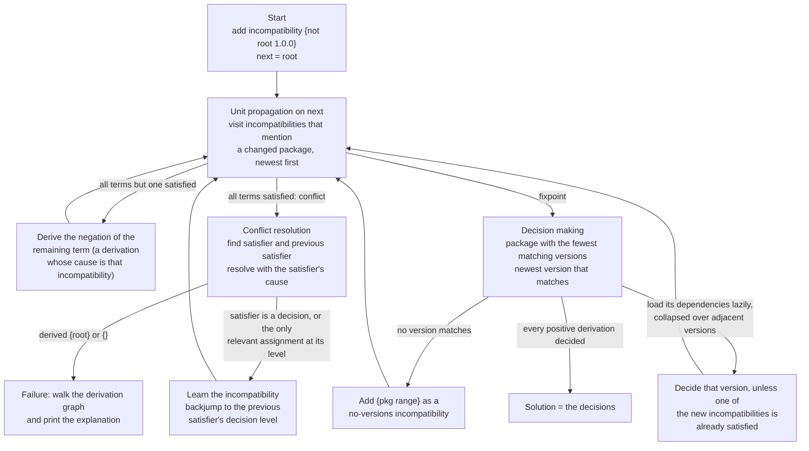
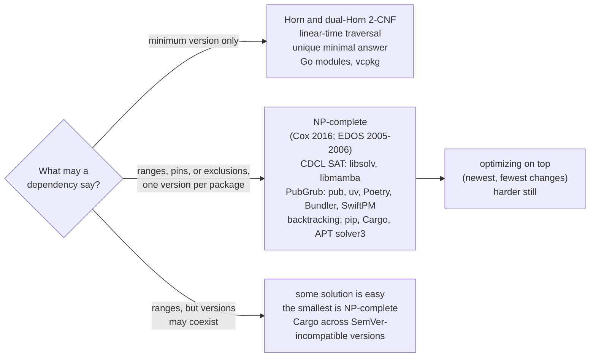

# Dependency Resolution: SAT, PubGrub, and Minimal Version Selection

> [!summary] Claim:
> Picking one version per package so that every selected version's dependencies hold is NP-complete as soon as dependencies can name versions, dependencies change between versions, and two versions of a package cannot coexist; Russ Cox's reduction turns any 3-SAT formula into such a registry.
> SAT-based managers encode one Boolean per package version and hand the formula to a CDCL solver; PubGrub runs the same conflict-driven clause learning directly on version ranges, learns a new incompatibility at every conflict, and replays the learned derivation tree as a human-readable proof when no solution exists.
> Go's Minimal Version Selection escapes NP-completeness by allowing only minimum-version requirements, which keeps every build formula Horn and dual-Horn, so one graph traversal gives the unique minimal answer.
> Each design pays for its guarantees elsewhere: SAT and PubGrub can still take exponential time on adversarial graphs, and MVS cannot say "incompatible with D 1.6" at all, so a bad release has to be fixed by a newer release.



## The Mechanism

### 1. The problem, stated precisely

A registry is a set of packages, each with versions, and each version with a list of dependencies.
pub's `doc/solver.md` defines version solving as finding a set of package versions in which each version's dependencies are satisfied, only one version of each package is selected, and every selected package is transitively reachable from the root.
The third condition matters: without it, a solver may add unrelated packages, which is the "unfounded set" problem that answer set solvers must handle explicitly (Section 9).

Real resolvers solve a harder problem than the yes or no question.
They must also choose among solutions (newest versions, or the fewest changes from a lockfile), and when no solution exists they must explain why.
Every design below is a different answer to three questions: what a dependency may say, whether two versions of one package may coexist, and what the tool optimizes.

[[Versioning-SemVer-CalVer-and-ABI]] owns what versions and ranges mean; this note owns the search over them.
[[Diamond-Dependency-and-Incompatible-ABI-Mitigation]] owns what to do once a diamond turns out to be unsatisfiable or ABI-unsafe.

### 2. Why it is NP-complete

Russ Cox's "Version SAT" (2016) proves the decision version, VERSION, NP-complete under four assumptions:

1. A package can list zero or more packages or specific package versions as dependencies.
2. To install a package, all its dependencies must be installed.
3. Each version of a package can have different dependencies.
4. Two different versions of a package cannot be installed simultaneously.

VERSION is in NP because a list of selected versions is a certificate that can be checked in polynomial time.
It is NP-hard by reduction from 3-SAT:

- For each variable x_j, create package `Xj` with versions `Xj:0` and `Xj:1`; assumption 4 makes them exclusive.
- For each clause C_i, create package `Ci` with three versions; version k depends on the package version that makes the k-th literal true, so `C5:1` depends on `X2:0` when the second literal of C5 is `not x2`.
- Create package `F` that depends on every `Ci`.

Installing `F` forces every clause package, each clause package forces one true literal, and the `Xj:1` install states read back as a satisfying assignment.
The construction is linear in the formula size.
The key step is the disjunction: Cox notes that the earlier EDOS proofs for Debian and RPM (EDOS deliverable WP2-D2.1, 2005, pages 49-50; the EDOS formal model was later published as Mancinelli et al., ASE 2006) encoded "or" with Debian's alternative dependencies or RPM's `Provides`, which language package managers lack, while this proof encodes "or" as the choice among a package's own versions, so it applies to essentially every package manager.

The lab runs Cox's two example formulas through the reduction: the first has exactly one satisfying assignment, x1=0, x2=1, x3=1, x4=0, and the second adds the clause `(x1 or not x2 or x4)` and becomes unsatisfiable (Section "Worked Lab Example").

Cox's escape hatches follow from the assumptions.
Drop assumption 1, so a dependency gives only a minimum version, and you get MVS (Section 11).
Drop assumption 4, so two versions may coexist, and any search finds some solution, though Cox notes that finding the smallest one is still NP-complete.
Cargo takes a middle path: versions that are SemVer-incompatible become different crates and may coexist, while SemVer-compatible versions must unify to one (Section 10).

### 3. The SAT encoding and CDCL

A SAT-based resolver gives each package version a Boolean variable and writes:

- A unit clause for the root: `root`.
- One clause per dependency: `not foo_1.2 or bar_2.0 or bar_2.1 or ...`, listing every version of `bar` the range allows.
- At-most-one constraints per package: `not foo_1.0 or not foo_1.1` for every pair, which pub's documentation notes costs O(n^2) clauses in the number of versions per package.
- Conflicts and obsoletes as binary clauses, for systems that have them.

A CDCL solver then repeats three steps.
Unit propagation assigns every literal that is the last unassigned one in a clause whose other literals are false.
When propagation empties a clause, conflict analysis resolves that clause backwards against the clauses that forced its literals until it reaches a clause with a single literal from the current decision level, adds that learned clause, and backjumps non-chronologically to the second-highest level in it.
Otherwise the solver picks an unassigned variable, assigns it, and propagates again.
Conflict-driven learning with non-chronological backtracking was introduced by GRASP (Marques-Silva and Sakallah, ICCAD 1996), and Chaff (Moskewicz et al., DAC 2001) made it fast with two watched literals per clause and the VSIDS decision heuristic.

Package managers that use this route, each verified at its source:

- openSUSE's `libsolv` describes itself as "a free package dependency solver using a satisfiability algorithm", supports rpm, deb, arch linux, haiku, and apk packages, and keeps learnt rules in `src/solver.c` (as of 2026-11, Both).
- conda made the libmamba solver, which has a libsolv backend in `libmamba`, its default in conda 23.10.0 (2023-11-06); the older "classic" solver is based on pycosat and stays available through `--solver=classic`.
- APT 2.9.3 (May 2024) introduced `solver3`, which its author describes as "a fully backtracking dependency solving algorithm that defers choices to as late as possible" and "essentially ... a DPLL solver without pure literal elimination"; CDCL is listed as future work, and it is selected with `--solver 3.0`.
- Cox's 2016 survey lists further SAT users: 0install, Eclipse (sat4j), FreeBSD pkg (picosat), OPAM, Solaris and illumos pkg (minisat), and Chef (the Gecode constraint solver).

Abate, Di Cosmo, Gousios, and Zacchiroli's census (SANER 2020) found SAT-based solving gaining adoption while delegating solving to reusable external solvers largely had not.

Two properties of the encoding explain why language package managers mostly moved away from raw SAT.
The clause set must be built before solving, but a registry has no fixed size, and fetching every version's metadata is a network round trip.
And a learned clause over hundreds of per-version variables cannot be shown to a user as an explanation.

### 4. PubGrub: terms and set algebra

PubGrub is pub's version solver; its documentation says it is based on CDCL and specifically on the version used by the clasp answer set solver, as described in Gebser et al., *Answer Set Solving in Practice*.
Natalie Weizenbaum designed the algorithm for Dart's package manager pub, introducing it in the dart-lang/pub repository in January 2018 (PR #1758) and detailing the solver specification in doc/solver.md.

Its atom is the **term**: a statement about one package, positive (`foo ^1.0.0`) or negative (`not foo ^1.0.0`).
A negative term is also true when no version of the package is selected.
Terms denote sets of versions, so satisfaction reduces to set relations over the intersection of everything known about a package:

- A set of terms S **satisfies** t when the intersection of S is a subset of t.
- S **contradicts** t when the intersection of S is disjoint from t.
- Otherwise S is **inconclusive** for t.

The intersection rules are the only algebra needed, and the lab's `Term.intersect` implements exactly these four cases:

| Left | Right | Intersection |
| :--- | :--- | :--- |
| `foo A` | `foo B` | `foo A n B` |
| `foo A` | `not foo B` | `foo A \ B` |
| `not foo A` | `foo B` | `foo B \ A` |
| `not foo A` | `not foo B` | `not foo A u B` |

A positive term with an empty range is the contradiction; a negative term is never empty, because "foo is not selected" is always possible.

### 5. Incompatibilities and the partial solution

An **incompatibility** is a set of terms that must not all be true; it is a clause written as a forbidden conjunction.
"`foo ^1.0.0` depends on `bar ^2.0.0`" is `{foo ^1.0.0, not bar ^2.0.0}`.
Incompatibilities come from outside (dependencies, a range with no versions, an SDK constraint) or are **derived** from two others during conflict resolution, in which case they remember both causes.
pub's constructor in `incompatibility.dart` normalizes them: terms about the same package are intersected, and positive root terms are dropped from derived incompatibilities with more than one term, "since it will always be satisfied".

The **partial solution** is an ordered list of assignments.
A **decision** selects one version; a **derivation** records a term forced by an incompatibility, its **cause**.
Each assignment has a **decision level**.
The prose definition in `solver.md` counts decisions "other than the root package", which makes the root decision level 0, and the worked tables in that document use this numbering.
The code does not: `PartialSolution.decisionLevel` is `_decisions.length`, and the root is decided like any other package, so the root decision is level 1 and the derivations before it are level 0; the conflict-resolution comment "Decision level 1 is the level where the root package was selected" matches the code.
Read pub's tables as code level minus one.

Incompatibilities are facts and are never backtracked; only the partial solution is, a split the pubgrub-rs guide states as the algorithm's state.

### 6. Unit propagation

Given the package just decided or derived, propagation looks only at the incompatibilities that mention it, newest first, because conflict resolution tends to produce more general incompatibilities later.
For each one (`_propagateIncompatibility` in `version_solver.dart`):

- If any term is contradicted, nothing follows.
- If exactly one term is inconclusive and the rest are satisfied, the incompatibility is **almost satisfied**, so the solver derives the negation of the remaining term and queues that package.
- If every term is satisfied, it is a conflict.

Indexing incompatibilities by package and touching only changed packages is PubGrub's substitute for SAT's watched literals.

### 7. Conflict resolution

The core is the resolution rule generalized to ranges.
From `{t1, q}` and `{t2, r}` you may derive `{q, r, t1 u t2}`, because in every solution where `t1 u t2` holds, `t1` or `t2` holds; when `not t2` satisfies `t1`, the union is "any" and the rule reduces to classical resolution, `{q, r}`.

`_resolveConflict` loops on the conflicting incompatibility:

1. If it is empty, or a single term about the root, solving has failed; it becomes the root of the error report.
2. The **satisfier** is the earliest assignment such that the partial solution up to and including it satisfies the incompatibility, and the **term** is the incompatibility's term for that package.
3. The **previous satisfier** is the earliest assignment before it that, together with the satisfier, still satisfies the incompatibility; its level, or 1 if none exists, is the backjump target.
4. If the satisfier is a decision, or the previous satisfier is at a lower level, the incompatibility is the root cause: backtrack to the previous satisfier's level, store the incompatibility if it is new, and return it to propagation, which is guaranteed to derive something from it.
5. Otherwise resolve: the new incompatibility is the union of this incompatibility's terms except the term, and the satisfier's cause's terms except those about the satisfier's package.
6. If the satisfier only partly satisfies the term, for example `foo >=1.0.0` and `foo <2.0.0` together satisfying `foo ^1.0.0`, add `not (satisfier \ term)`, which is the `t1 u t2` of the generalized rule.

Step 6 is the part that has no analogue in Boolean CDCL, because a Boolean literal is never "partly" assigned.
The lab exercises it, and in doing so found that pub's own worked example does not: `solver.md`'s "Conflict Resolution With a Partial Satisfier" writes `shared 1.0.0`'s dependency as `{shared ^1.0.0, not target ^1.0.0}`, but its own collapsing rule omits the lower bound when the first published version has the dependency, which gives `shared <2.0.0`.
With `shared <2.0.0`, a single derivation satisfies the term, the conflict ends in a plain backjump, and nothing is learned.
Adding a `shared 0.5.0` without the dependency restores the `^1.0.0` range, and the lab then learns exactly the two incompatibilities in the document's steps 22 and 28: `{left any, not target ^1.0.0, not shared >=2.0.0}` and `{foo >=1.1.0, not target ^1.0.0}`.

### 8. Decision making, lazy loading, and version collapsing

When propagation reaches a fixpoint, `_choosePackageVersion` picks a package that has a positive derivation and no decision:

- pub picks the package with the fewest versions matching its current range, "so that if a conflict is necessary it's forced quickly", then the newest matching version.
- If no version matches, it adds the no-versions incompatibility `{pkg range}` and returns to propagation.
- It adds the incompatibilities for that version's dependencies, then decides the version only if none of those incompatibilities is already satisfied; otherwise it lets propagation steer away, as in `solver.md`'s "Avoiding Conflict During Decision Making".

Dependencies become incompatibilities only when a version is first chosen, so the formula grows with what the search actually visits; pub's documentation calls these lazy formulas.

pub's `PackageLister` also collapses identical dependencies of adjacent versions into one incompatibility.
The depender's range runs from the first version that has the dependency (inclusive) to the first later version that does not (exclusive), with the lower bound omitted when the first published version has it and the upper bound omitted when the last one does.
`foo 1.0.0 -> bar ^1.0.0` and `foo 1.1.0 -> bar ^1.0.0` therefore become one incompatibility, `{foo ^1.0.0, not bar ^1.0.0}` in pub's example, and a version range in an incompatibility usually matches what a human wrote.

The lab's 3-SAT reduction shows the collapse at work: the clause `(x2 or x2 or x2)` gives `C4` three versions with the same dependency, and the report says "every version of C4 depends on X2 2.0.0".

When the current range excludes exactly one version, which typically comes from the negation of a locked version, pub also loads the dependencies of the best version overall, so that the error message talks about "every version of foo" instead of "foo 1.0.0 and no versions of foo match <1.0.0 or >1.0.0" (`_excludesSingleVersion`).
How locked versions are preferred is owned by [[Lockfiles-Vendoring-and-Offline-Mirrors]].

### 9. Error reporting from the derivation graph

When conflict resolution derives `{root}`, the causes of every derived incompatibility form a **derivation graph**: a DAG whose leaves are external incompatibilities and whose internal vertices are derived ones.
It is a proof that the root cannot be selected, and `failure.dart`'s `_Writer` prints it depth-first:

- It first counts, for every derived incompatibility, how many other incompatibilities it causes.
- An incompatibility that causes two or more gets a line number, so later lines can say "(1)" instead of repeating the proof.
- A derived incompatibility with one external and one derived cause is written as "And because <external>, <conclusion>.", and two such steps in a row collapse into one line, which is why pub says "foo depends on bar ^2.0.0 which depends on baz ^3.0.0".
- One with two derived causes, neither numbered, prints the first branch as a numbered conclusion, a blank line, then the second branch.
- The final line starts with "So," and ends "version solving failed".

`andToString` adds the special phrasings.
"X depends on both A and B" (`_tryRequiresBoth`) applies only when both incompatibilities have the same positive term, and `PackageRange` equality in `package_name.dart` compares the constraint as well as the name.
The lab's first port compared names only, which printed "C1 <2.0.0 depends on both X1 1.0.0 and X2 1.0.0" when the two dependencies belonged to different versions of C1; the fix produces "C1 <2.0.0 depends on X1 1.0.0 and C1 ^2.0.0 depends on X2 1.0.0".

The lab's port reproduces `solver.md`'s branching example word for word, and uv's pubgrub-rs reporter tells the same proof in its own words, including the numbered back-reference "(1)".
pip's resolvelib report on the linear example names only the final conflicting pair, so the chain through `foo` and `bar` is absent.

### 10. Where PubGrub differs from CDCL and answer set solving

`solver.md` lists four differences, each of which removes a cost that the SAT encoding pays:

- **Version ranges:** terms range over sets of versions, so `foo ^1.0.0 -> bar ^1.0.0` is one formula instead of a disjunction over individual versions, and messages need no translation back to ranges.
- **Implicit mutual exclusivity:** `foo ^1.0.0` and `foo ^2.0.0` contradict without a clause, avoiding the O(n^2) at-most-one encoding.
- **Lazy formulas:** dependencies are added only for versions that become candidates.
- **No unfounded-set detection:** PubGrub chooses versions only for packages with outstanding positive derivations, so it never selects packages nothing requires.

The worst case does not change: deciding VERSION is still NP-complete, and uv's resolver documentation says the same, that in the worst case "you have to try all possible combinations of all versions of all packages".
What changes is the common case, which the lab's thrashing family shows: learning plus the fewest-versions heuristic finds the irrelevant packages irrelevant.

### 11. PubGrub and backtracking in production

| Tool | Resolver | Verified detail (as of 2026-11) |
| :--- | :--- | :--- |
| Dart pub | PubGrub, the reference implementation | `doc/solver.md` and `lib/src/solver/` on master |
| uv | pubgrub-rs | uv's workspace `Cargo.toml` on main declares `pubgrub = { version = "0.7.1", package = "astral-pubgrub", default-features = false, features = ["unstable-state-api"] }`; the resolver docs call it "the Rust implementation of PubGrub" |
| Poetry | PubGrub port (`src/poetry/mixology/`) | `VersionSolver`'s docstring points to pub's `doc/solver.md` |
| Bundler | PubGrub (`pub_grub` gem) since 2.4 | Announced 2023-01-31: "usually much faster, because it learns from the resolution conflicts it finds" |
| Swift Package Manager | PubGrub | `Sources/PackageGraph/Resolution/PubGrub/` holds `PubGrubDependencyResolver.swift`, `Incompatibility.swift`, `PartialSolution.swift` |
| pip | resolvelib backtracking with backjumping | `max_rounds=200000` in `resolver.py`; vendored resolvelib 1.2.1 in pip 26.2.2 |
| Cargo | Cargo's own backtracking resolver | "Cargo will backtrack, erroring if no solution is found, rather than selecting multiple versions" |

uv extends PubGrub in three documented ways.
It forks the resolution whenever a package has requirements with different environment markers, and merges forks whose packages are identical, so one lockfile covers several platforms.
It prefetches the metadata of every newly added requirement in the background "to improve performance".
It gives packages with URLs the highest priority, then those with exact (`==`) specifiers, then the rest, each category in the order first seen; in uv's source (`crates/uv-resolver/src/pubgrub/priority.rs`) the root has a `Fixed` priority above all of these.
Its docs add only "a heuristic that backtracks and switches the order of two packages if they have been conflicting too much"; the source sets `CONFLICT_THRESHOLD: usize = 5` in `crates/uv-resolver/src/resolver/mod.rs`, after which the often-rejected package is raised to `ConflictEarly`, the culprit lowered to `ConflictLate` (both still above unconstrained packages), and the resolver backtracks (as of 2026-11, uv main).

pip's resolver (backtracking since pip 20.3) picks the next requirement with `get_preference`, which prefers, in order, direct URL requirements, pinned (`===`, or `==` without a wildcard) requirements, requirements with an upper bound, user requirements in the order given, requirements with any operator, and finally alphabetical order.
resolvelib backjumps over states that did not cause the conflict, and pip aborts with `ResolutionTooDeep` after 200,000 rounds.
[[Python-Dependency-Resolution-pip-uv-and-PEP-751-Lockfiles]] owns the Python details.

Cargo's resolver is not PubGrub and allows something PubGrub forbids: SemVer-incompatible versions of one crate, such as `rand 0.6` and `rand 0.7`, are built side by side, while SemVer-compatible requirements must unify to one version.
Two rules reintroduce single-version constraints: the `links` field allows only one package per native library name, so `libgit2-sys 0.11` and `0.12` cannot coexist, and resolver `"3"` (the `edition = "2024"` default, Rust 1.84+) prefers versions whose `rust-version` the toolchain supports.
[[Rust-Cargo-Model-Packages-Targets-Features-and-Workspaces]] owns feature unification and workspaces, and [[Rust-SemVer-Checks-MSRV-and-Editions]] owns MSRV.

### 12. Minimal version selection

MVS, from Russ Cox's 2018 series on Go versioning, starts from the import compatibility rule: a newer version of a module must work wherever an older one did, so a requirement states only a minimum version.
In Go a new major version is a new module path, so "B 1" and "B 2" are as unrelated as "B" and "C".

The Go Modules Reference defines the build list as the result of one traversal: start at the main modules, follow every requirement edge, track the highest version required for each module, and stop.
The highest required versions "are the minimum versions that satisfy all requirements".
The traversal visits each module version on the rough build list once, so its cost is that list's size plus the edges it follows, and it never loads a version that nothing requires; the reference notes that in its example "higher versions of B and D are available but MVS does not select them", and the lab's encoding of that example loads 5 `go.mod` files and never touches the published B 1.3 or D 1.3.

The 2018 post defines the four operations on top of the build list:

- **Construct:** the traversal above.
- **Upgrade all:** read every requirement as if it named the latest version, then reduce.
- **Upgrade one:** add one new edge from the main module to the target version, never replacing the old edge, because replacing `A -> C 1.2` with `A -> C 1.3` would drop C 1.2's requirement on D 1.4 and silently downgrade D.
- **Downgrade one:** remove every version above the target, remove every module version that requires a removed one, and move each top-level requirement down to its newest surviving version.

Algorithm R then writes the minimal requirement list that reproduces a build list, by visiting modules in reverse postorder and keeping a module only if nothing already kept implies it; `go get` records the extra requirements with `// indirect`.

#### Why MVS is polynomial

Every MVS constraint is one of three clause shapes:

- A positive unit, `X` (X must be installed, as in an upgrade).
- A negative unit, `not Y` (Y is unavailable, as in a downgrade).
- An implication, `not X or Z` (X requires Z).

Each clause has at most two variables (2-CNF), at most one positive literal (Horn), and at most one negative literal (dual-Horn), and Schaefer's dichotomy theorem lists all three among the classes whose satisfiability is polynomial.
A satisfiable Horn formula has a unique satisfying assignment with the fewest true variables, which is why the build list and every upgrade are unique and minimal; dual-Horn gives the same for downgrades with the fewest false variables.
Cox adds that the problem is NL-complete, of little practical consequence since the algorithm is already linear.

The rule for extensions follows: a new constraint keeps these guarantees only if it is both Horn and dual-Horn.
A conditional exclusion, `X -> not Y`, has two negative literals, and "B 1.2 needs D 1.3 or D 1.4" has two positive ones, so neither may be added.
That is why `exclude` and `replace` are honored only in the main module's `go.mod`, and why they edit the graph before the traversal instead of adding clauses.

#### Exclude, replace, pruning, and laziness in today's Go

- `exclude` semantics changed in Go 1.16.
  The `exclude directive` section says that since Go 1.16 a requirement on an excluded version "is ignored", and that before Go 1.16 the go command loaded the next higher non-excluded version, which "could result in non-deterministic version selection, since the next higher version could change over time".
  The reference's separate "Exclusion" section still says that requirements on an excluded version "are redirected to the next higher version", which contradicts the directive section; go1.27.4 behaves as the directive section says.
  The lab measures the consequence: excluding C v1.4.0 makes `go list -m all` select C v1.3.0 even though B 1.2 requires C v1.4.0, because B's requirement is dropped, not raised.
- `replace` swaps a module version's content, including its requirements, before the traversal.
- Module graph pruning: when the main module is at `go 1.17` or higher, the graph includes only the immediate requirements of each dependency that is itself at `go 1.17` or higher, unless that module version is also required through a `go 1.16`-or-below dependency, which works because such a `go.mod` lists every module needed to build its packages.
  In the lab the same graph gives `A 1.2 B 1.2 C 1.4 D 1.2` when the dependencies say `go 1.16` and `A 1.2 B 1.2 C 1.4` when they say `go 1.21`, because C's requirement on D is pruned.
- Lazy module loading: with `go 1.17` or higher, the go command loads only the main module's `go.mod` and loads the rest of the graph only when a package cannot be found.
- Since Go 1.21 the `go` line is a mandatory minimum toolchain version and must be at least the `go` line of every dependency.

MVS keeps no lock file: "the build list is not saved in a 'lock' file", because the same `go.mod` files always give the same build list; `go.sum` records checksums, not selections.
vcpkg adopted the same idea for C++: its versioning documentation says vcpkg "uses a minimal selection approach to versioning, inspired by the one used by Go", lists "Avoids using a SAT solver" as an advantage, and adds a `builtin-baseline` and top-level `overrides` (as of 2026-11, Both).

The cost is expressiveness.
MVS has no upper bounds and no conflicts, so "C 1.2 does not work with D 1.6" cannot be written; Cox's answer is that the buggy release should be withdrawn and fixed by a newer one, and that "adding a conflict to the dependency graph instead is like documenting a bug instead of fixing it".
MVS also never upgrades on its own: a security fix in D reaches a build only when some `go.mod` raises its D requirement.

### 13. The complexity map



| Variant | Complexity | Source |
| :--- | :--- | :--- |
| Ranges or exact pins, one version per package | NP-complete | Cox, "Version SAT", reduction from 3-SAT |
| Debian alternatives and conflicts, RPM `Provides` | NP-complete | EDOS WP2-D2.1 (2005); Mancinelli et al., ASE 2006 |
| Minimum versions only, unconditional exclusions | Polynomial, linear in practice; NL-complete | Cox, "Minimal Version Selection" |
| Multiple versions allowed, any solution | Easy | Cox, "Version SAT" |
| Multiple versions allowed, smallest solution | NP-complete | Cox, "Version SAT" |

## Commands and Numbers to Know

| Item | Value | Platform and date | What it controls |
| :--- | :--- | :--- | :--- |
| `uv pip compile --resolution` | `highest` (default), `lowest`, `lowest-direct`; env `UV_RESOLUTION` | Both (as of 2026-11, uv 0.11.26) | Which compatible version uv prefers; `lowest-direct` tests your own lower bounds |
| `uv pip compile --fork-strategy` | `fewest`, `requires-python` | Both (as of 2026-11, uv 0.11.26) | How forks pick versions across Python versions and platforms |
| uv conflict reprioritization | `CONFLICT_THRESHOLD = 5` | Both (as of 2026-11, uv main source) | Often-rejected package moved to `ConflictEarly`, culprit to `ConflictLate`, then backtrack |
| uv's PubGrub crate | `astral-pubgrub` 0.7.1 | Both (as of 2026-11, uv main) | The fork of pubgrub-rs uv builds against |
| pip resolution round limit | `max_rounds=200000` | Both (as of 2026-11, pip 26.2.2) | `ResolutionTooDeep` after this many rounds |
| pip's vendored resolvelib | 1.2.1 | Both (as of 2026-11, pip 26.2.2) | Backtracking and backjumping engine |
| `cargo update --precise <V>` | exact version for one package | Both (as of 2026-11, Cargo 1.99.0) | Moves one lockfile entry, for example to remove a duplicate |
| `cargo -Z minimal-versions`, `-Z direct-minimal-versions` | nightly only | Both (as of 2026-11, Cargo 1.99.0) | Resolve to minimum versions, for all or only direct dependencies |
| Cargo resolver `"3"` | `edition = "2024"` default, Rust 1.84+ | Both (as of 2026-11) | `incompatible-rust-versions = "fallback"`: prefer MSRV-compatible versions |
| `CARGO_LOG=cargo::resolver=trace` | log target | Both (as of 2026-11) | Shows why Cargo picked or rejected a version |
| `go list -m all` | prints the build list | Both (as of 2026-11, go1.27.4) | MVS output, with `=> replacement` annotations |
| `go mod graph` | one `module requirement` pair per line | Both (as of 2026-11, go1.27.4) | The requirement graph MVS traverses, with replacements applied |
| `go mod why -m <mod>` | shortest import path | Both (as of 2026-11, go1.27.4) | Why a module is needed at all |
| `go get <mod>@<v>`, `<mod>@none` | upgrade, downgrade, remove | Both (as of 2026-11, go1.27.4) | Edits the graph, runs MVS, writes `go.mod` |
| Go `exclude` | requirement ignored since Go 1.16 | Both (as of 2026-11) | Can select a version below a dependency's stated minimum |
| Go graph pruning | main module at `go 1.17`+ | Both (as of 2026-11) | Drops transitive requirements of `go 1.17`+ dependencies |
| conda solver | libmamba default since 23.10.0; `--solver=classic` | Both (as of 2026-11) | SAT-based solving through libsolv |
| APT `--solver 3.0` | opt-in since APT 2.9.3 | Linux (as of 2026-11) | DPLL-style solver3 instead of the classic solver |

## Multi-Language Comparison

| Concern | C++ | Python | Rust | Go |
| :--- | :--- | :--- | :--- | :--- |
| Algorithm | vcpkg: MVS-style minimum selection with a baseline; Conan 2: graph expansion that reports conflicts | pip: resolvelib backtracking; uv and Poetry: PubGrub; conda: libmamba (libsolv SAT) | Cargo: its own backtracking resolver | MVS traversal |
| What a dependency may say | vcpkg: `version>=` only; Conan: exact versions or ranges | PEP 440 specifiers with upper bounds, exclusions, markers | Caret, tilde, wildcard, and comparison requirements | Minimum version only |
| Versions of one package in a build | One | One per environment | One per SemVer-compatible range; incompatible versions coexist | One per module path; a new major is a new path |
| Diamond with incompatible requirements | vcpkg: highest minimum wins; Conan: "Version conflict: intro/1.0->matrix/1.1, game/1.0->matrix/1.0." until `force=True` or `override=True` | uv: PubGrub derivation; pip: the final conflicting pair | Error if compatible versions cannot unify; otherwise two copies | Highest minimum wins; no failure possible without `exclude` or retraction |
| Lock state | vcpkg baseline commit; Conan lockfiles | `uv.lock`, `pylock.toml` | `Cargo.lock` | None needed; `go.sum` holds checksums |

Owning notes: [[Cpp-vcpkg-Manifests-Registries-and-Binary-Caching]], [[Cpp-Conan-2-Architecture-and-Binary-Model]], [[Python-Dependency-Resolution-pip-uv-and-PEP-751-Lockfiles]], [[Python-Conda-and-Pixi-for-Polyglot-Environments]], and [[Rust-Cargo-Model-Packages-Targets-Features-and-Workspaces]].

## Worked Lab Example

The lab is `code/07-Packaging-and-Release/pubgrub_resolver/`.
It needs `python3` (3.9 or newer, with `venv`), `uv`, and `go` on `PATH`, and no network; `run.sh` exits with an error naming the missing tool instead of skipping a section.

- `pubgrub.py` is a from-scratch PubGrub in about 770 lines of standard-library Python, ported from pub's `version_solver.dart`, `partial_solution.dart`, `incompatibility.dart`, and `failure.dart`: interval-union ranges, the term algebra, normalized incompatibilities, decision levels as in pub's code, propagation, `_resolveConflict` including the partial-satisfier difference, fewest-versions decisions, adjacent-version collapsing, and the `_Writer` report with pub's phrasings.
- `naive.py` is the baseline: chronological backtracking, first-in first-out requirements, newest version first, nothing learned.
- `mvs.py` is MVS with Go 1.16+ exclusions.
- `lab.py` runs four sections and raises on any failed check; `crosscheck.py` feeds the same inputs to uv, pip, and go.

The checks, each of which fails if the mechanism is absent:

1. Every satisfiable `solver.md` example must produce the documented solution, and uv must produce the same pins from wheels built for the same graph.
2. The branching report must equal `solver.md`'s six lines exactly; the linear report may differ only in the order of the two operands of "both", because pub's table decides `foo` before `baz` and the code's ordering decides `baz` first.
3. The 3-SAT reduction must agree with brute force over all 16 assignments, and the decoded assignment must satisfy the formula.
4. The naive solver must agree with PubGrub on satisfiability and on the solution, must try at least n^2 versions on the unsatisfiable family, and PubGrub must load at most six package versions.
5. MVS must give the Go Modules Reference's build list, and `go list -m all` must give the same lists for the full and excluded graphs and must drop D from the pruned one.

```bash
cd code/07-Packaging-and-Release/pubgrub_resolver
bash run.sh
```

### Verified output

Recorded by `python3 -m _harness.verify --record` on darwin-arm64 on 2026-11-14 (host clock), with uv 0.11.26, pip 26.2.2 under CPython 3.15.2, and go1.27.4; the file is `code/07-Packaging-and-Release/pubgrub_resolver/expected/darwin-arm64.txt`.
uv's box-drawing characters are printed as ASCII by `crosscheck.py`.

Section 1, the `solver.md` examples:

```text
-- Performing Conflict Resolution --
  solution: foo 1.0.0, root 1.0.0
  learned: foo >=2.0.0 is forbidden
  stats: decisions=3 learned=1 conflicts=1

-- Conflict Resolution With a Partial Satisfier --
  solution: foo 1.0.0, root 1.0.0, target 2.0.0
  stats: decisions=7 learned=0 conflicts=1

-- Partial Satisfier, variant with shared 0.5.0 so shared 1.0.0 collapses to ^1.0.0 --
  solution: foo 1.0.0, root 1.0.0, target 2.0.0
  learned: every version of left requires target ^1.0.0 or shared >=2.0.0
  learned: foo >=1.1.0 requires target ^1.0.0
  stats: decisions=7 learned=2 conflicts=3

-- Linear Error Reporting --
  Because every version of foo depends on bar ^2.0.0 which depends on baz ^3.0.0, every version of foo requires baz ^3.0.0.
  So, because root depends on both foo ^1.0.0 and baz ^1.0.0, version solving failed.
  stats: decisions=3 learned=0 conflicts=2

-- Branching Error Reporting --
      Because foo <1.1.0 depends on a ^1.0.0 which depends on b ^2.0.0, foo <1.1.0 requires b ^2.0.0.
  (1) So, because foo <1.1.0 depends on b ^1.0.0, foo <1.1.0 is forbidden.

      Because foo >=1.1.0 depends on x ^1.0.0 which depends on y ^2.0.0, foo >=1.1.0 requires y ^2.0.0.
      And because foo >=1.1.0 depends on y ^1.0.0, foo >=1.1.0 is forbidden.
      And because foo <1.1.0 is forbidden (1), foo is forbidden.
      So, because root depends on foo ^1.0.0, version solving failed.
  stats: decisions=5 learned=2 conflicts=3
```

Section 2, Cox's formulas through the reduction:

```text
-- F1 (4 clauses): 9 packages, 21 package versions --
  brute force over 2^4 assignments: 1 satisfying
  PubGrub: SAT, x1..x4 = 0 1 1 0 (read from X_j:1 installed)
  installed: C1 1.0.0, C2 3.0.0, C3 3.0.0, C4 3.0.0, F 1.0.0, X1 1.0.0, X2 2.0.0, X3 2.0.0, X4 1.0.0
  stats: learned=0 conflicts=0

-- F2 (F1 plus (x1 or not x2 or x4)): 10 packages, 24 package versions --
  brute force over 2^4 assignments: 0 satisfying
  PubGrub: UNSAT, derivation report has 11 lines:
    Because C5 ^2.0.0 depends on X2 1.0.0 and C5 <2.0.0 depends on X1 2.0.0, C5 <3.0.0 requires X2 1.0.0 or X1 2.0.0.
    Because C1 <2.0.0 depends on X1 1.0.0 and C1 ^2.0.0 depends on X2 1.0.0, C1 <3.0.0 requires X1 1.0.0 or X2 1.0.0.
    Thus, if C5 <3.0.0 and C1 <3.0.0 then X2 1.0.0.
    And because C1 >=3.0.0 depends on X3 1.0.0, if C5 <3.0.0 and C1 any then X2 1.0.0 or X3 1.0.0.
    And because C5 >=3.0.0 depends on X4 2.0.0 and C2 >=3.0.0 depends on X4 1.0.0, if C1 any and C5 any and C2 >=3.0.0 then X2 1.0.0 or X3 1.0.0.
    Because C2 <2.0.0 depends on X2 1.0.0 and C2 ^2.0.0 depends on X3 1.0.0, C2 <3.0.0 requires X2 1.0.0 or X3 1.0.0.
    Thus, if C1 any and C5 any and C2 any then X2 1.0.0 or X3 1.0.0.
    And because C3 >=3.0.0 depends on X3 2.0.0 and C3 <3.0.0 depends on X2 1.0.0, if C1 any and C5 any and C2 any and C3 any then X2 1.0.0.
    And because every version of C4 depends on X2 2.0.0 and F depends on C1 any, one of C5 any or C2 any or C3 any or C4 any must be false.
    And because F depends on both C2 any and C3 any, C5 any is incompatible with C4 any.
    So, because F depends on both C4 any and C5 any, version solving failed.
  stats: learned=2 conflicts=6
```

Section 3, thrashing:

```text
== 3. Clause learning versus chronological backtracking ==
  root -> x any, a any, b any; x 2.0.0 -> z ^2.0.0 (no such z); a and b have n versions each

  n    sat | naive: versions tried | PubGrub: versions loaded / conflicts
  5    yes | 34                    | 5 / 1
  10   yes | 114                   | 5 / 1
  20   yes | 424                   | 5 / 1
  40   yes | 1644                  | 5 / 1
  5    no  | 62                    | 2 / 2
  10   no  | 222                   | 2 / 2
  20   no  | 842                   | 2 / 2
  40   no  | 3282                  | 2 / 2
```

Sections 4 to 6, MVS and the real tools:

```text
== 4. Minimal version selection (Go Modules Reference example) ==
  build list: A 1.2 B 1.2 C 1.4 D 1.2  (go.mod files loaded: 5 of 7 published)
  exclude C 1.4 (Go 1.16+ rule: requirement ignored): A 1.2 B 1.2 C 1.3 D 1.2

== 5. The same inputs through uv (pubgrub-rs) and pip (resolvelib) ==
-- Linear Error Reporting --
  uv (exit 1):
      x No solution found when resolving dependencies:
      \-> Because only bar==2.0.0 is available and bar==2.0.0 depends on
          baz>=3.0.0, we can conclude that bar==2.0.0 depends on baz>=3.0.0.
          And because foo==1.0.0 depends on bar==2.0.0 and only foo==1.0.0 is
          available, we can conclude that foo==1.0.0 depends on baz>=3.0.0.
          And because you require foo==1.0.0 and baz<2.0.0, we can conclude that
          your requirements are unsatisfiable.
  pip (exit 1), from its ResolutionImpossible report:
    ERROR: Cannot install baz<2.0.0 and >=1.0.0 and foo because these package versions have conflicting dependencies.
    
    The conflict is caused by:
        The user requested baz<2.0.0 and >=1.0.0
        bar 2.0.0 depends on baz<4.0.0 and >=3.0.0

== 6. The same module graph through go list -m all ==
  go1.27.4
  dependencies at go 1.16 (full graph):          A 1.2 B 1.2 C 1.4 D 1.2
  dependencies at go 1.21 (pruned graph):        A 1.2 B 1.2 C 1.4
  go 1.16 graph, main module excludes C v1.4.0:  A 1.2 B 1.2 C 1.3 D 1.2
  lab MVS and go agree on the full-graph and exclude cases
```

### Reading the result

- `foo >=2.0.0 is forbidden` is `solver.md`'s step 9 incompatibility `{foo >=2.0.0}`: PubGrub learned that `foo 2.0.0` can never work because of its dependency on `bar`, regardless of anything else.
- The verbatim partial-satisfier example learns nothing and the variant learns the document's two incompatibilities; the only difference is one extra `shared 0.5.0`, which changes how `shared 1.0.0`'s dependency collapses.
- The F1 solution is Cox's unique assignment; `C1 1.0.0` is satisfied by `X1` at version 1.0.0 (x1 = 0), and every other clause package took its newest version, because pub tries the newest matching version first.
- The F2 report is a resolution proof of unsatisfiability in pub's phrasing, 11 lines for a 5-clause formula; on a real registry the same shape is what makes PubGrub's errors long but checkable.
- The naive baseline tries n^2 combinations of the irrelevant `a` and `b` before it revisits `x`, about 2n^2 when the instance is unsatisfiable, while PubGrub loads `root` and `x` and stops: `x` has the fewest matching versions, both of its versions collapse into `every version of x depends on z ^2.0.0`, and `z ^2.0.0` matches nothing.
  The baseline is deliberately order-sensitive; a smarter static order would rescue it on this family, but not on a family that defeats that order, while learning does not depend on the order.
- uv and pub tell the same linear proof, but uv simplifies ranges against the versions that exist ("only bar==2.0.0 is available", "baz<2.0.0" for `baz>=1.0.0,<2.0.0` once only 1.0.0 and 3.0.0 exist).
- pip names `baz` and `bar 2.0.0` but never `foo`, the requirement that pulled `bar` in; the developer has to rebuild the chain by hand.
- go1.27.4 agrees with the lab's MVS on the full graph, drops D from the pruned graph, and selects C v1.3.0 under `exclude example.com/c v1.4.0`, below B 1.2's stated minimum of v1.4.0, without an error or a change to `go.mod`.

## Pitfalls

> [!warning] Pitfall: reading the first line of an error as the cause
> pip's report names the final pair that clashed, and a PubGrub report starts at the outermost external facts.
> The root cause is the derived incompatibility that mentions your own requirement: in the linear example, "root depends on both foo ^1.0.0 and baz ^1.0.0", one of which must move.

> [!warning] Pitfall: upper bounds you did not need
> Every upper bound is a negative fact the resolver must respect forever, and pip's own `get_preference` comment notes that upper bounds "can make dependency management and resolution harder".
> Cap a dependency when a released version is known to break you, not by default.

> [!warning] Pitfall: Go `exclude` can select a version below a dependency's minimum
> Since Go 1.16 a requirement on an excluded version is ignored, so excluding the only version a dependency requires can fall back to an older one that the dependency never claimed to support, as the lab's `C v1.3.0` shows.
> Pair `exclude` with an explicit `require` of the next good version.

> [!warning] Pitfall: trusting the Go reference's "Exclusion" section
> That section describes the pre-1.16 redirect-to-next-higher behavior; the `exclude directive` section and go1.27.4 ignore the requirement instead.

> [!warning] Pitfall: assuming MVS picks up fixes
> MVS selects the minimum that satisfies everyone, so a patched release of a transitive dependency is not used until some `go.mod` requires it; run `go get -u` or bump the requirement explicitly, and check with `go list -m all`.

> [!warning] Pitfall: two copies under Cargo
> Cargo builds SemVer-incompatible versions side by side, and each copy is a different crate, so their types and global state are distinct.
> `cargo tree -d` shows the duplicates, and `links` conflicts turn the same situation into a hard error for `-sys` crates; [[Diamond-Dependency-and-Incompatible-ABI-Mitigation]] owns the fixes.

> [!warning] Pitfall: blaming the solver for network time
> A lazy solver fetches metadata for every version it considers, so a slow resolution is often round trips rather than search; uv prefetches for this reason, and a local mirror helps more than a faster machine ([[Lockfiles-Vendoring-and-Offline-Mirrors]]).

> [!warning] Pitfall: re-implementing PubGrub from the tables in `solver.md`
> The tables use root-at-level-0 numbering while the code uses root-at-level-1, the partial-satisfier example's ranges do not follow the collapsing rule stated next to it, and the linear example's decision order is not what the code's ordering produces.
> Port from `version_solver.dart`, and check "requires both" against `PackageRange` equality, which includes the constraint.

## At Scale

For one developer, resolution is invisible until it fails, and the fix is to read the derivation from the bottom up and move one of your own requirements.
At 1,000 to 50,000 engineers, the resolver becomes infrastructure, and the problems become reproducibility, policy, and time.

- **Resolve once, install many times.**
  Resolution runs when a requirement changes and writes a lockfile; CI and production install from the lock and never resolve ([[Lockfiles-Vendoring-and-Offline-Mirrors]]).
  Go is the exception that proves the rule: MVS is deterministic enough to need no lock.
- **Test your lower bounds.**
  Resolvers that prefer the newest version never exercise the minimum you declared; run a CI job with `uv pip compile --resolution lowest-direct` or Cargo's nightly `-Z direct-minimal-versions`, so a library's stated floor is real.
- **Prefer one version per package across a monorepo when the language cannot isolate copies.**
  A single version policy turns per-project resolution into one shared resolution, makes diamonds impossible inside the repository, and moves the cost to the team that upgrades a widely used package.
- **Budget resolver time.**
  Track resolution duration in CI; a sudden jump usually means a new upper bound or a yanked version forced deep backtracking, and the derivation report names the package to fix.
- **Pin resolver versions.**
  Heuristics differ between pip, uv, and Poetry, and between versions of one tool, so the same input can yield different but valid solutions; pin the tool in CI and regenerate locks deliberately.
- **Choose the model per ecosystem, not per team.**
  MVS (Go, vcpkg) trades expressiveness for predictability and needs a culture of fixing bad releases with new releases; PubGrub and SAT trade predictability for the ability to say "not this version", and need lockfiles and good error output.
  Record the choice in a decision record ([[Packaging-Decision-Records]]).

Decision rules:

- A library: declare the widest true range, test its floor in CI, and never cap without a known break.
- An application or service: commit a lockfile, upgrade on a schedule, and review lockfile diffs like code.
- A platform team: mirror the registries the resolver reads, keep yanked and deleted versions resolvable from the mirror ([[Case-Study-Left-Pad-and-Registry-Immutability]]), and keep resolver versions pinned across the fleet.

## Practice Drill

> [!tip] Practice Drill:
> Work [[Drill-Packaging-PubGrub-Conflict-Diagnosis]] after this note.
> Then, in a copy of the lab, add to `lab.py`'s `EXAMPLES` a registry where `root` depends on `web ^2.0.0` and `orm ^1.0.0`, `web 2.0.0` and `2.1.0` depend on `json ^1.0.0` and `^2.0.0` respectively, and `orm 1.0.0` depends on `json ^1.0.0`; predict the solution before running.
> Next, make `json 1.0.0` depend on a package with no versions, predict the derivation report line by line, and compare it with `uv pip compile` on wheels that `crosscheck.write_wheels` builds for the same graph.
> As a stretch, write a CNF encoder for the same registries, solve it with a small DPLL, and count how many clauses the at-most-one constraints add as one package grows to 50 versions.

## Interview Questions

> [!question] L5: Why is a lockfile not a substitute for a dependency resolver, and why does Go not need one?
>
> > [!success]- Answer
> > A lockfile records the output of one resolution, so installs are reproducible, but someone still has to produce it when a requirement changes, and that is the NP-complete search for range-based ecosystems.
> > Go's MVS is deterministic in its inputs, the `go.mod` files, and does not change when new versions are published, so recomputing the build list on every command gives the same answer; `go.sum` stores checksums for integrity, not selected versions.

> [!question] L5: Predict the output: in the lab's Go graph, the main module requires A v1.2.0 and B v1.2.0, A needs C v1.3.0, B needs C v1.4.0, both C versions need D v1.2.0, every module says `go 1.16`, and the main module adds `exclude example.com/c v1.4.0`; what does `go list -m all` print for C, and does the command fail?
>
> > [!success]- Answer
> > It prints `example.com/c v1.3.0` and succeeds.
> > Since Go 1.16 a requirement on an excluded version is ignored, so B's requirement on C v1.4.0 disappears and the highest remaining requirement is A's v1.3.0.
> > The build now uses a C older than B declared it needs, with no error; the fix is to require a non-excluded version at or above B's minimum explicitly.

> [!question] L6: Walk through the 3-SAT reduction and say which package manager feature it really depends on.
>
> > [!success]- Answer
> > Variables become packages with two versions, which exclude each other; each clause becomes a package with one version per literal, each depending on the variable version that makes that literal true; a formula package depends on every clause package.
> > An installation of the formula package exists exactly when the formula is satisfiable, and the variable versions installed are the assignment.
> > The feature it depends on is that a package's dependencies may change from version to version, which lets "choose one version" encode "or"; the earlier EDOS proofs needed explicit alternatives or `Provides`, which language package managers lack.

> [!question] L6: How does PubGrub's conflict resolution differ from Boolean CDCL's?
>
> > [!success]- Answer
> > The skeleton is the same: find the most recent assignment that made the incompatibility true, resolve with the incompatibility that caused it, and stop when the satisfier is a decision or the only relevant assignment at its level, then backjump to the previous satisfier's level.
> > The differences come from ranges: two incompatibilities `{t1, q}` and `{t2, r}` resolve to `{q, r, t1 u t2}`, and when several derivations only jointly satisfy a term, PubGrub adds `not (satisfier \ term)` so the learned fact stays true.
> > Mutual exclusion is implicit in the term algebra instead of O(n^2) clauses, and incompatibilities are loaded lazily per chosen version.

> [!question] L6: Debug this: uv prints "And because foo==1.0.0 depends on b>=1.0.0,<2.0.0 and only the following versions of foo are available: foo<=1.0.0, foo==1.1.0, we can conclude that foo<1.1.0 cannot be used. (1)" and later "And because we know from (1) that foo<1.1.0 cannot be used, we can conclude that all versions of foo cannot be used." What is the structure of the failure and where do you intervene?
>
> > [!success]- Answer
> > The derivation graph branches: one subproof shows that every `foo` below 1.1.0 is impossible (through `a`, which needs `b 2.x` while `foo 1.0.0` needs `b 1.x`), and a second shows that `foo 1.1.0` is impossible (through `x`, which needs `y 2.x` while `foo 1.1.0` needs `y 1.x`).
> > The "(1)" is the line number PubGrub assigns to an incompatibility that is used twice, so the second branch can cite the first.
> > Both versions of `foo` fail for different reasons, so loosening `b` alone does not help; you need a release of `a` or `x` that accepts the older `b` or `y`, a `foo` release that moves to the newer ones, or to drop the requirement on `foo`.

> [!question] L6: Why does MVS stay polynomial, and which feature would break that?
>
> > [!success]- Answer
> > Every MVS constraint is a positive unit, a negative unit, or an implication `not X or Z`, so the formula is 2-CNF, Horn, and dual-Horn, all tractable classes in Schaefer's dichotomy; the Horn property also gives a unique minimal build list.
> > A conditional exclusion such as "X conflicts with Y" is `not X or not Y`, two negative literals, and "B needs D 1.3 or D 1.4" is two positive literals; either breaks the shape, which is why `exclude` and `replace` are main-module-only edits applied to the graph before the traversal.

> [!question] L7: Your monorepo's Python lock regeneration went from 20 seconds to 25 minutes after one dependency bump; how do you investigate?
>
> > [!success]- Answer
> > First separate network from search: run the resolver with verbose logging against a warm local cache or mirror; if the time stays, it is search.
> > Look for what the bump introduced: a new upper bound or exclusion that conflicts with another package forces backtracking through many versions of everything in between; uv's reprioritization after five conflicts (`CONFLICT_THRESHOLD`) and pip's preference for bounded requirements are heuristics that this pattern can defeat.
> > Bisect the requirement set to the smallest set that is still slow, read the derivation of the eventual solution or failure, and add a direct constraint that tells the resolver what it learns the hard way, then fix the upstream bound that causes the conflict.
> > Pin the resolver version while doing this, because a heuristic change can move the problem.

> [!question] L7: Cargo resolves `rand 0.6` and `rand 0.7` side by side while uv would fail; which behavior is right?
>
> > [!success]- Answer
> > Both are consistent with their languages.
> > In Rust each SemVer-incompatible version is a different crate with its own types and symbols, so linking both is sound, and resolution is easier because the single-version constraint only applies within a compatibility range.
> > Python has one module namespace per interpreter, so two versions of one distribution cannot both be imported, and the resolver must find one version or fail.
> > Cargo reintroduces the single-version constraint where linking demands it, through `links` for native libraries, and the cost of its choice shows up as duplicate code and types that do not interoperate across the two copies.

> [!question] L8+: You are designing the dependency system for a new language; which resolution model do you choose?
>
> > [!success]- Answer
> > Start from what the language can isolate: if two versions of a library can coexist under distinct names, allow it across major versions, as Go (new path) and Cargo (new crate) do, and the hardest diamonds disappear.
> > Within a major version, choose between MVS and a PubGrub-style solver.
> > MVS gives determinism without a lockfile, linear time, and no unsatisfiable states, but requires the ecosystem to fix bad releases with new ones and to bump requirements to pick up fixes; PubGrub allows upper bounds and exclusions, needs a lockfile, and must invest in error reporting.
> > Whichever you pick, publish the algorithm as a specification with worked examples, as pub's `solver.md` and Cox's posts do, so that tools agree, and make the registry immutable so that resolutions stay reproducible.

> [!question] L8+: An executive asks why "just use a SAT solver" did not end dependency hell; what do you say?
>
> > [!success]- Answer
> > SAT solvers made the search fast enough on real instances, as libsolv and conda's libmamba show, but they do not answer the other two questions.
> > Which solution is best is an optimization on top of satisfiability, and a clause learned over per-version variables does not explain a failure to a human.
> > PubGrub's contribution is to keep CDCL's learning while working on ranges, so that what it learns is also the explanation; MVS's contribution is to remove the hard part by restricting what a dependency may say.
> > The residual problem is social: a satisfiable combination is not a tested combination, so registries, lockfiles, and lower-bound tests still matter.

## Further Reading

- Dart pub, `doc/solver.md`: the PubGrub specification with six worked examples and the differences from CDCL and answer set solving.
- Dart pub, `lib/src/solver/version_solver.dart`, `partial_solution.dart`, `incompatibility.dart`, `failure.dart`: the reference implementation, which settles every question the tables leave open.
- Natalie Weizenbaum, "PubGrub: Next-Generation Version Solving", Medium, 2018-04-02 (https://medium.com/@nex3/pubgrub-2fb6470504f): the introductory motivation and architectural rationale for Dart's package solver.
- Russ Cox, "Version SAT" (2016): the 3-SAT reduction and the escape hatches that led to MVS.
- Russ Cox, "Minimal Version Selection" (2018): the four algorithms, Algorithm R, and the Horn and dual-Horn argument.
- Go Modules Reference, sections "Minimal version selection", "exclude directive", "Module graph pruning", and "Lazy module loading": what the go command does today.
- uv, "Resolver internals": forking, prefetching, priorities, and the conflict heuristic in a production PubGrub.
- pip, "Dependency Resolution", and `resolution/resolvelib/provider.py`: backtracking and the preference order.
- The Cargo Book, "Dependency Resolution": unification, multiple versions, `links`, and MSRV-aware resolution.
- vcpkg, "Versioning concepts": MVS adapted to a C++ registry with baselines and overrides.
- Mancinelli et al., ASE 2006, and Abate et al., SANER 2020: the formal model behind Debian's and RPM's NP-completeness and a census of how package managers solve.
- Marques-Silva and Sakallah, GRASP (ICCAD 1996), and Moskewicz et al., Chaff (DAC 2001): the CDCL techniques PubGrub adapts.

## Related

- Prerequisites: [[Versioning-SemVer-CalVer-and-ABI]]
- Next: [[Lockfiles-Vendoring-and-Offline-Mirrors]]
- See also: [[02-Programming-Languages/Python/Python-Backend-Interview-Prep/02-Python-Core|02 Python Core]], [[Diamond-Dependency-and-Incompatible-ABI-Mitigation]], [[Drill-Packaging-PubGrub-Conflict-Diagnosis]], [[Python-Dependency-Resolution-pip-uv-and-PEP-751-Lockfiles]], [[Rust-Cargo-Model-Packages-Targets-Features-and-Workspaces]]
- Lab: `code/07-Packaging-and-Release/pubgrub_resolver/`
