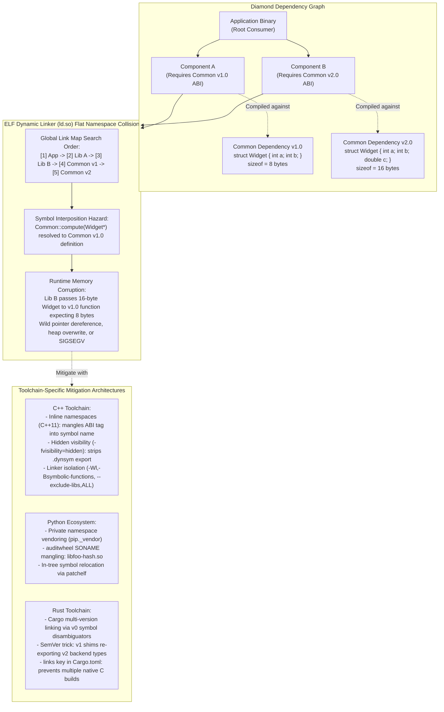
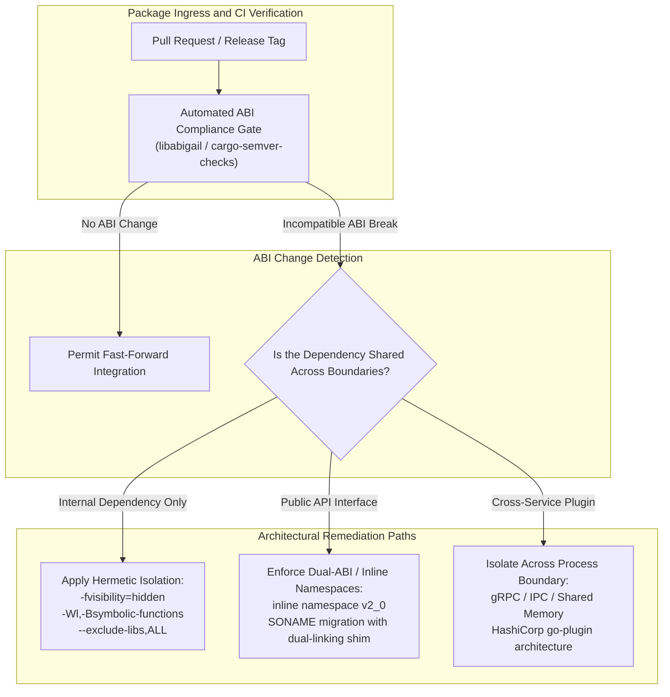

# Diamond Dependencies and Incompatible ABI Mitigation

> [!summary] Claim:
> A diamond dependency occurs when an application depends on two intermediate components that pull in conflicting versions or incompatible Application Binary Interfaces (ABIs) of a shared transitive dependency.
> In flat dynamic symbol environments such as standard ELF, the runtime linker resolves undefined symbols using a first-definition-wins strategy, causing silent symbol interposition, struct layout mismatch, and catastrophic memory corruption.
> Mitigating diamond conflicts requires distinct strategies across toolchains: C++ enforces binary separation via inline namespaces and hidden symbol visibility (`-fvisibility=hidden`, `-Wl,-Bsymbolic-functions`), Python isolates wheels via content-hashed SONAME mangling in `auditwheel`, and Cargo relies on symbol-level crate disambiguation alongside the SemVer trick.
> At enterprise scale, organizations eliminate diamond instability through single-version monorepos, automated ABI compatibility gates in continuous integration, or out-of-process IPC boundaries.



## The Mechanism

The diamond dependency problem originates in directed acyclic dependency graphs where a root node $A$ reaches a leaf node $C$ through at least two distinct paths, $A \to B_1 \to C$ and $A \to B_2 \to C$.
When $B_1$ requires $C$ at version $v_1$ and $B_2$ requires $C$ at version $v_2$, the runtime environment faces an ABI compatibility dilemma if $v_1$ and $v_2$ differ in data layout, calling conventions, or exported function signatures.
The resulting failure mode depends on whether the language toolchain enforces a single global symbol namespace, partitions symbols per module, or mangles version metadata directly into linkable symbol names.

### 1. ELF Dynamic Linker Resolution and Global Symbol Interposition

Under the System V Application Binary Interface (gABI) and standard Linux implementations (`ld.so`, installed as `ld-linux-x86-64.so.2` on x86-64 and `ld-linux.so.2` on i386), shared libraries loaded into a process share a single flat global symbol namespace by default.
When an executable starts, the dynamic linker traverses the binary's `DT_NEEDED` dynamic tags in a breadth-first search (BFS) order (the glibc `elf/dl-deps.c` comment on the search list reads "breadth-first search of the dependency tree", as of 2026-11) to construct a linked list of loaded objects (`struct link_map`).
Symbol resolution for relocations of type `R_X86_64_GLOB_DAT` (data symbols) and `R_X86_64_JUMP_SLOT` (Procedure Linkage Table function entries) follows this global link map sequentially from head to tail.

The dynamic linker operates under the first-definition-wins rule, formally termed symbol interposition:
- The first shared object in the link map that exports a symbol satisfying a requested name binds that symbol for the entire process.
- All subsequent definitions of the same symbol in libraries loaded later in the sequence are silently ignored.
- If $B_1$ loads $C_{v_1}$ before $B_2$ loads $C_{v_2}$, every call from $B_2$ targeting functions in $C_{v_2}$ binds instead to the implementations in $C_{v_1}$.

Consider an incompatible ABI evolution in class `Widget` where $C_{v_1}$ defines two 32-bit integers and $C_{v_2}$ appends a 64-bit floating-point value:

```cpp
// Common Dependency v1.0
struct Widget {
    int32_t id;      // offset 0
    int32_t flags;   // offset 4
};                   // sizeof = 8 bytes

// Common Dependency v2.0
struct Widget {
    int32_t id;      // offset 0
    int32_t flags;   // offset 4
    double weight;   // offset 8 (due to 8-byte alignment)
    int32_t tag;     // offset 16
};                   // sizeof = 24 bytes (with padding)
```

If $B_2$ allocates `Widget` on its stack (allocating 24 bytes) and passes its pointer to `Widget::reset()`, but the dynamic linker interposed `Widget::reset()` from $C_{v_1}$, the function executes code compiled against the 8-byte layout.
Conversely, if $C_{v_1}$ constructs a `Widget` and passes it to $B_2$, $B_2$ attempts to read `weight` at offset 8 and `tag` at offset 16, accessing uninitialized heap memory or crashing with an out-of-bounds memory fault.
Because both versions export identical mangled symbol names (for example, `_ZN6Widget5resetEv`), neither the static linker nor the dynamic linker reports an error during compilation or loading.

### 2. Mach-O Two-Level Namespace Architecture

Apple macOS avoids accidental ELF-style symbol interposition by enforcing a two-level namespace model in Mach-O binaries by default (`MH_TWOLEVEL`, introduced in Mac OS X 10.1).
In a Mach-O object file, every external symbol reference in the symbol table contains two distinct pieces of metadata:
1. The symbol name string.
2. A two-level namespace library ordinal referencing the exact dynamic library (`LC_LOAD_DYLIB` command index) from which the symbol was linked at compile time.

During runtime binding in macOS `dyld`, when `libB.dylib` references `_widget_reset`, `dyld` does not search the global list of loaded libraries.
Instead, `dyld` indexes directly into the specific shared library recorded in `libB`'s load commands (`libC_v2.dylib`).
Even if `libA.dylib` previously loaded `libC_v1.dylib` into the process, `dyld` resolves `libB`'s calls to `libC_v2.dylib` and `libA`'s calls to `libC_v1.dylib`.

However, Mach-O two-level namespaces do not eliminate ABI hazards when objects cross component boundaries:
- If `libA` allocates an instance of `Widget` and passes that pointer to `libB`, `libB` interprets the memory according to `v2.0` offsets, causing silent data corruption.
- If a build passes `-flat_namespace` to `ld64`, the linker records no library for each import and `dyld` "searches all images and uses the first definition it finds" (ld(1)); `-force_flat_namespace`, accepted only when linking a main executable, forces flat binding on every dylib and bundle in the process.
- The historical `DYLD_FORCE_FLAT_NAMESPACE=1` environment variable is no longer honored: the current `dyld(1)` page does not list it and the string is absent from `/usr/lib/dyld` (checked on macOS 27, as of 2026-11).
- C++ Run-Time Type Information (`typeid`) and exception handling (`catch`) depend on how libc++ compares `std::type_info` objects, selected by `_LIBCPP_TYPEINFO_COMPARISON_IMPLEMENTATION` in `<typeinfo>`: mode 1 compares name pointers only (the default for Itanium-ABI platforms), mode 2 compares pointers and then falls back to `strcmp` (COFF and XCOFF), and mode 3 uses a non-unique-RTTI bit in the name pointer and falls back to `strcmp` only when neither side is marked unique.
  Apple 64-bit non-x86 targets (`__APPLE__ && __LP64__ && !__x86_64__`, so Apple silicon) select mode 3, which tolerates duplicate typeinfo across dylibs; x86-64 macOS uses pointer comparison (libc++ `typeinfo` and libc++abi `private_typeinfo.cpp`, LLVM main, as of 2026-11).
  A duplicated typeinfo node therefore breaks `catch` on a pointer-comparison platform and is forgiven on Apple silicon, so do not rely on that tolerance for portable code.

### 3. C++ One Definition Rule and Inline Namespace Mangling

The C++ Standard (ISO/IEC 14882:2011 section 3.2 [basic.def.odr]) mandates the One Definition Rule (ODR) in two parts.
Every program shall contain exactly one definition of every non-inline function or variable that is odr-used in that program, with no diagnostic required (paragraph 3).
A class type, enumeration type, inline function, or template may be defined in more than one translation unit only if every definition consists of the same token sequence with the same meaning; "if the definitions of D do not satisfy these requirements, then the behavior is undefined" (paragraph 5, N3337).
Two incompatible definitions of `struct Widget` in a diamond therefore yield undefined behavior that neither the compiler nor the linker is obligated to diagnose, and the Standard does not model shared libraries at all, so the dynamic-linking case is governed only by the platform ABI.

To provide deterministic, link-time detection of ABI changes, C++11 introduced inline namespaces (section 7.3.1 [namespace.def]).
An inline namespace allows members of a nested namespace to be treated as members of the enclosing namespace for unqualified lookup, while altering the symbol's external linkage signature:

```cpp
namespace mylib {
    inline namespace v2_0 {
        class Widget {
        public:
            void execute();
        };
    }
}
```

A consumer writes `mylib::Widget w; w.execute();` without explicitly referencing `v2_0`.
However, under the Itanium C++ ABI mangling specification, the inline namespace becomes an immutable component of the mangled symbol name:
- In `v1_0`: `_ZN5mylib4v1_06Widget7executeEv`
- In `v2_0`: `_ZN5mylib4v2_06Widget7executeEv`

Because the symbols differ textually, the ELF dynamic linker treats them as separate entities.
If `libA` links against `v1_0` and `libB` links against `v2_0`, both libraries bind strictly to their respective implementations.
If a developer attempts to pass `mylib::v1_0::Widget` into an interface expecting `mylib::v2_0::Widget`, the static compiler rejects the call with a type mismatch error, converting a silent runtime crash into a deterministic compile-time check.

A prominent production implementation of this mechanism is the GNU libstdc++ Dual ABI introduced in GCC 5.1 (April 2015).
To comply with C++11 requirements prohibiting copy-on-write (COW) implementations of `std::string` and mandating $O(1)$ complexity for `std::list::size()`, GCC introduced `inline namespace __cxx11`:
- Compiling with `-D_GLIBCXX_USE_CXX11_ABI=1` directs `std::string` to `std::__cxx11::basic_string`, mangling as `_ZNSt7__cxx1112basic_string...`.
- Compiling with `-D_GLIBCXX_USE_CXX11_ABI=0` retains the legacy C++98 COW string, mangling as `_ZNSs...`.
- Both ABIs reside within the same `libstdc++.so.6` library, preventing symbol collisions and turning cross-ABI linkage mismatches into clear linker errors.

### 4. Linker Isolation: Symbol Visibility, Version Scripts, and Local Binding

When an application cannot migrate its shared libraries to inline namespaces, the toolchain must enforce isolation at the shared library boundary.
By default on Linux, GCC and Clang assign default visibility (`STV_DEFAULT`) to all functions and globals, causing every compiled symbol to be placed in the `.dynsym` dynamic symbol table.
When internal static dependencies (such as a private `libz.a` or `libprotobuf.a`) are linked into a shared library, their symbols leak into the global scope.

To hermetically encapsulate dependencies inside a shared library, engineers deploy three compiler and linker controls:

```text
Compilation:  -fvisibility=hidden -fvisibility-inlines-hidden
Link flags:   -Wl,-Bsymbolic-functions -Wl,--exclude-libs,ALL
```

#### Compiler Visibility (`-fvisibility=hidden`)
Sets the default ELF symbol visibility to `STV_HIDDEN`.
Hidden symbols are retained in `.symtab` for local debugging but are excluded from `.dynsym`.
Because dynamic linkers resolve references solely through `.dynsym`, hidden symbols cannot be interposed by external libraries or satisfy unresolved references in neighboring modules.
Public APIs must be explicitly exposed using `__attribute__((visibility("default")))`.

#### Linker Symbolic Binding (`-Wl,-Bsymbolic-functions`)
Instructs GNU `ld` or `lld` to bind references to global function symbols within the shared library to their local definitions at static link time.
Under standard dynamic linking, even an internal call within `libA.so` to a function defined in `libA.so` traverses the Procedure Linkage Table (PLT) to allow external interposition.
`-Bsymbolic-functions` eliminates PLT traversal for internal calls, ensuring that `libA.so` always invokes its own internal routines regardless of libraries preceding it in the link map.

#### Archive Exclusion (`-Wl,--exclude-libs,ALL`)
When statically linking third-party archives (`.a` files) into a shared library, every archive member the link pulls in keeps the visibility it was compiled with, which is `STV_DEFAULT` unless the archive was built with `-fvisibility=hidden`, so its global symbols are exported automatically.
Per the GNU ld manual, `--exclude-libs ALL` "excludes symbols in all archive libraries from automatic export", and "for ELF targeted ports, symbols affected by this option will be treated as hidden", preventing vendored third-party code from leaking into `.dynsym`.

#### Linker Version Scripts (`--version-script`)
A version script provides fine-grained control over symbol export and symbol versioning:

```text
LIBFOO_1.0 {
    global:
        foo_init;
        foo_process;
    local:
        *;
};
```

The wildcard `local: *;` demotes every symbol not explicitly listed under `global:` to local binding (`STB_LOCAL`), purging them from `.dynsym` and guaranteeing immunity from dynamic linker interposition.

### 5. Python Wheel Vendoring, sys.modules Contention, and SONAME Mangling

Python maintains a single global dictionary, `sys.modules`, to track imported modules within an interpreter process.
If package $A$ and package $B$ both execute `import yaml`, the Python import mechanism loads `yaml` during the first call and binds the resulting module object into `sys.modules['yaml']`.
Subsequent import calls in package $B$ return the existing module from `sys.modules`, completely ignoring whatever version package $B$ requested in its metadata.
Python pure-code dependencies cannot coexist at multiple versions within the same interpreter process.

To resolve pure Python collisions, packages such as `pip` (and `requests` before 2.16.0, released 2017-05-26 as "Unvendor ALL the things!") vendor their dependencies by rewriting their internal package namespaces:
- An internal build script moves `urllib3` to `pip._vendor.urllib3`.
- All internal import statements are refactored to `from pip._vendor import urllib3`.
- Because the module key in `sys.modules` is `pip._vendor.urllib3`, it operates in complete isolation from any system-wide `urllib3` installed in `site-packages`.

When Python wheels include compiled C or C++ extensions, the collision moves to the ELF dynamic linker.
If wheel $A$ and wheel $B$ both vendor a dynamic library whose `DT_SONAME` is `libprotobuf.so.32`, the glibc dynamic linker matches each new `DT_NEEDED` name against the names and SONAMEs of objects already in the namespace (`_dl_map_object` calls `_dl_lookup_map` in glibc `elf/dl-load.c`, which compares the requested name with `strcmp (name, l_soname (l))`).
When wheel $A$'s extension is loaded via `import` (which calls `dlopen()`), `ld.so` maps its `libprotobuf.so.32`.
When wheel $B$'s extension is loaded next, its `DT_NEEDED` entry `libprotobuf.so.32` matches the SONAME already in the link map, so `ld.so` reuses wheel $A$'s instance without searching wheel $B$'s `RPATH`, even if wheel $B$ bundles a differing build.

The standard Linux packaging tool `auditwheel` mitigates this dynamic library collision via SONAME mangling (`auditwheel repair`, `src/auditwheel/repair.py`, as of 2026-11):
1. It walks the extension modules' `DT_NEEDED` entries (via `lddtree`) to find external libraries not allowed by the target manylinux or musllinux policy.
2. It copies those shared libraries into a directory at the wheel root named `<dist-name>.libs/` (`--lib-sdir`, default `.libs`).
3. It hashes each library's contents with SHA-256 (`hashfile`), keeps the first 8 hex characters, and inserts them after the first dot-delimited segment of the file name (for example, `libprotobuf.so.32` becomes `libprotobuf-b27e8d31.so.32`).
4. It invokes `patchelf --set-soname` to modify the library's internal `DT_SONAME` tag to match the content-hashed filename.
5. It invokes `patchelf --replace-needed` on the extension module (`.so`) to point to the newly mangled filename.
6. It rewrites the extension's search path with `patchelf --force-rpath --set-rpath` to `$ORIGIN/<relative path to the .libs directory>` (`src/auditwheel/patcher.py`), so the result is a `DT_RPATH` entry, not `DT_RUNPATH`, which also applies to the grafted libraries' own dependencies.

#### The Dual-Singleton Hazard
While `auditwheel` prevents `ld.so` from colliding on identical filenames, loading two distinct copies of a C++ shared library into one process introduces the dual-singleton hazard.
Libraries that maintain global internal registries, such as Google Protocol Buffers or OpenMP, fail in two opposite ways depending on whether the copies stay isolated:
- Protocol Buffers maintains a process-wide descriptor pool in static memory (`google::protobuf::DescriptorPool::generated_pool()`), keyed by `.proto` file name and fully qualified symbol name.
- If two copies are fully isolated (hidden symbols, distinct SONAMEs), each has its own pool, and messages created by one copy are silently not recognized by the other.
- If generated code for the same `.proto` file is linked into two modules that register into one shared pool (one shared `libprotobuf`, or default-visibility symbols interposed across copies), the second static initializer fails: `descriptor_database.cc` logs `File already exists in database: <file>.proto` and `descriptor.cc` then aborts with `[libprotobuf FATAL ...] CHECK failed: GeneratedDatabase()->Add(encoded_file_descriptor, size)`.
- Loading two OpenMP runtimes creates two independent thread pools that each size themselves to the machine, oversubscribing the CPU; threadpoolctl reports that mixing LLVM `libomp` with Intel `libiomp` "manifested by crashes or deadlocks", while it "never observed any issue between `libgomp` and `libiomp`".

### 6. Rust Cargo Multi-Version Linking, Nominal Type Boundaries, and the SemVer Trick

Unlike C++ and Python, the Rust compiler and Cargo package manager natively support multi-version dependency graphs for pure Rust crates.
If an application depends on `crate_a` (which requires `serde 1.0.100`) and `crate_b` (which requires `serde 0.9.0`), Cargo resolves both versions and compiles both into the final binary artifact.

#### Symbol Disambiguation via RFC 2603 (v0 Mangling)
Cargo avoids link-time symbol collisions between different versions of the same crate by incorporating a unique crate disambiguator into every mangled symbol.
This holds under both the legacy mangling scheme (a hash suffix) and the `v0` scheme of RFC 2603, which became opt-in on stable with `-C symbol-mangling-version=v0` in Rust 1.59 and the stable default in Rust 1.97.0 (2026-07-09), after which legacy mangling is selectable only on nightly (as of 2026-11):
- Cargo passes each compilation unit a `-C metadata=<hash>` value; in Cargo's `compute_metadata` (`src/compiler/build_runner/compilation_files.rs`) it hashes the metadata version, enabled features, the profile, compile mode, LTO setting, host or target kind, the target name and kind, the rustc version, `is_std`, the package identity (name, version, source, hashed relative to the workspace root) and the sorted metadata hashes of all dependencies; `RUSTFLAGS` are deliberately excluded from `-C metadata` (as of 2026-11, Cargo master).
  rustc then folds each distinct `-C metadata` value, the crate name, an exe-or-lib tag, and the rustc version string into the 64-bit `StableCrateId` (`StableCrateId::new` in `rustc_span/src/def_id.rs`), which is the source of the disambiguator in the symbol.
  Because the hash includes the features, profile, and dependency hashes, one crate version built twice with different feature sets also gets two disambiguators.
- Compiling `pub fn parse` in a crate named `serde` with `-C metadata=abc` and then `-C metadata=xyz` on rustc 1.99 yields `_RNvCsaNmOKNTSuKj_5serde5parse` and `_RNvCs1Ylfoz0R18t_5serde5parse` (Mach-O adds one leading underscore), differing only in the base-62 `Cs..._` disambiguator.
- The system linker processes both symbols without duplicate symbol collision.

#### The Type Boundary Problem
Although Cargo links both versions without symbol clashes, Rust's type system enforces strict nominal typing based on full crate identity:
- Types defined in `serde v0.9.0` are completely distinct from types defined in `serde v1.0.100`.
- If `crate_a` exposes a function `accept_token(tok: serde::Token)` where `Token` originates from `serde v1.0`, and `crate_b` attempts to pass a `serde::Token` originating from `serde v0.9`, the compiler rejects the program.
- The output below was captured from rustc 1.99 (as of 2026-11) with two local path crates both named `tok` (versions 0.1.0 and 0.2.0, renamed `tok_old` and `tok_new`), with absolute paths shortened:

```text
error[E0308]: mismatched types
 --> src/main.rs:2:57
  |
2 | fn main() { let token_v0 = tok_old::Token; accept_token(token_v0); }
  |                                            ------------ ^^^^^^^^ expected `tok::Token`, found a different `tok::Token`
  |                                            |
  |                                            arguments to this function are incorrect
  |
note: there are multiple different versions of crate `tok` in the dependency graph
 --> .../tok2/src/lib.rs:1:1
  |
1 | pub struct Token;
  | ^^^^^^^^^^^^^^^^ this is the expected type
  |
 ::: .../tok1/src/lib.rs:1:1
  |
1 | pub struct Token;
  | ---------------- this is the found type
  = help: you can use `cargo tree` to explore your dependency tree
```

#### The SemVer Trick
When a library author must release a breaking major version bump (for example, moving from `0.2` to `0.3`) but wants to prevent fracturing the ecosystem into incompatible type silos, they deploy the SemVer trick (popularized by David Tolnay):
1. The author publishes the new breaking version as `my_crate 0.3.0`.
2. The author releases a final minor update to the older branch: `my_crate 0.2.1`.
3. In `my_crate 0.2.1`'s `Cargo.toml`, the crate declares an internal dependency on `my_crate 0.3.0` using dependency renaming:

```toml
[package]
name = "my_crate"
version = "0.2.1"

[dependencies]
my_crate_v3 = { package = "my_crate", version = "0.3.0" }
```

4. In `my_crate 0.2.1/src/lib.rs`, the library re-exports the unchanged types directly from the `v0.3.0` dependency:

```rust
pub use my_crate_v3::{CommonType, Handler};
```

Downstream crates locked to `my_crate 0.2` pull in `0.2.1` through standard Cargo SemVer updates.
Because `0.2.1` re-exports the exact types instantiated by `0.3.0`, types passed across components originate from the same canonical type definition, eliminating `E0308` compilation errors across the diamond.

#### Native Link Collision: The `links` Manifest Key
Rust's symbol disambiguation applies strictly to Rust code.
When a crate wraps a native C library (such as `sqlite3` or `openssl`), the compiled C object files expose flat, un-mangled symbols (`sqlite3_open`).
If two versions of `libsqlite3-sys` were linked into one binary, the static linker would abort with duplicate symbol definitions.

Cargo prevents this failure mode via the `links` manifest key:
- A sys-crate declares `links = "sqlite3"` in its `Cargo.toml`.
- Cargo enforces an absolute graph-wide invariant: only one crate instance claiming a specific `links` value may exist anywhere in the transitive dependency tree.
- If two distinct major versions of `libsqlite3-sys` appear in the dependency graph, Cargo halts during resolution before compiling any code.
- The output below was captured from Cargo 1.99 (as of 2026-11) with two local path crates `mysys-a` and `mysys-b` that both declare `links = "sqlite3"`, with absolute paths shortened:

```text
error: failed to select a version for `mysys-b`.
    ... required by package `app2 v0.1.0 (.../app2)`
versions that meet the requirements `*` are: 0.1.0

package `mysys-b` links to the native library `sqlite3`, but it conflicts with a previous package which links to `sqlite3` as well:
package `mysys-a v0.1.0 (.../sys1)`
    ... which satisfies path dependency `mysys-a` of package `app2 v0.1.0 (.../app2)`
note: only one package in the dependency graph may specify the same links value to ensure that only one copy of a native library is linked in the final binary
for more information, see https://doc.rust-lang.org/cargo/reference/resolver.html#links
help: try to adjust your dependencies so that only one package uses the `links = "sqlite3"` value

failed to select a version for `mysys-b` which could resolve this conflict
```

## Commands and Numbers to Know

The following reference numbers, linker flags, and environment controls govern dynamic symbol resolution, visibility enforcement, and dependency isolation.

| Mechanism / Command / Flag | Default Behavior | Target Platform | Performance / Memory Bound | Context and Impact (as of 2026-11) |
|---|---|---|---|---|
| `-fvisibility=hidden` | `STV_DEFAULT` (all symbols in `.dynsym`) | Both (Linux / macOS) | Shrinks `.dynsym` to the annotated API; the reduction depends entirely on the ratio of internal to public symbols, so measure it with `nm -D --defined-only \| wc -l` | Hides non-annotated symbols, preventing interposition and shrinking `.dynsym` |
| `-fvisibility-inlines-hidden` | Inline functions exported if out-of-line | Both (Linux / macOS) | Eliminates duplicate weak symbols across shared objects | Forces out-of-line copies of inline member functions to hidden binding |
| `-Wl,-Bsymbolic-functions` | PLT-based dynamic interposition enabled | Linux (GNU ld, lld, mold) | Removes the PLT stub and its dynamic symbol lookup for intra-library calls; the per-call saving is microarchitecture-dependent and must be measured | Binds internal function calls directly to internal definitions at link time |
| `-Wl,--exclude-libs,ALL` | Archive symbols exported with their compiled (usually default) visibility | Linux (ELF: GNU ld, gold, lld) | Prevents `.dynsym` table bloat | Treats symbols from static archives as hidden during shared library creation |
| `--version-script=<file>` | Linker exports all global definitions | Linux (ELF targets) | Link-time parsing cost only; no runtime cost | Enforces strict API boundaries via `global:` and `local: *;` blocks |
| `ld -flat_namespace` / `-force_flat_namespace` | Off (`-two_levelnamespace` is the default) | macOS (`ld64`, `dyld`) | `dyld` searches every loaded image per symbol | Restores first-definition-wins lookup; `DYLD_FORCE_FLAT_NAMESPACE` is no longer honored by current `dyld` |
| `auditwheel repair --plat <tag>` | Unchecked wheel dependencies | Linux (Python Wheels) | Copies dependent `.so` files into `<dist-name>.libs/` | Content-hashes SONAMEs and patches `DT_NEEDED` and `DT_RPATH` (`--force-rpath`) via `patchelf` |
| `Cargo.toml` `links = "<name>"` | Unset (no native library link constraint) | Both (Rust Cargo) | Compile-time check; 0 runtime or binary size cost | Ensures exactly one package linking `<name>` exists in the dependency graph |
| `-C symbol-mangling-version=v0` | Opt-in since Rust 1.59; default on stable since Rust 1.97.0 | Both (rustc) | Base-62 encoded hash format | Incorporates crate disambiguator into symbol names to eliminate link clashes |
| `dlmopen(LM_ID_NEWLM, ...)` | `RTLD_LOCAL` in default namespace | Linux (glibc `ld.so`) | Max 16 link map namespaces per process in glibc (`DL_NNS = 16`) | Isolates incompatible dynamic libraries in separate runtime link namespaces |
| `-D_GLIBCXX_USE_CXX11_ABI=1` | Enabled by default since GCC 5.1 unless GCC was configured with `--with-default-libstdcxx-abi=gcc4-compatible` | Linux (libstdc++) | Changes `sizeof(std::string)` on LP64 from 8 bytes (one pointer, COW) to 32 bytes (SSO) | Segregates C++11 and C++98 string and list implementations into inline namespaces |

## Multi-Language Comparison: C++ / Python / Rust

The strategies for handling diamond dependencies diverge across C++, Python, and Rust due to differences in runtime models, module registries, and symbol binding semantics.

| Dimension | C++ (Native System Toolchains) | Python (Interpreted / Native Wheels) | Rust (Cargo / rustc) |
|---|---|---|---|
| Runtime Symbol Namespace | Flat global namespace in ELF; two-level namespace in Mach-O | Single global `sys.modules` dictionary; flat C-symbol namespace for C-extensions | Mangled symbol names per crate disambiguator; flat un-mangled namespace for `extern "C"` |
| Multi-Version Coexistence | Prohibited under standard linking; allowed via inline namespaces or `dlmopen` | Prohibited in pure Python; allowed for C-extensions via content-hashed SONAME mangling | Natively supported for pure Rust crates; prohibited for crates declaring identical `links` keys |
| Type Identity Across Versions | Structural collision if mangling matches; ODR violation (IFNDR) | Duck typing at Python level; memory corruption if C-extension structs cross boundaries | Strict nominal typing; compiler rejects passing types across major versions (`E0308`) |
| Incompatible Upgrade Mitigation | Inline namespaces (`inline namespace v2`), `-fvisibility=hidden`, version scripts | Namespace vendoring (`pip._vendor`), SONAME rewriting via `patchelf` (`auditwheel`) | The SemVer trick (re-exporting types from new version in old minor release) |
| Link-Time Native Collision Guard | None by default; requires manual version script or linker wrapper scripts | None; dynamic linker loads first matching library name | `links` key in `Cargo.toml` halts compilation if multiple native wrappers exist |
| Failure Mode When Unmitigated | Silent symbol interposition, struct offset mismatch, `SIGSEGV` | First import wins in `sys.modules`, duplicate C++ singleton aborts in C-extensions | Compilation error on type mismatch (`E0308`) or Cargo resolution abort on native clash |

## Worked Example: Incompatible ABI Collision and Isolation

The following self-contained walkthrough demonstrates how an unmitigated diamond dependency causes silent memory corruption under ELF dynamic linking on Linux, and how compiler visibility and linker encapsulation flags resolve the defect.

### 1. The Vulnerable Architecture

An application binary `client_app` depends dynamically on two shared libraries, `librender.so` and `libphysics.so`.
Both libraries internally rely on a shared static utility library `libmath.a`, but they compile against incompatible versions:
- `librender.so` links `libmath v1.0`, where `struct Transform` contains two `float` components (8 bytes).
- `libphysics.so` links `libmath v2.0`, where `struct Transform` expands to four `float` components (16 bytes) to support quaternions.

```cpp
// math_v1.h (Used by librender)
struct Transform {
    float x;
    float y;
};
void init_transform(Transform* t);

// math_v2.h (Used by libphysics)
struct Transform {
    float x;
    float y;
    float z;
    float w;
};
void init_transform(Transform* t);
```

### 2. The Unmitigated Link Sequence and Failure

In an unmitigated build, `librender.so` and `libphysics.so` compile with default visibility (`-fvisibility=default`) and link their respective `libmath.a` without isolation flags:

```bash
# Compile math v1 and create archive
g++ -c -fPIC math_v1.cpp -o math_v1.o
ar rcs libmath_v1.a math_v1.o

# Compile math v2 and create archive
g++ -c -fPIC math_v2.cpp -o math_v2.o
ar rcs libmath_v2.a math_v2.o

# Build shared libraries with default symbol export
g++ -shared -fPIC render.cpp -L. -lmath_v1 -o librender.so
g++ -shared -fPIC physics.cpp -L. -lmath_v2 -o libphysics.so

# Build executable linking both libraries
g++ main.cpp -L. -lrender -lphysics -Wl,-rpath,. -o client_app
```

Inspecting only the dynamic symbol table of `librender.so` and `libphysics.so` with `readelf --dyn-syms --wide` reveals the defect (`readelf -s` would also print the static `.symtab`).
The block below is illustrative, not captured from a lab: symbol indices, addresses, and sizes vary by compiler and flags.

```text
$ readelf --dyn-syms --wide librender.so | grep init_transform
    12: 0000000000001140    25 FUNC    GLOBAL DEFAULT   11 _Z14init_transformP9Transform

$ readelf --dyn-syms --wide libphysics.so | grep init_transform
    14: 0000000000001180    45 FUNC    GLOBAL DEFAULT   11 _Z14init_transformP9Transform
```

Both libraries export the exact same mangled symbol `_Z14init_transformP9Transform` with `GLOBAL DEFAULT` binding.
When `client_app` executes, `ld.so` loads `librender.so` first, followed by `libphysics.so`.
When `libphysics.so` executes a routine that calls `init_transform()`, the call goes through `libphysics.so`'s PLT, and the dynamic linker binds it to the first definition in the global scope, which is `librender.so`'s (GCC's default `-fsemantic-interposition` also stops the compiler from inlining the call inside `libphysics.so`):
- `libphysics.so` expects `init_transform()` to initialize 16 bytes of memory (`x`, `y`, `z`, `w`).
- The interposed function from `librender.so` writes only 8 bytes (`x`, `y`).
- The `z` and `w` fields remain uninitialized garbage, resulting in NaN propagation in physics calculations or stack smashing if layouts are inverted.

### 3. The Isolated Mitigation Sequence

To completely eliminate symbol interposition and isolate the internal `libmath` dependencies, the build applies a three-layer isolation contract:

```bash
# 1. Compile math components with hidden visibility
g++ -c -fPIC -fvisibility=hidden math_v1.cpp -o math_v1.o
ar rcs libmath_v1.a math_v1.o

g++ -c -fPIC -fvisibility=hidden math_v2.cpp -o math_v2.o
ar rcs libmath_v2.a math_v2.o

# 2. Build shared libraries with symbolic binding and archive exclusion
g++ -shared -fPIC -fvisibility=hidden -fvisibility-inlines-hidden \
    render.cpp -L. -lmath_v1 \
    -Wl,-Bsymbolic-functions -Wl,--exclude-libs,ALL \
    -o librender.so

g++ -shared -fPIC -fvisibility=hidden -fvisibility-inlines-hidden \
    physics.cpp -L. -lmath_v2 \
    -Wl,-Bsymbolic-functions -Wl,--exclude-libs,ALL \
    -o libphysics.so

# 3. Relink application binary
g++ main.cpp -L. -lrender -lphysics -Wl,-rpath,. -o client_app
```

Because `render.cpp` and `physics.cpp` are now compiled with `-fvisibility=hidden`, the entry points that `main.cpp` calls must be declared with `__attribute__((visibility("default")))`, or step 3 fails with undefined references.
Verifying the resulting shared objects with `readelf --dyn-syms --wide` confirms that internal symbols are eradicated from the dynamic symbol table; plain `readelf -s` would still match the `LOCAL` entry in `.symtab` unless the library is stripped.

```text
$ readelf --dyn-syms --wide librender.so | grep init_transform
# Output is empty: symbol not present in .dynsym

$ readelf --dyn-syms --wide libphysics.so | grep init_transform
# Output is empty: symbol not present in .dynsym
```

The symbol `_Z14init_transformP9Transform` survives only as an `STB_LOCAL` entry in `.symtab`, because the static linker converts hidden symbols to local binding in its output.
Calls to it within `librender.so` and `libphysics.so` are resolved by the static linker to direct PC-relative `call` instructions, with no PLT entry and no dynamic relocation left for `ld.so` to process.
Each shared library executes against its intended version of `struct Transform`, eliminating memory corruption across the diamond.

## Pitfalls

> [!warning] Pitfall 1: Assuming Mach-O Two-Level Namespaces Prevent All Diamond Hazards
> While macOS `dyld` prevents function symbol interposition across separate `.dylib` binaries, it provides zero protection when data structures cross module boundaries.
> If `libA.dylib` instantiates a C++ object from a vendored dependency and passes a raw pointer or reference across an API boundary to `libB.dylib`, `libB` interprets the memory according to its own compile-time header offsets.
> If the struct layout changed between versions, field reads access misaligned or out-of-bounds memory.
> Never pass types from internal or vendored dependencies across public dynamic library interfaces.

> [!warning] Pitfall 2: Linker Version Script Omission of Inlined Template Instantiations
> When defining a version script with `local: *;`, developers frequently expose public class APIs under `global:` but fail to export explicit template instantiations or virtual table definitions used across translation units.
> Conversely, declaring broad wildcards under `global:` (such as `extern "C++" { mylib::*; };`) accidentally exports statically linked archive routines that match the namespace pattern.
> Always verify `.dynsym` with `nm -D --defined-only` or `readelf -s --wide` in continuous integration to ensure no third-party symbols escape into the dynamic symbol table.

> [!warning] Pitfall 3: C++ Virtual Table and Typeinfo Collisions Across Shared Libraries
> If two shared libraries embed conflicting versions of a class with virtual methods under default visibility, the dynamic linker interposes the virtual method table (`_ZTVN...`) and RTTI structure (`_ZTIN...`).
> Calling a virtual method on an instance constructed in one library invokes the vtable slot resolved from the other library.
> If the vtable slot ordering changed, the call executes a completely unrelated function, frequently passing the `this` pointer into a destructive destructor or mutating method.
> Mark internal polymorphic classes with `__attribute__((visibility("hidden")))` to ensure each library binds strictly to its local vtable.

> [!warning] Pitfall 4: SONAME Collisions in Python Wheels Bypassing pip Dependency Resolution
> When two wheels independently vendor dynamic libraries with the same `DT_SONAME` (for example, `libssl.so.3`), `pip` and `uv` cannot detect the conflict because installer resolvers inspect only Python metadata, not embedded ELF headers.
> At runtime, `dlopen()` loads the first library into the global process image and satisfies the second extension's dependency with the first library's symbols.
> If the libraries were built with differing compiler flags, patches, or SIMD alignments, the second extension crashes intermittently.
> Enforce `auditwheel repair` in wheel build pipelines to ensure every bundled dependency receives a unique content-hashed SONAME.

> [!warning] Pitfall 5: Cargo Feature Unification Silently Breaking Dependencies
> Cargo treats features as strictly additive and unifies feature flags across all occurrences of a crate in the dependency graph.
> If `crate_a` relies on `tokio` with default features disabled to maintain a lightweight embedded footprint, and `crate_b` in the diamond enables `features = ["full"]`, Cargo compiles `tokio` once with all features enabled.
> If a crate author designs features to be mutually exclusive (such as `feature = "backend-a"` and `feature = "backend-b"`), feature unification activates both, triggering compilation errors or unpredictable runtime behavior.
> Features in Rust must always be purely additive; never design mutually exclusive Cargo features.

> [!warning] Pitfall 6: Multiple Instances of -sys Crates Without the `links` Manifest Key
> If a developer writes a custom `-sys` wrapper crate for a native C library but omits the `links` key from `Cargo.toml`, Cargo does not apply its single-instance graph check.
> If two downstream crates pull in different major versions of this wrapper, Cargo happily compiles both.
> During final binary linking, the system linker fails with `duplicate symbol: <symbol_name>` or silently interposes functions depending on static versus dynamic archive resolution.
> Every crate that builds or links a native C library must declare a unique `links` string in its `Cargo.toml`.

## At Scale

At the scale of a single developer, diamond dependency conflicts are rare and often resolved ad hoc by upgrading dependencies or pinning versions in a requirements file.
At the scale of 1,000 to 50,000 engineers collaborating on shared infrastructure, diamond dependencies become the dominant source of binary instability, upgrade gridlock, and release friction.

### The Monorepo "Live at Head" Architecture

Large technology companies (such as Google) systematically eliminate diamond dependency conflicts by enforcing a strict single-version rule across their monorepo codebases.
*Software Engineering at Google* names this the One-Version Rule ("Developers must never have a choice of 'What version of this component should I depend upon?'", Chapter 16) and calls the practice of building everything against the current version of dependencies "Live at Head" (Chapter 21):
- The entire organization contains exactly one version of any third-party or internal library checked into the repository "in the steady state" (Chapter 16 notes that bundled external packages sometimes break this goal).
- All internal binaries, services, and libraries build against this single canonical version at head revision.
- Diamond dependency graphs cannot diverge at compile time because multiple versions of the same component cannot physically exist in the build graph.

The operational trade-off of the single-version model is the upgrade burden:
- Upgrading a foundational library (such as Protocol Buffers, Abseil, or Boost) requires updating all transitive consumers simultaneously.
- The upgrading team cannot leave legacy services on older versions; they must author automated refactoring tools (using Clang-Tidy, Kythe, or LibTooling) to migrate hundreds of call sites in a single atomic commit or phased forward-compatible rollout.
- The build system must maintain continuous integration test coverage capable of verifying tens of thousands of dependent targets before committing an upgrade.

### Polyrepo and Distributed Packaging Fleet Architecture

In decentralized organizations operating multiple repositories and distributing precompiled binaries, enforcing a single version is unfeasible.
Engineering leadership must establish automated binary governance and boundary isolation contracts:



### Architectural Decision Rules

1. **The Private Dependency Rule:**
   If a shared library links a third-party C/C++ library statically for internal implementation purposes, that library must be compiled with `-fvisibility=hidden` and linked with `-Wl,--exclude-libs,ALL`.
   Never export internal implementation symbols to `.dynsym`.
2. **The Public Boundary Rule:**
   If a C++ library must expose types from a dependency across its public headers, it must encapsulate those types inside an inline namespace tagged with the library's major version.
   This converts silent runtime memory corruption into explicit link-time symbol errors.
3. **The Wheel Relocation Rule:**
   All native Python wheels distributed through internal artifact registries must undergo mandatory `auditwheel repair` (Linux) or `delocate` (macOS) verification.
   Wheels containing un-mangled dynamic libraries that collide with enterprise standard libraries must be rejected at registry ingress.
4. **The Process Isolation Rule:**
   When integrating plugins or extensions authored by third parties that rely on conflicting C/C++ runtimes or incompatible GUI frameworks, avoid in-process dynamic linking (`dlopen`).
   Isolate the plugin into a separate process communicating via Unix Domain Sockets, gRPC, or shared memory.
5. **The Cargo Links Rule:**
   Any Rust crate that binds native C code must declare a `links` key matching the canonical upstream C library name.
   No PR introducing a duplicate `links` key may merge into the main development branch.

> [!tip] Practice Drill: Diagnose and Isolate a Duplicate Symbol Collision
> To gain hands-on operational mastery over diamond ABI failures:
> 1. In [[Drill-Packaging-Cpp-Silent-ABI-Break-Across-Shared-Libraries]], reproduce an ELF symbol interposition crash by building two shared libraries with mismatched struct padding and inspect the corrupted memory in `gdb`.
> 2. In [[Drill-Packaging-Cargo-Feature-Unification-Hazard]], trigger a Cargo feature unification conflict by combining two workspace crates with mutually exclusive flags and resolve it using target-specific feature partitioning.
> 3. Verify symbol stripping on your platform by running `readelf -s --wide <library.so> | grep -E "FUNC|OBJECT"` and confirm that all third-party symbols are demoted from `.dynsym`.

## Interview Questions

> [!question] L5: What causes a diamond dependency collision in an ELF shared library environment, and why does the linker emit no warning?
> > [!success]- Answer
> > A diamond collision occurs when an application loads two shared libraries that both depend on conflicting versions of a shared transitive dependency.
> > In standard ELF environments, the dynamic linker (`ld.so`) maintains a single flat global symbol namespace and traverses loaded objects in breadth-first search order.
> > Under the first-definition-wins rule, the first library loaded that defines a symbol satisfies all subsequent lookups across the entire process (symbol interposition).
> > The static linker emits no warning because each shared library was compiled and linked independently against its own headers without knowledge of the other.
> > The dynamic linker emits no warning because symbol interposition is an intentional design feature of System V ELF intended to allow overriding standard library functions (such as `LD_PRELOAD` memory allocators).

> [!question] L5: How does the `links` manifest key in Rust's `Cargo.toml` prevent native C library collisions?
> > [!success]- Answer
> > While Rust code avoids symbol collisions through crate disambiguator hashes embedded in mangled symbols, native C libraries expose flat, un-mangled symbol names.
> > If two crates in a Cargo dependency graph link the same native C library, the system linker would abort with duplicate symbol definitions or cause runtime interposition.
> > The `links = "<name>"` key informs Cargo that a package links to a specific native library.
> > Cargo enforces a strict rule during dependency resolution: only one package in the entire dependency graph may specify a given `links` value.
> > If two packages or two major versions of the same package declare the same `links` value, Cargo halts with a resolution error before compilation begins.

> [!question] L6: Predict the output: What happens when the following C++ program runs on Linux under standard ELF dynamic linking?
> ```cpp
> // libA.so (compiled against Common v1: sizeof(Point) == 8)
> struct Point { int32_t x, y; };
> void process_point(Point* p) { p->x = 10; p->y = 20; }
> 
> // libB.so (compiled against Common v2: sizeof(Point) == 16)
> struct Point { int32_t x, y, z, w; };
> Point* create_point() {
>     Point* p = new Point{1, 2, 3, 4};
>     process_point(p);
>     return p;
> }
> 
> // main.cpp
> int main() {
>     Point* p = create_point();
>     std::cout << p->x << " " << p->y << " " << p->z << " " << p->w << std::endl;
> }
> ```
> Assume `libA.so` is loaded before `libB.so`, and all symbols have default visibility.
> > [!success]- Answer
> > **Output:** `10 20 3 4`
> > 
> > **Mechanism:**
> > When `create_point()` in `libB.so` allocates `Point`, it allocates 16 bytes on the heap and initializes fields to `{1, 2, 3, 4}`.
> > It then calls `process_point(p)`.
> > `libB.so` only declares `process_point`, so the dynamic linker binds the call to the sole exported definition, the one in `libA.so`; no interposition is even needed, and the load order matters only if `libB.so` also defined its own `process_point`, in which case `libA.so`'s copy would still win because it comes first in the global scope.
> > `libA.so`'s implementation was compiled against `Point v1`, so it writes 10 to offset 0 (`x`) and 20 to offset 4 (`y`).
> > It does not touch offsets 8 (`z`) or 12 (`w`), leaving them as 3 and 4.
> > While this specific read produces coherent output, if the execution order were inverted (where `libA` allocated an 8-byte buffer and `libB`'s `process_point` wrote 16 bytes), the function would overwrite 8 bytes of adjacent heap memory, causing memory corruption or an allocator crash.

> [!question] L6: Debug this: A production Python service crashes on startup with `[libprotobuf ERROR google/protobuf/descriptor_database.cc] File already exists in database: user/profile.proto`, followed by `[libprotobuf FATAL google/protobuf/descriptor.cc] CHECK failed: GeneratedDatabase()->Add(encoded_file_descriptor, size)`.
> What is the root cause and how do you resolve it?
> > [!success]- Answer
> > **Root Cause:**
> > The Python process imported two native extension wheels that both contain C++ code generated from the same `user/profile.proto`, and both copies register into one descriptor pool.
> > Protocol Buffers registers generated file descriptors into a process-wide pool (`google::protobuf::DescriptorPool::generated_pool()`) from static initializers, keyed by `.proto` file name and fully qualified symbol names.
> > That pool is shared when both extensions dynamically link the same `libprotobuf.so`, or when each vendors a copy with default-visibility symbols so one copy interposes the other.
> > When the second extension's static initializer runs, `EncodedDescriptorDatabase::Add` rejects the duplicate file name, and the generated-code registration `CHECK` aborts the process.
> > If instead each wheel had a fully isolated copy (hidden symbols, `auditwheel`-mangled SONAME), registration would succeed in two separate pools, and the failure would move to runtime: messages built by one copy are not recognized by the other.
> > 
> > **Resolution:**
> > 1. Give each `.proto` file exactly one owner: compile its generated code into one shared module that both extensions depend on, instead of linking the generated `.pb.cc` into each extension.
> > 2. If the clash is between a native extension and the `protobuf` Python package's `cpp` backend sharing the C++ pool, set `PROTOCOL_BUFFERS_PYTHON_IMPLEMENTATION` to `upb` or `python` so the Python side stops using that pool.
> > 3. If two vendors ship the same `.proto` and neither can change, isolate the conflicting extensions into separate worker processes communicating via IPC.

> [!question] L6: Explain the SemVer trick in Rust.
> When must a library author use it, and what problem does it solve in the dependency graph?
> > [!success]- Answer
> > The SemVer trick is an architectural pattern used by Rust library authors when releasing a breaking major version (for example, bumping from `v0.2` to `v0.3`) for a foundational library whose types appear in the public APIs of downstream crates.
> > 
> > **The Problem:**
> > In Rust, types from different major versions of the same crate are distinct nominal types (`my_crate_v0_2::Token != my_crate_v0_3::Token`).
> > If downstream crates `A` and `B` expose `Token` in their APIs, a client application cannot upgrade to `v0.3` until both `A` and `B` simultaneously publish major updates.
> > 
> > **The Solution:**
> > 1. Publish `my_crate v0.3.0` with the breaking changes.
> > 2. Publish a final minor release `my_crate v0.2.1` that depends on `my_crate v0.3.0`.
> > 3. In `v0.2.1`, re-export the unchanged types directly from `v0.3.0`: `pub use my_crate_v3::Token;`.
> > 4. Crates consuming `v0.2` automatically upgrade to `v0.2.1` via non-breaking SemVer rules.
> > 5. Because both `v0.2.1` and `v0.3.0` now share the identical underlying type from `v0.3.0`, type compatibility is restored across the entire dependency diamond without coordinated ecosystem lockstep migrations.

> [!question] L7: Why did GCC 5.1 introduce `inline namespace __cxx11` in `libstdc++`, and why was it implemented as an inline namespace rather than a standard namespace or SONAME bump?
> > [!success]- Answer
> > **The Requirement:**
> > The C++11 standard mandated two breaking ABI changes to standard containers: `std::string` could no longer use copy-on-write (COW) implementations (due to multithreading concurrency guarantees and invalidation rules for references/iterators), and `std::list::size()` had to operate in $O(1)$ time rather than $O(N)$ (requiring an explicit size counter field).
> > 
> > **Why not a SONAME bump?**
> > Bumping `libstdc++.so.6` to `libstdc++.so.7` would break backwards compatibility for the entire Linux ecosystem.
> > Every legacy binary on the system linked to `libstdc++.so.6` would fail to run unless dual runtimes were loaded, which introduces allocator and exception handling hazards.
> > 
> > **Why an inline namespace?**
> > Defining the new containers inside `namespace std { inline namespace __cxx11 { class basic_string; } }` achieves two goals simultaneously:
> > 1. **Source Transparency:**
> >    User code continues to write `std::string`.
> >    Unqualified lookup and template resolution seamlessly resolve to the inline namespace.
> > 2. **Mangled Name Divergence:**
> >    The Itanium C++ ABI mangles the inline namespace into the symbol name (`_ZNSt7__cxx1112basic_string...` vs legacy `_ZNSs...`).
> > Both implementations coexist inside the same `libstdc++.so.6` library file.
> > If an application compiled with the new ABI attempts to link with an object compiled with the old ABI, the linker immediately fails with an unresolved symbol error rather than allowing silent runtime memory corruption.

> [!question] L7: You are architecting a large C++ plugin framework.
> Plugins dynamically link third-party static libraries that frequently collide with host symbols.
> Detail the exact compiler and linker flags needed to achieve total hermetic encapsulation.
> > [!success]- Answer
> > To achieve total hermetic encapsulation of a plugin shared library (`plugin.so`):
> > 1. **Compile with hidden visibility:**
> >    `-fvisibility=hidden -fvisibility-inlines-hidden`
> >    This ensures that all functions, globals, and inline member copies default to `STV_HIDDEN`, omitting them from `.dynsym`.
> > 2. **Explicitly mark API entry points:**
> >    Use `__attribute__((visibility("default")))` strictly on the plugin factory entry points (for example, `plugin_create`, `plugin_destroy`).
> > 3. **Bind internal references locally:**
> >    Pass `-Wl,-Bsymbolic-functions` to the linker.
> >    This forces all internal function calls within the plugin to bind directly to their internal definitions, bypassing PLT traversal and preventing the host from interposing plugin calls.
> > 4. **Strip static archive symbols:**
> >    Pass `-Wl,--exclude-libs,ALL` to ensure that any third-party archive (`.a`) linked into the plugin has its symbols forced to hidden, preventing them from leaking into the dynamic symbol table.
> > 5. **Apply a strict version script:**
> >    Pass `-Wl,--version-script=plugin.map` with:
> >    ```text
> >    PLUGIN_1.0 {
> >        global: plugin_create; plugin_destroy;
> >        local: *;
> >    };
> >    ```
> >    This strips all other symbols to `STB_LOCAL`, providing defense-in-depth against leaky dependencies.

> [!question] L8+: At an enterprise with 20,000 engineers, describe the trade-offs between adopting a monorepo "Live at Head" single-version strategy versus a decentralized polyrepo multi-version strategy.
> How do you govern diamond ABI hazards in both?
> > [!success]- Answer
> > **Monorepo "Live at Head":**
> > - **Model:** Every dependency exists in exactly one version at the root of the source tree.
> >   Diamonds still exist in the graph, but version conflicts at a diamond are impossible because the build graph cannot express multiple versions of a single node.
> > - **Trade-offs:** High operational friction during upgrades.
> >   Upgrading a core library requires updating every consumer across the enterprise in lockstep.
> >   Requires massive investments in automated refactoring tooling (Clang-Tidy, AST rewrites), hermetic distributed build systems (Bazel), and pre-submit CI testing.
> > - **Governance:** Enforced mechanically by the build system.
> >   Build rules disallow checking in duplicate versions of any package.
> > 
> > **Polyrepo Multi-Version Strategy:**
> > - **Model:** Teams maintain independent repositories, publish versioned packages, and resolve dependencies via SAT/PubGrub resolvers or dynamic linking.
> > - **Trade-offs:** Low friction for individual teams to upgrade, but high organizational friction due to diamond dependency conflicts, ABI breakage, and silent production crashes in shared binary environments.
> > - **Governance:**
> >   1. **Automated CI ABI Gates:** Enforce `libabigail` (`abidiff`) and `cargo-semver-checks` on all pull requests to detect unintentional binary breaks before merging.
> >   2. **Binary Encapsulation Standards:** Enforce compiler and linker visibility flags (`-fvisibility=hidden`, `-Wl,-Bsymbolic-functions`) as a mandatory baseline for all shared libraries.
> >   3. **Process-Level Isolation:** For complex extensible runtimes (e.g., service mesh filters, analytical plugins), architect an out-of-process execution model (gRPC/IPC or WebAssembly sandboxing) that isolates incompatible third-party ABIs across process memory boundaries.

## Further Reading

- System V Application Binary Interface (gABI) Section 4: the definitive specification defining ELF symbol table entries, symbol binding (`STB_LOCAL`, `STB_GLOBAL`), and visibility attributes (`STV_DEFAULT`, `STV_HIDDEN`).
- Ulrich Drepper, *How To Write Shared Libraries*: the foundational treatise on ELF dynamic linking, symbol visibility, PIC overhead, and relocations.
- ISO/IEC 14882:2011 (C++11 Standard) Sections 3.2 and 7.3.1: defines the One Definition Rule (ODR) and the syntax and linkage semantics of inline namespaces.
- GCC 5.1 Release Notes: details the libstdc++ Dual ABI implementation using `inline namespace __cxx11` and the `-D_GLIBCXX_USE_CXX11_ABI` control flag.
- Apple Dynamic Library Programming Topics: explains Mach-O two-level namespace architecture, ordinal binding, and differences from flat namespace ELF systems.
- The Cargo Book (`links` attribute and resolver): official documentation of Cargo's native library link collision prevention and multi-version dependency resolution.
- Rust RFC 2603 (Symbol Mangling v0): specification of rustc's symbol mangling scheme incorporating crate disambiguator hashes to enable multi-version linking.
- David Tolnay, `dtolnay/semver-trick`: the canonical implementation guide for releasing non-breaking major version upgrades in the Rust ecosystem.
- PyPA `auditwheel` Documentation and Source: details the automated inspection, copying, and content-hashed SONAME mangling of shared libraries in Linux wheels.
- Titus Winters et al., *Software Engineering at Google* (Chapters 16 and 21): the One-Version Rule and the "Live at Head" dependency management model at enterprise scale.

## Related

- Prerequisites: [[Dependency-Resolution-SAT-PubGrub-and-MVS]], [[Versioning-SemVer-CalVer-and-ABI]]
- Next: [[Packaging-Decision-Records]]
- See also: [[Cpp-ABI-Stability-Symbol-Visibility-and-SONAME]], [[Execute-Zero-Downtime-Shared-Library-SONAME-Migration]], [[Python-Wheels-Platform-Tags-Manylinux-and-ABI3]], [[Rust-Cargo-Model-Packages-Targets-Features-and-Workspaces]], [[Lockfiles-Vendoring-and-Offline-Mirrors]], [[Drill-Packaging-Cpp-Silent-ABI-Break-Across-Shared-Libraries]], [[Drill-Packaging-Cargo-Feature-Unification-Hazard]], [[02-Programming-Languages/C++/CPP_Zero_to_Godhood/Volume_08_Advanced_Systems/Chapter_102_Linking_Loading_ABI/Chapter_102_Linking_Loading_ABI_and_WPO|Chapter_102_Linking_Loading_ABI_and_WPO]]
