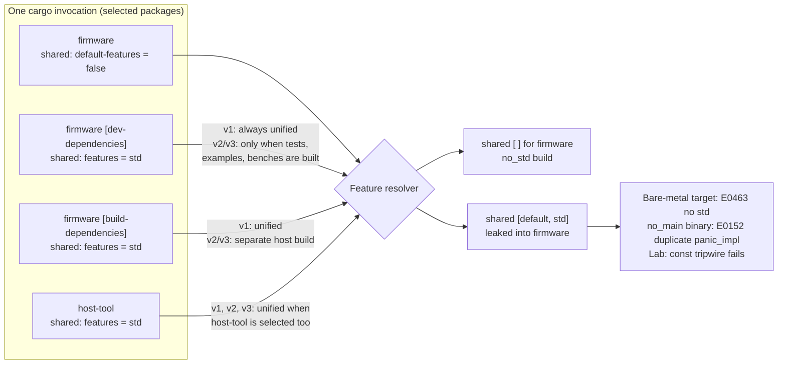

# Drill: Fix an Embedded Workspace Cargo Feature Unification Hazard

> [!summary] Claim:
> Cargo builds each dependency once per build invocation with the union of every feature any selected path asked for, so a `std` feature requested by a host-side test, build script, or sibling binary can land in the library a `no_std` firmware links.
> Resolver "1" unifies across dev-dependencies, build-dependencies, proc-macros, and inactive targets; resolver "2" (and "3", which keeps its feature rules) decouples those three cases but still unifies across every package selected in one `cargo` invocation.
> The leak is silent on the host, because std exists there; it surfaces only when the firmware is built for a bare-metal target or when a compile-time tripwire checks for it.
> The fix is a resolver setting plus a build topology: one `cargo` invocation per firmware artifact, workspace dependencies declared with `default-features = false`, and a CI check that fails when the firmware's dependency closure carries `std`.

The feature system, the two resolution passes, and the workspace model are owned by [[Rust-Cargo-Model-Packages-Targets-Features-and-Workspaces]].
Version selection (which versions of a package the lockfile pins) is owned by [[Dependency-Resolution-SAT-PubGrub-and-MVS]], and its failure drill by [[Drill-Packaging-PubGrub-Conflict-Diagnosis]].
This drill owns the diagnosis and repair of one failure: features from one consumer of a shared crate changing the build that a different consumer gets.

## Scenario

A team keeps three crates in one Cargo workspace:

- `shared`: a frame checksum used everywhere; `#![no_std]` always, with an additive `std` feature (on by default) that links std back in and adds host helpers.
- `firmware`: a `#![no_std]` library for a Cortex-M radio board, which depends on `shared` with `default-features = false`.
- `host-tool`: a desktop binary that depends on `shared` with `features = ["std"]`.

An engineer adds a host unit test to `firmware` that calls the std-only helper `shared::checksum_hex`, and lists `shared` a second time under `[dev-dependencies]` with `features = ["std"]`.
`cargo test -p firmware` passes on every laptop.
The next firmware build for the board fails in `shared`, a crate nobody touched, and the release is blocked.
The workspace root is a virtual manifest that was created years ago and never set `resolver`.



## Reproduction

The lab is `code/07-Packaging-and-Release/cargo_feature_hazard/`.
It needs stable `cargo` 1.84 or newer (for `resolver = "3"`), no network, and no extra targets, because every dependency is a path dependency.
Run it with `bash run.sh`; the recorded output is `expected/darwin-arm64.txt` (cargo 1.99.0, macOS on Apple silicon, 2026-11-15).

```text
cargo_feature_hazard/
  run.sh                 builds a fresh copy of ws/ per scenario, prints derived facts
  ws/
    shared/              #![no_std], features: default = ["std"], std = []
    firmware/            #![no_std] lib with a compile-time tripwire
    host-tool/           binary using shared with features = ["std"]
```

`run.sh` writes the root `Cargo.toml` for each scenario, so the resolver setting is the only difference between scenarios 1, 3, and 5.
It isolates Cargo from the caller with a private `CARGO_HOME`, unsets `RUSTFLAGS` and `CARGO_BUILD_TARGET`, and passes `--offline` to every command.

The two source files that matter:

```rust
// ws/shared/src/lib.rs (excerpt)
#![no_std]

#[cfg(feature = "std")]
extern crate std;

/// True when this build of `shared` was compiled with its `std` feature.
pub const STD_ENABLED: bool = cfg!(feature = "std");
```

```rust
// ws/firmware/src/lib.rs (excerpt)
#![no_std]

#[cfg(any(target_os = "none", firmware_target))]
const _: () = assert!(
    !shared::STD_ENABLED,
    "feature leak: shared was compiled with std for the firmware build"
);
```

`shared` follows the Cargo Book's advice for `no_std` support: the crate is `no_std` unconditionally and a positive `std` feature adds `extern crate std`, rather than a negative `no_std` feature, because features must be additive under unification.
The tripwire is a `const` item, so rustc evaluates the assertion at compile time and a leak becomes a build error on any host.
The lab runs on macOS and Linux hosts where std exists, so it passes `RUSTFLAGS="--cfg firmware_target"` to stand in for `target_os = "none"`; the firmware manifest declares that cfg under `[lints.rust] unexpected_cfgs` so rustc's cfg checking does not warn.
The tripwire is off for host test builds, because those are the builds where `std` is wanted.

The manifest that causes the incident:

```toml
# ws/firmware/Cargo.toml (excerpt)
[dependencies]
shared = { path = "../shared", default-features = false }

[dev-dependencies]
shared = { path = "../shared", features = ["std"] }
```

Listing the same package under `[dependencies]` and `[dev-dependencies]` with different features is legal; the Cargo Book's resolver chapter uses exactly this shape (with `serde`) as its dev-dependency example.

## Observed Symptom

On the board target the failure is in `shared`, not in `firmware`: `extern crate std` cannot be resolved because the bare-metal target ships only `core` (and optionally `alloc`).
That is rustc error E0463, whose error index entry lists "cross-compiling for a target which doesn't have std prepackaged" as a common cause.
This host could not reproduce the bare-metal error: no `thumbv7em-none-eabihf` standard library is installed, and `cargo +nightly build -Zbuild-std=core --offline` stopped with `error: no matching package named rustc-literal-escaper found` because building the standard library from source needs crates from the network.

A second form of the same leak shows up on the host itself, which is why some teams see it in host CI first.
In a one-off manual run (rustc 1.99.0, aarch64-apple-darwin, not part of the lab, so not recorded in its expected file), a `#![no_std]`, `#![no_main]` binary that defines its own `#[panic_handler]` and depends on a crate whose `std` feature was enabled failed with `error[E0152]: found duplicate lang item panic_impl`.
rustc's notes named the two definitions: the first in crate `std`, reached through the dependency, and the second in the local crate.
With the dependency's `std` feature removed, that error disappeared; the host build then stopped at the link step, which is expected for a `no_main` binary built for a hosted target, and is not part of the leak.

In the lab, the tripwire turns the leak into a deterministic error on the host.
Scenario 1 (cargo 1.99.0, darwin-arm64, from `expected/darwin-arm64.txt`):

```text
=== 1. Incident: resolver = "1", dev-dependency enables std ===
shared features for cargo build -p firmware (cargo tree -e normal,build): shared v0.1.0 [default,std]
cargo build -p firmware: FAILED (tripwire: shared has std)
first rustc error line: error[E0080]: evaluation panicked: feature leak: shared was compiled with std for the firmware build
```

Three facts in this output carry the diagnosis:
- The failing build is `cargo build`, which compiles no tests, yet `shared` has `std`: the dev-dependency's features reached a normal build.
- `default` is also on, although `firmware` wrote `default-features = false`: the dev-dependency line did not disable defaults, and unification takes the union.
- Nobody edited `shared` or the firmware's normal dependencies; the change that broke the build was a `[dev-dependencies]` line.

## Progressive Hint Ladder

> [!tip]- Hint 1
> The broken crate is a dependency, and its source did not change.
> Something changed which features it was compiled with.
> Ask Cargo which features `shared` gets in this build, and which edge requested each one.

> [!tip]- Hint 2
> Run `cargo tree -p firmware -e features -i shared` from the workspace root.
> `-i` inverts the tree so each feature of `shared` is listed with the packages that turned it on, and section headers such as `[dev-dependencies]` name the edge kind.
> Then compare with `cargo tree -p firmware -e normal,build -i shared -f '{p} [{f}]'`, which drops dev edges.

> [!tip]- Hint 3
> Find out which feature resolver the workspace uses.
> The root is a virtual manifest without a `resolver` key; read the warning Cargo prints for that case, and recall that the `edition` of member packages does not choose the resolver of a virtual workspace.

> [!tip]- Hint 4
> Resolver "2" stops dev-dependency features from reaching builds that do not compile tests, examples, or benches.
> It does not stop unification between packages selected in the same invocation.
> Check what `cargo build --workspace` and the CI script do after you switch the resolver.

> [!tip]- Hint 5
> Look for the same leak through the other doors: a `[build-dependencies]` entry, a proc-macro, a sibling member in the same `cargo` command, and a `[workspace.dependencies]` entry that leaves default features on.
> For each door, write down which resolver and which Cargo version closes it.

## Model Solution

> [!success]- Solution
> **Step 1: prove which edge enables `std`.**
> The inverted feature graph from scenario 1 (cargo 1.99.0, darwin-arm64, from `expected/darwin-arm64.txt`, absolute paths removed by the lab):
>
> ```text
> inverted feature graph (cargo tree -p firmware -e features -i shared):
>   shared v0.1.0
>   `-- firmware v0.1.0
>       `-- firmware feature "default" (command-line)
>   |-- shared feature "default"
>   |   [dev-dependencies]
>   |   `-- firmware v0.1.0 (*)
>   `-- shared feature "std"
>       [dev-dependencies]
>       `-- firmware v0.1.0 (*)
>       `-- shared feature "default" (*)
> ```
>
> Read it from each feature of `shared` downward: `std` is enabled by `firmware` through a `[dev-dependencies]` edge, and also by `shared`'s own `default` feature, which the same dev edge enabled.
> The normal edge (top branch) requested no feature at all, which is the `default-features = false` line doing its job.
> Under resolver "1", `cargo tree -e normal,build` still reports `[default,std]`, because resolver "1" computes one feature set per package that already includes dev-dependency features; only resolver "2" and later make the edge filter change the feature set.
>
> **Step 2: find the resolver.**
> Scenario 2 of the lab deletes the `resolver` key from the virtual manifest; Cargo 1.99.0 prints:
>
> ```text
> cargo warning: virtual workspace defaulting to `resolver = "1"` despite one or more workspace members being on edition 2021 which implies `resolver = "2"`
> cargo build -p firmware: FAILED (tripwire: shared has std)
> ```
>
> The resolver is a workspace-global setting read only from the root manifest; a virtual manifest has no `package.edition` to infer it from, so it defaults to "1" no matter what editions the members declare.
>
> **Step 3: switch the resolver and check what changed.**
> Add `resolver = "2"` (or `"3"`) to `[workspace]`.
> Scenario 3 (cargo 1.99.0, darwin-arm64):
>
> ```text
> === 3. Fix A: resolver = "2" ===
> shared features, cargo tree -e normal,build (what cargo build sees): shared v0.1.0 []
> shared features, cargo tree default edges (includes dev, what cargo test sees): shared v0.1.0 [default,std]
> cargo build -p firmware: ok
> cargo test -p firmware (host, std helper used by the unit test): ok
>   test result: ok. 1 passed; 0 failed; 0 ignored; 0 measured; 0 filtered out
> ```
>
> The firmware build now gets `shared` with no features, and the host test still gets `std`.
> Note that the plain `cargo tree` (default edges `normal,build,dev`) still shows `[default,std]` under resolver "2": it shows what `cargo test` would build, and the cargo-tree(1) page says `-e normal,build` is the closer approximation of `cargo build`.
>
> **Step 4: close the door resolver "2" leaves open.**
> Scenario 4 keeps resolver "2" and builds more than one package in one invocation:
>
> ```text
> === 4. Remaining hazard under resolver 2: one invocation selects firmware and host-tool ===
> cargo build --workspace: FAILED (tripwire: shared has std)
> cargo build -p firmware -p host-tool: FAILED (tripwire: shared has std)
> shared features, cargo tree --workspace -e normal,build: shared v0.1.0 [default,std]
> separate invocation: cargo build -p firmware: ok
> separate invocation: cargo build -p host-tool: ok
> ```
>
> The Cargo Book's resolver chapter states the rule: when several packages are built in one invocation (`--workspace` or several `-p` flags), the features of their dependencies are unified, and avoiding that requires separate invocations.
> The repair is topological: the firmware is built by its own `cargo build -p firmware --target thumbv7em-none-eabihf` command in CI and in the release script, and `[workspace] default-members` can be set so that a bare `cargo build` at the root does not select `firmware` and `host-tool` together.
> On a real board build, `--workspace --target thumbv7em-none-eabihf` would also try to compile `host-tool` for a target without std, which is one more reason the firmware gets its own invocation.
>
> **Step 5: close the inheritance door.**
> If the workspace centralizes versions in `[workspace.dependencies]`, declare `shared = { path = "shared", default-features = false }` there and let members opt in, `shared = { workspace = true, features = ["std"] }` for `host-tool` and `shared = { workspace = true }` for `firmware`.
> Scenario 7 shows why (cargo 1.99.0, darwin-arm64):
>
> ```text
> === 7. Workspace inheritance: default-features = false on an inherited dependency ===
> firmware edition 2021:
>   shared features: shared v0.1.0 [default,std]
>   cargo build -p firmware: FAILED (tripwire: shared has std)
>   cargo manifest warning: `default-features` is ignored for shared, since `default-features` was not specified for `workspace.dependencies.shared`; overriding workspace `default-features` to false requires Rust 1.99+ and the 2024 edition
> firmware edition 2024:
>   shared features: shared v0.1.0 []
>   cargo build -p firmware: ok
>   cargo manifest warning: none
> fix: workspace dependency declares default-features = false, members opt in to std:
>   shared features for firmware: shared v0.1.0 []
>   shared features for host-tool: shared v0.1.0 [std]
>   cargo build -p firmware: ok
> ```
>
> On an edition 2021 member, `{ workspace = true, default-features = false }` against a workspace entry that leaves defaults on is ignored with only a warning, and `std` (the default) leaks with resolver "2" already in place.
> Cargo 1.99 lets an edition 2024 member override it, so the same line works there; any older Cargo, or any edition before 2024, does not, so declaring `default-features = false` at the workspace level is the form that is correct on every toolchain.
>
> **Step 6: verify and lock it in.**
> - `cargo tree -p firmware -e normal,build -i shared -f '{p} [{f}]' --prefix none --depth 0` prints `shared v0.1.0 []`.
> - `cargo build -p firmware --target thumbv7em-none-eabihf` succeeds in CI; the cross build is the authoritative check because only the real target lacks std.
> - The `const` tripwire (or the equivalent `compile_error!` behind `#[cfg(all(feature = "std", target_os = "none"))]` inside `shared`) stays in the tree so the next leak fails at compile time with a sentence that names the cause.
> - `cargo test -p firmware` still passes on the host, and a separate CI job runs `cargo test -p shared --no-default-features` so the `no_std` code path of `shared` is tested at all.

## The Mechanism Behind Each Door

The Cargo model note owns the full mechanism; this section records only what the drill needs to reason about each leak path.

### Two passes, and why the lockfile does not show features

Cargo resolves twice, per the Cargo Book's resolver chapter.
The first pass builds the graph for `Cargo.lock` as if all features of all workspace members were enabled, so optional dependencies are always resolved and the lockfile does not change when `--features` changes.
The second pass computes the features actually used to compile each package, from the packages and features selected on the command line.
`Cargo.lock` therefore records versions and never features, which is why a feature leak never appears in a lockfile diff and why [[Lockfiles-Vendoring-and-Offline-Mirrors]] cannot detect it.
The second pass is the one this drill is about, and `cargo tree -e features` is its user-visible output.

### Resolver "1": one feature set per package per invocation

Resolver "1" unifies features for a package "no matter where it is specified" (Cargo Book, resolver chapter).
A dev-dependency, a build-dependency, a proc-macro's dependency, and a `[target.'cfg(windows)'.dependencies]` entry for a target not being built all contribute to the same set.
Scenario 6 measures the build-dependency door: with a `build.rs` that uses `shared` with `std`, resolver "1" compiles `shared` once, with `[default,std]`, and the firmware breaks.

### Resolver "2": three decouplings, nothing more

RFC 2957 (cargo-features2) designed the new feature resolver and Cargo 1.51.0 (2021-03-25) stabilized it as `resolver = "2"`.
It changes exactly three cases (Cargo Book, features chapter):
1. Features on target-specific dependencies for targets not currently being built are ignored.
2. Build-dependencies and proc-macros do not share features with normal dependencies.
3. Dev-dependencies do not activate features unless a Cargo target that needs them is being built, such as tests or examples; `cargo test` and `cargo build --all-targets` unify them.

Two scoping rules matter for workspaces.
The dev-dependency rule applies only to workspace members, because "dev-dependencies in dependencies are always ignored".
With `--target`, build-dependencies are always compiled separately from normal dependencies, so under resolver "2" the duplicate build that decoupling costs exists anyway (features chapter).
Separate compilation is not separate features: under resolver "1" the host and target copies still get the unified feature set, so the build-dependency leak survives `--target`.
A one-off manual run (cargo 1.99.0, darwin-arm64, scenario 6's workspace with an explicit `--target aarch64-apple-darwin`, not part of the lab) confirmed it: resolver "1" failed the tripwire with `[default,std]` on `shared`, and resolver "2" built it with `[]`.

Decoupling has a price: a package requested with different feature sets by host and target edges is compiled twice.
Scenario 6 measures it (cargo 1.99.0, darwin-arm64):

```text
=== 6. Build-dependency path: firmware/build.rs uses shared with std ===
resolver 1:
  cargo build -p firmware: FAILED (tripwire: shared has std)
  shared built with features [default,std]
  distinct shared compilations: 1
resolver 2:
  cargo build -p firmware: ok
  shared built with features []
  shared built with features [default,std]
  distinct shared compilations: 2
```

The lab counts distinct `compiler-artifact` messages for the `shared` library in `cargo build --message-format=json`, keyed by feature list and output file names.
The Cargo Book recommends `cargo tree --duplicates` to find such double builds, and adding the missing features to one declaration when the duplicate is not actually needed; for a `no_std` firmware the duplicate is the point.

Resolver "2" also changes command-line flags: `--features` can name features of any selected package, and `--no-default-features` applies to all workspace members, where resolver "1" applied both only to the package in the current directory.

### Resolver "3": the same feature rules, a different version policy

Resolver "3" was stabilized in Rust 1.84.0 (2025-01-09) and is the default for `edition = "2024"`, which was stabilized in Rust 1.85.0 (2025-02-20).
Its only change from "2", per the Cargo Book, is the default of `resolver.incompatible-rust-versions`, from `allow` to `fallback`: version selection prefers dependency versions whose `rust-version` the workspace can compile.
That is a first-pass (version) behavior, owned by [[Rust-SemVer-Checks-MSRV-and-Editions]]; the feature pass is unchanged, and scenario 5 confirms it:

```text
=== 5. resolver = "3" keeps the resolver 2 feature rules ===
shared features for cargo build -p firmware: shared v0.1.0 []
cargo build -p firmware: ok
cargo build --workspace: FAILED (tripwire: shared has std)
```

### How the resolver is chosen

- The resolver is a global setting for the workspace; only the top-level manifest's value counts, and values in dependencies are ignored.
- A root package with `edition = "2021"` implies "2", and `edition = "2024"` implies "3" (Rust Edition Guide).
- A virtual workspace has no edition, so it must set `resolver` in `[workspace]`; without it Cargo uses "1" and prints the warning in scenario 2.
- Moving a root package to edition 2021 with `cargo fix --edition` prints a report of dependencies that will be built with fewer features, which is the inverse of this drill: a build that only worked because of a leak can break when the leak is closed.

### Selected-package unification, and the unstable knob

The feature pass unifies across every package selected for the invocation, under every resolver version.
This is why `cargo build --workspace` and `cargo build -p firmware -p host-tool` both fail in scenario 4.
RFC 3692 (feature-unification, tracking issue rust-lang/cargo#14774) adds `resolver.feature-unification` with three values: `selected` (the current behavior and default), `workspace` (unify across all members regardless of selection), and `package` (unify per package, accepting duplicate builds).
It is unstable as of Cargo 1.99 (as of 2026-11, Both): the config is ignored unless `-Z feature-unification` is passed on a nightly toolchain.
In a one-off manual run on `cargo 1.101.0-nightly (cad07cf8e 2026-10-23)` (darwin-arm64, not part of the lab), with `CARGO_RESOLVER_FEATURE_UNIFICATION` set and `-Zfeature-unification`:
- `selected`: `cargo build --workspace` failed the tripwire, as on stable.
- `package`: `cargo build --workspace` succeeded.
- `workspace`: even `cargo build -p firmware` failed the tripwire, because `host-tool`'s `std` request was merged in without `host-tool` being selected.
RFC 3692 lists this last behavior as a drawback: a `no_std` package in a workspace with regular packages may receive dependencies built with `std`.
So `workspace` mode, which build-speed teams want, is exactly wrong for a mixed embedded workspace.

### Workspace inheritance and `default-features`

`[workspace.dependencies]` (Cargo 1.64) lets members inherit a dependency, adding `features` (additive) and, under rules that changed over time, `default-features`.
- Cargo 1.69 changed one direction: when the workspace entry sets `default-features = false` and the member sets `default-features = true`, default features are enabled.
- The other direction, a member writing `default-features = false` against a workspace entry that leaves defaults on, was ignored with a warning; the Rust 2024 edition guide page "Cargo: Reject unused inherited default-features" made it an error on edition 2024.
- The Rust 1.99.0 release notes (2026-10-01) reverse that for edition 2024: the member's `default-features = false` now overrides the workspace entry (RFC 3945, rust-lang/cargo#17126), and earlier editions still ignore it with a warning, which is what scenario 7 recorded.
The edition guide page shipped with 1.99.0 still describes the error, so trust the release notes and the Cargo Book (the workspaces and specifying-dependencies chapters both say "requires Rust 1.99+"), and expect older toolchains in the fleet to behave differently.

## Commands and Numbers to Know

| Item | Platform | Value (as of 2026-11) | Why it matters |
| :--- | :--- | :--- | :--- |
| `cargo tree -e features -i shared -p firmware` | Both | Inverted feature graph with edge-kind headers | Names the edge that enabled each feature. |
| `cargo tree -e normal,build -f '{p} [{f}]'` | Both | Features as `cargo build` would use them (resolver 2+) | Default edges `normal,build,dev` show the `cargo test` view instead. |
| `cargo tree --duplicates` / `-d` | Both | Packages built in more than one version | Use `--target all` and `--workspace` for the whole picture. |
| `cargo tree --target all` | Both | Includes every platform-specific dependency | The default is the host triple only. |
| `resolver = "1"` | Both | Default for virtual workspaces and pre-2021 root packages | Unifies dev, build, proc-macro, and inactive-target features. |
| `resolver = "2"` | Both | Stable since Rust 1.51.0; implied by edition 2021 | Decouples those three cases only. |
| `resolver = "3"` | Both | Stable since Rust 1.84.0; implied by edition 2024 | Same feature rules as "2"; MSRV-aware version fallback. |
| `resolver.feature-unification` | Both | Unstable; `selected` (default), `workspace`, `package`; needs `-Z feature-unification` | `package` fixes `--workspace` builds; `workspace` breaks `no_std` members. |
| Inherited `default-features = false` override | Both | Edition 2024 members on Cargo 1.99+ only | Earlier editions and toolchains ignore it with a warning. |
| `shared` compilations with a std build-dependency | macOS | 1 under resolver "1", 2 under resolver "2" (lab, cargo 1.99.0) | The cost of decoupling host and target features. |
| E0463 | Both | "can't find crate" for `std` on a target without std | The bare-metal symptom of a leaked `std` feature. |
| E0152 | Both | Duplicate lang item `panic_impl` | The host symptom when a `no_std` binary with its own panic handler links std. |

## Pitfalls

> [!warning] Reading the wrong `cargo tree`
> Plain `cargo tree` includes dev edges, so under resolver "2" it shows `std` on `shared` even when `cargo build -p firmware` would not use it.
> Use `-e normal,build` for the build view and `-e features -i shared` for the reason, and pass `-p firmware` because `-i` otherwise shows only the tree of the member in the current directory.

> [!warning] Fixing the resolver and stopping there
> Resolver "2" closes the dev, build, and proc-macro doors but not the sibling-member door.
> A Makefile or CI step that runs `cargo build --workspace` or `cargo clippy --workspace` reintroduces the leak, and a `cargo check --workspace` that passes says nothing about the firmware's own feature set.

> [!warning] Tests that test a different build
> Under resolver "2", `cargo test -p firmware` compiles `shared` with `std` because the dev-dependency asks for it.
> The host tests then exercise code paths and `cfg` branches the firmware never ships; run `cargo test -p shared --no-default-features` and build the firmware for its real target in CI.

> [!warning] Negative features
> A `no_std` feature that removes std is not additive: any other consumer that does not ask for it gets std, and two consumers can request contradictory things.
> Keep `std` positive, and if two features truly cannot coexist, guard them with `compile_error!` as the Cargo Book shows for mutually exclusive features.

> [!warning] Workspace-hack crates
> A workspace-hack crate (generated by `cargo hakari`) makes every member depend on one crate that enables the union of features, so each dependency is built with exactly one feature set and local builds stop recompiling.
> That is maximal unification by design: a firmware member that depends on it gets every `std` feature its siblings use, so the firmware must be kept out of it.

> [!warning] Trusting edition-dependent manifest behavior
> The same `default-features = false` line enables or ignores defaults depending on the member's edition and on whether Cargo is 1.99 or older.
> In a fleet with mixed toolchains, write the form that is correct everywhere: `default-features = false` on the workspace entry.

## At Scale

The leak is a property of build topology, so at scale the fix belongs to the build platform, not to each crate author.

- **One invocation per artifact class.** Build each `no_std` firmware image with its own `cargo build -p <fw> --target <triple>`; never let a monorepo-wide `--workspace` command produce release artifacts for constrained targets.
  Use `default-members` so a bare `cargo build` at the root selects only host members.
- **Separate workspaces when targets diverge.** When firmware and host tooling share little besides a few `no_std` crates, two workspaces (or `exclude` for the firmware) give each its own resolver run, lockfile, and profile; the cost is two lockfiles that can drift apart, which [[Lockfiles-Vendoring-and-Offline-Mirrors]] covers.
- **Feature-matrix CI for shared crates.** `cargo hack --each-feature` and `--feature-powerset` (with `--depth` to bound the combinations) build every feature combination of a crate, and `--no-dev-deps` removes dev-dependencies while it runs, a workaround its README gives for dev-dependencies leaking into normal builds (it cites rust-lang/cargo#4866, "Build-dependencies and dependencies should not have features unified").
  Bound it to the `no_std` crates that matter; a full powerset over many features is exponential.
- **Make the invariant executable.** A `const` assertion or `compile_error!` in the firmware or in `shared`, plus a CI job that runs `cargo tree -p <fw> -e normal,build --target <triple> -f '{p} [{f}]'` and fails if any package in the closure lists `std`, turns review-time knowledge into a gate.
- **Track the unstable knob, do not depend on it.** `resolver.feature-unification = "package"` would make `--workspace` safe for mixed workspaces, but it is nightly-only and `workspace` mode does the opposite; pin the decision in a decision record ([[Packaging-Decision-Records]]) and revisit when it stabilizes.
- **Dependency hygiene interacts.** Policy tools in [[Rust-Dependency-Hygiene-cargo-deny-cargo-audit-and-cargo-vet]] evaluate the resolved graph; run them with the firmware's `--target` so a `std`-only dependency pulled in by a feature shows up where it matters.

Decision rules:
- Mixed `std` and `no_std` members in one workspace: resolver "2" or "3" explicitly in `[workspace]`, firmware built alone, workspace dependencies with `default-features = false`.
- Pure host workspace that wants fewer rebuilds: unification is a feature, and `cargo hakari` or the future `workspace` mode is reasonable.
- Library published to crates.io with a `std` feature: test `--no-default-features` on a bare-metal target in CI, because downstream firmware will hit any leak first.

## Practice Drill

> [!tip] Practice Drill: Open and close each door
> Copy `code/07-Packaging-and-Release/cargo_feature_hazard/` to a scratch directory, run `bash run.sh`, and confirm it matches `expected/darwin-arm64.txt` (only darwin-arm64 has been recorded; the lab prints derived facts and no paths, so a Linux host with the same Cargo version should print the same text, but that is not yet verified).
> Predict each result before you run it.
> 1. In scenario 3, change `cargo build -p firmware` to `cargo build -p firmware --all-targets`: the tripwire fires, because building the unit test target unifies the dev-dependency features into the library build.
> 2. Add `[target.'cfg(windows)'.dependencies] shared = { path = "../shared", features = ["std"] }` to `firmware` and compare resolvers "1" and "2" on macOS or Linux.
> 3. Add `default-members = ["firmware"]` to the resolver "2" workspace and run a bare `cargo build` at the root; then run it with `default-members = ["firmware", "host-tool"]`.
> 4. With a nightly toolchain, repeat scenario 4 with `CARGO_RESOLVER_FEATURE_UNIFICATION=package cargo +nightly build -Zfeature-unification --workspace`, then with `workspace`.
> 5. If you have the target installed (`rustup target add thumbv7em-none-eabihf`), remove the tripwire and build scenario 1 with `--target thumbv7em-none-eabihf` to see the real E0463.
> Target time: 20 minutes.
> Then diagnose a version conflict instead of a feature conflict in [[Drill-Packaging-PubGrub-Conflict-Diagnosis]].

## Core Takeaway

Cargo features are a per-invocation union, not a per-consumer request, so every crate's feature set is decided by the widest consumer in the same build.
Resolver "2" narrowed the set of consumers that count (no inactive targets, no host builds, no dev builds unless tests are built), but it did not make the unit of unification smaller than one `cargo` invocation.
A `no_std` artifact is safe only when its build invocation selects nothing that wants `std`, its manifests declare the absence of defaults where they are defined, and a compile-time or CI check fails the moment that stops being true.
The owning concept is [[Rust-Cargo-Model-Packages-Targets-Features-and-Workspaces]]; the build-script side of host features is in [[Rust-Build-Scripts-and-Sys-Crates]], and cross-target release builds are in [[Rust-Binary-Distribution-with-dist-and-Cross-Compilation]].

## Interview Questions

> [!question] L5
> What does Cargo do when two crates in one build depend on `serde`, one with `features = ["derive"]` and one with `default-features = false`?
>
> > [!success]- Answer
> > It builds `serde` once with the union: default features plus `derive`.
> > `default-features = false` only means "this declaration does not ask for defaults"; any other declaration that does ask for them turns them on.
> > This is why features must be additive and why `no_std` support uses a positive `std` feature.

> [!question] L5
> A virtual workspace whose members are all `edition = "2021"` uses which feature resolver, and how do you check?
>
> > [!success]- Answer
> > Resolver "1": the resolver comes from the root manifest only, and a virtual manifest has no edition to imply one.
> > Cargo prints `virtual workspace defaulting to resolver = "1" despite one or more workspace members being on edition 2021 which implies resolver = "2"`.
> > Set `resolver = "2"` or `"3"` in `[workspace]` explicitly.

> [!question] L5
> Predict the output.
> Under `resolver = "2"`, `firmware` depends on `shared` with `default-features = false` and lists `shared` with `features = ["std"]` in `[dev-dependencies]`.
> What features does `shared` get for `cargo build -p firmware`, for `cargo test -p firmware`, and what does plain `cargo tree -p firmware -i shared -f '{p} [{f}]'` print?
>
> > [!success]- Answer
> > `cargo build -p firmware`: none, `shared v0.1.0 []`, because no target that needs dev-dependencies is built.
> > `cargo test -p firmware`: `[default,std]`, because the test target needs the dev-dependency and its features are unified into that invocation, including the library compiled for the test.
> > Plain `cargo tree` uses edges `normal,build,dev` by default, so it prints `[default,std]`, the `cargo test` view; `-e normal,build` prints `[]`.
> > The lab's scenario 3 records exactly these three results.

> [!question] L6
> Debug this.
> CI runs `cargo build --workspace --release` and then flashes `target/thumbv7em-none-eabihf/release/firmware`.
> After a teammate adds a desktop simulator crate to the workspace, the firmware build fails with E0463 in a dependency, while `cargo build -p firmware --target thumbv7em-none-eabihf` on a laptop works.
> The workspace already has `resolver = "2"`.
> What happened and what do you change?
>
> > [!success]- Answer
> > Selected-package unification: `--workspace` selects the firmware and the simulator in one invocation, the simulator enables `std` on a shared dependency, and the union is used for every build of it in that invocation.
> > Resolver "2" does not decouple sibling members; the Cargo Book says to use separate invocations.
> > The laptop command selects only the firmware, which is why it works.
> > Change CI to build the firmware with its own `cargo build -p firmware --target thumbv7em-none-eabihf --release`, build host members separately, set `default-members` so a bare build cannot mix them, and add a tripwire or a `cargo tree` gate that fails if the firmware closure has `std`.
> > With `--workspace --target thumbv7em-none-eabihf`, the simulator itself would also fail to compile for the bare-metal target, which is a second reason to split.

> [!question] L6
> Why does resolver "2" compile some crates twice, and when is that a bug rather than the intended behavior?
>
> > [!success]- Answer
> > It keeps host-side (build-dependency and proc-macro) features separate from target-side features, so a crate requested with `std` by a build script and without it by the library is compiled once for each feature set; the lab measured 2 compilations of `shared` under resolver "2" against 1 under resolver "1".
> > For a `no_std` target that duplicate is the point.
> > For a pure host project it is wasted build time when the extra features are harmless; `cargo tree --duplicates` finds them, and adding the features to one declaration makes the sets equal so Cargo builds once.
> > When cross-compiling with `--target`, build-dependencies are always compiled separately from normal dependencies, so under resolver "2" the duplicate exists anyway; under resolver "1" both copies still get the unified feature set, so `--target` alone does not stop the leak.

> [!question] L6
> A member writes `shared = { workspace = true, default-features = false }`, and the root has `[workspace.dependencies] shared = { path = "shared" }`.
> Does the member get `shared`'s default features?
>
> > [!success]- Answer
> > It depends on the member's edition and the Cargo version.
> > On edition 2021 (and with any Cargo before 1.99 on edition 2024 per the edition guide, where it was an error), the member's `default-features = false` does not take effect: Cargo 1.99.0 warns that it is ignored and defaults are enabled, which the lab recorded as `[default,std]`.
> > On Cargo 1.99 with an edition 2024 member, the override is honored (Rust 1.99.0 release notes, RFC 3945).
> > The portable form is `default-features = false` on the workspace entry, with members adding `features = ["std"]` where they need it.

> [!question] L6
> Why does a leaked `std` feature produce no error on the developer's laptop, and how do you make it fail early?
>
> > [!success]- Answer
> > The host target ships std, so `extern crate std` in the dependency resolves and everything links; the leak is a wrong build, not a broken one.
> > It fails only for a bare-metal target (E0463) or for a `no_std` binary that defines its own `#[panic_handler]` (E0152, duplicate `panic_impl`).
> > Make it fail early with a `const` assertion on a `pub const STD_ENABLED: bool = cfg!(feature = "std")` exported by the shared crate, gated on `target_os = "none"`, or with `compile_error!` in the shared crate under `cfg(all(feature = "std", target_os = "none"))`, and with a CI cross build of the firmware alone.

> [!question] L7
> Your organization wants `resolver.feature-unification = "workspace"` to cut rebuild time in a 400-crate monorepo that includes 12 firmware crates.
> What do you recommend?
>
> > [!success]- Answer
> > `workspace` mode merges features across all members even when only one is selected, so every firmware build would inherit every `std` feature any host crate asks for; RFC 3692 names this as a drawback, and a manual nightly run of the lab reproduced it (`cargo build -p firmware` failed the tripwire).
> > It is also unstable as of Cargo 1.99 and needs `-Z feature-unification`.
> > Recommend `workspace`-style unification (or `cargo hakari`) only for a host-only workspace, and move the firmware crates and their `no_std` dependencies into a separate workspace or exclude them from the hack crate, with their own CI invocations.
> > If the mode stabilizes, `package` mode is the one that fits mixed workspaces, at the cost of duplicate builds.

> [!question] L7
> Design CI gates that guarantee no `no_std` artifact in a mixed workspace ever links std, without testing every feature combination.
>
> > [!success]- Answer
> > 1. One cargo invocation per firmware artifact with its real `--target`; the cross build is the authoritative test.
> > 2. A graph gate: `cargo tree -p <fw> --target <triple> -e normal,build -f '{p} [{f}]' --prefix none` and fail if any package in the closure lists `std` (or an allowlist-violating feature).
> > 3. A compile-time tripwire in the firmware or the shared crates so a local build fails with a sentence that names the leak.
> > 4. For each shared `no_std` crate, `cargo hack --each-feature --no-dev-deps --target <triple>` to prove each feature compiles alone, with the powerset bounded by `--depth`.
> > 5. A lint on manifests: virtual roots must set `resolver`, and `[workspace.dependencies]` entries for `no_std` crates must set `default-features = false`.
> > This is linear in the number of firmware artifacts and shared crates, not exponential in features.

> [!question] L8+
> Cargo chose global unification per invocation instead of per-consumer feature sets.
> Why, and what would per-consumer resolution cost?
>
> > [!success]- Answer
> > Unification gives one compiled copy of each package per feature set in a build, which keeps types identical across the graph: if two crates pass a `shared::Frame` to each other, they must see the same compilation of `shared`, or the types are distinct and the program does not compile.
> > Per-consumer feature sets would compile a package once per distinct request, multiplying build time and binary size, and would split types and statics across copies.
> > Resolver "2" takes per-consumer resolution only where the copies never meet: host artifacts (build scripts, proc-macros) run in the compiler, and dev-only and inactive-target edges are not linked into the artifact being built.
> > RFC 3692's `package` mode extends that to workspace members because separate members are separate final artifacts; within one artifact's graph, unification remains necessary, so features must stay additive.

## Further Reading

- The Cargo Book, Features, https://doc.rust-lang.org/cargo/reference/features.html.
  Feature unification, why features must be additive, the `std` pattern for `no_std` crates, and the resolver "2" summary.
- The Cargo Book, Dependency Resolution, https://doc.rust-lang.org/cargo/reference/resolver.html.
  The two resolution passes, selected-package unification, the exact resolver "2" rules, and resolver versions.
- The Cargo Book, Workspaces, https://doc.rust-lang.org/cargo/reference/workspaces.html.
  Why a virtual workspace must set `resolver`, `default-members`, and the inherited `default-features` rules.
- cargo-tree(1), https://doc.rust-lang.org/cargo/commands/cargo-tree.html.
  Edge kinds, `-i`, `-e features`, and the warning that `cargo tree` approximates rather than replays a build.
- RFC 2957, cargo-features2, https://rust-lang.github.io/rfcs/2957-cargo-features2.html.
  The design of resolver "2", the issues it fixed, and its stated drawback of building dependencies more than once.
- RFC 3692, feature-unification, https://rust-lang.github.io/rfcs/3692-feature-unification.html.
  The `selected`, `workspace`, and `package` modes and why `workspace` endangers `no_std` members.
- Announcing Rust 1.51.0, https://blog.rust-lang.org/2021/03/25/Rust-1.51.0/.
  The release that stabilized the new resolver, with the `no_std` motivation in the announcement.
- The Rust Edition Guide, Rust 2021 default resolver and Rust 2024 resolver pages, https://doc.rust-lang.org/edition-guide/.
  How editions imply resolver versions, and the `cargo fix --edition` feature-change report.
- Rust 1.99.0 release notes, https://doc.rust-lang.org/releases.html.
  The edition 2024 override of inherited `default-features`.
- cargo-hack README, https://github.com/taiki-e/cargo-hack.
  Feature-matrix testing and `--no-dev-deps`.
- cargo-hakari documentation, https://docs.rs/cargo-hakari/latest/cargo_hakari/.
  Workspace-hack crates, the opposite trade-off, and why firmware must stay out of them.

## Related

- Prerequisites: [[Rust-Cargo-Model-Packages-Targets-Features-and-Workspaces]]
- Next: [[Drill-Packaging-PubGrub-Conflict-Diagnosis]]
- See also: [[Rust-Build-Scripts-and-Sys-Crates]], [[Rust-SemVer-Checks-MSRV-and-Editions]], [[Dependency-Resolution-SAT-PubGrub-and-MVS]]
- Lab: `code/07-Packaging-and-Release/cargo_feature_hazard/`
