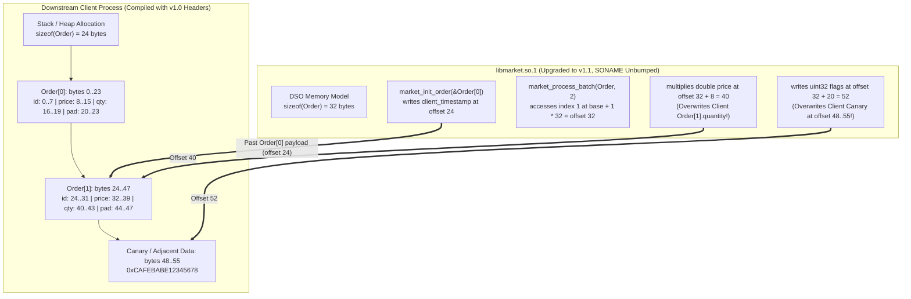

# Drill: Triage a Silent Memory Corruption ABI Break Across Shared Libraries

> [!summary] Claim:
> A dynamic shared library upgrade that modifies a public data structure without bumping the library SONAME is completely invisible to the dynamic linker (`ld.so`), which checks only symbol names and version tags.
> Downstream calling applications allocate stack frames, heap buffers, and array indexing strides using compile-time constants frozen when the client was built.
> When the upgraded shared library writes to the enlarged structure, it writes past the client's allocated bounds, causing silent memory corruption across adjacent stack variables, array elements, and heap allocator chunk headers.
> This drill reproduces silent memory corruption caused by an unbumped SONAME struct enlargement, isolates the failure using GDB DWARF inspection (`ptype /o`; `pahole` is described but not run), and repairs the interface via GNU symbol versioning and the PImpl idiom.

The fundamental mechanics of ELF dynamic linking, symbol visibility, and SONAME versioning are owned by [[Cpp-ABI-Stability-Symbol-Visibility-and-SONAME]].
Zero-downtime library migrations and dual-package strategies are owned by [[Execute-Zero-Downtime-Shared-Library-SONAME-Migration]].
Diamond dependency ABI conflicts and symbol collisions are owned by [[Diamond-Dependency-and-Incompatible-ABI-Mitigation]].
GNU C library symbol versioning internals are owned by [[Cpp-Glibc-Symbol-Versioning-and-Portable-Linux-Binaries]].
This drill owns the hands-on triage scenario: finding, diagnosing, and repairing a silent memory corruption defect caused by an ABI break across dynamic library boundaries.



## Reproduction

The reproducible lab is located in `code/07-Packaging-and-Release/cpp_abi_break/`.

```bash
cd code/07-Packaging-and-Release/cpp_abi_break
bash run.sh
```

The lab requires a standard Linux ELF toolchain (`gcc`, `ld`, `gdb`, `readelf`, `binutils`), which is declared via `# requires: linux`.
It runs self-contained without requiring root permissions, external network connectivity, or secondary package managers.

| File | Role |
| :--- | :--- |
| `v1/market.h` | Baseline public API header defining `struct Order` with a 24-byte layout on 64-bit systems. |
| `v1/market.c` | Implementation of `market_init_order` and `market_process_batch` compiled into `libmarket_v1.so` (SONAME `libmarket.so.1`). |
| `v2_broken/market.h` | Broken header where a developer appended `uint32_t flags` and `uint64_t client_timestamp`, expanding the struct to 32 bytes. |
| `v2_broken/market.c` | Upgraded implementation compiled into `libmarket_v2_broken.so` retaining the unbumped SONAME `libmarket.so.1`. |
| `v2_versioned/market.h` | Versioned API header defining modern v2 structures while supporting backward-compatible symbol versioning. |
| `v2_versioned/market.c` | Implementation with `.symver` directives binding `market_init_order_v1` to `MARKET_1.0` and `market_init_order_v2` to `MARKET_2.0`. |
| `v2_versioned/market.map` | GNU linker version script exporting version nodes `MARKET_1.0` and `MARKET_2.0`. |
| `pimpl/market_pimpl.h` | Opaque handle interface (`typedef struct MarketOrder* MarketOrderHandle`) isolating internal layout from client binaries. |
| `pimpl/market_pimpl.c` | Implementation encapsulating allocation and fields inside the shared library boundary. |
| `app/app.c` | Downstream client application compiled exclusively against `v1/market.h`, testing stack arrays, adjacent canaries, and heap boundaries. |
| `app_pimpl/app_pimpl.c` | Client application demonstrating zero layout coupling using the opaque handle API. |
| `run.sh` | Orchestration script that builds all shared objects, runs dynamic execution matrix scenarios, and traces layouts with GDB. |

The root of this defect is the false assumption that appending new fields to a structure is backward compatible because no existing field names or function signatures changed.
When `app` links against `v1/market.h`, the compiler emits hardcoded displacement constants:
Stack frame offsets, struct member offsets, and array indexing strides (`stride = 24`) are embedded directly into machine instructions.
When `libmarket.so` is replaced on the host by `v2_broken` without bumping the SONAME from `libmarket.so.1` to `libmarket.so.2`, the dynamic linker loads the new library without diagnostic or warning.
The client executes with a 24-byte mental model of `struct Order`, while the library executes with a 32-byte mental model.

## Observed Symptom

The production ticket reports subtle, erratic anomalies following a routine shared library update:
- Downstream trading order routers report nonsensical order quantities (`qty: 42949693` instead of `20`) during batch order execution.
- Security tokens and adjacent stack canaries placed immediately after order structures are silently overwritten with values like `0x00000002` or epoch timestamps.
- Long-running processes experience non-deterministic crashes (`SIGABRT`, exit code 134) inside glibc heap allocation routines (messages such as `double free or corruption (out)` or `free(): invalid next size (normal)`, depending on which free path runs).
- No compilation error occurred, no link-time error occurred, and `ldd` verifies that all dynamic dependencies resolve successfully.

The recorded test execution reproduces the corrupted quantity, the stale price, and both canary overwrites (linux-aarch64, Ubuntu 24.04, GCC 13.3.0, GDB 15.1, binutils 2.42, glibc 2.39, Linux kernel 7.2.12, recorded 2026-11-15; from `expected/linux-aarch64.txt`).
The lab does not reproduce the `SIGABRT` clause: its heap canary sits inside the client's own 32-byte allocation, so no allocator metadata is touched.
A separate verifier probe in the same container did reproduce it: after the v1.1 `market_init_order` overran a `malloc(24)` block, the next chunk's size word read `0x6736e1d0`, freeing the overrun block returned normally (it went to the tcache, which does not inspect the neighbour), and freeing the neighbour aborted with `double free or corruption (out)` and exit status 134.

```text
=== 1. Compile Shared Libraries and Downstream Application ===
[build] libmarket.so.1 (v1.0), libmarket.so.1 (v1.1 broken), and app successfully compiled

=== 2. Scenario A: Legacy App running against libmarket v1.0 ===
[app runtime] sizeof(struct Order): 24
[app runtime] items[0] id=1001 price=150.25 qty=10
[app runtime] items[1] id=1002 price=250.50 qty=20
[app runtime] Batch canary before process: VALID
[app runtime] items[0] price after process: 151.75
[app runtime] items[1] price after process: 253.00
[app runtime] items[1] qty after process:   20
[app runtime] Batch canary after process:  UNTOUCHED
[app runtime] Heap boundary canary after init: UNTOUCHED

=== 3. Scenario B: Legacy App running against unbumped libmarket v1.1 (ABI Break) ===
[app runtime] sizeof(struct Order): 24
[app runtime] items[0] id=1001 price=150.25 qty=10
[app runtime] items[1] id=1002 price=250.50 qty=20
[app runtime] Batch canary before process: CORRUPTED
[app runtime] items[0] price after process: 151.75
[app runtime] items[1] price after process: 250.50
[app runtime] items[1] qty after process:   42949693
[app runtime] Batch canary after process:  CORRUPTED
[app runtime] Heap boundary canary after init: CORRUPTED
```

Notice the critical mutations in Scenario B:
`items[1]` quantity mutated from `20` into `42949693`.
`items[1]` price remained `250.50` instead of receiving its intended 1% markup to `253.00`.
Both the stack batch canary and the heap boundary canary were corrupted.
Yet the application did not trigger a hardware segmentation fault (`SIGSEGV`) because the memory accessed remained within the process's allocated virtual address space.

## Progressive Hint Ladder

Work from the observable memory corruption symptom toward the dynamic linker boundary before looking at the implementation code.

> [!tip]- Hint 1: Check what the dynamic linker verifies at process initialization
> Inspect dynamic dependencies with `readelf -d build/app` and `readelf -d build/libmarket_v1.so`.
> Look at the `DT_NEEDED` and `DT_SONAME` dynamic array tags.
> The dynamic linker matches the string `libmarket.so.1` against available shared libraries in `LD_LIBRARY_PATH` and the system cache.
> Does the dynamic linker verify structure sizes, data offsets, or argument counts when resolving dynamic symbols?

> [!tip]- Hint 2: Measure the size mismatch across translation boundaries
> Print the size of `struct Order` as evaluated by the application: `sizeof(struct Order) == 24`.
> Check the size of `struct Order` inside `v2_broken/market.h`: `sizeof(struct Order) == 32`.
> When `app.c` allocates an array `struct Order items[2]`, how many total bytes are allocated on the stack?
> When `market_process_batch` in `libmarket.so` indexes `items[1]`, what formula does the compiled library code use to compute the address of index 1?

> [!tip]- Hint 3: Use GDB DWARF inspection (`ptype /o`) to expose member offsets and padding holes
> Launch GDB against both libraries to inspect the debugging information emitted by the compiler:
> `gdb -batch -q -ex "file libmarket_v1.so" -ex "ptype /o struct Order"`
> `gdb -batch -q -ex "file libmarket_v2_broken.so" -ex "ptype /o struct Order"`
> Notice where the 4-byte tail padding exists in v1.0 (GDB 15.1 prints it as `/* XXX  4-byte padding   */`; the lab's `grep` filter drops that line) and where the new fields `flags` and `client_timestamp` were inserted in v1.1.

> [!tip]- Hint 4: Trace the memory address computation for the corrupted quantity
> In `app.c`, `items` is located at base offset 0.
> `items[0]` spans bytes 0 to 23.
> `items[1]` spans bytes 24 to 47, with `items[1].quantity` located at bytes 40 to 43.
> In `libmarket_v2_broken.so`, `market_process_batch` computes `orders[1]` as `orders + 1 * 32 = orders + 32`.
> It reads an 8-byte `double` from offset `32 + 8 = 40`, multiplies it by 1.01, and writes it back to offset 40.
> Bytes 40..47 hold the caller's `items[1].quantity` (20) and the 4 bytes that v1.1's `market_init_order` wrote as `flags` (1).
> What `double` does that bit pattern decode to, and what integer is left in bytes 40..43 after the read-modify-write?

> [!tip]- Hint 5: Trace heap metadata corruption under glibc ptmalloc
> When `malloc(24)` is called on 64-bit glibc, `request2size(24) = (24 + 8 + 15) & ~15 = 32`, so the allocator carves a 32-byte chunk.
> The user pointer is `chunk + 16`; the 24 usable bytes run to `chunk + 40`, and the last 8 of them overlap the next chunk's `mchunk_prev_size` field, which is only meaningful while this chunk is free.
> The next chunk's `mchunk_size` field (with its `PREV_INUSE` bit) therefore starts exactly at `user_ptr + 24`.
> When `market_init_order` writes an 8-byte `client_timestamp` at offset 24 of the pointer, what field in the heap allocator does it overwrite?
> Why does the abort happen later, at a `free()` of a different block, and why does the message vary between runs?

> [!tip]- Hint 6: Design the repair without requiring downstream client recompilation
> To fix the library without breaking existing callers, you must provide binary compatibility for callers expecting the 24-byte layout while exposing the 32-byte layout to new callers.
> Research GNU symbol versioning: how do the `.symver` assembler directive and the linker `--version-script` map multiple function implementations to the same symbol name?
> For future interfaces, how does the PImpl (Pointer to Implementation) idiom or opaque handle pattern prevent structure size changes from leaking across shared library boundaries?

## Model Solution

> [!success]- Solution
> **Diagnosis.**
> The root cause is a silent Application Binary Interface (ABI) break caused by adding member variables to an exposed C/C++ struct in a dynamic library without incrementing the library's `SONAME`.
>
> | # | Defect Factor | Layer | Mechanism | Manifested Symptom | Remediation |
> | :--- | :--- | :--- | :--- | :--- | :--- |
> | 1 | Unbumped SONAME | Packaging / ELF | Library maintained `libmarket.so.1` despite data layout modification. | Dynamic linker loaded incompatible shared object without error. | Bump SONAME to `libmarket.so.2` on breaking layout changes. |
> | 2 | Array Stride Mismatch | Code Generation | Client indexed at stride 24; shared library indexed at stride 32. | `orders[1]` resolved to offset 32 instead of 24, so the price update read and rewrote quantity and flags as a `double`. | Isolate layout via PImpl or symbol versioning. |
> | 3 | Member Offset Corruption | Memory Layout | `client_timestamp` added at offset 24, outside client's 24-byte allocation. | Single order initialization wrote 8 bytes into adjacent canary or heap metadata. | Never append fields to caller-allocated public structs. |
> | 4 | Chunk Header Smashing | Runtime Heap | Out-of-bounds write at offset 24 overwrote glibc `mchunk_size` of next chunk. | Non-deterministic `SIGABRT` during later `malloc()` or `free()` calls. | Use library-owned factory functions (`market_order_create`). |
> | 5 | Transparent Symbol Resolution | Dynamic Linker | `ld.so` resolves symbols by string name; type signatures and sizes are not in ELF symbol tables. | False sense of stability; zero compile-time or load-time warnings. | Enforce ABI regression testing in CI using `abidiff`. |
>
> **Repair 1: GNU Symbol Versioning (`v2_versioned`).**
> Symbol versioning allows a single shared library binary to export multiple implementations of the same symbol, tagged with distinct version nodes.
> Downstream binaries record the version tag they were linked against in their `.gnu.version_r` section.
>
> In `v2_versioned/market.c`:
> ```c
> struct Order_v1 {
>     uint64_t order_id;
>     double price;
>     uint32_t quantity;
> };
>
> struct Order_v2 {
>     uint64_t order_id;
>     double price;
>     uint32_t quantity;
>     uint32_t flags;
>     uint64_t client_timestamp;
> };
>
> /* Legacy implementation for callers compiled against v1.0 */
> void market_init_order_v1(struct Order_v1* ord, uint64_t id, double price, uint32_t qty) {
>     if (!ord) return;
>     ord->order_id = id;
>     ord->price = price;
>     ord->quantity = qty;
> }
>
> void market_process_batch_v1(struct Order_v1* orders, size_t count) {
>     if (!orders) return;
>     for (size_t i = 0; i < count; ++i) {
>         orders[i].price *= 1.01;
>     }
> }
>
> /* Modern implementation for new callers */
> void market_init_order_v2(struct Order_v2* ord, uint64_t id, double price, uint32_t qty) {
>     if (!ord) return;
>     ord->order_id = id;
>     ord->price = price;
>     ord->quantity = qty;
>     ord->flags = 0x1;
>     ord->client_timestamp = 1731650000ULL;
> }
>
> void market_process_batch_v2(struct Order_v2* orders, size_t count) {
>     if (!orders) return;
>     for (size_t i = 0; i < count; ++i) {
>         orders[i].price *= 1.01;
>         orders[i].flags = 0x2;
>     }
> }
>
> /* Bind symbols to version tags using assembler directives */
> __asm__(".symver market_init_order_v1, market_init_order@MARKET_1.0");
> __asm__(".symver market_init_order_v2, market_init_order@@MARKET_2.0");
> __asm__(".symver market_process_batch_v1, market_process_batch@MARKET_1.0");
> __asm__(".symver market_process_batch_v2, market_process_batch@@MARKET_2.0");
> ```
>
> In `v2_versioned/market.map`:
> ```ld
> MARKET_1.0 {
>     global:
>         market_init_order;
>         market_process_batch;
>     local:
>         *;
> };
>
> MARKET_2.0 {
>     global:
>         market_init_order;
>         market_process_batch;
> } MARKET_1.0;
> ```
>
> The legacy client in this lab was linked against the unversioned v1.0 library, so it carries no version requirement for `libmarket.so.1` at all (`readelf -V build/app` lists only `GLIBC_*` needs, and `LD_DEBUG=bindings` reports `normal symbol` bindings with no version tag).
> glibc's `check_match` in `elf/dl-lookup.c` handles exactly this case: for an unversioned reference from an old application, "the oldest (default) version should be used", which is version index 2, the first node in the script, `MARKET_1.0`.
> Binaries linked against a library that already carries `MARKET_1.0` record that tag in their `.gnu.version_r` section and match it explicitly.
> The legacy code path treats `Order` as 24 bytes, preventing any write past offset 23.
> Newly compiled applications automatically bind to the default version (`@@MARKET_2.0`).
> Because the oldest-version rule only covers index 2, ship the first node in the very first release; retrofitting it later works only for clients that were linked unversioned.
>
> **Repair 2: Opaque Pointer / PImpl Idiom (`pimpl`).**
> The permanent architectural solution is preventing client applications from ever allocating or indexing library-owned structs directly.
>
> In `pimpl/market_pimpl.h`:
> ```c
> /* Opaque pointer: sizeof(MarketOrderHandle) is always sizeof(void*) = 8 bytes */
> typedef struct MarketOrder* MarketOrderHandle;
>
> MarketOrderHandle market_order_create(uint64_t id, double price, uint32_t qty);
> void market_order_destroy(MarketOrderHandle ord);
>
> uint64_t market_order_get_id(MarketOrderHandle ord);
> double market_order_get_price(MarketOrderHandle ord);
> uint32_t market_order_get_quantity(MarketOrderHandle ord);
> void market_order_set_price(MarketOrderHandle ord, double price);
> void market_order_process(MarketOrderHandle ord);
> ```
>
> In `pimpl/market_pimpl.c`:
> ```c
> struct MarketOrder {
>     uint64_t order_id;
>     double price;
>     uint32_t quantity;
>     uint32_t flags;
>     uint64_t client_timestamp;
>     char audit_trail[64]; /* Arbitrary future growth without ABI breaks */
> };
>
> MarketOrderHandle market_order_create(uint64_t id, double price, uint32_t qty) {
>     MarketOrderHandle ord = (MarketOrderHandle)malloc(sizeof(struct MarketOrder));
>     if (!ord) return NULL;
>     ord->order_id = id;
>     ord->price = price;
>     ord->quantity = qty;
>     ord->flags = 0x1;
>     ord->client_timestamp = 1731650000ULL;
>     return ord;
> }
>
> void market_order_destroy(MarketOrderHandle ord) {
>     free(ord);
> }
> ```
>
> Because the client only manipulates a pointer, the physical size and member layout of `struct MarketOrder` are completely decoupled from client code generation.
> The library author can add, remove, or reorder fields at will without altering the client ABI.

### Verified output

Recorded on linux-aarch64 (Ubuntu 24.04, GCC 13.3.0, GDB 15.1, binutils 2.42, Linux kernel 7.2.12) on 2026-11-15; from `code/07-Packaging-and-Release/cpp_abi_break/expected/linux-aarch64.txt`:

```text
=== 1. Compile Shared Libraries and Downstream Application ===
[build] libmarket.so.1 (v1.0), libmarket.so.1 (v1.1 broken), and app successfully compiled

=== 2. Scenario A: Legacy App running against libmarket v1.0 ===
[app runtime] sizeof(struct Order): 24
[app runtime] items[0] id=1001 price=150.25 qty=10
[app runtime] items[1] id=1002 price=250.50 qty=20
[app runtime] Batch canary before process: VALID
[app runtime] items[0] price after process: 151.75
[app runtime] items[1] price after process: 253.00
[app runtime] items[1] qty after process:   20
[app runtime] Batch canary after process:  UNTOUCHED
[app runtime] Heap boundary canary after init: UNTOUCHED

=== 3. Scenario B: Legacy App running against unbumped libmarket v1.1 (ABI Break) ===
[app runtime] sizeof(struct Order): 24
[app runtime] items[0] id=1001 price=150.25 qty=10
[app runtime] items[1] id=1002 price=250.50 qty=20
[app runtime] Batch canary before process: CORRUPTED
[app runtime] items[0] price after process: 151.75
[app runtime] items[1] price after process: 250.50
[app runtime] items[1] qty after process:   42949693
[app runtime] Batch canary after process:  CORRUPTED
[app runtime] Heap boundary canary after init: CORRUPTED

=== 4. Struct Layout Inspection (GDB DWARF Offset Tracing) ===
[gdb ptype /o v1.0 struct Order]
/*      0      |       8 */    uint64_t order_id;
/*      8      |       8 */    double price;
/*     16      |       4 */    uint32_t quantity;
                               /* total size (bytes):   24 */
[gdb ptype /o v1.1 struct Order]
/*      0      |       8 */    uint64_t order_id;
/*      8      |       8 */    double price;
/*     16      |       4 */    uint32_t quantity;
/*     20      |       4 */    uint32_t flags;
/*     24      |       8 */    uint64_t client_timestamp;
                               /* total size (bytes):   32 */

=== 5. SONAME and Dynamic Relocation Inspection ===
[readelf soname v1.0] libmarket.so.1
[readelf soname v1.1] libmarket.so.1

=== 6. Scenario C: Interface Repair via GNU Symbol Versioning ===
[readelf version definitions]
004:   1 (*global*)      1 (*global*)      1 (*global*)      2h(MARKET_1.0) 
008:   3 (MARKET_2.0)    3 (MARKET_2.0)    2h(MARKET_1.0)    3 (MARKET_2.0) 
00c:   2 (MARKET_1.0) 
Version definition section '.gnu.version_d' contains 3 entries:
0x001c: Rev: 1  Flags: none  Index: 2  Cnt: 1  Name: MARKET_1.0
0x0038: Rev: 1  Flags: none  Index: 3  Cnt: 2  Name: MARKET_2.0
0x0054: Parent 1: MARKET_1.0
[execution with versioned shared library]
[app runtime] sizeof(struct Order): 24
[app runtime] items[0] id=1001 price=150.25 qty=10
[app runtime] items[1] id=1002 price=250.50 qty=20
[app runtime] Batch canary before process: VALID
[app runtime] items[0] price after process: 151.75
[app runtime] items[1] price after process: 253.00
[app runtime] items[1] qty after process:   20
[app runtime] Batch canary after process:  UNTOUCHED
[app runtime] Heap boundary canary after init: UNTOUCHED

=== 7. Scenario D: Interface Repair via Opaque Pointer (PImpl Idiom) ===
[app_pimpl runtime] sizeof(MarketOrderHandle): 8
[app_pimpl runtime] Order ID: 8888, Price: 300.00, Qty: 15
[app_pimpl runtime] Processed Price: 303.00
[app_pimpl runtime] PImpl lifecycle completed: PASS
```

### Reading the output scenario by scenario

**Scenario A: Legacy Baseline.**
The application and shared library are compiled with matching v1.0 headers.
Both agree that `sizeof(struct Order) == 24`.
Array elements are laid out sequentially at byte offsets 0 and 24.
The stack canary at offset 48 remains `VALID` and `UNTOUCHED`.
The 1% price adjustment computes `150.25 * 1.01 = 151.75` for `items[0]` and `250.50 * 1.01 = 253.00` for `items[1]`.
Quantities remain pristine, and the heap boundary canary is completely untouched.

**Scenario B: Unbumped SONAME ABI Break.**
The legacy application runs against the v1.1 shared library via `LD_LIBRARY_PATH`.
Because `readelf -d` shows both libraries declaring `(SONAME) Library soname: [libmarket.so.1]`, the dynamic linker binds the symbols without any diagnostic.
The application allocates `2 * 24 = 48` bytes for `items[0]` and `items[1]`.
When `market_init_order(&ctx.items[0], ...)` executes, v1.1 writes `client_timestamp` (8 bytes) at offset 24, which is the exact address of `ctx.items[1].order_id`.
When `market_init_order(&ctx.items[1], ...)` executes, it writes `client_timestamp` at offset `24 + 24 = 48`, directly overwriting `ctx.canary`.
Before batch processing even begins, `ctx.canary` is already corrupted.
Next, `market_process_batch` executes.
Compiled with v1.1 headers, the library computes `orders[1]` at address `orders + 1 * 32 = orders + 32`.
It reads, multiplies, and writes back an 8-byte double at offset `32 + 8 = 40`.
In the application's stack layout, bytes 40..43 are `items[1].quantity` (20) and bytes 44..47 hold the `flags` value 1 that v1.1's `market_init_order` wrote into what the client treats as tail padding.
Little-endian, that is the bit pattern `0x0000000100000014`, a subnormal double equal to `4294967316 * 2^-1074`.
Multiplying by 1.01 gives `4337916989 * 2^-1074`, bit pattern `0x00000001028F5C3D`, whose low 32 bits are `42949693` (verifier probe, same container).
The true price of `items[1]` at offset 32 remains completely untouched at `250.50`.
The library then writes `flags = 2` at offset `32 + 20 = 52`, the upper half of `ctx.canary`, which a probe reads back as `0x000000026736e1d0`: the low 32 bits are the timestamp `1731650000`, the high 32 bits are the flag.
Finally, `market_init_order` on the heap block writes `client_timestamp` at offset 24, over the canary the client placed there inside its own 32-byte `malloc` block.
The lab sizes that block so the write stays inside the allocation; with a bare `malloc(24)` the same write lands on the next chunk's size word (see Deep Dive section 4).

**Scenario C: Verification via GNU Symbol Versioning.**
`libmarket_v2_versioned.so` exports both `market_init_order@MARKET_1.0` and `market_init_order@@MARKET_2.0`.
`readelf -V` confirms the version definition section `.gnu.version_d` containing `MARKET_1.0` (index 2) and `MARKET_2.0` (index 3).
`app` has no `.gnu.version_r` entry for `libmarket.so.1`, because it was linked against the unversioned v1.0 library.
glibc's lookup therefore applies its rule for unversioned references from old binaries and picks the oldest version, index 2 (`MARKET_1.0`), binding `app`'s calls to `market_init_order_v1` and `market_process_batch_v1` (`elf/dl-lookup.c`, `check_match`).
The v1 functions enforce the 24-byte layout.
Output confirms: `items[1]` price is properly updated to `253.00`, quantity remains `20`, and all canaries remain `UNTOUCHED`.

**Scenario D: Verification via Opaque PImpl Idiom.**
The application links against `market_pimpl.h`.
`sizeof(MarketOrderHandle)` is 8 bytes, representing a pointer.
The struct implementation is allocated entirely inside `libmarket_pimpl.so`.
Adding fields to the internal structure has zero influence on the client binary's stack layout, register allocation, or data offsets.
Lifecycle completes cleanly with zero corruption.

## Deep Dive: Anatomy of a Silent ABI Break

Understanding why the dynamic linker cannot prevent this failure requires examining the low-level data structures defined by the System V AMD64 psABI, the Itanium C++ ABI, and the Executable and Linking Format (ELF) specification.

### 1. Data Structure Alignment and Tail Padding

Under the System V AMD64 psABI (Section 3.1.2) and ARM64 AAPCS, aggregate data structures follow strict natural alignment rules:
1. An aggregate's alignment is equal to the maximum alignment of any of its individual members.
2. Each member is positioned at the lowest available offset that is an integer multiple of that member's alignment requirement.
3. The total size of an aggregate is rounded up to the nearest integer multiple of its alignment (tail padding).

In `v1/market.h`:
```c
struct Order {
    uint64_t order_id; /* offset 0, size 8, align 8 */
    double price;      /* offset 8, size 8, align 8 */
    uint32_t quantity; /* offset 16, size 4, align 4 */
    /* 4 bytes tail padding to satisfy alignof(struct Order) = 8 */
};
```
The struct requires 8-byte alignment due to `uint64_t` and `double`.
`quantity` occupies bytes 16 to 19.
To ensure that in an array `Order[2]` the second element begins on an 8-byte boundary (offset 24), the compiler inserts 4 bytes of implicit tail padding (bytes 20 to 23).
The total size is `sizeof(struct Order) == 24`.

In `v2_broken/market.h`:
```c
struct Order {
    uint64_t order_id;         /* offset 0, size 8, align 8 */
    double price;              /* offset 8, size 8, align 8 */
    uint32_t quantity;         /* offset 16, size 4, align 4 */
    uint32_t flags;            /* offset 20, size 4, align 4 */
    uint64_t client_timestamp; /* offset 24, size 8, align 8 */
};
```
The developer added `flags` (`uint32_t`), which fills the 4-byte padding hole at bytes 20 to 23.
Then the developer added `client_timestamp` (`uint64_t`), which requires 8-byte alignment.
It begins at offset 24 and extends through byte 31.
The total size expands to `sizeof(struct Order) == 32`.

### 2. Machine Code Generation and Array Indexing

Compilers generate machine instructions that calculate struct offsets and array strides at compile time.
When `app.c` accesses a fixed element such as `items[1]`, the offsets are folded into displacement constants (illustrative x86-64, stride 24):
```nasm
; Accessing items[1] in app.c (stride = 24)
; rbx points to base of items
mov     rax, QWORD PTR [rbx+24]       ; loads items[1].order_id
movsd   xmm0, QWORD PTR [rbx+32]      ; loads items[1].price
mov     edx, DWORD PTR [rbx+40]       ; loads items[1].quantity
```
x86-64 scaled-index addressing only scales by 1, 2, 4, or 8, so a 32-byte stride is materialized with a shift or a pointer increment.
This is the remainder loop of `market_process_batch` from `v2_broken/market.c`, as emitted by `clang --target=x86_64-linux-gnu -O2 -masm=intel` (Apple clang 21, verifier run; the 4-way unrolled main loop is omitted):
```nasm
; rcx = orders + i*32 + 8 (address of orders[i].price), rdx = byte offset, xmm0 = 1.01
    shl     rcx, 5
    add     rcx, rdi
    add     rcx, 8
.LBB1_7:
    movsd   xmm1, qword ptr [rcx + rdx]       ; load orders[i].price
    mulsd   xmm1, xmm0                        ; price *= 1.01
    movsd   qword ptr [rcx + rdx], xmm1       ; store price
    mov     dword ptr [rcx + rdx + 12], 2     ; flags = 0x2 (offset 8 + 12 = 20)
    add     rdx, 32                           ; stride 32
    cmp     rax, rdx
    jne     .LBB1_7
```
For index 1, the library touches `base + 32 + 8 = base + 40` for the price and `base + 52` for `flags`.
In the caller's layout, offset 40 is `items[1].quantity` and offset 52 is the upper half of `ctx.canary`.
The load reads bytes 40..47 (`quantity = 20`, then the `flags = 1` that `market_init_order` left in the client's tail padding) as the subnormal double `0x0000000100000014`.
Multiplying by 1.01 and storing it back leaves `0x00000001028F5C3D`, so the caller rereads `quantity` as `0x028F5C3D = 42949693`, exactly the recorded value.
The caller's variable is destroyed without an illegal memory access trap because the address falls entirely within the caller's valid stack segment.

### 3. Dynamic Linker Blindness (`ld.so`)

Why does the dynamic linker not prevent this?
ELF shared libraries communicate their interfaces via the `.dynsym` (dynamic symbol table) and `.dynstr` (dynamic string table) sections.
An entry in `.dynsym` is an `Elf64_Sym` structure:

```c
typedef struct {
    Elf64_Word    st_name;  /* Symbol name (string table index) */
    unsigned char st_info;  /* Type and binding attributes */
    unsigned char st_other; /* Symbol visibility */
    Elf64_Section st_shndx; /* Section index */
    Elf64_Addr    st_value; /* Symbol value (virtual address) */
    Elf64_Xword   st_size;  /* Symbol size in bytes */
} Elf64_Sym;
```

Notice what is absent:
1. There is no type signature.
2. There are no argument count or parameter type descriptors.
3. There is no struct layout, member offset, or member size information.
4. In C++, name mangling encodes function names, namespaces, and parameter types, but it does NOT encode class member variables, member offsets, or class sizes, and for non-template functions it does not encode the return type either (Itanium C++ ABI section 5.1.5.3, "Function types").

`st_size` is the only size the loader ever compares, and only for data objects reached through copy relocations: when the library's object is larger than the executable's reservation, glibc 2.39 prints a `has different size in shared object, consider re-linking` warning, copies the smaller size, and continues (`R_AARCH64_COPY` in `sysdeps/aarch64/dl-machine.h`).
Functions carry no such check.

When the dynamic linker resolves `market_process_batch`:
The linker reads `DT_NEEDED`, which specifies `libmarket.so.1`, and opens the first file of that name found on `LD_LIBRARY_PATH`, `ld.so.cache`, and the default directories.
It does not compare that file's own `DT_SONAME` against the request; glibc uses `DT_SONAME` only to recognize a library that is already loaded under another name (`elf/dl-load.c`, `_dl_map_object`).
It then compares the string `"market_process_batch"` in `app`'s `.dynstr` against `libmarket.so.1`'s exported symbols, along with any version tag the reference carries.
The string matches.
The dynamic linker writes the resolved function address into `app`'s GOT entry for the call and transfers control.
From the perspective of the dynamic loader, the binding is flawless.

### 4. Heap Allocator Chunk Corruption (glibc ptmalloc)

When structures are allocated on the heap, layout mismatches corrupt memory allocator metadata.
In glibc's `ptmalloc` (derived from Doug Lea's `dlmalloc`), each heap allocation is represented by an internal `malloc_chunk`:

```c
/* glibc 2.39 malloc/malloc.c, abridged: fd_nextsize and bk_nextsize follow bk for large free chunks */
struct malloc_chunk {
    INTERNAL_SIZE_T mchunk_prev_size; /* Size of previous chunk (if free).  */
    INTERNAL_SIZE_T mchunk_size;      /* Size in bytes, including overhead. */
    struct malloc_chunk* fd;          /* double links -- used only if free. */
    struct malloc_chunk* bk;
};
```

On 64-bit platforms:
When `malloc(24)` is called:
glibc computes `request2size(24) = (24 + SIZE_SZ + MALLOC_ALIGN_MASK) & ~MALLOC_ALIGN_MASK = (24 + 8 + 15) & ~15 = 32`.
Only `SIZE_SZ` (8 bytes) is added, not the full 16-byte header, because an in-use chunk lends its last 8 bytes to the next chunk's `mchunk_prev_size` field.
The pointer returned to the user points to `chunk + 16`, and `malloc_usable_size` reports 24 (verifier probe).
The next adjacent chunk in memory begins at `chunk + 32`.
The `mchunk_size` field of the next chunk is therefore located at `user_ptr + 24`; in general it sits at `user_ptr + malloc_usable_size(user_ptr)`, which equals the requested size only when the request is already a usable size such as 24, 40, or 56.
When `v1.1` writes `client_timestamp` (8 bytes) at `ord_ptr + 24`:
It writes directly over the `mchunk_size` word of the adjacent chunk.
The lower 3 bits of `mchunk_size` contain allocator status flags:
- `PREV_INUSE` (`0x1`): 1 if the previous chunk is allocated.
- `IS_MMAPPED` (`0x2`): 1 if the chunk was obtained via `mmap`.
- `NON_MAIN_ARENA` (`0x4`): 1 if the chunk belongs to a thread arena.

When the application later calls `free()`, what happens depends on which path the chunk takes.
A 32-byte chunk normally goes into the per-thread tcache, and that path never inspects the neighbouring chunk, so freeing the overrun block itself usually succeeds.
Chunks that miss tcache and the fastbins reach `_int_free_merge_chunk`, which runs these checks in this order (glibc 2.39 `malloc/malloc.c`, excerpt):
```c
if (__glibc_unlikely (p == av->top))
  malloc_printerr ("double free or corruption (top)");
if (__builtin_expect (contiguous (av)
                      && (char *) nextchunk
                      >= ((char *) av->top + chunksize(av->top)), 0))
  malloc_printerr ("double free or corruption (out)");
if (__glibc_unlikely (!prev_inuse(nextchunk)))
  malloc_printerr ("double free or corruption (!prev)");

INTERNAL_SIZE_T nextsize = chunksize(nextchunk);
if (__builtin_expect (chunksize_nomask (nextchunk) <= CHUNK_HDR_SZ, 0)
    || __builtin_expect (nextsize >= av->system_mem, 0))
  malloc_printerr ("free(): invalid next size (normal)");
```
The unbumped library overwrote the neighbour's `mchunk_size` with the timestamp `1731650000` (`0x6736E1D0`).
That value is 16-byte aligned with all three flag bits clear, so the neighbour now looks like an enormous, non-mmapped chunk whose predecessor is free.
In the verifier probe (glibc 2.39, linux-aarch64), `free()` of the overrun block returned normally, and `free()` of the neighbour computed a "next chunk" far past the top chunk and aborted with `double free or corruption (out)`.
Which message appears depends on heap layout, tcache occupancy, and the overwritten value; with the tcache bin pre-filled, the same probe placed the blocks in a different order and exited 0.
`malloc_printerr` calls `__libc_message`, which writes to standard error in glibc 2.39 (`sysdeps/posix/libc_fatal.c`), then `abort()` kills the process with `SIGABRT` (exit status 134).

## Core Takeaway

The dynamic linker is an address binding engine, not a type checker; it guarantees that a symbol exists, never that caller and callee agree on what that symbol means.
A public C/C++ header is an indelible binary contract: the instant a caller allocates a struct or indexes an array, every byte offset, struct size, and alignment constraint is permanently burned into machine instructions.
Modifying an exposed structure without incrementing the library's `SONAME` converts a compile-time type error into an undetectable runtime memory corruption bug.
The owning concept note for symbol versioning, visibility attributes, and SONAME mechanics is [[Cpp-ABI-Stability-Symbol-Visibility-and-SONAME]].
Zero-downtime migration procedures across SONAME major version bumps are owned by [[Execute-Zero-Downtime-Shared-Library-SONAME-Migration]].

## Commands and Numbers to Know

| Command / Parameter | Platform | Value `(as of 2026-11)` | Why it matters |
| :--- | :--- | :--- | :--- |
| `gdb -batch -q -ex "file LIB" -ex "ptype /o TYPE"` | Linux | GNU GDB >= 8.1 (`/o` added in 8.1, per GDB NEWS); lab used 15.1 | Inspects DWARF debugging sections to display exact byte offsets, field sizes, and padding holes. |
| `pahole -C TYPE OBJECT` | Linux | dwarves (options per the pahole(1) man page; not run in the lab, so no output is shown) | Analyzes DWARF structures, highlights cacheline crossings, member displacements, and internal alignment holes. |
| `readelf -d BINARY \| grep -E "(SONAME\|NEEDED)"` | Linux | binutils 2.42 (lab) | Verifies the dynamic dependencies embedded in `DT_NEEDED` and the library identifier declared in `DT_SONAME`. |
| `readelf -V BINARY` | Linux | binutils 2.42 (lab) | Displays ELF symbol version definitions (`.gnu.version_d`) and version requirements (`.gnu.version_r`). |
| `abidiff --headers-dir1 H1 --headers-dir2 H2 LIB1 LIB2` | Linux | libabigail (options per the abidiff manual; not run in the lab, so no output is shown) | Automated ABI comparison tool that flags struct size changes, member offset shifts, and sub-type modifications. |
| `LD_DEBUG=bindings,symbols ./app` | Linux | glibc `ld.so` | Enables dynamic linker tracing to monitor runtime symbol lookup, version tag resolution, and relocation binding. |
| `LD_PRELOAD=./libpatch.so ./app` | Linux | glibc `ld.so` (not POSIX) | Forces the dynamic linker to bind symbols from a specified shared object before searching default library paths. |
| Tail padding on 64-bit ABI | Both | Multiple of largest member | A struct containing a 64-bit member is always padded to an 8-byte boundary under x86-64 psABI and AArch64 AAPCS. |
| glibc malloc chunk header overhead | Linux | 16 bytes on 64-bit | `mchunk_prev_size` (8 bytes) + `mchunk_size` (8 bytes); out-of-bounds writes corrupt these critical control words. |
| Exit code 134 | Both | Shell 128 + 6 (`SIGABRT`) | Process terminated by `abort()`, typical signature of glibc heap corruption detection (`malloc_printerr`). |

## Pitfalls

> [!warning] The Additive Field Fallacy
> The most pervasive fallacy in systems programming is believing that adding a field to a C struct or C++ class is backward compatible because no existing members were removed or renamed.
> In interpreted or dynamically typed languages (Python, JavaScript), adding an attribute is typically backward compatible.
> In compiled C and C++, adding a field changes `sizeof(T)`, alters member offsets if inserted internally, and expands array indexing strides.
> Any caller that allocates the struct on its stack, embeds the struct inside another class, or allocates an array of the struct suffers silent out-of-bounds memory corruption.

> [!warning] The C++ Name Mangling False Sense of Security
> C++ developers frequently believe the Itanium C++ ABI's name mangling protects them from ABI mismatches.
> C++ name mangling encodes function names, namespaces, and parameter types (e.g., `_Z13process_batchP5Order` for `process_batch(Order*)`).
> It does NOT encode the internal layout, member count, or byte size of `class Order`.
> Both v1.0 and v1.1 generate the identical mangled symbol name `_Z13process_batchP5Order`.
> The dynamic linker binds the symbol cleanly, and the binary corrupts memory at runtime.

> [!warning] Inline Functions in Public Headers
> If a shared library header contains inline function definitions or C++ template functions that access struct member variables, the struct layout is baked directly into the downstream caller's machine code.
> If the library implementation is upgraded, the inline functions compiled into existing client binaries continue using stale offsets.
> The client and the shared library end up executing conflicting offset calculations within the exact same process address space.
> Public headers for dynamic libraries must never expose inline functions or templates that access member variables of library-owned types; keep such accessors out-of-line in the library.

> [!warning] Calling Convention Register Exhaustion
> Under the System V AMD64 psABI (Section 3.2.3), small aggregates up to 16 bytes are classified into eightbytes and passed directly in registers (`INTEGER` eightbytes in `rdi`, `rsi`, `rdx`, `rcx`, `r8`, `r9`; `SSE` eightbytes in `xmm0`..`xmm7`).
> If a struct is 16 bytes, it is passed in two registers.
> If a developer appends an 8-byte field, the struct size becomes 24 bytes, crossing the 16-byte threshold.
> Under the psABI post-merger cleanup, an aggregate larger than two eightbytes (other than an SSE/SSEUP vector) is passed in memory, as a copy in the caller's outgoing argument area.
> An unbumped library expecting the struct on the stack reads stale stack slots while the caller passed the values in registers, or vice versa, so the callee silently computes on wrong values.
> When the struct is a by-value return type, the damage is worse: a `MEMORY`-class return makes the caller pass a hidden result pointer in `rdi`, shifting every other integer argument by one register, so a mismatched callee can treat an ordinary argument as a pointer and write through it.

> [!warning] Private Member Additions in C++ Classes
> Adding a `private` member variable to a C++ class seems safe because client code cannot access the private variable directly.
> However, `sizeof(Class)` increases regardless of member access specifiers (`public`, `protected`, `private`).
> Any client that instantiates the class (`Class obj;` or `new Class()`) allocates insufficient memory.
> When the library's constructor or member functions execute, they write into unallocated memory past the client's allocation.

## At Scale

At organizations employing 1,000 to 50,000 engineers with hundreds of shared libraries and microservices, managing binary compatibility manually through code reviews is impossible.
Scale requires automated, mechanical toolchain guardrails:

- **Enforce Automated ABI Checking in CI:**
  Integrate `libabigail` (`abidiff`) into pull request validation pipelines for every native shared library.
  Archive the textual ABI dumps emitted by `abidw` for public release artifacts (`abidiff` accepts them as inputs, per its manual).
  `abidiff` reports struct size changes, member offset shifts, and function signature changes, and exits non-zero when the ABIs differ (bit 4 for a change, bit 8 for an incompatible one, per the manual), so a CI step can fail the pull request before code merges.
  Build both libraries with debug info, because without it `abidiff` compares only non-debug ELF properties unless `--fail-no-debug-info` is given:
  ```bash
  abidiff --suppressions abi-suppressions.ini libmarket-1.0.so libmarket-1.1.so
  ```
- **Automated SONAME Increment Verification:**
  Configure build systems (CMake, Meson) to enforce semantic versioning checks.
  A CI script that combines the `abidiff` exit code with a comparison of the library's `VERSION` or `SOVERSION` target properties can fail the build when an ABI change ships without an increment; this wiring is a design suggestion and was not run in the lab.
  See [[Execute-Zero-Downtime-Shared-Library-SONAME-Migration]].
- **Adopt Strict Interface Boundaries (PImpl and C-ABI Facades):**
  For enterprise core libraries shared across dozens of internal teams, mandate that public headers use opaque handles (the PImpl idiom or C-ABI facades).
  Client binaries must never allocate library-owned structures on the stack.
  All allocations must occur through factory functions (`market_order_create`) and all mutations through accessors.
- **Hermetic Binary Packaging:**
  Package native libraries with explicit package version constraints using package managers such as Conan or vcpkg.
  Ensure that downstream applications link against specific library releases rather than relying on unversioned dynamic system libraries.
  See [[Cpp-Conan-2-Architecture-and-Binary-Model]] and [[Cpp-vcpkg-Manifests-Registries-and-Binary-Caching]].
- **Decision Rule:**
  If an aggregate structure must be allocated by client applications on the stack for low-latency performance:
  Reserve explicit padding fields in v1.0 (e.g., `uint64_t reserved[8];`).
  Future expansions consume reserved slots without altering `sizeof(T)` or existing member offsets.
  If the reserved slots are exhausted, you MUST bump the `SONAME` and execute a phased migration.

## Practice Drill

> [!tip] Practice Drill: Simulate and Repair an ABI Break
> 1. Check out the lab in `code/07-Packaging-and-Release/cpp_abi_break/`.
> 2. Inspect the memory corruption in Scenario B by adding a `printf` in `app/app.c` that displays the raw byte pattern of `ctx.canary` in hex: `printf("Canary raw hex: 0x%016" PRIx64 "\n", ctx.canary);`.
> 3. Observe how the low 32 bits match `ord->client_timestamp` (`0x6736e1d0 = 1731650000`) and the high 32 bits hold the `flags = 2` written by `market_process_batch` (a verifier probe printed `0x000000026736e1d0`).
> 4. Modify `v2_broken/market.h` by moving `uint64_t client_timestamp` to the beginning of `struct Order` (offset 0), before `order_id`.
> 5. Re-run `bash run.sh` and predict which fields in `app.c` become corrupted.
> 6. Verify that `market_init_order` now overwrites `order_id` with `client_timestamp` and `price` with `order_id`.
> 7. Re-apply the GNU symbol versioning fix and confirm that `MARKET_1.0` callers remain completely shielded from the offset shifts.

## Interview Questions

> [!question] L5
> Why does adding a new member variable to the end of a C struct in a shared library break binary compatibility with existing downstream applications, even though all existing members retain their names and types?
>
> > [!success]- Answer
> > In compiled languages like C and C++, the compiler converts member names into fixed numeric byte offsets and evaluates `sizeof(Struct)` as a compile-time constant.
> > Downstream applications compiled against the original header allocate stack frames, heap buffers, and array indexing strides based on the smaller size.
> > When the upgraded shared library writes to the new member variable, it writes past the memory allocated by the application, causing out-of-bounds writes into adjacent stack variables, array elements, or heap allocator chunk metadata.

> [!question] L5
> How does the Linux dynamic linker (`ld.so`) use `DT_SONAME` and `DT_NEEDED` to load shared libraries, and why does this fail to prevent silent ABI layout breaks?
>
> > [!success]- Answer
> > When an application links against a shared library, the linker copies the library's `DT_SONAME` string into the application's `DT_NEEDED` list.
> > At runtime, `ld.so` searches library paths for a file matching the `DT_NEEDED` string and resolves required symbol names.
> > The dynamic linker inspects only string names and optional symbol version tags in the ELF `.dynsym` table.
> > It possesses no information regarding structure layouts, data types, member offsets, or buffer sizes, and therefore cannot detect that the library and caller disagree on object dimensions.

> [!question] L5
> What is the PImpl (Pointer to Implementation) idiom, and how does it guarantee ABI stability across dynamic linking boundaries?
>
> > [!success]- Answer
> > The PImpl idiom separates a class's public interface from its internal implementation by storing an opaque pointer to a forward-declared private structure (`struct Impl* pImpl;`).
> > Because `sizeof(Impl*)` is a fixed constant (8 bytes on 64-bit architectures), the public class size never changes regardless of how many fields are added, modified, or removed inside the private `Impl` definition.
> > The private structure is allocated and accessed exclusively inside the shared library binary, preventing memory layout coupling with client code.

> [!question] L6 (predict the output)
> An application allocates an array `struct Order items[2]`.
> In v1.0, `sizeof(struct Order)` is 24 bytes (`order_id` at 0, `price` at 8, `quantity` at 16, 4 bytes padding).
> In v2.0, the struct is expanded to 32 bytes by adding `uint32_t flags` at offset 20 and `uint64_t client_timestamp` at offset 24.
> The shared library loop executes `orders[1].price *= 1.01;`.
> What byte offset relative to `&items[0]` does the library write to, and what field in the caller's memory does this overwrite?
>
> > [!success]- Answer
> > The shared library compiles `orders[1]` using its v2.0 stride: `base + 1 * 32 = base + 32`.
> > `price` is located at member offset 8 within `struct Order`, so the library writes to `base + 32 + 8 = base + 40`.
> > In the caller's v1.0 array layout, `items[0]` occupies bytes 0..23 and `items[1]` occupies bytes 24..47.
> > Within `items[1]`, `order_id` is at 24..31, `price` is at 32..39, and `quantity` is at 40..43.
> > Therefore, the library writes the 8-byte floating point price directly over `items[1].quantity`, destroying the integer quantity with IEEE 754 floating-point bytes while leaving `items[1].price` untouched.

> [!question] L6 (debug this)
> A long-running C++ service crashes with `SIGABRT` inside `free()` reporting `free(): invalid next size (normal)`.
> The crash occurs during a routine deallocation of a recently initialized object.
> AddressSanitizer (`ASan`) reports a heap buffer overflow in a third-party shared library function that initializes an internal configuration struct.
> GDB examination of the core dump reveals:
>
> ```text
> (gdb) ptype /o struct Config (in executable) -> total size: 48 bytes
> (gdb) ptype /o struct Config (in shared library) -> total size: 64 bytes
> ```
>
> What happened, why did the crash occur during `free()`, and how do you resolve it?
>
> > [!success]- Answer
> > The executable was compiled against an older header where `struct Config` was 48 bytes, and called `malloc(48)` to allocate memory.
> > In glibc's memory allocator, an allocation chunk is immediately followed by the header of the next heap chunk (containing `mchunk_size`).
> > The shared library was upgraded without a SONAME bump and compiled with a 64-byte `struct Config`.
> > The library initialization function wrote 64 bytes into the 48-byte buffer, overwriting the `mchunk_size` field of the adjacent heap chunk.
> > (`malloc(48)` yields a 64-byte chunk with 56 usable bytes, so bytes 56..63 of the library's write land on the next chunk's `mchunk_size`.)
> > When a `free()` reached the non-tcache, non-fastbin path in `_int_free_merge_chunk`, glibc validated the adjacent chunk's header, found `mchunk_size` out of range, and aborted the process; a tcache-bound `free()` performs no such neighbour check, which is why the crash surfaces late and far from the overflow.
> > The fix is to bump the library `SONAME` to force client recompilation, or export versioned symbols using GNU symbol versioning (`.symver`) to preserve the 48-byte layout for legacy callers.

> [!question] L6
> How does GNU symbol versioning allow a single shared library file to support two different structure layouts for the same function name simultaneously?
>
> > [!success]- Answer
> > GNU symbol versioning uses the `.symver` assembler directive to associate different C function names with versioned symbol aliases (e.g., `market_init_v1` as `market_init@MARKET_1.0` and `market_init_v2` as `market_init@@MARKET_2.0`).
> > A linker script defines version nodes and export scopes.
> > When a client binary links against the library, the linker records the active version node in the client's `.gnu.version_r` section.
> > At runtime, `ld.so` inspects the client's version requirement and resolves the call to the function implementing that specific version's contract.
> > Existing clients run the v1 code that respects the old struct layout, while newly compiled clients bind to the v2 default symbol.

> [!question] L7+
> Under the System V AMD64 ABI, how does growing a structure from 16 bytes to 24 bytes alter parameter passing at the machine register level, and what crash signature does this produce?
>
> > [!success]- Answer
> > The System V AMD64 psABI classifies small aggregate arguments up to 16 bytes into eightbyte registers (`INTEGER` in general-purpose registers like `rdi`/`rsi`, `SSE` in `xmm` registers).
> > If a struct is 16 bytes or smaller, it is passed entirely in registers.
> > If the struct grows to 24 bytes, it exceeds 16 bytes and is classified as class `MEMORY`.
> > Arguments of class `MEMORY` are copied by the caller into its outgoing argument area on the stack.
> > If caller and callee disagree on size, the caller passes fields in registers while the callee expects them on the stack (or vice versa).
> > For a by-value parameter, the callee reads stale stack slots or leftover register contents as struct fields: the usual signature is silently wrong values, not a crash.
> > For a by-value return, a `MEMORY`-class result adds a hidden pointer argument in `rdi` (psABI 3.2.3, "Returning of Values"), so every integer argument shifts by one register; a callee built for the other layout can treat a plain integer as the result pointer and store through it, which produces `SIGSEGV` or silent heap or stack corruption.

> [!question] L7+
> Design an automated CI/CD gate for an enterprise monorepo that prevents silent ABI layout breaks across 200+ native shared libraries before code reaches production.
>
> > [!success]- Answer
> > 1. Use `libabigail` (`abidw`) to extract and commit textual ABI descriptors for every released shared library.
> > 2. In CI pull request pipelines, build the candidate shared library with debug symbols and run `abidiff --headers-dir1 <old-headers> --headers-dir2 <new-headers> <baseline-descriptor> <candidate.so>` (`abidiff` has `--headers-dir1` and `--headers-dir2`, not a bare `--headers-dir`; confirmed against the abidiff manual, not run in the lab).
> > 3. Fail the job on a non-zero `abidiff` exit code, after suppressing intentional internal changes with a suppression file.
> > 4. If an ABI break is detected, require either:
> >    - A bump in the library target's `SOVERSION` in CMake/Meson, triggering downstream rebuilds.
> >    - A symbol versioning update in a GNU version script preserving legacy symbols.
> > 5. Enforce header linters prohibiting public inline functions that access struct fields directly, requiring opaque handle patterns (PImpl) for all shared interfaces.

> [!question] L8+
> In ultra-low-latency financial trading systems, the PImpl idiom is often rejected due to pointer dereferencing and heap allocation overheads.
> How can an infrastructure architect guarantee ABI stability for high-frequency shared libraries without sacrificing nanosecond memory performance?
>
> > [!success]- Answer
> > 1. **Reserved Padding Fields:** Allocate fixed-size flat structures with explicit tail padding (e.g., `uint64_t reserved[8];`) aligned to 64-byte cache lines.
> >    Future minor versions consume reserved fields without changing struct size or cache alignment.
> > 2. **Explicit Versioned Pod Structs:** Avoid in-place mutation of existing structures; create new distinct types (`OrderV1`, `OrderV2`) and overload entry points.
> > 3. **Shared Memory Ring Buffer Headers with Version Offsets:** Embed a schema version and either a per-field offset table (as FlatBuffers vtables do) or a block length (as SBE - Simple Binary Encoding - message headers do, so older decoders skip appended fields) in shared memory headers, allowing consumers to read fields without heap allocation.
> > 4. **Compile-Time Static Assertions:** Enforce `static_assert(sizeof(Order) == 64, "ABI size altered")` and `static_assert(offsetof(Order, price) == 8, "ABI offset altered")` in public headers to immediately break compilation if layout shifts.

## Further Reading

- Ulrich Drepper, *How to Write Shared Libraries*, Red Hat Inc., 2011, https://www.akkadia.org/drepper/dsohowto.pdf.
  The definitive guide on ELF shared library architecture, dynamic relocations, symbol lookup costs, and GNU symbol versioning.
- Michael Matz et al., *System V Application Binary Interface: AMD64 Architecture Processor Supplement*, https://gitlab.com/x86-psABIs/x86-64-ABI.
  The official processor supplement detailing data structure alignment rules, register passing conventions, and stack frame layouts.
- Itanium C++ ABI Consortium, *Itanium C++ ABI*, https://itanium-cxx-abi.github.io/cxx-abi/abi.html.
  The definitive specification for C++ data layout, vtable structures, RTTI representations, and name mangling.
- Free Software Foundation, *Using LD, the GNU linker: VERSION Command*, https://sourceware.org/binutils/docs/ld/VERSION.html.
  Reference documentation for authoring GNU linker version scripts and managing version nodes.
- Dodji Seketeli, *Libabigail: The Application Binary Interface Generic Analysis and Instrumentation Library*, https://sourceware.org/libabigail/.
  Authoritative documentation on `abidiff` and `abipkgdiff` for detecting binary ABI discrepancies in CI/CD pipelines.
- Arnaldo Carvalho de Melo, *pahole(1): Poke A Hole in Data Structures*, https://man7.org/linux/man-pages/man1/pahole.1.html.
  Man page and usage guide for analyzing structure holes, padding, and alignment in compiled ELF binaries.
- GNU C Library Community, *Symbol Versioning in GNU C Library*, https://sourceware.org/glibc/wiki/SymbolVersioning.
  Detailed walkthrough of glibc's symbol versioning implementation, `.symver` directives, and backward compatibility management.

## Related

- Prerequisites: [[Cpp-ABI-Stability-Symbol-Visibility-and-SONAME]]
- Next: [[Drill-Packaging-Cargo-Feature-Unification-Hazard]]
- See also: [[02-Programming-Languages/C++/CPP_Zero_to_Godhood/Volume_08_Advanced_Systems/Chapter_102_Linking_Loading_ABI/Chapter_102_Linking_Loading_ABI_and_WPO|Chapter_102_Linking_Loading_ABI_and_WPO]]
- Lab: `code/07-Packaging-and-Release/cpp_abi_break/` (requires: linux)
