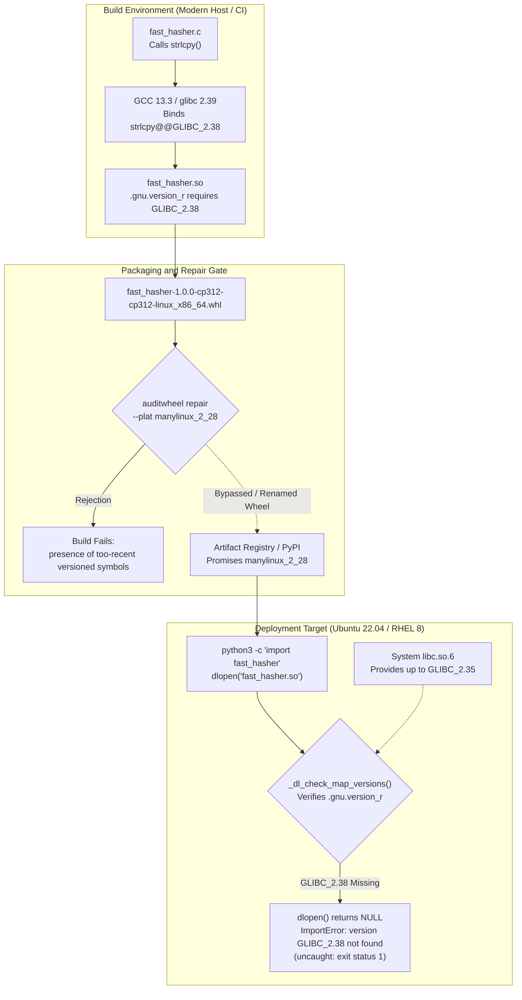

# Drill: Diagnose and Remediate a manylinux GLIBC Symbol Leak

> [!summary] Scope
> Hands-on diagnostic scenario where a compiled Python wheel built on a modern Linux host fails at import time on older deployment targets with glibc version lookup errors.
> Guides the engineer through inspecting GNU version requirement sections via readelf, diagnosing unpinned build host dependencies, and configuring auditwheel and cibuildwheel containerized baselines.
> Reinforces practical binary analysis and symbol version auditing under pressure.
> Delivers a fully verified solution with automated repro scripts.

Platform tags and Python wheel compatibility promises are owned by [[Python-Wheels-Platform-Tags-Manylinux-and-ABI3]].
Low-level symbol versioning mechanics and glibc runtime ABI evolution are owned by [[Cpp-Glibc-Symbol-Versioning-and-Portable-Linux-Binaries]].
Automated multi-platform compilation matrix pipelines are owned by [[Python-Cross-Platform-Wheel-Pipelines-with-cibuildwheel]].
This problem drill guides the engineer through isolating, diagnosing, and permanently remediating a classic native distribution breakdown: building a compiled C extension on a developer machine or unpinned CI runner, accidentally binding against newer GNU C Library symbols, and shipping a broken artifact that passes build checks but explodes during production imports on enterprise Linux hosts.



## 1. Reproduction

The reproduction scenario simulates a production data engineering team distributing an optimized token-hashing library (`fast_hasher`).
The library implements high-throughput payload hashing using a C extension module.
To sanitize input buffers safely, the C implementation calls `strlcpy()` from `<string.h>`.
The build runs on a modern development machine or standard CI runner powered by Ubuntu 24.04 (glibc 2.39, GCC 13.3 in the lab image, as of 2026-11, Linux).
Because `strlcpy()` was added to upstream glibc in version 2.38 (glibc NEWS: "derived from OpenBSD") and later standardized in POSIX.1-2024 (Issue 8), not ISO C23, the GNU linker binds the reference to the only definition the host libc exports, the default version `strlcpy@@GLIBC_2.38`.

All reproduction sources and orchestration scripts are located in `code/07-Packaging-and-Release/manylinux_leak/`.
The test harness drives two containerized environments:
1. Modern build environment (`toolchain-labs:1192e7ee37dc` running Ubuntu 24.04 with glibc 2.39).
2. Enterprise deployment target (`ubuntu:22.04` running glibc 2.35).

To execute the reproduction and observe the complete failure chain, run the harness verify command:

```bash
cd code && python3 -m _harness.verify 07-Packaging-and-Release/manylinux_leak/
```

## 2. Observed Symptom

### Symptom 1: Packaging Gate Rejection under auditwheel

When the team attempts to package the compiled shared object into a distributable wheel compliant with the `manylinux_2_28` baseline (the PyPA standard supporting enterprise Linux distributions such as AlmaLinux 8, Rocky Linux 8, and RHEL 8), the audit tool halts the release pipeline:

```text
(darwin-arm64)
=== Stage 3: Audit Wheel Against manylinux_2_28 Policy ===
auditwheel show: fast_hasher.so
  Found external shared library dependency: libc.so.6
  Required symbol versions: GLIBC_2.17, GLIBC_2.38
  This constrains the platform tag to "manylinux_2_38_aarch64".
  In order to achieve a more compatible tag, you would need to recompile a new wheel from source on a system with earlier versions of these libraries, such as a recent manylinux image.

Attempting auditwheel repair with target policy manylinux_2_28_aarch64...
auditwheel: error: cannot repair "fast_hasher.so" to "manylinux_2_28_aarch64" ABI because of the presence of too-recent versioned symbols: libc.so.6 with version GLIBC_2.38
```

The repair tool explicitly refuses to retag the wheel as `manylinux_2_28`.
It detects that the binary demands `GLIBC_2.38`, which exceeds the maximum version (`GLIBC_2.28`) permitted by the policy.
The output above comes from the lab's `audit_wheel.py`, a small simulator that applies the same glibc-version policy check to the bare `.so`; it does not run the real tool, and it checks only `GLIBC_` versions, not `GLIBCXX_`, `CXXABI_`, or bundled libraries.
Real `auditwheel` 6.8.2 (as of 2026-11, Linux) operates on a `.whl`, and its wording differs: `show` prints `... is consistent with the following platform tag: "manylinux_2_38_aarch64".`, then `The wheel references external versioned symbols in these system-provided shared libraries: libc.so.6 with versions {...}`, then the "This constrains the platform tag" sentence shown above (`main_show.py`).
Real `repair` fails with `auditwheel: error: cannot repair "<wheel>" to "manylinux_2_28_aarch64" ABI because of the presence of too-recent versioned symbols. You'll need to compile the wheel on an older toolchain.` and does not name the offending version (`main_repair.py`).

### Symptom 2: Production Loader Crash on Deployment Target

If a developer bypasses the repair gate - either by disabling `auditwheel`, deploying the raw wheel, or manually renaming the wheel tag to `manylinux_2_28` - pip installs the artifact on target nodes without error.
However, the moment any application attempts to import the extension, the load fails:

```text
(darwin-arm64)
=== Stage 4: Reproduce Deployment Crash on Older Host (glibc 2.35) ===
[Execution] Attempting dlopen() of unpatched module on glibc 2.35 container...
dlopen error: /lib/aarch64-linux-gnu/libc.so.6: version `GLIBC_2.38' not found (required by /work/fast_hasher.so)
Exit status: 1
```

In Python, this failure surfaces as an `ImportError` carrying the `dlerror()` text verbatim, including glibc's backtick quoting:
``ImportError: /lib/aarch64-linux-gnu/libc.so.6: version `GLIBC_2.38' not found (required by /work/fast_hasher.so)``.
No code from the extension module executes; its `PyInit_*` function is never reached.
The process does not crash: `ImportError` is an ordinary exception, so a `try`/`except ImportError` can catch it, but the extension is unusable and, left uncaught, the interpreter exits with status 1.

## 3. Progressive Hint Ladder

> [!tip]- Hint 1: Inspecting Version Requirements via readelf
> The Linux dynamic linker does not guess library compatibility based on file names.
> It reads dedicated ELF sections that record the exact symbol versions required by the binary.
> Run `readelf -V fast_hasher.so` to inspect the Version Needs section (`.gnu.version_r`).
> Look at the entries for `libc.so.6`.
> What specific version names are listed, and what is the highest `GLIBC_` version requested?

> [!tip]- Hint 2: Tracking Symbol Version Assignments in .dynsym
> Once you know which library version is demanded, identify which function call caused the requirement.
> Inspect the dynamic symbol table using `readelf --dyn-syms --wide fast_hasher.so` or `objdump -T fast_hasher.so`.
> Look for undefined symbols (`UND`) referencing `libc.so.6`.
> Notice how each imported symbol carries a `@GLIBC_X.YY` suffix indicating the version node assigned by the static linker during compilation.

> [!tip]- Hint 3: The Mechanics of Default Symbol Binding
> When GNU `ld` links a shared object against the host system's `libc.so.6`, it matches undefined symbol names to the default version (`@@GLIBC_...`) exported by that libc.
> On Ubuntu 24.04, the C runtime provides `strlcpy@@GLIBC_2.38`.
> Older distributions (Ubuntu 22.04 with glibc 2.35, or CentOS 7 with glibc 2.17) do not define `GLIBC_2.38` in their `libc.so.6` Version Definition section (`.gnu.version_d`).
> Can a binary compiled against a newer glibc run on an older glibc if it only calls backward-compatible functions?

> [!tip]- Hint 4: Why auditwheel Refuses to "Repair" the Wheel
> `auditwheel repair` can bundle third-party shared libraries (such as `libpng.so` or `libgomp.so`) into the wheel's `<name>.libs` directory and rewrite the extension's rpath via `patchelf` (`--force-rpath --set-rpath`, which writes `DT_RPATH`).
> However, `auditwheel` strictly forbids bundling or vendoring `libc.so.6`, `libm.so.6`, or `libpthread.so.0`.
> Why is `libc.so.6` non-vendorable, and why can `auditwheel` never lower a binary's glibc version requirement without recompilation?

> [!tip]- Hint 5: Paved-Road Isolation vs. Source Redirection
> To guarantee that a wheel runs on older platforms, all symbol references in `.gnu.version_r` must be satisfied by the target baseline's glibc.
> Consider two distinct remediation paths:
> 1. Source level: Replace modern glibc-only function calls with portable C fallbacks, or bind to older symbol versions using assembly `.symver` directives.
> 2. Build environment level: Compile the wheel inside a pinned OCI container that runs an older glibc baseline (such as `quay.io/pypa/manylinux_2_28_x86_64`) using `cibuildwheel`.

## 4. Model Solution

> [!success]- Solution: Root Cause Diagnosis and Complete Remediation
>
> ### Root Cause Analysis
>
> #### Mechanism 1: ELF Version Needs and Upfront Loader Verification
>
> When the dynamic linker (`ld.so`) loads an ELF shared object via `dlopen()`, `dl_open_worker_begin()` in glibc `elf/dl-open.c` calls `_dl_check_map_versions()` (defined in `elf/dl-version.c`) for every newly mapped object before relocation and before any initialization routine runs.
>
> The binary contains three ELF sections governing symbol versioning:
> 1. `.gnu.version`: An array of 16-bit integers (`Elf64_Versym`, a typedef of `Elf64_Half`), with one entry per symbol in `.dynsym`.
>    For undefined symbols, each entry holds a version index that matches the `vna_other` field of a `.gnu.version_r` auxiliary record.
>    For defined symbols, each entry matches the `vd_ndx` of a `.gnu.version_d` record, with the top bit (`0x8000`) marking the version hidden, that is, not the default.
> 2. `.gnu.version_r` (`SHT_GNU_verneed`): A structured list of `Elf64_Verneed` and `Elf64_Vernaux` records defining external library version requirements.
> 3. `.gnu.version_d` (`SHT_GNU_verdef`): Version definition records for symbols exported by this object.
>
> Inspecting the unpatched binary using `readelf -V` reveals the exact version requirements:
>
> ```text
> (darwin-arm64)
> === Stage 2: Inspect ELF Version Sections via readelf ===
> Version Needs section (.gnu.version_r):
> 000000: Version: 1  File: ld-linux-aarch64.so.1  Cnt: 1
> 0x0010:   Name: GLIBC_2.17  Flags: none  Version: 3
> 0x0020: Version: 1  File: libc.so.6  Cnt: 2
> 0x0030:   Name: GLIBC_2.38  Flags: none  Version: 4
> 0x0040:   Name: GLIBC_2.17  Flags: none  Version: 2
>
> Symbol bindings in .dynsym:
> FUNC GLOBAL strlcpy@GLIBC_2.38
> FUNC GLOBAL compute_hash
> ```
>
> In `elf/dl-version.c`, `_dl_check_map_versions()` iterates over each `Elf64_Verneed` record in `fast_hasher.so`.
> When it encounters `libc.so.6`, it traverses the auxiliary list (`Elf64_Vernaux`) and, through `match_symbol()`, verifies that every version string exists in the target library's `.gnu.version_d` table (comparing `vd_hash` first, then the name).
>
> On the deployment target (Ubuntu 22.04), `libc.so.6` provides symbol versions up to `GLIBC_2.35`.
> The check for `GLIBC_2.38` fails.
> `match_symbol()` builds the message with ``_dl_exception_create_format(..., "version `%s' not found (required by %s)", string, name)`` and raises it with `_dl_signal_cexception(0, &exception, N_("version lookup error"))`; `dlopen()` then returns `NULL` and `dlerror()` carries the text.
>
> Crucially, `_dl_check_map_versions()` validates the entire `.gnu.version_r` table upfront.
> Even if an application never executes the code branch calling `strlcpy()`, `dlopen()` fails during initial module loading.
>
> #### Mechanism 2: The Non-Vendorability of libc.so.6
>
> When `auditwheel repair` encounters a third-party dependency like `libpng.so`, it copies the library into `fast_hasher.libs/`, mangles its `SONAME` with an 8-character content hash (for example `libpng16-1a2b3c4d.so.16`) to prevent namespace collisions, and sets the extension's rpath to `$ORIGIN/<relative path to fast_hasher.libs>` (`repair.py`).
>
> However, `auditwheel`'s policy specification (`manylinux-policy.json`) lists system libraries in each policy's `lib_whitelist` (`libc.so.6`, `libm.so.6`, `libpthread.so.0`, `libdl.so.2`, `librt.so.1`, and others), and whitelisted libraries are never vendored.
> The `manylinux_2_28` whitelist also includes `libstdc++.so.6` and `libgcc_s.so.1`; those are not bundled either, but their `GLIBCXX_`, `CXXABI_`, and `GCC_` versions are capped by the same policy (auditwheel 6.8.2, as of 2026-11).
> System libraries cannot be copied into a wheel for two fundamental reasons:
> 1. Kernel Interface Tight Coupling: `libc.so.6` communicates directly with kernel system calls and architecture-specific kernel control structures.
> 2. Loader and Process State Singleton: The process already has the host's `libc.so.6` mapped, and the dynamic loader matches `DT_NEEDED` entries by `SONAME`, so a bundled copy under the same name would simply be ignored.
>    A copy under a mangled name would give the process two C runtimes, each with its own allocator state (ptmalloc arenas), thread-local storage layout, and stdio and locale state; glibc does not support that configuration, and pointers freed or locks taken across the two are undefined behavior.
>
> Because `libc.so.6` cannot be vendored, `auditwheel`'s only mechanism for ensuring compatibility is validating that all symbols bound to `libc.so.6` exist within the target policy baseline.
> When `auditwheel` detects `strlcpy@GLIBC_2.38`, it cannot patch or bundle it; it must reject the wheel.
>
> ---
>
> ### Remediation Steps
>
> To resolve the defect permanently, an engineering team has three viable options depending on architecture and build constraints.
>
> #### Option 1: Portable Source Fallback (Zero Dependency Overhead)
>
> If the symbol leak stems from calling a newly added standard C function, provide a self-contained fallback implementation when compiling for baseline Linux targets.
>
> In `fast_hasher.c`, replace the direct call to host `strlcpy()` with a portable fallback:
>
> ```c
> #include <stdint.h>
> #include <stddef.h>
> #include <string.h>
>
> #if defined(PORTABLE)
> static size_t portable_strlcpy(char *dst, const char *src, size_t siz) {
>     size_t srclen = strlen(src);
>     if (siz > 0) {
>         size_t copylen = (srclen >= siz) ? (siz - 1) : srclen;
>         memcpy(dst, src, copylen);
>         dst[copylen] = '\0';
>     }
>     return srclen;
> }
> #define my_strlcpy portable_strlcpy
> #else
> #define my_strlcpy strlcpy
> #endif
> ```
>
> Recompile the shared object with `-DPORTABLE=1`:
>
> ```bash
> gcc -shared -fPIC -O2 -DPORTABLE=1 -o fast_hasher_fixed.so fast_hasher.c
> ```
>
> Inspecting the updated `.gnu.version_r` confirms that `GLIBC_2.38` has vanished completely:
>
> ```text
> (darwin-arm64)
> === Stage 5: Remediate GLIBC Leak via Portable Source Fallback ===
> [Build] Recompiling fast_hasher.so with portable fallback (-DPORTABLE=1)...
> Version Needs section (.gnu.version_r) for fixed module:
> 000000: Version: 1  File: ld-linux-aarch64.so.1  Cnt: 1
> 0x0010:   Name: GLIBC_2.17  Flags: none  Version: 3
> 0x0020: Version: 1  File: libc.so.6  Cnt: 1
> 0x0030:   Name: GLIBC_2.17  Flags: none  Version: 2
> ```
>
> The module now requires only `GLIBC_2.17` (the baseline for CentOS 7 / manylinux2014 and AArch64).
>
> #### Option 2: Containerized Builds via cibuildwheel (The Paved Road)
>
> The most robust, industry-standard remediation is compiling all release wheels inside official PyPA `manylinux` OCI containers.
> By compiling inside a container based on AlmaLinux 8 (`quay.io/pypa/manylinux_2_28_x86_64`), the build toolchain links against headers and import libraries provided by glibc 2.28.
>
> Configure `pyproject.toml` or CI workflows to use `cibuildwheel`:
>
> ```toml
> # pyproject.toml
> [tool.cibuildwheel]
> build = "cp312-*"
> manylinux-x86_64-image = "manylinux_2_28"
> manylinux-aarch64-image = "manylinux_2_28"
>
> [tool.cibuildwheel.linux]
> repair-wheel-command = "auditwheel repair -w {dest_dir} {wheel}"
> ```
>
> In cibuildwheel 4.3.5 `manylinux_2_28` is already the default for both options and the Linux default `repair-wheel-command` is `auditwheel repair -w {dest_dir} {wheel}`, so these lines pin the baseline explicitly rather than change it (as of 2026-11, Linux).
> Inside the container, any attempt to call `strlcpy()` without a fallback fails at compile time because glibc 2.28 headers do not declare `strlcpy` and the image's GCC 14 toolchain treats implicit function declarations as errors.
> With a pre-14 GCC it would only warn, and a `-shared` link would still succeed with an unversioned undefined `strlcpy` that fails at load time with `undefined symbol: strlcpy`.
> On the paved road this converts a silent runtime deployment failure into a fail-fast compile-time error.
>
> #### Option 3: Advanced Compiler Symbol Redirection (.symver Directives)
>
> When a project requires functions whose implementations evolved across glibc versions (such as `memcpy`, `posix_spawn`, or `math.h` functions like `pow` and `exp`), the GNU compiler can be directed to bind against older version nodes using explicit `.symver` assembly directives:
>
> ```c
> /* Force memcpy to bind against the ancient glibc 2.2.5 baseline instead of 2.14 */
> #if defined(__x86_64__)
> __asm__(".symver memcpy,memcpy@GLIBC_2.2.5");
> #endif
> ```
>
> Alternatively, developers leveraging `zig cc` or `cargo-zigbuild` can target older glibc baselines directly from modern host toolchains without Docker:
>
> ```bash
> zig cc -target x86_64-linux-gnu.2.28 -shared -fPIC -O2 -o fast_hasher.so fast_hasher.c
> ```
>
> Zig generates glibc stub libraries from a bundled ABI list; as `zig cc` it supports glibc targets back to 2.2.5 (Zig `lib/libc/glibc/README.md`, as of 2026-11), so the generated ELF binary references only symbol versions present in glibc 2.28 or older.
>
> ---
>
> ### Verification
>
> After applying the portable fallback, `auditwheel repair` executes cleanly:
>
> ```text
> (darwin-arm64)
> === Stage 6: Verify Auditwheel Repair and Deployment Execution ===
> Fixed-up wheel written to dist/fast_hasher-1.0.0-cp312-cp312-manylinux_2_28_aarch64.whl
> [Execution] Loading repaired module on deployment target (glibc 2.35)...
> Result: SUCCESS! fast_hasher loaded and computed hash: 0xADDR
> ```
>
> The lab's simulator writes a placeholder file named `fast_hasher-1.0.0-cp312-cp312-manylinux_2_28_aarch64.whl`; it does not build a real wheel, and real `auditwheel repair` prints the same `Fixed-up wheel written to <path>` line after producing one.
> When transferred to the deployment container running Ubuntu 22.04 (glibc 2.35), `loader` loads the module via `dlopen()` without error and executes `compute_hash()`, returning the 32-bit FNV-1a hash of `transaction_record_99`, `0x043761a0` (observed in a run on 2026-11-15 and recomputed independently; the harness scrubs it to `0xADDR`).

## 5. Core Takeaway

Native Python wheels distributed across Linux fleets do not encapsulate their C runtime.
The wheel tag `{distribution}-{version}-{python}-{abi}-{platform}.whl` is an assertion of compatibility, but the static linker bakes immutable version constraints into the ELF `.gnu.version_r` section during compilation.
If an extension is compiled against a modern development host or unpinned CI container, the dynamic linker will enforce those version constraints at load time, failing the import on any host running an older glibc before the extension's initialization code can run.

Permanent prevention requires three architectural rules:
1. Never build production Linux wheels directly on host operating systems.
   Always compile inside official PyPA `manylinux` container baselines via `cibuildwheel`.
2. Treat `auditwheel` as an immutable CI gate.
   Never force wheel retagging or bypass `auditwheel repair`.
3. Audit all binary artifacts with `readelf -V` or automated symbol scanners before publishing to internal or public artifact repositories.

Foundational wheel specifications and tag ranking mechanics are detailed in [[Python-Wheels-Platform-Tags-Manylinux-and-ABI3]].
Deep dynamic linker resolution and symbol versioning internals are covered in [[Cpp-Glibc-Symbol-Versioning-and-Portable-Linux-Binaries]].

## Interview Questions

### Level 5 (L5)

> [!question] L5: Predict the loader output when importing a modern extension on an older glibc host.
> A developer compiles a C extension on Ubuntu 24.04 (glibc 2.39) that calls strlcpy().
> The resulting .so file contains a .gnu.version_r section with libc.so.6 (GLIBC_2.38).
> The developer transfers this .so to a Debian 11 server (glibc 2.31) and runs python3 -c 'import my_extension'.
> What exact error does Python produce, and does any module code execute?
>
> > [!success]- Answer
> > The import raises `ImportError` (uncaught, the interpreter prints the traceback and exits with status 1):
> > ``ImportError: /lib/x86_64-linux-gnu/libc.so.6: version `GLIBC_2.38' not found (required by /path/to/my_extension.so)``.
> >
> > Zero module code executes.
> > Under CPython (`Python/dynload_shlib.c`), importing a native C extension invokes `dlopen(pathname, dlopenflags)`, where the flags come from `sys.getdlopenflags()` and default to `RTLD_NOW` on Linux.
> > During `dlopen()`, glibc's dynamic linker executes `_dl_check_map_versions()` in `elf/dl-version.c`.
> > The loader checks every version string in the binary's `.gnu.version_r` section against the target `libc.so.6`'s `.gnu.version_d` section.
> > Because `GLIBC_2.38` is absent from Debian 11's glibc 2.31, `_dl_check_map_versions()` fails before relocation occurs, `dlopen()` returns `NULL`, and CPython raises `ImportError` with the `dlerror()` text via `PyErr_SetImportError()`.

> [!question] L5: Structure and mechanics of ELF GNU version sections.
> Explain the difference between the ELF .gnu.version, .gnu.version_r, and .gnu.version_d sections.
> How does the static linker decide which version string to embed into .gnu.version_r?
>
> > [!success]- Answer
> > These three sections implement the GNU symbol versioning extension to ELF:
> > 1. `.gnu.version`: An array of 16-bit integers (`Elf64_Half`), matching one-to-one with the dynamic symbol table (`.dynsym`).
> >    For undefined symbols, it records a version index matching the `vna_other` of a `.gnu.version_r` auxiliary entry.
> >    For defined symbols, it records the `vd_ndx` of a `.gnu.version_d` entry, with the top bit (bit 15) indicating whether the symbol version is hidden or default.
> >    Indexes 0 and 1 are reserved for local and unversioned global symbols.
> > 2. `.gnu.version_r` (Version Needs): Contains `Elf64_Verneed` records listing external shared libraries (`DT_NEEDED`) and `Elf64_Vernaux` records listing the specific symbol versions demanded from each library (e.g., `libc.so.6` needing `GLIBC_2.17` and `GLIBC_2.38`).
> > 3. `.gnu.version_d` (Version Definitions): Contains `Elf64_Verdef` records defining symbol versions exported by this shared library (e.g., `libc.so.6` defining `GLIBC_2.2.5`, `GLIBC_2.14`, `GLIBC_2.38`).
> >
> > The static linker (`ld`) decides which version string to embed by inspecting the shared libraries passed on the link line.
> > When resolving an undefined symbol, `ld` finds the definition in the provider library.
> > In glibc, functions carry version tags (such as `memcpy@@GLIBC_2.14`).
> > The static linker selects the default version (marked with `@@`) and records that version string in the downstream binary's `.gnu.version_r` table.

### Level 6 (L6)

> [!question] L6: Debug this issue:
> A Python C extension compiled on a developer's local Ubuntu 24.04 laptop works perfectly in local testing.
> However, when packaged and uploaded to PyPI, multiple enterprise users on AlmaLinux 8 and Ubuntu 20.04 report that the package fails to install with pip.
> The developer asks why older deployment systems reject the wheel after running auditwheel repair with --plat auto when --plat manylinux_2_28 failed.
>
> > [!success]- Answer
> > 1. **Root Cause Diagnosis:**
> >    When the developer ran `auditwheel repair --plat auto`, `auditwheel` inspected the binary's ELF `.gnu.version_r` section.
> >    Because the extension was compiled on Ubuntu 24.04 (glibc 2.39), the compiler bound calls to glibc 2.38+ symbols.
> >    Instead of rejecting the build, `--plat auto` (the default when `--plat` is omitted, auditwheel 6.8.2, as of 2026-11) determined the highest compatibility baseline the binary could satisfy: `manylinux_2_38_x86_64` (under PEP 600).
> >    `auditwheel` retagged the wheel as `*-manylinux_2_38_x86_64.whl`.
> >
> > 2. **Installation Failure Mechanism:**
> >    When enterprise users on AlmaLinux 8 (glibc 2.28) or Ubuntu 20.04 (glibc 2.31) run `pip install`, `pip` evaluates `packaging.tags.sys_tags()`.
> >    An installer on glibc 2.28 generates compatibility tags starting at `manylinux_2_28_x86_64` down through older legacy tags (`manylinux2014`).
> >    Because `manylinux_2_38` exceeds the host's glibc version, `manylinux_2_38` is absent from `sys_tags()`.
> >    `pip` completely ignores the wheel and either fails with `No matching distribution found` or attempts to build from sdist (which fails if native compilers are missing).
> >
> > 3. **Remediation:**
> >    The developer must recompile the extension inside a pinned `manylinux_2_28` OCI container using `cibuildwheel` or provide portable source fallbacks so that `.gnu.version_r` requires only `GLIBC_2.28` or older.

> [!question] L6: Why does auditwheel repair bundle third-party shared libraries like libpng.so into the wheel, but refuses to bundle libc.so.6 or libpthread.so.0?
> What breaks if libc.so.6 is copied into a wheel?
>
> > [!success]- Answer
> > `auditwheel` enforces a strict whitelist policy (`manylinux-policy.json`) separating vendorable libraries from non-vendorable system runtime libraries.
> >
> > `libc.so.6`, `libm.so.6`, and `libpthread.so.0` cannot be vendored because:
> > 1. **Process Singleton Invariant:** The GNU C Library manages global process state, including the heap allocator (`ptmalloc`), the thread-local storage layout (`TLS`), and stdio and locale state.
> >    The host's `libc.so.6` is already mapped and the loader matches `DT_NEEDED` by `SONAME`, so a bundled copy under the same name is ignored, and a copy under a mangled name yields two C runtimes in one process.
> >    A pointer allocated by one runtime and freed by the other, or a lock taken in one and released in the other, is undefined behavior; glibc does not support this configuration.
> > 2. **Kernel ABI Coupling:** `libc.so.6` contains direct architecture-specific system call wrappers and data structures tightly coupled to the running Linux kernel version and CPU capabilities.
> > 3. **Dynamic Linker Coupling:** `libc.so.6` works in lockstep with the dynamic linker (`ld-linux.so`): it imports `GLIBC_PRIVATE` symbols and shares internal structures (TLS layout, `struct rtld_global`) whose layout is not a stable ABI.
> >    A `libc.so.6` from a different glibc build than the host's `ld.so` therefore fails to load or misbehaves; the two can only be replaced together, which a wheel cannot do.

> [!question] L6: How do manylinux1 (PEP 513), manylinux2014 (PEP 599), and perpetual manylinux (PEP 600) tags differ in specification and installer ranking?
>
> > [!success]- Answer
> > 1. **Legacy Tag Specifications (PEPs 513, 571, 599):**
> >    - `manylinux1` (PEP 513): Based on CentOS 5 (glibc 2.5), released in 2016.
> >    - `manylinux2010` (PEP 571): Based on CentOS 6 (glibc 2.12), released in 2018.
> >    - `manylinux2014` (PEP 599): Based on CentOS 7 (glibc 2.17), released in 2019.
> >    Each legacy tag required a dedicated PEP and codified a static list of whitelisted external libraries, compiler flags, and symbol limits.
> >
> > 2. **Perpetual Tag Specification (PEP 600):**
> >    PEP 600 replaced static name tags with a continuous format: `manylinux_${glibc_major}_${glibc_minor}_${arch}` (e.g., `manylinux_2_28_x86_64`).
> >    No future PEP is required to support newer glibc versions.
> >    The legacy names are defined as aliases: `manylinux1` is `manylinux_2_5`, `manylinux2010` is `manylinux_2_12`, and `manylinux2014` is `manylinux_2_17`.
> >
> > 3. **Installer Ranking (`packaging.tags`):**
> >    Installers determine the running host's glibc version via `os.confstr("CS_GNU_LIBC_VERSION")`, falling back to `gnu_get_libc_version()` through `ctypes` (`packaging/_manylinux.py`).
> >    `packaging.tags.sys_tags()` emits compatible platform tags in descending order from the host's version down to `manylinux_2_17` (down to `manylinux_2_5` on `x86_64` and `i686`), inserting each legacy alias next to its PEP 600 equivalent.
> >    When multiple wheels exist for a package version, `pip` selects the wheel matching the tag ranked highest in `sys_tags()` (preferring the most modern supported tag).

### Level 7 (L7+)

> [!question] L7: In glibc elf/dl-version.c, walk through the exact internal control flow of _dl_check_map_versions().
> Why does the loader verify symbol versions upfront before executing any relocations, rather than resolving them lazily when functions are called?
>
> > [!success]- Answer
> > **Control Flow of `_dl_check_map_versions()`:**
> > 1. For each loaded ELF object, `ld.so` checks if `l_info[VERSYMIDX(DT_VERNEED)]` is non-null.
> > 2. It traverses the linked list of `ElfW(Verneed)` structures pointed to by the `DT_VERNEED` dynamic tag.
> > 3. For each needed library (identified by `vn_file`), `ld.so` finds the corresponding loaded `link_map` structure.
> > 4. It iterates over the associated `ElfW(Vernaux)` records.
> >    For each record, it extracts `vna_name` (the version string, e.g. `"GLIBC_2.38"`) and `vna_hash` (its 32-bit ELF hash).
> >    It calls `match_symbol()`, which searches the target library's `DT_VERDEF` list (`ElfW(Verdef)` and `ElfW(Verdaux)`).
> >    If a matching hash and string are found, the check passes.
> >    If no match is found and `vna_flags` does not have `VER_FLG_WEAK`, `match_symbol()` formats ``"version `%s' not found (required by %s)"`` with `_dl_exception_create_format()` and raises it with `_dl_signal_cexception()`; a weak requirement only produces a message in verbose (trace) mode.
> >
> > **Why Version Verification is Upfront and Non-Lazy:**
> > 1. **Deterministic Failure at Load Time:** If version checks were lazy, an application might run for days in production, execute transactions, and then crash halfway through a critical financial operation when an unversioned symbol is called for the first time.
> > 2. **Memory Safety and ABI Invariants:** When glibc changes a function's behavior or an ABI-visible structure layout, it introduces a new symbol version (for example `memcpy@GLIBC_2.14` beside `memcpy@GLIBC_2.2.5` on x86_64).
> >    Allowing code built for the new ABI to silently bind against an older implementation with a different contract could cause silent memory corruption.
> > 3. **Validation Decoupling:** Upfront checking allows the loader to verify that the overall library contract is satisfied in $O(V)$ time (where $V$ is the small number of version requirements) before spending time computing hundreds or thousands of individual relocations in `.rela.dyn` and `.rela.plt`.

> [!question] L7: Compare the four architectural strategies for remediating glibc symbol leaks across a multi-platform release pipeline: (1) OCI baseline images (cibuildwheel), (2) Zig toolchain targeting (zig cc), (3) GCC .symver redirection, and (4) Musl static linking (musllinux).
> Detail the operational trade-offs, performance implications, and failure modes of each.
>
> > [!success]- Answer
> > | Strategy | Operational Mechanism | Key Benefits | Trade-Offs and Failure Modes |
> > |---|---|---|---|
> > | **1. OCI Baseline Images (`cibuildwheel`)** | Compiles code inside official PyPA containers (`manylinux_2_28`) using real distribution headers and toolchains. | 100% fidelity with target OS; verified by `auditwheel`; catches missing APIs at compile time. | Requires Docker daemon in CI; slower build cycles; container maintenance overhead. |
> > | **2. Zig Toolchain (`zig cc` / `cargo-zigbuild`)** | Uses Zig's bundled C library headers and symbol stubs for specific glibc versions (e.g. `-target x86_64-linux-gnu.2.28`). | Cross-compiles without containers; extremely fast; runs on macOS/Windows host runners. | Non-standard compiler driver; potential C++ standard library (`libstdc++`) incompatibility or header drift. |
> > | **3. GCC `.symver` Redirection** | Inserts `__asm__(".symver ...")` directives in source files to bind symbols to older glibc version nodes. | No external toolchain changes; works on modern host compilers. | High maintenance; fragile; fails if an API has no older symbol version or if internal struct layouts differ. |
> > | **4. Musl Linking (`musllinux`, PEP 656)** | Links dynamically against musl (`libc.musl-<arch>.so.1`) instead of glibc, producing `musllinux_1_x` wheels. | Eliminates glibc version requirements for musl-based distributions such as Alpine. | Not a glibc remediation: installers on glibc hosts do not accept `musllinux` tags, so a separate `manylinux` wheel is still needed; slower default allocator in multithreaded code; behavior differences from glibc extensions. |

> [!question] L7+: Design an enterprise release pipeline and automated binary gate for a high-frequency trading firm shipping native Python analytics plugins across a hybrid fleet of RHEL 8 (glibc 2.28), RHEL 9 (glibc 2.34), and Ubuntu 24.04 (glibc 2.39).
> How do you enforce build hermeticity, automate symbol auditing with CI fail-fast gates, and ensure developers cannot accidentally leak modern host glibc symbols into production releases?
>
> > [!success]- Answer
> > A distinguished-level binary release architecture combines hermetic containerized builds, static binary gating, and post-build verification:
> >
> > 1. **Hermetic Compilation Baseline:**
> >    - Mandate that all production wheels be compiled exclusively through `cibuildwheel` using pinned OCI images (`quay.io/pypa/manylinux_2_28_x86_64`).
> >    - Disable direct host compilation (`pip wheel .`) on developer laptops for release artifacts by requiring SLSA Level 3 cryptographic provenance attestations generated inside isolated GitHub Actions / GitLab CI runners.
> >
> > 2. **Automated Binary Gate in CI:**
> >    - **Policy Gate (`auditwheel`):** Enforce `auditwheel repair --plat manylinux_2_28` on all built wheels.
> >      `auditwheel repair` exits non-zero with `cannot repair ... because of the presence of too-recent versioned symbols`; let that fail the job, and never fall back to `--plat auto`.
> >    - **ELF Section Inspection (`readelf`):** Execute an automated static analysis script that unpacks the wheel and runs `readelf -V` on all `.so` files.
> >      Assert that no `Elf64_Vernaux` record under `libc.so.6` has a version string numerically exceeding `GLIBC_2.28`.
> >    - **Export Symbol Audit:** Run `readelf --dyn-syms --wide` to verify that the only defined global symbol is the module's `PyInit_<name>` (everything else built with `-fvisibility=hidden`, so it never reaches `.dynsym`), preventing symbol preemption across multiple native plugins.
> >
> > 3. **Pre-Release Deployment Smoke Test:**
> >    - Before publishing artifacts to the internal Artifactory/Nexus index, spin up a minimal RHEL 8 / AlmaLinux 8 container (`glibc 2.28`).
> >    - Run `pip install --no-index --find-links=dist/ fast_hasher`.
> >    - Execute the full test suite inside the glibc 2.28 container.
> >    - If any symbol lookup or version resolution fails, the pipeline halts immediately, preventing broken artifacts from ever reaching production trading nodes.

## Further Reading

- Ulrich Drepper, *How To Write Shared Libraries*, Red Hat Inc., 2011.
  The authoritative guide to ELF shared library design, symbol versioning, and dynamic linker optimization by glibc's original versioning architect.
- System V Application Binary Interface - Edition 4.1, Chapter 5 (Dynamic Linking).
  The foundational specification defining ELF dynamic tags, program loading, and relocation structures.
- PEP 600 - *Future 'manylinux' Platform Tags for Portable Linux Built Distributions*, Python Software Foundation, 2019.
  The official specification establishing perpetual `manylinux_${glibc_major}_${glibc_minor}` platform tags.
- auditwheel documentation and source repository, PyPA, 2026.
  Reference implementation for inspecting ELF symbol versions, library whitelisting, and patching wheels with patchelf.
- cibuildwheel documentation, PyPA, 2026.
  Official guide for building cross-platform Python wheels across automated OCI container baselines.
- Linux man-pages: `ld.so(8)` and `dlopen(3)`.
  Authoritative reference for GNU dynamic linker resolution order, environment variables, and runtime error conditions.

## Related

- Prerequisites: [[Python-Wheels-Platform-Tags-Manylinux-and-ABI3]], [[Cpp-Glibc-Symbol-Versioning-and-Portable-Linux-Binaries]]
- Next: [[Drill-Packaging-Cpp-Silent-ABI-Break-Across-Shared-Libraries]]
- Lab: `code/07-Packaging-and-Release/manylinux_leak/` (requires: docker)
