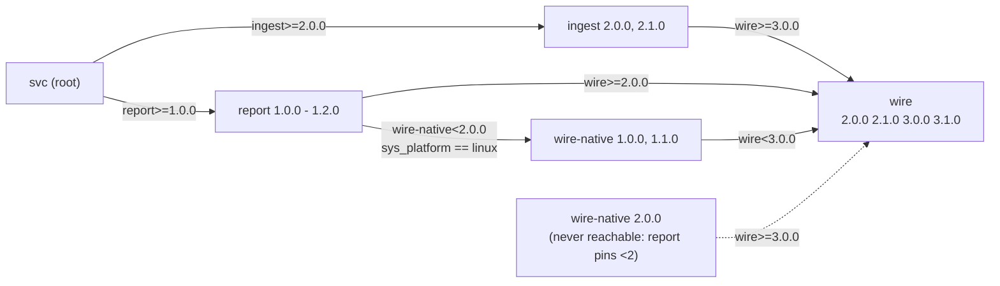

# Drill: Diagnose and Resolve a Diamond Version Incompatibility via PubGrub

> [!summary] Scope
> Practical exercise tracing an intractable diamond dependency version conflict across complex multi-platform environment markers.
> Uses a simulated toy registry to step through PubGrub derivation graphs, identify conflicting version constraints, and compute the minimal relaxation necessary to achieve a solvable graph.
> Builds intuition for conflict-driven clause learning and error explanation in modern package resolvers.
> Includes runnable resolution traces and diagnostic log verification.

The general theory (why version selection is NP-complete, how CDCL, PubGrub, and Go's Minimal Version Selection differ) is owned by [[Dependency-Resolution-SAT-PubGrub-and-MVS]], the prerequisite for this drill.
uv and pip as Python tools, `uv.lock`, and PEP 751 are owned by [[Python-Dependency-Resolution-pip-uv-and-PEP-751-Lockfiles]].
What to do when two versions of a library genuinely cannot coexist in one process (vendoring, symbol isolation, the semver trick) is owned by [[Diamond-Dependency-and-Incompatible-ABI-Mitigation]].
This note owns one skill: reading a PubGrub failure as a proof, reducing it to the facts that cause it, and choosing the cheapest truthful fact to change.

## Reproduction

The drill lives in `code/07-Packaging-and-Release/pubgrub_conflict/` and runs with `bash run.sh`.

- `registry.py` is the single source of truth: a toy registry of four packages and fourteen versions, and the root project `svc`.
- `make_wheels.py` turns the registry into fourteen metadata-only wheels (a `.dist-info` directory with `METADATA`, `WHEEL`, and `RECORD`, and no code), so the real uv resolver sees exactly the same graph from a flat `--find-links` directory.
- `pubgrub.py` is a small, faithful PubGrub: unit propagation, conflict resolution with backjumping, pub's fewest-versions decision heuristic, adjacent-version collapsing, and a port of pub's error writer (`failure.dart`).
  Its terms are exact finite sets of versions plus a "not selected" outcome, so every set operation the algorithm needs is exact.
- `drill.py` solves the registry per platform, prints the trace and the derivation graph, proves every fact in the proof is necessary, and searches for the cheapest widening of each fact.
- `uv_stage.py` runs `uv pip compile` offline for the symptom, compares uv's proof with the toy's, replays every relaxation through uv, demonstrates the override-marker pitfall, and summarizes uv's own `-v` resolver log.

The lab declares no harness requirement tokens: it runs on macOS and Linux as is, with no network.
It needs `python3` (3.10 or newer) and `uv` 0.11.25 or newer on `PATH`, because scoped overrides first shipped in uv 0.11.25 (released 2026-06-26, "Support scoped dependency overrides", astral-sh/uv#19970).
`run.sh` exits non-zero with a message when uv is missing, because a silent skip would hide drift in uv's output.
Each uv call passes `--config-file` pointing at a file the script writes; the uv configuration documentation states that this file is "used in place of _any_ discovered configuration files", so a reader's own `uv.toml` cannot change the result.
uv draws its error frame with four non-ASCII characters (a multiplication sign and a three-character arrow); `uv_stage.py` maps them to the ASCII forms (`x` and `` `-> ``) that the uv documentation itself prints, and fails if any other non-ASCII character appears.

As of 2026-11, the lab records `expected/darwin-arm64.txt` (Darwin 27.3.0 on Apple silicon, Python 3.15.2, uv 0.11.26).
Every output block below is copied from that file.
No Linux golden file exists yet; the toy solver is pure Python and uv's resolution does not depend on the host OS when `--python-platform` is given, so a Linux recording is expected to match, but that is a prediction, not a measurement.

The registry is a diamond whose second arm exists only on Linux:

| Package | Versions | Requires-Dist |
|---|---|---|
| `svc` (root) | - | `ingest>=2.0.0`, `report>=1.0.0` |
| `ingest` | 1.4.0 | `wire>=2.0.0,<3.0.0` |
| `ingest` | 2.0.0, 2.1.0 | `wire>=3.0.0` |
| `report` | 0.9.0 | `wire>=2.0.0` |
| `report` | 1.0.0, 1.1.0, 1.2.0 | `wire>=2.0.0`; `wire-native>=1.0.0,<2.0.0; sys_platform == "linux"` |
| `wire-native` | 1.0.0, 1.1.0 | `wire>=2.0.0,<3.0.0` |
| `wire-native` | 2.0.0 | `wire>=3.0.0` (rebuilt against the wire 3 ABI) |
| `wire` | 2.0.0, 2.1.0, 3.0.0, 3.1.0 | none |



The two paths from `svc` to `wire` meet at the bottom of the diamond with disjoint ranges, `>=3.0.0` and `<3.0.0`, but only when the `sys_platform == "linux"` marker turns the right-hand path on.
Python allows one installed version per distribution name, so there is no "load both" escape; that is what turns a diamond into a conflict.
Cargo would treat the same shape differently, which [[Rust-Cargo-Model-Packages-Targets-Features-and-Workspaces]] and the Pitfalls section cover.

## Observed Symptom

The ticket reads: "`uv lock` works on every laptop on the team, and the Linux CI job that resolves for the deploy image fails with a wall of text."
The team's laptops are Macs, and the deploy image is Linux.
Stage 1 of the lab reproduces exactly that split with `uv pip compile --python-platform`, then with `--universal`, which is the mode `uv.lock` always uses.
Copied from `expected/darwin-arm64.txt` (as of 2026-11, macOS, uv 0.11.26):

```text
=== Stage 1: uv resolves the same registry per platform (the observed symptom) ===
--- uv pip compile --python-platform macos -> exit 0 ---
Resolved 3 packages in <time>
ingest==2.1.0
report==1.2.0
wire==3.1.0
--- uv pip compile --python-platform linux -> exit 1 ---
  x No solution found when resolving dependencies:
  `-> Because ingest>=2.0.0 depends on wire>=3.0.0 and only the following
      versions of ingest are available:
          ingest<=2.0.0
          ingest==2.1.0
      we can conclude that ingest>=2.0.0 depends on wire>=3.0.0. (1)

      Because wire-native<=1.1.0 depends on wire<3.0.0 and only the following
      versions of wire-native{sys_platform == 'linux'} are available:
          wire-native{sys_platform == 'linux'}<=1.0.0
          wire-native{sys_platform == 'linux'}==1.1.0
          wire-native{sys_platform == 'linux'}>=2.0.0
      we can conclude that wire-native{sys_platform == 'linux'}<2.0.0 depends
      on wire<3.0.0.
      And because report>=1.0.0 depends on wire-native{sys_platform
      == 'linux'}<2.0.0, we can conclude that report>=1.0.0 depends on
      wire<3.0.0.
      And because we know from (1) that ingest>=2.0.0 depends on wire>=3.0.0,
      we can conclude that ingest>=2.0.0 and report>=1.0.0 are incompatible.
      And because only the following versions of report are available:
          report<=1.0.0
          report==1.1.0
          report==1.2.0
      we can conclude that ingest>=2.0.0 and report>=1.0.0 are incompatible.
      And because you require ingest>=2.0.0 and report>=1.0.0, we can conclude
      that your requirements are unsatisfiable.
--- uv pip compile --universal -> exit 1 ---
explanation identical to the linux one: yes
```

Three things in this output are the drill:

- The macOS resolution never mentions `wire-native`: the PEP 508 specification says a dependency whose marker evaluates to False "should be ignored", so on macOS the right arm of the diamond does not exist.
- The universal resolution fails with the Linux explanation, byte for byte: a universal lock must hold for every platform the project supports, so one unsolvable platform fails the whole lock, and every developer's `uv lock` would fail too once the lockfile is resolved universally.
- The explanation is 26 lines long (one of them blank) for a five-edge conflict, and eleven of those lines (the three `only the following versions` blocks, about two fifths of the message) carry no information about the cause.

Your task: name the facts that make Linux unsolvable, prove that each is necessary, list every single-fact change that would make the graph solvable, and pick the one that is both cheapest and true.

## Progressive Hint Ladder

> [!tip]- Hint 1: The explanation is a proof, so read it from the last line up
> PubGrub reports failure by deriving the incompatibility `{root}` ("the root package cannot be selected") and printing the derivation graph of that fact.
> Every `we can conclude that X` is a derived incompatibility, every `Because A and B` names its two causes, and `(1)` is a line number that pub-style writers attach only to a derivation that is used more than once or that ends a branch of the proof (`failure.dart`: `numbered = conclusion || _derivations[incompatibility]! > 1`).
> The last line names the root requirements involved; the first lines name the deepest facts.
> Which external facts (dependency declarations you could look up in a `METADATA` file) appear anywhere in the proof?

> [!tip]- Hint 2: Strip what is bookkeeping rather than cause
> uv's resolver is pubgrub-rs, whose version sets are continuous ranges, so "`ingest>=2.0.0` depends on `wire>=3.0.0`" also covers versions such as 2.0.5 that were never published.
> The gaps are closed by separate external facts that uv's `report.rs` renders as `only the following versions of X are available`.
> They are true and necessary for the proof, but no fix will ever change them.
> Also note the name `wire-native{sys_platform == 'linux'}`: uv's `PubGrubPackageInner::Marker` is "a proxy package for a base package with a marker", so a marker becomes a separate virtual package in the proof.
> Delete both kinds of line and count what is left.

> [!tip]- Hint 3: Ask why macOS works and Linux does not
> Resolve the same requirements with `--python-platform macos` and `--python-platform linux` and diff the facts that each resolution loads.
> The only fact that differs is the marked edge `report -> wire-native`.
> A conflict that appears on one platform is a conflict whose proof contains at least one marked edge.
> Is the Linux edge enough by itself, or does it need the unmarked edges too?

> [!tip]- Hint 4: The leaves are an unsatisfiable core
> Take the external incompatibilities at the leaves of the derivation graph.
> Because each derivation step is sound (generalized resolution), the leaves alone already imply `{root}`: no solution can satisfy all of them.
> So any fix must falsify at least one leaf, and a leaf that can be dropped without making the graph solvable was not part of the cause.
> For each leaf, drop it and re-solve.

> [!tip]- Hint 5: Relax each leaf by the smallest amount, then ask who owns it
> For each leaf `P depends on D in S`, add the excluded versions of `D` nearest to `S` one at a time and re-solve after each.
> The first widening that solves is that leaf's minimal relaxation.
> Then classify each candidate: is the edge declared by your project (you may change it freely) or by a third party (changing it is an assertion about someone else's code)?
> Does the candidate keep every platform on the same versions?
> Does it widen an edge that encodes a binary (ABI) constraint?

> [!tip]- Hint 6: Apply the fix without creating a new bug
> uv's override documentation says that if a package "has a dependency with a marker, it is replaced unconditionally when using overrides".
> What happens on macOS if your override for `wire-native` forgets the marker?
> And how do you limit an override to exactly one edge rather than every requirement on that package in the graph?

## Model Solution

> [!success]- Solution
> **Step 1: reduce uv's explanation to its premises.**
> After deleting the `only the following versions` facts and the derived `we can conclude` clauses, five premises remain:
>
> | # | Premise in uv's text | Kind | Declared by |
> |---|---|---|---|
> | F1 | `ingest>=2.0.0 depends on wire>=3.0.0` | external, dependency | ingest |
> | F2 | `wire-native<=1.1.0 depends on wire<3.0.0` | external, dependency | wire-native |
> | F3 | `report>=1.0.0 depends on wire-native{sys_platform == 'linux'}<2.0.0` | external, marked dependency | report |
> | F4 | `you require ingest>=2.0.0` | external, root requirement | svc (you) |
> | F5 | `you require ... report>=1.0.0` | external, root requirement | svc (you) |
>
> The chain is F2 + F3 gives "report needs wire<3", F1 gives "ingest needs wire>=3", so ingest>=2 and report>=1 are incompatible, and F4 + F5 require both.
> F3 is the only marked fact, which is why only Linux fails.
>
> **Step 2: watch PubGrub derive it.**
> Stage 2 solves the toy registry for each platform.
> Copied from `expected/darwin-arm64.txt` (as of 2026-11, macOS):
>
> ```text
> === Stage 2: the toy PubGrub reproduces the platform split ===
> darwin  ingest==2.1.0 report==1.2.0 wire==3.1.0
>         decisions=4 conflicts=0 backjumps=0 incompatibilities=5
> linux   NO SOLUTION
>         decisions=4 conflicts=3 backjumps=2 incompatibilities=7
> win32   ingest==2.1.0 report==1.2.0 wire==3.1.0
>         decisions=4 conflicts=0 backjumps=0 incompatibilities=5
> ```
>
> The toy agrees with uv on all three platforms, including the exact macOS versions.
> Stage 3 prints the Linux trace; `#N` is an incompatibility, `level` is the decision level.
> Copied from `expected/darwin-arm64.txt` (as of 2026-11, macOS):
>
> ```text
> === Stage 3: the solver trace on linux (decisions, propagation, conflicts, backjumps) ===
>   derive svc  (from #1, level 0)
>   add #2 {svc, not ingest>=2.0.0}: svc depends on ingest>=2.0.0
>   add #3 {svc, not report>=1.0.0}: svc depends on report>=1.0.0
> decide svc (root) 1.0.0  (level 1)
>   derive report>=1.0.0  (from #3, level 1)
>   derive ingest>=2.0.0  (from #2, level 1)
>   add #4 {ingest>=2.0.0, not wire>=3.0.0}: ingest>=2.0.0 depends on wire>=3.0.0
> decide ingest 2.1.0  (level 2)
>   derive wire>=3.0.0  (from #4, level 2)
> decide wire 3.1.0  (level 3)
>   add #5 {every version of report, not every version of wire}: every version of report depends on wire
>   add #6 {report>=1.0.0, not wire-native<2.0.0}: report>=1.0.0 depends on wire-native<2.0.0 (when sys_platform == 'linux')
> decide report 1.2.0  (level 4)
>   derive wire-native<2.0.0  (from #6, level 4)
>   add #7 {wire-native<2.0.0, not wire<3.0.0}: wire-native<2.0.0 depends on wire<3.0.0
> conflict: #7 {wire-native<2.0.0, not wire<3.0.0}
>   satisfier wire-native<2.0.0 is a derivation at level 4; previous satisfier level 2
>   backjump to decision level 2
>   derive not wire-native<2.0.0  (from #7, level 2)
> conflict: #6 {report>=1.0.0, not wire-native<2.0.0}
>   satisfier not wire-native<2.0.0 is a derivation at level 2; previous satisfier level 1
>   backjump to decision level 1
>   derive wire-native<2.0.0  (from #6, level 1)
>   derive wire<3.0.0  (from #7, level 1)
> conflict: #4 {ingest>=2.0.0, not wire>=3.0.0}
>   resolve with #7 on wire -> {ingest>=2.0.0, wire-native<2.0.0}
>   resolve with #6 on wire-native -> {ingest>=2.0.0, report>=1.0.0}
>   resolve with #2 on ingest -> {report>=1.0.0}
>   resolve with #3 on report -> {svc}
> ```
>
> Read it with pub's `doc/solver.md` and source open:
>
> - Line 1 is the root incompatibility `{not svc 1.0.0}` forcing the root in; the root's derivation sits at level 0 and the root decision at level 1.
>   That matches pub's `PartialSolution.decide`, which inserts into `_decisions` before reading `decisionLevel => _decisions.length`, and it is why `_resolveConflict` starts with `previousSatisfierLevel = 1`: backjumping to 1 keeps the root.
>   (`solver.md` is inconsistent here: its definition counts decisions "other than the root package" and its worked tables show the root decision at level 0, while its conflict-resolution note says "decision level 1 is the level where the root package was selected"; the code, not the table, is what pub runs.)
> - `ingest` is decided before `report` because pub "chooses the latest matching version of the package with the fewest versions that match the outstanding constraint": `ingest>=2.0.0` matches 2 versions, `report>=1.0.0` matches 3.
>   For the same reason `wire` (2 versions in `>=3.0.0`) is decided before `report`.
> - `#6` covers `report>=1.0.0` although only 1.2.0 was chosen: pub "collapses identical dependencies from adjacent package versions into individual incompatibilities", widening the depender to the run of versions that declare the same constraint (1.0.0 through 1.2.0; 0.9.0 differs).
> - `#7` is added when the solver tries to choose `wire-native` and finds that the candidate's own dependency already conflicts with `wire 3.1.0`, so it adds the incompatibility without deciding (pub: "unless this would produce a conflict in any of the new incompatibilities").
> - Conflict 1: `#7` is satisfied.
>   Its most recent satisfier is the level-4 derivation `wire-native<2.0.0`; the other term, `not wire<3.0.0`, has been satisfied since the level-2 derivation `wire>=3.0.0`.
>   The previous satisfier level (2) differs from the satisfier's level (4), so the incompatibility is already a root cause: backjump to level 2, discarding the `wire` and `report` decisions, and propagate `not wire-native<2.0.0`.
> - Conflict 2: the same rule fires one level lower and backjumps to level 1.
> - Conflict 3: now every satisfier is a level-1 derivation, so there is nothing left to backjump over.
>   Conflict resolution applies the generalized resolution rule (from `{t1, q}` and `{t2, r}` derive `{q, r, t1 union t2}`) with each satisfier's cause, four times, until it reaches `{svc}`, which is failure.
>
> Three conflicts and zero learned incompatibilities: both backjumps returned an incompatibility that was already in the set, and the only multi-step derivation ended in failure.
> On a graph this small CDCL's learning never pays off; on a real one, the derived incompatibilities are what stop the solver from re-exploring the same dead end under a different `ingest` version.
>
> **Step 3: print the derivation graph and the explanation.**
> Copied from `expected/darwin-arm64.txt` (as of 2026-11, macOS):
>
> ```text
> === Stage 4: the derivation graph and pub's error writer ===
> derived  -   {svc}
>   derived  -   {report>=1.0.0}
>     derived  -   {ingest>=2.0.0, report>=1.0.0}
>       derived  -   {ingest>=2.0.0, wire-native<2.0.0}
>         external #4  {ingest>=2.0.0, not wire>=3.0.0}
>         external #7  {wire-native<2.0.0, not wire<3.0.0}
>       external #6  {report>=1.0.0, not wire-native<2.0.0}
>     external #2  {svc, not ingest>=2.0.0}
>   external #3  {svc, not report>=1.0.0}
> --- report ---
> Because ingest>=2.0.0 depends on wire>=3.0.0 and wire-native<2.0.0 depends on wire<3.0.0, ingest>=2.0.0 is incompatible with wire-native<2.0.0.
> And because report>=1.0.0 depends on wire-native<2.0.0 (when sys_platform == 'linux'), ingest>=2.0.0 is incompatible with report>=1.0.0.
> So, because svc depends on ingest>=2.0.0 and svc depends on report>=1.0.0, version solving failed.
> --- external facts: 5 in the proof, 1 loaded but irrelevant ---
> irrelevant: every version of report depends on wire
> ```
>
> The graph is a linear chain (each derived node has one derived and one external cause), so the writer needs no line numbers.
> The last line comes from pub's `_isCollapsible` rule: `{report>=1.0.0}` is used once and has one external cause, so its derivation is folded into the conclusion, three facts in one sentence, introduced by "So," because it is the conclusion.
> The toy's three lines say what uv's 26 say; the difference is the gap facts, which a discrete version set does not need, and uv's extra numbered reuse of line (1).
> Note also what the proof does not contain: `report -> wire` was loaded and is irrelevant, and `wire-native 2.0.0 -> wire>=3.0.0` was never loaded at all, because no decision ever reached it.
>
> **Step 4: prove every fact necessary and find each fact's cheapest widening.**
> Copied from `expected/darwin-arm64.txt` (as of 2026-11, macOS):
>
> ```text
> === Stage 5: every fact in the proof is necessary, and the cheapest widening of each ===
> fact: ingest>=2.0.0 depends on wire>=3.0.0
>   necessary for the conflict: yes
>   owner: third-party; widen wire to >=2.1.0 (admits 2.1.0)
>   linux:  ingest==2.1.0 report==1.2.0 wire==2.1.0 wire-native==1.1.0
>   darwin: ingest==2.1.0 report==1.2.0 wire==3.1.0
> fact: wire-native<2.0.0 depends on wire<3.0.0
>   necessary for the conflict: yes
>   owner: third-party; widen wire to >=2.0.0,<3.1.0 (admits 3.0.0)
>   linux:  ingest==2.1.0 report==1.2.0 wire==3.0.0 wire-native==1.1.0
>   darwin: ingest==2.1.0 report==1.2.0 wire==3.1.0
> fact: report>=1.0.0 depends on wire-native<2.0.0 (when sys_platform == 'linux')
>   necessary for the conflict: yes
>   owner: third-party; widen wire-native to >=1.0.0 (admits 2.0.0)
>   linux:  ingest==2.1.0 report==1.2.0 wire==3.1.0 wire-native==2.0.0
>   darwin: ingest==2.1.0 report==1.2.0 wire==3.1.0
> fact: svc depends on ingest>=2.0.0
>   necessary for the conflict: yes
>   owner: project; widen ingest to >=1.4.0 (admits 1.4.0)
>   linux:  ingest==1.4.0 report==1.2.0 wire==2.1.0 wire-native==1.1.0
>   darwin: ingest==2.1.0 report==1.2.0 wire==3.1.0
> fact: svc depends on report>=1.0.0
>   necessary for the conflict: yes
>   owner: project; widen report to >=0.9.0 (admits 0.9.0)
>   linux:  ingest==2.1.0 report==0.9.0 wire==3.1.0
>   darwin: ingest==2.1.0 report==1.2.0 wire==3.1.0
> --- 5 single-edge relaxations, each admitting 1 version(s) ---
> ```
>
> "Necessary" is tested by deleting the fact's constraint outright and re-solving: if Linux stayed unsolvable, the fact would not be part of any cause.
> All five are necessary, so here the proof's leaves are a minimal unsatisfiable subset (MUS).
> That is a property of this graph, not of PubGrub: a PubGrub proof is sound but not guaranteed minimal, and in a larger graph the deletion test is how you shrink it.
> Every candidate admits exactly one extra version, so "smallest relaxation" does not pick a winner; the tie-breakers are ownership, truth, and platform parity:
>
> | Fact | Minimal widening | What you would be asserting | Platform parity | Verdict |
> |---|---|---|---|---|
> | F1 ingest -> wire | `wire>=2.1.0` for ingest 2.x | ingest 2.x runs on wire 2.1, which its authors deny | no: Linux wire 2.1.0, macOS 3.1.0 | reject |
> | F2 wire-native -> wire | admit wire 3.0.0 | a native 1.x extension built for wire 2 loads against wire 3 | no: Linux wire 3.0.0, macOS 3.1.0 | reject: ABI claim |
> | F3 report -> wire-native | admit wire-native 2.0.0 | report 1.x works with wire-native 2.0.0, rebuilt for wire 3 | yes on `ingest`, `report`, `wire` | accept, with tests and an upstream issue |
> | F4 svc -> ingest | `ingest>=1.4.0` | you accept an older ingest | no: Linux ingest 1.4.0, macOS 2.1.0 | reject |
> | F5 svc -> report | `report>=0.9.0` | you accept a report that predates the accelerator | no: Linux report 0.9.0, macOS 1.2.0 | reject |
>
> F4 and F5 are the only changes you own outright, and both are traps: the resolver satisfies them by backtracking Linux, and only Linux, to an old release, which is the failure mode the uv documentation warns about under "Lower bounds" ("the resolver can end up picking a version that's old enough that it doesn't depend on the conflicting package").
> F2 widens an edge that encodes a binary contract, the class of lie that [[Diamond-Dependency-and-Incompatible-ABI-Mitigation]] exists to prevent.
> F3 is the only candidate whose assertion is plausible (an upper bound on a sibling package that has since been rebuilt for the new ABI) and the only one that leaves `ingest`, `report`, and `wire` at the same versions on every platform.
>
> **Step 5: replay the analysis through the real resolver.**
> The toy is only worth trusting if uv agrees with it.
> Copied from `expected/darwin-arm64.txt` (as of 2026-11, macOS, uv 0.11.26):
>
> ```text
> === Stage 6: uv's proof names the same dependency edges as the toy proof ===
> uv exit 1; edges in uv's explanation: ingest->wire, report->wire-native, wire-native->wire
> edges in the toy proof:              ingest->wire, report->wire-native, wire-native->wire
> same edge set: yes
> === Stage 7: replay every relaxation through uv on linux ===
> scoped override of ingest 2.0.0,2.1.0: wire>=2.1.0
>   uv exit 0: ingest==2.1.0 report==1.2.0 wire==2.1.0 wire-native==1.1.0
>   matches the toy solver: yes
> scoped override of wire-native 1.0.0,1.1.0: wire>=2.0.0,<3.1.0
>   uv exit 0: ingest==2.1.0 report==1.2.0 wire==3.0.0 wire-native==1.1.0
>   matches the toy solver: yes
> scoped override of report 1.0.0,1.1.0,1.2.0: wire-native>=1.0.0
>   uv exit 0: ingest==2.1.0 report==1.2.0 wire==3.1.0 wire-native==2.0.0
>   matches the toy solver: yes
> edit requirement to ingest>=1.4.0
>   uv exit 0: ingest==1.4.0 report==1.2.0 wire==2.1.0 wire-native==1.1.0
>   matches the toy solver: yes
> edit requirement to report>=0.9.0
>   uv exit 0: ingest==2.1.0 report==0.9.0 wire==3.1.0
>   matches the toy solver: yes
> ```
>
> The edge comparison parses only premises from uv's text (it drops every `we can conclude that ...` sentence), so a derived statement such as "report>=1.0.0 depends on wire<3.0.0" cannot pollute it.
> Each third-party relaxation is applied as a uv scoped override pinned to the exact depender versions, so it changes one edge and nothing else; uv chose the same versions as the toy in all five cases.
>
> **Step 6: apply F3 without breaking macOS.**
> Stage 8 shows why the marker matters, using the global `--override` form, which replaces every requirement on `wire-native` in the graph.
> Copied from `expected/darwin-arm64.txt` (as of 2026-11, macOS, uv 0.11.26):
>
> ```text
> === Stage 8: an unscoped override erases the marker ===
> global, no marker    macos exit 0: ingest==2.1.0 report==1.2.0 wire==3.1.0 wire-native==2.0.0
>                      wire-native installed on macOS: yes
> global, marker kept  macos exit 0: ingest==2.1.0 report==1.2.0 wire==3.1.0
>                      wire-native installed on macOS: no
> ```
>
> An override without the marker silently installs a Linux-only native package on every Mac, exactly the behavior the uv documentation describes ("replaced unconditionally ... it does not matter if the marker evaluates to true or false").
> The fix that ships is the scoped, marker-preserving override, in `pyproject.toml` for a uv project (scoped overrides need uv 0.11.25 or newer):
>
> ```toml
> [tool.uv]
> override-dependencies = [
>     # report 1.x pins wire-native<2 out of caution; wire-native 2.0.0 is the wire-3 build.
>     # Remove when report ships a release with wire-native>=1.0.0,<3 (upstream issue: REPORT-123).
>     { package = { name = "report" }, dependencies = ["wire-native>=1.0.0,<3.0.0 ; sys_platform == 'linux'"] },
> ]
> ```
>
> Omitting `version` scopes the override to all versions of `report`, which the uv documentation allows; pin `version` when only some releases carry the bad bound.
> The override is an assertion, so it ships with evidence: run the Linux test suite against `wire-native 2.0.0`, file the upstream issue, and give the override an owner and an expiry, following [[Packaging-Decision-Records]].
> A manual run of `uv lock` with this override (not part of the lab's golden output) produced a lock that records the override in its manifest, so reviewers see it in every lockfile diff; treat that as an observation of uv 0.11.26, not a documented guarantee.
>
> **Step 7: keep it from coming back.**
> The bug escaped because every developer resolved for macOS.
> Make CI resolve the way the deploy target installs (`uv lock` is always universal, and `uv pip compile --python-platform linux` for pip-style pipelines), and if the project truly supports only some platforms, say so with `tool.uv.environments`, which the uv documentation describes as the way to "_reduce_ the set of supported platforms", rather than discovering it in production.
> Deleting Linux from `environments` would have made this error disappear, which is exactly why it is not a fix for a service that deploys on Linux.

## Core Takeaway

A PubGrub failure is a machine-checked proof, and its leaves are a set of facts that cannot all hold.
Diagnosis is the reduction of that proof to its premises (drop the bookkeeping, drop the derived clauses), and a fix is the choice of one premise to falsify.
The cheapest premise by version count is usually not the right one: rank candidates by who owns the fact, whether the new claim is true, whether it keeps every platform on the same versions, and whether it crosses an ABI boundary.
Environment markers make a conflict platform-local and a universal lock makes it global, so resolve for the deploy platform in CI.
The algorithm itself (incompatibilities, unit propagation, conflict-driven learning, MVS as the alternative) is owned by [[Dependency-Resolution-SAT-PubGrub-and-MVS]].

## Mechanism Reference: the PubGrub Vocabulary You Need to Read a Failure

| Term | Meaning (pub `doc/solver.md`) | Where it shows up in uv output |
|---|---|---|
| Term | A statement about one package, `foo ^1.0.0` or `not foo ^1.0.0`; negative terms are complements and are true when the package is not selected | Every `X>=a` fragment |
| Incompatibility | A set of terms that "are not *all* allowed to be true"; `foo ^1.0.0 depends on bar ^2.0.0` is `{foo ^1.0.0, not bar ^2.0.0}` | Each `X depends on Y` premise |
| External incompatibility | Comes from a fact about packages (a dependency, an SDK or Python constraint, no versions in a range) | `depends on`, `you require`, `only the following versions` |
| Derived incompatibility | Produced by conflict resolution; its two causes are recorded | Each `we can conclude that` |
| Partial solution | Ordered list of assignments: decisions (one version) and derivations (a range, with a cause) | `-v` log `Selecting:` lines are decisions |
| Decision level | Number of decisions at or before an assignment; `solver.md` excludes the root decision, but pub's code (`decisionLevel => _decisions.length`) puts it at level 1 | Not printed by uv |
| Satisfier / previous satisfier | Earliest assignment that completes the satisfaction of the conflicting incompatibility, and the one before it | Not printed by uv |
| Backjump | If the satisfier is a decision, or the previous satisfier is at a lower level, drop everything above that level | `-v` log `Recording ... conflict` lines |
| Derivation graph | DAG whose leaves are external and internal nodes are derived incompatibilities; its root `{root}` is the failure | The whole error message |
| Line number `(N)` | Attached only to an incompatibility that causes two or more others, or to a branch conclusion | `(1)` in Stage 1 |

## Commands and Numbers to Know

| Item | Value | Platform |
|---|---|---|
| Resolve for the deploy target from a Mac | `uv pip compile requirements.in --python-platform linux` (as of 2026-11) | Both |
| Resolve for every platform at once | `uv pip compile --universal`, or `uv lock` (always universal) (as of 2026-11) | Both |
| Hermetic uv configuration | `--config-file FILE` replaces every discovered config; `--no-config` disables discovery, and in a manual uv 0.11.26 run it also ignored `[tool.uv]` overrides in an input `pyproject.toml` (as of 2026-11) | Both |
| See uv's decisions and conflicts | `uv pip compile -v` logs `Selecting:`, `Recording ... conflict`, `too many conflicts` lines at DEBUG (as of 2026-11, uv 0.11.26) | Both |
| See forks | `uv lock -v`, look for `Splitting resolution on` and `Solving split` (uv resolver internals doc, as of 2026-11) | Both |
| Narrow a transitive range | `--constraint FILE` / `tool.uv.constraint-dependencies`; can only remove versions (as of 2026-11) | Both |
| Replace every requirement on a package | `--override FILE` / `tool.uv.override-dependencies = ["pkg>=x"]`; drops the original marker (as of 2026-11) | Both |
| Replace one package's requirement | `override-dependencies = [{ package = { name = "bar", version = "0.0.5" }, dependencies = ["foo>2"] }]`, uv 0.11.25+ (as of 2026-11) | Both |
| Remove an edge | `exclude-dependencies`; the scoped form needs uv 0.11.25+ (as of 2026-11) | Both |
| Limit the supported platforms | `tool.uv.environments = ["sys_platform == 'darwin'", "sys_platform == 'linux'"]`; entries must be disjoint (as of 2026-11) | Both |
| uv's "highly conflicting" threshold | A package pair is reprioritized after a conflict is seen "five time[s]" (uv resolver internals doc, as of 2026-11) | Both |
| pip's resolver round limit | `resolver.resolve(..., max_rounds=200000)` on the vendored resolvelib, the value held in a local named `limit_how_complex_resolution_can_be` (pip main, as of 2026-11) | Both |
| This lab, toy PubGrub on Linux | 4 decisions, 3 conflicts, 2 backjumps, 7 incompatibilities (measured, darwin-arm64 golden file) | Both |
| This lab, uv 0.11.26 on Linux | 39 resolver events in the `-v` log: 15 selections, 17 recorded conflicts, 3 priority changes (measured, darwin-arm64 golden file) | Both |
| PubGrub implementations | pub (Dart, 2018), pubgrub-rs (crates.io `pubgrub` 0.4.0, 2026-04-10), uv (`astral-pubgrub` 0.7.1 on uv main), Poetry (`poetry.mixology`), Bundler 2.4+ (`pub_grub`), Hex (`hex_solver`), SwiftPM (`PackageGraph/Resolution/PubGrub`) (as of 2026-11) | Both |

## How Implementations Differ on This Drill

The algorithm is shared; the explanation and the cost are not.
Stage 9 is uv's own log of the failing Linux resolve.
Copied from `expected/darwin-arm64.txt` (as of 2026-11, macOS, uv 0.11.26):

```text
=== Stage 9: uv's own resolver log for the failing linux resolve ===
Selecting: ingest==2.1.0 [compatible] (ingest-2.1.0-py3-none-any.whl)
Selecting: report==1.2.0 [compatible] (report-1.2.0-py3-none-any.whl)
Selecting: wire==3.1.0 [compatible] (wire-3.1.0-py3-none-any.whl)
Selecting: wire-native==1.1.0 [compatible] (wire_native-1.1.0-py3-none-any.whl)
Selecting: wire-native==1.1.0 [compatible] (wire_native-1.1.0-py3-none-any.whl)
Recording unit propagation conflict of wire-native from incompatibility of (wire-native, wire)
Selecting: wire-native==1.0.0 [compatible] (wire_native-1.0.0-py3-none-any.whl)
Selecting: wire-native==1.0.0 [compatible] (wire_native-1.0.0-py3-none-any.whl)
Recording dependency conflict of wire-native==1.0.0 from incompatibility of (wire-native, wire)
Recording unit propagation conflict of wire-native from incompatibility of (wire-native, wire)
No compatible version found for: wire-native{sys_platform == 'linux'}
Recording unit propagation conflict of wire-native from incompatibility of (wire-native{sys_platform == 'linux'}, wire)
Recording unit propagation conflict of wire-native{sys_platform == 'linux'} from incompatibility of (wire-native, wire-native{sys_platform == 'linux'}, wire)
Recording unit propagation conflict of wire-native from incompatibility of (wire-native{sys_platform == 'linux'}, wire)
Recording unit propagation conflict of wire-native{sys_platform == 'linux'} from incompatibility of (report, wire)
Recording unit propagation conflict of report from incompatibility of (report, wire)
... 39 resolver events in total: 15 selections, 17 recorded conflicts, 3 priority changes
```

- **Marker proxies.** Each `wire-native` version is selected twice: once as the proxy `wire-native{sys_platform == 'linux'}` and once as the base package the proxy depends on at the same version.
  That is uv's `PubGrubPackageInner::Marker` design ("a proxy package for a base package with a marker"), so a marker-conditional requirement is tracked as its own package, both in the search and in the proof.
- **No adjacent-version collapse at decision time.** uv tries `wire-native` 1.1.0 and then 1.0.0 separately, where pub's `package_lister.dart` would add one incompatibility for the run `<2.0.0`; uv's final explanation still prints the merged range `wire-native<=1.1.0`.
- **Prioritization.** uv orders packages by kind (root and URL requirements, then `==` pins, then highly conflicting packages, then the rest), each in first-seen order, rather than by pub's fewest-versions count; the three `too many conflicts` events are its conflict-driven reprioritization.
- **Continuous ranges.** pubgrub-rs sets are unions of intervals over an unbounded version space, so uv must add "no versions in this gap" facts, which become the `only the following versions` blocks; pub and this toy reason over published versions and print none.
- **Wording.** pub and Poetry print `Because ..., X.` / `And because ...` / `Thus, ...` / `So, because ..., version solving failed.`; pubgrub-rs's `DefaultStringReporter` prints the same skeleton; uv rewrites it as `we can conclude that ...` and `we know from (N) that ...`, and replaces the root with `you require` / `your requirements are unsatisfiable`.

Non-PubGrub resolvers handle the same graph differently:

| Resolver | Algorithm | On this diamond |
|---|---|---|
| uv (pubgrub-rs) | CDCL with derivation-graph explanations | Fails on Linux with a full proof (Stage 1) |
| pip (vendored resolvelib) | Backtracking search, bounded by `max_rounds=200000` | Fails with `ResolutionImpossible`; the documented example message lists the conflicting requirements under `The conflict is caused by:`, not a derivation chain (pip was not run in this lab) |
| Cargo | Backtracking with unification of SemVer-compatible versions | Allows two SemVer-incompatible versions (e.g. `rand` 0.6 and 0.7) in one build, so a pure Rust analog of this diamond can resolve and move the problem to type identity, see [[Drill-Packaging-Cargo-Feature-Unification-Hazard]] |
| Go modules | Minimal Version Selection over minimum-only requirements | No upper bounds exist to conflict, which is the relaxation of assumption 1 in Russ Cox's "Version SAT"; see [[Dependency-Resolution-SAT-PubGrub-and-MVS]] |

## Pitfalls

> [!warning] Pitfalls
> - **Widening a lower bound to "fix" a conflict.** F4 and F5 both resolve, by backtracking one platform to an old release; the lock now holds different versions per platform and nobody tested the old one.
>   uv's documentation names this exact outcome under "Lower bounds".
> - **Overrides that drop the marker.** A global `--override` or an unscoped `override-dependencies` entry replaces the requirement regardless of its marker (Stage 8), so a Linux-only native package lands on every Mac.
> - **Constraints instead of overrides.** A constraint can only remove versions; `--constraint wire-native>=2.0.0` intersects with report's `<2.0.0` and leaves report with no usable `wire-native`, so the error gets shorter, not solved.
> - **Overriding an ABI edge.** F2 resolves and installs; the failure moves to import time or, worse, to silent memory corruption, the subject of [[Diamond-Dependency-and-Incompatible-ABI-Mitigation]] and [[Drill-Packaging-Cpp-Silent-ABI-Break-Across-Shared-Libraries]].
> - **Deleting the platform.** Removing Linux from `tool.uv.environments` makes the error vanish and ships a lock that cannot install on the deploy target.
> - **Trusting the first lines of the error.** The deepest facts print first and the root requirements last; an engineer who reads only the first paragraph blames `ingest` and `wire`, while the fix is on `report`.
> - **Treating a PubGrub proof as minimal.** It is sound, not minimal; shrink it with the deletion test (Stage 5) before declaring which facts matter.
> - **Inconsistent metadata.** uv assumes every wheel of a version has the same `METADATA` ("requests to enforce this in the standards have been rejected"); a package whose Linux wheel declares different dependencies than its macOS wheel breaks universal resolution in ways no explanation will show.

## At Scale

- **One developer.** Resolve for the deploy platform before pushing; read the error bottom-up; prefer upgrading a third-party package over overriding it.
- **A team with CI.** Lock universally and check the lock in, so a conflict that exists on any supported platform fails on every laptop at lock time, not in the deploy job.
  Run `uv lock --check` ("Check if the lockfile is up-to-date", uv 0.11.26) in CI and fail the build on drift (the lockfile mechanics are owned by [[Lockfiles-Vendoring-and-Offline-Mirrors]]).
- **A monorepo with hundreds of services sharing one lock.** Every service's requirements become one root, so one service's upper bound can block every other service's upgrade.
  Keep an override registry: each scoped override has an owner, an upstream issue, a test that exercises the overridden edge, and an expiry date; CI fails when an override outlives its expiry or when upstream has released the fix.
  Prefer scoped overrides (one edge) to global ones (every edge to a package), because a global override silently changes edges you never inspected.
- **An internal registry.** Treat published metadata as immutable and fix bad bounds by publishing a new patch release, the same discipline [[Case-Study-Left-Pad-and-Registry-Immutability]] argues for; uv's internals documentation notes that metadata on PyPI cannot be changed once published.
- **Decision rule.** Change the fact you own if the result keeps platform parity; otherwise change the third-party fact whose new claim you can test; never change a fact that encodes an ABI; never delete a supported platform to make an error go away.

## Practice Drill

> [!tip] Practice Drill
> 1. Edit `registry.py` so that `ingest 2.1.0` also depends on `wire-native>=2.0.0; sys_platform == "linux"`, predict how the derivation graph and pub's line numbering change, then rerun `drill.py` and check your prediction.
> 2. Add a second conflict (for example a `report -> wire<3.0.0; sys_platform == "win32"` edge) so that no single-edge relaxation suffices, and extend `drill.py` to search pairs: the minimal fixes are then the minimal hitting sets of all MUSes (the MUS/MCS hitting-set duality).
> 3. Run `uv pip compile --universal -v` on the original registry, look for `Splitting resolution on`, and explain whether uv forked using the forking rule in uv's resolver internals document (a fork happens when one package receives requirements with different markers).
> 4. Reproduce Stage 7 with `uv lock` in a real `pyproject.toml` and inspect what the lockfile records about your override.

## Interview Questions

### Question 1 (L5): Encoding facts as incompatibilities

How does PubGrub encode "every `report` from 1.0.0 to 1.2.0 depends on `wire-native<2.0.0`", and why does it widen the depender to a range when only `report 1.2.0` was chosen?

> [!success]- Answer
> As the incompatibility `{report >=1.0.0 <=1.2.0, not wire-native <2.0.0}`: the two terms may not both be true, so either a `report` outside the run is selected or `wire-native` is in range.
> pub collapses identical dependencies of adjacent versions into one incompatibility whose depender range starts at the first version with the dependency and ends at the first without it.
> That makes the fact true for many versions at once, so when the solver derives `not wire-native<2.0.0` it can rule out all three `report` releases in one propagation, instead of discovering three separate conflicts.
> It also produces explanations in the ranges users write.

### Question 2 (L5, predict the output): The marker-free override

With the drill's registry, you add `wire-native>=1.0.0` to an override file (no marker) and run `uv pip compile --python-platform macos`.
Which packages are pinned?

> [!success]- Answer
> `ingest==2.1.0`, `report==1.2.0`, `wire==3.1.0`, and `wire-native==2.0.0` (Stage 8, uv 0.11.26).
> The override replaces report's marked requirement with an unmarked one, so `wire-native` becomes a dependency on every platform, and with no upper bound uv picks the newest, 2.0.0.
> Keeping `; sys_platform == 'linux'` in the override line restores the three-package macOS result.

### Question 3 (L5): Why macOS works

The same `requirements.in` resolves on a Mac and fails for Linux.
What, mechanically, is different between the two resolutions?

> [!success]- Answer
> The set of external incompatibilities.
> In platform-specific resolution uv evaluates PEP 508 markers against the target platform, and a dependency whose marker is False is ignored, so the `report -> wire-native` edge does not exist on macOS and the diamond has one arm.
> The algorithm, the registry, and the root requirements are identical; one fact is missing, and that fact is in every proof of the Linux failure.

### Question 4 (L6): Backjumping in the trace

In Stage 3 the first conflict is on `#7 {wire-native<2.0.0, not wire<3.0.0}` with decisions at levels 1 to 4.
Why does the solver jump to level 2 and not to level 3?

> [!success]- Answer
> pub finds the satisfier, the assignment that completed the conflict (the level-4 derivation `wire-native<2.0.0`), and the previous satisfier, the latest assignment needed for the other terms (`wire>=3.0.0`, derived at level 2).
> The `wire 3.1.0` decision at level 3 is not needed: `not wire<3.0.0` was already true at level 2.
> Because the previous satisfier level (2) is below the satisfier's level (4), the incompatibility is already a root cause; jumping to level 2 keeps everything that the conflict depends on and lets unit propagation immediately derive `not wire-native<2.0.0` there.
> Chronological backtracking would retry `wire 3.0.0` at level 3 and hit the same conflict again.

### Question 5 (L6, debug this): The constraint that does not help

A teammate adds a constraints file containing `wire-native>=2.0.0` and reports "uv still fails, but the error is shorter now, so we are closer".
What happened, and what should they have done?

> [!success]- Answer
> Constraints only remove versions; they never replace a declared requirement.
> report 1.x still declares `wire-native<2.0.0` on Linux, the constraint allows only `>=2.0.0`, and the intersection is empty, so the solver concludes that `report>=1.0.0` cannot be used at all and fails on the root requirement for `report`.
> The proof is shorter because the conflict is now immediate, not because it is closer to solved.
> The right tool is an override of that one edge: a scoped `override-dependencies` entry for `report` that keeps the Linux marker, which Stage 7 shows resolving to `wire-native==2.0.0`.

### Question 6 (L6): The extra lines in uv's message

Why does uv's explanation contain `only the following versions of report are available` blocks when pub's would not, and can you ignore them?

> [!success]- Answer
> pubgrub-rs represents version sets as continuous ranges, so `report>=1.0.0` includes versions that were never published.
> To derive that no `report>=1.0.0` works, the solver must also know there is nothing in the gaps, which it records as `NoVersions` external incompatibilities; uv's `report.rs` renders those as `only the following versions of X ...`.
> They are genuine premises of the proof, but they describe the registry, not any decision you can change, so you can delete them when looking for the cause.
> They matter only when the answer is "a version that should exist is missing", for example a yanked release or the wrong index.

### Question 7 (L7): Choosing among five minimal fixes

Every single-edge relaxation in Stage 5 admits exactly one extra version.
How do you choose, and how would you encode that choice as an organizational rule?

> [!success]- Answer
> Version count measures how far a fix moves the graph, not whether the new graph is true.
> Rank by: whether the new claim is testable and plausible (F3: report works with a rebuilt wire-native; F2: a native extension loads against a new ABI, which is not), whether it keeps platform parity (F1, F2, F4, and F5 all leave Linux and macOS on different versions of something), and who owns the fact (your own requirements are free to change, a third party's need an override plus an upstream fix).
> As a rule: prefer owned changes that keep parity; otherwise a scoped, marker-preserving override of the narrowest third-party edge, with a test, an upstream issue, an owner, and an expiry; never override an edge that encodes an ABI; never drop a supported platform.
> Enforce it in CI by rejecting unscoped overrides and expired ones.

### Question 8 (L7+): Is the proof minimal, and what is the true "minimal relaxation"?

Prove that the external leaves of PubGrub's derivation graph are unsatisfiable together.
Are they minimal, and what is the general problem of finding the smallest set of facts to relax?

> [!success]- Answer
> Each derived incompatibility comes from two causes by generalized resolution (from `{t1, q}` and `{t2, r}` derive `{q, r, t1 union t2}`), which is sound: any assignment that violates no cause violates no consequence.
> By induction from the leaves, a selection that violates none of the leaves violates none of the derived incompatibilities either, including the final `{root}`.
> But every candidate solution selects the root, so it violates `{root}`; hence no selection can respect all the leaves, and they form an unsatisfiable subset.
> They are not guaranteed minimal: resolution order and pub's heuristics can pull in facts that another proof would not need, so a deletion pass (remove each fact, re-solve) shrinks the set to a MUS, at one solve per fact.
> The smallest set of facts whose removal restores satisfiability is a minimum correction set, and by the hitting-set duality between MUSes and MCSes (Proposition 5 of Gamba, Bogaerts and Guns, 2021, which calls it well-known and attributes it to Liffiton and Sakallah, 2008, and to Reiter, 1987: a set is an MCS exactly when it is a minimal hitting set of the MUSes) it must hit every MUS, not just the one PubGrub happened to print.
> Since VERSION is NP-complete (Russ Cox's reduction from 3-SAT), finding a minimum one is NP-hard in general; in practice the graph near a conflict is small, which is why this drill can enumerate.

### Question 9 (L7): Cargo versus Python on the same diamond

If `ingest`, `report`, `wire-native`, and `wire` were Rust crates with the same ranges, would Cargo report this conflict?

> [!success]- Answer
> Not necessarily.
> The Cargo Book says Cargo unifies only SemVer-compatible versions and otherwise "two different versions ... will be resolved and built", so `wire 2.x` for `wire-native` and `wire 3.x` for `ingest` can coexist in one binary.
> The resolver succeeds and the failure moves to the type system: a `wire 2` value passed where a `wire 3` type is expected does not compile, and dynamic downcasts across the versions fail at run time, which the Cargo Book calls version-incompatibility hazards.
> Python's one-version-per-name rule forces the conflict into the resolver, where PubGrub can explain it; Cargo's model trades that error for duplicate code and type-identity bugs.

## Further Reading

- [pub `doc/solver.md`](https://github.com/dart-lang/pub/blob/master/doc/solver.md): the definitive PubGrub specification, with worked examples of every conflict-resolution and error-writing case.
- [pub `lib/src/solver/`](https://github.com/dart-lang/pub/tree/master/lib/src/solver): the reference implementation; `failure.dart` is the error writer this lab ports.
- [Natalie Weizenbaum, "PubGrub: Next-Generation Version Solving" (2018)](https://nex3.medium.com/pubgrub-next-generation-version-solving-2fb6470504f): the motivation and the user-facing error messages that made PubGrub spread.
- [uv resolver internals](https://docs.astral.sh/uv/reference/internals/resolver/): prioritization, forking, marker filtering, and why uv assumes consistent metadata.
- [uv resolution concepts](https://docs.astral.sh/uv/concepts/resolution/): universal resolution, environments, constraints, overrides, scoped overrides, and the lower-bound warning.
- [pubgrub-rs `src/report.rs`](https://github.com/pubgrub-rs/pubgrub/blob/dev/src/report.rs): the default reporter that uv builds on.
- [pip dependency resolution](https://pip.pypa.io/en/stable/topics/dependency-resolution/): the backtracking alternative and its `ResolutionImpossible` guidance.
- [The Cargo Book: Dependency Resolution](https://doc.rust-lang.org/cargo/reference/resolver.html): a resolver that permits multiple incompatible versions, for contrast.
- [Russ Cox, "Version SAT" (2016)](https://research.swtch.com/version-sat): the NP-completeness reduction and the four assumptions behind it.
- [Liffiton and Sakallah, "Algorithms for Computing Minimal Unsatisfiable Subsets of Constraints" (2008)](https://doi.org/10.1007/s10817-007-9084-z): MUS and MCS enumeration, the formal basis of "minimal relaxation".
- [Gamba, Bogaerts and Guns, "Efficiently Explaining CSPs with Unsatisfiable Subset Optimization" (2021)](https://arxiv.org/abs/2105.11763): states the MUS/MCS hitting-set duality as Proposition 5 and uses it to compute optimal unsatisfiable subsets.

## Related

- Prerequisites: [[Dependency-Resolution-SAT-PubGrub-and-MVS]]
- Next: [[Case-Study-CrowdStrike-Falcon-Channel-File-291]]
- See also: [[Python-Dependency-Resolution-pip-uv-and-PEP-751-Lockfiles]], [[Diamond-Dependency-and-Incompatible-ABI-Mitigation]], [[Lockfiles-Vendoring-and-Offline-Mirrors]], [[Packaging-Decision-Records]], [[Drill-Packaging-Cargo-Feature-Unification-Hazard]]
- Lab: `code/07-Packaging-and-Release/pubgrub_conflict/`
