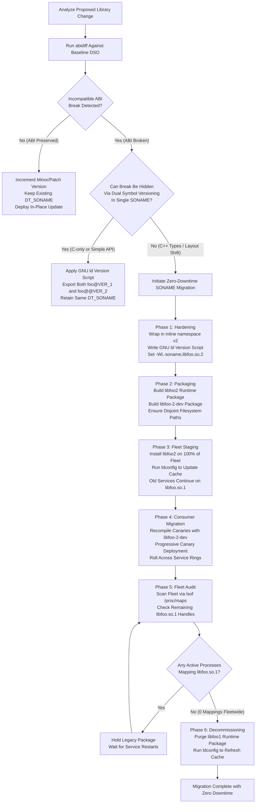

# Playbook: Execute a Zero-Downtime Shared Library SONAME Migration

> [!summary] Scope
> Operational runbook for safely migrating an ABI-breaking C++ shared library across an enterprise fleet without breaking downstream services.
> Details dual-SONAME packaging, inline namespace versioning, GNU ld version script symbol mapping, and side-by-side deployment staging.
> Includes pre-flight validation scripts, symlink management, and emergency rollback procedures.
> Provides concrete verification commands using readelf and ldd to check binary compatibility.

The foundational mechanisms of ELF shared objects and symbol visibility are owned by [[Cpp-ABI-Stability-Symbol-Visibility-and-SONAME]].
Low-level symbol versioning mechanisms, GNU version scripts, and dynamic linker version verification structures are owned by [[Cpp-Glibc-Symbol-Versioning-and-Portable-Linux-Binaries]].
Multi-version co-existence hazards and symbol conflict resolutions are owned by [[Diamond-Dependency-and-Incompatible-ABI-Mitigation]].
This playbook owns the end-to-end operational execution of an ABI-breaking shared library migration across an enterprise fleet without downtime.

## Trigger and Symptoms

Activate this playbook when an unavoidable Application Binary Interface (ABI) break must be introduced into a core shared library (`.so`) that serves multiple independently deployed services across an enterprise fleet.

Common triggers for an unavoidable ABI break include:
- Modifying the memory layout, member alignment, padding, or size of an exported `struct` or `class`.
- Adding, removing, or reordering virtual functions in a polymorphic class, which shifts virtual method table (`vtable`) offsets.
- Changing function signatures, parameter types, template instantiations, or return types in public headers.
- Removing public symbols or changing symbol visibility attributes from default to hidden.
- Upgrading standard library or compiler runtime ABI baselines (such as the historical GCC 5 `std::string` dual-ABI transition governed by `_GLIBCXX_USE_CXX11_ABI`).

Symptoms of a failed, uncoordinated, or in-place library migration include:
- Executable startup failure with exit code 127: `error while loading shared libraries: libfoo.so.1: cannot open shared object file: No such file or directory`.
- Immediate process termination with exit code 139 (`SIGSEGV`) or exit code 134 (`SIGABRT`) due to vtable corruption or mismatched structure offsets.
- Silent memory corruption occurring when an existing service binary passes a smaller allocated buffer to a newly deployed library function expecting a larger structure.
- Dynamic symbol lookup failure during execution: `undefined symbol: _ZN3foo6Widget7executeEv`.
- One Definition Rule (ODR) violations and deadlocks when an application transitively loads both legacy and updated shared objects via divergent dependencies.

## Decision Tree

The following flowchart guides the architectural choices and operational phases for executing a zero-downtime migration:



## Prerequisites

Before initiating the operational procedure, verify the following tools, system files, and permissions across build systems and target fleet nodes.

### Required Toolchain Binaries
- `gcc` / `g++` or `clang` / `clang++`; the commands here were run with g++ 13.3 (Ubuntu 24.04).
- GNU Binutils: `readelf`, `objdump`, `nm`, and `ld`; run with binutils 2.42.
- Libabigail suite: `abidw` and `abidiff` for automated ABI verification; any release that supports `--headers-dir2` and `--drop-private-types`.
- GNU C Library dynamic linker runtime: `/sbin/ldconfig` and dynamic loader (`ld.so`).
- Fleet inspection utilities: `lsof`, `fuser`, and `procps` (`/proc/$pid/maps`).

### Environment and Permission Checks
- Target fleet nodes must grant administrative access (`sudo` or system automation service accounts) to install packages and execute `/sbin/ldconfig`.
- Build systems must have access to enterprise artifact registries to publish dual-package artifacts simultaneously.
- Verify that `/etc/ld.so.conf` or an included file in `/etc/ld.so.conf.d/` contains the target library installation directory (typically `/usr/local/lib` or `/usr/lib64`).
- Ensure `LD_LIBRARY_PATH` is not hardcoded in system-wide profile scripts: `ld.so` searches it before `DT_RUNPATH` and `/etc/ld.so.cache` (ld.so(8) search order), so a stale directory there silently wins over the staged packages.

## Commands and Numbers to Know

The following table provides essential constants, dynamic array tags, exit codes, and default paths relevant to ELF dynamic linking and SONAME migration on Linux systems (as of 2026-11).

| Category | Identifier or Command | Value or Default (Linux, as of 2026-11) | Description |
| :--- | :--- | :--- | :--- |
| Dynamic Tag | `DT_NEEDED` | `1` (`0x01`) | ELF dynamic array tag specifying a required shared object dependency name. |
| Dynamic Tag | `DT_SONAME` | `14` (`0x0e`) | ELF dynamic array tag embedding the shared object logical name. |
| Dynamic Tag | `DT_RPATH` | `15` (`0x0f`) | Legacy runtime search path, superseded by `DT_RUNPATH` (gABI ch. 5); evaluated before `LD_LIBRARY_PATH` and ignored when `DT_RUNPATH` is present. |
| Dynamic Tag | `DT_RUNPATH` | `29` (`0x1d`) | Modern runtime library search path; evaluated after `LD_LIBRARY_PATH`. |
| Section Header | `.dynsym` | Dynamic Symbol Table | Table of symbols exported or imported for dynamic linking. |
| Section Header | `.gnu.version` | Symbol Version Table | Array of 16-bit integers mapping dynamic symbols to version definitions. |
| Section Header | `.gnu.version_d` | Version Definition Section | Contains `Elfxx_Verdef` records exported by this shared library. |
| Section Header | `.gnu.version_r` | Version Requirements Section | Contains `Elfxx_Verneed` records required from external dependencies. |
| Exit Code | `127` | Shell Command Not Found / Loader Failure | Returned when `ld.so` fails to resolve a `DT_NEEDED` dependency at program load time. |
| Exit Code | `134` | `128 + 6` (`SIGABRT`) | Returned when an assertion failure or `std::terminate()` aborts execution. |
| Exit Code | `139` | `128 + 11` (`SIGSEGV`) | Returned when invalid memory address access occurs due to corrupted pointer or vtable offset. |
| Tool Return Code | `abidiff` bit 2 | `4` (`0x04`) | Bit set when general ABI differences are detected. |
| Tool Return Code | `abidiff` bit 3 | `8` (`0x08`) | Bit set when incompatible ABI differences (breaks) are confirmed. |
| Tool Return Code | `abidiff` combined | `12` (`0x0c`) | Combined bitmask (`4 \| 8`) indicating breaking ABI changes requiring SONAME bump. |
| Cache File | `/etc/ld.so.cache` | Binary file | Pre-indexed mapping from library names to filesystem paths created by `ldconfig`. |
| Config File | `/etc/ld.so.conf` | Plain text | Master configuration file listing directories searched by `ldconfig`. |
| Linker Flag | `-Wl,-soname,NAME` | Linker argument | Instructs GNU `ld` to write string `NAME` into the `DT_SONAME` dynamic tag. |
| Linker Flag | `-Wl,--version-script,MAP` | Linker argument | Restricts and versions exported symbols via a GNU linker version script. |
| Linker Flag | `-Wl,-Bsymbolic` | Linker argument | Binds references to global symbols within the DSO to local definitions, reducing interposition. |

## Step-by-Step Execution

A zero-downtime shared library migration requires strict phase separation.
Never attempt to recompile downstream services before the new runtime library is indexed on all target nodes.
Never remove the legacy runtime library until all downstream services have transitioned.

```
+---------------------------------------------------------------------------------------------------------+
|                                    CHRONOLOGICAL MIGRATION PHASES                                       |
+------------------------------------+-----------------------------------+--------------------------------+
|  Phase 1: Build & Packaging        |  Phase 2: Fleet Staging           |  Phase 3: Consumer Cutover     |
|  - C++ inline namespace            |  - Install libfoo2 on all nodes   |  - Rebuild services with v2    |
|  - GNU ld version script           |  - Run ldconfig to update cache   |  - Deploy canaries & rings     |
|  - Produce libfoo2 & libfoo-2-dev  |  - libfoo.so.1 remains untouched  |  - Both SONAMEs active in RAM  |
+------------------------------------+-----------------------------------+--------------------------------+
                                                     |
                                                     v
+---------------------------------------------------------------------------------------------------------+
|  Phase 4: Audit & Decommissioning                                                                       |
|  - Verify 0 processes map libfoo.so.1 via /proc/$pid/maps                                               |
|  - Uninstall legacy libfoo1 package fleet-wide                                                          |
|  - Refresh ldconfig cache; zero downtime achieved                                                      |
+---------------------------------------------------------------------------------------------------------+
```

### Phase 1: Pre-Flight ABI Audit and Impact Radius Analysis

Before modifying production code, formally confirm whether the proposed changes break the existing ABI using Libabigail.

#### Step 1.1: Generate the Baseline ABI XML Representation
Extract the baseline ABI from the currently deployed production shared library (`libfoo.so.1.2.0`).

```bash
abidw --headers-dir /usr/include/foo /usr/lib64/libfoo.so.1.2.0 > libfoo_v1.abi.xml
```

#### Step 1.2: Compare Candidate Library Against Baseline
Compile a candidate shared library build and execute `abidiff` against the baseline XML description.

```bash
abidiff --headers-dir2 include/foo --drop-private-types libfoo_v1.abi.xml libfoo_candidate.so
ABIDIFF_STATUS=$?
echo "abidiff return code: ${ABIDIFF_STATUS}"
```

`abidiff` accepts the textual ABI emitted by `abidw` on one side and an ELF binary on the other.
`--drop-private-types` only acts together with the `--headers-dir1`/`--headers-dir2` options; the baseline XML is already filtered because `abidw` ran with `--headers-dir` (libabigail abidiff manual).

**Interpretation:**
- If `ABIDIFF_STATUS` is `0`, the ABIs are equal.
  No SONAME bump is required; follow standard minor release procedures as covered in [[Versioning-SemVer-CalVer-and-ABI]].
- If `ABIDIFF_STATUS` is `4` (`ABIDIFF_ABI_CHANGE` without `ABIDIFF_ABI_INCOMPATIBLE_CHANGE`), the manual says the change "might or might not be compatible"; a human must read the report before deciding.
- If `ABIDIFF_STATUS & 1` (`ABIDIFF_ERROR`) is non-zero, the comparison itself failed; treat it as a blocked gate, not as a pass.
- If `ABIDIFF_STATUS & 8` is non-zero (such as return code `12`), an incompatible ABI break has occurred.
  Proceed immediately to Phase 2.

#### Step 1.3: Map Fleetwide Reverse Dependencies
Identify every binary, shared library, and package across the enterprise that links against `libfoo.so.1`.

On Debian/Ubuntu build systems:
```bash
apt-cache rdepends --installed libfoo1
```

On RPM/RHEL build systems:
```bash
rpm -q --whatrequires "libfoo.so.1()(64bit)"
```

In modern monorepos or artifact repositories, query the build graph (such as Bazel `query 'rdeps(//..., //libs/foo:foo)'`) to catalog all affected downstream consumer targets.

### Phase 2: Source-Level and Linker-Level Hardening

When an ABI break is confirmed, the new library version must prevent symbol clashes and One Definition Rule (ODR) violations in scenarios where both versions are loaded into a single process address space.

#### Step 2.1: Apply C++11 Inline Namespaces
Isolate the new C++ symbols at the mangling level by enclosing the updated classes, structs, and functions in an inline namespace:

```cpp
// include/foo/engine.hpp
#pragma once
#include <cstdint>

// Required when the DSO is built with -fvisibility=hidden (Step 2.3).
#define FOO_API __attribute__((visibility("default")))

namespace foo {
#if defined(FOO_VERSION_1_COMPAT)
namespace v1 {
    struct OrderRecord {
        uint32_t order_id;
        double price;
        uint32_t quantity;
    };
    class FOO_API Engine {
    public:
        uint64_t process(const OrderRecord& rec);
    };
}
#endif

inline namespace v2 {
    // ABI break: OrderRecord layout expanded with 64-bit client_id
    struct OrderRecord {
        uint64_t client_id;
        uint32_t order_id;
        double price;
        uint64_t quantity;
    };

    class FOO_API Engine {
    public:
        Engine();
        ~Engine();
        uint64_t process(const OrderRecord& rec);
        uint32_t version() const;
    };
} // namespace v2
} // namespace foo
```

*Mechanism:* Because `v2` is marked `inline`, client code writing `foo::Engine` compiles seamlessly against `foo::v2::Engine`.
Under the Itanium C++ ABI, symbols are mangled as `_ZN3foo2v26Engine7processERKNS0_11OrderRecordE`.
Existing binaries compiled against the original, un-namespaced header reference `_ZN3foo6Engine7processERKNS_11OrderRecordE` (observed with g++ 13.3); only a library that already shipped `v1` inside an inline namespace, as the lab does, exports `_ZN3foo2v16Engine7processERKNS0_11OrderRecordE`.
Either way the mangled names are distinct from the `v2` names, so the two libraries cannot interpose on each other's C++ symbols.

#### Step 2.2: Author a GNU ld Version Script
Define explicit version nodes to scope symbol visibility and bind symbols to version tags:

```text
# src/libfoo_v2.map
FOO_2.0 {
    global:
        extern "C++" {
            foo::v2::*;
        };
    local:
        *;
};
```

#### Step 2.3: Compile the New Shared Object with Versioned SONAME
Compile the DSO with `-fPIC`, hidden symbol visibility, explicit SONAME tagging, and the version script:

```bash
g++ -O3 -fPIC -fvisibility=hidden -shared \
    src/engine.cpp -Iinclude \
    -Wl,-soname,libfoo.so.2 \
    -Wl,--version-script=src/libfoo_v2.map \
    -o build/libfoo.so.2.0.0
```

A version script cannot re-export a symbol the compiler already marked hidden.
With `-fvisibility=hidden`, every public class or function must carry `FOO_API` (Step 2.1); built from an unannotated header, this exact command exported zero `Engine` symbols in the verifier's Ubuntu 24.04 run (g++ 13.3, binutils 2.42), while the annotated header exports all six under `@@FOO_2.0`.

#### Step 2.4: Verify Embedded Dynamic Tags
Confirm that the compiled ELF binary contains the correct `DT_SONAME` tag and version definition records:

```bash
readelf -d build/libfoo.so.2.0.0 | grep -E 'SONAME|FLAGS_1'
readelf -V build/libfoo.so.2.0.0
```

**Verification Check:**
The output must show `(SONAME) Library soname: [libfoo.so.2]`.
The version definition section must display version definition index `2` bound to `FOO_2.0`.

### Phase 3: Dual-SONAME Packaging and Filesystem Segregation

Package managers require clean file separation to permit simultaneous installation of multiple major library versions.
Follow standard system packaging contracts as detailed in [[Cpp-System-Packaging-Deb-RPM-and-Homebrew]].

#### Step 3.1: Package Layout Contracts
Structure the packages so that runtime packages contain only versioned files, while development packages own unversioned symlinks and headers:

```text
Runtime Package 1: libfoo1 (Legacy)
  |-- /usr/lib64/libfoo.so.1.0.0
  \-- /usr/lib64/libfoo.so.1 -> libfoo.so.1.0.0  (SONAME symlink)

Runtime Package 2: libfoo2 (New Version)
  |-- /usr/lib64/libfoo.so.2.0.0
  \-- /usr/lib64/libfoo.so.2 -> libfoo.so.2.0.0  (SONAME symlink)

Development Package: libfoo-2-dev
  |-- /usr/include/foo-2/foo/engine.hpp
  |-- /usr/lib64/libfoo.so -> libfoo.so.2       (Linker symlink)
  \-- /usr/lib64/pkgconfig/foo-2.pc
```

#### Step 3.2: Configure pkg-config for Isolated Builds
Author `/usr/lib64/pkgconfig/foo-2.pc` to allow downstream consumers to opt into the new version explicitly:

```ini
prefix=/usr
exec_prefix=${prefix}
libdir=${exec_prefix}/lib64
includedir=${prefix}/include/foo-2

Name: libfoo
Description: High-performance enterprise core library
Version: 2.0.0
Libs: -L${libdir} -lfoo
Cflags: -I${includedir}
```

### Phase 4: Fleet-Wide Side-by-Side Runtime Staging

Deploy the new runtime package `libfoo2` across the entire fleet before modifying or recompiling any downstream consumer services.

#### Step 4.1: Deploy libfoo2 to Fleet Nodes
Distribute and install the `libfoo2` package using the host package manager:

On Debian/Ubuntu:
```bash
sudo dpkg -i libfoo2_2.0.0-1_amd64.deb
```

On RHEL/Rocky Linux:
```bash
sudo rpm -ivh libfoo2-2.0.0-1.x86_64.rpm
```

#### Step 4.2: Refresh the Dynamic Linker Cache
Run `ldconfig` to register `libfoo.so.2` into `/etc/ld.so.cache`:

```bash
sudo ldconfig
```

#### Step 4.3: Validate Cache and Filesystem Coexistence
Verify that `/etc/ld.so.cache` contains active index entries for both SONAMEs:

```bash
ldconfig -p | grep libfoo
```

**Expected Output:**
```text
	libfoo.so.2 (libc6,x86-64) => /usr/lib64/libfoo.so.2
	libfoo.so.1 (libc6,x86-64) => /usr/lib64/libfoo.so.1
```

Confirm that running services linked against `libfoo.so.1` remain completely undisturbed and continue operating without restarts.

### Phase 5: Phased Downstream Consumer Rebuild and Progressive Rollout

With both shared libraries staged in the fleet filesystem and indexed in the dynamic linker cache, downstream consumers can be migrated independently.

#### Step 5.1: Install Development Package on Build Farm
Install `libfoo-2-dev` on CI/CD build nodes:

```bash
sudo apt-get install -y libfoo-2-dev
```

#### Step 5.2: Update Downstream Build Configuration
Update downstream build targets (e.g., in CMake or Meson) to consume `foo-2`:

```cmake
# CMakeLists.txt of downstream consumer
find_package(PkgConfig REQUIRED)
pkg_check_modules(FOO REQUIRED foo-2)

add_executable(order_gateway src/main.cpp)
target_include_directories(order_gateway PRIVATE ${FOO_INCLUDE_DIRS})
target_link_libraries(order_gateway PRIVATE ${FOO_LIBRARIES})
```

#### Step 5.3: Verify Consumer Binary Dependencies
Before deploying the recompiled consumer binary, verify that its `DT_NEEDED` tag points to `libfoo.so.2`:

```bash
readelf -d build/order_gateway | grep -E 'NEEDED.*libfoo'
```

**Verification Check:**
The output must show:
```text
 0x0000000000000001 (NEEDED)             Shared library: [libfoo.so.2]
```
If the output shows `libfoo.so.1` or a full path instead of a bare SONAME, abort the release and correct the build link flags.

#### Step 5.4: Execute Progressive Canary Rollout
Deploy the recompiled consumer services using standard progressive delivery techniques (canary instances, blue-green pools, or deployment rings) as detailed in [[Progressive-Delivery-Rollbacks-and-Feature-Flags]].

As each new service instance spins up on a fleet node:
1. `ld.so` reads `/etc/ld.so.cache`.
2. `ld.so` locates `libfoo.so.2` at `/usr/lib64/libfoo.so.2`.
3. The new process binds dynamically to `v2` symbols.
4. Legacy service processes running on the exact same host continue using `libfoo.so.1` concurrently in memory.

### Phase 6: Fleet Audit, Telemetry, and Decommissioning

Do not uninstall `libfoo1` immediately after the final service deployment.
Enforce a soak period and audit all running processes across the fleet.

#### Step 6.1: Audit Open File Descriptors and Memory Mappings
Execute a fleet-wide scan to detect any lingering processes that maintain active memory mappings to `libfoo.so.1`:

```bash
sudo lsof /usr/lib64/libfoo.so.1*
```

Alternatively, query `/proc` across all running PIDs:
```bash
grep -l "libfoo.so.1" /proc/[0-9]*/maps 2>/dev/null | awk -F'/' '{print $3}' | while read -r PID; do
    echo "Stale process detected: PID ${PID} ($(cat /proc/${PID}/comm))"
done
```

#### Step 6.2: Purge Legacy Package Fleet-Wide
Once fleet telemetry confirms zero processes are mapping `libfoo.so.1`, remove the legacy runtime package:

On Debian/Ubuntu:
```bash
sudo apt-get purge -y libfoo1
sudo ldconfig
```

On RHEL/Rocky Linux:
```bash
sudo rpm -e libfoo1
sudo ldconfig
```

#### Step 6.3: Confirm Clean Dynamic Linker Cache
Verify that `libfoo.so.1` has been pruned from the dynamic linker cache:

```bash
ldconfig -p | grep libfoo
```

**Expected Output:**
```text
	libfoo.so.2 (libc6,x86-64) => /usr/lib64/libfoo.so.2
```

## Verification

Run these verification commands at each phase transition to guarantee system integrity.

### Verification 1: Inspect Dynamic Section Tags
Verify whether an executable or shared object properly specifies its dependencies and identity:

```bash
readelf -d /usr/lib64/libfoo.so.2.0.0 | grep -E 'SONAME|NEEDED'
```

Expected output:
```text
 0x000000000000000e (SONAME)             Library soname: [libfoo.so.2]
```

### Verification 2: Verify Symbol Version Tables
Check the symbol versions exposed by the library:

```bash
readelf -V /usr/lib64/libfoo.so.2.0.0
```

Verify that `.gnu.version_d` exports the expected version node (e.g., `FOO_2.0`) and that `.gnu.version` associates public functions with that version index.

### Verification 3: Dynamic Loader Dependency Tracing
Trace runtime dependency resolution for a consumer executable without executing business logic:

```bash
LD_TRACE_LOADED_OBJECTS=1 /usr/local/bin/order_gateway
```

Expected output confirms `libfoo.so.2` is resolved (illustrative RHEL-family x86-64 layout; load addresses vary per run):
```text
	linux-vdso.so.1 (0x00007fffa3be2000)
	libfoo.so.2 => /usr/lib64/libfoo.so.2 (0x00007f3a9e400000)
	libc.so.6 => /lib64/libc.so.6 (0x00007f3a9e200000)
	/lib64/ld-linux-x86-64.so.2 (0x00007f3a9e600000)
```

### Verification 4: Detailed Loader Binding Diagnostics
If symbol binding anomalies or unexpected fallbacks occur during canary testing, run the binary under `LD_DEBUG`:

```bash
LD_DEBUG=libs,versions,bindings /usr/local/bin/order_gateway 2>&1 | grep -E 'libfoo|version'
```

Verify that the loader searches for `FOO_2.0` symbols and successfully binds to definitions inside `libfoo.so.2`.

## Worked Example: Zero-Downtime SONAME Migration Lab

The lab in `code/07-Packaging-and-Release/soname_migration/` provides a complete, runnable reproduction of this migration procedure.

### Lab Implementation Architecture
1. `v1/order.hpp` and `v1/order.cpp`: Defines `order::v1::OrderRecord` and `order::v1::OrderProcessor`.
   Compiled into `liborder.so.1.0.0` with `-Wl,-soname,liborder.so.1` and version script `v1/order.map`.
2. `consumer_v1.cpp`: Compiled against `v1/order.hpp`, linked with `-lorder`.
   Inspection with `readelf -d` confirms `DT_NEEDED: liborder.so.1`.
3. `v2/order.hpp` and `v2/order.cpp`: Introduces an explicit ABI break.
   `OrderRecord` memory layout is modified by inserting a 64-bit `client_id` field at offset 0 and expanding `quantity` to 64 bits.
   The class is placed inside `order::inline namespace v2`.
   Compiled into `liborder.so.2.0.0` with `-Wl,-soname,liborder.so.2` and version script `v2/order.map`.
4. Coexistence Staging: Both `liborder.so.1.0.0` and `liborder.so.2.0.0` are installed into the same `staging/` directory alongside their respective SONAME symlinks.
5. `consumer_v2.cpp`: Compiled against `v2/order.hpp`, linked with `-lorder`.
   Inspection with `readelf -d` confirms `DT_NEEDED: liborder.so.2`.
6. Execution Check: `consumer_v1` and then `consumer_v2` execute as separate processes against the shared staging directory, demonstrating side-by-side installation; each finds its library through the `$ORIGIN/staging` run path (emitted as `DT_RUNPATH` by this toolchain).

### Verified Lab Output

Recorded by `make record` on `linux-aarch64` inside the pinned Ubuntu 24.04 container (`code/_harness/linux-labs.Dockerfile`) on 2026-11-15:
The file is `code/07-Packaging-and-Release/soname_migration/expected/linux-aarch64.txt`; an independent re-run with `python3 -m _harness.verify` on 2026-11-15 reproduced it exactly (PASS).

```text
=== Phase 1: Binary Dependency Check ===
consumer_v1 NEEDED: liborder.so.1
consumer_v2 NEEDED: liborder.so.2
=== Phase 2: SONAME Tag Check ===
liborder.so.1 SONAME: liborder.so.1
liborder.so.2 SONAME: liborder.so.2
=== Phase 3: Side-by-Side Coexistence Execution ===
consumer_v1: engine_version=1 order_hash=10100500
consumer_v2: engine_version=2 order_hash=42945388093204
=== Phase 4: Symbol Mangling and Version Node Check ===
_ZN5order2v114OrderProcessor7processERKNS0_11OrderRecordE
_ZN5order2v214OrderProcessor7processERKNS0_11OrderRecordE
=== Phase 5: Filesystem Co-installation Layout ===
liborder.so
liborder.so.1
liborder.so.1.0.0
liborder.so.2
liborder.so.2.0.0
```

### What the Output Proves
- Phase 1 proves that `consumer_v1` records a runtime dependency on `liborder.so.1`, whereas `consumer_v2` records `liborder.so.2`.
  Neither executable references a raw file path or an unversioned `.so`.
- Phase 2 proves that the ELF `DT_SONAME` dynamic tag was correctly embedded into each shared object during the build.
- Phase 3 proves that both binaries, run one after the other from the same directory, each load their own SONAME and complete without errors.
  `consumer_v1` computes `order_hash=10100500` (`101 * 100000 + 500`) from the v1 layout, while `consumer_v2` computes `order_hash=42945388093204` (`(9999 << 32) ^ 10100500`) from the v2 layout with its 64-bit `client_id`.
- Phase 4 proves that the C++ inline namespace separated the mangled symbol names:
  `v1` exported `_ZN5order2v114OrderProcessor7processERKNS0_11OrderRecordE`
  `v2` exported `_ZN5order2v214OrderProcessor7processERKNS0_11OrderRecordE`
  The script strips the `@@ORDER_1.0` / `@@ORDER_2.0` suffix, so this phase does not print the version nodes, and the lab never loads both DSOs into one process.
  Distinct mangled names are what prevent interposition when a transitive dependency does load both; the lab shows the names differ, not the in-process behavior.
- Phase 5 proves that the shared library files and SONAME symlinks coexist cleanly in the same directory without filename collision.

## Rollback Procedure

When an unexpected regression occurs during a migration, follow one of these three scoped rollback procedures.
For severe incidents requiring immediate containment, refer to [[Contain-and-Roll-Back-a-Bad-Production-Release]].

### Rollback Level 1: Revert a Single Regressed Consumer Service (Zero Host Impact)
If a newly deployed service binary linking to `libfoo.so.2` displays runtime errors, roll back only that service:

1. Redeploy the previous release artifact of the service binary (which links against `libfoo.so.1`).
2. Restart the service process.
3. Because `libfoo.so.1` was preserved on the host filesystem throughout the migration, the rolled-back service immediately resolves `libfoo.so.1` and boots with zero downtime.
4. No host-level library uninstalls, symlink modifications, or `ldconfig` invocations are required.

### Rollback Level 2: Abort Migration and Remove Staged Runtime DSO
If a critical defect is identified in `libfoo.so.2` before substantial consumer rollout:

1. Stop any canary instances running `v2` consumer binaries.
2. Uninstall the `libfoo2` package from fleet hosts:
   ```bash
   sudo apt-get purge -y libfoo2 || sudo rpm -e libfoo2
   ```
3. Refresh the dynamic linker cache:
   ```bash
   sudo ldconfig
   ```
4. Verify that `libfoo.so.1` remains intact:
   ```bash
   ldconfig -p | grep libfoo
   ```

### Rollback Level 3: Emergency Dynamic Linker Cache Recovery
If an operator accidentally corrupts `/etc/ld.so.cache` or breaks a critical system symlink:

1. Recreate the required SONAME symlink atomically using a temporary file and rename:
   ```bash
   ln -s /usr/lib64/libfoo.so.1.0.0 /usr/lib64/libfoo.so.1.tmp
   mv -T /usr/lib64/libfoo.so.1.tmp /usr/lib64/libfoo.so.1
   ```
   *Mechanism:* GNU `mv` first tries `renameat2` with `RENAME_NOREPLACE`; when the destination exists (`EEXIST`) it retries the rename without that flag (coreutils `src/copy.c`, `copy_internal`).
   The retry is a single rename call that atomically replaces the directory entry, so a concurrent `open()` by `ld.so` sees either the old link or the new one and never a missing name.
   `-T` only stops `mv` from treating a directory destination as a target directory.
2. Rebuild the cache forcefully:
   ```bash
   sudo /sbin/ldconfig -v -X
   ```
   *Note:* The `-X` flag instructs `ldconfig` not to update symlinks; the cache is still rebuilt (ldconfig(8)).
   Without `-X`, `ldconfig` itself recreates a missing SONAME symlink from the real file's `DT_SONAME` in any directory it scans: the verifier deleted `libx.so.1` next to `libx.so.1.0.0`, and `ldconfig -n` recreated it, while `ldconfig -X -n` left it missing (glibc 2.39).

## Failure Modes of the Procedure

The following table summarizes common operational failure modes, root causes, detection mechanisms, and recovery actions during an SONAME migration.

| Failure Mode | Root Cause | Detection Mechanism | Recovery Action |
| :--- | :--- | :--- | :--- |
| **Loader Startup Failure (Exit Code 127)** | Consumer deployed before `libfoo2` is installed on host, or `libfoo1` removed prematurely. | Process exits immediately; stderr logs `cannot open shared object file: No such file or directory`. | Re-stage missing `libfoo` package immediately; execute `ldconfig`. Roll back consumer binary if necessary. |
| **In-Place DSO Corruption (`SIGBUS` / `SIGSEGV`)** | Operator overwrote `.so` file on disk using `cp` instead of atomic install/replace. | Kernel logs `segfault at ...` (or `trap invalid opcode` on x86-64); the faulting mapping in `/proc/$pid/maps` points at the overwritten inode. | Kill corrupted processes; replace `.so` using atomic `install` or `mv`; restart service. |
| **Transitive Diamond Collision** | Consumer loads Plugin A (links `v1`) and Plugin B (links `v2`) without inline namespaces. | Undefined behavior, random heap corruption, or `SIGSEGV` in shared data structures. | Apply inline namespaces (`inline namespace v2`) to isolate mangled symbols; rebuild `v2`. See [[Diamond-Dependency-and-Incompatible-ABI-Mitigation]]. |
| **Unversioned Dev Symlink Clash** | `libfoo1` and `libfoo2` both package `/usr/lib64/libfoo.so` or `/usr/include/foo.h`. | Package manager aborts install with file conflict error (e.g. `dpkg: error processing archive`). | Split packages: place unversioned `.so` and headers exclusively in `libfoo-dev` packages. |
| **Stale ld.so Cache** | Library files dropped into `/usr/lib64` without invoking `ldconfig`. | Binary fails to start unless `LD_LIBRARY_PATH` is explicitly set. | Execute `sudo /sbin/ldconfig` to index new shared objects into `/etc/ld.so.cache`. |
| **Global Symbol Leak via dlopen** | Plugin loaded via `dlopen(..., RTLD_GLOBAL)` exports unversioned symbols into global namespace. | Unrelated service components call intended local functions but execute foreign plugin code. | Use `RTLD_LOCAL` or isolate plugins via `dlmopen(LM_ID_NEWLM, ...)`. |

## Pitfalls

> [!warning] Pitfalls:
> 1. **Overwriting Shared Libraries In-Place:**
>    Never execute `cp new_lib.so /usr/lib64/libfoo.so.1.0.0` on a running system.
>    Running processes have the existing `.so` mapped into virtual memory via `mmap()`.
>    Overwriting the underlying inode alters executable code pages under the kernel's feet, causing immediate crashes with `SIGBUS` or `SIGSEGV` when page faults occur.
>    Always use `install` (which unlinks the destination first; in the verifier's run GNU coreutils 9.4 `cp` kept the destination inode and `install` produced a new one) or write to a temporary file and atomically replace via `mv`.
>
> 2. **Neglecting C++ Inline Namespaces in Diamond Graphs:**
>    Relying exclusively on an SONAME bump does not prevent crashes if an application transitively depends on both `v1` and `v2`.
>    Because the dynamic linker places both DSOs in the global symbol scope by default, functions sharing the same mangled name will interpose unless each SONAME also defines a distinct version node (such as `FOO_1.0` and `FOO_2.0`), and even then the shared type names remain an ODR violation.
>    Always combine an SONAME bump with C++ inline namespaces (`inline namespace v2`).
>
> 3. **Bundling Linker Symlinks in Runtime Packages:**
>    A runtime package (`libfoo2`) must never include the unversioned linker symlink (`libfoo.so`).
>    If both `libfoo1` and `libfoo2` package `/usr/lib64/libfoo.so`, the package manager will reject co-installation.
>    Reserve the unversioned `.so` symlink strictly for development packages (`libfoo-dev`).
>
> 4. **Hardcoding Search Paths with DT_RPATH:**
>    Avoid linking binaries with `-Wl,-rpath` without `$ORIGIN`.
>    Hardcoded absolute RPATH entries override `LD_LIBRARY_PATH` and can force binaries to load legacy libraries from unexpected locations, bypassing staged fleet updates.
>    Prefer `DT_RUNPATH` or system cache resolution.
>    The GNU ld manual says "By default, the new dynamic tags are not created", so upstream `-rpath` yields `DT_RPATH`; some distribution toolchains change that default (Ubuntu 24.04 g++ 13.3 with binutils 2.42 emitted `RUNPATH` in the verifier's run), so check with `readelf -d` and pass `-Wl,--enable-new-dtags` explicitly.
>
> 5. **Mixing Standard Library ABI Configurations:**
>    Ensure all libraries and consumers are built with matching standard library ABI macros (such as `-D_GLIBCXX_USE_CXX11_ABI=1`).
>    A mismatch in `std::string` or `std::vector` ABI creates silent symbol resolution failures or corrupt parameter passing across library boundaries.

## At Scale

Executing an SONAME migration across 1,000 to 50,000 production nodes introduces organizational and architectural challenges that cannot be solved by manual scripting.

### CI/CD Automated ABI Gates
Incorporate automated ABI regression checks into continuous integration pipelines.
Every pull request targeting a shared library must run `abidiff` against the current production baseline.
If `abidiff` reports an incompatible change (bitmask exit code `12`) without an accompanying pull request bumping the SONAME and applying inline namespaces, the CI gate blocks the merge automatically.

### Enterprise Package Repository Staging
Maintain staged package channels (e.g. `unstable`, `testing`, `stable`).
When an SONAME bump occurs:
1. Publish `libfoo2` and `libfoo-2-dev` to the enterprise repository.
2. Fleet configuration management (Ansible, Puppet, Chef, or Salt) pushes `libfoo2` to the `base-runtime` package manifest installed on all nodes.
3. This decouples library deployment from application releases, ensuring that by the time downstream teams recompile, 100% of fleet nodes are already capable of running `libfoo.so.2`.

### Telemetry and Fleetwide eBPF Audits
Rather than relying on team attestations, track migration progress via kernel-level observability.
Deploy an eBPF probe or osquery scheduled query to trace dynamic linker activity across the fleet:

```c
// BPF trace snippet conceptually tracking openat on legacy SONAME
SEC("tracepoint/syscalls/sys_enter_openat")
int trace_openat(struct trace_event_raw_sys_enter* ctx) {
    const char *filename = (const char *)ctx->args[1];
    // Check if filename matches libfoo.so.1
    // Increment metric counter per service cgroup
    return 0;
}
```

An `openat` probe only sees new loads; a process that mapped `libfoo.so.1` before the probe was attached never reopens it, so pair the probe with a periodic `/proc/$pid/maps` scan (or osquery's `process_memory_map` table, which lists mapped paths per `pid`) to count long-running holders.
Dashboard metrics report the percentage of running services actively mapped to `libfoo.so.1`.
Decommissioning of `libfoo1` is automatically scheduled only after this metric reaches 0.00% for seven consecutive days.

## Practice Drill

> [!tip] Practice Drill:
> To practice identifying and debugging the silent memory corruption that occurs when an ABI break is released without an SONAME bump, execute [[Drill-Packaging-Cpp-Silent-ABI-Break-Across-Shared-Libraries]].

## Interview Questions

### Question 1 (L5 - Core Mechanics): SONAME vs File Name vs Linker Name
What are the distinct functions of `libfoo.so`, `libfoo.so.2`, and `libfoo.so.2.1.0` in Linux shared library management?
Why does an operating system package manager split a library into `libfoo2` and `libfoo-dev` packages?

> [!success]- Answer
> The three names fulfill distinct lifecycle roles:
> 1. `libfoo.so.2.1.0` is the **Real File**, containing the actual compiled machine code and data.
> 2. `libfoo.so.2` is the **SONAME Symlink**, pointing to the real file.
>    Its name matches the `DT_SONAME` entry in the library's dynamic section and is recorded in the `DT_NEEDED` tag of dependent binaries.
>    The dynamic linker (`ld.so`) searches for this name at runtime.
> 3. `libfoo.so` is the **Linker Symlink**, used exclusively at development/link time when passing `-lfoo` to the compiler.
>
> Distributions split libraries into runtime packages (`libfoo2`) and development packages (`libfoo-dev`) to allow multi-version coexistence.
> Runtime packages contain only the real file and the SONAME symlink (`libfoo.so.2`).
> Because different major versions have distinct filenames, `libfoo1` and `libfoo2` can be installed simultaneously on the same system without filesystem conflicts.
> The development package contains the unversioned symlink (`libfoo.so`) and public headers (`/usr/include/foo.h`).
> Because there can only be one `/usr/lib64/libfoo.so`, development packages for different major versions that both ship it cannot be co-installed even with versioned header directories and pkg-config files; Debian Policy 8.4 has them use `dpkg`'s Conflicts mechanism, or the linker symlink must move to a version-specific directory or name.

### Question 2 (L5 - Predict-the-output): Dynamic Linker Resolution
A developer compiles an application using:
`g++ main.cpp -L/opt/lib -lbar -o app`
In `/opt/lib`, the following files exist:
- `libbar.so -> libbar.so.1`
- `libbar.so.1 -> libbar.so.1.0.0`
- `libbar.so.1.0.0` (compiled with `-Wl,-soname,libbar.so.1`)

Predict what `readelf -d app | grep NEEDED` will output.
What happens if the operator subsequently deploys `app` to a production host where `/usr/lib64/libbar.so.1.0.0` exists, but the symlink `/usr/lib64/libbar.so.1` was deleted?

> [!success]- Answer
> 1. Output prediction:
>    `readelf -d app | grep NEEDED` will output:
>    `0x0000000000000001 (NEEDED)             Shared library: [libbar.so.1]`
>    *Reason:* The linker opens `libbar.so`, inspects its ELF dynamic section, discovers `DT_SONAME = libbar.so.1`, and stamps `libbar.so.1` (not `libbar.so` or `libbar.so.1.0.0`) into the executable's `DT_NEEDED` tag.
> 2. Runtime failure prediction:
>    On the production host, `app` will fail to execute with exit code 127:
>    `error while loading shared libraries: libbar.so.1: cannot open shared object file: No such file or directory`.
>    *Reason:* `ld.so` searches `/etc/ld.so.cache` and standard directories specifically for the string recorded in `DT_NEEDED` (`libbar.so.1`).
>    The dynamic linker does not inspect version numbers inside real files to guess missing symlinks.
>    The fix is `sudo ldconfig`: it reads `DT_SONAME` from `/usr/lib64/libbar.so.1.0.0` and recreates the `libbar.so.1` symlink, because `/usr/lib64` is a trusted directory on 64-bit RHEL-family layouts (ldconfig(8)).

### Question 3 (L6 - Debug-this): Production Crash After In-Place Update
A high-frequency trading market data parser shared library, `libmktdata.so.1.2.0`, was updated in-place on production servers using `cp libmktdata.so.1.2.0 /usr/lib64/` while trading engines were actively processing orders.
Within 15 seconds, trading engine processes began crashing with `SIGBUS` (exit code 135) and `SIGSEGV` (exit code 139) at instruction offsets inside `mkt_parse()`.
The engineering team insists: "We did not change any function signatures or struct layouts; we only fixed a calculation bug inside the function body."
Debug the exact operating system mechanism causing this crash.

> [!success]- Answer
> The root cause is memory mapping corruption caused by modifying an open file inode in-place.
> When a shared library is loaded, `ld.so` maps its segments into the process's virtual address space using `mmap()` with `MAP_PRIVATE` backed by the filesystem inode; mmap(2) leaves it unspecified whether later file changes show through a private mapping, and on Linux, pages the process has not written to do reflect them in practice.
> Executable pages are not loaded all at once; they are paged into physical RAM on demand by the kernel page fault handler.
> When `cp` overwrites an existing file in-place, it modifies the data blocks of the existing inode.
> This produces two fatal conditions:
> 1. Code pages already resident in memory now mismatch newly paged instructions, causing jump targets and relative RIP-relative offsets to land in the middle of instructions, triggering `SIGSEGV` or `SIGILL`.
> 2. If the new binary file size is smaller than the original, or if a page fault requests an offset temporarily truncated during the write, the kernel cannot satisfy the page fault and raises `SIGBUS`.
>
> *Remediation:*
> Never copy over an existing DSO in-place.
> Use `install` or write to a temporary file (`libmktdata.so.1.2.0.tmp`) and use `mv` (`renameat`) to replace the file.
> `rename` points the path at the new file's inode; existing running processes retain their mapping of the original, now unlinked, inode until they unmap it or exit.

### Question 4 (L6 - C++ ABI & ODR): Inline Namespaces vs GNU Version Scripts
Why is a GNU ld version script alone insufficient to guarantee binary compatibility when an application transitively loads two different ABI versions of the same C++ library?
How do C++11 inline namespaces resolve this limitation?

> [!success]- Answer
> A GNU ld version script operates on linker symbol names in the ELF dynamic symbol table (`.dynsym`).
> While it can attach version tags to symbols (e.g. `foo@VER_1`), standard C++ symbol mangling generates identical mangled names if class names and method signatures remain unchanged between versions (even if member variable layouts, struct sizes, or private fields differ).
> In a process that loads both `v1` and `v2` (such as via a diamond dependency), the dynamic linker searches one global scope in breadth-first load order.
> If the legacy library is unversioned (the common case) or both libraries reuse the same version node name, the first definition found interposes for every caller.
> If each SONAME defines a distinct node (`FOO_1.0` vs `FOO_2.0`), versioned references do bind to the right library: in the verifier's glibc 2.39 run, two intermediate libraries calling `sym` from `libx.so.1` and `libx.so.2` both got the v1 result when unversioned or both named `X`, but each got its own result with `X_1.0` and `X_2.0`.
> That still leaves `dlsym` lookups, objects linked without version information, and the type problem below.
> Furthermore, C++ requires the One Definition Rule (ODR).
> If two translation units compile against different struct layouts sharing the identical mangled type name, passing that object across boundaries causes undefined behavior and silent memory corruption.
>
> C++11 inline namespaces (`namespace foo { inline namespace v2 { class Engine; } }`) solve this by altering the mangled symbol name itself.
> Under the Itanium C++ ABI, the namespace becomes part of the symbol's mangled identifier (`_ZN3foo2v26Engine...` vs `_ZN3foo2v16Engine...`).
> Because the symbols possess distinct string identifiers in `.dynsym`, the dynamic linker treats them as completely independent types, preventing interposition and eliminating ODR violations.

### Question 5 (L6 - Linker Version Scripts): Meaning of @ vs @@ in Symbol Versioning
Explain the technical difference between `sym@VERSION` and `sym@@VERSION` in GNU symbol versioning.
What error occurs if an executable linked against `sym@@LIB_2.0` is run on a host providing only `libfoo.so.1` (which exports `sym@LIB_1.0`)?

> [!success]- Answer
> In GNU ELF symbol versioning:
> - `sym@@VERSION` designates the **Default Version**.
>   When a new client binary is linked against the shared library, the static linker binds references to `sym` to this version.
>   A shared library can have at most one default version for any given symbol name.
> - `sym@VERSION` designates a **Non-default (Hidden) Version**.
>   It is retained for backward compatibility with older binaries already linked against that specific version tag, but newly linked binaries will not bind to it.
>
> If an executable linked against `sym@@LIB_2.0` runs on a host providing only `LIB_1.0`, the dynamic linker checks the executable's `.gnu.version_r` (version requirements) against the library's `.gnu.version_d` (version definitions).
> Because required version `LIB_2.0` is missing, `ld.so` aborts program execution before `main()` starts with:
> ``./app: /usr/lib64/libfoo.so.1: version `LIB_2.0' not found (required by ./app)``
> The format string is in glibc `elf/dl-version.c`; unlike a missing `DT_NEEDED` file, the message carries no `error while loading shared libraries:` prefix, and the verifier observed exit status `1`, not `127` (glibc 2.39).

### Question 6 (L7 - Architecture): The Diamond Dependency Co-existence Hazard
An enterprise service links to `libauth.so` (built against `libcrypto.so.1`) and `libbilling.so` (built against `libcrypto.so.2`).
Trace how `ld.so` resolves symbols when both libraries are loaded into a single process address space.
Under what conditions does silent memory corruption occur, and what architectural options can isolate them?

> [!success]- Answer
> When `app` starts, `ld.so` traverses the dependency graph breadth-first (`DT_NEEDED`).
> If `libauth.so` appears before `libbilling.so`, `libcrypto.so.1` is loaded into the global link-map first, followed by `libcrypto.so.2`.
> By default, dynamic symbols reside in a flat global symbol table.
> If both versions export an unversioned symbol (e.g. `cipher_init`), all calls from both `libauth` and `libbilling` bind to the first definition encountered in the search path (`libcrypto.so.1`).
>
> Silent memory corruption occurs if:
> 1. `libbilling` allocates a context struct using `sizeof(v2::CipherContext)` (e.g., 256 bytes), but `libcrypto.so.1`'s `cipher_init` initializes it assuming `sizeof(v1::CipherContext)` (128 bytes), leaving fields uninitialized.
> 2. Struct fields were reordered or types changed, causing functions in `v1` to write integers into pointers or floats.
>
> Architectural isolations:
> 1. **Inline Namespaces:** Mangling shifts guarantee disjoint symbols, allowing co-existence.
> 2. **RTLD_LOCAL and RTLD_DEEPBIND:** If loaded dynamically via `dlopen()`, `RTLD_LOCAL` keeps symbols out of the global scope, and `RTLD_DEEPBIND` forces the library to resolve its own symbols before consulting the global table (though `RTLD_DEEPBIND` can break custom allocators).
> 3. **Linker Namespaces via `dlmopen`:** Calling `dlmopen(LM_ID_NEWLM, "libbilling.so", ...)` creates an entirely isolated link-map list with its own private symbol table and static variables.
> 4. Full mitigation patterns are detailed in [[Diamond-Dependency-and-Incompatible-ABI-Mitigation]].

### Question 7 (L7 - Systems Design): Zero-Downtime Fleet Migration Architecture
You are tasked with migrating a foundational telemetry library across 30,000 servers running 400 microservices.
The API must change in a way that breaks binary compatibility.
No downtime is tolerated, and rolling deployments for downstream services take up to three months.
Design the operational migration plan.

> [!success]- Answer
> The design must decouple host operating system state from application build cycles across four distinct phases:
>
> 1. **Dual-SONAME Packaging:**
>    - Bump `DT_SONAME` from `libtelemetry.so.3` to `libtelemetry.so.4`.
>    - Enclose all updated C++ symbols in an inline namespace (`inline namespace v4`).
>    - Create two independent package tracks: `libtelemetry3` (runtime) and `libtelemetry4` (runtime).
>    - Create a versioned development package `libtelemetry-4-dev` containing `/usr/include/telemetry-4/` and `/usr/lib64/pkgconfig/telemetry-4.pc`.
>
> 2. **Fleet Runtime Pre-Staging:**
>    - Roll `libtelemetry4` out to 100% of the 30,000 servers via fleet configuration management.
>    - Execute `/sbin/ldconfig` on each node.
>    - Both `libtelemetry.so.3` and `libtelemetry.so.4` now reside in `/usr/lib64/` and are indexed in `/etc/ld.so.cache`.
>    - Existing running services remain completely unaffected.
>
> 3. **Asynchronous Consumer Cutover:**
>    - Make `libtelemetry-4-dev` available to application teams.
>    - Over the 3-month window, service teams update their build configurations to link against `telemetry-4.pc`.
>    - Services deploy independently using canary and rolling updates.
>    - Recompiled binaries immediately find `libtelemetry.so.4` on any node they land on.
>
> 4. **Telemetry-Driven Decommissioning:**
>    - Deploy an eBPF tracepoint or `/proc/$pid/maps` scanner across the fleet to audit open file handles to `libtelemetry.so.3`.
>    - Track the burndown curve until active mappings reach exactly zero across all 30,000 nodes.
>    - Once verified, issue an automated command to purge `libtelemetry3` and re-run `ldconfig`.

### Question 8 (L7+ - Low-Level Linker Internals): ldconfig Concurrency and Race Conditions
During an automated rolling update, `ldconfig` is invoked on a production server while 50 multi-threaded processes are concurrently fork-execing and dynamically loading shared objects.
Explain the kernel and filesystem mechanisms that ensure `ldconfig` does not cause torn reads or crashes.
Under what exact operational mistake can a race condition cause an `ENOENT` failure?

> [!success]- Answer
> `/sbin/ldconfig` ensures atomic updates to `/etc/ld.so.cache` through the following mechanisms:
> 1. When updating the cache, `ldconfig` never writes directly to `/etc/ld.so.cache`.
>    Instead, glibc's `save_cache()` (`elf/cache.c`) opens the fixed temporary name `/etc/ld.so.cache~` with `O_NOFOLLOW`.
> 2. It writes the cache, `chmod`s it world-readable, and calls `fsync()` before closing it.
> 3. It calls `rename("/etc/ld.so.cache~", "/etc/ld.so.cache")`.
> 4. `rename(2)` (a `renameat`-family call on architectures such as aarch64 that lack plain `rename`) replaces the directory entry atomically.
>    Any process calling `open("/etc/ld.so.cache")` either opens the complete old cache file or the complete new cache file; no process can ever observe a half-written or empty cache file.
> 5. `ld.so` reads the cache by mapping it and closing the descriptor, so a process that already mapped the old cache keeps a reference to the old inode through that mapping.
>    The kernel retains the old inode's data until the last mapping or descriptor is gone.
>
> *The Fatal Race Condition Mistake:*
> If an operator or automation script updates symlinks manually using non-atomic sequences:
> `rm /usr/lib64/libfoo.so.1 && ln -s /usr/lib64/libfoo.so.1.0.0 /usr/lib64/libfoo.so.1`
> Between the execution of `rm` and `ln`, a window of several microseconds (or longer under heavy I/O) exists where `/usr/lib64/libfoo.so.1` does not exist in the directory inode table.
> If a process starts during this window, `open()` returns `ENOENT` and `ld.so` exits with code 127; a `dlopen()` call in the window instead returns `NULL` with the error in `dlerror()`, which the caller must handle.
>
> *Prevention:*
> Symlink updates must always be performed atomically using:
> `ln -sfn /usr/lib64/libfoo.so.1.0.0 /usr/lib64/libfoo.so.1.tmp && mv -T /usr/lib64/libfoo.so.1.tmp /usr/lib64/libfoo.so.1`.

## Further Reading

- Free Software Foundation, *The GNU Linker: Command-line Options*, sourceware.org, 2026. Official manual detailing `-soname`, `--version-script`, and dynamic linking controls.
- Michael Kerrisk et al., *ld.so(8) and ldconfig(8) man pages*, Linux man-pages project, 2026. Foundational documentation on Linux dynamic loader lookup rules and cache maintenance.
- Ulrich Drepper, *How To Write Shared Libraries*, Red Hat Inc., 2011. Seminal paper defining ELF shared object design, ABI compatibility, and symbol versioning.
- Debian Project, *Debian Policy Manual Chapter 8 - Shared libraries*, debian.org, 2026. The definitive specification for shared library package separation and SONAME transitions.
- Red Hat Inc. and Dodji Seketeli, *Libabigail Manual (abidiff, abidw)*, sourceware.org, 2026. Primary tooling documentation for static analysis and detection of ELF ABI breaks.
- System V Application Binary Interface, *Edition 4.1*, The SCO Group, 1997. Foundational ELF format specification defining dynamic array tags (`DT_NEEDED`, `DT_SONAME`).
- Fangrui Song (MaskRay), *All about symbol versioning*, maskray.me, 2020. In-depth analysis of ELF symbol versioning implementations across GNU ld, gold, and LLVM lld.

## Related

- Prerequisites: [[Cpp-ABI-Stability-Symbol-Visibility-and-SONAME]], [[Cpp-Glibc-Symbol-Versioning-and-Portable-Linux-Binaries]], [[Diamond-Dependency-and-Incompatible-ABI-Mitigation]]
- Next: [[Contain-and-Roll-Back-a-Bad-Production-Release]]
- See also: [[02-Programming-Languages/C++/CPP_Zero_to_Godhood/Volume_08_Advanced_Systems/Chapter_102_Linking_Loading_ABI/Chapter_102_Linking_Loading_ABI_and_WPO|Chapter_102_Linking_Loading_ABI_and_WPO]]
- Lab: `code/07-Packaging-and-Release/soname_migration/` (requires: linux)
