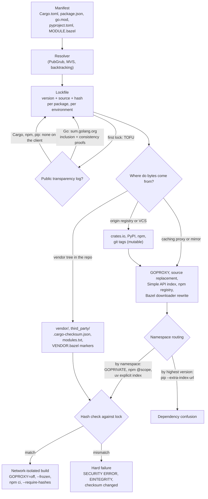

# Lockfiles, Vendoring, and Hermetic Offline Mirrors

> [!summary] Claim:
> A lockfile answers three questions for every dependency: which version, from which source, and which bytes, and only the third one is a security property.
> The bytes are pinned either as a hash of the archive (Cargo, npm, pip, Bazel) or as a hash of the archive's contents (Go's `h1:` dirhash, Nix's `narHash`), and that choice decides whether a mirror may legally repack an artifact.
> A first lock trusts whatever the network served, unless a public transparency log such as `sum.golang.org` vouches for the hash.
> Vendor trees and caching proxies both remove the network from the build, but a vendor tree is only as trustworthy as the check that compares it with the lock, and `go` makes no such check.
> Private proxies fail when they merge internal and public namespaces by version number, so packages should be routed by namespace, not by version.



## The Mechanism

### 1. What a lockfile records, and what it does not

A manifest states constraints (`serde = "1"`, `requests>=2.31`), and a resolver turns them into one concrete graph; [[Dependency-Resolution-SAT-PubGrub-and-MVS]] owns how that search works.
A lockfile freezes the output of that search so that later installs skip it.
For each node it records up to three things:
1. The exact version, so the next resolution cannot drift when upstream publishes.
2. The source, such as a registry URL, a git URL with a commit, or a path, so the same version cannot silently come from somewhere else.
3. A cryptographic hash of the artifact, so the same version from the same source cannot silently carry different bytes.

Versions and sources make builds repeatable; only the hash makes them tamper-evident.
A lockfile without hashes, such as a classic `pip freeze` output, still lets a compromised mirror substitute bytes under the same version string.

The Cargo FAQ states the scope precisely: the lockfile describes "the state of the world at the time of a successful build," and it "does not affect the consumers of your package, only Cargo.toml does that."
Two consequences follow:
- A library's committed lockfile pins only its own CI; downstream users resolve again from the library's manifest.
- `cargo install` selects the latest dependencies unless `--locked` is passed, so installing a binary from crates.io ignores the author's lockfile by default.

The Cargo team changed its guidance on 2023-08-29: it used to say commit `Cargo.lock` for binaries but not libraries, and now says do what suits the project, with committing as the starting point, and `cargo new` stopped ignoring `Cargo.lock` for libraries as of nightly-2023-08-24.
The reasons given were bisectability, MSRV verification, and the availability of Dependabot and Renovate for testing newer versions, instead of relying on an unlocked CI.
npm draws the same line in file names: `package-lock.json` is never published and is ignored outside the root project, while `npm-shrinkwrap.json` has the same format, is published, and takes precedence when both exist.

Go is the outlier.
Minimal version selection picks the minimum versions that satisfy every `require` in the module graph, so `go.mod` alone already determines the build list, and Go has no separate version lock.
`go.sum` therefore carries only hashes: it is a hash pin file, not a lockfile in the Cargo sense.

### 2. Two ways to hash an artifact

#### Archive hashes

Most ecosystems hash the exact bytes of the downloaded archive:
- Cargo records `checksum`, the SHA-256 of the `.crate` file; the registry index carries the same value as `cksum`, which the registry computes itself because the publish API does not send it.
- npm records `integrity`, a W3C Subresource Integrity string: an algorithm token, a dash, and the base64 digest, as in `sha512-...`; package-lock allows sha512 or sha1, and SRI's valid set is sha256, sha384, and sha512, ordered so that stronger algorithms come later.
- pip's hash-checking mode compares each downloaded file with `--hash=sha256:<hex>` options in the requirements file, and pylock.toml stores `hashes` plus an optional `size` for every wheel and sdist.
- Bazel uses a SHA-256 on each download request (for example the `sha256` attribute of `http_archive`) and hashes every registry file that module resolution reads into `registryFileHashes`.

An archive hash is simple and strong, but it pins the container as well as the contents.
It only works if the registry promises to serve identical bytes forever, which is why the registries forbid re-uploading a version (Section 7).

#### Content hashes: Go's `h1:` and Nix's `narHash`

Go hashes what is inside the module zip, not the zip itself.
`dirhash.Hash1` in `golang.org/x/mod/sumdb/dirhash` is defined as the base64 SHA-256 of a summary "prepared as if by the Unix command `sha256sum $(find . -type f | sort) | sha256sum`":
1. Sort the file names with `slices.Sort`; every name already carries the `module@version/` prefix.
2. For each file, write a line: the lowercase hex SHA-256 of its content, two spaces, the name, and a newline.
3. SHA-256 the concatenated lines, base64-encode the digest with the standard alphabet, and prefix `h1:`.
4. Reject any file name that contains a newline, because it would forge a summary line.

`HashZip` feeds that function the zip's member names and decompressed contents, so "the exact zip file format encoding, compression method, per-file modification times, and other metadata are ignored."
The Go module reference also says file modes are ignored and that symlinks and other irregular files are never put in module zips.
A `/go.mod` line in `go.sum` is the same `Hash1` over a single file named `go.mod`; the worked example recomputes both kinds and matches `go.sum` byte for byte.

The content hash exists because Go modules often come straight from version control, and every client that downloads in direct mode synthesizes its own zip from a checkout.
Two honest zips of the same tag can differ in compression and member order, so an archive hash would report a false mismatch, while `h1:` agrees.
The flip side is that `h1:` says nothing about the archive container, which is harmless because Go never runs code from the container.

Nix makes the same choice for flake inputs: `flake.lock` records `narHash`, "the SHA-256 (in SRI format) of the Nix Archive (NAR) serialisation" of the source tree, which the Nix manual calls useful for inputs such as tarballs that lack a content identifier like a git commit.
[[Cpp-Spack-and-Nix-for-Native-Dependencies]] owns the Nix store model.

#### Trust on first use, and the Go checksum database

Every scheme above verifies later downloads against the first one.
The first lock itself trusts whatever the proxy or registry served at that moment, so a tampered artifact that is present on day zero is locked in as "correct."

Go closes that gap for public modules.
When a hash is missing from `go.sum`, the `go` command asks `sum.golang.org`, a transparent log (a Merkle tree backed by Trillian) of `go.sum` lines, and adds the line only after two proofs:
- An inclusion proof that the record is in the signed tree, which costs O(lg N) hashes.
- A consistency proof that the new signed tree head extends every earlier head this client has seen, so the log cannot fork its history for one victim without detection.

The endpoints are `/latest` (signed tree head), `/lookup/$module@$version` (record number, the `go.sum` lines, and a signed head), and `/tile/$H/$L/$K[.p/$W]` for hash tiles, which the client caches in the module cache.
On 2026-11-15 (UTC) `/latest` reported a tree of 71,401,889 records, and `/lookup/golang.org/x/mod@v0.2.0` returned record 698842 with `h1:KU7oHjnv3XNWfa5COkzUifxZmxp1TyI7ImMXqFxLwvQ=` for the zip.
The database "ensures that the bits associated with a specific version do not change from one day to the next, even if the module's author subsequently alters the tags in their repository."
`GOPRIVATE` or `GONOSUMDB` skips it for matching paths, and `GOSUMDB=off` skips it for everything, at which point first-use trust is back.

Cargo, npm, and pip do not run an equivalent client-side proof: on first lock they accept the hash in the registry's index metadata over TLS.
Artifact signatures and provenance that narrow this gap, such as PEP 740 attestations, belong to [[Python-Trusted-Publishing-and-PEP-740-Attestations]] and the 08-Software-Supply-Chain pillar.

### 3. The lockfile formats

#### Cargo.lock

Cargo's lockfile is TOML with one `[[package]]` table per resolved package: `name`, `version`, `source`, `checksum`, and `dependencies`.
`src/resolver/resolve.rs` documents five format versions in its `ResolveVersion` enum:

| Version | Change | Default for new lockfiles |
|---|---|---|
| V1 | Historical baseline; checksums in a separate `[metadata]` table | before 1.41 |
| V2 | Compressed `dependencies` arrays, checksums inline, fewer merge conflicts | 1.41 to 1.52 |
| V3 | Explicit top-level `version = 3`, git `branch = "master"` encoded distinctly | 1.53 to 1.82 |
| V4 | URL-encoding-aware `SourceId` serialization, so `?branch=foo bar` round-trips | 1.83 and later |
| V5 | Unstable, collecting changes | none (as of 2026-11) |

V4 was stabilized in Cargo 1.78 (2024-05-02) and became the default in Cargo 1.83 (2024-11-28), whose changelog warns that toolchains before 1.78 cannot read it and suggests `package.rust-version` of 1.82 or earlier for older MSRVs.
Cargo compares the lockfile checksum with what the source reports, and `resolve.rs` has three distinct errors: a checksum that "changed between lock files," one that "was not previously calculated, but a checksum could now be calculated," and one that "could not be calculated, but a checksum is listed in the existing lock file."
The first message names its own likely cause: "a replacement source in use (e.g., a mirror) returned a different checksum."

Three flags control how strictly Cargo treats the lock, and they are shared by `build`, `vendor`, and most other commands:
- `--locked` errors if the lockfile is missing or Cargo would have to change it.
- `--offline` forbids network access and restricts resolution to crates already downloaded, which "may result in different dependency resolution than online mode."
- `--frozen` is both together, and `net.offline = true` in config is the persistent form of `--offline`.

Cargo resolves `[target.'cfg(...)'.dependencies]` "as-if all platforms are enabled," so one `Cargo.lock` covers every target triple.

#### package-lock.json

npm documents lockfile versions by the CLI that wrote them: version 1 for npm 5 and 6, version 2 for npm 7 and 8 (backwards compatible with version 1 readers), and version 3 for npm 9 and above (readable by npm 7).
The `packages` object maps each install location, such as `node_modules/foo` or `node_modules/a/node_modules/foo`, to `version`, `resolved` (tarball URL, or git URL with commit), `integrity`, and flags such as `dev`, `optional`, `hasInstallScript`, `os`, and `cpu`.
The key is a filesystem path rather than a name, because npm can install several versions of one package at different depths.
Since npm 7 a hidden lockfile at `node_modules/.package-lock.json` lets npm skip reading the tree, and npm trusts it only if no package folder is newer than it; the docs warn that adding a file deep inside a package folder does not change that folder's modification time.

`npm ci` is the frozen install: it requires a lockfile, exits with an error instead of updating it when it disagrees with `package.json`, deletes any existing `node_modules`, and "will never write to package.json or any of the package-locks."

#### go.mod and go.sum

Each `go.sum` line has three space-separated fields: module path, version (with a `/go.mod` suffix when the hash covers only the `go.mod` file), and `h1:<base64>`.
`h1` is the only algorithm; a future `h2` is reserved for a SHA-256 break.
`go.sum` can hold hashes for several versions of one module, because MVS loads `go.mod` files of versions it does not select, and `go mod tidy` adds missing lines and drops unneeded ones.
Since Go 1.16, `-mod=readonly` is the default for build commands: a missing `go.sum` line is an error (`updates to go.sum needed, disabled by -mod=readonly` in `fetch.go`), not a silent download.

#### Python: requirements with hashes, uv.lock, and pylock.toml

pip's hash-checking mode (added in pip 8.0) is all or nothing: one `--hash` anywhere turns it on for the whole run, every requirement and every transitive dependency must be listed and hashed, and every requirement must be pinned with `==`, a URL, or a path.
md5, sha1, and sha224 are refused, and the `#sha256=` fragment that PyPI puts on each download URL does not satisfy `--require-hashes`, because "this hash originates remotely."
pip 26.2 added `--no-require-hashes`, which checks hashes only where they are given, for mixing hashed pins with local directories or VCS URLs.
pip also caches locally built wheels in hash-checking mode since 23.1, and verifies them against the original sdist hash stored in each cache entry's `origin.json`.

`uv.lock` is a universal lock, "portable across platforms," in which a package may appear several times with different versions for different environment markers.
pylock.toml, standardized by PEP 751 in April 2025, is the tool-neutral format: `lock-version = "1.0"`, optional `environments` markers, `requires-python`, and `[[packages]]` with `marker`, `index`, and exactly one source kind (`vcs` with a `commit-id`, `directory`, `archive`, `sdist`, or `wheels`), each artifact carrying `hashes` and optional `size`.
Its installation algorithm says tools "MUST NOT try to change what wheel file to download based on what's available; what file to install should be determined in an offline fashion for reproducibility."
A file is named `pylock.toml` or `pylock.<name>.toml`, so one repository can keep a lock per deployment target.
[[Python-Dependency-Resolution-pip-uv-and-PEP-751-Lockfiles]] owns these formats in depth.

#### MODULE.bazel.lock and flake.lock

Bazel's Bzlmod lockfile (`lockFileVersion` 10 in the current documentation example, as of 2026-11) is JSON with three sections:
- `registryFileHashes` maps every registry URL read during resolution to a hash, including `"not found"` entries, because the fact that a higher-priority registry lacked a module is itself an input.
- `selectedYankedVersions` records yanked versions explicitly allowed with `--allow_yanked_versions`, because yank state is mutable and cannot be hashed.
- `moduleExtensions` stores, per extension, `bzlTransitiveDigest`, `usagesDigest`, and the `generatedRepoSpecs` output, with a single `general` entry or separate `os:macos`, `os:linux`, and similar entries when the result depends on the host.

`--lockfile_mode` takes `off`, `update` (the default), `refresh`, or `error`, and `error` is the CI setting that fails instead of rewriting the file.
[[Bazel-Skyframe-Bzlmod-and-Execution-Model]] owns Bzlmod resolution itself.
Nix's `flake.lock` (format `"version": 7` in the manual's example) records each input's `locked` reference with `narHash` and `lastModified`, in a `nodes` graph that the manual describes as isomorphic to the root flake's dependency graph.

### 4. Locking for many platforms at once

Resolution is a function of the environment: Python markers such as `sys_platform` and `python_version`, platform-only npm packages with `os` and `cpu`, and target-specific crates.
A lock generated on a developer's Mac must still be correct on a Linux CI runner and an ARM production host.
The ecosystems use three strategies:
1. Universal resolution with forks: Cargo resolves as if every platform is enabled; uv forks the resolution on markers and records each branch's markers; npm records platform-specific optional packages with their `os` and `cpu` fields so each host installs only its own.
2. Per-host sections inside one file: Bazel stores separate module-extension results named after the OS, the architecture, or both (such as `os:macos`) when an extension depends on the host.
3. One file per environment: `pylock.<name>.toml`, or a `pip-compile`-style requirements file per platform, which is exact for each target but drifts unless all of them are regenerated together.

Universal locks have their own failure mode: a package without an sdist may have wheels for only some platforms, so the lock can resolve but fail to install on a target nobody tested.
uv's `environments` setting narrows the platforms it solves for, and `required-environments` does the opposite: it makes resolution fail unless every binary-only package has a wheel for each listed marker, such as `sys_platform == 'darwin' and platform_machine == 'x86_64'`.

### 5. Vendoring

Vendoring copies dependency sources into the repository, so the repository is the only input the build needs.
The hard question is how the build knows that the copied tree still equals what the lock describes.

#### Go: vendor/ and modules.txt

`go mod vendor` writes `vendor/` with copies of exactly the packages needed to build and test the main module's packages, ignoring build constraints other than `ignore` so every platform's files are included, and leaving out packages imported only by tests of other modules.
It writes `vendor/modules.txt`, one `# module version` header per module, a `## explicit; go 1.22` annotation when the module is required directly in `go.mod` (the `go` version annotations arrived in Go 1.17), and the vendored package paths.
Since Go 1.14, a module whose `go.mod` says `go 1.14` or later builds as if `-mod=vendor` were passed whenever `vendor/` exists, and in that mode "the go command will not use the network or the module cache."
Go 1.17 stopped copying the `go.mod` and `go.sum` files of vendored dependencies, and Go 1.22 added `go work vendor` for workspaces.

The `go` command checks that `modules.txt` agrees with `go.mod` and stops with `inconsistent vendoring` otherwise, as the worked example shows.
It does not check the files: the reference says "The go command does not check that packages in the vendor directory have not been modified," and recommends running `go mod vendor` again and confirming that nothing changed.
In the worked example an edited `vendor/example.com/greet/greet.go` built and ran with `GOPROXY=off` and exit code 0.
`go mod vendor -o <dir>` (Go 1.18 and later) writes a second copy elsewhere, so `diff -r vendor <dir>` is the CI check that the `go` command does not perform.
The `go` command also ignores `vendor/` directories everywhere except the main module root and leaves them out of module zips, so vendoring never propagates to consumers.

#### Cargo: cargo vendor and directory sources

`cargo vendor <dir>` copies every crates.io and git dependency, unpacked, into one directory per crate, and prints on stdout the configuration that tells Cargo to use it:

```toml
[source.crates-io]
replace-with = "vendored-sources"

[source.vendored-sources]
directory = "vendor"
```

In the worked example, `cargo vendor --quiet` printed nothing at all on stdout, so the redirect `> .cargo/config.toml` produced an empty file and builds silently kept using the registry cache; drop `--quiet` when capturing the config (observed with Cargo 1.99.0, 2026-11-14, macOS).

Each crate directory gets `.cargo-checksum.json` with `package`, the SHA-256 of the original `.crate` file, and `files`, the SHA-256 of every vendored file; `cargo_vendor.rs` skips `.git`, `.gitattributes`, and `.gitignore`, and writes a `$comment` that the file "only protects against accidental modifications."
`DirectorySource` in `src/sources/directory.rs` enforces it in two places:
- When it loads the directory, it reads the `package` value as the crate's checksum, so Cargo compares it with `Cargo.lock` and fails with "checksum for `cfg-if v1.0.0` changed between lock files" when they differ.
- In `verify`, it rehashes every listed file and fails with "the listed checksum of ... has changed" on any difference.

Three observed properties bound what that check is worth (Cargo 1.99.0, macOS, 2026-11-14):
1. A directory source's `fingerprint` is just the version string, so after a vendored file is edited, a build with a warm `target/` neither recompiles the crate nor reports the edit; only a cold build caught it.
2. Rewriting the file's entry in `.cargo-checksum.json` to the new hash makes the cold build pass, because nothing signs the JSON file.
3. Changing only the `package` field is caught, because that value is cross-checked against `Cargo.lock`.

The Cargo Book is explicit that the file "is not a security mechanism and does not protect against malicious changes."
The real control is review of `vendor/` diffs plus a CI job that re-runs `cargo vendor` from `Cargo.lock` and diffs the result.

Useful `cargo vendor` options: `--versioned-dirs` puts the version in every directory name, `--no-delete` keeps existing contents, `--sync <manifest>` vendors extra workspaces, and `--respect-source-config` honors existing `[source]` replacement instead of ignoring it.
Source replacement assumes "the source code is exactly the same from both sources," and "a replacement source is not allowed to have crates which are not present in the original source," so it is the wrong tool for patching (use `[patch]`) or for private crates (use `[registries]` and `registry = "name"` on the dependency).
A `local-registry` source is the alternative layout: `.crate` files plus an index, managed by the third-party `cargo-local-registry` subcommand.

#### Bazel vendor mode

`bazel vendor --vendor_dir=vendor_src` fetches external repositories into a directory, either all of them or only those needed for target patterns, and a build with `--vendor_dir` then "should work in a clean build environment without network access and repository cache."
Each vendored repo has a marker file; if the marker is up to date, or the repo is listed in `pin()` in `VENDOR.bazel`, Bazel symlinks the vendored source instead of running the repository rule.
If the marker is outdated, Bazel prints a warning and falls back to fetching the latest version, so a stale vendor tree turns into a network fetch rather than a failure unless the network is also blocked.
`ignore()` excludes a repo from vendor mode, and the documentation warns that edits to an unpinned vendored repo are used but overwritten on the next vendor run.

#### C and C++ third_party trees, and tarball versus git

C and C++ projects without a package manager vendor by copying sources into `third_party/` or by pinning git submodules to commit IDs.
The copy is only as good as its origin: in CVE-2024-3094 the xz 5.6.0 and 5.6.1 release tarballs contained a modified `m4/build-to-host.m4` that, as Andres Freund reported on 2024-03-29, was "not in the upstream source of build-to-host, nor is build-to-host used by xz in git."
A vendor process that imports release tarballs inherits whatever the release manager added; importing from a pinned commit and regenerating build files locally closes that gap.
[[Case-Study-XZ-Utils-Backdoor-CVE-2024-3094]] and [[Drill-Supply-Chain-Detect-Tarball-vs-Git-Tag-Backdoor]] own the incident and the detection technique.
Package-manager alternatives for C++ are owned by [[Cpp-vcpkg-Manifests-Registries-and-Binary-Caching]] and [[Cpp-Conan-2-Architecture-and-Binary-Model]].

### 6. Caching proxies and offline mirrors

#### The GOPROXY protocol

A Go module proxy is any HTTP server, including a `file://` tree, that answers five GET paths with no query parameters and no required headers:
- `$base/$module/@v/list`: known versions, one per line, without pseudo-versions.
- `$base/$module/@v/$version.info`: JSON `{"Version": ..., "Time": ...}`.
- `$base/$module/@v/$version.mod`: the `go.mod` file, or a synthetic one with only a `module` line.
- `$base/$module/@v/$version.zip`: the module zip.
- `$base/$module/@latest`: optional fallback metadata.

Upper-case letters are escaped as `!` plus the lower-case letter, so `example.com/M` and `example.com/m` coexist on case-insensitive disks.
The `.mod` and `.zip` responses must never change and are authenticated by `go.sum` and the checksum database; `list` and `.info` "are not authenticated and may change over time."
The module cache's `cache/download` directory has the proxy's layout, so `GOPROXY=file://$(go env GOMODCACHE)/cache/download` turns any warm cache into an offline mirror.
Zips are capped at 500 MiB compressed and 500 MiB uncompressed, `go.mod` and `LICENSE` files at 16 MiB each, and every member must start with `$module@$version/`.

`GOPROXY` is a list, and the separator is policy:
- After a comma, the `go` command falls through to the next entry only on 404 or 410.
- After a pipe, it falls through on any error, including timeouts.
- `direct` means fetch from version control, and `off` forbids downloads entirely, which the worked example shows as `module lookup disabled by GOPROXY=off`.

Because any other status is terminal behind a comma, a corporate proxy can return 403 for a module with a bad license or a known vulnerability, and the client will not route around it.
The default since Go 1.13 is `https://proxy.golang.org,direct`, with `GOSUMDB=sum.golang.org`, launched as production services on 2019-08-29.

A mirror is a proxy that keeps its own copy, which is what makes it survive upstream deletion, and also what makes it remember malware.
Socket reported on 2025-02-04 that `github.com/boltdb-go/bolt`, a typosquat of `boltdb/bolt`, was cached by the Go module mirror as v1.3.1 with a backdoor in November 2021; the author then rewrote the git tag to clean code, so a review of the GitHub repository showed nothing while the mirror kept serving the backdoored version for over three years.
Immutability guarantees that everyone gets the same bits; it does not guarantee that the bits are good.

#### Cargo registries and source replacement

A Cargo registry is an index plus a download location named in the index's `config.json`.
`dl` is a URL template with markers such as `{crate}`, `{version}`, and `{sha256-checksum}`, and `/{crate}/{version}/download` is appended when no marker is present; `auth-required: true` makes Cargo send the token on index, API, and download requests.
The sparse protocol (`sparse+https://...`) fetches one index file per crate over HTTP and became the default for crates.io in Cargo 1.70 (2023-06-01); Cargo caches each file with its `ETag` or `Last-Modified` and revalidates with `If-None-Match` or `If-Modified-Since`, preferring the ETag when both exist.
Because the registry URL is written into `Cargo.lock`, the Cargo Book advises against offering one registry over both protocols.
A mirror of crates.io is configured as source replacement (`[source.crates-io] replace-with = "mirror"` with `registry = "sparse+https://mirror.example/index/"`), and Cargo still checks every crate against the lockfile checksum, which is exactly the "replacement source ... returned a different checksum" error.

#### Python indexes, npm registries, and the Bazel downloader

PEP 503 defines the Simple Repository API as static pages: `/simple/<normalized-name>/` lists files as links whose URL fragment may carry `#sha256=<hex>`, so a directory of HTML files served over HTTP is a valid index, as the worked example uses; PEP 691 adds a JSON form of the same data.
`pip download` with `--only-binary=:all:` (pip requires either it or `--no-deps` whenever `--platform`, `--python-version`, `--implementation`, or `--abi` is given) builds a wheelhouse on a connected machine, and `pip install --no-index --find-links <dir>` installs from it with no index at all.

npm routes by scope: `npm config set @myco:registry=https://reg.example.com` sends every `@myco/*` install and publish there, and the docs state that "a scope only ever points to one registry."

Bazel's downloader reads `--downloader_config`, a file of `rewrite`, `allow`, `block`, and `all_blocked_message` directives applied in the order rewrite, allow, block; `rewrite` maps an upstream URL regex to an internal mirror, and `block *` forbids every host not explicitly allowed.
Its repository cache (`--repository_cache`, default `{--output_user_root}/cache/repos/v1`) serves a file only "if the download request has a SHA256 sum of the file specified and a file with that hash is in the cache," and is never cleaned automatically, "as it might contain a copy of a file that is no longer available upstream."
`--distdir` is deprecated in favor of the repository cache, and for air-gapped hosts the Bazel docs prepare a repository cache on a connected machine (Bazel 7 and later) and copy it over.

### 7. Namespace isolation in private proxies

A private proxy usually presents one URL that merges internal packages with a cache of a public registry.
If the merged view picks the highest version across both sources, anyone who publishes an internal package name publicly with a higher version wins.
Alex Birsan's 2021-02-09 report, "Dependency Confusion," popularized this attack against internal package names on npm, PyPI, and RubyGems.
pip documents the mechanism: for package locations "There is no priority in the locations that are searched. Rather they are all checked," the latest version satisfying the constraints is installed, and the `--extra-index-url` warning names "dependency confusion," where "an attacker can publish a package with the same name to a public index."
PyTorch's nightly index hit the same failure between 2022-12-25 and 2022-12-30: a malicious `torchtriton` was uploaded to PyPI with the name of the nightly dependency, and "Since the PyPI index takes precedence, this malicious package was being installed."

The fix is to route by namespace, not by version:
- Go: `GOPRIVATE=corp.example.com` is the default for `GONOPROXY` and `GONOSUMDB`, so matching paths bypass every proxy and the public checksum database; alternatively a single private `GOPROXY` with no fallback serves everything and answers 403 for what it refuses.
- npm: one scope per internal namespace, bound to one registry.
- uv: the default `first-index` strategy limits each package to the first index that has it, and an index with `explicit = true` serves only packages pinned to it in `[tool.uv.sources]`; `unsafe-best-match` restores pip's behavior and the docs warn that it "exposes users to the risk of 'dependency confusion' attacks."
- Cargo: internal crates live in a named registry and each dependency says `registry = "name"`, and source replacement cannot introduce crates that the public source lacks.
- Bazel: registry precedence is part of the lock, including `"not found"` entries for higher-priority registries.

uv's flag semantics invert pip's mental model: `--index-url` becomes the lowest-priority default index and every `--extra-index-url` is consulted first, in order.
In the worked example the same `--index-url public --extra-index-url internal` command made pip choose the public `corp-utils 99.0.0`, made uv choose the internal `1.0.0`, and made uv with `--index-strategy unsafe-best-match` choose `99.0.0`.
PEP 708 tried to fix this at the index protocol level with "tracks" and "alternate-locations" metadata, but it was rejected in 2026 after three years of provisional acceptance, because its required conditions were never met.
[[Dependency-Confusion-Typosquatting-and-Registry-Attacks]] owns the attack family and defensive name pre-claiming.

### 8. Preventing upstream mutation and out-of-band tampering

#### Registry immutability rules

Archive hashes are only usable if the registry never serves different bytes under one name:
- PyPI rejects any upload whose filename was ever used, even after deletion; Warehouse's `forklift/legacy.py` answers "This filename was previously used by a file that has since been deleted. Use a different version."
- npm states "Once package@version has been used, you can never use it again," allows unpublishing a new package within 72 hours only if nothing depends on it, and after that only for packages with no dependents, fewer than 300 downloads in the last week, and a single maintainer; a fully unpublished name cannot be republished for 24 hours.
- crates.io versions can be yanked but not replaced; the index entry's `yanked` flag "may change at any time," and a yank hides a version from new resolutions while existing lockfiles keep working.
- Go versions are immutable by construction once the mirror and the checksum database have seen them.

[[Case-Study-Left-Pad-and-Registry-Immutability]] owns the history that produced these policies.

#### Mutable references are the main bypass

Git tags and branch names can be moved by anyone with push access, so any lock entry that names a tag instead of a commit is a version without a hash.
On 2025-03-14 and 2025-03-15 multiple version tags of the GitHub Action `tj-actions/changed-files` (all versions through 45.0.7 are affected; the advisory lists `v1.0.0`, `v35.7.7-sec`, and `v44.5.1` as examples) were retroactively repointed to commit `0e58ed8`, which dumped CI secrets into build logs (CVE-2025-30066, GHSA-mrrh-fwg8-r2c3).
GitHub's guidance is to pin actions "to a full-length commit SHA," noting that a bad actor would then need a SHA-1 collision for a valid Git object, and also that Dependabot does not alert on actions pinned to SHAs, so a SHA pin needs its own update process.
GitHub's secure-use reference now ranks a workflow dependency lockfile, which records the exact commit of every action including transitive ones and verifies each source repository at run time, above SHA pinning, which it keeps for repositories that cannot adopt a lockfile (as of 2026-11, Both).
Cargo and pylock.toml record git dependencies by commit (`vcs.commit-id` in pylock.toml), and Go records them as pseudo-versions whose content the checksum database pins.

#### Out-of-band fetches that no lockfile sees

A lockfile only covers what the package manager downloads.
Build scripts, install hooks, `curl | bash` steps, and container base images fetch outside it.
Between 2021-01-31 and 2021-04-01, Codecov's Bash Uploader, downloaded by CI jobs from `https://codecov.io/bash`, was modified in 108 time windows to send each CI environment's variables to an attacker; it was detected when a customer compared the downloaded script's shasum with the one published on GitHub and saw a mismatch.
npm marks packages with install scripts as `hasInstallScript` in the lockfile, which is a list of the packages that can run code during `npm ci`.
[[Case-Study-Codecov-Bash-Uploader-and-TJ-Actions]] owns that incident.

The structural control is a build that cannot reach the network: `GOPROXY=off` or `-mod=vendor`, `cargo build --frozen`, `npm ci` against an internal registry only, `pip install --no-index --require-hashes`, Bazel `--vendor_dir` with a `block *` downloader config, all inside a sandbox with no route out.
An undeclared fetch then fails loudly in CI instead of succeeding quietly; [[Hermetic-and-Reproducible-Builds]] and [[Sandboxing-and-Hermetic-Execution-Internals]] own the sandbox side.

#### Tampering at rest

Once downloaded, artifacts sit in caches that other processes can write:
- The Go module cache is read-only by default, every module-aware command checks cached zips against the main module's `go.sum` using hashes stored beside them, and `go mod verify` rehashes the zips and extracted trees to catch edits after download.
- Cargo's registry cache and directory sources are checked against the lock on a cold build, but not on a warm one (Section 5).
- npm detects a changed tarball by its SRI integrity, as `EINTEGRITY` in the worked example.

## Commands and Numbers to Know

| Item | Value | Platform | Notes |
|---|---|---|---|
| `go.sum` line | `<module> <version>[/go.mod] h1:<base64 sha256>` (as of 2026-11) | Both | `h1` is the only algorithm; `h2` is reserved. |
| `dirhash.Hash1` | sha256 over sorted `"<hex sha256>  <name>\n"` lines (as of 2026-11) | Both | Ignores zip compression, order, timestamps, and file modes. |
| `GOPROXY` default | `https://proxy.golang.org,direct` since Go 1.13 (as of 2026-11) | Both | Comma falls through on 404/410 only; pipe on any error. |
| `GOPROXY=off` | `module lookup disabled by GOPROXY=off` (as of 2026-11) | Both | Observed with go1.27.4 on macOS. |
| `GOFLAGS=-mod=vendor` | automatic when `go.mod` says `go 1.14`+ and `vendor/` exists (as of 2026-11) | Both | No network or module cache in this mode. |
| `go mod vendor -o dir` | Go 1.18+ (as of 2026-11) | Both | Write a second copy and `diff -r` it against `vendor/`. |
| `GOPRIVATE` | default for `GONOPROXY` and `GONOSUMDB` (as of 2026-11) | Both | Comma-separated `path.Match` globs of path prefixes. |
| `sum.golang.org` tree size | 71,401,889 records on 2026-11-15 UTC | Both | `curl https://sum.golang.org/latest`; proofs cost O(lg N) hashes. |
| Go module zip limits | 500 MiB zip, 500 MiB uncompressed, 16 MiB `go.mod` and `LICENSE` (as of 2026-11) | Both | Go Modules Reference, Module zip files. |
| `Cargo.lock` format | v4 default since Cargo 1.83, readable since 1.78 (as of 2026-11) | Both | v3 was the default from 1.53 to 1.82. |
| `cargo build --locked` / `--offline` / `--frozen` | fail on lock change / no network / both (as of 2026-11) | Both | `net.offline = true` is the config form of `--offline`. |
| `cargo install --locked` | uses the package's published lockfile (as of 2026-11) | Both | Without it, `cargo install` resolves the latest versions. |
| `cargo vendor` stdout | the `[source]` replacement config; nothing with `--quiet` (as of 2026-11) | macOS | Observed with Cargo 1.99.0. |
| `.cargo-checksum.json` | `package` = sha256 of `.crate`, `files` = per-file sha256 (as of 2026-11) | Both | Not a security mechanism; unsigned. |
| crates.io sparse protocol | default since Cargo 1.70, 2023-06-01 (as of 2026-11) | Both | `sparse+https://index.crates.io/`. |
| `lockfileVersion` | 1 (npm 5, 6), 2 (npm 7, 8), 3 (npm 9+) (as of 2026-11) | Both | npm 11.20.0 wrote 3 in the worked example. |
| `npm ci` | requires a lock, never writes it, deletes `node_modules` (as of 2026-11) | Both | Fails on a lock that disagrees with `package.json`. |
| npm `integrity` | SRI string, `sha512-<base64>` (as of 2026-11) | Both | Mismatch fails with `EINTEGRITY`. |
| npm unpublish | 72 hours if no dependents; later only with no dependents, under 300 weekly downloads, one owner (as of 2026-11) | Both | A version string can never be reused. |
| `pip install --require-hashes` | all requirements pinned and hashed, sha256 or stronger (as of 2026-11) | Both | Added in pip 8.0; `--no-require-hashes` in 26.2. |
| `pip download --only-binary=:all: --platform ...` | wheelhouse for another platform (as of 2026-11) | Both | Install it with `--no-index --find-links`. |
| `uv lock --check` / `--locked` / `--frozen` | check / fail if stale / use without checking (as of 2026-11) | Both | uv's `--frozen` is not Cargo's `--frozen`. |
| uv `--index-strategy` | `first-index` default; `unsafe-first-match`; `unsafe-best-match` (as of 2026-11) | Both | `--extra-index-url` is consulted before `--index-url`. |
| uv `exclude-newer` | ignore artifacts uploaded after a timestamp (as of 2026-11) | Both | Compared per file against the PEP 700 `upload-time`; files without it are treated as unavailable. |
| pylock.toml | `lock-version = "1.0"`; names `pylock.toml` or `pylock.<name>.toml` (as of 2026-11) | Both | PEP 751, April 2025. |
| Bazel `--lockfile_mode` | `off`, `update` (default), `refresh`, `error` (as of 2026-11) | Both | Use `error` in CI. |
| Bazel `--downloader_config` | `rewrite`, `allow`, `block`, `all_blocked_message`; order rewrite, allow, block (as of 2026-11) | Both | `block *` blocks every host. |
| Bazel repository cache | hit only when the request names a SHA-256; never auto-cleaned (as of 2026-11) | Both | Default `{--output_user_root}/cache/repos/v1`. |
| Bazel `--vendor_dir` with `bazel vendor` | offline builds from a vendored tree (as of 2026-11) | Both | Outdated markers fall back to fetching, with a warning. |

## Multi-Language Comparison

| Concern | C++ (Bazel Bzlmod) | Python (pip, uv, pylock.toml) | Rust (Cargo) | Go (modules) | JavaScript (npm) |
|---|---|---|---|---|---|
| Lock file | `MODULE.bazel.lock` | `requirements.txt` with hashes, `uv.lock`, `pylock.toml` | `Cargo.lock` | `go.mod` (versions) plus `go.sum` (hashes) | `package-lock.json`, `npm-shrinkwrap.json` |
| What is hashed | registry files read during resolution; downloads by SHA-256 | each wheel and sdist file, sha256 | the `.crate` archive, sha256 | module zip contents (`h1:` dirhash) and `go.mod` | the tarball, SRI sha512 |
| First-lock trust | TOFU | TOFU | TOFU | `sum.golang.org` proofs for public modules | TOFU |
| Frozen install | `--lockfile_mode=error` | `--require-hashes`, `uv sync --locked` | `--locked` | default `-mod=readonly` | `npm ci` |
| No-network switch | `--vendor_dir`, downloader `block *` | `--no-index --find-links`, `uv --offline` | `--offline`, `--frozen` | `GOPROXY=off`, `-mod=vendor` | internal registry only |
| Multi-platform lock | per-host extension entries | universal `uv.lock`; `environments` in pylock | resolves as if all targets enabled | `go mod tidy` ignores build constraints, so one `go.sum` covers every `GOOS` | records `os` and `cpu` per package |
| Vendoring | `bazel vendor`, `VENDOR.bazel` | wheelhouse via `pip download` | `cargo vendor` plus source replacement | `go mod vendor` | `bundleDependencies` (`inBundle`) |
| Vendor integrity check | marker files; edits assumed absent | file hashes at install | `.cargo-checksum.json` on cold builds, unsigned | `modules.txt` vs `go.mod` only, no file check | not applicable |
| Mirror configuration | `--downloader_config` rewrite, repository cache | `--index-url`, `[[tool.uv.index]]` | `[source]` replacement, `[registries]` | `GOPROXY` list | `registry=`, `@scope:registry=` |
| Namespace routing | registry precedence recorded in the lock | uv `first-index`, `explicit = true` | `registry = "name"` per dependency | `GOPRIVATE`, `GONOPROXY`, `GONOSUMDB` | one registry per scope |

## Worked Lab Example

This note has no harness lab under `code/`, so `make verify` does not re-check this section.
The commands below were run once on darwin-arm64 (macOS 27.3) on 2026-11-14 with go1.27.4, Cargo 1.99.0, npm 11.20.0, pip 26.2.2, and uv 0.11.26, using a throwaway script that set `GOENV=off`, `GOMODCACHE`, `CARGO_HOME`, `npm_config_cache`, and `UV_CACHE_DIR` to fresh directories so no user configuration leaked in.
Paths are scrubbed to `<scratch>`, and only the Cargo step used the network (one crate from crates.io).

### Go: a file:// proxy, the h1 dirhash, and four failure modes

The setup writes a module `example.com/greet@v1.0.0` as the four proxy files (`list`, `.info`, `.mod`, `.zip`) under a directory, points `GOPROXY=file://...` at it with `GONOSUMDB=example.com`, and builds an app that requires it.
A six-line Python function reimplements `dirhash.Hash1` over the zip members and over `go.mod`.

```text
=== go mod tidy writes go.sum; go run uses the module ===
go: downloading example.com/greet v1.0.0
example.com/greet v1.0.0 h1:LszVV5aMzyD+LXcb06UaS88zReVoDy4VyR3SvrUzEZc=
example.com/greet v1.0.0/go.mod h1:cq0P48hwMNXGoO60yjlgQnfIyddJXHav9+MU5dF8bFg=
hello from greet v1.0.0

=== recompute h1 in Python (dirhash.Hash1) and compare with go.sum ===
zip    h1 (python): h1:LszVV5aMzyD+LXcb06UaS88zReVoDy4VyR3SvrUzEZc=  match=yes
go.mod h1 (python): h1:cq0P48hwMNXGoO60yjlgQnfIyddJXHav9+MU5dF8bFg=  match=yes

=== repack the same files: STORED, reversed order, 2030 timestamps ===
sha256 of zip bytes: original d09b3dd54c7ad6a3...  repacked de15a126cba7cdf7...
h1 of zip contents:  original h1:LszVV5aMzyD+LXcb06UaS88zReVoDy4VyR3SvrUzEZc=  repacked h1:LszVV5aMzyD+LXcb06UaS88zReVoDy4VyR3SvrUzEZc=
go: downloading example.com/greet v1.0.0
hello from greet v1.0.0
exit=0

=== mirror serves tampered bytes for the same version ===
go: downloading example.com/greet v1.0.0
verifying example.com/greet@v1.0.0: checksum mismatch
	downloaded: h1:Fo0BWtDMOf0Y9C0vQMzMlAc0k/Z9Ivga/iigwavDO8U=
	go.sum:     h1:LszVV5aMzyD+LXcb06UaS88zReVoDy4VyR3SvrUzEZc=

SECURITY ERROR
This download does NOT match an earlier download recorded in go.sum.
The bits may have been replaced on the origin server, or an attacker may
have intercepted the download attempt.

For more information, see 'go help module-auth'.
exit=1

=== GOPROXY=off with an empty module cache ===
go: downloading example.com/greet v1.0.0
main.go:6:2: module lookup disabled by GOPROXY=off
exit=1
```

The repacked zip has different bytes and the same `h1:`, and the `go` command accepted it from a cleaned module cache, which an archive hash would have rejected.
The tampered zip changed one string in `greet.go`, and the `go` command refused it before it reached the module cache.

```text
=== go mod vendor, then build with GOPROXY=off and an empty cache ===
go: downloading example.com/greet v1.0.0
# example.com/greet v1.0.0
## explicit; go 1.22
example.com/greet
hello from greet v1.0.0
exit=0

=== edit a vendored file: the go command does not check vendor contents ===
hello, EDITED IN VENDOR
exit=0
go: downloading example.com/greet v1.0.0
diff -r vendor/example.com/greet/greet.go <scratch>/go/vendor.check/example.com/greet/greet.go
3c3
< func Hello() string { return "hello, EDITED IN VENDOR" }
---
> func Hello() string { return "hello from greet v1.0.0" }
diff exit=1

=== vendor/modules.txt disagrees with go.mod ===
go: inconsistent vendoring in <scratch>/go/app:
	example.com/greet@v1.0.0: is explicitly required in go.mod, but not marked as explicit in vendor/modules.txt
	example.com/greet@v0.9.0: is marked as explicit in vendor/modules.txt, but not explicitly required in go.mod

	To ignore the vendor directory, use -mod=readonly or -mod=mod.
	To sync the vendor directory, run:
		go mod vendor
exit=1
```

The vendored build needed neither the network nor the module cache.
The edited vendor file shipped silently with exit code 0, and only the `go mod vendor -o` plus `diff -r` step, which is not built in, caught it; a one-line change in `modules.txt`, by contrast, is a hard error.

### Cargo: lockfile checksum and the limits of .cargo-checksum.json

```text
=== cargo: 1.99.0, Cargo.lock after cargo fetch ===
# This file is automatically @generated by Cargo.
# It is not intended for manual editing.
version = 4

[[package]]
name = "app"
version = "0.1.0"
dependencies = [
 "cfg-if",
]

[[package]]
name = "cfg-if"
version = "1.0.0"
source = "registry+https://github.com/rust-lang/crates.io-index"
checksum = "baf1de4339761588bc0619e3cbc0120ee582ebb74b53b4efbf79117bd2da40fd"
sha256(cfg-if-1.0.0.crate) = baf1de4339761588bc0619e3cbc0120ee582ebb74b53b4efbf79117bd2da40fd
index.crates.io cksum      = baf1de4339761588bc0619e3cbc0120ee582ebb74b53b4efbf79117bd2da40fd

=== cargo vendor prints the source replacement config ===
[source.crates-io]
replace-with = "vendored-sources"

[source.vendored-sources]
directory = "vendor"
package: baf1de4339761588bc0619e3cbc0120ee582ebb74b53b4efbf79117bd2da40fd
files: 9 entries, e.g. src/lib.rs = 54b0f108b0dc48a0...
build exit=0
```

The three values agree: the lockfile `checksum`, the SHA-256 of the downloaded `.crate`, and the sparse index's `cksum`; the lock still names crates.io as `source` even though the sparse protocol fetched it.
The next runs edit `vendor/cfg-if/src/lib.rs` and rebuild with `--frozen`, first with a warm `target/` and then cold:

```text
[cold build, pristine vendor]
   Compiling cfg-if v1.0.0
   Compiling app v0.1.0 (<scratch>/cargo/app)
    Finished `dev` profile [unoptimized + debuginfo] target(s) in 1.00s
[warm build after edit]
    Finished `dev` profile [unoptimized + debuginfo] target(s) in 0.03s
exit=0
[cold build after edit]
error: the listed checksum of `<scratch>/cargo/app/vendor/cfg-if/src/lib.rs` has changed:
expected: 54b0f108b0dc48a077c52c0bcd22b64ef4de083e5e2b7d405e50ae4d78224f1b
actual:   d30d89292b3e6f0080ce09dd7ab284110d8110a1096d953506f0758b6f0f8651

directory sources are not intended to be edited, if modifications are required then it is recommended that `[patch]` is used with a forked copy of the source
exit=101
[cold build, edit plus rewritten .cargo-checksum.json]
   Compiling cfg-if v1.0.0
   Compiling app v0.1.0 (<scratch>/cargo/app)
    Finished `dev` profile [unoptimized + debuginfo] target(s) in 1.02s
exit=0
```

```text
=== change the package checksum in .cargo-checksum.json ===
error: checksum for `cfg-if v1.0.0` changed between lock files

this could be indicative of a few possible errors:

    * the lock file is corrupt
    * a replacement source in use (e.g., a mirror) returned a different checksum
    * the source itself may be corrupt in one way or another

unable to verify that `cfg-if v1.0.0` is the same as when the lockfile was generated

build exit=101
```

The warm build took 0.03 s and neither recompiled nor checked the edited crate, matching `DirectorySource::fingerprint`, which returns only the version.
An attacker who edits a file and its JSON entry passes even a cold build; only the `package` field is tied to `Cargo.lock`.

### npm: SRI integrity and EINTEGRITY

```text
=== npm: 11.20.0, npm pack integrity vs a Python sha512 ===
npm pack integrity: sha512-vmO/0qdcmKkQ2hJ5XV9k5cILb7uy0Ps8EX7Y1cHcod6RoAm/YpH6QotnMlkh+SZZWEnGyEq+5KNjlwY7NrvfWw==
python sha512 SRI:  sha512-vmO/0qdcmKkQ2hJ5XV9k5cILb7uy0Ps8EX7Y1cHcod6RoAm/YpH6QotnMlkh+SZZWEnGyEq+5KNjlwY7NrvfWw==
lockfileVersion: 3
{
 "version": "1.0.0",
 "resolved": "file:../padder-1.0.0.tgz",
 "integrity": "sha512-vmO/0qdcmKkQ2hJ5XV9k5cILb7uy0Ps8EX7Y1cHcod6RoAm/YpH6QotnMlkh+SZZWEnGyEq+5KNjlwY7NrvfWw=="
}

=== replace the tarball with different content, then npm ci with an empty cache ===
npm error code EINTEGRITY
npm error sha512-vmO/0qdcmKkQ2hJ5XV9k5cILb7uy0Ps8EX7Y1cHcod6RoAm/YpH6QotnMlkh+SZZWEnGyEq+5KNjlwY7NrvfWw== integrity checksum failed when using sha512: wanted sha512-vmO/0qdcmKkQ2hJ5XV9k5cILb7uy0Ps8EX7Y1cHcod6RoAm/YpH6QotnMlkh+SZZWEnGyEq+5KNjlwY7NrvfWw== but got sha512-WrDJzimTcVbyggUT1MJcEbgadgjC/NCIZJ07QgVpv+HnGSrHbVefaBTRekLi/9am7G7QCIZpE/ESUczRlTqzQw==. (209 bytes)
npm ci exit=1
```

The `integrity` value is the base64 SHA-512 of the `.tgz` bytes, and npm checked it even for a local `file:` tarball.

### Python: dependency confusion, then hash-checking mode

Two PEP 503 indexes were served from `127.0.0.1` with `python3 -m http.server`: a "public" one with an attacker's `corp-utils 99.0.0` and an "internal" one with the real `corp-utils 1.0.0`.

```text
=== pip 26.2.2: --index-url public --extra-index-url internal ===
Would install corp-utils-99.0.0

=== uv 0.11.26: same flags, default index strategy ===
corp-utils==1.0.0

=== uv with --index-strategy unsafe-best-match ===
corp-utils==99.0.0

=== pip hash-checking mode: lock the internal wheel, then the mirror swaps it ===
corp-utils==1.0.0 --hash=sha256:26be519acd98e56e...
Saved <scratch>/py/dl1/corp_utils-1.0.0-py3-none-any.whl
Looking in indexes: http://127.0.0.1:18082/simple
Collecting corp-utils==1.0.0 (from -r <scratch>/py/req.txt (line 1))
  Downloading corp_utils-1.0.0-py3-none-any.whl (1.0 kB)
ERROR: THESE PACKAGES DO NOT MATCH THE HASHES FROM THE REQUIREMENTS FILE. If you have updated the package versions, please update the hashes. Otherwise, examine the package contents carefully; someone may have tampered with them.
    corp-utils==1.0.0 from http://127.0.0.1:18082/files/corp_utils-1.0.0-py3-none-any.whl#sha256=a38817dcff16167b0a8803a4e7f4b00bbbe3ac290a546c5ea61c9c4a89ad1306 (from -r <scratch>/py/req.txt (line 1)):
        Expected sha256 26be519acd98e56e0c92bb58641119a536943dd47bbb81961a9e33a8ba0f9940
             Got        a38817dcff16167b0a8803a4e7f4b00bbbe3ac290a546c5ea61c9c4a89ad1306

pip exit=1
```

The last run simulates a compromised mirror that replaces the wheel and also rewrites its own `#sha256=` link fragment to match, so the index's hash agrees with the bad file; only the hash in the local requirements file caught it, which is why pip refuses to count index fragments toward `--require-hashes`.

### Reproduce by hand

```sh
# Go: any warm module cache is a proxy; prove the build is offline.
GOPROXY=file://$(go env GOMODCACHE)/cache/download GOFLAGS=-mod=mod go build ./...
GOPROXY=off go build ./...
go mod vendor -o /tmp/vendor.check && diff -r vendor /tmp/vendor.check

# Rust: vendor without --quiet, then build from a cold target directory.
cargo vendor vendor > .cargo/config.toml
rm -rf target && cargo build --frozen

# npm and Python: frozen installs.
npm ci
pip install --no-deps --require-hashes -r requirements.txt
uv sync --locked
```

## Pitfalls

> [!warning] Pitfall 1: Trusting go to notice edits in vendor/
> The `go` command checks `vendor/modules.txt` against `go.mod` but never hashes vendored files, so a hand edit or a malicious change ships with exit code 0, as the worked example shows.
> Run `go mod vendor -o <tmp>` and `diff -r vendor <tmp>` in CI, and review `vendor/` diffs like source code.

> [!warning] Pitfall 2: Treating .cargo-checksum.json as a security control
> Cargo's own comment in the file says it "only protects against accidental modifications."
> A warm `target/` skips the check entirely because a directory source fingerprints only the version, and an attacker who updates the JSON passes a cold build.
> Regenerate the vendor tree from `Cargo.lock` in CI and diff it, and build release artifacts from a cold target directory.

> [!warning] Pitfall 3: pip --extra-index-url for internal packages
> pip merges all indexes and installs the highest version, so a public package with an internal name and a higher version wins, as in Birsan's research and the PyTorch `torchtriton` incident.
> Use one internal index that proxies the public one without version merging, or uv with an `explicit = true` index pinned through `[tool.uv.sources]`, and keep hash-checking mode on.

> [!warning] Pitfall 4: Same flag name, different meaning
> Cargo's `--frozen` means locked and offline, while uv's `--frozen` means "use the lockfile without checking if it is up-to-date," which can install a lock that no longer matches `pyproject.toml`.
> In CI, use `cargo build --locked` (plus `--offline` where intended) and `uv sync --locked`, which fail on a stale lock.

> [!warning] Pitfall 5: Silent fallbacks to the network
> `GOPROXY=https://proxy.corp,https://proxy.golang.org,direct` falls through to public sources on any 404, `GOPROXY=a|b` falls through on any error, and Bazel vendor mode fetches the latest version when a vendored repo's marker is outdated, with only a warning.
> In hermetic CI, end the proxy list without `direct`, set `GOFLAGS=-mod=vendor` or `GOPROXY=off`, and use a Bazel `block *` downloader rule so a fallback becomes an error.

> [!warning] Pitfall 6: Pinning tags instead of commits
> A tag is a mutable pointer: multiple `tj-actions/changed-files` version tags were repointed to a malicious commit in March 2025, and the `boltdb-go/bolt` author rewrote a tag after the Go mirror cached the backdoored version.
> Pin GitHub Actions, git submodules, and git dependencies to full commit SHAs, and remember that the Go mirror and sumdb keep the first bits they saw, good or bad.

> [!warning] Pitfall 7: Assuming a universal lock installs everywhere
> A universal `uv.lock` or `package-lock.json` can resolve on a Mac and still lack a wheel or platform package for a Linux ARM host, if a binary-only dependency never published one.
> Declare the targets with uv's `required-environments`, and install from the lock in CI on every production platform, not just the developer's.

> [!warning] Pitfall 8: Capturing cargo vendor output with --quiet
> `cargo vendor --quiet vendor > .cargo/config.toml` writes an empty config, so Cargo keeps using the registry and the vendor tree is decoration (observed with Cargo 1.99.0).
> Capture the config without `--quiet` and assert in CI that `.cargo/config.toml` contains `replace-with`.

## At Scale

For a single developer, the lockfile plus the default public mirror is enough, and the useful habits are committing the lock, running the frozen install command in CI, and reading lock diffs in review.

For a team of tens, add one internal caching proxy per ecosystem, configured as the only source, plus hash-checked frozen installs in CI; this removes registry outages from the critical path and gives one place to block a package.

For 1,000 to 50,000 engineers the cost moves from storage to policy, and the questions are which bytes may enter, who approves them, and how fast a bad version can be removed everywhere.
The proxy becomes a quarantine and promotion pipeline, with age cooldowns and install-script sandboxing, which [[Enterprise-Third-Party-Code-Ingestion-and-Quarantine-Architecture]] owns; [[Release-Trains-Backports-and-Artifact-Registries]] owns the registry lifecycle for artifacts the organization publishes.

Vendor trees and caching proxies trade different costs:
- A vendor tree makes every dependency change a reviewable diff, works with no infrastructure, and survives the loss of every registry; it costs repository size and history forever, merge conflicts, and a per-repository security update for every advisory.
- A caching proxy keeps repositories small, gives one blocklist and one audit log for the whole fleet, and updates centrally; it is a production dependency of every build and needs its own availability, retention, and access control.
- Both need the same thing to be secure: a check that the bytes used equal the bytes locked, which is a hash in the lockfile for proxies and a regenerate-and-diff job for vendor trees.

Decision rules:
1. Commit lockfiles for every application, service, and CI-tested library, and make the frozen install (`npm ci`, `cargo build --locked`, `uv sync --locked`, `--require-hashes`, `--lockfile_mode=error`) the only install command in CI.
2. Default to a caching proxy per ecosystem, configured as the sole source with no public fallback, for any organization with more than one repository.
3. Vendor only where the build must survive with no infrastructure: air-gapped or regulated builds, long-term-support branches that must rebuild in ten years, or C and C++ code with no package manager; pair every vendor tree with a regenerate-and-diff CI job.
4. Route internal names by namespace (`GOPRIVATE`, npm scopes, Cargo `registry =`, uv explicit indexes), never by "highest version across indexes," and pre-register internal names on public registries where policy allows.
5. Keep `GOSUMDB` on for public Go modules and set `GONOSUMDB` only for private prefixes; a proxy that mirrors the checksum database lets locked-down networks keep the proofs.
6. Run release builds in a sandbox with no network route, so any fetch that the lockfile does not cover fails instead of succeeding.
7. Retain every artifact the fleet ever locked in the proxy, because a lockfile is only reproducible while its bytes exist somewhere you control.

> [!tip] Practice Drill: Make an offline build that cannot lie
> Take a Go service and a Rust crate you own.
> For Go, build once with `GOPROXY=off -mod=vendor`, then edit one vendored file and write the CI step that fails on it with `go mod vendor -o` and `diff -r`.
> For Rust, run `cargo vendor` without `--quiet`, build with `--frozen` from a cold `target/`, edit a vendored file, and show that the warm build passes and the cold build fails.
> For Python, serve two PEP 503 indexes from `python3 -m http.server`, reproduce the `99.0.0` versus `1.0.0` choice for pip and uv, and fix pip with a hash-checked requirements file.
> Then work through [[Drill-Supply-Chain-Exploit-and-Fix-Dependency-Confusion]].

## Interview Questions

> [!question] L5: What three things does a lockfile pin, and which one makes it a security control?
> > [!success]- Answer
> > The exact version, the source (registry URL, git commit, or path), and a cryptographic hash of the artifact.
> > Versions and sources make builds repeatable, but only the hash stops a registry or mirror from serving different bytes under the same version.
> > A lock without hashes, such as plain `pip freeze` output, is repeatable but not tamper-evident.
> > Go is the exception in layout: MVS makes `go.mod` determine versions, so `go.sum` only stores hashes.

> [!question] L5: Why does a library's committed Cargo.lock not protect its users?
> > [!success]- Answer
> > The lockfile is not used by consumers: each downstream build resolves the library's `Cargo.toml` constraints together with everything else in its own graph.
> > It pins the library's own CI and contributors, which helps bisecting and MSRV checks.
> > `cargo install` also ignores a published lockfile unless the user passes `--locked`.
> > The Cargo team's 2023 guidance therefore recommends committing it as a starting point and testing against latest dependencies separately.

> [!question] L5: What is the difference between npm install and npm ci?
> > [!success]- Answer
> > `npm ci` requires `package-lock.json` or `npm-shrinkwrap.json` and fails if it disagrees with `package.json`, instead of updating it.
> > It deletes any existing `node_modules`, installs the whole project, and never writes the manifest or the lock.
> > Every tarball is checked against its SRI `integrity`, and a mismatch fails with `EINTEGRITY`.
> > `npm install` may re-resolve and rewrite the lock, so it is a development command, not a CI command.

> [!question] L6: Predict the output. A Go module zip is repacked with STORED compression, reversed member order, and 2030 timestamps, but identical file names and contents, and served by the proxy. The app's go.sum has the original h1 line. What does go run print after go clean -modcache?
> > [!success]- Answer
> > It downloads the module and prints the program's normal output with exit code 0.
> > `h1:` is `dirhash.Hash1` over the sorted names and SHA-256s of the files inside the zip, and `HashZip` ignores compression, order, and timestamps, so the repacked zip has the same `h1:` even though its SHA-256 differs.
> > Changing one byte of one file's content instead produces `verifying ...: checksum mismatch` and `SECURITY ERROR`, and the file never enters the module cache.
> > Go chose a content hash because clients synthesize zips from version control, and their bytes need not match.

> [!question] L6: Debug this. CI uses pip install --index-url https://pypi.org/simple --extra-index-url https://pypi.corp/simple -r requirements.txt, and a build installs corp-utils 99.0.0 although the internal index only has 1.0.0. What happened and what do you change?
> > [!success]- Answer
> > pip treats all indexes as one pool and picks the highest version that satisfies the requirement, so someone published `corp-utils 99.0.0` to PyPI and won the comparison: dependency confusion.
> > Short term, pin `corp-utils==1.0.0` with `--require-hashes` and a locally recorded sha256, and rotate any secrets the build could reach, because install-time code may have run.
> > Structurally, use one internal index that serves internal names exclusively and proxies the public registry, or use uv, whose `first-index` default stops at the first index that has the package and whose `explicit = true` indexes serve only pinned packages.
> > Pre-registering the internal name on PyPI blocks the same trick for that name.

> [!question] L6: A team vendors with cargo vendor and says .cargo-checksum.json protects them. What do you tell them?
> > [!success]- Answer
> > The file lists a SHA-256 for every vendored file and the original `.crate` hash in `package`, and Cargo's own comment says it only protects against accidental changes.
> > Nothing signs it, so editing a file and its JSON entry passes a cold build; only the `package` field is cross-checked against `Cargo.lock`.
> > A directory source fingerprints only the version, so with a warm `target/` an edited vendored file is neither rebuilt nor checked.
> > The control is a CI job that re-vendors from `Cargo.lock` into a clean directory and diffs it, plus code review of `vendor/` changes and cold release builds.

> [!question] L7: How does the Go checksum database turn untrusted proxies into safe ones, and what does it not protect against?
> > [!success]- Answer
> > On the first download of a public module version, the `go` command fetches the `go.sum` lines from `sum.golang.org/lookup`, checks an inclusion proof against a signed tree head, and checks a consistency proof that the head extends every head it saw before, using cached tiles.
> > So a proxy cannot serve different bits for a version without every client noticing, and the log cannot show one victim a forked history.
> > It does not judge content: a module that was malicious when first logged, like the `boltdb-go/bolt` typosquat cached in 2021, is verified as correct forever.
> > It also does not cover `GOPRIVATE` or `GONOSUMDB` paths, or anything when `GOSUMDB=off`.

> [!question] L7: Design an air-gapped build for a polyglot monorepo with Go, Rust, Python, and Bazel-built C++.
> > [!success]- Answer
> > On a connected staging host, resolve every lock and populate one artifact store: a Go module cache served as `GOPROXY`, a Cargo `local-registry` or vendor tree, a PEP 503 wheelhouse from `pip download --only-binary=:all:` for each target platform, and a Bazel repository cache or `bazel vendor` tree.
> > Transfer it with a manifest of hashes and verify the manifest on the inside.
> > Inside, set `GOPROXY=file://...` with no fallback and keep `go.sum` checks, `CARGO_NET_OFFLINE=true` or `--frozen` with source replacement, `pip install --no-index --find-links ... --require-hashes`, and Bazel `--lockfile_mode=error` with a `block *` downloader config.
> > Add a CI job that fails on any outbound connection attempt, and keep every transferred artifact forever so old lockfiles stay reproducible.

> [!question] L8+: You own dependency ingestion for 20,000 engineers across five ecosystems. Proxy or vendor, and what policy do you write?
> > [!success]- Answer
> > Default to one caching proxy per ecosystem as the sole source, with no public fallback, retention of every artifact ever served, and a blocklist that returns 403 so clients cannot route around it.
> > Require committed lockfiles with hashes and frozen installs in CI, and route internal names by namespace in every ecosystem, with public pre-registration of internal names.
> > Allow vendoring only for air-gapped, regulated, or long-term-support builds and for C and C++ without a package manager, each with a regenerate-and-diff CI job.
> > Measure lock freshness and time-to-remove a bad version fleet-wide, because a proxy's value is that one block reaches every build at once.

> [!question] L8+: A widely used package is found malicious. Walk through containment using lockfiles, proxies, and vendor trees.
> > [!success]- Answer
> > Block the bad versions at the proxy first, which stops new installs everywhere at once, and confirm that public fallbacks cannot bypass the block.
> > Search every committed lockfile and `go.sum` for the package, version, and hash, which gives the exact list of affected repositories, including those with stale vendor trees.
> > Rebuild affected artifacts from patched locks, rotate secrets reachable by any install-time code, and check images and caches for copies, since mirrors and the Go sumdb keep old bits.
> > Afterwards, add a cooldown before new versions are promoted and verify that frozen CI installs would have failed closed.

## Further Reading

- Go Modules Reference, sections Module proxies, Authenticating modules, Vendoring, Private modules, and Module zip files: the normative protocol and every environment variable this note uses.
- `golang.org/x/mod/sumdb/dirhash/hash.go`: the short file that defines `h1:`, worth reading before writing any proxy.
- Russ Cox, "Transparent Logs for Skeptical Clients": the tile-based Merkle log design behind `sum.golang.org` and its O(lg N) proofs.
- Go proposal 25530, "Secure the Public Go Module Ecosystem": the threat model for the checksum database, linked from the Go Modules Reference.
- The Cargo Book, Source Replacement, cargo-vendor, Registry Index, and FAQ: vendoring, mirrors, `cksum`, and the lockfile's scope.
- Cargo's `src/resolver/resolve.rs` and `src/sources/directory.rs`: lockfile version history and exactly what a directory source checks.
- npm package-lock.json and npm-ci documentation: lockfile versions, `integrity`, and the frozen-install contract.
- W3C Subresource Integrity: the `sha512-<base64>` format that npm and Nix reuse.
- pip Secure installs and the pylock.toml specification: hash-checking rules and the standard Python lock format with its offline installation algorithm.
- uv Package indexes and Resolution: `first-index`, explicit indexes, universal locks, and `required-environments`.
- Bazel Lockfile, Vendor Mode, and the repository cache section of "Build programs with Bazel": hermetic module resolution and air-gapped fetching.
- Alex Birsan, "Dependency Confusion," and the PyTorch `torchtriton` advisory: the attack that motivates namespace routing.
- Andres Freund's xz report and the Codecov security update: two cases where the artifact differed from the source of truth outside any lockfile.

## Related

- Prerequisites: [[Versioning-SemVer-CalVer-and-ABI]], [[Dependency-Resolution-SAT-PubGrub-and-MVS]]
- Next: [[Release-Trains-Backports-and-Artifact-Registries]]
- See also: [[19-Shell-and-Unix-Engineering/17-Security/Supply-Chain-Pinning-and-Verification|Supply Chain Pinning and Verification]], [[17-Cloud-AI-Engineering/Volume_06_Infrastructure_as_Code_and_Delivery/Chapter_02_Enterprise_Module_Design_and_Abstraction_Layers|Chapter_02_Enterprise_Module_Design_and_Abstraction_Layers]], [[Python-Dependency-Resolution-pip-uv-and-PEP-751-Lockfiles]], [[Rust-Publishing-Crates-io-Trusted-Publishing-and-Private-Registries]], [[Rust-Dependency-Hygiene-cargo-deny-cargo-audit-and-cargo-vet]], [[Case-Study-Left-Pad-and-Registry-Immutability]], [[Hermetic-and-Reproducible-Builds]], [[Dependency-Confusion-Typosquatting-and-Registry-Attacks]], [[Enterprise-Third-Party-Code-Ingestion-and-Quarantine-Architecture]]
