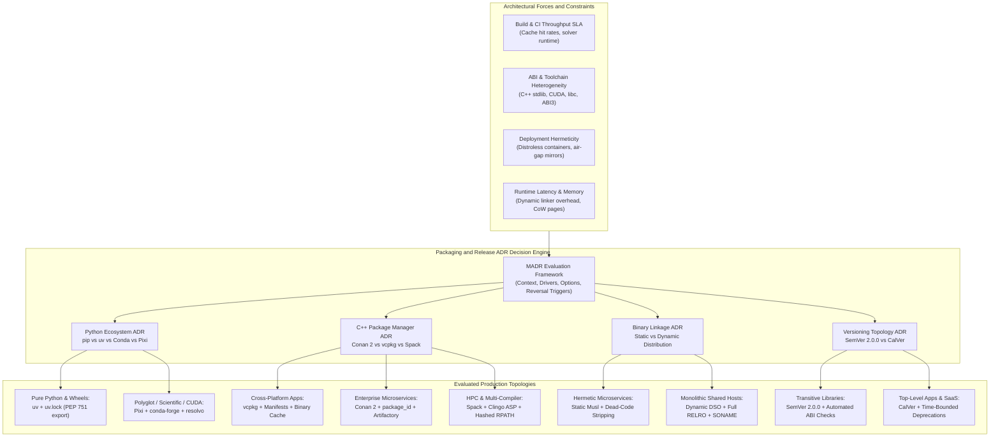

# Packaging and Release Architecture Decision Records

> [!summary] Claim:
> Packaging and release architecture decisions impose multi-year technical hysteresis on software systems, anchoring organizations to specific binary compatibility models, dependency resolution algorithms, and deployment artifacts.
> Formal Architecture Decision Records (ADRs) capture Architecturally Significant Requirements (ASRs), evaluate explicit trade-off matrices across build throughput, ecosystem isolation, and runtime memory overhead, and establish quantitative reversal triggers.
> Selecting between package managers (pip versus uv versus Conda and Pixi; Conan 2 versus vcpkg versus Spack), binary linking models (static versus dynamic), and versioning schemes (SemVer versus CalVer) requires evaluating graph resolution complexity, dynamic linker relocation latency, and ABI failure modes.
> Enterprise release governance codifies these choices into machine-verifiable constraints, preventing silent binary corruption, registry poisoning, and uncoordinated dependency drift across distributed teams.



## The Mechanism

Packaging and release engineering operates at the boundary where source code is transformed into distributed machine artifacts.
Decisions made at this boundary exhibit high hysteresis: changing a package manager, binary linkage strategy, or versioning contract across thousands of engineers requires modifying build systems, artifact repositories, deployment scripts, container base images, and runtime monitoring infrastructure.
An Architecture Decision Record (ADR) serves as the formal mechanism to capture the context, trade-offs, and invariants governing these architectural commitments.

### 1. Architecture Decision Records (ADRs) in Packaging and Release Engineering

An Architecture Decision Record documents an Architecturally Significant Requirement (ASR) that affects software structure, operational characteristics, or team velocity.
In packaging and release systems, an ASR is any choice that binds downstream consumers to an Application Binary Interface (ABI), an artifact repository protocol, a dependency resolution algorithm, or an operating system dependency contract.

The Markdown Architectural Decision Records (MADR) 4.0.0 template (released 2024-09-17) uses YAML front matter for metadata (`status`, `date`, `decision-makers`, `consulted`, `informed`) and these body sections, several of them optional ([MADR template](https://github.com/adr/madr/blob/main/template/adr-template.md)):

1. **Title:** A short title representative of the solved problem and the found solution; files are numbered (for example, `0014-standardize-python-on-uv.md`).
2. **Status (front matter):** The lifecycle state of the decision; the template lists `proposed`, `rejected`, `accepted`, `deprecated`, and `superseded by ADR-0123` as examples.
3. **Context and Problem Statement:** The operational constraints, build timings, developer pain points, and ecosystem forces necessitating a decision.
4. **Decision Drivers (optional):** Engineering criteria such as CI pipeline duration, binary artifact footprint, security patching turnaround time, and air-gapped registry compatibility.
5. **Considered Options:** Explicit enumeration of viable alternatives.
6. **Decision Outcome:** The chosen alternative with justification, plus optional `Consequences` and `Confirmation` subsections.
7. **Pros and Cons of the Options** and **More Information (optional):** Per-option analysis and links.

Quantitative reversal triggers are not a MADR section; this note adds them as a packaging-specific extension under `Decision Outcome` or `More Information`.

```
       +------------+
       |  Proposed  |
       +------------+
         /        \
        v          v
 +----------+  +----------+
 | Accepted |  | Rejected |
 +----------+  +----------+
    /      \
   v        v
+------------+  +------------+
| Deprecated |  | Superseded | ---> Points to ADR-XXXX
+------------+  +------------+
```

MADR does not prescribe transitions; this state machine is a common convention, and an accepted record may move directly to superseded without passing through deprecated.

A packaging ADR differs from a generic software architecture record because it must quantify the *reversal cost* and establish *falsifiable operational thresholds*.
If an ADR selects static linking to eliminate dynamic loader startup overhead in short-lived serverless functions, the record must specify the exact metric that would invalidate the decision, such as base image storage costs exceeding a defined threshold or an emergency vulnerability remediation requiring fleet-wide recompilation within an unachievable SLA.

### 2. Python Ecosystem ADR: pip versus uv versus Conda versus Pixi

The Python packaging ecosystem bifurcates into two distinct architectural approaches: the PyPA wheel ecosystem (`pip`, `uv`) and the conda prefix ecosystem (`Conda`, `Pixi`).
Understanding their underlying mechanics is required before authoring an ADR.

```
                     +-----------------------------------+
                     | Python Packaging Topology Dilemma |
                     +-----------------------------------+
                                       |
                   Does your workload require non-Python
                   system runtimes (CUDA, MKL, C/Fortran)
                   outside standard manylinux wheels?
                                  /         \
                             YES /           \ NO
                                v             v
                   +-------------------+   +---------------------+
                   | Conda-Forge Prefix|   | Pure PyPA Standards |
                   |     Ecosystem     |   |      Ecosystem      |
                   +-------------------+   +---------------------+
                             |                        |
                   Do you need Rust-speed   Do you require extreme
                   solves, multi-env lock,  CI throughput, workspaces,
                   and task running?        and PEP 751 lockfiles?
                        /         \              /          \
                   YES /           \ NO     YES /            \ NO
                      v             v          v              v
                  +------+      +-------+    +----+        +-----+
                  | Pixi |      | Conda |    | uv |        | pip |
                  +------+      +-------+    +----+        +-----+
```

#### Resolution Mechanics

Before pip 20.3, the legacy resolver did not backtrack: it took the first candidate satisfying the first requirement seen and could install a mutually inconsistent set.
Since pip 20.3, pip uses `resolvelib`, a backtracking resolver that can take exponential time on dense conflicting graphs.
`pip` resolves in a single Python process, and neither the pip dependency-resolution guide nor the pip release notes through 25.3 describe parallel metadata fetching or parallel downloads, so treat its metadata fetches as sequential unless a measurement on your pip version says otherwise (as of 2026-11; [pip resolution guide](https://pip.pypa.io/en/stable/topics/dependency-resolution/), [pip news](https://pip.pypa.io/en/stable/news/)).
When resolving complex graphs containing packages like `scipy` or `transformers`, `pip` frequently downloads multiple large wheels solely to read their `METADATA` files when the package index does not serve PEP 658 metadata.

`uv` replaces this architecture with an engine implemented in Rust, using the PubGrub algorithm: [[Dependency-Resolution-SAT-PubGrub-and-MVS]].
PubGrub is a deterministic algorithm that constructs an explicit explanation graph during backtracking, terminating with actionable conflict explanations when no valid solution exists: [[Drill-Packaging-PubGrub-Conflict-Diagnosis]].
`uv` fetches metadata concurrently from the Simple repository API, uses PEP 658 metadata files when the index serves them, and otherwise reads a remote wheel's `METADATA` via HTTP range requests without downloading the entire archive.

`Conda` treats Python itself as a runtime package inside a complete, self-contained prefix.
Dependencies are resolved across cross-language binary libraries including `libcufft`, `libmkl_rt`, `libgfortran`, and `ffmpeg`.
Historically, Conda used a Python SAT solver (`pycosat`) that struggled with channel sizes containing hundreds of thousands of package variants.
Modern Conda uses `conda-libmamba-solver`, integrating the openSUSE `libsolv` C library.

`Pixi` is built on `rattler`, an open-source library that implements Conda package management in Rust.
It employs `resolvo`, a Rust CDCL SAT solver that started as a port of libsolv and has since diverged ([resolvo](https://github.com/prefix-dev/resolvo)); Pixi solves every environment (such as `default`, `cuda`, `test`) declared in one `pixi.toml` manifest for every listed platform and records them all in a single cross-platform `pixi.lock`.

#### Filesystem Layout and Linking Economics

`pip` extracts `.whl` archives by reading the ZIP directory structure and writing individual files directly into `<venv>/lib/pythonX.Y/site-packages/`.
This requires full file copies, issuing tens of thousands of `write()` system calls and consuming disk space linearly with every created virtual environment.

`uv` implements a global cache stored under `$XDG_CACHE_HOME/uv` or `~/.cache/uv` on Linux and macOS (as of 2026-11, Both).
When installing packages into an environment, `uv` defaults to copy-on-write cloning (`clonefile` on macOS APFS, the `FICLONE` reflink ioctl on Linux btrfs and XFS) on macOS and Linux and to hardlinking on Windows; if a clone fails it falls back to a hardlink (`link` system call), then to a plain copy ([uv settings](https://docs.astral.sh/uv/reference/settings/), `LinkMode::default` and `next_mode` in `crates/uv-fs/src/link.rs`) (as of 2026-11, Both).
This decouples environment instantiation time from archive size: a clone or hardlink touches inode metadata instead of rewriting file contents, so install cost scales with file count rather than bytes copied; measure the factor on your own cache and filesystem.

`Conda` and `Pixi` install binaries into an isolated prefix (`sys.prefix` containing `bin/`, `lib/`, `include/`, and `share/`).
Because binaries contain hardcoded paths, conda-build builds in a long placeholder prefix (padded to 255 characters on Linux and macOS) and registers the files that contain it in `info/has_prefix`; at install time the placeholder is replaced with the real prefix, directly in text files and with null-byte padding in binary files so the file length does not change ([conda-build: making packages relocatable](https://docs.conda.io/projects/conda-build/en/stable/resources/make-relocatable.html)).
Conda performs that rewrite; this note does not claim Pixi shares the code path, only that it installs the same package format.

#### The Decision Matrix

| Architectural Driver | `pip` (PyPA Default) | `uv` (Astral) | `Conda` (libmamba) | `Pixi` (Prefix.dev) |
| :--- | :--- | :--- | :--- | :--- |
| **Language & Toolchain** | Python | Rust | Python / C (`libsolv`) | Rust (`resolvo`) |
| **Resolution Engine** | `resolvelib` (Backtracking) | PubGrub (with derivation-tree explanations) | `libsolv` (CDCL SAT) | `resolvo` (CDCL SAT) for conda packages; uv's resolver for PyPI dependencies |
| **System Dependency Scope** | Python wheels only (`manylinux`) | Python wheels only (`manylinux`) | Full sys-root (CUDA, C++, BLAS, R) | Full sys-root (CUDA, C++, BLAS, R) |
| **Filesystem Strategy** | Full archive file copy | CoW clones (default on macOS and Linux) / hardlinks (default on Windows) | Hardlinks / Prefix text replacement | Hardlinks / Prefix text replacement |
| **Lockfile Support** | `requirements.txt` pins; experimental `pip lock` writes PEP 751 `pylock.toml` for the current platform only | `uv.lock` (Cross-platform; exportable to `pylock.toml`) | `conda-lock` (External tool) | `pixi.lock` (Native, multi-environment) |
| **Interpreter Management** | No (External tool needed) | Yes (`uv python install`) | Yes (Python is a conda package) | Yes (Python is a conda package) |

This table carries no solve-latency row: no primary source publishes a representative figure, so benchmark your own dependency graph (see the Practice Drill) before quoting one.
Pixi uses uv for its `pypi-dependencies`: its docs state that "uv handles both the resolution of PyPI dependencies and the building of any source dependencies" ([Pixi pyproject.toml guide](https://pixi.prefix.dev/latest/python/pyproject_toml/)).

**Decision Rule:**
- Choose `uv` when developing pure Python, web services, or standard machine learning applications where pre-built wheels exist on PyPI, and where CI speed and deterministic cross-platform lockfiles are primary drivers: [[Python-Dependency-Resolution-pip-uv-and-PEP-751-Lockfiles]].
- Choose `Pixi` when developing polyglot workflows spanning C++, CUDA, Python, and Fortran, where native system libraries must match binary toolchains exactly without relying on host operating system package managers: [[Python-Conda-and-Pixi-for-Polyglot-Environments]].

### 3. C and C++ Package Manager ADR: Conan 2 versus vcpkg versus Spack

Unlike Python or Rust, C and C++ lack a standard unified package manager.
Native compilation introduces combinatorial configuration spaces where target architecture, compiler vendor, compiler version, C++ standard library implementation (`libstdc++` versus `libc++`), runtime library linkage (`/MT` versus `/MD`), and preprocessor definitions dictate ABI compatibility: [[Cpp-ABI-Stability-Symbol-Visibility-and-SONAME]].

```
                  +--------------------------------+
                  | C++ Package Manager ADR Engine |
                  +--------------------------------+
                                   |
                  What is the target domain and runtime
                  distribution environment?
                                   |
         +-------------------------+-------------------------+
         |                         |                         |
         v                         v                         v
+------------------+      +------------------+      +------------------+
| Cross-Platform   |      | Componentized    |      | Supercomputing   |
| Desktop/Mobile   |      | Microservices &  |      | HPC / Scientific |
| Applications     |      | Enterprise Fleet |      | Multi-Compiler   |
+------------------+      +------------------+      +------------------+
         |                         |                         |
         v                         v                         v
+------------------+      +------------------+      +------------------+
|      vcpkg       |      |     Conan 2      |      |      Spack       |
+------------------+      +------------------+      +------------------+
| - Declarative    |      | - Imperative     |      | - Combinatorial  |
|   vcpkg.json     |      |   conanfile.py   |      |   spec syntax    |
| - Triplets       |      | - package_id     |      | - Clingo ASP     |
| - Portfile CMake |      |   hash model     |      |   concretization |
| - Native CMake   |      | - RREV / PREV    |      | - Isolated RPATH |
|   interception   |      |   immutability   |      |   per build DAG  |
+------------------+      +------------------+      +------------------+
```

#### Conan 2 Architecture and Binary Model

Conan 2 models C++ dependencies as a directed acyclic graph where each node is governed by a Python recipe (`conanfile.py`).
The core architectural primitive of Conan 2 is the `package_id`: a SHA-1 hash of the binary's `conaninfo.txt` (the Conan docs state it "is computed as the sha1 hash of the `conaninfo.txt` file"; [Conan package_id](https://docs.conan.io/2/reference/binary_model/package_id.html)) derived from:
1. Target **settings** (`os`, `arch`, `compiler`, `compiler.version`, `compiler.cppstd`, `build_type`).
2. Package-specific **options** (e.g. `shared=True`, `fPIC=True`, `with_openssl=True`).
3. Dependency information reduced by a **package_id mode** (`unrelated_mode`, `semver_mode`, `major_mode`, `minor_mode`, `patch_mode`, `full_version_mode`, `revision_mode`, `full_mode`, among others in `conan/internal/model/info.py`); the defaults are `core.package_id:default_embed_mode=full_mode` for static and header-only dependencies, `default_non_embed_mode=minor_mode` for shared dependencies, `default_unknown_mode=semver_mode`, and no mode for `tool_requires` ([Conan 2 binary model](https://docs.conan.io/2/reference/binary_model/dependencies.html)) (as of 2026-11, Both).

Conan 2 enforces binary immutability through Recipe Revisions (`RREV`) and Package Revisions (`PREV`).
A fully qualified Conan 2 binary reference follows the structure:
`pkg/version#RREV:package_id#PREV`

If a developer modifies `conanfile.py` or updates a source patch without bumping `version`, Conan calculates a new `RREV`.
When compiled, the resulting binary directory hash generates a unique `PREV`.
In Conan 2, having multiple `PREV` entries for the same `RREV` and `package_id` indicates an unmodeled non-deterministic build artifact, such as timestamp leakage or unpinned host compiler toolchains.
Conan 2 integrates with CMake via generated configuration files (`CMakeDeps`, `CMakeToolchain`), preserving normal `find_package()` idioms: [[Cpp-Conan-2-Architecture-and-Binary-Model]].

#### vcpkg Architecture: Manifests and Triplets

`vcpkg` is maintained by Microsoft and implemented in C++.
It centers on declarative JSON manifests (`vcpkg.json`) and companion registry configuration (`vcpkg-configuration.json`).
`vcpkg` does not use Python recipes; each package ("port") is defined by a `portfile.cmake` script that downloads, patches, and builds the library using CMake, Meson, Autotools, or custom scripts.

The ABI configuration is governed by **Triplets** (such as `x64-linux`, `x64-windows-static`, `arm64-osx`).
A triplet defines the target architecture, operating system, CRT linkage, and static versus dynamic library defaults.
`vcpkg` manages binary caching by computing an ABI hash of the port files, triplet parameters, compiler identity, and transitive dependency ABI hashes.
Pre-built binaries can be cached in local directories (`files`), HTTP servers (`http`), and NuGet feeds (`nuget`), plus the providers vcpkg labels experimental: Azure Blob Storage (`x-azblob`), Google Cloud Storage (`x-gcs`), AWS S3 (`x-aws`), and Azure Universal Packages (`x-az-universal`); the GitHub Actions cache provider (`x-gha`) has been removed ([vcpkg binary caching reference](https://learn.microsoft.com/en-us/vcpkg/reference/binarycaching)) (as of 2026-11, Both): [[Cpp-vcpkg-Manifests-Registries-and-Binary-Caching]].
`vcpkg` integrates into CMake through a single toolchain file (`vcpkg.cmake`) that wraps CMake's native `find_package()` calls.

#### Spack Architecture: Combinatorial Concretization and HPC

`Spack` was designed by Lawrence Livermore National Laboratory (LLNL) to address the extreme combinatorial complexity of High-Performance Computing (HPC).
In HPC clusters, software must run across diverse microarchitectures (Intel Sapphire Rapids, AMD Zen 4, ARM Neoverse), distinct compilers (GCC, Clang, Intel oneAPI, NVHPC, AOCC), and vendor-specific MPI libraries (OpenMPI, MPICH, Cray-MPICH).

Spack rejects static package IDs in favor of dynamic **Spec syntax**:
`hdf5@1.14.0 +hl +fortran +mpi %gcc@14.1.0 cflags="-O3" target=zen4 ^mpich@4.2.0`

Spack resolves this combinatorial space using the `Clingo` Answer Set Programming (ASP) solver.
The concretizer unifies requirements into a fully determined directed acyclic graph.
Critically, Spack ensures side-by-side coexistence: every compiled package is installed into a distinct directory path hashed by its entire dependency DAG; the current default projection is `{architecture.platform}-{architecture.target}/{name}-{version}-{hash}` under `$spack/opt/spack` ([Spack config.yaml reference](https://spack.readthedocs.io/en/latest/config_yaml.html)) (as of 2026-11, Both):
`$spack/opt/spack/linux-zen4/hdf5-1.14.0-7f8a9bc.../`

Spack's compiler wrappers embed explicit runtime search paths into every compiled ELF binary; the default `shared_linking: type: rpath` emits `DT_RPATH`, and `type: runpath` emits `DT_RUNPATH` instead, ensuring that executables locate their exact transitive dependencies at runtime without requiring `LD_LIBRARY_PATH` manipulation: [[Cpp-Spack-and-Nix-for-Native-Dependencies]].

#### The Decision Matrix

| Evaluation Dimension | Conan 2 | vcpkg | Spack |
| :--- | :--- | :--- | :--- |
| **Implementation Core** | Python | C++ | Python |
| **Package Definition** | Imperative Python (`conanfile.py`) | Declarative JSON + CMake (`portfile.cmake`) | Imperative Python Spec (`package.py`) |
| **ABI Identification** | Cryptographic `package_id` hash | Triplet + Portfile ABI hash | DAG-wide cryptographic hash |
| **Resolution Engine** | Graph dependency solver | Version baseline comparator | Clingo Answer Set Programming (ASP) |
| **Runtime Isolation** | Relocatable CMake config / RPATH | Triplet tree installation | Explicit hashed RPATH per package |
| **Multi-Compiler Coexistence** | Supported via profiles | Requires custom triplets | Native, first-class design principle |
| **Enterprise Storage** | Native JFrog Artifactory support | Files, HTTP, NuGet; experimental Azure Blob, GCS, S3 | Buildcache mirrors (S3, HTTP, OCI) |
| **Primary Domain** | Enterprise C++ / Embedded systems | Cross-platform desktop / game dev | Supercomputing / scientific computing |

**Decision Rule:**
- Choose `vcpkg` when developing cross-platform desktop, mobile, or gaming applications tightly integrated with CMake, Visual Studio, or standard CI runners where a declarative JSON manifest is preferred.
- Choose `Conan 2` when building large componentized enterprise architectures with diverse embedded toolchains, fine-grained option toggles, and dedicated Artifactory artifact registries.
- Choose `Spack` when software runs in High-Performance Computing or scientific environments requiring combinatorial variants across MPI implementations, Fortran compilers, and specific processor microarchitectures.

### 4. Binary Linkage ADR: Static versus Dynamic Library Distribution

Choosing between static linkage (`.a` archives) and dynamic linkage (`.so` / `.dylib` shared objects) is a foundational architectural decision that impacts execution latency, memory footprint, address space layout randomization (ASLR), and vulnerability remediation cycles: [[Execute-Zero-Downtime-Shared-Library-SONAME-Migration]].

```
                  +-------------------------------+
                  | Binary Linkage Dilemma Engine |
                  +-------------------------------+
                                  |
                  What is the execution environment and
                  operational lifecycle model?
                                  |
         +------------------------+------------------------+
         |                                                 |
         v                                                 v
+-------------------------------+         +-------------------------------+
| Short-Lived CLI / Serverless  |         | Multi-Process Monolith / Host |
| / Distroless Container Base   |         | System / OS Plugin Framework  |
+-------------------------------+         +-------------------------------+
         |                                                 |
         v                                                 v
+-------------------------------+         +-------------------------------+
|        Static Linkage         |         |        Dynamic Linkage        |
+-------------------------------+         +-------------------------------+
| - Kernel execve() instant     |         | - Clean text pages shared     |
| - Zero ld.so relocation cost  |           across processes in RAM       |
| - Hermetic musl libc          |         | - Hotpatchable shared objects |
| - Whole-program LTO & gc      |           without rebuilding clients    |
| - Downside: glibc NSS breaks  |         | - Downside: ELF startup time, |
| - Downside: larger disk image |           dirty CoW pages (.data.rel.ro)|
+-------------------------------+         +-------------------------------+
```

#### Kernel Loading and Dynamic Linker Overhead

When the Linux kernel executes a dynamically linked ELF binary via the `execve()` system call:
1. The kernel parses the binary program headers, maps the `PT_LOAD` segments into virtual memory, and identifies the `PT_INTERP` segment (typically `/lib64/ld-linux-x86-64.so.2`).
2. The kernel maps the dynamic linker into the process address space and transfers execution control to the linker entry point (`_start`, emitted by the `RTLD_START` macro in glibc's `sysdeps/x86_64/dl-machine.h`, which calls `_dl_start` in `elf/rtld.c`).
3. The dynamic linker traverses the binary's `PT_DYNAMIC` segment (the `_DYNAMIC` array), reads `DT_NEEDED` entries, and loads all required shared libraries in dependency order.
4. The linker iterates over the symbol hash tables (`.gnu.hash` and `.hash`) to resolve external symbol references.
5. The linker executes relocations:
   - `R_X86_64_RELATIVE`: Rebasing internal pointers against the randomized base address selected by ASLR.
   - `R_X86_64_GLOB_DAT`: Resolving global data symbols in the Global Offset Table (GOT).
   - `R_X86_64_JUMP_SLOT`: Binding Procedure Linkage Table (PLT) entries to function addresses.

If the binary is compiled without Full RELRO (`-Wl,-z,relro,-z,now`), the dynamic linker resolves `JUMP_SLOT` relocations lazily upon the first function invocation.
However, in high-security production environments, Full RELRO is mandatory to protect against GOT-overwrite exploits.
Full RELRO links with `-z now`, which sets the `DF_BIND_NOW` / `DF_1_NOW` dynamic flags and so has the same effect as running with `LD_BIND_NOW` set: `ld.so` resolves all relocations before transferring execution to `main()`, then makes the RELRO region read-only.
For large microservices loading hundreds of shared objects, this relocation phase grows with the number of DSOs and relocations and is paid on every process start; `LD_DEBUG=statistics` prints the time spent relocating, so measure it for your binary instead of trusting a rule of thumb.

In contrast, a statically linked binary contains no `PT_INTERP` segment.
The kernel maps the `PT_LOAD` segments directly into the process address space and branches directly to the program entry point (`_start`); a static PIE still applies its own `R_X86_64_RELATIVE` relocations in startup code, but performs no symbol lookup, so there is no library search or symbol resolution at startup; the remaining cost is `execve()` and page faults.

#### Memory Page Sharing versus Dirty Copy-On-Write Pages

Dynamic libraries promise physical memory savings through page sharing: `ld.so` maps the executable code (`.text`) and read-only data (`.rodata`) segments with `MAP_PRIVATE`, backed by the underlying filesystem inode.
Until a page is written, every process mapping the same inode uses the same page-cache frame, so concurrent processes share the exact same physical RAM for these read-only pages.

However, the dynamic linker must write resolved addresses into the `.got` and `.data.rel.ro` sections during relocation.
Because these memory pages are mapped with `MAP_PRIVATE`, the moment `ld.so` writes a relocated pointer into a page, the CPU Memory Management Unit (MMU) triggers a page fault.
The Linux kernel allocates a fresh, private physical page frame via Copy-On-Write (CoW).
These "dirty pages" become process-private Resident Set Size (RSS) and can never be shared across processes.
In systems with large global offset tables, dirty relocation pages can consume megabytes of private memory per process instance, neutralizing the theoretical memory savings of shared libraries.

#### The glibc Static Linking Hazard

A critical architectural pitfall in Linux static linking centers on the GNU C Library (glibc).
glibc implements the Name Service Switch (NSS) to handle user account, hostname, and service lookups (`/etc/nsswitch.conf`).
Functions such as `getaddrinfo()`, `gethostbyname()`, and `getpwnam()` dispatch to NSS modules; any module other than the built-in ones (`sss`, `systemd`, `ldap`, `mdns4_minimal`, and so on) is loaded at runtime with `dlopen()` as `libnss_<name>.so.2`.
Since glibc 2.34 the `files` and `dns` modules are compiled into libc itself and are loaded without `dlopen()`, including in static binaries (`module_load` in `nss/nss_module.c`; Florian Weimer, "nss: Directly load nss_dns, without going through dlsym/dlopen", 2021); before 2.34 a static binary had to `dlopen()` even `libnss_files.so.2` and `libnss_dns.so.2`.

When an engineer compiles a program using `-static` against glibc, the GNU linker (`ld`) still issues this warning for every NSS interface function (the `static_link_warning` macro in `include/libc-symbols.h`, applied through `nss_interface_function`):
`Using 'getaddrinfo' in statically linked applications requires at runtime the shared libraries from the glibc version used for linking`

The hazard is twofold.
First, a host whose `nsswitch.conf` names a non-built-in module makes the static binary `dlopen()` a host `libnss_*.so.2` built for a different glibc version, which can fail or crash.
Second, in a distroless container image (`FROM scratch`) there is no `/etc/nsswitch.conf`, `/etc/hosts`, or `/etc/resolv.conf`: glibc then defaults the `hosts` database to `files dns` (`nss/nss_database.c`) and the resolver to a nameserver on `INADDR_LOOPBACK` (`resolv/res_init.c`), so name lookups fail unless something answers DNS on 127.0.0.1.
To achieve hermetic static binaries on Linux, the ADR must either mandate linking against `musl libc` (for example, via Alpine Linux or the `x86_64-unknown-linux-musl` target in Rust), whose resolver needs no NSS modules, or ship `/etc/resolv.conf` and `/etc/nsswitch.conf` in the image; either way the container still needs a reachable DNS server.

#### The Decision Matrix

| Evaluation Dimension | Static Linkage (musl) | Dynamic Linkage (glibc / System DSO) |
| :--- | :--- | :--- |
| **Startup Latency** | No dynamic linker work (Kernel direct mapping) | Grows with DSO count and relocations (`ld.so`); measure with `LD_DEBUG=statistics` |
| **Deployment Footprint** | Single self-contained binary | Binary plus transitive tree of `.so` files |
| **Runtime Dependencies** | Linux kernel system call ABI only | Matching `libc`, dynamic linker, and shared libraries |
| **Memory Page Sharing** | Shared only among instances of the same binary file (same inode) | Clean `.text` pages shared across all processes using the same DSO file |
| **Process-Private RSS** | Minimal (Zero dynamic relocation dirty pages) | High (Every relocated GOT page becomes private CoW) |
| **Dead-Code Elimination** | Maximum (Link-Time Optimization, `--gc-sections`) | None across library boundaries (whole DSO mapped; only touched pages become resident) |
| **Security Patch SLA** | Must recompile and redeploy binary | Replace shared object on disk, restart process |
| **Container Base Image** | Distroless (`FROM scratch`) | Debian / Ubuntu / RHEL runtime base |

**Decision Rule:**
- Choose **Static Linkage with musl** for CLI tools, serverless functions, background workers, and containerized microservices deployed on ephemeral cloud infrastructure where instant startup, zero external dependencies, and minimal container images are critical: [[OCI-Images-Layers-Multi-Stage-and-Distroless]].
- Choose **Dynamic Linkage with Full RELRO** for monolithic multi-process platforms running on shared bare-metal hosts where physical memory page sharing across dozens of distinct processes outweighs startup latency, or where runtime plugin architectures require `dlopen()`.

### 5. Versioning Scheme ADR: SemVer 2.0.0 versus CalVer

The contract governing package releases establishes how consumers reason about compatibility and upgrade risk.
The two dominant paradigms are Semantic Versioning (SemVer 2.0.0) and Calendar Versioning (CalVer): [[Versioning-SemVer-CalVer-and-ABI]].

```
                  +--------------------------------+
                  | Versioning Topology ADR Engine |
                  +--------------------------------+
                                   |
                  Who is the primary consumer of the package,
                  and how are dependencies resolved?
                                   |
         +-------------------------+-------------------------+
         |                                                   |
         v                                                   v
+-------------------------------+           +-------------------------------+
| Programmatic Solvers & Shared |           | Human End-Users, Platforms,   |
| Transitive Software Libraries |           | SaaS Services, & Base Images  |
+-------------------------------+           +-------------------------------+
         |                                                   |
         v                                                   v
+-------------------------------+           +-------------------------------+
|         SemVer 2.0.0          |           |            CalVer             |
+-------------------------------+           +-------------------------------+
| - Format: MAJOR.MINOR.PATCH   |           | - Format: YYYY.MM.MICRO       |
| - Machine contract for SAT/   |           | - Cadence and recency driven  |
|   PubGrub caret ranges        |           | - Time-bounded deprecations   |
| - Clear breaking signal       |           | - Eliminates SemVer fatigue   |
| - Downside: Hyrum's Law leaks |           | - Downside: Cannot resolve    |
| - Downside: "Forever v0.x"    |             transitive graphs safely      |
+-------------------------------+           +-------------------------------+
```

#### SemVer 2.0.0 Mechanics and Invariants

Semantic Versioning formalizes the version tuple:
`MAJOR.MINOR.PATCH[-PRERELEASE][+BUILD]`

1. **MAJOR:** Incremented when backwards-incompatible API or ABI changes are introduced.
2. **MINOR:** Incremented when backwards-compatible functionality is added or existing features are deprecated.
3. **PATCH:** Incremented when backwards-compatible bug fixes are applied.

Ecosystems whose default requirement syntax encodes SemVer (Cargo's backtracking resolver, npm, and Dart's `pub`, where PubGrub originated) rely on SemVer invariants to prune incompatible branches of the solution space.
Python resolvers such as `pip` and `uv` order versions by PEP 440 instead, which assigns no compatibility meaning to version components beyond the `~=` operator.
For instance, the caret operator (`^1.2.3`, the Cargo and npm default, not part of the SemVer 2.0.0 text) asserts that any version satisfying `>=1.2.3, <2.0.0` is backwards-compatible; for `0.y.z` it narrows to the minor version (`^0.2.3` means `>=0.2.3, <0.3.0`) ([Cargo resolver](https://doc.rust-lang.org/cargo/reference/resolver.html)).
Without SemVer, automated solvers cannot calculate viable dependency graphs across thousands of transitive libraries without exhaustive human-authored constraint specifications.

#### The Failure Modes of SemVer: Hyrum's Law and SemVer Fatigue

In production engineering, SemVer faces two human and technical limits:
- **Hyrum's Law:** "With a sufficient number of users of an API, it does not matter what you promise in the contract: all observable behaviors of your system will be depended on by somebody." ([hyrumslaw.com](https://www.hyrumslaw.com/))
  A bug fix that changes error string formatting, hash iteration order, or memory allocation patterns is technically a PATCH release, yet it frequently breaks downstream consumers who inadvertently relied on the bug.
- **SemVer Fatigue and the "Forever v0.x" Trap:** Because incrementing MAJOR signals a breaking change that forces downstream clients to manually update their version constraints, library authors develop an aversion to bumping MAJOR.
  Projects remain on `0.x.y` for years, overloading MINOR releases with breaking changes (SemVer 2.0.0 item 4 says that under major version zero "anything MAY change at any time"), or maintainers accumulate technical debt to avoid breaking public interfaces.

#### Calendar Versioning (CalVer) Mechanics

Calendar Versioning links version numbers directly to release dates:
`YYYY.MM.MICRO` (for example, `2026.11.0` or Ubuntu's `24.04`).
CalVer communicates release cadence, maintenance horizons, and platform freshness.
It operates effectively in systems governed by **time-based release trains**: [[Release-Trains-Backports-and-Artifact-Registries]].

CalVer shifts the compatibility contract from the version number to explicit **deprecation windows**.
For example, an API feature is marked deprecated in `2026.03`, documented to persist for six months, and removed in `2026.09`.
This eliminates "SemVer fatigue" and establishes a predictable cadence for downstream consumers to audit deprecation warnings.

#### The Decision Matrix

| Evaluation Dimension | SemVer 2.0.0 (`MAJOR.MINOR.PATCH`) | CalVer (`YYYY.MM.MICRO`) |
| :--- | :--- | :--- |
| **Target Audience** | Automated dependency solvers (PubGrub, SAT) | Human operators, DevOps, end users |
| **Compatibility Signal** | Structural (Machine-interpretable) | Chronological (Recency and support window) |
| **Resolver Integration** | First-class support for ranges (`^`, `~`) | Poor support (Resolvers cannot infer compatibility) |
| **Deprecation Model** | Major version boundaries | Time-bounded release horizons (e.g. 6 months) |
| **Ecosystem Fit** | Shared libraries, SDKs, crates, PyPI packages | Microservices, CLI utilities, Linux distros, SaaS |
| **Governance Overhead** | High (Strict ABI/API auditing required in CI) | Low (Focus shifts to release train automation) |

**Decision Rule:**
- Mandate **SemVer 2.0.0** for reusable shared libraries, SDKs, C++ headers, and internal package registries consumed transitively by other software repositories.
- Mandate **CalVer** for top-level deployed applications, internal microservice deployments, CLI binaries, Docker base images, and system platforms where deployment cadence and operational lifecycle dominate: [[Release-Trains-Backports-and-Artifact-Registries]].

---

## Commands and Numbers to Know

Reference metrics, system call behaviors, environment variables, and flag defaults governing packaging and release architecture decisions.

| Metric / Command / Variable | Default / Measured Value | Platform | Architectural Significance |
| :--- | :--- | :--- | :--- |
| `uv cache clean` | Cleans the uv cache (`$XDG_CACHE_HOME/uv` or `~/.cache/uv`) | Both | Cleans global wheel and archive storage (as of 2026-11, Both). |
| `UV_LINK_MODE=clone` | Default on macOS and Linux | Both | Uses `clonefile` (APFS) or `FICLONE` (btrfs, XFS) reflinks; falls back to hardlink, then copy (as of 2026-11, Both). |
| `UV_LINK_MODE=hardlink` | Default on Windows; first fallback for `clone` | Both | Uses the `link()` system call to populate virtual environments with zero disk duplication, but shares inodes with the cache (as of 2026-11, Both). |
| `LD_BIND_NOW` | Unset by default; any non-empty value enables it, including `0` | Linux | Forces immediate symbol binding at startup; prevents lazy PLT resolution (ld.so(8)) (as of 2026-11, Linux). |
| `-Wl,-z,relro,-z,now` | Toolchain dependent | Linux | Enforces Full RELRO; dynamic linker marks GOT read-only prior to `main()` execution (as of 2026-11, Linux). |
| `LD_DEBUG=statistics,reloc` | Disabled by default | Linux | Emits dynamic linker timing, relocation counts, and symbol search statistics to stderr (as of 2026-11, Linux). |
| `VCPKG_BINARY_SOURCES` | Unset: the `default` local files cache, read-write | Both | Configures binary caching backends (`files`, `http`, `nuget`, experimental `x-azblob`, `x-gcs`, `x-aws`); a value such as `clear;files,/cache,readwrite` replaces the default (as of 2026-11, Both). |
| `X_VCPKG_ASSET_SOURCES` | Empty | Both | Configures asset caching to mirror upstream source archives in air-gapped environments; the `X_` prefix marks it experimental (as of 2026-11, Both). |
| Conan revisions | Always on in Conan 2.x; the Conan 1 `CONAN_REVISIONS_ENABLED` switch no longer exists | Both | Every reference carries Recipe Revisions (`RREV`) and Package Revisions (`PREV`) (as of 2026-11, Both). |
| `spack concretize -f` | Forces re-concretization | Both | Invokes the Clingo ASP solver to re-concretize every spec in the active environment (as of 2026-11, Both). |
| GNU hash lookup complexity | $O(1)$ expected per symbol per DSO searched | Linux | Symbol search in `.gnu.hash` uses a Bloom filter then a bucket chain; total lookup cost still scales with the number of DSOs in the search scope (as of 2026-11, Linux). |
| Minimum dirty memory per 1k relocations | At least two 4 KiB pages | Linux | Arithmetic only: 1,000 eight-byte slots occupy 8,000 bytes, so at least two 4 KiB pages are privately dirtied if they are packed contiguously; real figures depend on layout, so read `Private_Dirty` in `/proc/<pid>/smaps` (as of 2026-11, Linux). |

---

## Multi-Language Comparison: C++ / Python / Rust

Comparison of packaging and release architecture decisions across native C++, interpreted/extension Python, and compiled Rust toolchains.

| Capability / Decision Dimension | C++ (Native Toolchains) | Python (Interpreted / Extensions) | Rust (Cargo Toolchain) |
| :--- | :--- | :--- | :--- |
| **Package Definition File** | `conanfile.py` (Conan) or `vcpkg.json` (vcpkg) | `pyproject.toml` (PEP 621) | `Cargo.toml` |
| **Dependency Resolution Algorithm** | Clingo ASP (Spack) / Graph solver (Conan) / Baseline (vcpkg) | PubGrub (`uv`) / `libsolv` (`Conda`) / `resolvelib` (`pip`) | Cargo's own backtracking resolver (not PubGrub) |
| **Binary Artifact Unit** | Compiled tarball (`.tar.gz`) / Shared object (`.so`) | Wheel (`.whl`, PEP 427) / Conda package (`.conda`) | Pre-compiled binary / `.crate` source archive |
| **Binary Identity / Hash Model** | `package_id` (Settings/options hash) / Triplet | Platform tags (`manylinux_2_28_x86_64`) / Conda hash | Target triple (`x86_64-unknown-linux-gnu`) + profile hash |
| **Lockfile Specification** | `conan.lock` / vcpkg has no lockfile (versions pinned by `builtin-baseline` and `overrides` in `vcpkg.json`) | `uv.lock` / `pixi.lock` / PEP 751 `pylock.toml` | `Cargo.lock` |
| **Default Linkage Model** | Dynamic linking (Host system) / Configurable static | Dynamic shared libraries (`.so` bundled in wheels) | Static linking for Rust crates; dynamic for `glibc` |
| **Hermetic Musl Static Support** | Full support via `musl-gcc` or Alpine Linux | Challenging (Requires `musllinux` wheels on PyPI) | First-class (`--target x86_64-unknown-linux-musl`) |
| **Formal Decision Records** | Crucial for ABI stability: [[Cpp-ABI-Stability-Symbol-Visibility-and-SONAME\|C++ ABI Stability]] | Standardized on toolchain transitions: [[Python-Dependency-Resolution-pip-uv-and-PEP-751-Lockfiles\|Python Resolvers]] | Focused on Cargo features: [[Rust-Cargo-Model-Packages-Targets-Features-and-Workspaces\|Cargo Workspaces]] |

---

## Worked Example: Authoring and Evaluating an Enterprise Release ADR

This worked example details the authoring, multi-criteria trade-off scoring, and programmatic validation of an enterprise Architecture Decision Record.
The scenario models an engineering organization with 800 developers operating a polyglot platform: high-frequency trading execution cores in C++, data science modeling pipelines in Python, and distributed gateway microservices in Rust.
The existing infrastructure suffers from 15-minute CI pipelines, frequent dynamic linker symbol collisions in production, and dependency solver timeouts.

### 1. The Architecture Decision Record: ADR-0042

```markdown
# ADR-0042: Modernization of Polyglot Package Management and Distribution Topology

* **Status:** Accepted
* **Deciders:** Principal Toolchain Architect, Head of Quantitative Infrastructure, Security Lead
* **Date:** 2026-11-15
* **Technical Domain:** Packaging and Release Infrastructure

## Context and Problem Statement
Our current release architecture relies on legacy `pip` and unpinned Conda environments for Python, combined with ad-hoc pre-compiled shared libraries (`.so`) distributed across NFS shares for C++.
This architecture produces three critical failure modes:
1. CI pipeline durations exceed 14 minutes per pull request, driven by pip unconstrained backtracking and redundant wheel downloads.
2. Production microservices encounter silent ABI crashes due to dynamic linker symbol shadowing when loading incompatible transitive versions of shared libraries (`libprotobuf.so.32` versus `libprotobuf.so.28`).
3. Deployments into minimal Kubernetes clusters fail due to missing dynamic host dependencies.

We must establish a standardized package management topology and binary distribution contract across our C++, Python, and Rust services.

## Decision Drivers
* **Build and CI Latency:** Pull request dependency installation and build time must not exceed 90 seconds.
* **Deterministic Reproducibility:** 100% bit-identical dependency resolution across developer laptops, CI workers, and production clusters.
* **Hermetic Deployment:** Zero runtime reliance on host operating system libraries outside the Linux kernel syscall interface.
* **Polyglot Interoperability:** Clean integration between C++ native libraries, CUDA runtime accelerators, and Python numerical bindings.

## Considered Options
* **Option 1: Status Quo (pip + Classic Conda + NFS Dynamic Shared Objects)**
* **Option 2: Container-Centric Monolith (Docker multi-stage builds with host-level glibc dynamic linkage)**
* **Option 3: Modern Decoupled Paved Road (uv for pure Python, Pixi for CUDA/scientific Python, Conan 2 for C++, Static Musl binaries for production services)**

## Multi-Criteria Decision Analysis (MCDA) Scoring

Each option is evaluated against five architectural criteria on a scale of 1 to 5, weighted by organizational priority:
* Weight 0.30: CI and Developer Feedback Velocity
* Weight 0.25: Determinism and Reproducibility (Cryptographic Lockfiles)
* Weight 0.20: Deployment Hermeticity and Blast Radius Isolation
* Weight 0.15: Native Toolchain and CUDA Support
* Weight 0.10: Migration and Operational Adoption Effort

| Evaluation Criterion | Weight | Option 1 (Status Quo) | Option 2 (Docker Monolith) | Option 3 (Decoupled Paved Road) |
| :--- | :--- | :--- | :--- | :--- |
| CI Feedback Velocity | 0.30 | 1 (14 min runtime) | 2 (Layer cache invalidation) | 5 (< 45s hardlink solves) |
| Determinism & Lockfiles | 0.25 | 1 (No multi-platform lock) | 3 (Docker image pinning) | 5 (uv.lock, pixi.lock, conan.lock) |
| Deployment Hermeticity | 0.20 | 1 (NFS symbol leaks) | 4 (Container boundary) | 5 (Musl static + distroless) |
| Native & CUDA Support | 0.15 | 4 (Ad-hoc manual paths) | 3 (Huge CUDA container images) | 4 (Pixi conda-forge + Conan) |
| Migration Effort | 0.10 | 5 (Zero effort required) | 3 (Moderate rewrite) | 2 (Significant tooling shift) |
| **Weighted Score** | **1.00** | **1.85** | **2.90** | **4.55** |

## Decision Outcome
Chosen Option: **Option 3: Modern Decoupled Paved Road**, because it scores highest (4.55/5.00) and directly resolves the root-cause bottlenecks.

### Positive Consequences
* Python CI environment setup drops from 480 seconds to 12 seconds via `uv` content-addressable cache hardlinking.
* Data science teams execute CUDA workflows without system driver corruption using `Pixi` multi-environment specifications.
* Production microservices compile as static musl binaries deployed on `FROM scratch` distroless images, eliminating dynamic linker startup latency and dirty CoW page memory overhead.
* Conan 2 recipe revisions (`RREV`) and package IDs prevent upstream ABI drift from polluting C++ builds.

### Negative Consequences (Accepted Liabilities)
* Developers must learn modern tooling interfaces (`uv`, `pixi`, `conan`).
* Static linking increases individual binary file sizes on disk (from ~8 MiB to ~35 MiB per binary), requiring higher container registry network transfer on fresh nodes.
* Third-party C++ libraries that cannot be compiled against musl libc must be isolated inside legacy dynamic container wrappers.

## Quantitative Reversal Triggers
This architectural decision must be reopened if any of the following empirical thresholds are violated:
1. Container registry storage costs increase by more than 300% due to static binary duplication across 10,000 daily microservice builds.
2. A critical zero-day security vulnerability in a shared component requires emergency patching across > 50 distinct services, and the static recompilation pipeline fails to deploy within the 4-hour SLA.
3. The upstream `uv` or `Pixi` project introduces a backwards-incompatible lockfile format that breaks automated deployment gates without a supported migration path.
```

### 2. Programmatic ADR Evaluation and Verification

The following Python verification script models the decision engine.
It encodes the multi-attribute evaluation matrix, applies weighted normalization, validates minimum constraint gates (eliminating options that fail non-negotiable SLAs), and outputs the selected architecture with reversal triggers:

```python
#!/usr/bin/env python3
"""Programmatic evaluation engine for Packaging and Release ADRs.

Evaluates candidate release architectures against weighted criteria and hard constraint gates.
"""

from dataclasses import dataclass
from typing import Dict, List, Optional


@dataclass
class Criterion:
    name: str
    weight: float
    description: str


@dataclass
class OptionScore:
    option_name: str
    scores: Dict[str, float]  # 1.0 to 5.0
    hard_gate_pass: bool
    disqualification_reason: Optional[str] = None


class ADREvaluationEngine:
    def __init__(self, criteria: List[Criterion]):
        self.criteria = {c.name: c for c in criteria}
        total_weight = sum(c.weight for c in criteria)
        assert abs(total_weight - 1.0) < 1e-6, f"Weights must sum to 1.0, got {total_weight}"

    def evaluate(self, candidate: OptionScore) -> float:
        if not candidate.hard_gate_pass:
            return 0.0
        weighted_sum = 0.0
        for name, score in candidate.scores.items():
            criterion = self.criteria[name]
            weighted_sum += score * criterion.weight
        return round(weighted_sum, 2)


def main():
    criteria = [
        Criterion("ci_velocity", 0.30, "CI setup and build time < 90 seconds"),
        Criterion("lockfile_determinism", 0.25, "Cryptographic, multi-platform lockfiles"),
        Criterion("hermeticity", 0.20, "Zero runtime host OS dependency leakage"),
        Criterion("cuda_native", 0.15, "First-class CUDA and C++ native integration"),
        Criterion("migration_effort", 0.10, "Organizational transition cost (inverse scale)"),
    ]

    candidates = [
        OptionScore(
            option_name="Status Quo (pip + Conda + NFS DSOs)",
            scores={
                "ci_velocity": 1.0,
                "lockfile_determinism": 1.0,
                "hermeticity": 1.0,
                "cuda_native": 4.0,
                "migration_effort": 5.0,
            },
            hard_gate_pass=False,
            disqualification_reason="Failed CI velocity gate: 14 min average exceeds 90s SLA",
        ),
        OptionScore(
            option_name="Container-Centric Monolith (Docker glibc)",
            scores={
                "ci_velocity": 2.0,
                "lockfile_determinism": 3.0,
                "hermeticity": 4.0,
                "cuda_native": 3.0,
                "migration_effort": 3.0,
            },
            hard_gate_pass=True,
        ),
        OptionScore(
            option_name="Decoupled Paved Road (uv + Pixi + Conan 2 + Static Musl)",
            scores={
                "ci_velocity": 5.0,
                "lockfile_determinism": 5.0,
                "hermeticity": 5.0,
                "cuda_native": 4.0,
                "migration_effort": 2.0,
            },
            hard_gate_pass=True,
        ),
    ]

    engine = ADREvaluationEngine(criteria)
    print("=== Packaging and Release ADR Decision Matrix Evaluation ===\n")

    ranked_results = []
    for candidate in candidates:
        score = engine.evaluate(candidate)
        status = "PASSED" if candidate.hard_gate_pass else f"DISQUALIFIED ({candidate.disqualification_reason})"
        ranked_results.append((score, candidate.option_name, status))

    ranked_results.sort(key=lambda x: x[0], reverse=True)

    for rank, (score, name, status) in enumerate(ranked_results, 1):
        print(f"Rank {rank}: {name}")
        print(f"  Final Weighted Score: {score:.2f} / 5.00")
        print(f"  Gating Status:        {status}\n")

    winner = ranked_results[0]
    print(f"Outcome: {winner[1]} selected for ADR ratification.")


if __name__ == "__main__":
    main()
```

When executed, this script computes the objective scores:

```text
=== Packaging and Release ADR Decision Matrix Evaluation ===

Rank 1: Decoupled Paved Road (uv + Pixi + Conan 2 + Static Musl)
  Final Weighted Score: 4.55 / 5.00
  Gating Status:        PASSED

Rank 2: Container-Centric Monolith (Docker glibc)
  Final Weighted Score: 2.90 / 5.00
  Gating Status:        PASSED

Rank 3: Status Quo (pip + Conda + NFS DSOs)
  Final Weighted Score: 0.00 / 5.00
  Gating Status:        DISQUALIFIED (Failed CI velocity gate: 14 min average exceeds 90s SLA)

Outcome: Decoupled Paved Road (uv + Pixi + Conan 2 + Static Musl) selected for ADR ratification.
```

---

## Pitfalls

> [!warning] Pitfalls:
> 1. **Premature Toolchain Consolidation across Incompatible Ecosystems:**
>    Attempting to force every language into a single package manager (such as wrapping C++ libraries inside Python wheels or packaging Python applications as Conan packages) creates impedance mismatches.
>    Python wheels cannot express C++ template header dependencies or multi-compiler variations, while Conan lacks the ecosystem integration required for rapid scientific Python development.
>    Respect ecosystem boundaries: use native packaging primitives (`uv`, `Cargo`, `Conan 2`) and integrate them at clean binary boundaries via OCI images or standardized FFI layers: [[Ship-a-Rust-Extension-in-a-Python-Wheel]].
>
> 2. **Static glibc NSS Resolution Failure in Distroless Linux Containers:**
>    Compiling C or C++ applications with `-static` using `glibc` causes functions like `getaddrinfo()` to dynamically load `libnss_dns.so` and `libnss_files.so` via `dlopen()`.
>    When deployed into a minimal container image (`FROM scratch`) lacking these dynamic libraries, network DNS lookups fail with cryptic resolution errors or core dumps.
>    Always compile static Linux binaries against `musl libc` rather than `glibc`.
>
> 3. **The "Forever v0.x" Anti-Pattern and SemVer Solver Range Locking:**
>    Maintaining a major version of `0` (e.g. `0.8.4`) indefinitely to avoid the perceived commitment of a `1.0.0` release breaks automated SemVer solvers.
>    Under SemVer 2.0.0 item 4, anything may change at any time in `0.y.z`, so `0.2.0` can break `0.1.0`.
>    Cargo and npm caret ranges therefore treat every `0.y` minor bump as breaking (`^0.2.3` means `>=0.2.3, <0.3.0`), forcing downstream users to specify rigid, brittle version pins that impede security updates.
>    Promote packages to `1.0.0` as soon as they reach production.
>
> 4. **Unmodeled Toolchain Microarchitecture Divergence in Conan/vcpkg Binary Caches:**
>    Binary caches identify packages by hashing settings, triplets, and compiler flags.
>    If the host build agent emits CPU-specific instructions (e.g. `-march=native` generating AVX-512 instructions on an Intel Xeon build agent) without recording the microarchitecture in the package ID or triplet, the binary cache will serve those artifacts to older runner nodes (e.g. AVX2-only nodes).
>    The resulting binaries terminate immediately at runtime with `SIGILL` (Illegal Instruction).
>    Pin target microarchitectures explicitly (for example, `x86-64-v3` in CMake or Spack `target=x86_64_v3`).
>
> 5. **Hardlink Virtual Environment Mutation across Multi-Tenant Build Agents:**
>    Tools like `uv` can populate virtual environment `site-packages` by hardlinking files from a centralized cache: `hardlink` is the default on Windows and the first fallback when `clone` fails, for example when the cache and the environment sit on a filesystem without reflink support.
>    If a test suite, debugger, or build script edits an installed package file in place (for example, a script that opens a `.py` source file for writing and rewrites it in place, as `open(path, "r+")` or `>>` do), the shared inode in the global cache is modified; tools that replace the file by rename, such as `sed -i`, allocate a new inode and leave the cache alone.
>    Writing new files such as `.pyc` byte-code creates new inodes and does not touch the cache.
>    Every subsequent environment hardlinked to a modified cache entry is silently poisoned.
>    Ensure build agents mount cache directories read-only, or use true copy-on-write cloning (`UV_LINK_MODE=clone` on a reflink-capable filesystem) or full copies (`UV_LINK_MODE=copy`) when running mutation-heavy test suites (hardlinks name the same inode by definition; a one-off check on macOS APFS with `ln a b` followed by an in-place `dd conv=notrunc` write to `b` showed the same `ls -i` inode and the changed bytes visible through `a`, as of 2026-11, macOS; the uv-specific behavior follows from the uv link-mode defaults cited above and was not run through uv).

---

## At Scale

As an organization grows from a single team to 50,000 engineers, the operational physics of packaging and release infrastructure change by orders of magnitude.

```
       1 - 20 Engineers          20 - 200 Engineers          200 - 2,000 Engineers        2,000 - 50,000 Engineers
    +--------------------+     +--------------------+     +----------------------+     +--------------------------+
    | Ad-hoc Resolution  |     | Central Registries |     | Ephemeral CI Workers |     | Zero-Trust Attestations  |
    | - pip install      | --> | - Artifactory/Nexus| --> | - Read-only mirrors  | --> | - SLSA Level 3 & Sigstore|
    | - git submodules   |     | - vcpkg manifests  |     | - Lockfile gatekeeper|     | - Automated canary gates |
    | - Host glibc deps  |     | - Shared CI cache  |     | - Formal ADR board   |     | - Ephemeral micro-roots  |
    +--------------------+     +--------------------+     +----------------------+     +--------------------------+
```

### Scale Archetypes

#### 1 to 20 Engineers
- Packaging is ad-hoc: developers execute `pip install` directly, C++ dependencies are consumed via Git submodules or system package managers (`apt`, `brew`), and releases are tagged manually.
- The build bottleneck is local compilation speed; dynamic linking dominates to minimize local link times.

#### 20 to 200 Engineers
- The organization experiences binary interface drift and "works on my machine" failures.
- Teams introduce central artifact repositories (Nexus, JFrog Artifactory, Cloudsmith) and mandate declarative manifests (`pyproject.toml`, `vcpkg.json`, `Cargo.toml`).
- ADRs are drafted informally in pull requests to align teams on compiler versions and package registries.

#### 200 to 2,000 Engineers
- Shared network artifact registries become saturation bottlenecks, suffering bandwidth exhaustion during major fleet merges: [[Lockfiles-Vendoring-and-Offline-Mirrors]].
- Pull requests must be guarded by machine-enforced lockfiles (`uv.lock`, `Cargo.lock`).
- Multi-region caching proxies are deployed adjacent to CI runner farms.
- An Architectural Review Board (ARB) evaluates packaging ADRs to prevent toolchain proliferation.
- Binary caching (vcpkg binary cache, Conan Artifactory remotes) becomes economically mandatory, saving thousands of engineering compute hours daily.

#### 2,000 to 50,000 Engineers
- Packaging infrastructure becomes a mission-critical platform governed by strict Service Level Objectives (SLOs).
- Software supply chain attacks necessitate cryptographic attestations (PEP 740, in-toto, Sigstore, SLSA Level 3): [[Python-Trusted-Publishing-and-PEP-740-Attestations]].
- Release trains run on automated schedule cadences with automated canary evaluation, error-budget abort triggers, and automated rollbacks: [[Progressive-Delivery-Rollbacks-and-Feature-Flags]], [[Release-Trains-Backports-and-Artifact-Registries]].
- Core native libraries are audited for ABI stability using automated AST diffing tools (`abi-compliance-checker`, `libabigail`) in pull request pipelines to reject silent breaking changes before merge: [[Cpp-ABI-Stability-Symbol-Visibility-and-SONAME]].

### Decision Rules for Platform Teams

1. **The 30-Second Rule:** If dependency resolution and environment setup in CI exceeds 30 seconds, transition the ecosystem to a PubGrub/SAT-based tool with content-addressable hardlink caching (`uv`, `Pixi`).
2. **The 5-Minute Rebuild Rule:** If native C++ compilation in CI exceeds 5 minutes on a cold cache, mandate manifest-based binary caching (`vcpkg` with GCS/Azure backend or `Conan 2` with Artifactory).
3. **The Zero-External-Syscall Rule:** For microservices deployed across heterogeneous multi-cloud Kubernetes clusters, mandate static musl linking or distroless base images to eliminate host operating system glibc coupling.
4. **The Transitive Dependency Lock Rule:** Never deploy software to production from an unconstrained floating version specification; every production artifact must trace to a cryptographically validated, fully frozen lockfile.

---

## Practice Drill

> [!tip] Practice Drill: Audit, Benchmark, and Decide: ELF Dynamic Linker Relocation Profiling and Python Solver Migration
> 
> Execute this drill to measure the real-world operational costs governing packaging ADRs: dynamic linker startup overhead in native binaries and dependency resolution performance differences between legacy and modern package managers.
> 
> **Phase 1: Dynamic Linker Profiling (Linux)**
> 1. Profile the relocation and symbol lookup overhead of any dynamically linked system binary (such as `/usr/bin/python3` or a native application):
>    ```bash
>    LD_DEBUG=statistics /usr/bin/python3 -c "import sys; sys.exit(0)"
>    ```
> 2. Inspect the output to record:
>    - Total startup time in the dynamic loader (printed in CPU cycles by `print_statistics` in glibc `elf/rtld.c`) and the share spent on relocation and on loading objects.
>    - Number of relocations processed, and how many were relative relocations.
>    - Number of relocations satisfied from the lookup cache.
> 3. Compare with immediate binding enforced:
>    ```bash
>    LD_DEBUG=statistics LD_BIND_NOW=1 /usr/bin/python3 -c "import sys; sys.exit(0)"
>    ```
>    Observe the increase in startup relocation time and explain the trade-off regarding memory page protection (Full RELRO).
> 
> **Phase 2: Python Solver Benchmark and ADR Drafting**
> 1. Create a synthetic complex dependency specification requiring backtracking resolution (e.g. installing `scipy`, `pandas`, `fastapi`, and `pydantic` with constrained sub-dependencies).
> 2. Benchmark resolution and virtual environment creation time using `pip` without cache:
>    ```bash
>    time python3 -m pip install --no-cache-dir -r requirements.txt --target /tmp/pip_env
>    ```
> 3. Benchmark the identical resolution using `uv`:
>    ```bash
>    time uv pip install --no-cache -r requirements.txt --target /tmp/uv_env
>    ```
> 4. Draft an ADR (following the MADR template provided in this note) justifying the migration to `uv` and `PEP 751` lockfiles.
>    Include explicit reversal triggers and quantify the estimated annual developer-hour savings for your engineering organization.

---

## Interview Questions

### L5: Packaging Mechanisms and Resolver Mechanics

**Question:**
Explain why `uv` achieves up to 100x faster package installation compared to legacy `pip`, detailing the algorithmic differences in resolution and the filesystem operations involved.

> [!success]- Answer
> The performance disparity between `uv` and `pip` stems from three architectural mechanisms:
> 
> 1. **Algorithmic Resolution Engine:**
>    `pip`'s pre-20.3 legacy resolver did not backtrack at all; since 20.3 pip relies on the `resolvelib` backtracking resolver.
>    `pip` runs in Python and, when the index lacks PEP 658 metadata, downloads whole wheels to read their `METADATA` files.
>    `uv` is written in Rust and implements the PubGrub algorithm: [[Dependency-Resolution-SAT-PubGrub-and-MVS]].
>    It fetches metadata concurrently with asynchronous HTTP requests, uses PEP 658 metadata when served, and otherwise issues HTTP range requests to read only the central ZIP directory and `METADATA` bytes from remote wheels.
>    The "10-100x" figure is Astral's own benchmark claim, not an independent measurement.
> 
> 2. **Filesystem Population Mechanics:**
>    `pip` extracts wheel ZIP archives by reading individual file streams and copying every file into `<venv>/lib/pythonX.Y/site-packages/`.
>    This requires thousands of individual file `write()` system calls, saturating filesystem I/O and consuming physical disk space linearly for every environment.
>    `uv` maintains a global cache under `$XDG_CACHE_HOME/uv` or `~/.cache/uv` on Linux and macOS.
>    When populating a virtual environment, `uv` defaults to copy-on-write reflinks (`clonefile()` on macOS APFS, `FICLONE` ioctl on Linux XFS/btrfs) on macOS and Linux and to hardlinks (`link()`) on Windows, falling back from clone to hardlink to copy, which decouples environment creation time from package archive size (as of 2026-11, Both).
> 
> 3. **Native Concurrency and Memory Layout:**
>    `uv` runs compiled native code with zero Global Interpreter Lock (GIL) contention, parallelizing network queries, SHA-256 integrity verification, and archive inflation across all CPU cores.

---

### L5: Predict-the-Output: Static glibc Linking and NSS

**Question:**
Consider the following C program (`resolve.c`):
```c
#include <stdio.h>
#include <netdb.h>

int main(void) {
    struct addrinfo *res;
    int err = getaddrinfo("example.com", "80", NULL, &res);
    if (err != 0) {
        printf("FAILED: %s\n", gai_strerror(err));
        return 1;
    }
    printf("SUCCESS\n");
    freeaddrinfo(res);
    return 0;
}
```
The engineer compiles this program on Linux using `gcc -static resolve.c -o resolve_static`.
The binary is then placed inside a container with `FROM scratch` containing only the binary (no `/etc/`, no `/lib64/`, no shared libraries).
Predict the compiler output during build time and the program output when executed inside the container, explaining the root cause.

> [!success]- Answer
> **Compiler Output:**
> During compilation, the GNU linker (`ld`) succeeds with exit code 0 but emits a warning to stderr:
> ```text
> /usr/bin/ld: /tmp/ccXXXXXX.o: in function 'main':
> resolve.c:(.text+0x1b): warning: Using 'getaddrinfo' in statically linked applications requires at runtime the shared libraries from the glibc version used for linking
> ```
> 
> **Runtime Execution Output:**
> Inside the `FROM scratch` container, `getaddrinfo()` returns an error and the program prints a `FAILED:` line; the exact `gai_strerror()` text depends on the glibc version and on whether anything answers DNS on 127.0.0.1 (this note shows no captured error text because the container run was not executed; read the `FAILED:` line your own build prints).
> 
> **Root Cause:**
> glibc dispatches `getaddrinfo()` through the Name Service Switch (NSS), which reads `/etc/nsswitch.conf` to determine the hostname resolution order.
> With glibc 2.34 or later, the `files` and `dns` modules are built into libc, including the static archive (`module_load` in `nss/nss_module.c`), so no `dlopen()` happens for them; with glibc 2.33 or earlier the static binary must `dlopen()` `libnss_files.so.2` and `libnss_dns.so.2`, which are absent in `FROM scratch`, and the lookup fails.
> On 2.34 or later the failure comes from missing configuration instead: with no `/etc/nsswitch.conf` glibc defaults `hosts` to `files dns` (`nss/nss_database.c`), there is no `/etc/hosts`, and with no `/etc/resolv.conf` the resolver queries a nameserver on `INADDR_LOOPBACK` (`resolv/res_init.c`), where nothing listens.
> The link-time warning is still emitted because any `nsswitch.conf` naming a non-built-in module (`sss`, `systemd`, `mdns4_minimal`) makes the static binary `dlopen()` a shared module that must match the glibc version used for linking.
> To run statically in `FROM scratch`, compile against `musl libc`, whose resolver needs no NSS modules, and still ship an `/etc/resolv.conf` (or let the container runtime inject one) that points at a reachable DNS server.

---

### L6: Debug-This: Silent ABI Memory Corruption across Shared Libraries

**Question:**
A microservice running on Linux crashes randomly with `SIGSEGV` inside `std::__cxx11::basic_string` operations shortly after startup.
The binary links against two shared libraries: `libservice_core.so` and `libanalytics_plugin.so`.
Both libraries link against an internal logging library `liblogging.so`.
Running `gdb` on the core dump reveals that `libservice_core.so` and `libanalytics_plugin.so` are passing a `LoggingConfig` struct across function boundaries:
```cpp
struct LoggingConfig {
    std::string endpoint;
    bool enable_tls;
    uint32_t buffer_size;
};
```
Inspecting the build systems reveals that `libservice_core.so` was compiled with GCC 13 using `-std=c++20`, while `libanalytics_plugin.so` was compiled with Clang 16 using `-std=c++17 -D_GLIBCXX_USE_CXX11_ABI=0`.
Diagnose the failure mechanism at the linker and memory layout level, and explain what ADR governance controls would prevent this failure.

> [!success]- Answer
> **Diagnosis:**
> This crash is caused by a dual-ABI incompatibility in `std::string` colliding across a single process address space: [[Drill-Packaging-Cpp-Silent-ABI-Break-Across-Shared-Libraries]].
> 
> 1. **Divergent Class Layout:**
>    `libservice_core.so` was built with `_GLIBCXX_USE_CXX11_ABI=1` (the default since GCC 5), where `std::string` uses the Small String Optimization (SSO) layout.
>    On x86-64, `sizeof(std::string)` is 32 bytes (a data pointer, a size, and a 16-byte union of the local SSO buffer and the capacity), and the string does not use reference counting.
>    `libanalytics_plugin.so` was explicitly compiled with `-D_GLIBCXX_USE_CXX11_ABI=0`, enforcing the legacy C++98 copy-on-write (COW) `std::string` ABI.
>    In the COW ABI, `sizeof(std::string)` is only 8 bytes (a single pointer to a heap-allocated `_Rep` control block containing length, capacity, and reference count preceding the character array).
> 
> 2. **Struct Member Offset Shift:**
>    Inside `struct LoggingConfig`, the offset of `enable_tls` in `libservice_core.so` is offset 32.
>    In `libanalytics_plugin.so`, the offset of `enable_tls` is offset 8.
>    When `libservice_core.so` allocates `LoggingConfig` on the stack or heap and passes its pointer to `libanalytics_plugin.so`, the plugin reads `enable_tls` from byte offset 8, interpreting the middle of `std::string`'s SSO buffer as a boolean and integer.
>    When the plugin attempts to free or reassign `endpoint`, it treats an arbitrary stack integer as a pointer to a COW `_Rep` structure, dereferencing invalid memory and triggering a `SIGSEGV`.
> 
> **ADR Governance Remediation:**
> The organization must author an Architectural Decision Record establishing C++ ABI governance:
> 1. Mandate a single enterprise C++ toolchain profile in Conan 2 or vcpkg manifests, pinning `compiler.libcxx=libstdc++11` globally.
> 2. Implement automated PR gate checks using `abi-compliance-checker` or `libabigail` (`abidiff`) to verify that all exported interfaces share identical symbol versions and struct layouts.
> 3. Enforce default hidden symbol visibility (`-fvisibility=hidden`) so that internal library symbols are not exposed into the global ELF dynamic symbol table: [[Cpp-ABI-Stability-Symbol-Visibility-and-SONAME]].

---

### L6: Package Manager Binary Models: Conan 2 versus vcpkg

**Question:**
Compare the binary identity model of Conan 2 (`package_id`, `RREV`, `PREV`) with vcpkg's manifest and triplet architecture.
Specifically, explain how each toolchain handles a situation where an upstream header-only library introduces an optimization that changes inline function machine code without modifying exported symbol signatures.

> [!success]- Answer
> **Conan 2 Binary Model:**
> Conan 2 uniquely identifies a compiled binary using:
> `name/version#RREV:package_id#PREV`
> 
> 1. When an upstream header-only library modifies its code, its recipe revision (`RREV`) changes.
> 2. Conan 2's `package_id` calculation applies a package_id mode to each dependency according to how it is consumed.
>    A header-only dependency is embedded into the consumer's binary, so the default `core.package_id:default_embed_mode=full_mode` applies; shared dependencies get `minor_mode` and unknown cases `semver_mode` ([Conan 2 binary model](https://docs.conan.io/2/reference/binary_model/dependencies.html)) (as of 2026-11, Both).
>    Under `full_mode`, any change in the upstream dependency's version, `RREV`, or `package_id` changes the downstream consumer's `package_id` automatically.
> 3. When `conan install` or `conan create` is executed, Conan detects that no pre-compiled binary exists for the newly calculated `package_id` in the local cache or remote Artifactory registry, automatically triggering a re-compilation of the downstream consumer.
> 
> **vcpkg Binary Model:**
> vcpkg models dependencies through declarative manifests (`vcpkg.json`) and **Triplets** (`x64-linux`, `x64-windows`):
> 
> 1. vcpkg computes an **ABI Hash** for every package.
>    The ABI hash is derived from:
>    - The portfile contents and patches of the package itself.
>    - The resolved triplet configuration.
>    - The compiler executable identity and flags.
>    - The ABI hashes of all direct and transitive dependencies.
> 2. When the upstream header-only library portfile is updated (or its Git tree commit changes in `vcpkg-configuration.json`), its ABI hash changes.
> 3. Because the upstream ABI hash is an explicit input into the downstream package's ABI hash calculation, the downstream package's ABI hash changes transitively.
> 4. During build execution, vcpkg checks its binary caching backends (local directory, HTTP, NuGet feeds such as GitHub Packages, or the experimental Azure Blob, GCS, and S3 providers).
>    Failing to find a cached archive matching the new ABI hash, vcpkg compiles the downstream package from source.
> 
> **Summary Comparison:**
> Both managers correctly detect the transitive change and force re-compilation.
> Conan 2 provides fine-grained programmatic control over this behavior via package_id modes (`semver_mode`, `patch_mode`, `revision_mode`, `full_mode`, set globally in `global.conf` or per requirement in `package_id()`), whereas vcpkg enforces strict transitive hash propagation mechanically across its portfile Git tree hashes.

---

### L7: Architectural Strategy: SemVer 2.0.0 versus CalVer Framework Design

**Question:**
You are the Principal Architect for a distributed analytics platform consisting of:
1. An open-source client SDK published in Python, Go, and C++.
2. A core native calculation engine deployed as an internal microservice RPC mesh.
3. A corporate data platform base image containing drivers, compilers, and system runtimes.
Design a unified versioning ADR for this organization.
Specify which versioning scheme applies to each layer, justify the boundary, and define how breaking changes are coordinated.

> [!success]- Answer
> **Architectural Decision:**
> Apply a bifurcated versioning strategy: **SemVer 2.0.0** for programmatic libraries and client SDKs; **CalVer (`YYYY.0M.MICRO`)** for the internal microservice RPC mesh and platform base images.
> 
> **Layer 1: Open-Source Client SDKs (SemVer 2.0.0)**
> * *Rationale:*
>   Client SDKs are consumed by third-party applications and external pipelines using automated dependency resolvers (`pip`, `uv`, `cargo`, `go get`).
>   These solvers rely on SemVer semantics (e.g. `^2.1.0`) to calculate non-breaking compatibility ranges.
>   Using CalVer here would break automated dependency updates, as solvers cannot distinguish between a backwards-compatible monthly update and an API rewrite.
> * *Breaking Change Rule:*
>   MAJOR version bumps are restricted to a maximum cadence of once per year, preceded by at least two MINOR releases issuing programmatic deprecation warnings (`FutureWarning` in Python or the standard `deprecated` attribute in C++).
> 
> **Layer 2: Core Native Calculation RPC Mesh (CalVer `YYYY.0M.MICRO`)**
> * *Rationale:*
>   The calculation engine is a top-level deployed distributed service, not an imported library.
>   Deployments are governed by continuous integration release trains operating on a bi-weekly cadence: [[Release-Trains-Backports-and-Artifact-Registries]].
>   CalVer directly communicates platform freshness and operational maintenance horizons to operations teams.
> * *Breaking Change Rule:*
>   Backwards-incompatible RPC protocol changes cannot be communicated via a MAJOR version bump because microservices communicate across heterogeneous deployment versions.
>   Instead, wire compatibility is maintained via Protocol Buffer field addition rules (`reserved` fields, never changing tag numbers).
>   Protocol deprecations require dual-schema support across a minimum 90-day release horizon.
> 
> **Layer 3: Corporate Data Platform Base Images (CalVer `YYYY.0M`)**
> * *Rationale:*
>   Base images package underlying operating system kernels, glibc, CUDA drivers, and compiler toolchains.
>   Their lifecycle is tied to external operating system support (e.g. Ubuntu LTS / RHEL lifecycles).
>   CalVer (e.g. `base-image:2026.11`) immediately informs security teams of image age and unpatched CVE exposure windows.
> * *Breaking Change Rule:*
>   Base images are supported for 12 months from their CalVer date, after which security alerts block deployment of un-upgraded workloads.

---

### L7: Systems Performance: Memory and Latency Economics of Static versus Dynamic Linking

**Question:**
A high-frequency trading firm runs 4,000 containerized microservice instances across a cluster of 50 multi-tenant bare-metal Linux servers (80 instances per host).
A proposal is made to switch all services from dynamic linking with glibc to static linking with musl libc.
Analyze the physical memory (RAM) and execution latency trade-offs of this decision.
Under what exact operational conditions does dynamic linking actually consume *more* physical memory than static linking?

> [!success]- Answer
> **Execution Latency Analysis:**
> * *Static Linking with musl:*
>   Startup latency is minimized: no library search, symbol lookup, or lazy binding remains at startup (measure `execve()` to `main()` on your own binary).
>   The Linux kernel maps `PT_LOAD` segments directly into virtual memory and branches to `_start`.
>   Zero dynamic linker (`ld.so`) relocation overhead, zero symbol hash searches, and zero PLT resolution.
> * *Dynamic Linking with glibc:*
>   Startup latency grows with the number of DSOs and relocations (measure it per instance with `LD_DEBUG=statistics`).
>   The dynamic linker must open 30+ DSOs, traverse `_DYNAMIC`, search `.gnu.hash`, and process thousands of relocations.
>   If Full RELRO (`-Wl,-z,now`) is enabled, all `R_X86_64_JUMP_SLOT` and `R_X86_64_GLOB_DAT` relocations must be resolved prior to `main()`.
> * *Verdict:* Static linking wins unambiguously on invocation latency and determinism.
> 
> **Physical Memory (RAM) Trade-off Analysis:**
> The classic argument that dynamic linking saves memory rests on physical frame sharing:
> - Multiple processes loading the exact same shared library file (`/usr/lib64/libc.so.6`) map the `.text` (executable code) segment with `MAP_SHARED` or `MAP_PRIVATE` backed by the same vnode/inode.
> - The operating system shares identical physical RAM frames across all 80 instances on the host.
> 
> However, dynamic linking consumes **more** physical memory than static linking when:
> 
> 1. **Relocation Dirty Page Penalties (Copy-On-Write):**
>    Every ELF shared library contains `.got`, `.got.plt`, and `.data.rel.ro` sections.
>    When `ld.so` executes at startup, it writes resolved virtual memory addresses into these tables.
>    Because dynamic libraries are mapped `MAP_PRIVATE`, writing to these pages triggers the CPU MMU page fault handler, forcing the Linux kernel to allocate private physical RAM pages via Copy-On-Write (CoW).
>    Every relocated page that `ld.so` writes becomes private dirty RSS, so a process that loads 50 shared libraries pays for those pages once per process instead of sharing them (read `Private_Dirty` in `/proc/<pid>/smaps` to measure the real figure).
>    For illustration only, at an assumed 8 MiB of private dirty pages per process (an assumption chosen for the arithmetic, not a measurement), 80 instances hold $80 \times 8\text{ MiB} = 640\text{ MiB}$ of dirty RAM.
> 
> 2. **Dead-Code Bloat in DSOs:**
>    A dynamic library is mapped in its entirety, although demand paging makes only the touched pages resident.
>    If `libarrow.so` is 40 MiB, its read-only pages occupy virtual address space, and even if only 2% of the library's functions are called, the linker cannot strip unused code; used functions scattered across many pages drag neighboring dead code into RSS.
>    In static linking, Link-Time Optimization (LTO) combined with compiler flags `-ffunction-sections -fdata-sections` and linker flag `-Wl,--gc-sections` strips every unreferenced function.
>    A static binary can end up far smaller than the shared library it replaces, because only referenced code is linked in; compare `size` output for your own build.
> 
> 3. **Container Boundary Inode Isolation:**
>    If each of the 80 microservices runs inside a Docker container where shared libraries are packaged into separate container image layers rather than mounted from the host rootfs, the shared libraries possess **different filesystem inodes**.
>    The Linux page cache shares pages only across identical filesystem inodes.
>    Separate container layers completely break page cache sharing, resulting in 80 independent copies of `.text` in physical memory.
> 
> **Conclusion:**
> Under isolated container layers (each service shipping its own copy of the libraries rather than sharing a base-image layer, which overlayfs would back with one inode) and dead-code stripping, static musl binaries are expected to consume less physical RAM and start faster than dynamically linked glibc containers; verify both with `smaps` and `LD_DEBUG=statistics` before the ADR cites a number.

---

### L8+: Enterprise Governance: Reversing Release Train Gridlock

**Question:**
An enterprise engineering organization with 10,000 developers across 400 service teams experiences chronic release gridlock.
Release trains intended to deploy weekly are delayed by 10 to 18 days due to:
1. Diamond dependency version conflicts discovered late in staging integration pipelines.
2. Uncoordinated minor bumps in internal shared libraries breaking downstream consumers.
3. Multi-hour dependency solver timeouts in CI runners.
As the Distinguished Engineer for Developer Platform, formulate an organizational Architecture Decision Record that restructures the package topology, solver SLAs, lockfile enforcement, and automated rollback guardrails to restore continuous delivery.

> [!success]- Answer
> **Organizational ADR: Enterprise Release Decoupling and Dependency Governance**
> 
> **1. Package Topology Restructuring (Federated Monorepo or Virtual Workspace):**
> * *Diagnosis:*
>   The organization suffers from combinatorial diamond dependency explosion caused by hundreds of uncoordinated polyrepos publishing independent semantic packages: [[Diamond-Dependency-and-Incompatible-ABI-Mitigation]].
> * *Architectural Policy:*
>   Migrate all shared foundational libraries into a unified central workspace (or Git submodule monorepo trunk).
>   Enforce a **Single Version Policy**: inside the enterprise perimeter, there is exactly one canonical active version of any internal library at trunk HEAD.
>   Services must build against trunk HEAD in continuous integration.
>   This shifts integration failure discovery from downstream deployment time to upstream commit time.
> 
> **2. Solver SLA and Deterministic Lockfile Enforcement:**
> * *Architectural Policy:*
>   Mandate high-performance SAT/PubGrub solvers (`uv` for Python, `cargo` for Rust, `vcpkg/Conan 2` for C++).
>   Set an uncompromising CI gate: **Dependency resolution time must not exceed 20 seconds.**
>   Floating version ranges (e.g. `foo >= 1.2`) are strictly prohibited in application deployable repositories.
>   Every production deployable artifact must check in a hermetic, cryptographically pinned multi-platform lockfile (`uv.lock`, `Cargo.lock`, `conan.lock`).
>   CI runners execute strictly in offline verification mode (e.g. `uv sync --frozen --offline` or `cargo build --frozen`), pulling exclusively from regional air-gapped immutable caching mirrors: [[Lockfiles-Vendoring-and-Offline-Mirrors]].
> 
> **3. Automated ABI and API Breaking Change Gates:**
> * *Architectural Policy:*
>   Implement automated semantic checking in PR pipelines for all shared libraries:
>   - Python: AST and public symbol export diffing (`griffe` / `mypy` stub checking).
>   - C++: Dynamic symbol and DWARF layout validation (`libabigail` `abidiff`).
>   - Rust: `cargo-semver-checks` running against crates.io/internal registry baselines: [[Rust-SemVer-Checks-MSRV-and-Editions]].
>   Any PR that introduces an uncoordinated breaking change without a corresponding MAJOR version bump and approved migration RFC is rejected mechanically before human review.
> 
> **4. Decoupling Deployment from Release via Progressive Delivery:**
> * *Architectural Policy:*
>   Eliminate the "big-bang" release train: [[Progressive-Delivery-Rollbacks-and-Feature-Flags]].
>   Decouple code deployment from feature activation:
>   - All new functionality must merge behind dynamic runtime feature flags.
>   - Deployments transition to automated continuous deployment (CD) pipelines rolling out canary instances (1%, 5%, 25%, 100%) evaluating Prometheus error-budget SLIs.
>   - If error rates increase by > 0.05% or P99 latency degrades by > 5 ms, the release orchestrator executes an automated rollback within 60 seconds without human intervention: [[Contain-and-Roll-Back-a-Bad-Production-Release]].

---

### L8+: Disaster Postmortem Analysis: Knight Capital and CrowdStrike

**Question:**
Analyze the 2012 Knight Capital trading disaster (a trading loss of over $460 million in about 45 minutes per the SEC order; Knight itself reported a $440 million pre-tax loss) and the 2024 CrowdStrike Falcon Channel File 291 global outage through the lens of packaging, configuration, and release architecture decisions.
What specific packaging and release ADR governance controls would mechanically prevent both catastrophic failure modes?

> [!success]- Answer
> Both disasters represent catastrophic failures of release engineering and deployment governance, where untested production state transitions bypassed standard safety invariants.
> 
> **1. Knight Capital (2012): The Re-Purposed Dead Code Flaw**
> * *Failure Mechanism:*
>   Knight Capital deployed new order-routing software across eight production servers.
>   A technician failed to copy the new software to the eighth server.
>   The deployment repurposed an internal configuration flag that previously activated an obsolete test routine ("Power Peg") left in the codebase for nine years.
>   When live trading opened, the eighth server interpreted incoming orders using the obsolete Power Peg logic and sent more than 4 million child orders while trying to fill 212 customer orders, trading over 397 million shares ([SEC press release 2013-222](https://www.sec.gov/news/press-release/2013-222)): [[Case-Study-Knight-Capital-Deployment-Failure]].
> * *Root Cause in Release Architecture:*
>   - Non-atomic, manual host-by-host server deployment.
>   - Repurposing configuration flag flags without dead-code elimination.
>   - Absence of automated binary verification on running targets.
> * *ADR Governance Prevention Controls:*
>   1. **Immutable, Atomic Deployment (No In-Place Upgrades):**
>      Mandate immutable container or machine images (AMI / OCI).
>      Servers are never updated in place; fleet transitions occur via Blue/Green routing where the router shifts traffic only after 100% of target nodes pass cryptographic binary hash verification.
>   2. **Dead-Code Stripping and Flag Invariants:**
>      Delete retired features from source; linker dead-code elimination (`-Wl,--gc-sections`) cannot remove code that a configuration flag can still reach, as Power Peg could.
>      Enforce an architectural rule: Configuration flags are write-once and immutable; retired flags are permanently deleted from schema definitions and cannot be repurposed.
> 
> **2. CrowdStrike Falcon Channel File 291 (2024): The Out-of-Band Content Leak**
> * *Failure Mechanism:*
>   CrowdStrike Falcon deployed an out-of-band configuration and sensor rule file ("Channel File 291") to Windows kernel drivers globally.
>   CrowdStrike's root cause analysis states that the IPC Template Type defined 21 input fields while the sensor code supplied 20, and the Channel File 291 content made the Content Interpreter read the 21st entry, an out-of-bounds memory read in the kernel driver (`csagent.sys`); a bug in the Content Validator let the file pass.
>   Microsoft estimated about 8.5 million Windows devices were affected, caught in a `PAGE_FAULT_IN_NONPAGED_AREA` blue screen boot loop (the stop code `PAGE_FAULT_IN_NONPAGED_AREA (50)` appears in the Bugcheck Analysis section of CrowdStrike's [Channel File 291 root cause analysis](https://www.crowdstrike.com/wp-content/uploads/2024/08/Channel-File-291-Incident-Root-Cause-Analysis-08.06.2024.pdf)): [[Case-Study-CrowdStrike-Falcon-Channel-File-291]].
> * *Root Cause in Release Architecture:*
>   - Treating active configuration rules as "data" rather than "code", thereby bypassing the phased progressive delivery pipeline.
>   - Fleet-wide simultaneous deployment (0 to 100% blast radius without canary gates).
>   - A content validator with a logic error and no test exercising the interpreter with the new template's real field count before release distribution.
> * *ADR Governance Prevention Controls:*
>   1. **Unify Configuration and Code under Identical Release Governance:**
>      Mandate that configuration definitions, rule tables, and channel files are packaged as formal, versioned release artifacts subjected to identical CI compilation, schema validation, and integration test suites.
>   2. **Mandatory Progressive Delivery Gates (Canary Enforcement):**
>      Ban global instant updates across production fleets.
>      Enforce progressive canary deployment rings: Ring 0 (Internal Dogfood, 24h soak), Ring 1 (1% pilot, 12h soak), Ring 2 (10%), Ring 3 (50%), Ring 4 (100%).
>      Automated health monitors must halt the rollout and rollback immediately upon detecting kernel panic or abnormal error rate increases.

---

## Further Reading

- Michael Nygard, *Documenting Architecture Decisions*, Cognitect, 2011.
  The seminal paper establishing the format, purpose, and lifecycle of lightweight Architecture Decision Records in source repositories.
- ADR GitHub Organization, *Markdown Architectural Decision Records (MADR) 4.0.0*, 2024, and Oliver Kopp, Anita Armbruster, and Olaf Zimmermann, *Markdown Architectural Decision Records: Format and Tool Support*, ZEUS 2018.
  The open template defining structured Markdown sections for capturing decision drivers, evaluated options, and rationale, and the paper that introduced it.
- Ulrich Drepper, *How To Write Shared Libraries*, Red Hat Inc., 2011.
  The definitive reference on ELF binary internals, dynamic linker mechanics, relocation overhead, and symbol visibility optimization.
- Todd Gamblin et al., *The Spack Package Manager: Bringing Order to HPC Software Chaos*, ACM/IEEE Supercomputing (SC15), 2015.
  Seminal systems paper introducing the recursive spec syntax, side-by-side hashed installs, and RPATH-based dependency location; it predates the Clingo ASP concretizer, which Spack adopted later.
- Astral Software, *uv: Python packaging in Rust*, Astral Documentation, 2026.
  Primary documentation detailing PubGrub resolution, the global cache, and the `link-mode` options (clone, hardlink, copy, symlink) used to populate virtual environments.
- Tom Preston-Werner, *Semantic Versioning 2.0.0 Specification*, SemVer.org, 2013.
  The formal grammar and mathematical specification governing version precedence and compatibility range resolution.
- Mahmoud Hashemi, *Calendar Versioning (CalVer) Specification*, CalVer.org, 2026.
  The comprehensive guide to date-based versioning schemes, release cadence alignment, and deprecation scheduling.

---

## Related

- Prerequisites: [[Versioning-SemVer-CalVer-and-ABI]], [[Dependency-Resolution-SAT-PubGrub-and-MVS]]
- Next: [[Ship-a-Rust-Extension-in-a-Python-Wheel]]
- See also: [[02-Programming-Languages/C++/CPP_Zero_to_Godhood/Volume_09_Specialized_Mastery/Chapter_110_Build_Systems_and_Tooling/Chapter_110_Build_Systems_Dependency_Management_and_Tooling|Chapter_110_Build_Systems_Dependency_Management_and_Tooling]]
