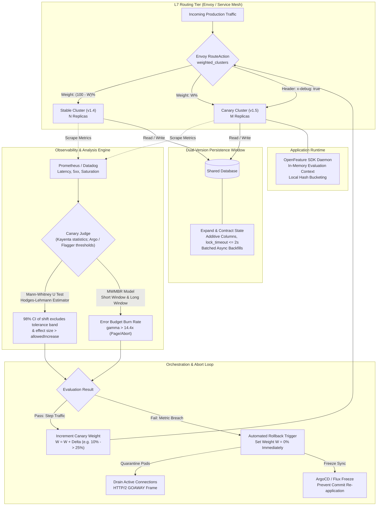
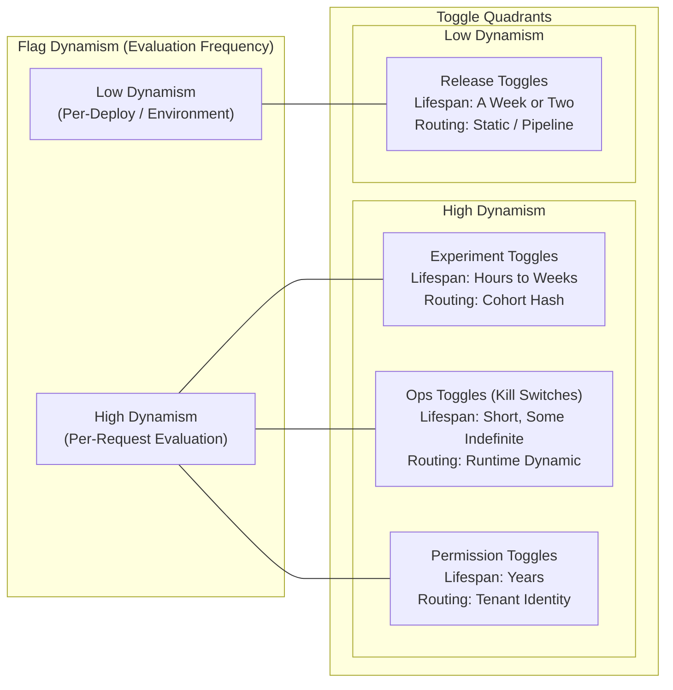
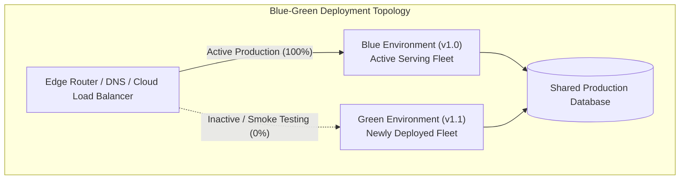
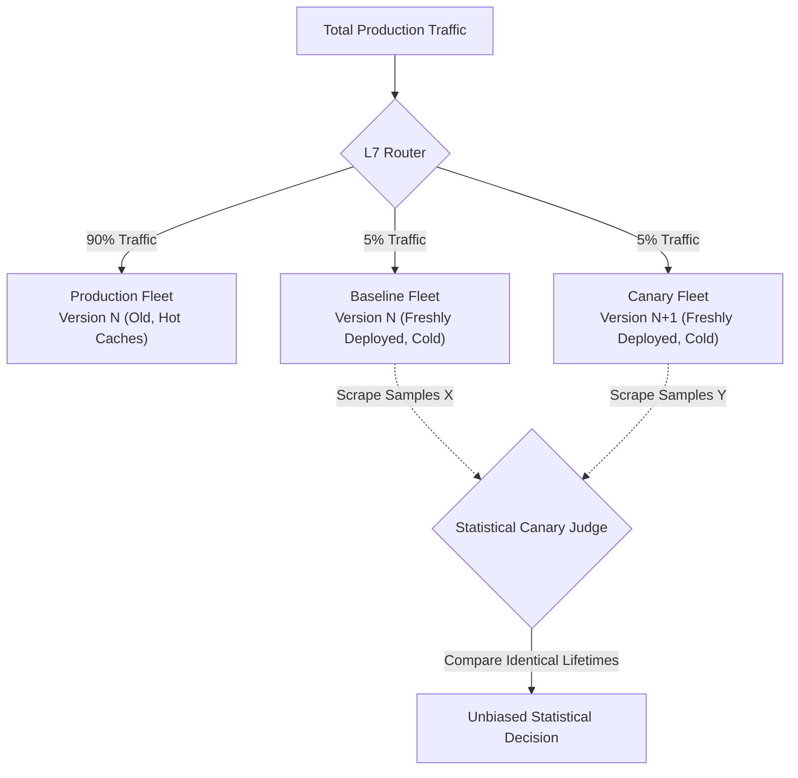
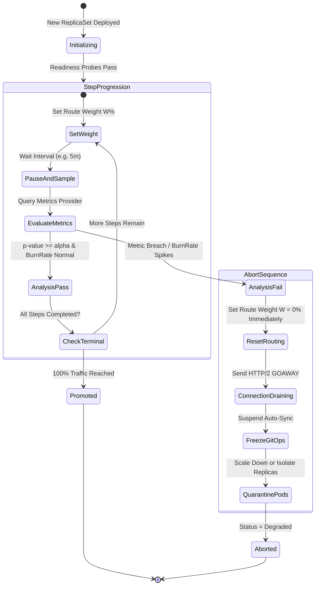
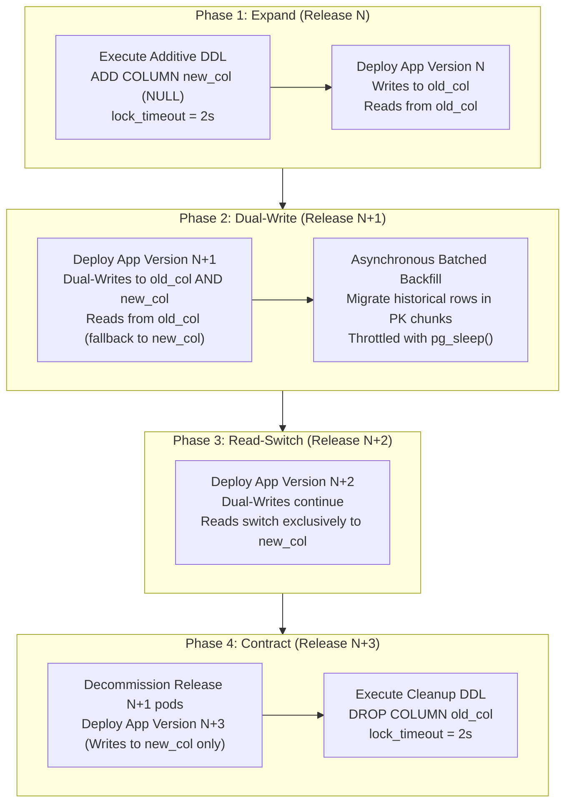
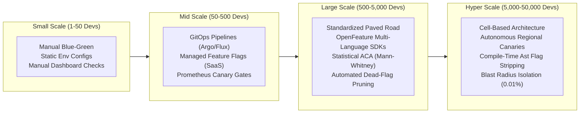

# Progressive Delivery, Automated Rollbacks, and Feature Flags

> [!summary] Claim:
> Progressive delivery replaces atomic all-or-nothing software deployments with stepwise traffic exposure governed by statistical telemetry gates and runtime feature flags.
> Decoupling binary deployment from user release requires L7 traffic shifting topologies, automated rollback triggers tuned to error budget burn rates, and dual-version compatibility windows for API wire protocols and relational databases.
> Feature flags govern operational activation and cohort segmentation at the application layer, but they introduce compounding technical debt that requires strict lifecycle taxonomy and automated dead-code pruning.
> When telemetry exhibits significant deviation under non-parametric tests like Mann-Whitney U or multi-window burn rate breaches, automated controllers revert routing weights on the next reconcile, bounding blast radius without human intervention.



## The Mechanism

Progressive delivery treats software deployment not as a single binary state transition, but as a continuous control system.
Deploying an artifact means placing immutable executable bits on compute infrastructure, initializing runtimes, running liveness and readiness probes, and establishing network listener sockets.
Releasing an artifact means directing live production user requests, transactions, or state transitions to that newly deployed code.
By separating these two concerns, systems isolate infrastructure provisioning failures from behavioral execution regressions.

### 1. Decoupling Deployment from Release and Feature Flag Taxonomies

Traditional release processes couple code installation with user exposure.
If a binary contains an unhandled exception or memory leak, every user immediately experiences degradation upon container restart.
Progressive delivery separates these phases into distinct operational lifecycle stages.

Feature toggles (feature flags) provide the application-level mechanism for decoupling release from deployment.
As formalized by Pete Hodgson (martinfowler.com, 2017-10-09), feature flags are not a monolithic abstraction; they divide into four categories that he places on two axes, longevity and dynamism:

1. **Release Toggles:**
   Release toggles allow incomplete features to be continuously merged to the trunk branch and shipped to production within standard release artifacts while remaining dormant.
   Hodgson says they "should generally not stick around much longer than a week or two", though product-centric release toggles can live longer.
   Their dynamism is very static; changing the decision usually means rolling out a new release with a configuration change, and they must be retired as soon as the feature is fully rolled out.

2. **Experiment Toggles:**
   Experiment toggles execute multivariate or A/B testing across defined user cohorts.
   Their lifespan is set by the time needed to reach statistically significant results, which Hodgson puts at hours to weeks.
   Their dynamism is high; every incoming request is dynamically evaluated based on user identifier hashing or profile attributes to ensure sticky cohort assignment.

3. **Ops Toggles (Kill Switches):**
   Ops toggles control the operational behavior of system components under degraded conditions.
   They allow operators or automated control loops to gracefully degrade fidelity (for example, disabling expensive recommendation algorithms, shedding background processing, or bypassing non-critical third-party integrations).
   Most are short-lived, but key kill switches may be left in place "almost indefinitely" (Hodgson).
   They must be re-configurable extremely quickly, without deploying code or restarting processes.

4. **Permission Toggles (Entitlements):**
   Permission toggles gate access to specific capabilities based on customer subscription tiers, licensing agreements, organizational roles, or geographic boundaries.
   Their lifespan is very long, potentially multiple years.
   Their dynamism is very high; the decision is always per request, evaluated against user or tenant metadata.



Treating all toggles as generic configuration introduces catastrophic architectural decay.
Release toggles left in place become dead code paths that complicate unit tests, mask runtime errors, and degrade developer velocity.
Long-lived ops toggles require hardened fallback logic that must be exercised regularly in integration testing to prevent silent rot.

### 2. Dynamic Flag Architecture and the OpenFeature Standard

Early feature flag implementations relied on ad-hoc database queries or centralized HTTP requests on every evaluation.
Evaluating a flag over remote HTTP introduces a network round trip, whose cost depends on topology and load and is not quoted here, directly into the hot path, creates an external point of failure, and causes cascading outages when the feature flag service degrades.

Production-grade flag architectures decouple rule distribution from rule evaluation:

- **Rule Distribution (Control Plane):**
  Flag definitions, targeting rules, and rollout percentages are authored in a central control plane.
  The control plane streams rule updates to application processes via Server-Sent Events (SSE, a long-lived HTTP response stream over HTTP/1.1 or HTTP/2), WebSocket, or gRPC streaming connections, with periodic polling as the fallback.
- **In-Memory Evaluation (Data Plane):**
  Application SDKs cache the compiled ruleset in memory.
  When code invokes a flag check, evaluation occurs entirely within the process memory space using local CPU instructions.
  Latency drops to local CPU and memory cost, with no network hop; the exact figure depends on the SDK and rule complexity, so measure it in your own runtime before budgeting for it.

Deterministic user bucketing hashes a stable group identifier (usually the flag or rollout name) together with the targeting key; the exact scheme is vendor-specific.
Unleash's Node SDK, for example, computes (as of 2026-11, Both):

$$\text{bucket} = \left( \text{MurmurHash3\_x86\_32}(\text{groupId} \mathbin{\Vert} \texttt{":"} \mathbin{\Vert} \text{userId},\ \text{seed}=0) \bmod 100 \right) + 1$$

and uses a different seed (86028157) for variant assignment so that rollout and variant buckets are uncorrelated.

This mathematical mapping ensures that a user with ID `usr_9812` consistently maps to the same percentile across all application servers without requiring cross-node distributed synchronization or centralized state.

The CNCF OpenFeature specification (v0.9.0, released 2026-07; there is no v1.0.0 as of 2026-11) standardizes the application programming interface across vendors and in-house systems.
Four of its core abstractions matter most here (the specification also defines events, tracking, and provider lifecycle):

- **EvaluationContext:**
  A structured data container holding attributes relevant to flag evaluation.
  It encapsulates the `targeting_key` (the primary identifier for bucketing), session identifiers, tenant identifiers, and custom contextual attributes (such as IP address, user tier, or application version).
- **Provider:**
  The translation layer between the OpenFeature SDK API and the underlying evaluation engine (for example, LaunchDarkly, Unleash, Flipt, or an in-memory test provider).
  The provider implements typed resolution methods, which the specification writes as `resolveBooleanValue`, `resolveStringValue`, `resolveNumberValue`, and `resolveStructureValue`; the JavaScript SDK names them `resolveBooleanEvaluation()`, `resolveStringEvaluation()`, `resolveNumberEvaluation()`, and `resolveObjectEvaluation()`.
- **FlagEvaluationDetails:**
  The structured response object returned to the application.
  It contains the evaluated `value`, the matched `variant` name, a categorical `reason` (`STATIC`, `DEFAULT`, `TARGETING_MATCH`, `SPLIT`, `CACHED`, `DISABLED`, `UNKNOWN`, `STALE`, or `ERROR`), and an optional `errorCode` (`PROVIDER_NOT_READY`, `FLAG_NOT_FOUND`, `PARSE_ERROR`, `TYPE_MISMATCH`, `TARGETING_KEY_MISSING`, `INVALID_CONTEXT`, `PROVIDER_FATAL`, or `GENERAL`).
- **Hooks:**
  Middleware interception points executed across four lifecycle phases:
  - `before`: Runs before the provider evaluates the flag; can inspect or mutate the `EvaluationContext`.
  - `after`: Runs immediately after successful evaluation; used for telemetry collection and validation checks.
  - `error`: Runs if the provider throws an unhandled exception or returns an evaluation error; triggers alerts or fallback metrics.
  - `finally`: Executes unconditionally after evaluation finishes; emits OpenTelemetry spans and metrics.

### 3. Traffic Shifting Topologies: Blue-Green, Canary, and L7 Routing

Traffic shifting manages how external network requests transition between software versions.
Three primary topologies dominate production architectures:

#### Blue-Green (Red-Black) Deployments

Blue-Green deployment provisions two identical, independent infrastructure environments: the active production environment (Blue) and the standby idle environment (Green).



The new software version is deployed to Green.
Automated integration smoke tests run directly against Green by routing requests via internal endpoints or explicit test headers.
Once validated, the edge router, DNS record, or load balancer target group pointer is updated to swap 100% of production traffic from Blue to Green.

**Operational Trade-offs:**
- **Cost:** Requires a minimum of 200% baseline compute capacity during the deployment window.
- **Speed:** Rollback is nearly instantaneous; flipping the load balancer target group back to Blue diverts traffic away from Green as soon as the load balancer applies the change.
- **Cold Cache Stampede Hazard:** When traffic shifts instantly from Blue to Green, the Green environment starts with completely cold local caches.
  JIT compilers have not compiled hot bytecode paths, connection pools to backend databases are uninitialized, and local in-memory caches (such as LRU object caches) are empty.
  This sudden cutover frequently causes an immediate latency spike and can overwhelm backend relational databases with a thundering herd of read queries.

#### Canary Deployments

Canary deployment introduces the new version alongside the stable version, initially routing a tiny fraction of production traffic (such as 1%, 2%, or 5%) to the canary instances while the overwhelming majority remains on the stable fleet.

If telemetry indicates healthy behavior, the traffic weight advances incrementally through defined steps (such as 5% $\to$ 10% $\to$ 25% $\to$ 50% $\to$ 100%).
If anomalies are detected at any step, traffic is immediately reverted to 0%, isolating the impact to a small fraction of requests.

#### L7 Traffic Routing Mechanics with Envoy

Modern progressive delivery relies on Layer 7 (HTTP/gRPC) proxy routing rather than Layer 4 (TCP) connection balancing.
Because HTTP/2 and gRPC multiplex multiple concurrent logical requests over a single long-lived TCP connection, Layer 4 balancers cannot shift traffic percentages without terminating underlying TCP sockets.

Envoy proxy handles granular traffic shifting via `RouteAction` within its `route_config` API (`envoy.config.route.v3.RouteAction`).
The `weighted_clusters` configuration assigns integer weights to distinct upstream clusters:

```yaml
routes:
  - match:
      prefix: "/v1/orders"
    route:
      weighted_clusters:
        clusters:
          - name: service_orders_stable
            weight: 90
          - name: service_orders_canary
            weight: 10
      timeout: 2.5s
      retry_policy:
        retry_on: "5xx,connect-failure,reset"
        num_retries: 2
```

The `WeightedCluster.total_weight` field is deprecated; Envoy now uses the sum of the cluster weights, which must be greater than 0 and must not exceed 4294967295 (as of 2026-11, Both).
By default Envoy generates a pseudo-random value for each request and selects the target cluster according to the cumulative distribution of the cluster weights; `header_name` takes the random value from a request header instead, and `use_hash_policy` derives it from the route's hash policy for sticky selection.

**Request Mirroring (Traffic Shadowing):**
To test software versions against production traffic profiles without exposing users to risks, Envoy supports traffic mirroring via `request_mirror_policies`.
Envoy routes the primary request to the stable cluster, but asynchronously sends a duplicate copy of the request payload and headers to the canary cluster.
The response from the mirrored canary cluster is discarded by Envoy.
Its status codes and latency have zero effect on the client response.

> [!warning] Critical Constraint on Traffic Shadowing:
> Traffic shadowing must never be enabled on non-idempotent endpoints that perform external mutations (such as processing credit card payments, sending customer emails, or writing non-idempotent event streams to Apache Kafka) unless the canary cluster has all outbound mutating dependencies mocked or disabled.

### 4. Statistical Canary Analysis: Hypothesis Testing and Burn Rates

Manual inspection of operational dashboards during a canary deployment is error-prone, biased, and slow.
Automated Canary Analysis (ACA) evaluates quantitative telemetry mathematically to decide whether to advance traffic or abort the rollout.

#### The Baseline vs Canary Control Triad

A common failure mode in canary analysis is comparing the newly deployed canary instance directly against the entire existing production fleet.
Existing production pods have been running for days or weeks.
Their in-memory caches are hot, memory allocators have reached steady-state fragmentation, and language runtimes (such as Java Virtual Machine or V8) have executed JIT compilation on all critical execution paths.
A newly started canary pod will inevitably exhibit higher initial CPU utilization, slower p99 latency, and different memory growth rates, triggering false-positive aborts.

To eliminate time-in-service bias, production systems employ the Baseline vs Canary control triad:



1. **Production:** Runs Version $N$, absorbs $(100 - 2w)\%$ of traffic.
2. **Baseline:** Deployed simultaneously with the canary, runs Version $N$, receives $w\%$ of traffic.
3. **Canary:** Runs Version $N+1$, receives $w\%$ of traffic.

Because Baseline and Canary are deployed at the exact same instant with the same initial conditions, differences in telemetry isolate changes in the source code rather than container initialization artifacts.

#### Non-Parametric Hypothesis Testing: Mann-Whitney U Test

Application performance metrics (especially request latency) violate the fundamental assumptions of Gaussian bell-curve statistics.
Latency distributions are asymmetric, positive-only, long-tailed, and multimodal due to garbage collection pauses, database lock contention, and network retransmissions.
Applying Student's t-test to latency metrics generates severe Type I (false positive) and Type II (false negative) statistical errors.

Production canary judges (such as Netflix Kayenta's `NetflixACAJudge`) apply the non-parametric Mann-Whitney U test (also known as the Wilcoxon rank-sum test).
Argo Rollouts and Flagger do not run this test themselves; their analyses compare each query result against a fixed threshold, and Argo Rollouts can delegate the statistical judgment to Kayenta through its Kayenta metric provider.
The Mann-Whitney U test evaluates whether the probability of an observation from population $Y$ (Canary) exceeding an observation from population $X$ (Baseline) is greater than $0.5$, without assuming any underlying distribution shape.

**Algorithm:**
Given $n_1$ observations from Baseline $X = \{x_1, x_2, \dots, x_{n_1}\}$ and $n_2$ observations from Canary $Y = \{y_1, y_2, \dots, y_{n_2}\}$:

1. Combine both samples into a single ordered array of size $N = n_1 + n_2$.
2. Rank the combined values from lowest to highest, assigning ranks $1$ through $N$.
   If values are tied, assign each tied value the average of the ranks they span.
3. Sum the ranks corresponding to the Baseline observations ($R_1$) and Canary observations ($R_2$).
4. Compute the U statistics:

$$U_1 = n_1 n_2 + \frac{n_1(n_1 + 1)}{2} - R_1$$

$$U_2 = n_1 n_2 + \frac{n_2(n_2 + 1)}{2} - R_2$$

$$\text{Verification Invariant: } U_1 + U_2 = n_1 n_2$$

5. For sample sizes where $n_1, n_2 > 20$, the distribution of $U$ rapidly converges to a normal distribution:

$$\mu_U = \frac{n_1 n_2}{2}$$

$$\sigma_U = \sqrt{\frac{n_1 n_2}{12}\left[(N + 1) - \frac{\sum_{i=1}^{k} (t_i^3 - t_i)}{N(N - 1)}\right]}$$

where $t_i$ represents the number of observations sharing the tied value in tie group $i$; without ties this reduces to $\sqrt{n_1 n_2 (N+1)/12}$.

6. Compute the standard score $Z$:

$$Z = \frac{U_1 - \mu_U}{\sigma_U}$$

7. Determine the two-tailed p-value.
   If $p < \alpha$, the null hypothesis is rejected: Canary and Baseline latency distributions differ significantly.
   Kayenta's `NetflixACAJudge` hard-codes a 98% confidence level (`confLevel = 0.98`, so $\alpha = 0.02$) (as of 2026-11, Both).

**Hodges-Lehmann Estimator for Effect Size:**
Statistical significance does not indicate operational importance.
In high-throughput services with thousands of samples, the Mann-Whitney U test will detect a statistically significant p-value for a trivial 0.5 millisecond latency shift.
To prevent false-positive aborts, judges calculate the Hodges-Lehmann estimator: the median of all pairwise differences:

$$\hat{\Delta} = \text{median}\left\{ y_j - x_i \mid 1 \le i \le n_1, 1 \le j \le n_2 \right\}$$

The canary analysis only flags a failure if both conditions are met:
1. The difference is statistically significant ($p < \alpha$).
2. The magnitude of the Hodges-Lehmann median shift exceeds the configured operational tolerance threshold (for example, $\hat{\Delta} > 15\text{ ms}$ or $\hat{\Delta} / \text{median}(X) > 0.05$).

Kayenta implements this two-part rule concretely (`MannWhitneyClassifier.scala`, as of 2026-11, Both).
It classifies a metric as High only when the lower bound of the 98% confidence interval for the location shift exceeds $0.25 \cdot |\hat{\Delta}|$ (the `tolerance = 0.25` band around zero).
The effect size, by default the ratio of means (`meanRatio`), must also be at least `allowedIncrease`.
`allowedIncrease` defaults to `1.0`, meaning no extra slack; a metric configured with `allowedIncrease: 1.05` tolerates a 5% increase.

#### Multi-Window Multi-Burn-Rate (MWMBR) Alerting Model

For ratio metrics such as HTTP 5xx error rates, systems monitor error budget consumption directly using the Multi-Window Multi-Burn-Rate model developed in Google SRE practice.

Let availability Service Level Objective (SLO) be defined as a target percentage over a rolling compliance period $T_{\text{period}}$ (typically 30 days).
The error budget $B$ is the maximum tolerable failure fraction:

$$B = 1 - \text{SLO} \quad (\text{for a } 99.9\% \text{ SLO, } B = 0.001)$$

The burn rate $\gamma$ represents the consumption speed of the error budget relative to a uniform rate that would exhaust the budget at the exact end of $T_{\text{period}}$:

$$\gamma = \frac{\text{Observed Error Rate}}{B} = \frac{\text{Error Count} / \text{Total Requests}}{1 - \text{SLO}}$$

- A burn rate of $\gamma = 1$ exhausts $100\%$ of the budget in exactly 30 days.
- A burn rate of $\gamma = 14.4$ exhausts $2\%$ of the monthly budget in 1 hour (or $100\%$ of the budget in 50 hours).

To prevent alert fatigue from transient spikes while maintaining rapid detection for catastrophic bugs, the automated rollback trigger requires both a long window and a short window to simultaneously exceed the threshold:

| Urgency / Action | Burn Rate ($\gamma$) | Long Window ($T_{\text{long}}$) | Short Window ($T_{\text{short}}$) | Budget Consumed |
| :--- | :--- | :--- | :--- | :--- |
| **Immediate Abort & Page** | **14.4x** | 1 hour | 5 minutes | 2% |
| **Canary Step Halt & Page** | **6.0x** | 6 hours | 30 minutes | 5% |
| **Automated Investigation Ticket** | **1.0x** | 3 days | 6 hours | 10% |

These three rows are Table 5-8 of the SRE Workbook for a 99.9% SLO; the workbook pages on the first two rows and files a ticket on the third, and the abort and halt actions are this note's mapping onto a canary controller.

In canary deployments, the evaluation period is bounded by the step duration (e.g. 10 minutes).
Because the canary serves a fraction $w_c$ of total traffic, an error rate $E_c$ on the canary consumes the total service budget at a scaled rate:

$$\gamma_{\text{system}} = \frac{w_c \cdot E_c}{B}$$

If $w_c = 0.10$ (10% traffic), the target SLO is $99.9\%$ ($B = 0.001$), and the canary experiences a fatal regression causing a $5\%$ error rate ($E_c = 0.05$):

$$\gamma_{\text{system}} = \frac{0.10 \times 0.05}{0.001} = \frac{0.005}{0.001} = 5.0$$

A burn rate of $\gamma = 5.0$ burns through the entire monthly error budget in 6 days.
If the canary fails completely ($E_c = 1.0$), $\gamma_{\text{system}} = (0.10 \times 1.0) / 0.001 = 100.0$, exhausting the monthly budget in 7.2 hours.
A system-wide burn rate of 5.0 never crosses the 14.4x page threshold, so fleet-level alerts stay silent while one canary returns 5% errors.
This is why the canary controller computes the burn rate on the canary's own traffic ($E_c / B = 0.05 / 0.001 = 50$) over a short window, such as the 2-minute `rate()` window in the Worked Lab Example, and aborts on that.

### 5. Automated Telemetry Rollback Loops and Orchestration

Automated progressive delivery controllers (such as Argo Rollouts and Flagger) run control loops reconciling desired routing states against real-time telemetry metrics.



#### The Abort Orchestration Sequence

In Argo Rollouts a metric is assessed Failed when its total count of failed measurements (not consecutive ones) is greater than `failureLimit`, which defaults to `0`; separately, more than `consecutiveErrorLimit` (default `4`) consecutive query errors also fail it (`analysis/analysis.go`, as of 2026-11, Both).
A failed analysis aborts the Rollout, sets the canary weight back to zero, and marks the Rollout `Degraded`.
The full sequence below is a platform-level runbook; only the first step is guaranteed controller behavior, and the rest depend on the proxy, the GitOps tool, and platform policy:

1. **Immediate Traffic Severance:**
   The controller updates the L7 router (Envoy virtual service, NGINX ingress annotation, or AWS TargetGroup) to reset the canary weight to 0%.
   All new requests are routed exclusively to the stable replica set.
2. **Graceful Connection Draining:**
   Canary instances must not be abruptly terminated with `SIGKILL`.
   Abrupt termination drops active in-flight requests, compounding the error rate.
   A server or proxy that is shutting down sends an HTTP/2 `GOAWAY` frame carrying the last stream identifier it processed or might still process (RFC 9113 Section 6.8), so clients retry later streams elsewhere.
   In-flight requests are permitted to complete within a bounded grace period (`terminationGracePeriodSeconds`, Kubernetes default 30 seconds).
3. **GitOps Synchronization Freeze:**
   In GitOps environments managed by Argo CD or Flux, the Git repository is the declared source of truth.
   If an operator rolls back a plain Deployment in the cluster (for example `kubectl rollout undo`) while Git still references the bad image tag, a self-healing reconciler detects drift and re-applies the broken version.
   An aborted Argo Rollouts canary does not flap this way, because the abort lives in the Rollout's status rather than its spec, but the spec still names the bad image and the next retry or sync with a change will try it again.
   The durable fix is a revert commit in the deployment repository; until it lands, suspend reconciliation (disable Argo CD automated sync or add a deny sync window, or run `flux suspend kustomization <name>`).
4. **Forensic Quarantine (Canary Parking):**
   Argo Rollouts scales the aborted canary ReplicaSet down after `abortScaleDownDelaySeconds` (default 30 seconds); setting it to `0` disables the scale-down so the canary pods stay up, already receiving no traffic, for postmortem inspection (`utils/defaults/defaults.go`, as of 2026-11, Both).
   Some platforms go further and keep exactly one parked pod outside service discovery, preserving its heap memory, OS file descriptors, and local logs; that is platform policy, not a controller default.

### 6. Dual-Version Compatibility Windows: API Protocols and Schema Evolution

The fundamental invariant of progressive delivery is the Dual-Version Window:
**At any given point during a progressive deployment, Version $N$ and Version $N+1$ run concurrently, process the same user requests, and access the same database and caching infrastructure.**

Deploying a breaking change to an API schema or database structure breaks the system the instant the first canary instance starts up, before any automated rollback can intervene.

```mermaid
sequenceDiagram
    autonumber
    participant Client
    participant Router as L7 Load Balancer
    participant OldPod as Pod Version N
    participant NewPod as Pod Version N+1
    participant DB as Relational Database

    Note over DB: State: Expand Phase (Both columns active)
    Client->>Router: HTTP Request (Order Submission)
    Router->>NewPod: 10% Traffic Shuffled to Canary
    NewPod->>DB: Write (id, amount, status, tax_v2)
    Note over DB: Writes succeed; old columns populated
    Client->>Router: Concurrent Request
    Router->>OldPod: 90% Traffic to Stable
    OldPod->>DB: Read (id, amount, status)
    Note over OldPod: Tolerant Reader ignores tax_v2
    OldPod-->>Client: 200 OK
```

#### API Protocol Evolution and Protobuf Wire Mechanics

In binary protocols like Protocol Buffers (Protobuf) and gRPC, field names are discarded during compilation.
Every serialized field is encoded strictly as a numeric Tag-Length-Value (TLV) block on the wire.

The Protobuf wire format encodes a field tag as an unsigned varint combining the field number and wire type:

$$\text{Tag Key} = (\text{field\_number} \ll 3) \mid \text{wire\_type}$$

| Wire Type Code | Format Name | Data Types | Payload Structure |
| :--- | :--- | :--- | :--- |
| `0` | Varint | `int32`, `int64`, `uint32`, `bool`, `enum` | Variable-length 7 bits per byte (MSB continuation) |
| `1` | 64-bit | `fixed64`, `sfixed64`, `double` | Exactly 8 bytes in little-endian order |
| `2` | Length-delimited | `string`, `bytes`, embedded messages, packed repeated | Varint length prefix followed by that many raw bytes |
| `5` | 32-bit | `fixed32`, `sfixed32`, `float` | Exactly 4 bytes in little-endian order |

Wire types `3` and `4` (start and end group) are deprecated proto2 group delimiters and are omitted from the table.

Because the wire format explicitly encodes the `wire_type` with every tag, an older parser (Version $N$) reading a payload generated by a newer service (Version $N+1$) can safely skip fields it does not recognize.
If it encounters an unknown tag with wire type `2`, it reads the length varint and skips that exact number of bytes.

**The Unknown Fields Preservation Invariant:**
The official Protobuf runtimes preserve unrecognized fields in memory (an `UnknownFieldSet` in C++); the proto3 language guide states that proto3 messages preserve unknown fields and include them in the serialized output, matching proto2.
Not every third-party runtime does: Rust's `prost` discards unknown fields (tokio-rs/prost issue 2, still open as of 2026-11).
If an intermediate microservice running Version $N$ receives a message from a Version $N+1$ service, modifies a known field, and forwards the message downstream to another Version $N+1$ service, the runtime re-serializes the unknown fields untouched.

If an application developer naively deserializes Protobuf messages into a custom internal object, drops the unknown fields, and reserializes, data loss silently occurs during dual-version rollout windows.

**Strict Wire Evolution Rules:**
1. **Never change a field tag number:** Changing `string username = 1;` to `string username = 2;` causes older services to misinterpret the tag or fail deserialization.
2. **Never reuse a retired field number:** If a field is deleted, its tag number must be permanently marked with the `reserved` keyword:
   ```protobuf
   message UserProfile {
     reserved 4, 8, 12 to 15;
     reserved "legacy_hash", "tax_identifier";
     string user_id = 1;
   }
   ```
   Reusing a retired tag causes new parsers to decode old messages into the wrong fields, resulting in silent memory or business logic corruption.
3. **Never change a field wire type:** Changing an `int32` (wire type 0) to a `fixed32` (wire type 5) is not on the language guide's list of compatible changes; the guide documents only the listed compatible pairs (for example `int32` with `uint32`, `int64`, `uint64`, and `bool`, and `fixed32` only with `sfixed32`) and does not specify what a parser does on a wire-type mismatch, so treat the outcome as runtime-specific and avoid the change.

### 7. Relational Database Concurrency: Locking, Queue Starvation, and Safe DDL

Relational databases present the greatest obstacle to automated rollbacks.
Code can be rolled back in seconds by re-pointing a load balancer.
A database schema migration that mutates on-disk storage structures cannot be rolled back without extensive downtime and data loss.

#### The Expand and Contract Pattern

Zero-downtime database evolution enforces the Expand and Contract pattern (also known as Parallel Run).
Every breaking schema modification is divided into distinct, non-breaking deployment cycles separated across multiple software releases:



1. **Phase 1: Expand (Additive Schema):**
   Add new columns, tables, or views alongside existing structures.
   Columns must be nullable or possess non-locking constant defaults.
   Existing code continues to operate unaffected.
2. **Phase 2: Dual-Write:**
   Deploy code that writes to both the old structure and the new structure simultaneously.
3. **Phase 3: Backfill:**
   A background batch process scans historical rows in primary-key chunks (e.g. 1,000 rows per transaction) and populates the new structure.
   The process includes sleep throttling to prevent I/O starvation and replication lag.
4. **Phase 4: Read Switch:**
   Deploy code that switches reads to the new structure, retaining fallback reads to the old structure if data is missing.
5. **Phase 5: Contract (Cleanup DDL):**
   Once all older application versions are fully decommissioned across all environments, execute clean-up DDL to drop the legacy columns or tables.

#### PostgreSQL Lock Queues and Head-of-Line Starvation

In PostgreSQL, `ALTER TABLE` acquires an `ACCESS EXCLUSIVE` lock unless the documentation notes otherwise, so `ADD COLUMN`, `DROP COLUMN`, altering column data types, and most `ADD CONSTRAINT` forms all take it.
The documented exceptions matter for migrations: `ADD FOREIGN KEY` takes `SHARE ROW EXCLUSIVE` on both the table and the referenced table, and `VALIDATE CONSTRAINT` takes `SHARE UPDATE EXCLUSIVE` (plus `ROW SHARE` on the referenced table for a foreign key).
Even a metadata-only `ADD COLUMN` holds `ACCESS EXCLUSIVE` briefly, so it is still exposed to the lock queue described below.
`ACCESS EXCLUSIVE` is the strongest lock mode in the PostgreSQL lock hierarchy; it conflicts with all other lock types, including `ACCESS SHARE` (acquired by every standard `SELECT` query).

```mermaid
sequenceDiagram
    autonumber
    participant AppRead1 as App Thread 1 (Read)
    participant Migration as Migration Script (DDL)
    participant AppRead2 as App Thread 2 (Read)
    participant PG as PostgreSQL Lock Manager

    AppRead1->>PG: BEGIN; SELECT * FROM orders WHERE id = 42;
    Note over PG: Lock Granted: ACCESS SHARE on orders
    Migration->>PG: ALTER TABLE orders ADD COLUMN notes TEXT;
    Note over PG: Requests ACCESS EXCLUSIVE on orders.<br/>Blocked by App Thread 1.<br/>Migration placed at head of Lock Queue!
    AppRead2->>PG: SELECT * FROM orders WHERE user_id = 99;
    Note over PG: Requests ACCESS SHARE on orders.<br/>BLOCKED behind Migration in Lock Queue!
    Note over PG: CATASTROPHIC STARVATION:<br/>All subsequent SELECT / INSERT / UPDATE queries queue up.<br/>Connection pool exhausts quickly!
```

PostgreSQL appends a blocked lock request to the end of the lock's wait queue, with a narrow exception for processes that already hold locks conflicting with an earlier waiter (`src/backend/storage/lmgr/README`).
A new request that conflicts with a request already waiting must also wait, even when it would be compatible with the locks currently granted.
If a migration requests an `ACCESS EXCLUSIVE` lock on a table currently undergoing a slow `SELECT` transaction, the migration blocks waiting for the `SELECT` to finish.
**Critically, every subsequent query touching that table (even simple point-lookup `SELECT` statements) is queued behind the waiting migration.**
At production request rates the application connection pool exhausts within seconds, web workers stall, health probes fail, and the outage lasts until the blocking transaction ends or the migration is cancelled.

**Mandatory DDL Guardrails for Zero-Downtime Execution:**

Every migration script in a progressive delivery pipeline must execute within an explicit lock timeout wrapper:

```sql
-- Enforce strict lock acquisition timeout
SET lock_timeout = '2s';
SET statement_timeout = '5s';

-- Add column as nullable without table rewrite
ALTER TABLE orders ADD COLUMN fulfillment_center_id UUID NULL;

-- Create index concurrently without holding table exclusive locks
-- Must run outside an explicit transaction block
-- Lift the 5s statement cap: a cancelled CONCURRENTLY build leaves an INVALID index behind
COMMIT;
SET statement_timeout = 0;
CREATE INDEX CONCURRENTLY idx_orders_fulfillment_center 
  ON orders(fulfillment_center_id);

-- Add foreign key constraint safely in two stages
-- NOT VALID skips the scan; takes SHARE ROW EXCLUSIVE on orders and fulfillment_centers
SET statement_timeout = '5s';
ALTER TABLE orders 
  ADD CONSTRAINT fk_orders_fulfillment 
  FOREIGN KEY (fulfillment_center_id) 
  REFERENCES fulfillment_centers(id) 
  NOT VALID;

-- Validate constraint without blocking writes (SHARE UPDATE EXCLUSIVE, ROW SHARE on the referenced table)
-- The validation scan runs as long as the table needs, so lift the statement cap again
SET statement_timeout = 0;
ALTER TABLE orders VALIDATE CONSTRAINT fk_orders_fulfillment;
```

If the migration script cannot acquire the `ACCESS EXCLUSIVE` lock within 2 seconds, PostgreSQL cancels the statement with `canceling statement due to lock timeout`, which aborts the surrounding transaction, removes the request from the lock queue, and releases the queries waiting behind it.
The CI/CD deployment orchestrator catches the timeout error, applies an exponential backoff delay, and retries when database lock contention subsides.

In MySQL/InnoDB environments, similar metadata locking hazards exist.
Modern engineering organizations utilize online schema migration tools such as `gh-ost` or `pt-online-schema-change`.
`gh-ost` is triggerless, unlike `pt-online-schema-change`, which uses triggers.
It creates a ghost table, copies historical rows in primary key chunks, and tails the MySQL binary log (binlog) to stream concurrent row modifications.
It then cuts over atomically: per the gh-ost cut-over documentation, one connection holds a lock on the original table while a second connection issues the `RENAME`, held back by a sentry table until gh-ost confirms everything is in order.
Pending queries are blocked for a brief period and then continue against the new table; the documentation gives no numeric bound, and if the cut-over times out the original table stays in place and gh-ost can retry.

## Commands and Numbers to Know

The following reference table codifies the operational parameters, flag defaults, and mathematical thresholds required to configure progressive delivery, automated canary analysis, and database migration guardrails.

| Parameter / Metric | Standard Value | Safe Production Range | Platform | Citation & Mechanism |
| :--- | :--- | :--- | :--- | :--- |
| Envoy `WeightedCluster.total_weight` | Deprecated | Omit; sum of weights is used | Both | `config.route.v3.WeightedCluster` (as of 2026-11, Both); sum of cluster weights must be greater than 0 and at most `4294967295` |
| Envoy `ClusterWeight.weight` | Step dependent | `0` to the sum of weights | Both | `config.route.v3.WeightedCluster` (as of 2026-11, Both); sets proportional L7 traffic slice |
| Argo Rollouts `failureLimit` | `0` | `0` to `5` failed measurements | Linux | Argo Rollouts v1.10.2 (as of 2026-11, Linux); metric fails when total failed measurements exceed it (`failed > failureLimit`) |
| Argo Rollouts `consecutiveErrorLimit` | `4` | `2` to `5` | Linux | Argo Rollouts v1.10.2 (as of 2026-11, Linux); consecutive query errors (not failures) before the metric is marked Error |
| Argo Rollouts `abortScaleDownDelaySeconds` | `30` | `0` (keep pods) to `600` | Linux | Argo Rollouts v1.10.2 (as of 2026-11, Linux); delay before scaling down an aborted canary |
| Flagger `analysis.stepWeight` | No default | `1` to `20` (%) | Linux | Flagger v1.45.0 (as of 2026-11, Linux); traffic weight increment per analysis interval |
| Flagger `analysis.threshold` | No default (required) | `2` to `10` iterations | Linux | Flagger v1.45.0 (as of 2026-11, Linux); failed metric checks before rollback; `interval` defaults to `60s` |
| PostgreSQL `lock_timeout` | `0` (disabled) | `1000ms` to `3000ms` | Both | PostgreSQL 17 (as of 2026-11, Both); max wait time to acquire table locks before aborting DDL |
| PostgreSQL `statement_timeout` | `0` (disabled) | `3000ms` to `10000ms` | Both | PostgreSQL 17 (as of 2026-11, Both); max total execution duration for migration commands |
| MySQL `lock_wait_timeout` | `31536000` (1 yr) | `2` to `5` (seconds) | Both | MySQL 8.4 LTS (as of 2026-11, Both); prevents metadata lock queue head-of-line blocking |
| Mann-Whitney $\alpha$ significance | `0.02` (`confLevel = 0.98`) | `0.001` to `0.05` | Both | Kayenta `NetflixACAJudge` (as of 2026-11, Both); confidence level of the interval on the location shift, hard-coded |
| Hodges-Lehmann tolerance band | `0.25` of the estimate | Not configurable in `NetflixACAJudge` | Both | Kayenta `MannWhitneyClassifier` `tolerance` (as of 2026-11, Both); the confidence interval must clear this band around zero |
| Kayenta `effectSize.allowedIncrease` | `1.0` (no slack) | `1.02` to `1.10` | Both | Kayenta `NetflixACAJudge` (as of 2026-11, Both); minimum mean ratio before a significant increase fails the metric |
| SRE Multi-Window Fast Burn Rate | `14.4x` | `10x` to `20x` | Both | Google SRE Workbook (as of 2026-11, Both); 1h long / 5m short window, consumes 2% error budget |
| SRE Multi-Window Slow Burn Rate | `6.0x` | `3x` to `8x` | Both | Google SRE Workbook (as of 2026-11, Both); 6h long / 30m short window, consumes 5% error budget |
| Release Toggle Max Lifespan | A week or two | `7` to `30` days (house policy) | Both | Pete Hodgson Taxonomy (as of 2026-11, Both); Hodgson's guidance, the 30-day cap is this note's policy |
| Protobuf one-byte tag numbers | `1` to `15` | `16` to `2047` take two bytes | Both | Protobuf Language Guide (as of 2026-11, Both); field numbers run `1` to `536870911` |
| Protobuf Reserved Tag Range | `19000` to `19999` | Reserved internally | Both | Protobuf Language Guide (as of 2026-11, Both); reserved for the Protobuf implementation |

## Multi-Language Comparison: Feature Flagging and Dynamic Serialization

Engineering teams working across C++, Python, and Rust must manage feature flags and schema evolution according to the language-specific memory management and type system semantics.

| Dimension | C++ (C++20 / C++23) | Python (CPython 3.12+) | Rust (Edition 2021 / 2024) |
| :--- | :--- | :--- | :--- |
| **OpenFeature SDK Integration** | `open-feature/cpp-sdk` repository (as of 2026-11) | PyPI `openfeature-sdk` 0.10.0 (as of 2026-11); `EvaluationContext` with a plain attributes dictionary | crate `open-feature` 0.3.0 (as of 2026-11); trait-based provider interface with `async` evaluation methods |
| **In-Memory Ruleset Cache Concurrency** | `std::atomic<std::shared_ptr<RuleSet>>` (C++20) with RCU-style (Read-Copy-Update) swaps, or `folly::AtomicSharedPtr` | Atomic rebinding of a reference to an immutable ruleset (a single assignment is atomic in CPython); the standard library has no reader-writer lock | `arc_swap::ArcSwap<RuleSet>` for lock-free concurrent reads during background rule updates |
| **Hot-Path Flag Evaluation Cost** | No published figure; measure per SDK; primitive checks can avoid heap allocation | No published figure; measure per SDK; dictionary lookups and object allocations inside dynamic evaluations | No published figure; measure per SDK; reads can borrow the evaluation context without allocation |
| **Protobuf Schema Backward Compatibility** | `google::protobuf::Message`; unknown fields preserved in `UnknownFieldSet`, reachable through `Reflection` | `google.protobuf` classes; unknown fields preserved, inspected via `google.protobuf.unknown_fields.UnknownFieldSet(msg)` | `prost` discards unknown fields (issue 2 open); the `protobuf` crate (rust-protobuf) preserves them in `SpecialFields` |
| **Schema Strictness and Deserialization** | Strongly typed generated structs; parse failures abort with `ParseFromArray()` returning `false` | Dynamically coerced fields; missing fields populate default objects or `None` | Strict enum and variant parsing; `Result<T, DecodeError>` forces explicit compile-time error handling |
| **Dynamic Configuration Streaming** | Custom gRPC streaming thread or Boost.Asio event loop receiving SSE updates | Asyncio background task consuming SSE streams via `aiohttp` or `httpx` | Tokio background task driving an SSE / HTTP/2 stream pushing into a `tokio::sync::watch` channel |

## Worked Lab Example

This worked end-to-end example traces a progressive canary deployment of an order processing service (`order-processor`), demonstrating Envoy L7 weighted routing, Prometheus error budget burn rate evaluation, and automated rollback execution under Argo Rollouts.

### 1. Configuration Declarations

The deployment architecture defines an `AnalysisTemplate` querying Prometheus for both error budget burn rates and p99 latency thresholds, bound to an Argo Rollouts resource.
This note has no lab in `code/`: the manifests were not applied to a cluster, and every output block in this section is an illustrative trace written by hand, not captured controller output.
`count: 4` bounds each analysis to four measurements so the inline analysis step can complete; `failureLimit: 1` means the second failed measurement fails the metric, because Argo Rollouts fails a metric when `failed > failureLimit`.
SMI traffic routing is shown because Argo Rollouts still documents it, but the CNCF archived the SMI specification in 2023, and the Argo Rollouts documentation points new installs to the Gateway API plugin (as of 2026-11, Linux).

```yaml
# File: order-processor-analysis.yaml
apiVersion: argoproj.io/v1alpha1
kind: AnalysisTemplate
metadata:
  name: order-processor-canary-gate
  namespace: production
spec:
  metrics:
    - name: error-budget-burn-rate
      interval: 30s
      count: 4
      successCondition: result[0] < 14.4
      failureLimit: 1
      provider:
        prometheus:
          address: http://prometheus-k8s.monitoring.svc.cluster.local:9090
          query: |
            (
              sum(rate(http_requests_total{service="order-processor-canary",status=~"5.."}[2m]))
              /
              sum(rate(http_requests_total{service="order-processor-canary"}[2m]))
            ) / 0.001
    - name: latency-p99
      interval: 30s
      count: 4
      successCondition: result[0] < 0.250
      failureLimit: 1
      provider:
        prometheus:
          address: http://prometheus-k8s.monitoring.svc.cluster.local:9090
          query: |
            histogram_quantile(0.99, sum(rate(http_request_duration_seconds_bucket{service="order-processor-canary"}[2m])) by (le))
```

```yaml
# File: order-processor-rollout.yaml
apiVersion: argoproj.io/v1alpha1
kind: Rollout
metadata:
  name: order-processor
  namespace: production
spec:
  replicas: 10
  strategy:
    canary:
      canaryService: order-processor-canary
      stableService: order-processor-stable
      trafficRouting:
        smi:
          rootService: order-processor
          trafficSplitName: order-processor-split
      steps:
        - setWeight: 10
        - pause: { duration: 1m }
        - analysis:
            templates:
              - templateName: order-processor-canary-gate
        - setWeight: 25
        - pause: { duration: 2m }
        - analysis:
            templates:
              - templateName: order-processor-canary-gate
        - setWeight: 50
        - pause: { duration: 5m }
        - analysis:
            templates:
              - templateName: order-processor-canary-gate
  template:
    metadata:
      labels:
        app: order-processor
    spec:
      containers:
        - name: service
          image: registry.internal.net/order-processor:v2.4.0
          ports:
            - containerPort: 8080
          env:
            - name: PG_LOCK_TIMEOUT
              value: "2000"
```

### 2. Execution Trace and Step Progression

The deployment is initiated by updating the container image tag from `v2.3.9` to `v2.4.0`.

```bash
# Apply updated image tag to trigger progressive rollout
kubectl argo rollouts set image order-processor service=registry.internal.net/order-processor:v2.4.0 -n production
```

The rollout controller launches the canary ReplicaSet, verifies container readiness, and applies the initial traffic split of 10% to the canary service via the TrafficSplit resource.

```text
STEP 1: INITIAL CANARY WEIGHT SHIFT
Rollout status: Progressing
Created ReplicaSet order-processor-78d49f6b9 (v2.4.0) with 1 replicas
Readiness probes passed: 1/1 pods ready
TrafficSplit updated: order-processor-stable: 90%, order-processor-canary: 10%
Phase: Paused (duration: 1m)
```

At the 1-minute mark, the controller initiates `order-processor-canary-gate`.
Prometheus evaluates the two metrics against the canary cluster.

```text
ANALYSIS RUN 1 (Traffic Weight: 10%):
Metric: error-budget-burn-rate
  Query: (sum(rate(http_requests_total{service="order-processor-canary",status=~"5.."}[2m])) / sum(rate(http_requests_total{service="order-processor-canary"}[2m]))) / 0.001
  Evaluation: 0.000000 / 0.001 = 0.00 < 14.4 [PASSED]
Metric: latency-p99
  Query: histogram_quantile(0.99, sum(rate(http_request_duration_seconds_bucket{service="order-processor-canary"}[2m])) by (le))
  Evaluation: 0.048s < 0.250s [PASSED]
4/4 measurements passed for both metrics. AnalysisRun Successful.
Advancing traffic weight to 25%.
TrafficSplit updated: order-processor-stable: 75%, order-processor-canary: 25%
Phase: Paused (duration: 2m)
```

### 3. Fault Injection, Metric Breach, and Automated Abort

At 25% traffic, a latent concurrency defect in `v2.4.0` is triggered by production payload volume, causing database connection acquisition timeouts and HTTP 500 errors on the canary pods.

```text
ANALYSIS RUN 2 (Traffic Weight: 25%):
Check 1 at T+90s:
Metric: error-budget-burn-rate
  Observed Error Rate: 0.038 (3.8% HTTP 500 responses)
  Calculated Burn Rate: 0.038 / 0.001 = 38.0
  Condition Check: 38.0 < 14.4 [FAILED]
  Failed measurements: 1 (failureLimit: 1, not exceeded)

Check 2 at T+120s:
Metric: error-budget-burn-rate
  Observed Error Rate: 0.052 (5.2% HTTP 500 responses)
  Calculated Burn Rate: 0.052 / 0.001 = 52.0
  Condition Check: 52.0 < 14.4 [FAILED]
  Failed measurements: 2 > failureLimit (1) [METRIC FAILED]

AUTOMATED ABORT TRIGGERED:
Rollout: production/order-processor aborted and marked Degraded
1. TrafficSplit updated: order-processor-stable: 100%, order-processor-canary: 0%
2. Canary ReplicaSet order-processor-78d49f6b9 scaled down after abortScaleDownDelaySeconds (default 30s)
```

Connection draining, GitOps suspension, and forensic parking are not steps Argo Rollouts performs on abort; they come from the proxy, the GitOps tool, and platform policy, as the Abort Orchestration Sequence describes.
How quickly traffic returns to stable after the breach depends on the traffic router's reconcile and propagation time and was not measured here; exposure is bounded to 25% of traffic for the roughly 2 minutes between the first failing measurement and the abort.

The abort condition in the trace is the `failed > failureLimit` check in `analysis/analysis.go`; this note does not reproduce the exact text `kubectl argo rollouts status` prints, because the plugin documentation does not show it.

## Pitfalls

> [!warning] Pitfall: Reusing retired feature flag identifiers (The Knight Capital disaster)
> Reusing an obsolete feature flag key, configuration tag, or Protobuf field number causes new deployments to execute dead code paths or misinterpret payload bytes.
> On August 1, 2012, Knight Capital's new RLP code repurposed a flag that had formerly activated its long-dormant Power Peg code in the SMARS order router; the new code reached seven of eight servers, and on the eighth the flag triggered the still-present Power Peg code.
> For 212 parent orders it sent millions of child orders, producing more than 4 million executions in 154 stocks for more than 397 million shares in about 45 minutes, and Knight lost more than $460 million (SEC Release No. 34-70694).
> Permanent reservation of retired identifiers (`reserved` in Protobuf, database unique constraint history, compile-time linter assertions) is mandatory.

> [!warning] Pitfall: Evaluating canary metrics against historical production instead of an active baseline instance
> Comparing a newly deployed canary instance against historical production metrics or an aged production fleet introduces severe thermal, memory allocator, and JIT compilation bias.
> Production pods have hot caches and optimized JIT execution; newly deployed canaries exhibit transient cold-start latency that triggers false-positive rollbacks.
> Always deploy an identical Baseline version (running version $N$) concurrently with the Canary ($N+1$) to isolate software regressions from container lifecycle noise.

> [!warning] Pitfall: Destructive single-step database DDL during dual-version rollout windows
> Executing `ALTER TABLE ... DROP COLUMN` or changing column data types while a progressive rollout is underway causes immediate unhandled exceptions in the older application pods that remain active on the stable traffic slice.
> Version $N$ pods will attempt to read or write columns that no longer exist, causing catastrophic request failure.
> All database migrations must strictly follow the Expand and Contract pattern across distinct release boundaries.

> [!warning] Pitfall: Cold cache stampedes on Blue-Green cutovers and rapid rollbacks
> Switching 100% of production traffic instantly to an idle Blue/Green environment or executing an emergency rollback to a cold standby fleet directs massive load to unprimed memory caches.
> L1/L2 caches, connection pools, and query plan caches are empty, resulting in immediate latency spikes and downstream relational database connection starvation.
> Traffic cutovers must include pre-warming scripts or follow progressive canary step weighting even during rollbacks.

> [!warning] Pitfall: Fleet-wide metric aggregation masking canary-isolated catastrophic failures
> Calculating error rates by aggregating all requests across the entire service fleet dilutes canary anomalies into background noise.
> If a canary receives 2% of traffic and crashes on 100% of those requests, the fleet-wide error rate only registers a 2% increase, which commonly sits beneath static 5% alert thresholds.
> Automated Canary Analysis queries must be strictly partitioned by target service cluster (`service="canary"`) rather than averaged globally.

> [!warning] Pitfall: Missing `lock_timeout` on PostgreSQL DDL inducing lock queue head-of-line blocking
> Executing DDL requiring `ACCESS EXCLUSIVE` locks on PostgreSQL without setting `SET lock_timeout` causes the migration to queue behind active long-running read transactions.
> Because a new lock request that conflicts with a queued waiter must wait behind it, all subsequent incoming `SELECT` queries on that table block behind the waiting DDL, exhausting the application connection pool within seconds.
> Always inject `SET lock_timeout = '2s';` at the beginning of every migration transaction, with a short `statement_timeout` for metadata-only steps and `statement_timeout = 0` for long scans such as `CREATE INDEX CONCURRENTLY` and `VALIDATE CONSTRAINT`.

> [!warning] Pitfall: Dropping unknown fields in intermediate serialization relays
> In microservice pipelines where messages pass through intermediate proxies or aggregators, deserializing a Protobuf or JSON payload into an incomplete internal schema drops unrecognized fields.
> When the intermediate service re-serializes and forwards the message downstream, the new fields added by Version $N+1$ producers are permanently lost.
> Runtimes must preserve unknown fields (`UnknownFieldSet`) across deserialization-serialization cycles.

> [!warning] Pitfall: Metastable rollback loops and retry storms
> Rolling back a service during an incident where downstream queues or caches have accumulated large backlogs can cause the restored stable version to immediately collapse.
> The newly started pods are inundated with accumulated client retries and cold-start queue volume, driving the system into a metastable failure state where neither the old nor new version can stabilize.
> Automated rollback sequences must incorporate circuit breakers, backpressure shedding, and exponential backoff on retry clients.

## At Scale

Scaling progressive delivery from a single developer to an enterprise organization spanning 50,000 engineers requires transitioning from manual deployment scripts to automated platform control planes.



### Scale Transitions and Architectural Inflection Points

- **1 to 50 Engineers:**
  Deployments are typically coordinated manually or via basic CI/CD shell scripts.
  Teams use simple Blue-Green container deployments or rolling updates with Kubernetes native Deployment primitives (`maxSurge`, `maxUnavailable`).
  Feature flags reside in configuration files, environment variables, or lightweight database tables.
  Verification relies on engineers watching Grafana dashboards during deployment windows.
- **50 to 500 Engineers:**
  Manual verification collapses as deployment frequency increases to dozens per day.
  Teams adopt declarative GitOps controllers (ArgoCD, Flux) and standardize on progressive delivery operators (Argo Rollouts, Flagger).
  Feature flag management shifts to managed solutions (LaunchDarkly, Unleash, CloudBees) using in-memory SDK rule evaluation.
  Automated canary analysis gates deployments on basic error rate and latency thresholds.
- **500 to 5,000 Engineers:**
  Static metric thresholds generate intolerable false-alarm rates across hundreds of microservices.
  The platform engineering team introduces standardized Paved Roads:
  - Universal adoption of the CNCF OpenFeature API to decouple vendor lock-in.
  - Automated Canary Analysis engines (such as Kayenta or custom internal judges) running non-parametric Mann-Whitney U tests and Hodges-Lehmann effect size calculations against concurrent Baseline clusters.
  - Strict linting and automated bots (e.g. Uber Piranha) that generate automated Pull Requests to delete stale feature flags and dead code branches after rollout completion.
- **5,000 to 50,000 Engineers (Global Enterprise / Meta / Google Scale):**
  At hyper-scale, progressive delivery operates across independent fault domains (Cell-Based Architectures).
  Canaries are deployed to isolated "Canary Cells" or internal canary regions before touching public customer traffic.
  Rollouts proceed through automated geographic rings (Ring 0: internal canary $\to$ Ring 1: small region $\to$ Ring 2: secondary region $\to$ Ring 3: global fleet).
  Dead flag elimination is performed at the AST (Abstract Syntax Tree) level during automated compiler passes, ensuring binary sizes and CPU branch predictors remain unburdened by years of accumulated toggle checks.

### Organizational Decision Rules

1. **The Blast Radius Rule:** No progressive rollout may expose more than 1% of the global user base on its initial external canary step, and the duration of the initial step must equal at least two metric scraping aggregation intervals (minimum 10 minutes).
2. **The Zero-Downtime Migration Rule:** Any pull request containing database DDL must be accompanied by evidence of backward compatibility against the currently running production commit; single-step destructive operations (`DROP`, `ALTER TYPE`, non-valid constraints) are automatically blocked by CI linters.
3. **The Flag Expiration Rule:** Every release flag created in the feature flag control plane must have an assigned owner and an expiration timestamp (maximum 30 days from creation); expired flags trigger automated CI build warnings and schedule cleanup PRs.

## Practice Drill

> [!tip] Practice Drill: Simulating Statistical Canary Analysis and Error Budget Rollback Triggers
> Construct a lightweight, reproducible Python evaluation script to calculate the Mann-Whitney U test and SRE Multi-Window Multi-Burn-Rate trigger on synthetic canary metrics.
> The exercise simulates two scenarios:
> 1. A healthy canary with micro-variations that must NOT trigger an abort.
> 2. An anomalous canary with elevated p99 latency and a burst of HTTP 500 errors that triggers an immediate automated rollback.
> Run the drill with standard Python 3.10+ (no third-party dependencies required; uses the standard library `math` module).

```python
#!/usr/bin/env python3
"""
canary_drill.py - Simulates non-parametric Mann-Whitney U and MWMBR abort triggers.
"""
import math

def calculate_mann_whitney_u(baseline, canary):
    """Computes Mann-Whitney U statistic and standard normal Z score."""
    n1 = len(baseline)
    n2 = len(canary)
    combined = [(val, 'B') for val in baseline] + [(val, 'C') for val in canary]
    combined.sort(key=lambda x: x[0])
    
    # Assign ranks with tie handling
    ranks_b = 0.0
    ranks_c = 0.0
    i = 0
    while i < len(combined):
        j = i
        while j < len(combined) - 1 and combined[j][0] == combined[j + 1][0]:
            j += 1
        avg_rank = (i + 1 + j + 1) / 2.0
        for k in range(i, j + 1):
            if combined[k][1] == 'B':
                ranks_b += avg_rank
            else:
                ranks_c += avg_rank
        i = j + 1

    u1 = n1 * n2 + (n1 * (n1 + 1)) / 2.0 - ranks_b
    u2 = n1 * n2 - u1
    u = min(u1, u2)
    
    mu_u = (n1 * n2) / 2.0
    sigma_u = math.sqrt((n1 * n2 * (n1 + n2 + 1)) / 12.0)
    z = (u - mu_u) / sigma_u
    # Approximate two-tailed p-value from standard normal Z
    p_value = 2.0 * (1.0 - 0.5 * (1.0 + math.erf(abs(z) / math.sqrt(2.0))))
    return u, z, p_value

def evaluate_burn_rate(error_count, total_requests, slo=0.999):
    """Calculates error budget burn rate gamma against defined SLO."""
    budget = 1.0 - slo
    observed_error_rate = error_count / total_requests if total_requests > 0 else 0.0
    burn_rate = observed_error_rate / budget
    return observed_error_rate, burn_rate

def run_canary_evaluation(scenario_name, baseline_latencies, canary_latencies, 
                           canary_errors, canary_requests):
    print(f"\n=== Evaluating Scenario: {scenario_name} ===")
    u, z, p = calculate_mann_whitney_u(baseline_latencies, canary_latencies)
    err_rate, gamma = evaluate_burn_rate(canary_errors, canary_requests)
    
    print(f"Mann-Whitney U: {u:.1f}, Z: {z:.3f}, p-value: {p:.5f}")
    print(f"Canary Error Rate: {err_rate*100:.2f}%, Burn Rate (gamma): {gamma:.2f}x")
    
    # Abort conditions: p < 0.01 AND burn_rate > 14.4 (fast burn)
    should_abort = False
    reasons = []
    if p < 0.01 and z < -2.326: # Significant degradation
        should_abort = True
        reasons.append("Latency distribution degraded significantly (p < 0.01)")
    if gamma >= 14.4:
        should_abort = True
        reasons.append("Multi-Window Burn Rate exceeded critical threshold (gamma >= 14.4x)")
        
    if should_abort:
        print("DECISION: >>> AUTOMATED ROLLBACK TRIGGERED <<<")
        for r in reasons:
            print(f"  - Cause: {r}")
    else:
        print("DECISION: >>> CANARY PASSED (Advance Traffic Step) <<<")

# Scenario 1: Normal variation (Healthy Canary)
base_normal = [42, 45, 48, 43, 44, 46, 49, 41, 47, 45, 44, 46, 43, 48, 42, 45, 47, 44, 46, 43]
canary_normal = [43, 46, 47, 44, 45, 48, 50, 42, 46, 47, 45, 47, 44, 49, 43, 46, 48, 45, 47, 44]
run_canary_evaluation("Healthy Canary (10% Traffic)", base_normal, canary_normal, 
                      canary_errors=1, canary_requests=1000)

# Scenario 2: Severe degradation (Unhealthy Canary)
canary_broken = [55, 62, 78, 95, 110, 85, 92, 104, 88, 97, 102, 89, 94, 115, 87, 99, 108, 93, 101, 86]
run_canary_evaluation("Faulty Canary (25% Traffic)", base_normal, canary_broken, 
                      canary_errors=35, canary_requests=1000)
```

Save this script as `canary_drill.py` and execute:

```bash
python3 canary_drill.py
```

Run once by the verifier with Python 3.15.2 on macOS (darwin-arm64), the script printed:

```text

=== Evaluating Scenario: Healthy Canary (10% Traffic) ===
Mann-Whitney U: 155.0, Z: -1.217, p-value: 0.22351
Canary Error Rate: 0.10%, Burn Rate (gamma): 1.00x
DECISION: >>> CANARY PASSED (Advance Traffic Step) <<<

=== Evaluating Scenario: Faulty Canary (25% Traffic) ===
Mann-Whitney U: 0.0, Z: -5.410, p-value: 0.00000
Canary Error Rate: 3.50%, Burn Rate (gamma): 35.00x
DECISION: >>> AUTOMATED ROLLBACK TRIGGERED <<<
  - Cause: Latency distribution degraded significantly (p < 0.01)
  - Cause: Multi-Window Burn Rate exceeded critical threshold (gamma >= 14.4x)
```

Observe that in Scenario 1, the p-value remains comfortably above 0.01 and the burn rate is $1.0\text{x}$, allowing traffic progression.
In Scenario 2, the latency shift drives $p < 0.0001$ and the burn rate spikes to $35.0\text{x}$, triggering an immediate simulated rollback abort.
Three simplifications are worth fixing as an extension.
First, the script reports $U = \min(U_1, U_2)$, so $Z$ is never positive and the `z < -2.326` direction guard always passes: a canary that became significantly faster would also abort; test $U_1$ (canary-above-baseline pairs) one-sided instead.
Second, it omits the tie correction in $\sigma_U$ that the Mann-Whitney algorithm describes, although both samples contain ties.
Third, despite its message, the burn-rate check is a single-window check on one sample, not a multi-window rule.

## Interview Questions

### Level 5 (Senior Engineer)

> [!question] L5: Explain the technical difference between a deployment and a release, and describe how an L7 proxy enforces this distinction.
>
> > [!success]- Answer
> > A deployment is the provisioning and installation of an immutable software artifact on infrastructure, including process startup, dependency binding, and internal health checks (`/healthz`).
> > A release is the operational activation of routing production user traffic or business execution to that deployed code.
> > An L7 proxy (such as Envoy) enforces this distinction by decoupling container cluster existence from routing rules.
> > The new version can be 100% deployed across hundreds of pods while the L7 router's `weighted_clusters` configuration assigns it 0% traffic.
> > Releasing occurs dynamically when the proxy reconfigures weights (e.g. 5% Canary, 95% Stable) or inspects request headers (`x-canary: true`) without restarting containers or modifying DNS.

> [!question] L5: Why does executing `ALTER TABLE users ADD COLUMN age INT NOT NULL;` cause downtime in production relational databases, and how do you execute it safely?
>
> > [!success]- Answer
> > Adding a column with a `NOT NULL` constraint and no default value in older database engines requires scanning and rewriting the entire table on disk while holding an exclusive lock.
> > Even in modern PostgreSQL engines, if the column lacks a default, the command fails immediately if existing rows exist.
> > If an un-optimized DDL operation runs on a large table, PostgreSQL acquires an `ACCESS EXCLUSIVE` lock that blocks all incoming reads and writes.
> > If long-running queries are active, the DDL waits in the lock queue, causing all subsequent queries to queue behind it and exhausting the connection pool.
> > The safe procedure uses the Expand and Contract pattern:
> > 1. `SET lock_timeout = '2s';`
> > 2. Add the column as nullable: `ALTER TABLE users ADD COLUMN age INT NULL;`
> > 3. Deploy application code that dual-writes to `age`.
> > 4. Backfill historical records in small, throttled asynchronous batches.
> > 5. Add a `CHECK (age IS NOT NULL) NOT VALID;` constraint, and validate it via `ALTER TABLE users VALIDATE CONSTRAINT ...;`, which scans the table under only a `SHARE UPDATE EXCLUSIVE` lock, so reads and writes continue.
> > 6. Run `ALTER TABLE users ALTER COLUMN age SET NOT NULL;`; PostgreSQL skips the full-table scan because a valid `CHECK` constraint already proves no `NULL` exists, then drop the now-redundant `CHECK`.

### Level 6 (Staff Engineer)

> [!question] L6: Why is the Mann-Whitney U test preferred over Student's t-test for automated canary analysis, and what is the role of the Hodges-Lehmann estimator?
>
> > [!success]- Answer
> > Student's t-test assumes that the underlying data is normally distributed (Gaussian) and evaluates differences between arithmetic means.
> > Application performance metrics (especially request latency) are strongly skewed, multi-modal, strictly positive, and heavy-tailed due to runtime anomalies, GC pauses, and network jitter.
> > Applying t-tests to heavy-tailed metrics yields significant Type I (false positive) and Type II (false negative) errors.
> > The Mann-Whitney U test is non-parametric: it ranks all observations ordinally and evaluates whether one distribution stochastically dominates another without assuming any functional form.
> > The Hodges-Lehmann estimator calculates the median of all pairwise differences between canary and baseline samples, providing a robust measurement of effect size.
> > This prevents the canary judge from failing rollouts on statistically significant but operationally trivial differences (such as a 0.2 ms shift detected over 100,000 samples).

> [!question] L6 (Predict the Output): What occurs when a Protobuf message containing an unknown field is processed by an intermediate service and forwarded downstream?
>
> > [!success]- Answer
> > Consider Service A (Schema v2, tag 1 and tag 2) sending to Service B (Schema v1, tag 1 only), which forwards to Service C (Schema v2, tag 1 and tag 2).
> > When Service B decodes the wire payload:
> > 1. Tag 1 is decoded into its native field.
> > 2. Tag 2 is identified by its wire type (e.g. wire type 2, length-delimited).
> > Service B skips the specified byte count, but standard Protocol Buffer parsers store these raw unparsed bytes in an internal `UnknownFieldSet` structure.
> > When Service B re-serializes the message to transmit to Service C, the runtime writes both the modified known fields AND the preserved `UnknownFieldSet` bytes back out to the wire.
> > Service C successfully decodes both tag 1 and tag 2 with zero data loss.
> > However, if Service B converts the message into an intermediary format that lacks unknown field tracking (such as a generic JSON map or internal DTO) and reconstructs the Protobuf message from scratch, tag 2 is permanently stripped, causing silent data loss downstream.

### Level 7 (Principal Engineer)

> [!question] L7: Derive the Multi-Window Multi-Burn-Rate alerting condition for an automated canary deployment and explain why both long and short windows are mandatory.
>
> > [!success]- Answer
> > Let error budget be $B = 1 - \text{SLO}$ over rolling compliance period $T_{\text{period}}$.
> > The burn rate is $\gamma = \frac{E}{B}$, where $E$ is observed error rate.
> > In a 30-day compliance window ($720$ hours), a $14.4\text{x}$ burn rate consumes $2\%$ of the total budget in 1 hour:
> > $$\text{Budget Fraction} = \gamma \cdot \frac{T_{\text{window}}}{T_{\text{period}}} = 14.4 \cdot \frac{1}{720} = 0.02$$
> > In a canary deployment, the canary receives traffic fraction $w_c$.
> > The whole-system burn rate induced by the canary is $\gamma_{\text{canary}} = \frac{w_c \cdot E_{\text{canary}}}{B}$.
> > If an alert or automated abort relied solely on a long window (e.g. 1 hour), two failures occur:
> > 1. Detection depends on severity: a total outage crosses a 14.4x threshold on a 1-hour window within about a minute, but an error rate burning at just over 14.4x takes close to the full hour to register.
> > 2. Reset latency: After an issue is mitigated, the 1-hour window retains historical errors; the SRE Workbook gives a 58-minute reset time for this alert and calls that still too long.
> > If an alert relied solely on a short window (e.g. 5 minutes), brief transient blips (such as a temporary network retransmission burst) would trigger false-positive aborts.
> > The multi-window design mandates a logical AND condition:
> > The abort triggers if and only if:
> > $$(\text{BurnRate}_{1\text{h}} \ge 14.4) \quad \text{AND} \quad (\text{BurnRate}_{5\text{m}} \ge 14.4)$$
> > The short window (the workbook suggests 1/12 of the long window) checks that the budget is still being consumed, so the alert stops firing about five minutes after the errors stop, while the long window ensures a significant fraction of the budget has actually been spent.

> [!question] L7 (Debug this): A production progressive rollout of a payment service aborts at 10% traffic due to database connection pool exhaustion while canary pods report zero internal errors; diagnose the root cause.
>
> > [!success]- Answer
> > The root cause is PostgreSQL lock queue head-of-line blocking triggered by an un-timeouted DDL migration executed concurrently with the canary rollout.
> > During deployment, an automated migration script attempted an `ALTER TABLE` operation requiring an `ACCESS EXCLUSIVE` lock on a central table (such as `invoices` or `payments`).
> > A long-running analytics query or batch export was holding an `ACCESS SHARE` lock on that table.
> > The migration script lacked `SET lock_timeout = '2s';` and blocked, waiting for the read lock to release.
> > Because a new lock request that conflicts with a queued waiter must wait behind it, every subsequent query on that table from both the stable (90%) and canary (10%) application pods was placed behind the waiting DDL in the lock queue.
> > The canary pods showed zero internal application stack-trace errors initially because their queries were not failing, only blocked inside PostgreSQL holding pooled connections, so new requests waited on pool checkout until its timeout fired.
> > Once the client connection pool timed out, health checks began failing across both stable and canary pods.
> > The canary analyzer observed elevated latency and dropped connections on the canary service and triggered an automated rollback.
> > The remediation is to configure `SET lock_timeout = '2s'` on all migration sessions, enforce concurrent index creation, and defer foreign key validation to asynchronous post-rollout phases.

### Level 8+ (Distinguished Engineer / Architect)

> [!question] L8+: Design an enterprise progressive delivery platform for 20,000 engineers deploying 5,000 independent microservices that contains blast radius, eliminates dead flag debt, and guarantees schema synchronization.
>
> > [!success]- Answer
> > An enterprise progressive delivery architecture at this scale rests on four architectural pillars:
> > 1. **Cell-Based Architecture and Ring Topologies:**
> >    Partition the global infrastructure into cellular failure domains.
> >    Deployments follow a strictly automated ring progression:
> >    - Ring 0: Internal synthetic canary cell (automated smoke and load testing).
> >    - Ring 1: Production canary cell serving 0.1% of global traffic.
> >    - Ring 2: Regional pilot cell serving a single non-critical metropolitan area (5% traffic).
> >    - Ring 3: Regional expansion across active-active cell pairs.
> >    - Ring 4: Global general availability.
> >    Each transition is governed by an automated canary judge executing Mann-Whitney U latency tests and Multi-Window Multi-Burn-Rate error budget monitoring.
> > 2. **Standardized In-Memory Feature Flagging and AST Pruning:**
> >    Adopt the CNCF OpenFeature API standard implemented via native, in-memory SDK wrappers across C++, Rust, Go, and Python.
> >    Rule updates stream via HTTP/2 SSE control planes to eliminate remote network evaluation overhead.
> >    To eliminate feature flag debt, build an automated AST refactoring service (modeled after Uber Piranha).
> >    When a flag reaches 100% rollout for more than 14 days, the platform generates an automated pull request that deletes the toggle conditional, removes the dead code branch, and prunes unused configuration keys, running the full test suite before requesting reviewer sign-off.
> > 3. **Dual-Version Compatibility Contracts and CI Schema Enforcement:**
> >    Enforce the Expand and Contract pattern at the build and deployment pipeline level.
> >    Every API protobuf change is validated in CI using schema breaking-change detectors (such as `buf breaking`) to ensure tags are never reused and unknown fields remain supported.
> >    Database DDL is passed through an automated migration linter that rejects any pull request containing non-concurrent index creation, missing `lock_timeout` settings, or destructive drop operations.
> > 4. **GitOps Reconciler Synchronization and Automated Rollback Freeze:**
> >    Decouple runtime rollback actions from Git repository synchronization loops.
> >    When the telemetry engine triggers an abort, the progressive delivery operator sets an immediate routing weight of 0% and places a temporary lock annotation on the deployment resource.
> >    The control plane automatically opens an emergency Git revert commit to the deployment repository, ensuring the infrastructure state remains reconciled with the version-controlled truth without flapping.

> [!question] L8+: An e-commerce platform experiences a cold cache stampede whenever a Blue-Green deployment or rapid automated rollback cutover occurs; design the architectural defenses that prevent database saturation.
>
> > [!success]- Answer
> > A sudden 100% cutover to an unprimed environment or cold standby fleet triggers a thundering herd where thousands of concurrent requests miss empty local caches and hit the database simultaneously.
> > The primary defense is enforcing incremental canary stepping even during rollbacks rather than performing instantaneous 100% router pointer swaps.
> > The platform must execute an active cache pre-warming phase during the inactive stage: replay production shadow traffic or run synthetic query warmers against the new fleet before exposing it to live traffic.
> > At the application layer, implement single-flight request coalescing (such as `singleflight` in Go or synchronized compute-if-absent patterns in C++ and Java) so that concurrent cache misses for the same key collapse into a single database query while pending requests await its result.
> > Configure Stale-While-Revalidate cache policies in edge CDNs and internal caching tiers to serve slightly stale entries during cutover transients while background tasks populate fresh values.
> > Finally, enforce connection pool limits and queue timeouts on database proxies (such as PgBouncer) with aggressive query circuit breakers to reject excess load before the primary database instance destabilizes.

## Further Reading

- Danilo Sato, *CanaryRelease* (martinfowler.com, 2014): the canonical architectural definition of canary routing and blast radius containment.
- Pete Hodgson, *Feature Toggles (aka Feature Flags)* (2017): the foundational taxonomy separating release, experiment, ops, and permission flags.
- Betsy Beyer et al., *The Site Reliability Workbook*, Chapter 5: Alerting on SLOs (2018): mathematical formulation of the multi-window multi-burn-rate alerting model.
- Dinah McNutt, *Site Reliability Engineering*, Chapter 8: Release Engineering (2016): principles of release engineering and deployment safety at Google.
- Netflix Technology Blog, *Automated Canary Analysis at Netflix with Kayenta* (2018): application of non-parametric hypothesis testing and Hodges-Lehmann effect size estimation to production canaries.
- CNCF, *OpenFeature Specification v0.9.0* (2026): the vendor-agnostic specification defining evaluation contexts, providers, and hook lifecycles.
- Argo Project Maintainers, *Argo Rollouts Documentation* (v1.10.2, 2026): operational guide to Kubernetes canary step sequencing and analysis templates.
- Google Protocol Buffers Authors, *Protocol Buffers Encoding Specification* (2026): the wire format specification detailing tag packing, wire types, and unknown field semantics.
- PostgreSQL Global Development Group, *PostgreSQL 17 Explicit Locking Documentation* (2024): the authoritative description of table lock hierarchies, conflicts, and lock queue behavior.
- U.S. Securities and Exchange Commission, *Release No. 34-70694: In the Matter of Knight Capital Americas LLC* (2013): the definitive regulatory postmortem on the more than $460M loss caused by repurposing a flag over dead code.
- Murali Krishna Ramanathan, Lazaro Clapp, Rajkishore Barik, and Manu Sridharan, *Piranha: Reducing Feature Flag Debt at Uber* (ICSE-SEIP, 2020): static analysis algorithms for automated dead flag code pruning at enterprise scale.

## Related

- Prerequisites: [[Release-Trains-Backports-and-Artifact-Registries]]
- Next: [[Diamond-Dependency-and-Incompatible-ABI-Mitigation]]
- See also: [[17-Cloud-AI-Engineering/Volume_06_Infrastructure_as_Code_and_Delivery/Chapter_06_Progressive_Delivery_and_Deployment_Pipelines|Chapter_06_Progressive_Delivery_and_Deployment_Pipelines]], [[17-Cloud-AI-Engineering/Volume_05_Kubernetes_and_Platform_Engineering/Chapter_07_GitOps_Delivery_Argo_CD_and_Flux|Chapter_07_GitOps_Delivery_Argo_CD_and_Flux]], [[Contain-and-Roll-Back-a-Bad-Production-Release]], [[Case-Study-Knight-Capital-Deployment-Failure]], [[Case-Study-CrowdStrike-Falcon-Channel-File-291]], [[OCI-Images-Layers-Multi-Stage-and-Distroless]], [[Execute-Zero-Downtime-Shared-Library-SONAME-Migration]], [[Packaging-Decision-Records]]
